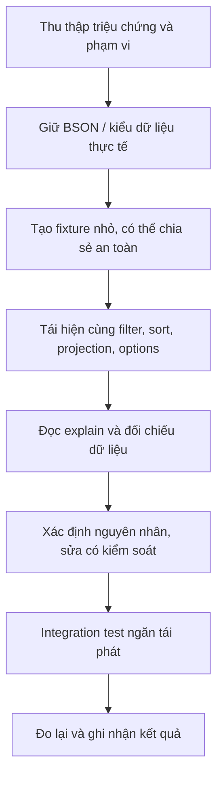

# Quy trình tái hiện lỗi bằng BSON thực tế, `explain` và integration test

## 1. Vì sao chỉ nhìn JSON hoặc stack trace thường chưa đủ?

Trong ứng dụng **Spring Data MongoDB**, một lỗi truy vấn có thể xuất phát từ nhiều tầng: document thực tế trong MongoDB, ánh xạ Java–BSON của `MappingMongoConverter`, `Criteria` hoặc truy vấn repository, cấu hình index, quy tắc chọn server, transaction, và cả phiên bản MongoDB Driver. Hai document trông giống nhau khi in ra JSON có thể mang **kiểu BSON khác nhau**, khiến cùng một truy vấn trả kết quả khác nhau.

Ví dụ, một hệ thống xử lý đơn hàng nhận phản ánh: *“Đơn đã thanh toán ngày 03/03 nhưng API tìm đơn thanh toán từ ngày 01/03 không trả về đơn này.”* Một người mở document bằng công cụ xem dữ liệu và thấy:

```json
{
  "_id": "65b0f00d0000000000000002",
  "status": "PAID",
  "placedAt": "2025-03-03T10:20:30Z"
}
```

Nhưng dữ liệu ở trên chưa cho biết `_id` đang là BSON `ObjectId` hay `String`, và `placedAt` là BSON `Date` hay chuỗi `String`. Đây là khác biệt quan trọng khi `Criteria.where("placedAt").gte(...)` sử dụng một giá trị Java `Date`.

Bài học hướng dẫn một vòng điều tra lặp lại được:



Quy trình này phục vụ cả **lỗi tính đúng đắn** (thiếu bản ghi, kết quả sai thứ tự, ánh xạ sai), **lỗi hiệu năng** (scan lớn, index không được dùng, timeout), và lỗi xuất hiện theo môi trường (read preference, collation, transaction, dữ liệu nhập từ nguồn khác).

## 2. Bắt đầu bằng một mô tả lỗi có thể kiểm chứng

Một phiếu điều tra tốt cần trả lời ít nhất:

| Thành phần | Ví dụ cần ghi |
| --- | --- |
| Đường gọi | API `GET /orders?status=PAID&from=2025-03-01`, service/repository cụ thể |
| Triệu chứng | Trả 1 đơn thay vì 2 đơn mà dữ liệu nghiệp vụ dự kiến |
| Kỳ vọng | Hai đơn có `status=PAID` và thời điểm đặt hàng sau mốc UTC được nhận |
| Thực tế | Đơn mã `...0002` bị bỏ qua |
| Thời điểm | Thời điểm request và lần cuối dữ liệu được sửa hoặc nhập |
| Môi trường | Phiên bản MongoDB, Spring Data MongoDB, MongoDB Java Driver, Java; topology |
| Truy vấn | Filter, sort, projection, collation, limit, skip, hint, read preference, read concern |
| Dữ liệu | Fixture giữ nguyên kiểu BSON và những giá trị quyết định lỗi |
| Dấu vết | Correlation ID, loại exception, query shape, số bản ghi, kết quả `explain` |

Phân biệt ngay ba loại câu hỏi:

1. **Sai kết quả:** document có khớp điều kiện truy vấn theo **BSON thực tế** không? Mapper có đổi tên trường/kiểu trước khi gửi lệnh không?
2. **Chậm:** MongoDB đang đọc bao nhiêu index key/document, có `COLLSCAN`, `SORT`, pagination sâu hay phải đọc từ secondary đang quá tải không?
3. **Lỗi bất thường:** thao tác có chạy trong transaction, có xung đột version, timeout, lỗi chọn server, thay đổi schema hoặc dữ liệu không thể convert không?

Trước khi thay index hay sửa code, cần viết **một điều kiện tái hiện pass/fail rõ ràng**. Ví dụ: “Với hai document PAID sau ngày 01/03, truy vấn ngày phải trả đủ hai document; dữ liệu nhập lịch sử ở dạng chuỗi phải được phát hiện và chuẩn hóa.”

## 3. Thu thập BSON đúng kiểu bằng Extended JSON

### 3.1. BSON và JSON thông thường khác nhau

MongoDB lưu **BSON**: có các kiểu `ObjectId`, `Date`, `Decimal128`, `Int32`, `Int64`, binary, mảng, object lồng nhau, giá trị `null` và field bị thiếu. JSON thông thường không biểu diễn đầy đủ ranh giới giữa những kiểu đó.

| Trường hợp | BSON thực tế có thể là | Hậu quả khi tái hiện sai |
| --- | --- | --- |
| `_id` | `ObjectId("...")` hoặc chuỗi `"..."` | Query theo String có thể không khớp ObjectId nếu đi qua đường raw không convert |
| `placedAt` | BSON Date hoặc String ISO-8601 | Range query theo Date có thể bỏ qua chuỗi |
| `amount` | Decimal128, Double, Int32 hoặc Int64 | Chênh lệch precision/convert, điều kiện so sánh và mapping |
| `tags` | Array, String hoặc field thiếu | `$in`, `$elemMatch` và mapping có kết quả khác |
| `deletedAt` | Field thiếu hoặc `null` | `$exists` và một số điều kiện matching khác nhau |
| `status` | String khác chữ hoa/thường hoặc khoảng trắng | Collation và so sánh bằng có thể khác |

MongoDB cung cấp **Extended JSON (EJSON)**. Dạng *Canonical Extended JSON* (ví dụ `{"$numberDecimal":"19.90"}`, `{"$oid":"..."}`) giúp giữ rõ type, trong khi dạng *Relaxed Extended JSON* dễ đọc hơn nhưng có thể làm mất thông tin kiểu của một số số nguyên.

Ví dụ hai đơn hàng được **chủ ý** lưu khác kiểu `placedAt`:

```json
{
  "_id": {"$oid": "65b0f00d0000000000000001"},
  "status": "PAID",
  "placedAt": {"$date": {"$numberLong": "1740910830000"}},
  "grossAmount": {"$numberDecimal": "19.90"}
}
```

```json
{
  "_id": {"$oid": "65b0f00d0000000000000002"},
  "status": "PAID",
  "placedAt": "2025-03-03T10:20:30Z",
  "grossAmount": {"$numberDecimal": "24.50"}
}
```

Document thứ nhất có `placedAt` là BSON Date (02/03/2025 10:20:30 UTC); document thứ hai là BSON String dù trông giống thời gian. Cả hai cùng `PAID` và cùng sau mốc 01/03 theo ý nghĩa nghiệp vụ, nhưng range query với giá trị BSON Date **không tự chuyển** chuỗi thứ hai thành Date.

### 3.2. Quan sát BSON thực tế bằng `mongosh`

Trước hết đọc document và kiểu BSON:

```javascript
const orderId = ObjectId("65b0f00d0000000000000002");
const order = db.orders.findOne({_id: orderId});

print(EJSON.stringify(order, null, 2, {relaxed: false}));

printjson(db.orders.aggregate([
  {$match: {_id: orderId}},
  {$project: {
    status: 1,
    placedAt: 1,
    placedAtType: {$type: "$placedAt"},
    amountType: {$type: "$grossAmount"}
  }}
]).toArray());
```

Trong `mongosh`, `EJSON.stringify(..., {relaxed:false})` giúp nhìn rõ wrapper kiểu dữ liệu; `$type` trong aggregation cho biết loại BSON của từng giá trị. Với dữ liệu thiếu trường, `$type` trong aggregation có thể báo `"missing"`. Kết quả này chính xác hơn phỏng đoán từ định dạng hiển thị trong UI.

Để kiểm kê toàn collection (trên môi trường cho phép truy vấn và với giới hạn tải phù hợp):

```javascript
db.orders.aggregate([
  {$group: {
    _id: {$type: "$placedAt"},
    documents: {$sum: 1}
  }},
  {$sort: {documents: -1}}
]);
```

Nếu xuất hiện cả `date` và `string`, đó là một bằng chứng về dữ liệu không đồng nhất. Nhưng **chưa đủ để kết luận** nó là nguyên nhân của một request sai: còn phải đối chiếu filter thật, mốc thời gian, collation và đường thực thi.

### 3.3. Tạo fixture an toàn thay vì sao chép dữ liệu nhạy cảm

Một fixture tốt giữ những thuộc tính *gây lỗi* nhưng thay thế thông tin riêng tư bằng giá trị tổng hợp:

- Giữ đúng **kiểu BSON**, đường field lồng nhau, field bị thiếu/`null`, cấu trúc array, timezone và tương quan giá trị giữa các document.
- Giữ số lượng document tối thiểu để tái hiện; nếu lỗi chỉ xảy ra ở kích thước lớn, tạo dữ liệu tổng hợp có phân phối gần thực tế thay vì sao chép thông tin khách hàng.
- Thay ID, email, tên, địa chỉ, token hoặc dữ liệu bí mật bằng giá trị giả, đồng thời kiểm tra không vô tình phá vỡ kiểu (ví dụ `ObjectId` vẫn phải là `ObjectId`).
- Không lưu connection string chứa credential, plaintext nhạy cảm, key encryption hoặc nguyên văn query chứa PII trong ticket/log.
- Ghi cách tạo fixture để người khác có thể tái hiện và biết chính xác tập dữ liệu đã bị ẩn danh hóa.

Khi dữ liệu có nhiều document liên quan, cần giữ ràng buộc khóa ngoại ở tầng ứng dụng, thứ tự phiên bản và trạng thái cần thiết. Một testcase chỉ có một document “đẹp” có thể bỏ qua nguyên nhân thật của lỗi.

## 4. Tái hiện filter bằng truy vấn BSON trực tiếp

Trước tiên chạy một truy vấn đọc xác định trên MongoDB, dùng **BSON Date** chứ không dùng String:

```javascript
const threshold = ISODate("2025-03-01T00:00:00Z");

db.orders.find({
  status: "PAID",
  placedAt: {$gte: threshold}
}).sort({placedAt: -1}).limit(20);
```

Với hai fixture ở trên, truy vấn theo kiểu Date chỉ thấy document `...0001`. Document `...0002` có `placedAt` là chuỗi, không khớp phép so sánh range dùng BSON Date theo quy tắc so khớp kiểu (*type bracketing*) của truy vấn MongoDB.

Để loại trừ lỗi do điều kiện trạng thái:

```javascript
db.orders.find(
  {status: "PAID"},
  {_id: 1, status: 1, placedAt: 1}
);

db.orders.find({
  placedAt: {$type: "string"}
}, {_id: 1, placedAt: 1});
```

Những phép kiểm chứng này giúp tách **document tồn tại** khỏi **document khớp filter**. Chúng chưa sửa dữ liệu: mọi quyết định đổi type cần quy tắc parse, timezone, xử lý giá trị không hợp lệ và kế hoạch migration riêng.

## 5. Đối chiếu đường Spring Data với lệnh gửi đến MongoDB

### 5.1. Truy vấn bằng `MongoTemplate`

Với ví dụ đơn hàng, đường đọc có thể được viết:

```java
import java.time.Instant;
import java.util.Date;
import java.util.List;

import org.bson.Document;
import org.springframework.data.mongodb.core.MongoTemplate;
import org.springframework.data.mongodb.core.query.Criteria;
import org.springframework.data.mongodb.core.query.Query;

public final class OrderDiagnostics {
    private final MongoTemplate template;

    public OrderDiagnostics(MongoTemplate template) {
        this.template = template;
    }

    public List<Document> findPaidSince(Instant from) {
        Query query = Query.query(
            Criteria.where("status").is("PAID")
                .and("placedAt").gte(Date.from(from))
        );
        query.limit(20);
        query.with(org.springframework.data.domain.Sort.by(
            org.springframework.data.domain.Sort.Direction.DESC, "placedAt"));

        return template.find(query, Document.class, "orders");
    }
}
```

Đoạn này cố ý đọc `Document` thô để tập trung vào kiểu BSON trong fixture. Với entity do Spring Data quản lý, `@Field("placed_at")`, `@Id`, custom converter, enum conversion và type discriminator `_class` có thể làm tên trường/giá trị trên wire khác thuộc tính Java.

`Query.getQueryObject()` cho phép xem một phần biểu diễn filter của `Query` trước khi thực thi. Nó **không phải** bằng chứng duy nhất về lệnh BSON cuối cùng: còn có chuyển đổi mapping, sort, projection, limit, skip, collation, hint và read preference. Muốn so sánh chính xác, dùng command monitoring/profiler được kiểm soát hoặc tái hiện bằng native driver với cùng BSON filter.

### 5.2. Kiểm tra mapping khi dùng entity/repository

Ví dụ entity:

```java
import java.time.Instant;
import org.bson.types.ObjectId;
import org.springframework.data.annotation.Id;
import org.springframework.data.mongodb.core.mapping.Document;
import org.springframework.data.mongodb.core.mapping.Field;

@Document("orders")
public class OrderDocument {
    @Id
    private ObjectId id;

    private String status;

    @Field("placed_at")
    private Instant placedAt;

    // Constructor, getter, setter theo quy ước của dự án.
}
```

Ở ví dụ này, property Java `placedAt` ánh xạ sang BSON field `placed_at`. Nếu document thật lưu `placedAt` mà code tìm `placed_at`, truy vấn có thể không ra kết quả dù kiểu thời gian hoàn toàn chính xác. **Không lấy ví dụ `@Field` này áp dụng trực tiếp vào fixture trước đó**; hai ví dụ minh họa hai nhóm lỗi độc lập: sai kiểu và sai tên trường.

Checklist đối chiếu:

1. Collection name trong `@Document` và collection thực tế có trùng không?
2. `@Id` là `String`, `ObjectId` hay kiểu khác? Mapping ID có áp dụng cho đường raw đang kiểm tra không?
3. `@Field` hoặc naming strategy có đổi tên field được gửi đi không?
4. Java `Date`/`Instant`, `LocalDateTime` và timezone được chuyển thế nào?
5. `@Query` hoặc derived repository method có thêm filter, sort, collation, pagination hay projection không?
6. Dữ liệu có field thiếu, `null`, kiểu cũ hoặc nhiều phiên bản schema cùng tồn tại không?
7. Bộ đọc có sử dụng `ReadPreference.secondaryPreferred()` khiến kết quả đến từ một secondary đang trễ không?

Khi phát hiện khác biệt giữa đường native và repository, nên tách thành hai integration test: một test cho **BSON/query matching**, một test cho **mapping Java–BSON**. Cách này chỉ rõ lỗi nằm ở dữ liệu, cách xây query hay converter.

## 6. Dùng `explain("executionStats")` để hiểu kế hoạch truy vấn

MongoDB có cơ chế giải thích kế hoạch truy vấn `explain`. Với filter đang điều tra:

```javascript
db.orders.find({
  status: "PAID",
  placedAt: {$gte: ISODate("2025-03-01T00:00:00Z")}
}).sort({placedAt: -1}).limit(20).explain("executionStats");
```

Các trường cần đọc tùy shape và phiên bản engine:

| Trường/dấu hiệu | Cách diễn giải |
| --- | --- |
| `queryPlanner.winningPlan` | Kế hoạch optimizer chọn; có thể lồng trong các cấu trúc khác nhau theo engine |
| `COLLSCAN` | Truy vấn quét collection thay vì dùng index scan phù hợp |
| `IXSCAN` | Có thao tác đọc index; chưa đủ để kết luận query luôn hiệu quả |
| `FETCH` | Cần lấy document để kiểm tra thêm hoặc trả field |
| `SORT` | Có bước sắp xếp; xem có thể tránh bằng index và query pattern không |
| `executionStats.nReturned` | Số document mà execution trả ra |
| `executionStats.totalDocsExamined` | Số lần xét document ở execution; so với số trả ra |
| `executionStats.totalKeysExamined` | Số index key được xét |
| `executionStats.executionTimeMillis` | Thời gian thực thi trong bối cảnh phép đo; không phải SLA request ứng dụng |

Ví dụ: nếu `nReturned = 20` nhưng `totalDocsExamined = 250000`, có dấu hiệu query phải xét quá nhiều document. Ngược lại, `totalDocsExamined = 0` và `IXSCAN` không có nghĩa mọi kết quả nghiệp vụ đều đúng: một filter mang **sai kiểu BSON** vẫn có thể được thực thi rất hiệu quả nhưng trả thiếu document.

Tùy MongoDB version (bao gồm các đường thực thi *classic* và *slot-based execution*), cấu trúc `winningPlan`, `executionStages` và tên stage có thể thay đổi. Tránh viết test chỉ kiểm tra một đường JSON cố định như `queryPlanner.winningPlan.stage == "IXSCAN"` trên mọi phiên bản.

### 6.1. So sánh trước và sau index

Nếu truy vấn lọc `status` rồi range theo `placedAt` và sort giảm dần, một index ứng viên:

```javascript
db.orders.createIndex(
  {status: 1, placedAt: -1},
  {name: "status_placedAt_desc"}
);
```

Sau đó chạy lại `explain("executionStats")`, so sánh số key/document xét, stage và query latency trên **tập dữ liệu đại diện**. Tập fixture chỉ có hai document thường quá nhỏ để optimizer cho thấy lợi ích index; MongoDB có thể chọn `COLLSCAN` hoàn toàn hợp lý.

Không suy ra index chắc chắn tối ưu chỉ từ thứ tự field ví dụ. Sự lựa chọn còn phụ thuộc độ chọn lọc, index khác, collation, projection, sort, tính đa khóa của array, dữ liệu phân bố và version optimizer. Khi đổi index trên production, cần đánh giá tác động ghi, dung lượng và kế hoạch rollout.

### 6.2. Chạy `explain` từ `MongoTemplate`

Để chắc chắn dùng **filter BSON cụ thể** (không đi qua mapping entity), có thể gọi lệnh `explain` trực tiếp:

```java
import java.time.Instant;
import java.util.Date;

import org.bson.Document;
import org.springframework.data.mongodb.core.MongoTemplate;

public final class ExplainExamples {
    public static Document explainPaidOrders(MongoTemplate template) {
        Document filter = new Document("status", "PAID")
            .append("placedAt", new Document(
                "$gte",
                Date.from(Instant.parse("2025-03-01T00:00:00Z"))
            ));

        Document findCommand = new Document("find", "orders")
            .append("filter", filter)
            .append("sort", new Document("placedAt", -1))
            .append("limit", 20);

        return template.getDb().runCommand(
            new Document("explain", findCommand)
                .append("verbosity", "executionStats")
        );
    }
}
```

Chỉ dùng lệnh phù hợp quyền và khả năng kiểm soát tải. `executionStats` có thể thực sự chạy truy vấn để thống kê; với query nặng không nên tùy tiện chạy trên production cao điểm. Lệnh này cũng chưa chứng minh hành vi mapping của `@Field`/converter: nó dùng filter được xây dựng thủ công.

## 7. Dựng integration test có dữ liệu BSON giống hiện trường

Mục tiêu là tạo một bài test có thể chạy lại trên máy phát triển hoặc CI, **không phụ thuộc database đang vận hành**. Spring Boot Test + Testcontainers là một lựa chọn phổ biến; với lỗi query/mapping đơn giản, MongoDB test instance có thể đủ. Với lỗi transaction hoặc Change Streams, phải dùng topology MongoDB hỗ trợ, thường là replica set.

Ví dụ dưới đây dùng Java 17+, JUnit 5, Spring Boot Test, Testcontainers và MongoDB Java Driver. Class `MongoDBContainer` minh họa API Testcontainers 1.x; với Testcontainers 2.x cần chỉnh module/import theo bản đang dùng. Các dependency test, Docker runtime và Spring Boot application/configuration cần được chuẩn bị trong dự án.

### 7.1. Fixture giữ type BSON gốc

Hai text block là **Canonical Extended JSON**. `Document.parse` có thể giải mã Extended JSON về `Document` và các giá trị BSON tương ứng:

```java
import static org.junit.jupiter.api.Assertions.*;

import java.time.Instant;
import java.util.Date;
import java.util.List;

import com.mongodb.client.model.Filters;
import com.mongodb.client.model.Updates;
import com.mongodb.client.result.UpdateResult;
import org.bson.Document;
import org.bson.types.ObjectId;
import org.junit.jupiter.api.BeforeEach;
import org.junit.jupiter.api.Test;
import org.springframework.beans.factory.annotation.Autowired;
import org.springframework.boot.test.context.SpringBootTest;
import org.springframework.data.mongodb.core.MongoTemplate;
import org.springframework.data.mongodb.core.query.Criteria;
import org.springframework.data.mongodb.core.query.Query;
import org.springframework.test.context.DynamicPropertyRegistry;
import org.springframework.test.context.DynamicPropertySource;
import org.testcontainers.containers.MongoDBContainer;
import org.testcontainers.junit.jupiter.Container;
import org.testcontainers.junit.jupiter.Testcontainers;
import org.testcontainers.utility.DockerImageName;

@Testcontainers
@SpringBootTest
class OrderBsonRegressionTest {
    private static final String DATE_ORDER = """
        {
          "_id": {"$oid": "65b0f00d0000000000000001"},
          "status": "PAID",
          "placedAt": {"$date": {"$numberLong": "1740910830000"}},
          "grossAmount": {"$numberDecimal": "19.90"}
        }
        """;

    private static final String LEGACY_STRING_ORDER = """
        {
          "_id": {"$oid": "65b0f00d0000000000000002"},
          "status": "PAID",
          "placedAt": "2025-03-03T10:20:30Z",
          "grossAmount": {"$numberDecimal": "24.50"}
        }
        """;

    @Container
    static MongoDBContainer mongo =
        new MongoDBContainer(DockerImageName.parse("mongo:7.0"));

    @DynamicPropertySource
    static void properties(DynamicPropertyRegistry registry) {
        registry.add("spring.data.mongodb.uri", mongo::getReplicaSetUrl);
    }

    @Autowired
    MongoTemplate template;

    @BeforeEach
    void resetAndSeed() {
        template.getCollection("orders").deleteMany(new Document());
        template.getCollection("orders").insertMany(List.of(
            Document.parse(DATE_ORDER),
            Document.parse(LEGACY_STRING_ORDER)
        ));
    }

    private List<Document> paidSinceMarch() {
        Query query = Query.query(
            Criteria.where("status").is("PAID")
                .and("placedAt").gte(
                    Date.from(Instant.parse("2025-03-01T00:00:00Z"))
                )
        );
        return template.find(query, Document.class, "orders");
    }

    @Test
    void legacyStringIsNotMatchedByDateRange() {
        Document raw = template.getCollection("orders")
            .find(Filters.eq("_id",
                new ObjectId("65b0f00d0000000000000002")))
            .first();

        assertNotNull(raw);
        assertInstanceOf(String.class, raw.get("placedAt"));
        assertEquals(1, paidSinceMarch().size());
    }

    @Test
    void normalizationAllowsBothOrdersToMatch() {
        ObjectId id = new ObjectId("65b0f00d0000000000000002");
        UpdateResult updated = template.getCollection("orders").updateOne(
            Filters.and(
                Filters.eq("_id", id),
                Filters.eq("placedAt", "2025-03-03T10:20:30Z")
            ),
            Updates.set("placedAt",
                Date.from(Instant.parse("2025-03-03T10:20:30Z")))
        );

        assertEquals(1L, updated.getModifiedCount());
        assertEquals(2, paidSinceMarch().size());

        Document migrated = template.getCollection("orders")
            .find(Filters.eq("_id", id)).first();
        assertNotNull(migrated);
        assertInstanceOf(Date.class, migrated.get("placedAt"));
    }
}
```

Test thứ nhất xác nhận chính xác **triệu chứng cần sửa**: chuỗi ISO thời gian không được xem là BSON Date. Test thứ hai mô phỏng một bước chuẩn hóa có điều kiện theo giá trị cũ và xác nhận query trả đủ hai document.

Trong hệ thống thật, migration cần kiểm tra chuỗi ngày không hợp lệ, timezone, định dạng lịch sử khác, ghi đồng thời và tính idempotent. Đoạn `updateOne` trong test chỉ sửa một fixture đã biết; **không** phải script migration chạy trực tiếp lên dữ liệu production.

Để xác minh tính idempotent của bước cập nhật minh họa, có thể chạy lại cùng `updateOne` rồi assert `modifiedCount == 0`, vì `placedAt` đã chuyển từ String thành BSON Date. Khi chuyển dữ liệu hàng loạt, nên ghi thêm kiểm tra số lượng document cũ, document bị bỏ qua và document sai kiểu sau migration.

### 7.2. Vì sao test phải giữ BSON thực?

Một unit test dùng mock `MongoTemplate` được cấu hình trả danh sách theo ý muốn sẽ **không thể chứng minh** các quy tắc MongoDB về type bracketing, collation, index, aggregation hay BSON mapping. Nó chỉ có thể kiểm tra service xử lý danh sách đã mock ra sao.

Một integration test đáng tin cậy phải:

1. Ghi fixture vào MongoDB thật bằng đúng kiểu BSON cần kiểm tra.
2. Gọi đúng đường truy vấn gây lỗi (`MongoTemplate`/repository hoặc cả hai).
3. So sánh **ID, kiểu dữ liệu và giá trị thực**; không chỉ assert “không ném exception”.
4. Tái hiện hành vi cũ và chứng minh sửa đổi làm thay đổi kết quả theo kỳ vọng.
5. Chạy lại sau thay đổi driver, converter, version Spring Data hoặc cấu trúc index.

## 8. Cách viết test cho lỗi hiệu năng từ `explain`

Lỗi hiệu năng thường không xuất hiện với hai document fixture. Cần thêm một **dataset tổng hợp** có kích thước và phân bố gần workload thật:

- Số lượng document đủ lớn để phân biệt index scan và collection scan.
- Tỷ lệ `status=PAID` gần thực tế, nhiều mốc `placedAt` và giá trị bị thiếu/sai kiểu.
- Trường cần sort, filter, projection và tổ hợp index giống môi trường gây lỗi.
- Dữ liệu phân bổ theo tenant, category hoặc shard key nếu các yếu tố đó ảnh hưởng query.

Quy trình đo:

1. Nạp fixture lớn và xác nhận số lượng, các phân phối chính.
2. Chạy `explain("executionStats")` cho query shape trước khi sửa.
3. Ghi `nReturned`, `totalKeysExamined`, `totalDocsExamined`, stage chính và môi trường.
4. Tạo/chỉnh index hoặc sửa query theo nguyên nhân đã xác định.
5. Chạy lại trên cùng dataset, query options và điều kiện đủ tương đương.
6. So sánh kết quả nghiệp vụ và thống kê; đặt ngưỡng cảnh báo hợp lý cho regression.

Ví dụ assertion ở mức ý tưởng:

```java
Document explain = ExplainExamples.explainPaidOrders(template);
Document stats = explain.get("executionStats", Document.class);

assertNotNull(stats);
assertTrue(((Number) stats.get("nReturned")).longValue() >= 0);

long scanned = ((Number) stats.get("totalDocsExamined")).longValue();
long returned = ((Number) stats.get("nReturned")).longValue();
System.out.println("Examined=" + scanned + ", returned=" + returned);
```

Ví dụ chỉ minh họa cách đọc số liệu, **không phải tiêu chí hiệu năng đủ mạnh**. Với regression test, có thể đặt mục tiêu tỷ lệ `scanned/returned` trên workload đại diện, giới hạn số document quét hoặc xác minh query có thể sử dụng index cần thiết, nhưng tránh hardcode số mili giây không ổn định theo tải của CI.

Đừng viết test giả định tất cả lần chạy đều chọn đúng một stage của `winningPlan`; optimizer có thể đổi kế hoạch hợp lệ khi dataset hoặc phiên bản MongoDB thay đổi. Nếu bắt buộc so sánh stage, cần chuẩn hóa cấu trúc giải thích theo engine và ghi rõ điều kiện.

## 9. Những khác biệt môi trường dễ làm lỗi biến mất khi chạy local

Một lỗi chỉ có trên staging/production thường do tập dữ liệu hoặc điều kiện thực thi khác nhau:

| Yếu tố | Sai khác điển hình | Cách đưa vào repro |
| --- | --- | --- |
| MongoDB version / FCV | Quy tắc optimizer và khả năng cú pháp khác | Ghi version server và featureCompatibilityVersion |
| Spring Data / Driver | Conversion và hành vi API có thể thay đổi | Ghi phiên bản dependency được lock |
| Topology | Standalone vs replica set vs sharded cluster | Dùng môi trường test đúng tính năng cần kiểm chứng |
| Read preference | Query local vào primary, production vào secondary đang lag | Ghi server thực tế được chọn và read concern |
| Index | Local thiếu/có index khác; collation khác | Dựng index cùng tên, key pattern, partial filter, collation |
| Dữ liệu | Kiểu BSON, thiếu field, schema cũ, nhiều phần tử array | Fixture giữ chính xác type và cấu trúc |
| Timezone | Chuyển `LocalDateTime`, parse chuỗi không có offset | Dùng mốc thời gian tuyệt đối và test UTC/zone liên quan |
| Collation | Khác ngôn ngữ, độ nhạy chữ hoa/dấu | Chạy cùng collation trên query và index |
| Kích thước dữ liệu | Local vài dòng, production hàng triệu | Sinh dataset tổng hợp với phân phối có kiểm chứng |
| Session / transaction | Retry, snapshot, write concern khác | Đưa test vào topology có transaction khi cần |

Đặc biệt, **replication lag** có thể khiến ứng dụng đọc bản cũ ngay cả khi BSON và filter hoàn toàn đúng. Nếu truy vấn dùng `secondaryPreferred`, cần chứng minh request đã chạy ở node nào. Tái hiện bằng MongoDB standalone không kiểm chứng được lỗi đọc từ secondary.

Nếu nguyên nhân là transaction hoặc Change Streams, cần replica set và fixture thể hiện trình tự thao tác, lỗi transient và trạng thái commit; test bằng một query đơn lẻ không đủ.

## 10. Quan sát hệ thống mà không làm lộ dữ liệu

Trong quá trình chẩn đoán có thể cần:

- **Spring application log:** correlation ID, loại operation, thời gian, retry count, exception class và error code.
- **MongoDB Driver command monitoring:** tên command, server address, duration, request ID và truy vấn đã được giảm thông tin nhạy cảm.
- **MongoDB profiler/slow query diagnostics:** query shape, docs examined, keys examined, kế hoạch và thời gian.
- **`explain`:** đối chiếu kế hoạch của một truy vấn tái hiện có kiểm soát.
- **Metrics:** tỷ lệ timeout, server selection failure, pool saturation, p95/p99 query latency.

Không bật profiler thu thập toàn bộ query trên production mà chưa đánh giá chi phí lưu trữ và mức độ nhạy cảm của dữ liệu. Một command hoặc profiler record có thể chứa thông tin khách hàng, token hoặc query parameters. Theo nguyên tắc tối thiểu, chỉ giữ dữ liệu cần cho debug và bảo đảm quyền truy cập/hạn lưu giữ phù hợp.

Khi xảy ra timeout, cần phân biệt:

```text
Lỗi đọc thiếu document        → kiểm tra BSON type, mapping, filter, node.
Query trả đúng nhưng quá chậm → kiểm tra explain, index, dataset, contention.
Server selection timeout      → kiểm tra topology, DNS, TLS, read preference.
Command timeout               → kiểm tra thời gian thực thi và giới hạn timeouts.
Mapping/conversion exception  → kiểm tra document thô, converter và schema lịch sử.
Lỗi trong transaction         → kiểm tra write conflict, session, rollback/retry.
```

Không sửa mọi trường hợp bằng cách tăng timeout. Timeout có thể là triệu chứng của query quét toàn collection, secondary bị quá tải hoặc connection pool hết tài nguyên.

## 11. Các tình huống cần tái hiện bổ sung

Ngoài lỗi BSON Date/String, nên có một bộ test nhỏ cho những lỗi phổ biến trong Spring Data MongoDB:

| Tình huống | Fixture cần có | Kỳ vọng |
| --- | --- | --- |
| ID String so với ObjectId | Hai document có biểu diễn ID giống chữ nhưng khác BSON type | Đường query raw/mapped được hiểu đúng |
| `Decimal128` so với `Double` | Số tiền/giá trị có phần thập phân | Không mất precision qua mapping hoặc phép toán |
| Field thiếu và `null` | Một document thiếu field, một document có `null` | Filter `$exists`, projection và converter đúng |
| Array và object lồng nhau | Hai phần tử mảng thỏa điều kiện khác nhau | Query `$elemMatch` không ghép nhầm phần tử |
| Collation | Tên có dấu, chữ hoa/chữ thường | Query và index collation khớp chính sách |
| Pagination + sort không ổn định | Nhiều document trùng `createdAt` | Thêm tie-breaker `_id` để giảm kết quả trùng/bỏ khi phân trang |
| Sửa dữ liệu đồng thời | Hai writer đọc cùng revision | `@Version` hoặc CAS xử lý lost update |
| Aggregation với field sai kiểu | Field số bị lưu thành chuỗi | `$group`/`$sum` hoặc conversion được kiểm soát |
| Query trên secondary đang trễ | Primary/secondary khác tiến độ | Xác nhận read preference và causal/consistency requirement |
| Index đa khóa | Array, filter và sort | `explain` phản ánh đúng stage và chi phí |

Với mỗi tình huống, viết một **khẳng định nghiệp vụ** trước, rồi mới chọn fixture. Nếu test chỉ khẳng định một implementation detail như “phải có `IXSCAN`” mà không xác minh danh sách ID hoặc số liệu đúng, nó có thể bỏ qua lỗi dữ liệu nghiêm trọng.

## 12. Kết luận điều tra và bảo vệ bằng regression test

Một biên bản khắc phục nên có cấu trúc:

1. **Triệu chứng:** endpoint nào, request nào, kỳ vọng và kết quả thực tế.
2. **Bằng chứng:** BSON type thực tế, filter và options đã gửi, kết quả `explain`, dữ liệu fixture.
3. **Nguyên nhân gốc:** ví dụ import đã lưu `placedAt` thành String, còn query so sánh với BSON Date.
4. **Thay đổi:** chuẩn hóa dữ liệu cũ, chặn dữ liệu nhập sai kiểu, bổ sung validation và chỉ số kiểm kê.
5. **Regression test:** fixture lịch sử có sai kiểu trước migration, test sau migration và test đường ghi mới luôn dùng BSON Date.
6. **Giới hạn:** các trường hợp chưa bao phủ (dữ liệu lỗi khác, vùng thời gian, sharding, large dataset, index trên production).
7. **Đối soát sau triển khai:** số document sai kiểu còn lại, tỷ lệ lỗi request, latency và số bản ghi được query trả về.

Đối với lỗi mẫu, quy tắc đầu ra có thể là:

```text
Trước sửa:
  Một document PAID có BSON Date.
  Một document PAID có String ngày giờ.
  Query theo range BSON Date trả 1 document.

Sau chuẩn hóa:
  Cả hai document PAID dùng BSON Date.
  Query theo range BSON Date trả 2 document.
  Writer mới không tạo lại String ngày giờ.
  Integration test dùng fixture BSON lịch sử tiếp tục chạy trong CI.
```

Trong tình huống có dữ liệu lịch sử lớn, migration phải có điều kiện cập nhật, batching, log ngoại lệ và khả năng chạy lại. Sau migration, đừng chỉ tin vào số “đã xử lý”; hãy kiểm kê lại kiểu BSON bằng `$type` và chạy truy vấn nghiệp vụ để xác minh.

## 13. Bài thực hành

Hãy dựng một module test cho collection `orders` với đúng hai fixture Extended JSON ở phần 3, sau đó thực hiện:

1. Ghi BSON vào MongoDB Testcontainers và xác nhận `placedAt` của hai document có kiểu khác nhau.
2. Chạy truy vấn `status=PAID` và `placedAt >= 2025-03-01T00:00:00Z` trong `mongosh` và `MongoTemplate`; ghi ID được trả về.
3. Gọi `explain("executionStats")`, xác định `nReturned`, `totalDocsExamined`, `totalKeysExamined` và stage chính; giải thích vì sao query đúng kế hoạch nhưng vẫn thiếu một đơn.
4. Thêm index `{status:1, placedAt:-1}`, đo lại `explain` trên dataset hai document và trên dataset tổng hợp lớn hơn; ghi rõ giới hạn của phép đo.
5. Viết bước chuẩn hóa có điều kiện String → BSON Date cho fixture, chạy lại query, xác nhận trả cả hai đơn và không làm hỏng `grossAmount` Decimal128.
6. Bổ sung kiểm thử không thể tạo document mới với `placedAt` là String qua đường import/writer mà ứng dụng đang dùng.
7. Thay đổi code ánh xạ `@Field` trong một bài test riêng để kiểm tra lỗi “đúng dữ liệu nhưng sai tên trường”; giữ bài test không liên quan đến migration String/Date.
8. Tạo một báo cáo nhỏ gồm symptom, fixture đã ẩn danh, nguyên nhân, thay đổi và bằng chứng test.

**Tiêu chí hoàn thành:** một người khác có thể lấy fixture và test, tái hiện được chính triệu chứng trước sửa, quan sát được BSON type thật, phân biệt lỗi matching với lỗi query plan, và xác nhận bản sửa bằng integration test trên MongoDB thực. Đây là điểm kết thúc của một vòng chẩn đoán có thể kiểm chứng và đủ thông tin để đánh giá một thay đổi Spring Data MongoDB.
