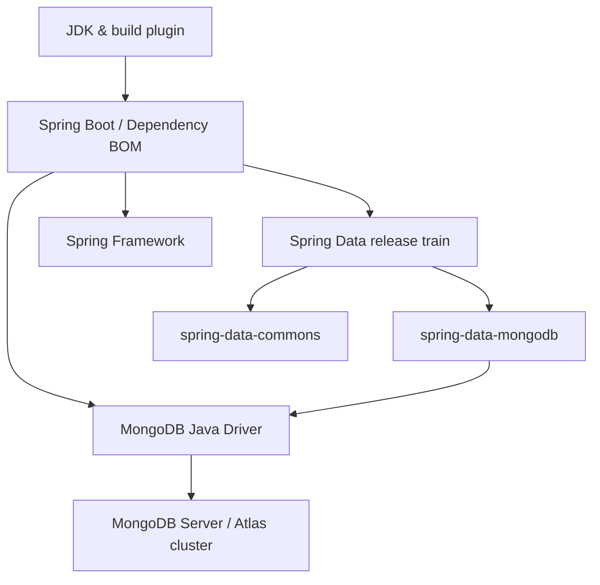
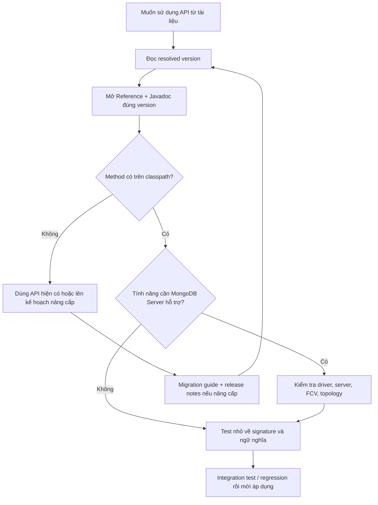

# Đối chiếu API với tài liệu đúng phiên bản đang dùng

> **Chương:** Phiên bản và nâng cấp  
> **Phạm vi:** Spring Data MongoDB — kiểm chứng API cho `MongoTemplate`, repository, mapping document, aggregation, index, transaction, reactive access, kiểm thử và chẩn đoán hiệu năng.

## 1. Vấn đề: cùng tên API nhưng khác phiên bản

Khi tra cứu Spring Data MongoDB, một đoạn mã trong tài liệu có thể trông đúng nhưng dự án lại báo `Cannot resolve method`, `ClassNotFoundException`, `NoSuchMethodError` hoặc chạy được mà cho hành vi khác mong đợi. Một lý do quan trọng là người đọc đang xem **tài liệu của một phiên bản khác với thư viện thực sự được nạp**.

Hệ sinh thái gồm nhiều thành phần có vòng đời và cách đánh số phiên bản riêng:



Sơ đồ thể hiện **quan hệ cần kiểm tra**, không khẳng định mọi dự án đều dùng Spring Boot. Một ứng dụng Spring Framework thuần có thể quản lý các dependency bằng BOM hoặc version riêng. MongoDB Server/Atlas còn là một thành phần được triển khai độc lập với các JAR trong ứng dụng.

Điều cần ghi nhớ:

- **Phiên bản Spring Boot** khác **phiên bản Spring Data MongoDB**. Ví dụ, không được kết luận thư viện MongoDB là “3.x” chỉ vì ứng dụng chạy Spring Boot 3.x.
- **Spring Data release train** (ví dụ `2025.0`) khác phiên bản module `spring-data-mongodb` (ví dụ `4.5.x`). Release train quản lý một nhóm module Spring Data.
- **MongoDB Java Driver** (ví dụ `mongodb-driver-sync`) là tầng khác với Spring Data; tài liệu của driver không tự mô tả cách `MongoTemplate` mapping domain object.
- **MongoDB Server** có phiên bản riêng. Một API Java có thể tồn tại trong JAR nhưng tính năng server tương ứng chưa được hỗ trợ ở cluster đang chạy.

Mục tiêu của bài: lấy được **phiên bản thực**, chọn **tài liệu cùng dòng**, kiểm tra **signature và ngữ nghĩa cụ thể**, rồi xác minh bằng test trước khi áp dụng mã hoặc nâng cấp.

## 2. Bốn câu hỏi phải trả lời trước khi tra API

| Câu hỏi | Bằng chứng đáng tin cậy | Vì sao cần? |
| --- | --- | --- |
| Ứng dụng đang dùng Spring Data MongoDB bản nào? | Dependency graph đã resolve trên đúng module và configuration | Xác định class, method, annotation nào hiện diện |
| Boot, Framework, Commons, Driver thực sự ở bản nào? | Resolved dependency graph, BOM/lockfile và artifact triển khai | Phát hiện dependency override, lệch nhóm thư viện |
| Cluster MongoDB đang chạy phiên bản nào? | `db.version()` hoặc thông tin cluster/Atlas được xác minh | Biết command và feature phía server có khả dụng |
| Đang xem tài liệu phát hành nào? | Banner phiên bản, đường dẫn versioned docs/Javadoc | Tránh dùng API của latest/SNAPSHOT khi mã chạy bản cũ |

Chỉ khi có bốn thông tin này mới nên sao chép ví dụ vào code.

### 2.1. Phân biệt version được khai báo và được resolve

`build.gradle` hoặc `pom.xml` có thể không ghi phiên bản `spring-data-mongodb` vì Spring Boot BOM quản lý giùm. Hơn nữa, transitive dependency, dependency constraints, lockfile, forced versions và cấu hình nhiều module có thể làm **phiên bản resolve khác dự đoán**.

Trong ứng dụng đóng gói thành JAR, dependency trên máy lập trình còn có thể khác artifact thực sự đang chạy ở staging/production. Khi xử lý lỗi chỉ xuất hiện trên server, phải xác minh **build được deploy**, không chỉ đọc source hiện tại.

## 3. Xác định dependency thực sự với Gradle

Đối với dự án Gradle, chạy trên **module ứng dụng** và đúng configuration:

```powershell
# Windows PowerShell, từ thư mục module có gradlew.bat:
.\gradlew.bat dependencies --configuration runtimeClasspath

.\gradlew.bat dependencyInsight --dependency spring-data-mongodb --configuration runtimeClasspath
.\gradlew.bat dependencyInsight --dependency spring-data-commons --configuration runtimeClasspath
.\gradlew.bat dependencyInsight --dependency mongodb-driver-sync --configuration runtimeClasspath
.\gradlew.bat dependencyInsight --dependency mongodb-driver-reactivestreams --configuration runtimeClasspath
.\gradlew.bat dependencyInsight --dependency spring-core --configuration runtimeClasspath
```

Các lệnh trên chỉ là hướng dẫn cho người học; tùy cấu trúc project, có thể cần chỉ rõ task path, ví dụ:

```powershell
.\gradlew.bat :shop-app:dependencyInsight --dependency spring-data-mongodb --configuration runtimeClasspath
```

Trong dự án không dùng reactive driver, truy vấn `mongodb-driver-reactivestreams` có thể không tìm thấy dependency; đó chưa phải lỗi. Khi cần kiểm tra compile-time, so sánh thêm `compileClasspath`. Khi code chỉ lỗi trong test, kiểm tra `testRuntimeClasspath` và `testCompileClasspath` tương ứng.

Ý nghĩa của `dependencyInsight`:

- Hiển thị version được chọn và đường phụ thuộc dẫn tới JAR.
- Giúp nhận diện việc chọn version bởi constraint/BOM hoặc do dependency trực tiếp.
- Giúp phát hiện một phần thư viện bị override khác nhóm, chẳng hạn module driver/BSON bị ép sang dòng không tương thích.

Spring Boot Gradle Plugin cùng `io.spring.dependency-management` có thể nhập BOM `spring-boot-dependencies`; Gradle native `platform(...)` cũng hỗ trợ BOM. **Không nên tự thêm version cho từng JAR MongoDB theo một bài hướng dẫn trên mạng** khi ứng dụng đang dựa vào tập phiên bản do Boot quản lý.

### 3.1. Ví dụ phụ thuộc được BOM quản lý

```groovy
plugins {
    id 'java'
    id 'org.springframework.boot' version '3.5.0' // Chỉ là ví dụ build, không khuyến nghị chọn bản này.
    id 'io.spring.dependency-management' version '1.1.7'
}

dependencies {
    implementation 'org.springframework.boot:spring-boot-starter-data-mongodb'
    // Nếu cần reactive, dùng starter tương ứng thay/hoặc bổ sung có chủ đích:
    // implementation 'org.springframework.boot:spring-boot-starter-data-mongodb-reactive'
}
```

Hai plugin version phía trên chỉ minh họa cơ chế cấu hình; **không suy ra** Spring Data MongoDB version từ số trên một dòng bất kỳ. Hãy xem kết quả `dependencyInsight` và BOM thực tế. Nếu dự án dùng Spring Boot phiên bản khác, giữ nguyên cơ chế quản lý dependency tương ứng của phiên bản đó.

## 4. Xác định dependency thực sự với Maven

Trong Maven, `spring-boot-starter-parent` hoặc BOM `spring-boot-dependencies` có thể quản lý phiên bản transitive. Đọc cây dependency:

```powershell
# Chạy từ module có pom.xml, hoặc chọn -pl đúng module trong reactor:
mvn dependency:tree

# Rút gọn theo nhóm cần kiểm tra (PowerShell giữ chuỗi -D bằng dấu nháy):
mvn dependency:tree "-Dincludes=org.springframework.data:spring-data-mongodb,org.springframework.data:spring-data-commons,org.mongodb:mongodb-driver-sync,org.mongodb:mongodb-driver-reactivestreams,org.mongodb:mongodb-driver-core,org.mongodb:bson"

# Xem các property/BOM hiệu lực từ parent và dependencyManagement:
mvn help:effective-pom "-Doutput=effective-pom.xml"
```

Nếu dùng Maven Wrapper, thay `mvn` bằng `.\mvnw.cmd` trên Windows hoặc `./mvnw` trên macOS/Linux. File `effective-pom.xml` là bản diễn giải build tạm thời cho mục đích kiểm tra, không nên commit nếu không cần.

`dependencyManagement` chỉ **đề xuất/khóa version khi dependency được đưa vào graph**; nó không có nghĩa tất cả artifact có trong runtime. Cần đối chiếu cả `dependency:tree` lẫn `effective-pom`.

### 4.1. Ví dụ Maven dùng parent của Spring Boot

```xml
<parent>
  <groupId>org.springframework.boot</groupId>
  <artifactId>spring-boot-starter-parent</artifactId>
  <version>3.5.0</version> <!-- Giá trị minh họa, không phải phiên bản dự án -->
</parent>

<dependencies>
  <dependency>
    <groupId>org.springframework.boot</groupId>
    <artifactId>spring-boot-starter-data-mongodb</artifactId>
  </dependency>
</dependencies>
```

Không khai báo version của starter ở đây vì parent quản lý. Nếu có một dependency `spring-data-mongodb` trực tiếp kèm version khác, hãy kiểm tra vì sao override cần thiết và liệu toàn bộ dòng Spring Data, Java Driver, Framework còn tương thích hay không.

## 5. Tìm đúng trang Reference, Javadoc và release notes

Tài liệu chính thức có **nhiều loại và nhiều đường dẫn**; mỗi loại trả lời một câu hỏi khác nhau:

| Nguồn | Nội dung nên tìm | Dùng khi |
| --- | --- | --- |
| **Reference Guide** cùng phiên bản | Quy trình cấu hình, ví dụ nghiệp vụ, giới hạn hành vi | Muốn hiểu cách dùng template/repository/aggregation |
| **Javadoc** cùng module/version | Package, class, overload, generic, kiểu trả về, `@Since`, `@Deprecated` | Muốn xác nhận một method có thật và chữ ký chính xác |
| **Migration Guide** giữa hai dòng | Breaking changes, yêu cầu JDK/driver, thay đổi mapping và startup | Chuẩn bị chuyển từ phiên bản cũ sang mới |
| **Release notes** của patch/minor | Bug fix và các thay đổi trong những bản đã đi qua | Lỗi chỉ xảy ra sau nâng cấp |
| **Spring Boot dependency versions/BOM** | Boot chọn phiên bản Spring Data/Framework/Driver nào | Kiểm tra dependency nhất quán |
| **MongoDB Driver docs và compatibility table** | Driver API, tương thích Java và server | Lỗi codec, connection, driver method |
| **MongoDB Server Manual** đúng version | Command, query/aggregation operator, tính năng server | Lỗi “unknown operator” hoặc feature không chạy |

### 5.1. Ví dụ các đường dẫn đã đối chiếu

Các URL dưới đây là ví dụ thực tế để so sánh:

```text
# Spring Data MongoDB Reference — dòng 4.5:
https://docs.spring.io/spring-data/mongodb/reference/4.5/mongodb/template-api.html

# Spring Data MongoDB Reference — dòng 5.0:
https://docs.spring.io/spring-data/mongodb/reference/5.0/

# Spring Data MongoDB Reference mặc định (có thể đổi theo phiên bản mới):
https://docs.spring.io/spring-data/mongodb/reference/

# Javadoc Criteria của dòng 4.5 (alias theo dòng, có thể tiến patch):
https://docs.spring.io/spring-data/mongodb/docs/4.5.x/api/org/springframework/data/mongodb/core/query/Criteria.html

# Javadoc cho một bản patch cụ thể:
https://docs.spring.io/spring-data/data-mongodb/docs/4.5.11/api/

# Javadoc mặc định (phụ thuộc site đang trỏ phiên bản nào):
https://docs.spring.io/spring-data/mongodb/docs/current/api/

# Migration Guide 4.x -> 5.x:
https://docs.spring.io/spring-data/mongodb/reference/migration-guide/migration-guide-4.x-to-5.x.html
```

`/reference/4.5/...` cố định **nhánh tài liệu 4.5**, nhưng nội dung có thể theo bản patch mới nhất của nhánh. `/docs/4.5.x/api/...` tương tự là alias theo nhánh; `/docs/4.5.11/api/...` trỏ tới bản Javadoc patch cụ thể. Khi chẩn đoán một bug xảy ra đúng ở patch, ưu tiên tài liệu gắn chính xác patch và release notes tương ứng.

**Đừng chỉ dựa vào URL:** trang `/reference/5.1/...` có thể redirect sang tài liệu hiện hành; hãy kiểm tra **banner phiên bản hiển thị trên trang**. Nếu banner nói `SNAPSHOT`, `RC` hoặc `Milestone`, đó là tài liệu phát triển/tiền phát hành, chưa chắc tương ứng với dependency production.

### 5.2. Cách đọc Javadoc để biết method có dùng được

Trên trang Javadoc của một class, kiểm tra theo thứ tự:

1. **Package đầy đủ:** ví dụ `org.springframework.data.mongodb.core.query.Criteria`, không nhầm với class tương tự từ thư viện khác.
2. **Method Summary/Detail:** tên, kiểu tham số, generic, kiểu trả về, method static/instance và toàn bộ overload.
3. **`Since`:** version đầu tiên giới thiệu API; cần so với **version module Spring Data MongoDB** đang dùng.
4. **`Deprecated` và `forRemoval`:** nếu có, đọc đề xuất thay thế và target version.
5. **Throws/Nullability/Notes:** điều kiện null, exception và ngữ nghĩa có thể thay đổi dù chữ ký tương tự.
6. **Source và migration notes:** với thay đổi khó nhận biết, đối chiếu release notes và test thực tế.

`Since 5.0.4` **không đồng nghĩa Spring Boot 5.0.4**. Nó là mốc của API/module được tài liệu ghi nhận. Một method có từ 5.0.4 sẽ không nhất thiết tồn tại trên 5.0.0, dù cùng major/minor.

## 6. Ví dụ thực tế: vì sao `Criteria.eq(...)` không biên dịch ở nhánh 4.5?

Javadoc đã đối chiếu cho thấy:

- Ở **Spring Data MongoDB 4.5.x**, `Criteria` có `is(Object)` để tạo điều kiện equality.
- Ở **Spring Data MongoDB 5.0.4 trở lên**, Javadoc có thêm `Criteria.eq(Object)`; mục này được đánh dấu **`Since: 5.0.4`**.

Giả sử sao chép ví dụ từ Javadoc hiện hành:

```java
import org.springframework.data.mongodb.core.query.Criteria;
import org.springframework.data.mongodb.core.query.Query;

// Chỉ biên dịch nếu dependency có Criteria.eq(...):
Query query = Query.query(Criteria.where("status").eq("PAID"));
```

Dự án chạy Spring Data MongoDB 4.5.x có thể báo `Cannot resolve method 'eq'` vì class trên classpath chưa có method này. Sửa theo API đã có ở nhánh 4.5:

```java
Query query = Query.query(Criteria.where("status").is("PAID"));
```

**Tại sao cách sửa này đúng?** Nó dùng API equality hiện diện trong dòng thư viện đang chạy. Người học không cần nâng cấp cả hệ thống chỉ để gọi `eq` nếu `is` đã đáp ứng cùng yêu cầu. Nếu một version khác có cả hai, vẫn nên kiểm tra Javadoc để xem chi tiết ngữ nghĩa, nullability và khả năng tạo biểu thức tương ứng.

### 6.1. Thử bằng một đoạn mã nhỏ trước khi sửa hàng loạt

```java
import static org.assertj.core.api.Assertions.assertThat;

import org.junit.jupiter.api.Test;
import org.springframework.data.mongodb.core.query.Criteria;
import org.springframework.data.mongodb.core.query.Query;

class CriteriaCompatibilityTest {
    @Test
    void equalityQueryUsesApiAvailableInCurrentDependency() {
        Query query = Query.query(Criteria.where("status").is("PAID"));

        assertThat(query.getQueryObject())
            .containsEntry("status", "PAID");
    }
}
```

Test này chỉ xác nhận DSL sinh ra BSON query phù hợp, không thay thế integration test mapping `@Field`/`@Id` và MongoDB server. Nếu field Java tên `status` nhưng BSON là `order_status`, hãy chạy thêm test qua `MongoTemplate` hoặc `QueryMapper` để xác nhận chuyển tên đúng.

## 7. Kiểm tra toàn bộ bộ phiên bản, không chỉ một JAR

Trang **Requirements/Compatibility Matrix** của Spring Data MongoDB công bố quan hệ giữa release train, module và tối thiểu driver. Ví dụ các dòng đã xuất hiện trong tài liệu chính thức thời điểm biên soạn:

| Spring Data release train | Spring Data MongoDB | Java Driver tối thiểu theo docs | MongoDB Server được bộ test Spring Data thử nghiệm |
| --- | --- | --- | --- |
| `2025.0` | `4.5.x` | `5.5.x` | `6.x–8.x` |
| `2025.1` | `5.0.x` | `5.6.x` | `6.x–8.x` |
| `2026.0` | `5.1.x` | `5.6.x` | `6.x–8.x` |

**Đây là bảng minh họa từ tài liệu tại thời điểm biên soạn, không phải danh sách phiên bản của project này.** Trước khi nâng cấp, xem lại ma trận được cập nhật trên trang Requirements, đồng thời đối chiếu **Java Driver ↔ MongoDB Server**, JDK và Spring Framework. Cột “Server được test” không có nghĩa các phiên bản ngoài danh sách chắc chắn không hoạt động hoặc rằng mọi tính năng đều tương thích.

Spring Data MongoDB 4.5 yêu cầu JDK 17+ và thuộc dòng Spring Framework 6.2; Spring Data MongoDB 5.x yêu cầu JDK 17+ và thuộc dòng Spring Framework 7.0. Không trộn các dòng major của Spring Data, Commons và Spring Framework mà không có cơ sở tương thích.

### 7.1. Các kiểm tra bắt buộc khi dùng Spring Boot BOM

Spring Boot quản lý một **tập dependency được thử nghiệm chung**. Cách làm thường an toàn là giữ các starter và các thư viện được BOM quản lý đồng bộ với phiên bản Boot đã chọn. Override `spring-data-mongodb` hoặc riêng `mongodb-driver-core` có thể làm mất đồng bộ với `spring-data-commons`, `bson`, driver sync/reactive hoặc Framework.

Khi thực sự cần override, ghi lại:

- Version trước/sau, lý do override và API/bug được giải quyết.
- Dependency graph sau resolve ở `compileClasspath`, `runtimeClasspath` và `testRuntimeClasspath`.
- Compatibility matrix, migration guide và kế hoạch test regression.
- Bản Build/Release được deploy để có thể tái hiện và rollback.

Không dùng sự kiện “build compile thành công” làm bằng chứng mọi tính năng MongoDB sẽ chạy đúng; lỗi liên kết binary như `NoSuchMethodError` thường chỉ xuất hiện khi một code path cụ thể được thực thi.

### 7.2. Phía server còn quyết định khả năng tính năng

Ví dụ một Spring Data API giúp tạo aggregation expression hay giao dịch không đảm bảo mọi MongoDB cluster đều hỗ trợ command tương ứng. Cần xét:

- Version MongoDB Server và **Feature Compatibility Version (FCV)** khi nâng cấp server.
- Topology (standalone, replica set, sharded cluster), role/permission và driver capability.
- Các ràng buộc riêng của transaction, change stream, time-series, aggregation stage, index type hoặc Queryable Encryption.
- Driver compatibility và Stable API của MongoDB Server khi sử dụng.

Hãy đối chiếu **manual đúng phiên bản server**, thay vì dựa vào việc phương thức Java xuất hiện trong autocomplete. Stable API giúp giữ ổn định một tập command do server cam kết, nhưng không biến các API mới ngoài phạm vi thành tính năng phổ quát.

## 8. Một ví dụ migration có tác động thực: Spring Data MongoDB 4.x → 5.x

Migration Guide chính thức 4.x → 5.x có những thay đổi đáng lưu ý:

| Hạng mục | Điểm cần đối chiếu | Rủi ro nếu đọc nhầm docs |
| --- | --- | --- |
| MongoDB Java Driver | Dòng Spring Data 5.x yêu cầu driver **5.6+** và không còn hỗ trợ thế hệ driver 4.x | Runtime linkage/API mismatch |
| `UUID` | Spring Data 5.x không còn tự đặt default `UuidRepresentation` trong các cấu hình hỗ trợ; cần chỉ định rõ nếu lưu UUID | Dữ liệu cũ có thể không đọc/ghi giống kỳ vọng |
| `BigDecimal`/`BigInteger` | Default conversion trong các cấu hình hỗ trợ thay đổi, cần chọn `BigDecimalRepresentation` rõ ràng | BSON type/representation thay đổi, query hoặc index không khớp dữ liệu cũ |
| `DefaultMessageListenerContainer` | `SmartLifecycle` auto-start mặc định chuyển thành `true` | Listener/change stream có thể khởi chạy sớm ngoài dự định |
| JMX | Hỗ trợ JMX cũ bị bỏ | Hệ thống giám sát cần chuyển sang cơ chế phù hợp, ví dụ Actuator |

Ví dụ cấu hình UUID được Migration Guide hướng dẫn cho dòng 5.x:

```java
// Phần override trong class extends AbstractMongoClientConfiguration
@Override
protected void configureClientSettings(MongoClientSettings.Builder builder) {
    builder.uuidRepresentation(UuidRepresentation.STANDARD);
}
```

Ví dụ cấu hình BigDecimal representation:

```java
// Phần override trong class extends AbstractMongoClientConfiguration
@Override
protected void configureConverters(
        MongoConverterConfigurationAdapter adapter) {
    adapter.bigDecimal(BigDecimalRepresentation.DECIMAL128);
}
```

Đây là các **đoạn trích minh họa**; cần import type và tích hợp vào class config thật, không paste riêng vào một class bất kỳ. Nếu dữ liệu cũ lưu decimal dạng string, phải cân nhắc `BigDecimalRepresentation.STRING` để tương thích trước khi lập kế hoạch migration sang Decimal128. Đừng thay representation trong production chỉ vì tài liệu mới dùng giá trị khác; hãy kiểm thử dữ liệu BSON cũ, raw query, aggregation và index.

Khi chuẩn bị nâng cấp:

1. Đọc guide **đúng cặp version** đang chuyển. Nếu nhảy qua nhiều minor/major, đọc guide và release notes của **từng dòng trung gian**.
2. Lập danh sách API đang dùng: template/repository, custom converter, annotations, aggregation, index, transaction, reactive subscription, change streams, auditing và test slice.
3. Kiểm tra API và chữ ký từ Javadoc version **đích**; sửa các đoạn deprecated/removed.
4. Viết test round-trip trên dữ liệu lưu thật hoặc fixtures đại diện, đặc biệt cho `UUID`, `BigDecimal`, ngày/giờ, ID, custom conversion và default index creation.
5. Chạy integration tests với MongoDB Server tương thích, kiểm tra performance và log/metrics sau triển khai.

## 9. Checklist chẩn đoán API không khớp tài liệu

| Triệu chứng | Câu hỏi kiểm chứng | Hành động phù hợp |
| --- | --- | --- |
| IDE báo `Cannot resolve method` | Method có trong Javadoc **đúng version module** chưa? `Since` là bản nào? | Dùng overload/API của version hiện tại hoặc lập kế hoạch nâng cấp |
| Compile được, chạy báo `NoSuchMethodError` | Runtime dependency có cùng version với compile dependency không? | Xem runtime classpath và artifact đã deploy; loại bỏ xung đột JAR |
| `ClassNotFoundException` sau nâng cấp | Class bị đổi package, loại bỏ hay thiếu starter/driver? | Xem migration notes, dependency tree và imports |
| Repository hoạt động, `MongoTemplate` query không khớp | Mapping `@Field`, custom conversion, query overload và server BSON có khác? | Kiểm tra raw query/BSON và docs mapping đúng version |
| Aggregation stage bị server từ chối | Server/FCV có hỗ trợ stage đó chưa? | Xem MongoDB Server Manual đúng version và test tích hợp |
| Kết quả UUID/Decimal khác trước | `UuidRepresentation`/`BigDecimalRepresentation` có thay đổi? | Đọc BSON cũ, cấu hình representation phù hợp |
| Index annotation có mà server thiếu index | Auto-index creation hoặc migration có chạy không? | Xem docs index đúng version, `getIndexes()` trên server |
| Reactive publisher “không chạy” | Có subscribe/`StepVerifier` không? Driver reactive có đúng phiên bản? | Xác minh subscription, driver và test thực |
| Transaction không hoạt động | Có manager/session, replica set/cluster và write concern hợp lệ? | Đối chiếu docs Spring Data và server topology |
| `@DataMongoTest` thiếu bean | Spring Boot slice phiên bản này nạp bean gì? Có import config chưa? | Xem Boot test-slice docs đúng version, thêm bean có chủ đích |
| Ví dụ blog dùng API lạ | Bài blog dùng snapshot hay thư viện khác? | Mở Javadoc package/version và release notes tương ứng |

### 9.1. Phân biệt lỗi source và lỗi binary

`Cannot resolve method`/compile error thường chứng tỏ **API không có trong compile classpath** hoặc nhập sai package. `NoSuchMethodError` thường cho thấy code được biên dịch với một signature nhưng JAR nạp ở runtime lại khác. `NoClassDefFoundError` có thể do class không được đóng gói hoặc lỗi khởi tạo class, nên cần đọc cause đầy đủ thay vì vội quy mọi lỗi cho “đúng version chưa”.

Nên kiểm tra dependency resolution trên cả compile/test/runtime, sau đó đọc stack trace từ lỗi đầu tiên. Nếu cần xác minh JAR nào đang được nạp trong môi trường thực, có thể dùng thông tin class loading và build manifest/Actuator nếu hệ thống đã cấu hình; `Package.getImplementationVersion()` có thể trả null tùy cách đóng gói.

## 10. Quy trình xác minh một API mới trong 10 bước

Ví dụ người học định dùng một phương thức mới của `MongoTemplate` hoặc `Criteria`:

1. Ghi rõ **yêu cầu nghiệp vụ** và API đang định gọi (package, tên method, tham số).
2. Xác định project/module và **build artifact** đang chạy ở môi trường cần sửa.
3. Lấy `spring-data-mongodb` **resolved version**, không chỉ version Spring Boot trong file build.
4. Lấy phiên bản `spring-data-commons`, Spring Framework, MongoDB Driver, JDK.
5. Mở **Reference Guide** theo dòng Spring Data MongoDB đó để hiểu hành vi.
6. Mở **Javadoc** cùng version để xem signature, `Since`, `Deprecated` và nullability.
7. Nếu API gắn với command/tính năng server, đối chiếu **MongoDB Server version, FCV và driver compatibility**.
8. Nếu đang nâng cấp, đọc **migration guide, changelog và release notes** của mọi dòng bị nhảy qua.
9. Viết **một test nhỏ** kiểm chứng API compile + BSON/query behavior; mở rộng thành integration test nếu cần database thật.
10. Chỉ sau khi xác minh mới sửa code chính, điều chỉnh dependency hoặc triển khai.



## 11. Bài tập thực hành

### Bài tập A: sao chép một method “mới”

1. Giả định một dự án dùng Spring Data MongoDB **4.5.x**. Mở Javadoc `Criteria` của 4.5.x và tìm `is(Object)`, `isNull()`, `isNullValue()` và `eq(Object)`.
2. So với Javadoc **5.0.4+**: ghi lại method nào được thêm và dòng `Since`.
3. Viết query equality bằng một method có trên 4.5.x, kiểm tra `Query.getQueryObject()`.
4. Giải thích vì sao lỗi `Cannot resolve method eq` không đồng nghĩa MongoDB Server không hỗ trợ toán tử `$eq`.

### Bài tập B: đối chiếu build với tài liệu

1. Dùng `dependencyInsight` hoặc `dependency:tree` liệt kê version Spring Data MongoDB, Commons, MongoDB Java Driver và BSON.
2. Xem Boot BOM/parent, tìm có override nào không.
3. Mở trang Requirements đúng dòng đã resolve; ghi driver tối thiểu và bản server được test.
4. So với version MongoDB thật từ `db.version()` và bảng compatibility của MongoDB Java Driver.
5. Lưu kết quả đối chiếu vào ticket nâng cấp (module, version, nguồn docs và thời điểm kiểm tra).

### Bài tập C: chuẩn bị chuyển 4.x → 5.x

1. Đọc Migration Guide 4.x → 5.x, nêu thay đổi về UUID, decimal representation, driver và listener.
2. Viết test ghi/đọc `UUID` và `BigDecimal` trên fixture hiện tại; quan sát BSON type.
3. Chỉ định representation có chủ đích trong môi trường test phù hợp và chạy lại.
4. Kiểm tra rằng không có khác biệt dữ liệu ngoài mong muốn trước khi nâng cấp bản thực tế.

## 12. Ghi nhớ

- **Version thực là version đã được resolve và deploy**, không phải version đoán từ tên Spring Boot hay bài viết trên mạng.
- Chọn **Reference + Javadoc cùng dòng module**, rồi xem `Since`/**patch** và release notes; các URL `current`, `SNAPSHOT` hoặc redirect có thể dẫn đến API khác.
- Đối chiếu đủ **Spring Data release train, Commons, Framework, MongoDB Java Driver, BSON, JDK và MongoDB Server/FCV**. Một API Java xuất hiện chưa bảo đảm server có tính năng tương ứng.
- Khi nâng cấp, đọc migration guide và kiểm thử mapping BSON, repository/template, index, transaction, reactive access và các feature đang dùng.
- Với một đoạn mã đơn giản, ưu tiên API đang tồn tại trên classpath và đáp ứng đúng hành vi; chỉ nâng cấp dependency khi có lý do và kiểm chứng tương thích.

## Tài liệu tham khảo chính thức

- [Spring Boot — Build Systems và Dependency Management](https://docs.spring.io/spring-boot/reference/using/build-systems.html): Boot BOM, nguyên tắc quản lý và đồng bộ phiên bản.
- [Spring Boot — Managing Dependencies với Gradle](https://docs.spring.io/spring-boot/gradle-plugin/managing-dependencies.html): các cách nhập BOM và lý do nên hạn chế override.
- [Spring Data MongoDB — Requirements & Compatibility Matrix (trang hiện hành)](https://docs.spring.io/spring-data/mongodb/reference/preface.html): tương thích Spring Data, driver và MongoDB Server.
- [Spring Data MongoDB 4.5 — Requirements](https://docs.spring.io/spring-data/mongodb/reference/4.5/preface.html): so sánh yêu cầu phiên bản của nhánh 4.5.
- [Spring Data MongoDB 4.5 — Template API](https://docs.spring.io/spring-data/mongodb/reference/4.5/mongodb/template-api.html): ví dụ Reference Guide theo dòng.
- [Spring Data MongoDB 4.5.x — Criteria Javadoc](https://docs.spring.io/spring-data/mongodb/docs/4.5.x/api/org/springframework/data/mongodb/core/query/Criteria.html): các method có sẵn ở nhánh 4.5.
- [Spring Data MongoDB hiện hành — Criteria Javadoc](https://docs.spring.io/spring-data/mongodb/docs/current/api/org/springframework/data/mongodb/core/query/Criteria.html): chữ ký `eq(Object)` và mục `Since: 5.0.4` tại thời điểm soạn.
- [Spring Data MongoDB — Migration Guide 4.x → 5.x](https://docs.spring.io/spring-data/mongodb/reference/migration-guide/migration-guide-4.x-to-5.x.html): thay đổi driver, UUID, BigDecimal, listener và JMX.
- [MongoDB Java Driver — Compatibility Tables](https://www.mongodb.com/docs/drivers/compatibility/?driver-language=java&java-driver-framework=java-sync): đối chiếu Java, driver và server.
- [MongoDB Java Driver — Upgrade Driver Versions](https://www.mongodb.com/docs/drivers/java/sync/current/reference/upgrade/): breaking changes của driver.
- [MongoDB Java Driver — Stable API](https://www.mongodb.com/docs/drivers/java/sync/current/connection/specify-connection-options/stable-api/): giới hạn và phạm vi server Stable API.
