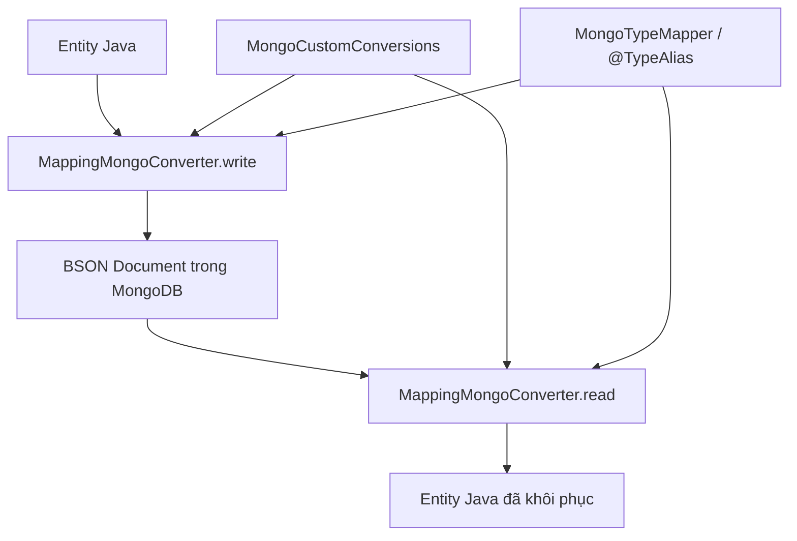
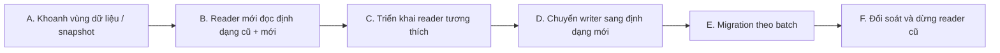

# Nâng mapping converter, type alias và quy ước chuyển đổi thời gian

## 1. Vì sao nâng cấp Spring Data MongoDB có thể làm lệch dữ liệu?

Khi nâng phiên bản **Spring Data MongoDB**, thay đổi dependency và chạy lại ứng dụng là chưa đủ. `MongoTemplate` và `MongoRepository` đều dựa vào hệ thống ánh xạ để biến entity Java thành BSON và khôi phục dữ liệu từ MongoDB. Thay đổi cách ánh xạ có thể khiến **cùng một document** đọc ra đối tượng khác trước hoặc khiến **cùng một entity** được ghi dưới định dạng mới.

Ba nhóm rủi ro quan trọng trong chương **Phiên bản và nâng cấp**:

1. **Mapping converter:** một `Converter<A, B>` được thêm, gỡ hoặc đổi hướng có thể làm thay đổi kiểu BSON của trường; converter viết và đọc không tương thích có thể làm mất khả năng round-trip.
2. **Type alias:** `MappingMongoConverter` thường ghi metadata `_class` để nhận biết kiểu Java, đặc biệt với property đa hình. Đổi tên package/class, thay `@TypeAlias` hoặc tắt type hints có thể làm lỗi dữ liệu lịch sử.
3. **Quy ước thời gian:** đổi giữa bộ chuyển đổi Java Time dựa vào **múi giờ hệ thống** và codec của MongoDB Driver dựa vào **UTC** có thể làm lệch giờ lưu/đọc của `LocalDateTime` dù code nghiệp vụ không thay đổi.

Bài này hướng dẫn đánh giá tương thích, cấu hình có chủ đích, thử trên BSON thực, nâng cấp theo giai đoạn và khôi phục khi phát hiện sai lệch. Ví dụ sử dụng Java, Spring Data MongoDB, `MappingMongoConverter`, `MongoCustomConversions` và `MongoTemplate`; API reactive dùng nguyên tắc tương tự nhưng có đường cấu hình/kiểm thử riêng.

### Mục tiêu học tập

- Phân biệt loại thay đổi ở **wire format BSON**, metadata kiểu, quy tắc domain và hiển thị thời gian.
- Hiểu `_class`, `@TypeAlias`, `DefaultMongoTypeMapper` và yêu cầu khởi tạo metadata trước khi đọc.
- Đăng ký cặp `@ReadingConverter`/`@WritingConverter` qua `MongoCustomConversions`, tránh converter đăng ký nhầm hướng.
- Xác định nguồn chênh giờ khi đổi quy ước `LocalDateTime`, `Instant`, `LocalDate` hoặc `LocalTime`.
- Viết regression test so sánh BSON trước/sau, kiểm tra dữ liệu cũ và quy trình rolling upgrade.
- Phân biệt thay đổi Java/Spring Data với migration dữ liệu thật trong MongoDB.

## 2. Xác lập hợp đồng dữ liệu trước khi đổi phiên bản

Trước khi nâng, ghi nhận các thông tin sau của **phiên bản đang chạy** và **phiên bản mục tiêu**. Không giả định mọi bản Spring Data MongoDB có cùng default:

| Thành phần | Câu hỏi cần trả lời | Bằng chứng |
| --- | --- | --- |
| Spring Data MongoDB và Spring Boot | Đang dùng nhánh nào? Driver nào được quản lý theo BOM? | Dependency tree, release/migration notes của nhánh hiện tại và nhánh đích |
| `MongoCustomConversions` | Có bean tùy chỉnh hoặc cấu hình qua `AbstractMongoClientConfiguration`? | Danh sách bean và mã đăng ký converter |
| `MappingMongoConverter` | Có `MongoTypeMapper` hoặc `MongoMappingContext` tùy chỉnh? | Cấu hình thực chạy của ứng dụng |
| `_class` / alias | BSON đang chứa tên class đầy đủ, alias hay không có type hint? | Mẫu raw BSON từ các collection liên quan |
| Các trường thời gian | Đang lưu BSON Date, string hay epoch number? Múi giờ gốc là gì? | Dữ liệu mẫu và convention đã được phê duyệt |
| Giá trị số lớn | `BigDecimal` đang là string hay Decimal128? | Raw BSON và schema/index/query thực tế |
| Các đường ghi | Có script, bulk update, driver trực tiếp hoặc dịch vụ khác ghi chung collection? | Danh sách writer và phiên bản sẽ cùng hoạt động |

**Nguyên tắc:** mọi thay đổi mapping quan trọng phải được mô tả bằng cặp **Java value → BSON value → Java value**, gồm cả dữ liệu tạo từ ứng dụng cũ. Test chỉ khởi động Spring context hoặc chỉ gọi repository `save` chưa chứng minh khả năng đọc ngược tài liệu cũ.

Ví dụ hai document lịch sử cùng ý nghĩa nghiệp vụ nhưng khác cách lưu:

```javascript
// Document do phiên bản cũ ghi: kiểu Java đầy đủ và giờ lưu theo quy ước cũ.
{
  _id: "ord-1001",
  _class: "com.legacy.orders.OrderSnapshot",
  email: { value: "a@example.test" },
  scheduledAt: ISODate("2026-11-20T02:00:00Z")
}

// Document từ phiên bản mới giả định: alias ổn định và email dạng string.
{
  _id: "ord-1002",
  _class: "order.snapshot.v1",
  email: "a@example.test",
  scheduledAt: ISODate("2026-11-20T09:00:00Z")
}
```

Hai thời điểm BSON khác nhau ở ví dụ chỉ để minh họa vấn đề **nếu** `scheduledAt` là cùng `LocalDateTime.of(2026, 11, 20, 9, 0)` nhưng một lần dùng múi giờ `Asia/Ho_Chi_Minh` và lần khác dùng UTC. Đây không phải quy luật rằng mọi bản nâng cấp luôn làm lệch 7 giờ; lệch bao nhiêu phụ thuộc timezone thực tế và cách cấu hình converter.

## 3. Vai trò của `MappingMongoConverter`

`MappingMongoConverter` là triển khai ánh xạ trung tâm trong Spring Data MongoDB. Nó sử dụng metadata của domain class và các converter đã đăng ký để:

- Ánh xạ `@Id` thành `_id`; đọc/ghi field có `@Field` với tên hoặc kiểu BSON tùy chỉnh.
- Tạo BSON `Document` khi `MongoTemplate.save/insert` hoặc repository ghi entity.
- Khôi phục Java object từ BSON, gồm nested object, collection và dữ liệu đa hình.
- Sử dụng `MongoCustomConversions` cho các cặp type được định nghĩa.
- Ghi và đọc type hints nếu `MongoTypeMapper` được cấu hình tương ứng.



Thứ tự logic trên giúp tìm lỗi: nếu BSON có đúng dữ liệu nhưng domain object sai, hãy kiểm tra **đọc/constructor/converter**; nếu BSON đã sai ngay sau `save`, hãy kiểm tra **ghi/converter/time codec**. Không nên sửa data migration để che một lỗi converter mới.

**Các đường không đi qua mapper:** script `mongosh` và lệnh trực tiếp từ MongoDB Java Driver có thể ghi BSON mà không gọi `MappingMongoConverter`. `updateFirst` và bulk update qua Spring Data không thực hiện toàn bộ vòng đời `save(entity)`. Vì vậy, quy ước schema và thời gian phải được áp dụng thống nhất ở mọi writer.

## 4. Type hint `_class` và `@TypeAlias`

### 4.1. `_class` có tác dụng gì?

Mặc định `DefaultMongoTypeMapper` thường lưu **tên class đầy đủ** vào field `_class` cho root document và cho các giá trị phức tạp cần type information, chẳng hạn một property khai báo interface/abstract class nhưng thực tế chứa subtype.

```java
import org.springframework.data.annotation.Id;
import org.springframework.data.mongodb.core.mapping.Document;

@Document("shipping_events")
class ShippingEvent {
    @Id
    String id;
    ShippingAction action; // interface hoặc lớp cha
}

interface ShippingAction {}

class Deliver implements ShippingAction {
    String addressCode;
}
```

Một BSON document có thể chứa type hint của cả root và nested subtype:

```javascript
{
  _id: "evt-01",
  action: {
    addressCode: "WH-1",
    _class: "com.acme.shipping.Deliver"
  },
  _class: "com.acme.shipping.ShippingEvent"
}
```

Khi code đổi package `com.acme.shipping` thành `com.newco.shipping`, MongoDB **không tự thay** giá trị `_class` đã tồn tại. Một alias cũ không được nhận diện hoặc tên class đã mất khỏi classpath có thể khiến quá trình khôi phục kiểu đa hình thất bại.

### 4.2. Dùng alias có định danh ổn định

```java
import org.springframework.data.annotation.TypeAlias;
import org.springframework.data.mongodb.core.mapping.Document;

@Document(collection = "shipping_events")
@TypeAlias("shipping.event.v1")
class ShippingEvent {
    // fields, constructor...
}

@TypeAlias("shipping.action.deliver.v1")
class Deliver implements ShippingAction {
    // fields, constructor...
}
```

Với metadata đã được nhận diện, document mới được ghi với `_class: "shipping.event.v1"` và nested subtype với alias tương ứng. Alias nên phản ánh **hợp đồng dữ liệu ổn định**, tránh gắn với tên package, tên module hoặc đường dẫn code dễ đổi. Khi thay đổi lớn về schema, cân nhắc version alias có quy trình tương thích rõ ràng thay vì đổi alias tùy tiện.

**Điểm dễ bỏ qua:** `@TypeAlias` không phải là migration. Thêm annotation hôm nay không tự sửa các document có `_class` là tên Java cũ hôm qua. Cũng không có nghĩa Spring Data sẽ nhận diện alias trước khi metadata của class được đăng ký.

### 4.3. Mapping context phải biết type trước khi đọc alias

Spring Data chỉ giải được `@TypeAlias` khi `MongoMappingContext` đã biết class tương ứng. Metadata có thể được phát hiện khi lưu lần đầu hoặc được khởi tạo trước qua quét entity/initial entity set. Không thiết kế hệ thống yêu cầu “ghi thử một document trước rồi mới đọc được dữ liệu”.

Nếu dùng cấu hình dựa trên `AbstractMongoClientConfiguration`, có thể cung cấp tập entity cần nhận diện:

```java
import java.util.Set;
import org.springframework.data.mongodb.config.AbstractMongoClientConfiguration;

class KnownEntitiesConfig extends AbstractMongoClientConfiguration {

    @Override
    protected String getDatabaseName() {
        return "application_db";
    }

    @Override
    protected Set<Class<?>> getInitialEntitySet() {
        return Set.of(ShippingEvent.class, Deliver.class);
    }
}
```

Đây là **mẫu cấu hình cho ứng dụng chủ động dùng `AbstractMongoClientConfiguration`**, không phải hướng dẫn thêm một cấu hình thứ hai vào ứng dụng Spring Boot đã có cấu hình MongoDB riêng. Với Boot auto-configuration, kiểm tra package scan, `@Document` và các bean mapping context hiện hữu; chỉ thêm cấu hình bổ sung khi cần.

Test quan trọng nhất là **đọc một document chỉ có alias trước khi bất kỳ `save` nào xảy ra**. Nếu đọc thất bại sau nâng cấp nhưng lại thành công sau insert, thường cần kiểm tra việc khởi tạo mapping metadata.

### 4.4. Đổi tên class và alias cũ

Có ba chiến lược thường gặp:

| Chiến lược | Cách dùng | Đổi chác |
| --- | --- | --- |
| Giữ type hint cũ có thể đọc | Duy trì ánh xạ tương thích cho các giá trị `_class` cũ | Thêm mã tương thích, cần kế hoạch bỏ dần |
| Migration có điều kiện từ giá trị cũ sang alias mới | Chuyển document lịch sử theo batch có kiểm soát | Phải phối hợp với các phiên bản đang ghi/đọc chung |
| Tùy chỉnh `TypeInformationMapper`/`DefaultMongoTypeMapper` | Có nhiều kiểu/alias cũ hoặc muốn chính sách riêng | Tăng độ phức tạp của mapping, đòi test kỹ |

Tắt toàn bộ `_class` bằng `DefaultMongoTypeMapper(null)` **không phải** giải pháp mặc định cho lỗi alias. Việc đó có thể làm mất thông tin subtype cần thiết để đọc interface, abstract class, field kiểu `Object` hoặc document hỗn hợp. Chỉ bỏ type hint khi schema, API đọc và mọi polymorphic property đã được thiết kế thay thế rõ ràng.

## 5. Xem và migration `_class` bằng raw BSON

Trước khi sửa, thống kê giá trị `_class` đang có:

```javascript
db.shipping_events.aggregate([
  {
    $group: {
      _id: "$_class",
      count: { $sum: 1 }
    }
  },
  { $sort: { count: -1 } }
]);
```

Kiểm tra thêm **nested type hint** nếu một collection chứa các subtype:

```javascript
db.shipping_events.aggregate([
  { $match: { action: { $exists: true } } },
  {
    $group: {
      _id: "$action._class",
      count: { $sum: 1 }
    }
  }
]);
```

Một migration minh họa, chỉ áp dụng khi mọi phiên bản ứng dụng liên quan đã được kiểm tra khả năng đọc alias mới:

```javascript
db.shipping_events.updateMany(
  {
    _class: "com.acme.shipping.ShippingEvent"
  },
  {
    $set: { _class: "shipping.event.v1" }
  }
);
```

Với subtype lồng nhau, phải chuyển `action._class` bằng logic riêng và chỉ cho những document phù hợp:

```javascript
db.shipping_events.updateMany(
  { "action._class": "com.acme.shipping.Deliver" },
  {
    $set: {
      "action._class": "shipping.action.deliver.v1"
    }
  }
);
```

Hai lệnh trên **chỉ là ví dụ cú pháp**. Trên hệ thống thật:

1. Kiểm kê mọi giá trị cũ và những đường dẫn có type hint; không chỉ nhìn root `_class`.
2. Kiểm tra app cũ **có đọc được alias mới hay không** trước khi rolling deployment; nếu không, chuẩn bị chế độ dual-read hoặc đổi thứ tự triển khai.
3. Giới hạn batch, đo `matchedCount/modifiedCount` và lưu thông tin audit của đợt migration.
4. Dùng điều kiện khớp giá trị cũ để rerun an toàn; không cập nhật đại trà mọi `_class`.
5. Thử đọc cả document cũ lẫn mới bằng binary mới, rồi xác minh tiếp qua repository và `MongoTemplate`.

Nếu dữ liệu có nhiều subtype, viết bảng ánh xạ **old type → new alias → domain class hiện tại** được review chung với code. Không suy alias từ tên class theo quy tắc ngẫu nhiên.

## 6. Nâng cấp `MongoCustomConversions`

### 6.1. Vì sao converter tùy chỉnh cần được kiểm toán?

`MappingMongoConverter` kiểm tra converter phù hợp trước khi dùng mapping mặc định. Một converter có thể quyết định một value object được lưu thành string, subdocument hay kiểu BSON khác.

Ví dụ trước đây ứng dụng lưu email thành subdocument:

```javascript
{ email: { value: "a@example.test" } }
```

Sau khi đăng ký converter ghi sang `String`, định dạng mới trở thành:

```javascript
{ email: "a@example.test" }
```

Nếu reader mới chỉ hiểu string, nó có thể không còn đọc được dữ liệu cũ. Đổi converter vì muốn đơn giản hóa BSON là **thay đổi schema** và cần chiến lược compatibility tương tự migration field bình thường.

### 6.2. Cặp converter đọc/ghi cho value object

Ví dụ `EmailAddress` là một value object được validate ở tầng domain:

```java
import java.util.Objects;

record EmailAddress(String value) {
    EmailAddress {
        Objects.requireNonNull(value, "email must not be null");
        if (value.isBlank()) {
            throw new IllegalArgumentException("email must not be blank");
        }
    }
}
```

Đăng ký converter theo đúng hướng:

```java
import org.springframework.core.convert.converter.Converter;
import org.springframework.data.convert.ReadingConverter;
import org.springframework.data.convert.WritingConverter;

@WritingConverter
class EmailAddressWriteConverter
        implements Converter<EmailAddress, String> {

    @Override
    public String convert(EmailAddress source) {
        return source.value();
    }
}

@ReadingConverter
class EmailAddressReadConverter
        implements Converter<String, EmailAddress> {

    @Override
    public EmailAddress convert(String source) {
        return new EmailAddress(source);
    }
}
```

`@WritingConverter`/`@ReadingConverter` giúp Spring Data phân biệt hướng chuyển đổi. Điều này đặc biệt quan trọng với hai type đều là kiểu lưu trữ native, ví dụ `String → Long`; nếu thiếu annotation, một converter có thể được áp dụng theo hướng không mong muốn.

Các converter **không tự động được đăng ký chỉ vì có annotation hoặc có mặt trên classpath**. Hãy đăng ký thực sự trong `MongoCustomConversions` (hoặc qua cấu hình Spring Data thích hợp), rồi kiểm tra bean đang dùng bởi `MongoTemplate`.

### 6.3. Cấu hình converter và Java Time có chủ đích

Trong ứng dụng Spring Boot sử dụng auto-configuration, có thể khai báo bean `MongoCustomConversions`:

```java
import org.springframework.context.annotation.Bean;
import org.springframework.context.annotation.Configuration;
import org.springframework.data.mongodb.core.convert.MongoCustomConversions;

@Configuration(proxyBeanMethods = false)
class UpgradeMongoConfig {

    @Bean
    MongoCustomConversions mongoCustomConversions() {
        return MongoCustomConversions.create(adapter -> {
            adapter.registerConverter(new EmailAddressWriteConverter());
            adapter.registerConverter(new EmailAddressReadConverter());
            adapter.useNativeDriverJavaTimeCodecs();
        });
    }
}
```

`useNativeDriverJavaTimeCodecs()` là **một lựa chọn có chủ đích**, không nên bật vô điều kiện trong migration nếu dữ liệu lịch sử của `LocalDateTime` đang sử dụng quy ước múi giờ khác. Nếu cần giữ quy ước Spring Data cũ trong giai đoạn chuyển đổi, cấu hình tương ứng là `useSpringDataJavaTimeCodecs()`. Phải đối chiếu API chính xác của phiên bản Spring Data mà dự án sử dụng.

Nếu ứng dụng tự tạo `MappingMongoConverter` hoặc kế thừa `AbstractMongoClientConfiguration`, có thể đăng ký converter thông qua `configureConverters(...)`; tránh tạo **hai** hệ thống cấu hình converter cạnh tranh nhau. Khi nâng cấp, kiểm tra lại tất cả converter hiện hữu và quyết định giữ, sửa hay bỏ từng cái trước khi thay bean.

### 6.4. Converter đọc ngược dữ liệu BSON cũ

Trong giai đoạn chuyển đổi dữ liệu cũ dạng subdocument, có thể đăng ký thêm một reading converter:

```java
import org.bson.Document;
import org.springframework.core.convert.converter.Converter;
import org.springframework.data.convert.ReadingConverter;

@ReadingConverter
class LegacyEmailDocumentReadConverter
        implements Converter<Document, EmailAddress> {

    @Override
    public EmailAddress convert(Document source) {
        Object value = source.get("value");
        if (!(value instanceof String email)) {
            throw new IllegalArgumentException(
                    "Unsupported legacy email BSON shape");
        }
        return new EmailAddress(email);
    }
}
```

Sau khi thêm `adapter.registerConverter(new LegacyEmailDocumentReadConverter())`, ứng dụng có thể xử lý **cả** string mới và subdocument cũ nếu hạ tầng conversion phân giải đúng đường đọc vào `EmailAddress`. Kiểm tra bằng test trên BSON đại diện trước khi triển khai. Converter này không tự viết lại dữ liệu trong collection; nó giúp **đọc tương thích** trong thời gian migration.

Nếu BSON cũ có nhiều shape, tránh converter rộng kiểu `Document → Object` vì có thể ảnh hưởng mọi document khác. Ưu tiên converter giới hạn vào value object cụ thể hoặc property-level conversion cho một trường.

### 6.5. Thay đổi mapping của kiểu số cũng cần chú ý

`BigDecimal` là ví dụ quan trọng về thay đổi mặc định giữa các nhánh. Theo tài liệu **Spring Data MongoDB 5.0+**, không còn một representation mặc định chung cho `BigDecimal`/`BigInteger` như trước; cần cấu hình rõ nếu domain thực sự lưu các kiểu đó. Có thể giữ string cho tương thích hoặc sử dụng BSON `Decimal128` để truy vấn số học.

Ví dụ định nghĩa type BSON ngay tại field:

```java
import java.math.BigDecimal;
import org.springframework.data.mongodb.core.mapping.Field;
import org.springframework.data.mongodb.core.mapping.FieldType;

class PaymentSnapshot {
    @Field(targetType = FieldType.DECIMAL128)
    BigDecimal amount;
}
```

Với kiểu tiền, cần xem xét độ chính xác, giới hạn của `Decimal128`, dữ liệu cũ dạng string, index và biểu thức sort/aggregation. Không đơn giản coi `"12.5"` và `NumberDecimal("12.5")` là tương đương khi query trực tiếp trên BSON. Nếu cần giữ quy ước string cho tất cả các field chưa được định nghĩa target type riêng, có thể cấu hình representation thích hợp trong `MongoCustomConversions` theo tài liệu của chính nhánh 5.x.

## 7. Quy ước thời gian: `Instant`, `LocalDateTime` và BSON Date

### 7.1. BSON Date lưu gì?

MongoDB BSON Date biểu diễn **một thời điểm trên timeline**, thường dưới dạng số mili-giây tính từ Unix epoch UTC. BSON Date **không lưu nguyên tên timezone** như `Asia/Ho_Chi_Minh` hay offset `+07:00`.

```javascript
{
  createdAt: ISODate("2026-11-20T02:00:00.000Z")
}
```

Đó là cùng một thời điểm với `2026-11-20 09:00:00` ở UTC+07, nhưng BSON chỉ biết instant `02:00Z`. Ứng dụng quyết định hiển thị theo timezone nào. Việc thấy chữ `Z` trong output `mongosh` không có nghĩa mọi người dùng đang ở múi giờ UTC.

| Type Java | Biểu diễn điều gì? | Khuyến nghị sử dụng |
| --- | --- | --- |
| `Instant` | Một thời điểm tuyệt đối | `createdAt`, `updatedAt`, audit log, mốc sự kiện |
| `OffsetDateTime` | Thời điểm kèm offset đã chọn | Hợp đồng API cần offset; phải quy định cách lưu/khôi phục offset |
| `ZonedDateTime` | Thời gian + định danh vùng thời gian | Lịch hẹn cần chính sách DST, thời gian tại địa phương |
| `LocalDateTime` | Ngày/giờ **không có timezone** | Giờ hẹn cục bộ; phải lưu thêm `ZoneId` nếu cần quy đổi thành instant |
| `LocalDate` | Ngày theo lịch, không có giờ | Sinh nhật, ngày nghiệp vụ, kỳ thanh toán |
| `LocalTime` | Giờ trong ngày, không có ngày/zone | Giờ mở cửa hoặc lịch lặp |

Không nên dùng `LocalDateTime` để biểu diễn sự kiện tuyệt đối nếu không có quy tắc timezone rõ ràng. Đối với audit, `Instant` thường là lựa chọn đơn giản và an toàn hơn.

### 7.2. Khác biệt quan trọng giữa hai cơ chế Java Time

Tài liệu Spring Data MongoDB mô tả:

- Bộ converter Java Time của Spring Data Commons cho các type local (`LocalDate`, `LocalTime`, `LocalDateTime`) dựa vào `ZoneId.systemDefault()`.
- Codec Java Time của MongoDB Driver khi được bật qua `useNativeDriverJavaTimeCodecs()` dùng `ZoneOffset.UTC` cho các type đó.
- Spring Data khuyến nghị lựa chọn native UTC cho thiết kế mới, còn cách dùng system-default chủ yếu phục vụ tương thích dữ liệu cũ. Việc chuyển giữa hai cơ chế cần kiểm thử dữ liệu đã lưu.

Ví dụ nếu một giá trị `LocalDateTime` là 09:00 ngày 20/11/2026:

```java
import java.time.Instant;
import java.time.LocalDateTime;
import java.time.ZoneId;
import java.time.ZoneOffset;

LocalDateTime local = LocalDateTime.of(2026, 11, 20, 9, 0);

Instant withVietnamZone = local
        .atZone(ZoneId.of("Asia/Ho_Chi_Minh"))
        .toInstant(); // 2026-11-20T02:00:00Z

Instant withUtc = local
        .toInstant(ZoneOffset.UTC); // 2026-11-20T09:00:00Z
```

Hai instant cách nhau **7 giờ**, dù `local` không đổi. Nếu bản cũ ghi `LocalDateTime` theo timezone máy chủ Asia/Ho_Chi_Minh và bản mới ghi theo UTC, BSON Date của **dữ liệu mới** có thể lệch 7 giờ so với trước. Ngược lại, **dữ liệu cũ** đọc bằng quy ước UTC có thể trở thành `02:00` thay vì `09:00`. Đây là lỗi tương thích wire format, không phải đơn thuần lỗi hiển thị trong UI.

### 7.3. Tách quy ước về instant và giờ địa phương

Với “thời điểm sự kiện đã xảy ra”, luôn quy đổi rõ thành `Instant` trước khi lưu:

```java
import java.time.Instant;
import java.time.LocalDateTime;
import java.time.ZoneId;

ZoneId businessZone = ZoneId.of("Asia/Ho_Chi_Minh");
LocalDateTime localAppointment =
        LocalDateTime.of(2026, 11, 20, 9, 0);

Instant appointmentAt =
        localAppointment.atZone(businessZone).toInstant();
// Lưu appointmentAt dưới dạng BSON Date.
```

Với lịch hẹn mà việc giữ **giờ địa phương và vùng thời gian** quan trọng hơn instant riêng lẻ, lưu dữ liệu có cấu trúc:

```javascript
{
  appointmentLocal: "2026-11-20T09:00:00",
  timeZoneId: "Asia/Ho_Chi_Minh",
  appointmentInstant: ISODate("2026-11-20T02:00:00Z")
}
```

Nếu lưu cả hai biểu diễn, ứng dụng phải có một nguồn sự thật rõ ràng và kiểm tra tính nhất quán khi đổi lịch. Với vùng có DST, giờ địa phương có thể **không tồn tại** hoặc **lặp hai lần**; cần quy tắc xử lý khoảng trống/chồng lặp thay vì ngầm phụ thuộc default JVM.

**Với `LocalDate`:** việc “ngày 20/11” bị ánh xạ sang BSON Date theo múi giờ rồi đọc lại theo múi giờ khác có thể biến thành ngày 19/11 hoặc 21/11 trong một số điều kiện. Nếu domain chỉ cần ngày theo lịch, hãy quyết định định dạng bảo toàn ngày (ví dụ ISO `yyyy-MM-dd` dưới dạng string hoặc bộ trường năm/tháng/ngày) và triển khai mapping đúng hợp đồng đó.

### 7.4. Độ chính xác và offset

- BSON Date có độ chính xác **mili-giây**; `Instant` có thể chứa nano-giây. Khi round-trip, phần nhỏ hơn một mili-giây có thể bị mất.
- Chuyển `OffsetDateTime`/`ZonedDateTime` thành instant rồi chỉ lưu BSON Date làm mất thông tin offset/zone gốc. Muốn phục hồi chính xác vùng thời gian đã chọn, lưu riêng `ZoneId`/offset theo yêu cầu nghiệp vụ.
- `Date.toString()` hoặc log của JVM thường hiển thị timezone máy chạy và có thể làm nhầm khi so sánh với `ISODate(...Z)`. Khi kiểm tra, chuẩn hóa sang `Instant` rồi so sánh giá trị epoch.
- Với ngày/giờ quá khứ tại vùng có DST, dữ liệu thiếu timezone gốc đôi khi **không thể** chuyển đúng một cách tuyệt đối; phải dùng chính sách hoặc thông tin nghiệp vụ bổ sung.

## 8. Chiến lược migration quy ước thời gian

Không nên áp một câu lệnh cộng/trừ số giờ lên toàn collection khi chưa biết dữ liệu được tạo bằng timezone gì. Dữ liệu lịch sử có thể đến từ nhiều máy chủ, nhiều version hoặc chứa các ngoại lệ DST.

Quy trình:

1. **Khoanh vùng dữ liệu:** thống kê theo version ứng dụng, khoảng thời gian ghi, tenant, nguồn tạo và định dạng BSON thực tế.
2. **Ghi lại quy ước cũ:** liệu `LocalDateTime` từng được convert theo `ZoneId.systemDefault()`, UTC, offset từ client hay converter riêng?
3. **Định nghĩa quy ước đích:** `Instant` cho sự kiện tuyệt đối; `LocalDateTime + ZoneId` cho giờ địa phương; string cho ngày lịch khi phù hợp.
4. **Xây dựng bộ chuyển đổi đơn trị:** với mỗi nhóm dữ liệu phải biết chính xác cách diễn giải giờ cũ và giờ mới; nếu không đủ thông tin, đánh dấu cần xử lý riêng.
5. **Thử trên snapshot dữ liệu:** so sánh BSON Date cũ, instant đúng theo nghiệp vụ và BSON dự kiến; theo dõi sai lệch trong các múi giờ/DST khác nhau.
6. **Triển khai reader tương thích trước:** cho phép app mới đọc cả định dạng cũ và mới trong giai đoạn đồng tồn tại.
7. **Chuyển dữ liệu theo batch có audit và checkpoint**, sau đó mới loại đường đọc cũ khi tất cả writer đã chuyển và số liệu đối soát đạt yêu cầu.

### Ví dụ chuẩn hóa có tính quyết định

Giả sử đã **xác minh** mỗi document trong nhóm được ghi bằng `LocalDateTime` dựa trên `Asia/Ho_Chi_Minh`, nhưng mục tiêu là dùng `Instant` giữ **đúng thời điểm lịch hẹn**. Thay vì cộng giờ bằng mắt, hãy phân tích giá trị BSON cũ theo codec cũ rồi dựng instant tương ứng trong Java:

```java
import java.time.Instant;
import java.time.LocalDateTime;
import java.time.ZoneId;
import java.time.ZoneOffset;
import java.util.Date;

ZoneId legacyZone = ZoneId.of("Asia/Ho_Chi_Minh");

// Giá trị BSON cũ lưu một LocalDateTime theo quy ước legacyZone.
Date legacyBsonDate = rawDocument.getDate("scheduledAt");

// Phục hồi LocalDateTime dựa trên cách ghi cũ.
LocalDateTime historicalLocal = LocalDateTime.ofInstant(
        legacyBsonDate.toInstant(), legacyZone);

// Diễn giải giờ lịch hẹn tại chính zone nghiệp vụ.
Instant actualAppointmentInstant = historicalLocal
        .atZone(legacyZone)
        .toInstant();

// Thường bằng instant cũ: mục đích là làm rõ ngữ nghĩa.
// Không tự cộng 7 giờ vào Date nếu dữ liệu cũ đã là đúng instant.
Date normalizedDate = Date.from(actualAppointmentInstant);
```

Đoạn mã nhấn mạnh một điểm: **thay codec đọc LocalDateTime** có thể làm thay đổi đối tượng Java quan sát được, nhưng không có nghĩa BSON Date đã lưu nhất thiết bị sai. Nếu BSON vốn biểu diễn đúng instant thì không migration epoch; hãy đổi model/reader để diễn giải đúng. Chỉ sửa BSON khi có bằng chứng rằng dữ liệu cần đổi ý nghĩa hoặc định dạng.

Nếu business muốn **giữ nguyên giờ hiển thị 09:00 trong một quy ước UTC mới**, đó là một hợp đồng khác: phải chuyển dữ liệu có chủ đích từ lịch giờ cũ sang định dạng mới, phân biệt rõ với bảo toàn instant.

## 9. Nâng cấp nhiều phiên bản chạy song song

Trong rolling deployment, các instance cũ và mới có thể đọc/ghi cùng collection. Hệ thống phải đảm bảo tồn tại **giai đoạn tương thích**:



Thứ tự này là **mẫu tư duy**, cần điều chỉnh nếu instance cũ không thể đọc dữ liệu mới:

- Nếu writer mới ghi `_class` alias mà app cũ chỉ hiểu FQCN, app cũ có thể lỗi ngay trong lúc rolling deployment. Cần đảm bảo tương thích ở cả hai chiều hoặc dùng feature flag để trì hoãn thay đổi writer.
- Nếu writer mới lưu `email` thành string nhưng app cũ đòi subdocument, writer mới không nên bật định dạng mới cho đến khi các reader còn lại đã được nâng hoặc route traffic được tách rõ.
- Nếu đổi Java Time codecs nhưng nhiều service cùng ghi `LocalDateTime`, dữ liệu mới có thể chứa **hai cách diễn giải một field**; cần đóng băng convention hoặc thêm version marker/schema field.
- Nếu migration đã sửa BSON và có app cũ đang chạy, rollback chỉ code chưa chắc phục hồi khả năng đọc. Phải có phương án rollback dữ liệu/dual-read trước.

Một cách thực hiện là thêm `schemaVersion` cho document mới, cho phép reader chọn quy tắc mapping theo version. Tuy nhiên, các converter global trong `MongoCustomConversions` thường được quyết định theo cặp **kiểu nguồn/đích**; chúng không tự phân luồng theo `schemaVersion`. Khi cùng một kiểu BSON cần hai diễn giải khác nhau, phải thiết kế adapter chuyên biệt có ngữ cảnh, mô hình DTO đọc dữ liệu thô hoặc migration một lần có kiểm soát.

## 10. Kiểm thử mapping trước và sau nâng cấp

### 10.1. Ma trận ca kiểm thử

| Nhóm test | Dữ liệu đầu vào | Assertion cần có |
| --- | --- | --- |
| Ghi mới với alias | Entity có `@TypeAlias` | Raw BSON có đúng `_class` alias |
| Đọc alias trước khi save | BSON được insert trực tiếp qua driver | Reader dựng đúng subtype trước mọi `save` |
| Đọc tên class lịch sử | BSON có `_class` FQCN cũ | Đọc được bằng compatibility path hoặc được phát hiện để migration |
| Converter ghi | Value object → BSON | Đúng kiểu string/document/Decimal128 dự kiến |
| Converter đọc mới/cũ | BSON có cả hai shape | Domain value giống nhau, không thất lạc dữ liệu |
| Java Time mới | `Instant`, `LocalDateTime`, `LocalDate` | BSON Date/kiểu dữ liệu và giá trị sau round-trip đúng |
| Timezone khác nhau | Thử nhiều `ZoneId` | Không lệch instant hoặc ngày lịch ngoài chính sách đã chọn |
| Precision | Instant có nanosecond | Sai số cho phép được ghi rõ (BSON Date là mili-giây) |
| Query/update | `Criteria`, repository, aggregation | Điều kiện truy vấn vẫn khớp BSON mới/cũ |
| Rolling compatibility | Writer cũ và mới trên dữ liệu mẫu | Mọi phiên bản được phép đọc dữ liệu tại thời điểm đồng tồn tại |

### 10.2. Entity và converter để kiểm thử BSON mới

Kết hợp alias, value object và Java Time:

```java
import java.time.Instant;
import java.time.LocalDateTime;
import org.springframework.data.annotation.Id;
import org.springframework.data.annotation.TypeAlias;
import org.springframework.data.mongodb.core.mapping.Document;

@Document(collection = "upgrade_probe")
@TypeAlias("upgrade.probe.v1")
record UpgradeProbe(
        @Id String id,
        EmailAddress email,
        Instant occurredAt,
        LocalDateTime localAt
) {}
```

Nếu cấu hình `UpgradeMongoConfig` ở phần trước đã được nạp, test có thể xác minh raw BSON:

```java
import static org.junit.jupiter.api.Assertions.*;

import java.time.Instant;
import java.time.LocalDateTime;
import java.time.ZoneOffset;
import java.util.Date;

import org.bson.Document;
import org.junit.jupiter.api.Test;
import org.springframework.beans.factory.annotation.Autowired;
import org.springframework.boot.test.autoconfigure.data.mongo.DataMongoTest;
import org.springframework.context.annotation.Import;
import org.springframework.data.mongodb.core.MongoTemplate;

@DataMongoTest
@Import(UpgradeMongoConfig.class)
class MappingUpgradeIntegrationTest {

    @Autowired
    MongoTemplate template;

    @Test
    void writesAliasAndUtcTimeThenReadsBack() {
        UpgradeProbe source = new UpgradeProbe(
                "probe-001",
                new EmailAddress("a@example.test"),
                Instant.parse("2026-11-20T02:00:00Z"),
                LocalDateTime.of(2026, 11, 20, 9, 0)
        );

        template.insert(source);

        Document raw = template.getCollection("upgrade_probe")
                .find(new Document("_id", "probe-001"))
                .first();

        assertNotNull(raw);
        assertEquals("upgrade.probe.v1", raw.getString("_class"));
        assertEquals("a@example.test", raw.getString("email"));
        assertEquals(
                Instant.parse("2026-11-20T02:00:00Z"),
                raw.getDate("occurredAt").toInstant());
        assertEquals(
                LocalDateTime.of(2026, 11, 20, 9, 0)
                        .toInstant(ZoneOffset.UTC),
                raw.getDate("localAt").toInstant());

        UpgradeProbe reread =
                template.findById("probe-001", UpgradeProbe.class);
        assertNotNull(reread);
        assertEquals(source.email(), reread.email());
        assertEquals(source.occurredAt(), reread.occurredAt());
        assertEquals(source.localAt(), reread.localAt());
    }
}
```

Đoạn test minh họa đường dùng `@DataMongoTest` quen thuộc với **Spring Boot 3.x**. Với các phiên bản Boot mới có thay đổi package/cấu hình test, cần chọn import theo BOM mục tiêu. Chạy test trên MongoDB thử nghiệm riêng (ví dụ Testcontainers); test không tự cung cấp database nên không nên chạy nhầm trên môi trường chung. Dữ liệu mẫu dùng `_id` cố định, cần isolation/cleanup để chạy lặp không bị lỗi duplicate key.

Test dùng UTC native codec theo cấu hình `UpgradeMongoConfig` và khẳng định **hợp đồng đã chọn**, không khẳng định mọi app Spring Data MongoDB mặc định như vậy.

### 10.3. Test đọc dữ liệu lịch sử trước khi ghi

Một integration test độc lập nên:

1. Dùng MongoDB Java Driver insert trực tiếp document BSON lịch sử, bao gồm `_class` cũ, email object và giá trị ngày/giờ cũ.
2. Khởi tạo **ứng dụng mới** với converter/type mapper phù hợp; không tạo thử entity mới bằng `save` trước khi đọc.
3. Gọi `MongoTemplate.findById(...)` hoặc repository và xác minh domain value, subtype, timezone/instant.
4. Chạy cùng fixture với binary cũ trong môi trường thử nghiệm để kiểm tra tương thích hai chiều nếu cần rolling deployment.

Ví dụ raw BSON được seed:

```java
Document legacy = new Document("_id", "legacy-001")
        .append("_class", "com.legacy.orders.OrderSnapshot")
        .append("email", new Document("value", "a@example.test"))
        .append("scheduledAt", Date.from(
                Instant.parse("2026-11-20T02:00:00Z")));

template.getCollection("upgrade_probe").insertOne(legacy);
```

Đây là **fixture để thử tính tương thích**: trường `scheduledAt` và type `com.legacy.orders.OrderSnapshot` chỉ là định dạng lịch sử giả định. Không kỳ vọng `template.findById(..., UpgradeProbe.class)` đọc đúng fixture này chỉ nhờ `@TypeAlias` mới; cần conversion/type mapping hoặc migration đã được thiết kế đúng từ trước. Test nên thất bại có ý nghĩa khi đường đọc legacy chưa được hỗ trợ.

### 10.4. Kiểm thử timezone có tính quyết định

Tránh dùng `TimeZone.setDefault(...)` tùy tiện trong một test suite chạy song song: timezone mặc định là **trạng thái toàn JVM** và có thể làm ảnh hưởng test khác. Muốn xác minh thay đổi `ZoneId.systemDefault()`, có thể chạy test trong những JVM riêng với các thiết lập `-Duser.timezone=UTC` và `-Duser.timezone=Asia/Ho_Chi_Minh`, hoặc kiểm tra trực tiếp logic dùng `ZoneId` được truyền như một dependency.

Với ngày có DST, bổ sung zone như `Europe/Berlin` và thời điểm chuyển giờ. Kiểm tra **raw BSON Date/epoch milliseconds**, không chỉ so chuỗi đã format theo timezone máy đang chạy.

## 11. Chẩn đoán sự cố sau nâng cấp

### Lỗi đọc kiểu đa hình hoặc không nhận diện alias

**Dấu hiệu:** một document cũ có `_class`, đọc vào interface/subclass bị lỗi hoặc ra kiểu khác dự kiến.

**Kiểm tra:** đọc raw BSON `_class` root và nested; đối chiếu tập alias và các class được mapping context nhận biết; kiểm tra tài liệu lịch sử FQCN còn tồn tại không. Đọc thử **trước khi ghi entity mới** để phát hiện thiếu khởi tạo metadata.

**Cách xử lý:** bổ sung compatibility mapping/reader hoặc migration có điều kiện sau khi kiểm tra rolling compatibility. Không xóa `_class` hàng loạt chỉ để làm hết exception.

### Converter chạy sai hướng hoặc chuyển nhầm type

**Dấu hiệu:** một field `String` bỗng thành number, value object thành subdocument hoặc ngược lại; query equality không còn tìm đúng document cũ.

**Kiểm tra:** các converter đã đăng ký thực sự, annotation `@ReadingConverter`/`@WritingConverter`, nguồn/đích conversion, các cấu hình bean bị ghi đè và BSON đọc/ghi trước–sau.

**Cách xử lý:** tách converter theo hướng, giới hạn conversion về type/property đúng, thêm test cho cả shape cũ và mới.

### Giờ bị lệch nhiều giờ hoặc ngày bị lệch một ngày

**Dấu hiệu:** sau nâng cấp, `LocalDateTime` hoặc `LocalDate` đọc ra giá trị khác, trong khi trường BSON Date trên database không đổi.

**Kiểm tra:** cơ chế Java Time cũ/mới, `ZoneId.systemDefault()` của từng máy, field thuộc loại instant hay giờ địa phương, precision và nơi áp dụng timezone lúc format.

**Cách xử lý:** thống nhất convention, phục hồi quy ước legacy khi đọc dữ liệu cũ, dùng `Instant` cho mốc sự kiện hoặc lưu `LocalDateTime + ZoneId` theo nghiệp vụ. Chỉ migration BSON sau khi xác định đúng semantics lịch sử.

### Lỗi số tiền/Decimal128 khi chuyển nhánh

**Dấu hiệu:** field tiền bị đổi sang string/Decimal128, phép sort/aggregation cho kết quả khác hoặc converter không nhận định dạng mới.

**Kiểm tra:** representation cấu hình cho `BigDecimal`/`BigInteger`, loại BSON thực tế và khả năng đọc các record lịch sử. Đặc biệt rà soát thay đổi về default tại nhánh **Spring Data MongoDB 5.x**.

**Cách xử lý:** cấu hình explicit BSON target, migration theo batch nếu cần và test so sánh số với cùng scale/precision.

## 12. Checklist trước khi kết thúc nâng cấp

- Đã ghi rõ Spring Boot, Spring Data MongoDB, MongoDB Driver và MongoDB Server version nguồn/đích.
- Đã có tập dữ liệu mẫu cho từng giá trị `_class`, nested alias, converter BSON và loại thời gian.
- `MongoCustomConversions` hiện tại được kiểm kê; custom reader/writer cùng phạm vi domain rõ ràng.
- Đã kiểm tra alias được nhận diện khi **đọc trước lần save đầu tiên**.
- Đã chứng minh những document lịch sử quan trọng có thể đọc bằng binary mới.
- Thời gian có hợp đồng về **instant vs local wall-clock**, timezone, precision và cách hiển thị.
- Có test với timezone khác nhau và dữ liệu thuộc thời điểm chuyển DST nếu domain liên quan.
- Đã xác định mọi writer có thể hoạt động trong rolling upgrade và thứ tự bật định dạng mới.
- Migration có điều kiện idempotent, audit, batch và kế hoạch rollback phù hợp.
- Query, index, aggregation và API response đã được kiểm thử với BSON cũ/mới.
- Đã theo dõi lỗi conversion, chênh thời gian và số document migrated sau triển khai.

## 13. Bài tập thực hành

### Bài 1 — Nâng alias nhưng vẫn đọc dữ liệu cũ

Tạo một entity `@TypeAlias("customer.profile.v1")` và một subtype trong trường interface. Seed document trước với `_class` là FQCN Java cũ, sau đó tạo document mới bằng `MongoTemplate.save`. Viết test đọc cả hai. Nêu rõ bạn chọn giữ reader tương thích hay migration field `_class` và vì sao giải pháp đó an toàn trong rolling deployment.

**Tiêu chí đạt:** bản ghi cũ/mới được giải đúng subtype, không có bước “save một bản ghi mới trước” để tình cờ kích hoạt metadata mapping.

### Bài 2 — Nâng converter cho value object

Tạo `EmailAddress` đọc được từ BSON `String` và subdocument legacy `{ value: ... }`; chỉ ghi mới dưới dạng string. Viết test bằng raw BSON kiểm tra `email` sau save và test hai reader. Nếu dùng `@ReadingConverter` cho `Document → EmailAddress`, kiểm tra rằng các trường document khác không bị conversion nhầm.

**Tiêu chí đạt:** round-trip dữ liệu mới không mất thông tin; dữ liệu cũ không cần rewrite ngay để đọc được.

### Bài 3 — Phát hiện lệch `LocalDateTime`

Với `LocalDateTime.of(2026, 11, 20, 9, 0)`, tính instant tương ứng ở UTC và Asia/Ho_Chi_Minh. Dùng MongoDB thử nghiệm ghi và đọc giá trị theo hai quy ước converter, đối chiếu raw BSON Date và object Java sau đọc.

**Tiêu chí đạt:** nêu được chính xác thời điểm nào cần bảo toàn, vì sao hai cơ chế khác nhau 7 giờ trong ví dụ và lúc nào cần thay đổi dữ liệu thay vì chỉ sửa reader.

### Bài 4 — Đánh giá thay đổi `BigDecimal`

Seed hai document với `amount` lần lượt là `"12.50"` (BSON string) và `NumberDecimal("12.50")`. Viết kiểm thử đọc/ghi theo cấu hình representation đích và so sánh kết quả của query/sort phù hợp.

**Tiêu chí đạt:** quyết định rõ định dạng lưu, chỉ chuyển dữ liệu cũ sau khi test tính đúng đắn và giới hạn precision.

## Tài liệu tham khảo

- [Spring Data MongoDB — Object Mapping](https://docs.spring.io/spring-data/mongodb/reference/mongodb/mapping/mapping.html)
- [Spring Data MongoDB — Type Mapping và `@TypeAlias`](https://docs.spring.io/spring-data/mongodb/reference/mongodb/converters-type-mapping.html)
- [Spring Data MongoDB — Custom Conversions](https://docs.spring.io/spring-data/mongodb/reference/mongodb/mapping/custom-conversions.html)
- [Spring Data MongoDB — Property Converters](https://docs.spring.io/spring-data/mongodb/reference/mongodb/mapping/property-converters.html)
- [Spring Data MongoDB — `MongoCustomConversions.MongoConverterConfigurationAdapter`](https://docs.spring.io/spring-data/mongodb/docs/current/api/org/springframework/data/mongodb/core/convert/MongoCustomConversions.MongoConverterConfigurationAdapter.html)
- [Spring Data MongoDB — `DefaultMongoTypeMapper` API](https://docs.spring.io/spring-data/mongodb/docs/current/api/org/springframework/data/mongodb/core/convert/DefaultMongoTypeMapper.html)
- [Spring Data MongoDB — Release Notes](https://docs.spring.io/spring-data/mongodb/reference/migration-guide.html)
- [MongoDB Manual — BSON Date](https://www.mongodb.com/docs/manual/reference/bson-types/#date)
- [MongoDB Manual — Decimal128](https://www.mongodb.com/docs/manual/reference/bson-types/#decimal128-bson-data-type)
