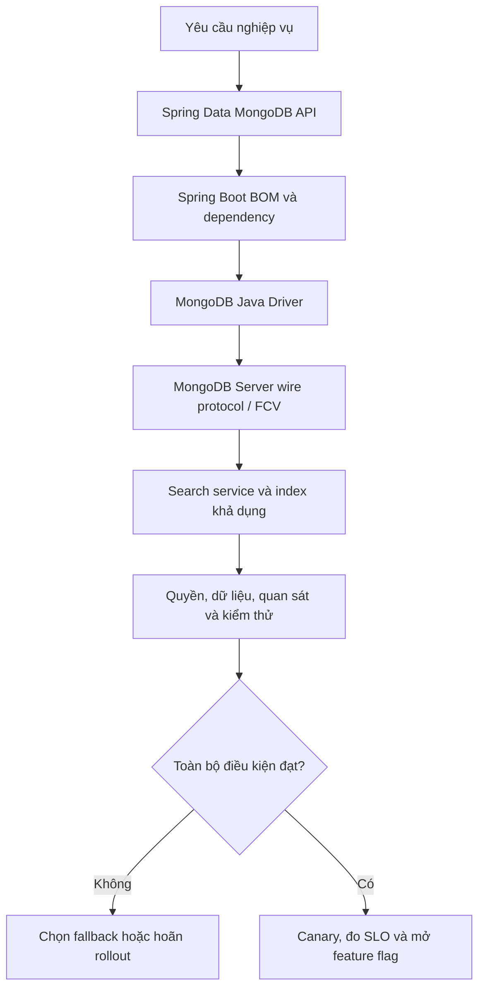
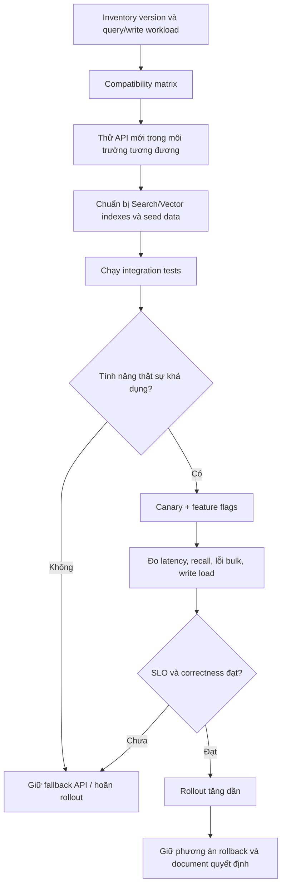

# Đối chiếu API Search, vector, bulk nhiều collection và tính năng mới

> **Chương:** Phiên bản và nâng cấp · **Module:** `SPRING_DATA_MONGODB`. Spring Data MongoDB cung cấp `MongoTemplate`, repository, aggregation DSL, index management, transaction và reactive access. Khi nâng cấp, một phương thức Java mới xuất hiện **không đồng nghĩa** MongoDB deployment hiện tại có thể thực thi lệnh tương ứng. Bài này xây dựng cách đối chiếu **MongoDB Server/Atlas hoặc Search deployment**, **MongoDB Java Driver**, **Spring Data MongoDB** và **Spring Boot dependency management** trước khi sử dụng MongoDB Search, Vector Search hay bulk write trên nhiều collection.

## 1. Vì sao phải lập bảng tương thích trước khi đổi API?

Một nhóm phát triển đang vận hành hệ thống catalog trên Spring Data MongoDB và cần thêm ba chức năng:

1. Tìm sản phẩm bằng từ khóa, fuzzy match hoặc relevance score thay cho việc chỉ tìm kiếm theo điều kiện `$text`.
2. Tìm sản phẩm gần với câu mô tả bằng embedding vector; lọc theo `tenantId` và xếp hạng theo độ tương đồng.
3. Gửi một batch gồm cập nhật `products` và tạo bản ghi `inventoryEvents` qua một client-level bulk write, giảm số lượt gọi database.

Những lựa chọn này phụ thuộc các lớp khác nhau:



Một số lỗi rất dễ nhầm:

- **Có `VectorSearchOperation` trên classpath** nhưng cluster không có Search service hoặc vector index đã sẵn sàng.
- **Có MongoDB 8.0** nhưng Spring Data đang ở phiên bản trước khi bổ sung `Bulk` đa collection.
- **Có `MongoClient.bulkWrite()`** của Java Driver nhưng dùng nhầm `MongoCollection.bulkWrite()` hoặc Spring Data `bulkOps()`: hai API sau vẫn giới hạn ở một collection trong lần gọi.
- **Dùng `@VectorSearch` trong repository** trên phiên bản Spring Data MongoDB chưa hỗ trợ annotation.
- **Build Search index thành công** nhưng gọi truy vấn ngay khi index vẫn `BUILDING`, rồi kết luận truy vấn hoặc dữ liệu sai.

Vì vậy, kiểm tra phiên bản và feature gate là một phần của **thiết kế và kiểm thử**, không chỉ là việc tăng version trong `build.gradle`.

## 2. Phân biệt bốn tầng phiên bản

| Tầng | Cần xác định | Không được suy ra |
|---|---|---|
| MongoDB Server và FCV | Server version, topology, FCV và lệnh hỗ trợ | Có `$search` chỉ vì server là MongoDB 8.x |
| Atlas hoặc Search service self-managed | Search index, dịch vụ Search, cấu hình deployment, Search feature/tier | Mọi standalone `mongod` có sẵn Search |
| MongoDB Java Driver | Phiên bản driver sync/reactive, API `MongoClient.bulkWrite` và các model tương ứng | Cập nhật driver tự bổ sung DSL của Spring Data |
| Spring Boot + Spring Data MongoDB | Release train, BOM, `MongoTemplate`/repository/aggregation APIs | Đổi version Spring Data tùy tiện vẫn tương thích với Boot |

**FCV** (feature compatibility version) không được đánh đồng với số phiên bản binary. Khi hệ thống đang thực hiện nâng cấp rolling hoặc downgrade, kiểm tra FCV và khả năng hiện có thay vì dựa vào một member có binary mới.

### 2.1. Ma trận tính năng cần nhớ

Các mốc dưới đây là **mốc tối thiểu của API cụ thể**, không phải cam kết mọi tổ hợp phiên bản đều đã được Spring Boot phát hành cùng nhau:

| Khả năng | Lớp API | Điều kiện quan trọng |
|---|---|---|
| MongoDB `$text` + text index cổ điển | Server + `TextQuery`/`TextCriteria` của Spring Data | Không cần MongoDB Search index chuyên dụng |
| MongoDB Search `$search`/`$searchMeta` | Search-capable deployment + aggregation | Cần Search index và dịch vụ Search hỗ trợ |
| `VectorIndex`, `VectorSearchOperation` | Spring Data MongoDB **4.5+** | Cần vector index và `$vectorSearch` ở deployment |
| Repository `@VectorSearch`, `Vector`, `SearchResults<T>` | Spring Data MongoDB **5.0+** | Có Search index và pre-filter phù hợp |
| `MongoCollection.bulkWrite()` | MongoDB Java Driver, collection-scoped | Một collection; không phải multi-collection API |
| `MongoClient.bulkWrite()` | Java Driver hỗ trợ client-level bulk | **MongoDB Server 8.0+** và cùng cluster |
| Spring Data `Bulk.create(...)` + `MongoOperations.bulkWrite(Bulk, BulkWriteOptions)` | Spring Data MongoDB **5.1+** | Nhiều collection cần **MongoDB 8.0+** |
| Reactive `ReactiveMongoOperations.bulkWrite(...)` | Spring Data MongoDB **5.1+** | Trả `Mono`; cần subscribe và server thích hợp |
| Typed property paths trong `Criteria`/`Update` | Cải tiến **5.1** | Chỉ dùng khi dependency Spring Data thực tế có API |
| `IsEmpty`/`IsNotEmpty` và expanded change stream events | Cải tiến **5.1** | Kiểm tra hành vi, mapping và phiên bản server/driver trước khi dùng |

**Lưu ý về deployment MongoDB Search:** MongoDB Search và Vector Search vốn được dùng phổ biến trên Atlas. Tài liệu MongoDB hiện hành cũng nêu các cấu hình **MongoDB Community 8.2+** và **Enterprise 8.2+ với Kubernetes Operator** hỗ trợ những aggregation stage này. Điều đó **không** có nghĩa chỉ cài một process `mongod` 8.2 thông thường là tự có mọi thành phần Search; cần triển khai Search service, cấu hình chỉ mục và khả năng tương thích theo tài liệu cho loại deployment tương ứng.

### 2.2. Lệnh kiểm tra trước khi lập kế hoạch

Trên chính MongoDB deployment dùng cho thử nghiệm, với tài khoản có quyền phù hợp:

```javascript
// Xem version và thông tin topology:
db.version();
db.adminCommand({ hello: 1 });

// Kiểm tra FCV theo quyền được cấp:
db.adminCommand({
  getParameter: 1,
  featureCompatibilityVersion: 1
});

// Trên collection có Search được hỗ trợ, xem trạng thái index:
db.products.getSearchIndexes();
```

Nếu câu lệnh `getSearchIndexes` không khả dụng, trước khi quy lỗi cho Spring Data, kiểm tra phiên bản `mongosh`, tính năng Search trên cluster, quyền của tài khoản và loại deployment. Với Atlas/managed service, thông tin khả dụng còn có thể nằm ở dashboard hoặc API quản trị của nhà cung cấp.

Trên ứng dụng Java, xem dependency tree theo công cụ build hiện có để xác định **version được resolve**, không chỉ version ghi trong file khai báo. Đặc biệt kiểm tra Spring Boot BOM, Spring Data MongoDB và MongoDB Java Driver có bị override bất ngờ không.

## 3. Đối chiếu các lựa chọn tìm kiếm văn bản

Trong MongoDB tồn tại nhiều khái niệm “search” có cách triển khai và mục tiêu khác nhau:

| Giải pháp | Mục tiêu | Index | Dạng truy vấn |
|---|---|---|---|
| `find` + `Criteria` | Tìm theo equality/range/regex/sort | B-tree thông thường | `db.products.find(...)` |
| `$text` | Full-text cơ bản theo text index | MongoDB text index cổ điển | `find({$text:{$search:"..."}})` |
| MongoDB Search `$search` | Lexical relevance, fuzzy, analyzer, compound search | Search index chuyên dụng | Aggregation có `$search` |
| `$searchMeta` | Metadata/count/facet của Search | Search index | Aggregation có `$searchMeta` |
| `$vectorSearch` | Semantic nearest-neighbor search bằng embedding | Vector Search index | Aggregation có `$vectorSearch` |
| Hybrid search/reranking | Kết hợp lexical, semantic và ranking | Nhiều query/index, tính năng tương thích | Pipeline/thuật toán theo deployment |

Một text index được tạo bằng `db.products.createIndex({description:"text"})` **không phải** Search index được tạo bởi `createSearchIndex(...)`. Cũng vậy, vector index không thể thay bằng chỉ mục B-tree trên field `embedding`.

### 3.1. `$text` cổ điển trong Spring Data

`TextCriteria`/`TextQuery` phù hợp khi chỉ cần MongoDB text search truyền thống, không phụ thuộc Search service:

```javascript
db.products.createIndex({
  title: "text",
  description: "text"
});
```

```java
import org.springframework.data.mongodb.core.query.TextCriteria;
import org.springframework.data.mongodb.core.query.TextQuery;

// Giả định MongoTemplate và Product đã được cấu hình.
TextCriteria criteria =
    new TextCriteria().matchingAny("coffee", "grinder");

TextQuery query = TextQuery.queryText(criteria);
List<Product> products = mongoTemplate.find(query, Product.class);
```

Đây **không phải `$search`**. Nếu chuyển sang MongoDB Search để hỗ trợ fuzzy/analyzer và nhiều cách tính relevance, phải xác nhận **Search index riêng đã sẵn sàng** và benchmark lại điểm số, tốc độ, cách phân trang.

## 4. MongoDB Search: `$search` và `$searchMeta`

### 4.1. Tạo Search index cho collection catalog

Ví dụ trong database `catalog_lab` với các field BSON `title`, `description` và `tenantId`. Lệnh này chỉ chạy trên deployment có hỗ trợ Search:

```javascript
use catalog_lab

db.products.createSearchIndex(
  "idx_products_text_v1",
  "search",
  {
    mappings: {
      dynamic: false,
      fields: {
        title: { type: "string" },
        description: { type: "string" },
        tenantId: { type: "token" }
      }
    }
  }
);
```

Mục `token` cho `tenantId` phục vụ bộ lọc exact-value trong Search. Đối với index thật, phải kiểm tra mapping/analyzer của các field, đặc biệt khi cần tiếng Việt, diacritics hoặc chuẩn hóa từ khóa. Không nên tự suy từ data class Java rằng Search index đã chọn đúng analyzer.

Việc `createSearchIndex` trả kết quả là **yêu cầu xây dựng chỉ mục đã được nhận**, không chứng minh index `READY`. Kiểm tra:

```javascript
db.products.getSearchIndexes("idx_products_text_v1");
```

Thông tin trạng thái phụ thuộc phiên bản; chờ đến khi index sẵn sàng/queryable trước khi đưa lưu lượng tìm kiếm vào.

### 4.2. Truy vấn lexical search có filter theo tenant

```javascript
db.products.aggregate([
  {
    $search: {
      index: "idx_products_text_v1",
      compound: {
        must: [
          {
            text: {
              query: "máy xay cà phê",
              path: ["title", "description"]
            }
          }
        ],
        filter: [
          { equals: { path: "tenantId", value: "tenant-a" } }
        ]
      }
    }
  },
  {
    $project: {
      _id: 0,
      sku: 1,
      title: 1,
      description: 1,
      score: { $meta: "searchScore" }
    }
  },
  { $limit: 10 }
]);
```

`$search` thường cần đứng **đầu pipeline** mà nó xuất hiện, trừ các hình thức sub-pipeline được MongoDB quy định; không đặt `$match` trước `$search` rồi kỳ vọng pipeline luôn hợp lệ. Bộ lọc tenant cần được thiết kế **ngay trong Search query** khi nghiệp vụ yêu cầu cô lập kết quả, và phải có mapping cho field filter.

Chú ý: một Search score là điểm theo cơ chế xếp hạng của Search, không phải xác suất hay phần trăm chính xác. Không dùng ngưỡng điểm giữa hai kiểu index/truy vấn khác nhau mà chưa hiệu chỉnh.

### 4.3. `$searchMeta` không trả danh sách document như `$search`

Ví dụ yêu cầu count từ Search:

```javascript
db.products.aggregate([
  {
    $searchMeta: {
      index: "idx_products_text_v1",
      text: {
        query: "cà phê",
        path: ["title", "description"]
      },
      count: { type: "total" }
    }
  }
]);
```

Kết quả thiên về **metadata** của truy vấn, không phải tập `Product` tương tự `findAll()`. Khi dùng metadata cho UI phân trang, cần xác nhận count là exact/approximate theo options và tính năng; không tự hiểu mọi con số Search count là tuyệt đối chính xác trong mọi cấu hình.

### 4.4. Dùng `MongoTemplate` khi chưa có DSL chuyên dụng cho operator cụ thể

Trong Spring Data, aggregation API có thể dùng một `AggregationOperation` biểu diễn stage raw:

```java
import java.util.List;
import org.bson.Document;
import org.springframework.data.mongodb.core.aggregation.Aggregation;
import org.springframework.data.mongodb.core.aggregation.AggregationOperation;

AggregationOperation search = ctx -> new Document(
    "$search",
    new Document("index", "idx_products_text_v1")
        .append("text", new Document(
            "query", "máy xay cà phê"
        ).append("path", List.of("title", "description")))
);

AggregationOperation score = ctx -> new Document(
    "$addFields",
    new Document("score", new Document("$meta", "searchScore"))
);

Aggregation pipeline = Aggregation.newAggregation(
    search, score, Aggregation.limit(10)
);

List<Document> matches = mongoTemplate.aggregate(
    pipeline, "products", Document.class
).getMappedResults();
```

Ví dụ raw này cố tình tập trung vào cách gọi API; nó không thêm điều kiện tenant. Trong hệ thống nhiều tenant **phải thêm Search filter phù hợp** trước khi dùng thật. Khi tự viết `Document` raw, hãy nhớ **field name không được ánh xạ từ Java property** giống như nhiều API typed của Spring Data. Với `@Field("product_title")`, đường dẫn Search cần là tên field BSON `product_title`.

Nếu truy vấn yêu cầu toán tử mới mà aggregation DSL Spring Data hiện tại chưa có, dùng raw stage có kiểm soát và tích hợp test vẫn hợp lý hơn việc nâng cấp toàn bộ framework chỉ để gọi một convenience method.

## 5. MongoDB Vector Search: dữ liệu và index quyết định kết quả

### 5.1. Vector khác full-text thế nào?

Embeddings là dãy giá trị số biểu diễn ý nghĩa tương đối của văn bản/hình ảnh. Hai câu không dùng chung từ ngữ vẫn có thể gần nhau trong không gian vector. Vector Search sử dụng khoảng cách/độ tương đồng để lấy tập gần nhất, không thay thế mọi điều kiện dữ liệu nghiệp vụ.

Ví dụ product lưu:

```javascript
{
  _id: "product-01",
  tenantId: "tenant-a",
  sku: "COF-001",
  title: "Máy xay cà phê cầm tay",
  embedding: [0.12, 0.25, -0.31, 0.40]
}
```

Vector 4 chiều ở đây **chỉ phục vụ minh họa**. Production thường dùng số chiều theo embedding model đã chọn. Không được trộn vector từ các model hoặc các phiên bản embedding khác nhau trong cùng một phép đo mà không có kế hoạch chuyển đổi.

**Các điều kiện trước query:**

- Model embedding xác định, version cố định và tất cả dữ liệu/query cùng cách chuẩn hóa.
- Kích thước vector (`dimensions`) và kiểu phần tử đúng với index definition.
- Field filter (như `tenantId`, `status`) được khai báo trong vector index nếu muốn pre-filter.
- Vector index đã build xong và có thể query.
- Truy vấn có ngân sách `numCandidates`, `limit`, độ trễ và đánh giá chất lượng (recall@k) cụ thể.

### 5.2. Tạo index bằng `mongosh`

```javascript
db.products.createSearchIndex(
  "idx_products_vector_v1",
  "vectorSearch",
  {
    fields: [
      {
        type: "vector",
        path: "embedding",
        numDimensions: 4,
        similarity: "cosine"
      },
      {
        type: "filter",
        path: "tenantId"
      }
    ]
  }
);
```

Đây là vector index chuyên dụng, **khác** `createIndex({embedding:1})`. Đối với nhiều phiên bản MongoDB, còn có lựa chọn ANN/ENN, quantization và cấu hình nâng cao; đọc tài liệu theo deployment hiện tại thay vì sao chép một index config từ môi trường không tương thích.

Trạng thái index:

```javascript
db.products.getSearchIndexes("idx_products_vector_v1");
```

Search index được xây dựng bất đồng bộ. Nếu index tồn tại nhưng chưa `READY`, đừng kết luận data hoặc Spring Data sai chỉ vì truy vấn không trả kết quả.

### 5.3. Truy vấn vector bằng aggregation

```javascript
db.products.aggregate([
  {
    $vectorSearch: {
      index: "idx_products_vector_v1",
      path: "embedding",
      queryVector: [0.11, 0.24, -0.29, 0.41],
      numCandidates: 100,
      limit: 5,
      filter: { tenantId: "tenant-a" }
    }
  },
  {
    $project: {
      _id: 0,
      sku: 1,
      title: 1,
      tenantId: 1,
      score: { $meta: "vectorSearchScore" }
    }
  }
]);
```

Trong ANN, `numCandidates` thường lớn hơn `limit` để tăng xác suất tìm được các hàng xóm gần nhất; tỷ lệ bao nhiêu cần đo theo dữ liệu và ngân sách độ trễ. Khi hỗ trợ **exact nearest neighbor (ENN)**, kết quả có thể dùng làm đối chứng chất lượng với ANN. Không mặc định `score` là một xác suất độc lập với công thức similarity.

**Quan trọng:** `$vectorSearch` không được lồng tùy tiện vào `$lookup` hoặc `$facet`. Vị trí stage và các khả năng kết hợp như `$unionWith` thay đổi theo server version; với mỗi kế hoạch pipeline mới, tra giới hạn hiện hành.

### 5.4. Spring Data `VectorIndex` và `VectorSearchOperation`

Spring Data MongoDB **4.5+** cung cấp API quản lý index và stage vector:

```java
import org.springframework.data.mongodb.core.index.VectorIndex;
import org.springframework.data.mongodb.core.index.VectorIndex.SimilarityFunction;

VectorIndex vectorIndex =
    new VectorIndex("idx_products_vector_v1")
        .addVector(
            "embedding",
            field -> field.dimensions(4)
                .similarity(SimilarityFunction.COSINE)
        )
        .addFilter("tenantId");

// Chạy trong migration job, không tạo index mỗi lần request:
mongoTemplate.searchIndexOps(Product.class)
    .createIndex(vectorIndex);
```

`Product` là domain được `@Document("products")` mapping. Với `@Field`, Spring Data có thể áp dụng mapping trong index definition khi gọi `searchIndexOps(Product.class)`; không nhầm property Java với tên BSON khi chạy `mongosh`.

Đừng coi `searchIndexOps(...).exists("...")` là điều kiện hoàn thành build. API `SearchIndexOperations` có khả năng kiểm tra status; cần chờ trạng thái index phù hợp (ví dụ `READY`) theo API/version. Hãy dùng rollout job có timeout, audit và cảnh báo khi build kéo dài.

Truy vấn typed:

```java
import java.util.List;
import org.bson.Document;
import org.springframework.data.domain.Vector;
import org.springframework.data.mongodb.core.aggregation.Aggregation;
import org.springframework.data.mongodb.core.aggregation.VectorSearchOperation;

VectorSearchOperation search = VectorSearchOperation
    .search("idx_products_vector_v1")
    .path("embedding")
    .vector(Vector.of(0.11f, 0.24f, -0.29f, 0.41f))
    .numCandidates(100)
    .limit(5)
    .withSearchScore("score");

List<Document> found = mongoTemplate.aggregate(
    Aggregation.newAggregation(search),
    Product.class,
    Document.class
).getMappedResults();
```

Đoạn API này mô tả vector search nhưng **chưa ràng buộc tenant**: ở ứng dụng nhiều tenant, phải dùng `filter(...)` của `VectorSearchOperation` hoặc cơ chế bảo vệ scope phù hợp và có test chống cross-tenant leakage. Tuyệt đối không lấy ví dụ chưa filter rồi đưa trực tiếp lên endpoint công khai.

### 5.5. Repository `@VectorSearch` trên Spring Data MongoDB 5.0+

Spring Data MongoDB **5.0+** hỗ trợ khai báo vector search ngay trên repository method. Ví dụ giao diện, giả định field `embedding` của domain và filter `tenantId` đã được lập index:

```java
import org.springframework.data.domain.Vector;
import org.springframework.data.domain.Score;
import org.springframework.data.repository.Repository;
import org.springframework.data.domain.SearchResults;
import org.springframework.data.mongodb.repository.VectorSearch;

public interface ProductSearchRepository extends Repository<Product, String> {

    @VectorSearch(
        indexName = "idx_products_vector_v1",
        path = "embedding",
        numCandidates = "100"
    )
    SearchResults<Product> searchTop5ByTenantIdAndEmbeddingNear(
        String tenantId,
        Vector queryVector,
        Score threshold
    );
}
```

Các tên API `Vector`, `Score`, `SearchResults`, `@VectorSearch` và cú pháp derived search method phải được kiểm tra theo **phiên bản Spring Data thực tế** trước khi biên dịch. Đặc biệt, thuật ngữ `Score` và `Similarity` liên quan cách diễn giải điểm; không được chuyển một ngưỡng thành phần trăm theo cảm tính.

Nếu dự án đang dùng Spring Data 4.5 (có `VectorSearchOperation` nhưng không có repository annotation), **không cố import `@VectorSearch`**. Có thể giữ aggregation DSL tương thích hoặc nâng cấp lên release train phù hợp.

## 6. Bulk write: cùng tên gọi nhưng ba khả năng khác nhau

### 6.1. So sánh collection-level và client-level

| API | Phạm vi | Mốc quan trọng | Cần lưu ý |
|---|---|---|---|
| `MongoTemplate.bulkOps(BulkMode, Product.class)` | Một collection ánh xạ entity | API Spring Data có từ lâu | Không dùng cho nhiều collection trong một bulk |
| `MongoCollection.bulkWrite(List<WriteModel>)` | Một collection | Java Driver truyền thống | Không tự mở rộng sang nhiều namespace |
| `MongoClient.bulkWrite(List<ClientNamespacedWriteModel>)` | Nhiều collection/database cùng cluster | MongoDB **8.0+**, driver hỗ trợ | Namespace đi kèm từng operation |
| `MongoTemplate.bulkWrite(Bulk, BulkWriteOptions)` | Một hoặc nhiều collection | Spring Data **5.1+**, multi-collection cần server **8.0+** | Dùng `Bulk.create` và mapping Spring Data |
| `ReactiveMongoTemplate.bulkWrite(...)` | Tương tự nhưng reactive | Spring Data **5.1+** | Trả publisher; không thực thi trước subscription |

Với MongoDB Server trước 8.0, cứ dùng collection-level bulk hoặc các lệnh riêng theo nhu cầu. Một dependency Spring Data mới **không** nâng server cũ lên khả năng xử lý client-level bulk đa collection.

### 6.2. Collection-level bulk của Spring Data

```java
import org.springframework.data.mongodb.core.BulkOperations;
import org.springframework.data.mongodb.core.query.Criteria;
import org.springframework.data.mongodb.core.query.Query;
import org.springframework.data.mongodb.core.query.Update;

var result = mongoTemplate
    .bulkOps(BulkOperations.BulkMode.ORDERED, Product.class)
    .updateOne(
        Query.query(Criteria.where("sku").is("SKU-A")),
        new Update().set("priceCents", 59000)
    )
    .updateOne(
        Query.query(Criteria.where("sku").is("SKU-B")),
        new Update().set("priceCents", 79000)
    )
    .execute();
```

`BulkOperations` của Spring Data đóng gói thao tác trên **một collection**. Với cập nhật dựa trên optimistic locking `@Version`, tài liệu Spring Data lưu ý bulk operations không hỗ trợ đầy đủ những kết quả/phép tăng version cá thể. Nếu nghiệp vụ cần CAS hoặc phát hiện lost update chính xác, phải thiết kế guard/result riêng, không thay `save()` thành bulk vô điều kiện.

### 6.3. MongoDB 8.0: bulk nhiều namespace

Trong `mongosh` hỗ trợ cú pháp MongoDB 8.0+:

```javascript
db.getMongo().bulkWrite(
  [
    {
      namespace: "catalog_lab.products",
      name: "updateOne",
      filter: { sku: "SKU-A" },
      update: { $set: { priceCents: 59000 } }
    },
    {
      namespace: "catalog_lab.inventoryEvents",
      name: "insertOne",
      document: {
        _id: "event-test-001",
        sku: "SKU-A",
        eventType: "PRICE_CHANGE"
      }
    }
  ],
  { ordered: true, verboseResults: true }
);
```

`Mongo.bulkWrite` không giống `db.collection.bulkWrite`. Tầng server dùng command `bulkWrite` với namespace cho từng operation, thay vì gắn toàn bộ batch vào đúng một collection.

**Đừng suy từ “một request” thành “một transaction”:** nếu operation đầu thành công và operation tiếp theo lỗi, thay đổi đã ghi trước đó **có thể vẫn tồn tại** khi không có transaction. `ordered: true` chỉ điều khiển thứ tự/dừng sau lỗi; `ordered: false` cho phép xử lý không theo thứ tự và tiếp tục các operation khác theo khả năng server.

### 6.4. Spring Data MongoDB 5.1: `Bulk.create` đa collection

Ví dụ chuẩn bị hai domain được mapping:

```java
import org.springframework.data.annotation.Id;
import org.springframework.data.mongodb.core.mapping.Document;

@Document("products")
public class Product {
    @Id
    private String id;
    private String sku;
    private String tenantId;
    private String title;
    private long priceCents;
    // Constructors, getters, setters.
}

@Document("inventoryEvents")
public class InventoryEvent {
    @Id
    private String id;
    private String sku;
    private String eventType;
    // Constructors, getters, setters.
}
```

Từ Spring Data MongoDB **5.1**, có thể định nghĩa batch qua `Bulk`:

```java
import org.springframework.data.mongodb.core.bulk.Bulk;
import org.springframework.data.mongodb.core.bulk.BulkWriteOptions;
import org.springframework.data.mongodb.core.bulk.BulkWriteResult;
import org.springframework.data.mongodb.core.query.Update;

InventoryEvent event = /* event with unique id/sku/type */;

Bulk bulk = Bulk.create(builder -> builder
    .inCollection(Product.class, operations -> operations
        .upsert(
            org.springframework.data.mongodb.core.query.Criteria
                .where("sku").is("SKU-A"),
            new Update().set("priceCents", 59000)
        )
    )
    .inCollection(InventoryEvent.class, operations -> operations
        .insert(event)
    )
);

BulkWriteResult writeResult = mongoTemplate.bulkWrite(
    bulk,
    BulkWriteOptions.ordered()
);

// Sau ghi, đọc lại products/inventoryEvents và đối chiếu nghiệp vụ.
```

Từ khóa `inCollection(Product.class, ...)` cho phép Spring Data dùng domain metadata để ánh xạ collection. Các thuộc tính `@Field`, `@Document` và converter cần được kiểm chứng với BSON thật trên server. Không nhầm chữ ký `Bulk.create(...)` (Spring Data 5.1+) với `BulkOperations` cũ.

Nếu ứng dụng cần cập nhật và insert ở **hai database khác nhau**, hãy xác minh phiên bản API, client và ranh giới session; ví dụ trên dùng hai collection trong **cùng database** để minh họa tính năng cốt lõi.

### 6.5. Reactive multi-collection bulk

`ReactiveMongoOperations.bulkWrite(Bulk, BulkWriteOptions)` cũng có từ Spring Data 5.1 và trả `Mono<BulkWriteResult>`:

```java
import reactor.core.publisher.Mono;

Mono<BulkWriteResult> write = reactiveMongoTemplate.bulkWrite(
    bulk,
    BulkWriteOptions.ordered()
);

// Trả publisher cho caller và để framework subscribe tại boundary.
// Không gọi subscribe() lồng nhau trong service rồi bỏ qua lỗi.
return write;
```

Ví dụ là đoạn thân của một service method trả `Mono<BulkWriteResult>`; `bulk` đã được tạo theo `Bulk.create`. Khi kiểm thử có thể dùng `StepVerifier` và kiểm tra trạng thái database sau khi publisher kết thúc.

Bulk đa collection **không mặc nhiên có tính nguyên tử trên toàn batch**, kể cả reactive. Khi cần commit/rollback cùng nhau, sử dụng transaction trong topology MongoDB hỗ trợ và test boundary đúng; không giả định một method API mới thay thế transaction manager.

### 6.6. Khi nào nên dùng Java Driver trực tiếp?

Nếu dự án chưa thể lên Spring Data 5.1 nhưng Java Driver và MongoDB Server hỗ trợ, có thể xem xét dùng `MongoClient.bulkWrite` trực tiếp với các `ClientNamespacedWriteModel`. Điều đó yêu cầu:

- Chọn đúng phiên bản Java Driver có client-level API.
- Truyền `MongoNamespace` cho từng operation.
- Tự xử lý BSON/mapping thay vì dựa hoàn toàn vào Spring Data converter.
- Kiểm tra kết quả và `ClientBulkWriteException` theo semantics của driver.
- Không dùng sync driver bằng cách chặn thread trong một reactive pipeline.

Thường nên ưu tiên API Spring Data khi nó đã hỗ trợ đúng tính năng, để giữ nhất quán mapping, cấu hình và quản lý transaction; chỉ đi xuống driver khi có lý do kỹ thuật rõ ràng.

## 7. Bulk write không thay thế transaction, idempotency và constraint

Đây là phân biệt quan trọng nhất khi nâng cấp:

| Vấn đề | Bulk write giải quyết? | Cần thêm |
|---|---|---|
| Giảm overhead gửi nhiều thao tác | Có, trong phạm vi batch/protocol hỗ trợ | Đo thực tế, giới hạn batch |
| Một batch cập nhật nhiều collection | Có ở client-level MongoDB 8.0+ | Đúng API và namespace |
| Toàn bộ operations hoặc tất cả rollback | **Không tự động** | Multi-document transaction khi cần |
| Chống trùng record theo khóa nghiệp vụ | **Không tự động** | Unique index, idempotency key |
| Đảm bảo mọi operation luôn thành công | Không | Error handling, retry có điều kiện |
| Giữ `@Version` optimistic locking trên từng entity | Không thể mặc định | Guard version/result, test mapping |
| Tránh mất dữ liệu khi retry network | Không | Idempotency, đối soát trạng thái |
| Bảo đảm thứ tự tuyệt đối khi `unordered` | Không | Dùng ordered hoặc thiết kế độc lập |

### 7.1. Ordered và unordered

- **Ordered**: tuân theo thứ tự liệt kê ở mức contract, thông thường dừng các operation tiếp theo sau lỗi.
- **Unordered**: có thể thay đổi thứ tự, tiếp tục sau lỗi và tăng throughput, nhưng nghiệp vụ không được phụ thuộc một bước phải xảy ra trước bước khác.
- **Cả hai**: vẫn có thể có **partial success** nếu không có transaction. Phải đọc bulk result/exception và điều tra trạng thái cuối khi có lỗi.

Ví dụ gồm “trừ stock trước, ghi event sau” mà yêu cầu cả hai phải cùng commit thì **ordered vẫn chưa đủ**. Nếu không thể dùng transaction, có thể cần mô hình outbox hoặc workflow có trạng thái bền vững và idempotency.

### 7.2. Kết quả và exception phải kiểm tra theo API

Collection-level bulk và client-level bulk có các kiểu result/exception khác nhau; Spring Data có `org.springframework.data.mongodb.core.bulk.BulkWriteResult` cho API mới. Không copy code đọc `com.mongodb.bulk.BulkWriteResult` từ `MongoCollection.bulkWrite` rồi mặc định hai API trả cùng một class.

Với nhiều collection, phải đối chiếu **từng namespace, số operation thành công/thất bại và bất biến nghiệp vụ**. Trong ứng dụng có retry, ưu tiên ID duy nhất và upsert theo khóa nghiệp vụ; không chạy lại một batch chứa `$inc` mù quáng sau timeout không rõ commit.

## 8. Các tính năng mới khác: cách đánh giá thay vì nâng cấp theo danh sách

Trong dòng Spring Data MongoDB 5.1, changelog nêu thêm những khả năng như typed property path ở `Criteria`/`Update`, keyword repository `IsEmpty`/`IsNotEmpty` và expanded change stream events. Một nhóm nên xem **tính năng nào thực sự phục vụ query shape và use case** trước khi nâng cấp.

### 8.1. Typed property path cho Criteria/Update

Mục tiêu của typed property path là giảm phụ thuộc vào chuỗi field name rải rác khi xây truy vấn/cập nhật:

```java
// Phong cách cũ và vẫn hợp lệ:
Criteria.where("tenantId").is("tenant-a");
new Update().set("priceCents", 59000);
```

Với 5.1, các API mới nhận `TypedPropertyPath` ở một số vị trí của Criteria/Update. Tên chính xác của factory/method và tính năng mapping cần được đọc từ Javadoc đúng version trước khi chuyển hàng loạt string path. Không tự đổi toàn bộ DSL nếu không có test so BSON query/update trước và sau.

### 8.2. Derived query `IsEmpty` và `IsNotEmpty`

Nếu tận dụng keyword mới, cần kiểm thử **ngữ nghĩa BSON** với array, field không có, null và dữ liệu kiểu khác. Đặc biệt trong MongoDB, “array rỗng”, “field không tồn tại” và “giá trị null” là ba trường hợp khác nhau. Không chuyển repository method chỉ dựa vào tên nghe hợp lý rồi suy ra dữ liệu trả đúng như kỳ vọng.

### 8.3. Expanded change stream events

MongoDB có thể phát các sự kiện change stream mở rộng trong những điều kiện/phiên bản hỗ trợ. API Spring Data mới có thể cung cấp tùy chọn thể hiện sự kiện mở rộng, nhưng phải xem xét:

- Mức hỗ trợ của MongoDB Server và driver.
- Độ ổn định của schema event và trường mới.
- Resume token/checkpoint, idempotency và khả năng consumer cũ đọc event mới.
- Trường hợp invalidate và sự khác biệt hành vi của pipeline filtering.

Chỉ bật tính năng để giải quyết nhu cầu có thật, không thay đổi diện sự kiện mà downstream consumer nhận được trong khi chưa kiểm thử.

### 8.4. Không nhầm “mới có API” với “mặc định bật”

Trong nhiều tính năng Search, việc tạo Search index là bước triển khai riêng, async và thường đòi quyền quản trị. Repository có annotation search không tự chứng minh index đang tồn tại. Trong bulk, API mới cũng không tự bật transaction hoặc sinh unique index. Feature availability phụ thuộc **server + Spring + driver + deployment + dữ liệu**, không phụ thuộc một annotation.

## 9. Quy trình nâng cấp an toàn theo từng pha



### Pha 1. Khóa baseline và version

Ghi lại:

- MongoDB version, FCV, topology, Search deployment type và trạng thái index.
- Spring Boot version, Spring Data MongoDB version, release train và MongoDB Driver version được resolve.
- Các API đang dùng: `bulkOps`, `MongoTemplate.aggregate`, repository derived queries, custom converters.
- Latency p50/p95/p99, write throughput, index size, độ trễ Search, recall@k với bộ dữ liệu nhãn.
- Phạm vi bảo mật: tenant filters, field-level authorization, dữ liệu nhạy cảm trong embedding và log.

### Pha 2. Dựng feature-gate và fallback

Ví dụ contract trong service:

```java
public interface ProductDiscovery {
    List<ProductSummary> lexicalSearch(String tenantId, String text);
    List<ProductSummary> semanticSearch(String tenantId, float[] embedding);
}
```

Có thể cung cấp implementation dựa trên query truyền thống cho cluster chưa hỗ trợ Search, và implementation dựa trên `$search`/`$vectorSearch` cho môi trường đã đủ điều kiện. **Fallback phải có ngữ nghĩa rõ**: không được lặng lẽ trả toàn bộ sản phẩm hoặc bỏ tenant filter khi vector feature không khả dụng.

Đối với bulk, không thể giả vờ multi-collection atomic bằng cách gọi hai collection-level bulk rồi trả success khi mới hoàn thành một. Fallback phải phản ánh đúng khả năng consistency hoặc sử dụng transaction khi nghiệp vụ đòi hỏi.

### Pha 3. Thử một truy vấn/đợt ghi thật trước canary

- **Search:** so lexical top-k trước/sau theo bộ câu hỏi đại diện, cả tiếng Việt có dấu/không dấu, synonym, fuzzy, tenant scoping.
- **Vector:** so ANN với ENN hoặc tập chuẩn theo recall@k, latency, vector model version, mức tiêu thụ tài nguyên và quality.
- **Bulk:** thử ordered/unordered, duplicate key, timeout, partial success, retry, optimistic locking và transaction boundary.
- **Reactive:** dùng `StepVerifier` hoặc subscriber ở application boundary; không coi publisher mới được tạo là thao tác đã hoàn thành.

### Pha 4. Triển khai có thể rollback

Giữ Search/Vector index cũ trong một giai đoạn nếu có chuyển đổi mapping/embedding model. Dùng **tên index có version**, ví dụ `idx_products_vector_v1` và `idx_products_vector_v2`, để đối chiếu query. Nếu thay embedding model, ghi version trên dữ liệu hoặc tách field/index, backfill dần, tránh so cùng score giữa hai model tùy tiện.

Đừng drop index cũ hoặc loại bỏ code fallback ngay sau một lần canary thành công. Chu kỳ tải, tenant lớn, truy vấn biên và thời gian Search index rebuild có thể bộc lộ vấn đề muộn.

## 10. Kế hoạch kiểm thử theo tính năng

### 10.1. Test cấu hình và index Search

Trên môi trường **có Search service thật**, kiểm tra:

1. Search index tên đúng, mapping đúng kiểu và trạng thái queryable/`READY`.
2. Truy vấn lexical trả kết quả, có score phù hợp và không trả tài liệu của tenant khác.
3. `$searchMeta` trả metadata theo cấu hình; không nhầm thành danh sách domain object.
4. Khi index chưa sẵn sàng hoặc không tồn tại, ứng dụng trả lỗi/fallback an toàn, không tắt phân quyền.
5. Câu tiếng Việt, từ khóa có dấu, dữ liệu rỗng và case lớn đều có bộ test.

**Không dùng MongoDB Testcontainers standalone thông thường để khẳng định `$search` hay `$vectorSearch` chạy được.** Môi trường test phải là Atlas/local Atlas tương thích hoặc self-managed Search deployment đã cấu hình đúng. Unit test chỉ verify pipeline JSON không thể chứng minh Search service vận hành.

### 10.2. Test vector và tenant isolation

Ví dụ dữ liệu giả:

| Product | Tenant | Embedding | Ý nghĩa |
|---|---|---|---|
| P-1 | tenant-a | `[0.1,0.2,0.3,0.4]` | Gần vector query |
| P-2 | tenant-a | `[-0.2,0.1,0.5,-0.3]` | Xa hơn |
| P-3 | tenant-b | `[0.1,0.2,0.3,0.4]` | Cùng embedding như P-1 nhưng tenant khác |

Một test quan trọng là query của `tenant-a` **không trả P-3** dù embedding P-3 rất gần. Điều này phát hiện trường hợp Search pre-filter bị bỏ quên hoặc bị sai mapping. Đối với ANN, test exact thứ tự từng phần tử có thể không ổn định; test theo recall@k, constraints và tập dữ liệu chuẩn phù hợp.

### 10.3. Test bulk nhiều collection

Giả định MongoDB 8.0+ và Spring Data 5.1+:

1. Xóa dữ liệu test trong hai collection, tạo unique index cần thiết.
2. Tạo `Bulk` gồm insert/upsert ở `products` và `inventoryEvents`.
3. Gọi `mongoTemplate.bulkWrite(bulk, BulkWriteOptions.ordered())`.
4. Đọc lại cả hai collection và xác minh trạng thái, không chỉ assert có result.
5. Tạo operation cố tình vi phạm unique constraint ở giữa; xác minh hành vi ordered và phần ghi thành công trước lỗi.
6. Thử unordered riêng, không giả định thứ tự thành công.
7. Nếu nghiệp vụ cần all-or-nothing, bọc transaction được hỗ trợ và test rollback khi lỗi thật.

Trường hợp server 7.x phải được test **fail-fast hoặc fallback có chủ đích** khi cố dùng multi-collection bulk, không âm thầm thử trên production rồi nuốt lỗi.

### 10.4. Test version API

Với codebase có nhiều module, chạy compile/check import trên release train dự kiến. Những lỗi như “cannot find symbol `@VectorSearch`” hoặc “method `bulkWrite(Bulk, BulkWriteOptions)` not found” thường chỉ ra **Spring Data MongoDB version chưa đủ**, không phải lỗi MongoDB Server.

Ngược lại, nếu compile thành công nhưng server từ chối command `bulkWrite`, kiểm tra version/FCV/endpoint và quyền của cluster. Đây là hai lớp lỗi khác nhau và cần hai cách sửa khác nhau.

## 11. Vận hành và bảo mật khi kích hoạt tính năng mới

### 11.1. Search có thể ảnh hưởng chi phí index và thứ tự dữ liệu

Search/Vector Search index tạo tài nguyên riêng, có độ trễ cập nhật (eventual consistency của search indexing tùy hệ thống), và score/ranking có thể thay đổi khi data hay cấu hình index thay đổi. Đừng coi Search như một truy vấn transaction snapshot theo mặc định.

Một luồng viết dữ liệu rồi lập tức search có thể **chưa thấy document mới** nếu Search index chưa nhận cập nhật. Với tính năng đòi read-your-writes, cần cơ chế truy vấn theo ID/document trực tiếp hoặc hợp đồng consistency riêng.

### 11.2. Embedding có thể chứa thông tin nhạy cảm

Vector không phải một dạng mã hóa hay ẩn danh bảo đảm. Embedding có thể bộc lộ đặc điểm của văn bản gốc qua suy luận hoặc tìm kiếm tương đồng. Phải áp dụng kiểm soát truy cập theo tenant, mã hóa truyền/lưu theo chính sách, retention/consent và tránh log raw embedding/câu truy vấn.

Search index thay đổi phạm vi dữ liệu được lập chỉ mục; đánh giá field mapping trước khi bật `dynamic:true` trên collection có PII.

### 11.3. Quan sát đúng metric theo từng tính năng

| Tính năng | Chỉ số cần xem |
|---|---|
| Lexical Search | Query latency, zero-result rate, relevance, index lag, search errors |
| Vector Search | Recall@k, p95/p99 latency, candidate count, score distribution, index ready/build status |
| Client-level bulk | Batch size, succeeded/failed/partial results, throughput, duplicate key, retry rate |
| Spring Data mapping | Exception translation, field mapping regression, BSON changes, serialization latency |
| Upgrade | Error rate theo phiên bản app, serverSelectionTimeout, latency, pool pressure và rollback count |

Không gắn email, raw query, embedding hoặc tenant ID làm high-cardinality metric tags. Dùng query-shape IDs và nhãn đã cho phép để chẩn đoán.

## 12. Bảng chẩn đoán nhanh sau nâng cấp

| Triệu chứng | Nguyên nhân có thể | Việc nên kiểm tra |
|---|---|---|
| Không compile được `VectorSearchOperation` | Spring Data dưới 4.5 | Dependency tree và BOM |
| Không import được `@VectorSearch` | Spring Data dưới 5.0 | Release train, repository module |
| Không thấy `Bulk.create` hoặc `bulkWrite(Bulk, ...)` | Spring Data dưới 5.1 | Version đã resolve, cache build |
| `$search` bị từ chối | Deployment thiếu Search support/service | Loại cluster, Search index, version, quyền |
| `$search` trả ít/không có kết quả | Index chưa READY, mapping/token/analyzer, sai tên | `getSearchIndexes`, BSON path, query/filter |
| `$vectorSearch` không có kết quả | Index không tồn tại, sai dimensions, filter, embedding type | Vector index spec, status, dữ liệu mẫu |
| Score thay đổi mạnh sau nâng cấp | Đổi index/analyzer/model hoặc thuật toán | Kiểm tra model/index version, đánh giá relevance |
| Query trả document tenant khác | Thiếu pre-filter hoặc cấu hình Search filter sai | Test isolation, index filter path, tắt feature nếu rủi ro |
| Bulk đa collection báo unknown command | Server dưới 8.0 hoặc endpoint không hỗ trợ | Server version và khả năng deployment |
| Bulk trả lỗi ở operation giữa | Ordered/partial success, duplicate key | Đọc result/exception, đối soát trạng thái |
| Bulk thay đổi dữ liệu nhưng event không được ghi | Không dùng transaction, partial success | Xác định consistency contract và transaction |
| Reactive bulk không chạy | Không subscribe publisher | Kiểm tra chain, `StepVerifier`/HTTP boundary |
| `bulkOps` không cập nhật `@Version` như kỳ vọng | Giới hạn bulk operation | Guard version, API thay thế, test lost update |
| Text Search chạy, MongoDB Search không chạy | Nhầm text index với Search index | Kiểm tra `getIndexes` và `getSearchIndexes` riêng |
| Testcontainers MongoDB chạy nhưng Search test fail | Container thiếu Search service/index | Dùng Search-enabled integration environment |

## 13. Checklist quyết định nâng cấp

- [ ] Ghi rõ use case Search/vector/bulk đa collection và mức cải thiện kỳ vọng.
- [ ] Xác minh MongoDB binary version, FCV, topology, Atlas/self-managed Search support.
- [ ] Xác minh MongoDB Java Driver và Spring Data MongoDB API version **thực tế được resolve**.
- [ ] Đối chiếu Spring Boot BOM; không nâng riêng dependency bừa bãi.
- [ ] Với `$search`/`$vectorSearch`, tạo Search index đúng type, field path và tenant filter; chờ READY.
- [ ] Đánh giá model embedding, dimensions, version, score semantics và recall@k.
- [ ] Với bulk đa collection, xác nhận MongoDB 8.0+ và Spring Data 5.1+ hoặc Java Driver client-level phù hợp.
- [ ] Phân biệt `Bulk` với `BulkOperations` và `MongoClient.bulkWrite` với `MongoCollection.bulkWrite`.
- [ ] Có chính sách ordered/unordered, partial success, unique constraint và idempotency.
- [ ] Nếu đòi all-or-nothing, cấu hình transaction riêng và test rollback thật.
- [ ] Có kiểm thử backend Search thật, không chỉ mock hoặc standalone mongod.
- [ ] Có integration test rollback/failure, tenant isolation và dữ liệu biên.
- [ ] Có fallback/feature flag, canary và biểu đồ SLO quan sát theo phiên bản.
- [ ] Giữ khả năng rollback index/model/code, tránh xóa dữ liệu hoặc index cũ quá sớm.
- [ ] Kiểm tra quyền, secrets và dữ liệu nhạy cảm trong query/embedding/log.

## 14. Câu hỏi tự kiểm tra

1. Vì sao chỉ nâng Spring Data lên phiên bản mới không làm MongoDB Server cũ hỗ trợ command mới?
2. Spring Data MongoDB 4.5 và 5.0 khác nhau ở API Vector Search nào?
3. Từ phiên bản Spring Data MongoDB nào có API `Bulk.create` đa collection?
4. MongoDB Server tối thiểu nào cần cho multi-collection `bulkWrite`?
5. `MongoCollection.bulkWrite` và `MongoClient.bulkWrite` khác nhau về phạm vi namespace ra sao?
6. Vì sao ordered bulk chưa phải multi-document transaction?
7. Khi Search index đã xuất hiện trong `getSearchIndexes`, có thể mặc định queryable ngay không?
8. Tại sao MongoDB text index và MongoDB Search index không thay thế trực tiếp cho nhau?
9. Vì sao `$search`/`$searchMeta` cần placement đúng trong aggregation pipeline?
10. Những điều kiện nào cần để dùng vector pre-filter theo `tenantId`?
11. `numCandidates` và `limit` ảnh hưởng thế nào tới chất lượng/latency của ANN?
12. Tại sao vector từ hai embedding model khác nhau không nên so trực tiếp?
13. Vì sao unit test kiểm tra JSON pipeline không đủ chứng minh Search hoạt động trên cluster?
14. Làm sao phân biệt lỗi compile thiếu API với lỗi server từ chối command sau khi nâng cấp?
15. Nếu bulk trả lỗi sau một operation update đã thành công, cần làm gì trước khi retry?
16. Tại sao raw `AggregationOperation` cần kiểm tra tên field BSON nếu entity có `@Field`?
17. Những feature gates và metrics nào cần có trước canary Search/vector/bulk?
18. Vì sao embedding không được coi là dữ liệu đã được ẩn danh an toàn?

## 15. Ghi nhớ

- **Đối chiếu theo tầng**: Spring Data API, Java Driver, Server/FCV, Search deployment và index phải cùng hỗ trợ tính năng được chọn.
- **MongoDB Search**: `$search` và `$searchMeta` dùng Search index; khác `$text` dựa trên text index cổ điển.
- **Vector Search**: `VectorIndex`/`VectorSearchOperation` có từ Spring Data MongoDB 4.5; repository `@VectorSearch` từ 5.0. Không quên filter, dimensions, readiness và đánh giá recall.
- **Bulk đa collection**: MongoDB 8.0+ hỗ trợ client-level bulk; Spring Data MongoDB 5.1+ có `Bulk` + `bulkWrite(Bulk, BulkWriteOptions)`.
- **Bulk không tự là transaction**: ordered/unordered, partial success, retry và idempotency vẫn cần thiết kế rõ.
- **Nâng cấp an toàn**: có compatibility matrix, test server thật, version pinning, feature flag, canary và khả năng rollback.

### Tài liệu tham khảo

- [Spring Data MongoDB — MongoDB Search và Vector Index](https://docs.spring.io/spring-data/mongodb/reference/mongodb/mongo-search-indexes.html)
- [Spring Data MongoDB — Repository Vector Search](https://docs.spring.io/spring-data/mongodb/reference/mongodb/repositories/vector-search.html)
- [Spring Data MongoDB — CRUD và Bulk Writes](https://docs.spring.io/spring-data/mongodb/reference/mongodb/template-crud-operations.html)
- [Spring Data MongoDB API — VectorSearchOperation](https://docs.spring.io/spring-data/mongodb/docs/current/api/org/springframework/data/mongodb/core/aggregation/VectorSearchOperation.html)
- [Spring Data MongoDB API — VectorSearch](https://docs.spring.io/spring-data/mongodb/docs/current/api/org/springframework/data/mongodb/repository/VectorSearch.html)
- [Spring Data MongoDB API — MongoOperations](https://docs.spring.io/spring-data/mongodb/reference/api/java/org/springframework/data/mongodb/core/MongoOperations.html)
- [Spring Data MongoDB — Releases](https://github.com/spring-projects/spring-data-mongodb/releases)
- [MongoDB Manual — MongoDB Search `$search`](https://www.mongodb.com/docs/search/query/aggregation-stages/search/)
- [MongoDB Manual — MongoDB Search `$searchMeta`](https://www.mongodb.com/docs/search/query/aggregation-stages/searchmeta/)
- [MongoDB Manual — `$vectorSearch`](https://www.mongodb.com/docs/manual/reference/operator/aggregation/vectorsearch/)
- [MongoDB Manual — `createSearchIndex()`](https://www.mongodb.com/docs/manual/reference/method/db.collection.createsearchindex/)
- [MongoDB Manual — Bulk Write Operations](https://www.mongodb.com/docs/manual/core/bulk-write-operations/)
- [MongoDB Manual — `Mongo.bulkWrite()`](https://www.mongodb.com/docs/manual/reference/method/mongo.bulkwrite/)
- [MongoDB Java Driver — Bulk Write Operations](https://www.mongodb.com/docs/drivers/java/sync/current/crud/bulk/)
- [Spring Data Blog — Repository Vector Search Methods](https://spring.io/blog/2025/05/23/vector-search-methods/)
