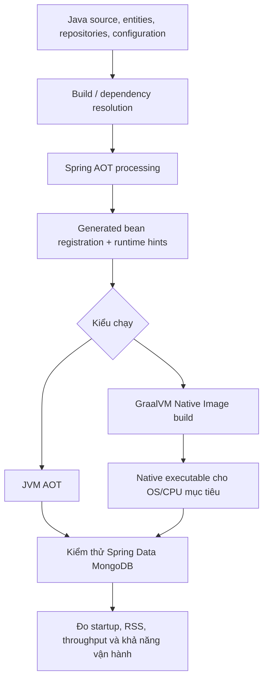

# AOT, native image và giới hạn cần kiểm chứng khi sử dụng

## 1. Mục tiêu và bối cảnh

Trong dự án **Spring Data MongoDB**, ứng dụng Java thường được đóng gói dưới dạng JAR và chạy trên JVM. Khi muốn giảm thời gian khởi động và lượng bộ nhớ nền, nhóm phát triển có thể cân nhắc **Spring AOT (Ahead-of-Time)** và **GraalVM Native Image**. Tuy nhiên, một ứng dụng chạy đúng trên JVM không mặc nhiên hoạt động giống hệt khi được biên dịch thành executable native.

Lý do là **Spring Data MongoDB** sử dụng nhiều cơ chế động: tìm entity và repository, ánh xạ BSON ↔ Java object, gọi constructor, sử dụng converter, proxy, tài nguyên classpath và thư viện của MongoDB Java Driver. Native Image áp dụng phân tích khả năng truy cập (*closed-world reachability analysis*) khi build; những phần chỉ được tìm thấy bằng reflection hoặc nạp động khi runtime có thể cần metadata bổ sung.

Bài thuộc chương **Phiên bản và nâng cấp**, tập trung vào những giới hạn cần **kiểm chứng trên chính tổ hợp phiên bản dự án** trước khi chuyển từ JVM sang native. Sau bài này, bạn có thể:

- Phân biệt Spring AOT, GraalVM Native Image và chạy Java trên JVM thông thường.
- Xác định điểm tương thích giữa Spring Boot, Spring Framework, Spring Data MongoDB, MongoDB Java Driver, JDK và GraalVM.
- Nhận diện các trường hợp cần `RuntimeHints` cho reflection, proxy, resource hoặc JNI.
- Kiểm thử mapping, repository, `MongoTemplate`, aggregation, index, transaction, reactive access và change stream trong executable native.
- Chẩn đoán lỗi build, lỗi khởi động, lỗi kết nối và lỗi chỉ xuất hiện trên một đường thực thi dữ liệu.
- Lập kế hoạch đo hiệu năng và chuyển phiên bản có thể rollback.

> **Nguyên tắc:** Tương thích AOT/native là thuộc tính của **tổ hợp phiên bản, dependency, cách cấu hình và luồng code đang sử dụng**. Không nên suy ra rằng mọi tính năng Spring Data MongoDB đều đã được kiểm chứng chỉ vì một ứng dụng native khởi động thành công.

## 2. Spring AOT khác Native Image như thế nào?

### 2.1. Ba chế độ thực thi

| Chế độ | Đặc điểm | Điểm cần kiểm thử |
| --- | --- | --- |
| JVM thông thường | Spring khởi tạo context tại runtime, Java bytecode chạy trên JVM/JIT | Mapping, bean, driver và chức năng ứng dụng |
| JVM với Spring AOT | Một phần cấu hình Spring/bean metadata được xử lý trước khi chạy | Hành vi bean, conditional configuration, repository và hints |
| GraalVM Native Image | Ứng dụng được biên dịch thành executable cho OS/architecture cụ thể; sử dụng mô hình phân tích reachability | Tất cả luồng nghiệp vụ cùng reflection, proxy, resources, TLS/JNI và hiệu năng native |

**Spring AOT** là quá trình Spring Framework/Boot phân tích cấu hình được biết tại build time, sinh mã hỗ trợ bootstrap và các runtime hints phù hợp. **GraalVM Native Image** là công nghệ biên dịch executable native. Hai thứ có thể phối hợp nhưng không đồng nghĩa: một ứng dụng có thể chạy bản AOT-generated trên JVM để phát hiện một số vấn đề cấu hình trước khi build native.



### 2.2. Closed-world và reachability

Trong ứng dụng JVM, code có thể gọi `Class.forName(...)` hoặc `getDeclaredConstructor(...)` với tên class được chọn khi chạy. Native Image không thể dự đoán mọi class sẽ được nạp theo cách này nếu chúng không xuất hiện trong đồ thị code hoặc metadata có thể phân tích.

Ví dụ:

```java
String typeName = configuration.getExportType();
Class<?> type = Class.forName(typeName);
Object instance = type.getDeclaredConstructor().newInstance();
```

Đoạn code có thể chạy trên JVM với class có sẵn ở classpath. Với Native Image, class/constructor tương ứng có thể cần **reflection hints**, thậm chí cơ chế nạp plugin động có thể không phù hợp với mô hình executable đóng gói sẵn.

Một lỗi native dạng “không tìm thấy constructor/method bằng reflection” có thể là vấn đề reachability. Nó khác với lỗi MongoDB `AuthenticationFailed` hay `MongoTimeoutException`, vốn liên quan kết nối và thông tin xác thực.

## 3. Chốt ma trận phiên bản trước khi build

Không nên chọn phiên bản GraalVM, Spring Boot, Spring Data MongoDB và MongoDB Driver hoàn toàn độc lập. Hãy bắt đầu từ bộ phiên bản được **Spring Boot dependency management** hỗ trợ rồi xem release notes và compatibility matrix của từng thành phần.

| Thành phần | Cần ghi nhận | Vì sao liên quan AOT/native |
| --- | --- | --- |
| **JDK** | Major version và cách build ứng dụng | Source/bytecode target, API Java và tương thích GraalVM |
| **GraalVM / native-image toolchain** | Phiên bản, vendor, OS, architecture | Compiler/linker, TLS, filesystem, native libraries, môi trường runtime |
| **Spring Boot** | Phiên bản và build plugin | Quy trình AOT, autoconfiguration và native build integration |
| **Spring Framework** | Version được Boot quản lý | Bean AOT, reflection/resources hints và proxy |
| **Spring Data MongoDB** | Version được Boot quản lý | Mapping, query/repository, converter và AOT support |
| **MongoDB Java Driver** | Sync/reactive version thực tế | TLS, auth, BSON codecs, client settings và các native dependency nếu sử dụng |
| **MongoDB Server** | Version/topology (standalone/replica set/sharded) | Transaction, change streams, aggregation, indexes và wire protocol |
| **Ứng dụng và thư viện phụ** | Converters, security, tracing, encryption, codecs, custom starter | Reflection, dynamic loading, JNI hoặc resource nằm ngoài ứng dụng chính |

**Điểm phải kiểm chứng theo phiên bản:** khả năng AOT của các repository, điều kiện dùng query derivation, `@Query`/SpEL, custom converter, entity constructors, BSON codec và cách cấu hình driver. Những khả năng này thay đổi theo bản phát hành; tránh đưa ra danh sách hỗ trợ “toàn bộ” mà không chạy chính ứng dụng.

### 3.1. Kiểm tra dependency thực tế

Một lỗi thường gặp là nâng Spring Boot nhưng tự pin `spring-data-mongodb` hoặc `mongodb-driver-sync` sang phiên bản không tương thích với bộ dependency được quản lý. Khi debug, hãy lấy **dependency graph cuối cùng** của ứng dụng thay vì chỉ đọc phiên bản khai báo trong build file.

Với Gradle, lệnh tham khảo:

```bash
./gradlew dependencies --configuration runtimeClasspath
```

Với Maven:

```bash
./mvnw dependency:tree
```

Đối chiếu phiên bản Spring Data, MongoDB Driver, BSON và các module liên quan trên **runtime classpath**. Nếu có nhiều starter hoặc custom driver dependencies, cần kiểm tra xung đột phiên bản. Không chỉnh sửa dependency của module khác khi chưa xác nhận nguyên nhân.

## 4. Quy trình tạo bản native để kiểm thử

Một dự án Spring Boot dùng Gradle thường tích hợp **GraalVM Native Build Tools** và Spring Boot plugin. Bước build có thể tạo executable native trực tiếp hoặc build container image tùy công cụ được cấu hình.

Ví dụ lệnh khi project **đã khai báo đúng các plugin và toolchain**:

```bash
# Linux/macOS: chạy JVM tests trước.
./gradlew test

# Nếu đã cấu hình GraalVM Native Build Tools:
./gradlew nativeCompile

# Nếu project đã cấu hình nativeTest:
./gradlew nativeTest
```

Windows PowerShell:

```powershell
.\gradlew.bat test
.\gradlew.bat nativeCompile
```

Đây là lệnh minh họa workflow, **không có nghĩa mọi project đều đã có task** `nativeCompile` hoặc `nativeTest`. Với Maven, quy trình tương ứng có thể qua profile native và GraalVM plugin; cần dùng cấu hình plugin phù hợp phiên bản của dự án.

Thông thường nên đi theo các mốc:

1. **Baseline trên JVM:** build, test, kết nối MongoDB và ghi nhận metrics.
2. **Chạy AOT trên JVM nếu pipeline hỗ trợ:** tìm khác biệt về bean, repository và configuration.
3. **Build native:** quan sát lỗi phân tích, reflection, resource, static initialization, native library.
4. **Chạy executable native với MongoDB kiểm thử:** kiểm tra CRUD, mapping, auth/TLS, query và tính năng nâng cao.
5. **Thử image/container của chính môi trường triển khai:** xác nhận certificate, architecture, secrets và file system.
6. **Đo hiệu năng/độ ổn định:** so sánh cùng workload với bản JVM.

Một native binary được build cho một hệ điều hành và architecture nhất định. Không giả định executable Windows chạy được trên Linux container hoặc binary x86_64 chạy được trên ARM64 nếu không có build tương ứng. Khi build trên CI/container, kiểm tra thêm OS base image, libc, linker và khả năng cung cấp các thư viện native cần thiết.

## 5. Spring Data MongoDB mapping: điều gì cần reachable?

Spring Data MongoDB chuyển đổi giữa Java object và BSON thông qua metadata mapping, converter và đôi khi reflection. Các phần quan trọng là:

- `@Document`, `@Id`, `@Field`, `@Indexed`, `@Version` và annotation mapping khác.
- Constructor/creator dùng để khởi tạo entity từ BSON.
- Property accessors, field access, getter/setter, Java record components.
- `MappingMongoConverter`, custom `@ReadingConverter` / `@WritingConverter`.
- Các kiểu lồng nhau, collection, enum, `Instant`, `BigDecimal`, `ObjectId`, polymorphic subtype và type alias.
- Code ứng dụng chỉ định class ánh xạ **ở runtime** qua tên class, registry hoặc plugin.

### 5.1. Entity có constructor rõ ràng

Ví dụ một entity có constructor để Spring Data tạo đối tượng khi đọc:

```java
import java.time.Instant;
import org.springframework.data.annotation.Id;
import org.springframework.data.annotation.PersistenceCreator;
import org.springframework.data.mongodb.core.mapping.Document;

@Document("orders")
public class Order {

    @Id
    private final String id;
    private final String tenantId;
    private final String status;
    private final Instant createdAt;

    @PersistenceCreator
    public Order(String id, String tenantId,
                 String status, Instant createdAt) {
        this.id = id;
        this.tenantId = tenantId;
        this.status = status;
        this.createdAt = createdAt;
    }

    public String getId() { return id; }
    public String getTenantId() { return tenantId; }
    public String getStatus() { return status; }
    public Instant getCreatedAt() { return createdAt; }
}
```

Constructor và mapping metadata của entity cần khả dụng trong chế độ chạy đích. Spring Data và Spring AOT có cơ chế hỗ trợ nhiều loại model được biết tại build time. Tuy nhiên, **không mặc nhiên cho rằng mọi class được tạo hoặc chọn động đều được phát hiện**.

Một test chỉ lưu document (`save`) chưa đủ. Đường đọc (`findById`) có thể là nơi đầu tiên gọi constructor/field access theo cơ chế khác và lộ ra lỗi reachability.

### 5.2. Test phải đi qua cả hai chiều chuyển đổi

```java
@Test
void orderRoundTripThroughMongoTemplate() {
    Order input = new Order(
            "ORD-NATIVE-01",
            "tenant-test",
            "PAID",
            Instant.parse("2026-11-20T00:00:00Z"));

    mongoTemplate.save(input);

    Order restored = mongoTemplate.findById(
            input.getId(), Order.class);

    assertThat(restored).isNotNull();
    assertThat(restored.getTenantId()).isEqualTo("tenant-test");
    assertThat(restored.getStatus()).isEqualTo("PAID");
    assertThat(restored.getCreatedAt()).isEqualTo(
            input.getCreatedAt());
}
```

Test này cần MongoDB test thật (ví dụ Testcontainers hoặc database kiểm thử được phép). Phải chạy **cả dưới JVM và trong executable native** để phát hiện khác biệt do reflection, constructor binding hoặc converter.

Nếu ứng dụng có custom converters, kiểm tra thêm trường hợp null, nested object, enum và dữ liệu BSON được ghi từ phiên bản cũ. Đừng chỉ test model mới ghi rồi tự đọc bằng đúng cùng một version.

## 6. Repository, query và proxy trong AOT

Spring Data repository tạo implementation/proxy dựa trên interface và metadata của repository. Khi bật AOT, phần bean definition và hỗ trợ repository có thể được xử lý khác so với JVM khởi tạo hoàn toàn động.

Ví dụ:

```java
public interface OrderRepository
        extends MongoRepository<Order, String> {

    List<Order> findByTenantIdAndStatus(
            String tenantId, String status);
}
```

Với repository này, cần test:

1. Repository bean được tạo trong native executable.
2. Derived query tìm đúng field sau khi `@Field` và converter được áp dụng.
3. Query có điều kiện tenant hoặc quyền truy cập vẫn hoạt động.
4. Paging, sorting, mapping của projection/DTO và custom repository fragment còn đúng.
5. Các interface projection, proxy lồng nhau hoặc code gọi method bằng reflection có metadata cần thiết.

**Trường hợp dễ sót:** repository được khai báo qua cơ chế scan hoặc bean registration phụ thuộc vào cấu hình runtime ngoài tập input mà Spring AOT biết khi build. AOT không đồng nghĩa có thể phát hiện vô hạn class/bean mới được thêm sau khi binary đã build. Nếu ứng dụng chọn package/model/repository theo plugin lúc chạy, cần thay thiết kế hoặc tạo metadata/registration có kiểm soát.

### 6.1. `@Query`, SpEL và repository fragment

Các cách query thường cần kiểm tra riêng:

- Query derivation: `findByStatusAndTenantId(...)`.
- `@Query` chứa JSON query tĩnh hoặc biểu thức được Spring Data hỗ trợ.
- Query với SpEL, parameter binding hoặc custom converters.
- `@Aggregation` trong repository và kết quả DTO/projection.
- Custom repository fragment triển khai bằng class riêng, có bean/proxy được phát hiện đúng.

Một câu query được parse thành công trên JVM không đảm bảo mọi biểu thức hoặc class chỉ dùng trong một nhánh hiếm đã reachable trong native. Nên test **query thực** và xác minh kết quả, không dừng ở `ApplicationContext` khởi động.

## 7. MongoTemplate và các đường mapping động

`MongoTemplate` linh hoạt vì có thể nhận `Class<?>`, tên collection hoặc pipeline được xây tại runtime. Chính sự linh hoạt đó đòi hỏi chú ý trong Native Image.

Ví dụ:

```java
Class<?> domainType = registeredTypes.get(typeKey);
Object value = mongoTemplate.findById(id, domainType);
```

Nếu `registeredTypes` chứa những class chỉ được chọn từ metadata runtime và không xuất hiện trong đồ thị mapping/bean ở build time, native compiler có thể không đăng ký đủ metadata tạo object cho các class này.

Giải pháp nên cân nhắc theo thứ tự:

1. Ưu tiên các loại entity **được khai báo và discoverable** tại build time.
2. Giữ registry các class hợp lệ rõ ràng thay vì nhận class name tùy ý từ request.
3. Chạy các đường đọc/ghi thực tế để xác định thiếu hint thuộc **class/constructor/property** nào.
4. Đăng ký **RuntimeHints cụ thể** cho các thành phần động được kiểm chứng.
5. Với plugin tải JAR mới sau khi executable đã build, đánh giá lại kiến trúc; metadata reflection không biến Native Image thành một JVM có classpath mở rộng tùy ý.

## 8. RuntimeHints: bổ sung chính xác phần Spring AOT không thấy

`RuntimeHints` là API Spring Framework để đăng ký metadata cần thiết khi tạo native image, như **reflection**, **JDK proxy**, **resources**, **serialization** hoặc **JNI**, tùy use case. Không phải mọi entity đều cần thêm hints thủ công: Spring Data và framework có thể đóng góp hints cho các class/bean đã được phát hiện.

Giả sử lớp `LegacyAuditPayload` chỉ được ánh xạ thông qua registry động và native build/test cho thấy thiếu reflection metadata. Có thể đăng ký rõ:

```java
import org.springframework.aot.hint.MemberCategory;
import org.springframework.aot.hint.RuntimeHints;
import org.springframework.aot.hint.RuntimeHintsRegistrar;

public final class MongoRuntimeHints implements RuntimeHintsRegistrar {

    @Override
    public void registerHints(RuntimeHints hints,
                              ClassLoader classLoader) {

        hints.reflection().registerType(
                LegacyAuditPayload.class,
                MemberCategory.INVOKE_DECLARED_CONSTRUCTORS,
                MemberCategory.INVOKE_PUBLIC_METHODS,
                MemberCategory.DECLARED_FIELDS);
    }
}
```

Kích hoạt registrar qua cấu hình Spring:

```java
import org.springframework.context.annotation.Configuration;
import org.springframework.context.annotation.ImportRuntimeHints;

@Configuration(proxyBeanMethods = false)
@ImportRuntimeHints(MongoRuntimeHints.class)
class MongoNativeConfiguration {
}
```

Trong ví dụ, `LegacyAuditPayload` là class nghiệp vụ do dự án định nghĩa; class này phải thật sự có mặt khi build. Những `MemberCategory` được chọn cần khớp cách thư viện truy cập class; không có lý do mở mọi field/method chỉ vì class có mặt trong MongoDB mapping.

### 8.1. Test hint riêng trước khi build executable

Có thể test metadata khai báo bằng `RuntimeHintsPredicates`:

```java
@Test
void legacyPayloadConstructorIsRegistered() {
    RuntimeHints hints = new RuntimeHints();
    new MongoRuntimeHints().registerHints(
            hints, getClass().getClassLoader());

    assertThat(RuntimeHintsPredicates.reflection()
            .onType(LegacyAuditPayload.class)
            .withMemberCategory(MemberCategory.INVOKE_DECLARED_CONSTRUCTORS)
            .test(hints))
            .isTrue();
}
```

Đây là test một phần metadata, **không chứng minh native executable đã chạy đúng**. Vẫn phải build native và kiểm thử đường truy cập class thật.

### 8.2. Resources, proxy và serialization

Các trường hợp khác có thể cần hints:

| Nhóm | Ví dụ | Cách xác minh |
| --- | --- | --- |
| **Reflection** | Class entity/chuyển đổi được chọn động, constructor không reachable | Test đọc BSON → Java |
| **JDK proxy** | Một interface proxy tự tạo ngoài cơ chế Spring AOT tự nhận | Khởi tạo proxy và gọi method trong native |
| **Resources** | JSON Schema, template pipeline, cấu hình nằm trong classpath | Đọc resource bằng đường đi thật trong native |
| **Serialization** | Dữ liệu qua cơ chế Java serialization trong thư viện phụ | Test serialize/deserialize đúng kiểu |
| **JNI** | Thư viện phụ gọi mã native | Kiểm chứng toolchain/metadata/native library trên OS đích |

Một resource chỉ nằm trên classpath không đương nhiên được đóng vào Native Image trong mọi trường hợp. Khi ứng dụng nạp file động qua `ClassLoader.getResourceAsStream(...)`, cần kiểm tra **resource pattern** hoặc nguồn cung cấp file.

Mặt khác, file cấu hình bên ngoài image (ví dụ truststore được mount vào container) cần được kiểm tra như **file runtime**, không nên nhúng bí mật vào binary để “cho dễ chạy”.

### 8.3. Không mở toàn bộ reflection theo package

Đăng ký metadata quá rộng có thể tăng kích thước binary, thời gian build, bề mặt tấn công và che giấu vấn đề thiết kế dynamic loading. Hãy chỉ thêm hints sau khi có bằng chứng thiếu reachability và test tương ứng. Spring AOT và các thư viện có thể đã tạo sẵn hints cho phần thông dụng.

## 9. Custom converter, BSON codec và schema động

Mapping MongoDB có thể dùng converter được cấu hình qua `MongoCustomConversions`:

```java
@ReadingConverter
public class MoneyReadConverter
        implements Converter<Document, Money> {

    @Override
    public Money convert(Document source) {
        return new Money(
                source.getString("currency"),
                source.get("amount", Decimal128.class).bigDecimalValue());
    }
}
```

Đây là ví dụ converter đọc từ BSON document sang value object, với giả định trường `amount` được lưu dưới dạng BSON Decimal128 và có import `org.bson.types.Decimal128`. Nếu converter được đăng ký như bean/cấu hình Spring rõ ràng, framework thường có nhiều thông tin hơn để xử lý AOT. Nếu converter được phát hiện qua tên class trong properties hoặc registry phản chiếu ở runtime, cần test reachability.

Những tình huống nên kiểm tra:

- Constructor và field access của nested/polymorphic types.
- `@TypeAlias` và giá trị `_class` của document cũ.
- Custom `CodecRegistry` hoặc BSON codec được tạo bằng reflection.
- `BigDecimal`, ngày giờ, enum, Java record, generic collections và các trường null.
- Converter chỉ được dùng với collection hiếm hoặc một loại event cũ.
- Schema validation hoặc aggregation đọc kết quả vào DTO động.
- Tương thích round-trip giữa dữ liệu do **JVM phiên bản cũ** ghi và **native phiên bản mới** đọc.

Đặc biệt với `_class` hoặc subtype discriminator: dữ liệu cũ có thể tham chiếu kiểu mà quá trình AOT không thấy ở startup. Nếu kiểu đó vẫn cần đọc, hãy kiểm tra alias/mapping và có hints chính xác hoặc chiến lược migration.

## 10. Aggregation, index, transaction và repository trong native

Native Image không thay đổi trực tiếp giới hạn MongoDB Server: giới hạn BSON, memory của aggregation, index, locking hoặc khả năng hỗ trợ transaction vẫn do server/topology quyết định. Nhưng cách tạo query, ánh xạ kết quả và nạp metadata phía Java có thể khác.

### 10.1. Aggregation

Kiểm tra một pipeline thật:

```java
Aggregation pipeline = Aggregation.newAggregation(
        Aggregation.match(
                Criteria.where("tenantId").is(tenantId)),
        Aggregation.group("status")
                .count().as("count"),
        Aggregation.sort(Sort.Direction.DESC, "count")
);

AggregationResults<StatusCount> result =
        mongoTemplate.aggregate(
                pipeline, "orders", StatusCount.class);
```

`StatusCount` là read model do dự án định nghĩa, cần ánh xạ field `_id` và `count` phù hợp. Nếu nó chỉ xuất hiện ở một nhánh hiếm khi thực thi, test native phải chạy nhánh đó. Với `@Aggregation` hoặc các projection tạo động, kiểm tra thêm cách Spring Data khởi tạo result type.

### 10.2. Index

Các annotation `@Indexed`, `@CompoundIndex` hoặc chiến lược tạo index thủ công cần được kiểm tra ở cả hai chế độ. **Annotation không tự bảo đảm index đã được tạo trong database**; hành vi tự tạo index phụ thuộc cấu hình và phiên bản Spring Data. Native hóa ứng dụng không nên âm thầm làm thay đổi quy trình migration/index do đội vận hành quản lý.

Ví dụ kiểm tra có điều kiện:

```java
IndexOperations indexes =
        mongoTemplate.indexOps(Order.class);

List<IndexInfo> indexInfo = indexes.getIndexInfo();
// Kiểm chứng tên/key của index mà truy vấn nghiệp vụ cần.
```

Test cần kiểm tra cả metadata index và `explain` của truy vấn quan trọng. Một query chạy được nhưng bỏ index có thể làm giảm hiệu năng production.

### 10.3. Transaction

Khi dùng `MongoTransactionManager` hoặc `ReactiveMongoTransactionManager`, cần kiểm tra:

- MongoDB deployment có hỗ trợ transaction không.
- `ClientSession` và transaction manager được tạo đúng bean.
- `@Transactional` hoặc `TransactionalOperator` có thực sự ràng buộc thao tác vào transaction hay không.
- Trường hợp rollback khi operation thứ hai thất bại.
- Các bean/proxy phục vụ transaction và custom configuration có hoạt động trong native executable.

Ví dụ test đáng giá: thực hiện hai thao tác thuộc cùng transaction, cố tình gây lỗi ở thao tác sau và xác minh trạng thái database như kỳ vọng. Chỉ test ghi một document thành công **không kiểm chứng transaction**.

## 11. Reactive access và change stream

Nếu dùng `spring-boot-starter-data-mongodb-reactive`, hãy kiểm chứng **reactive driver** và `ReactiveMongoTemplate`/reactive repositories độc lập với bản blocking:

- Tạo `Mono`/`Flux` chưa tạo network request cho đến khi có subscription.
- Mapping của nested entity và converter phải hoạt động khi publisher được subscribe.
- Transaction reactive đòi hỏi cấu hình manager và ngữ cảnh reactive phù hợp.
- Change stream cần replica set/sharded deployment hỗ trợ và token/timeout logic hoạt động.
- `retryWhen(...)` không tự khắc phục lỗi non-resumable hoặc thay thế checkpoint.
- Nếu ứng dụng dùng cùng lúc blocking và reactive clients, cần xác minh cấu hình TLS, authentication và database của **cả hai client**.

Ví dụ smoke test reactive có subscription thực:

```java
StepVerifier.create(
        reactiveMongoTemplate.findById(
                "ORD-NATIVE-01", Order.class))
    .assertNext(order ->
            assertThat(order.getStatus()).isEqualTo("PAID"))
    .verifyComplete();
```

Trong test end-to-end, chuẩn bị document kiểm thử trước và kiểm tra luồng không chặn event loop. Chỉ tạo `Mono` rồi không subscribe không đủ để xác minh kết nối MongoDB hoặc reflection hints.

Với change stream, một smoke test chỉ mở stream có thể chưa kích hoạt nhánh xử lý event. Nên tạo một event kiểm thử, nhận event, lưu resume token, restart consumer và xác minh nhận tiếp đúng quy tắc idempotency.

## 12. MongoDB Driver, TLS, DNS, authentication và tài nguyên runtime

Các vấn đề kết nối thường **không phải lỗi AOT**. Native executable vẫn cần URI hợp lệ, DNS hoạt động, TLS trust chain, credentials đúng, `authSource` phù hợp và quyền trên namespace. Nhưng đóng gói native có thể thay đổi cách lấy file/certificate và cách khởi tạo thư viện.

### 12.1. Kết nối và cấu hình

Ví dụ cấu hình sử dụng biến môi trường:

```properties
spring.data.mongodb.uri=${MONGODB_URI}
```

Tên property MongoDB trong Spring Boot có thể khác theo phiên bản. Đối chiếu configuration reference ứng với **phiên bản đang nâng cấp**; đừng sao chép một property từ bản cũ mà cho rằng vẫn được bind như trước.

Nếu tự tạo `MongoClient` bean, Spring Boot auto-configuration có thể không còn là nguồn cấu hình được sử dụng. Khi chạy native, phải kiểm tra **bean thực tế** và settings cuối cùng, không chỉ giá trị environment.

### 12.2. TLS truststore và resource

Trong Java container, CA custom có thể được cấp qua truststore file và cấu hình JVM. Với native executable, các quy tắc về trust store/SSL phụ thuộc toolchain, platform và cách build. Cần xác nhận trực tiếp:

1. Có kết nối TLS tới đúng host và chứng chỉ hợp lệ không.
2. Có lấy được file/CA đã cấu hình trên OS/container đích không.
3. Tên host trong URI có khớp SAN certificate không.
4. Có cần mTLS client certificate hoặc key file không; đường dẫn và quyền file còn đúng không.
5. Khi build image bằng container, có copy/mount đúng CA và cấu hình runtime không.

**Không nhúng private key, password, token KMS vào native binary**. Giữ secrets bên ngoài image khi vận hành và kiểm soát quyền đọc.

### 12.3. DNS SRV và mạng

`mongodb+srv://` yêu cầu tra DNS SRV/TXT và kết nối đến các host được trả về. Khi chạy native trong môi trường khác JVM, kiểm tra DNS resolver, DNS policy, network policy, security group, replica set advertised hosts và port. Một binary khởi động rất nhanh nhưng không resolve được SRV record vẫn không thể sử dụng MongoDB.

### 12.4. CSFLE, crypt_shared, libmongocrypt và JNI

Nếu dùng **Client-Side Field Level Encryption (CSFLE)** hoặc Queryable Encryption, một số triển khai yêu cầu thành phần mã hóa native hoặc thư viện hỗ trợ phân tích truy vấn theo bản driver MongoDB đang dùng. Đây là điểm cần kiểm chứng riêng khi đóng gói thành GraalVM Native Image:

- Thư viện native tương ứng với **OS/architecture/ABI** của binary có mặt trong runtime không?
- Driver có thể nạp thư viện theo đường dẫn và cơ chế được hỗ trợ không?
- Cấu hình `AutoEncryptionSettings`, key vault, DEK và KMS có hoạt động khi thực thi native không?
- Thư viện/driver/version có hỗ trợ Native Image trong tổ hợp đang chọn không?
- Các tài nguyên, JNI metadata, SSL/KMS settings và file được dùng bởi encryption được đóng gói đúng không?

**Không giả định “đã có `@Encrypted`” nghĩa là build native tự động hỗ trợ mã hóa.** Các thành phần mã hóa phụ thuộc nhiều phiên bản và thư viện ngoài; cần test end-to-end rằng giá trị thực sự lưu ở MongoDB dưới dạng ciphertext và được giải mã đúng bởi client có quyền.

Nếu vendor/toolchain không hỗ trợ tổ hợp này, cân nhắc giữ dịch vụ sử dụng encryption trên JVM hoặc điều chỉnh kiến trúc sau khi đánh giá. Đừng tắt mã hóa để vượt qua lỗi build.

## 13. Lỗi native thường gặp và cách tìm nguyên nhân

| Triệu chứng | Nguyên nhân có thể | Hướng xử lý |
| --- | --- | --- |
| Native build không tạo executable | Unsupported API, class initialization, JNI, native library hoặc thiếu toolchain | Đọc log build, dependency graph và tương thích toolchain |
| Khởi động native lỗi bean/repository | Bean registration/conditional config hoặc proxy không được xử lý đúng | So sánh AOT JVM và native, kiểm tra cách khai báo bean |
| Chỉ đọc một loại entity mới báo reflection error | Class/constructor/converter động thiếu hints | Test mapping cụ thể và thêm `RuntimeHints` hẹp |
| Đọc resource từ classpath thất bại | Resource không có trong image | Đăng ký resource hints hoặc dùng runtime file đúng chỗ |
| Chỉ TLS production lỗi | Truststore/CA/SAN hoặc runtime file không hiện diện | Test cùng trust chain/hostname trên image đích |
| URI SRV lỗi trong container | DNS policy/network khác môi trường dev | Tra SRV/TXT và TCP từ đúng container |
| `AuthenticationFailed` hoặc `Unauthorized` | `authSource`, secret, database hoặc role không đúng | Sửa cấu hình/quyền tương ứng, không đổi hints tùy tiện |
| CSFLE không nạp được library | Native dependency, ABI hoặc đường dẫn thư viện | Xác minh driver/vendor support và packaging |
| Test JVM qua nhưng native cho dữ liệu mapping sai | Đường chuyển đổi hiếm, class thiếu reachability hoặc khác profile | Tái hiện dữ liệu/case trên native, kiểm tra converter/type alias |
| Native chạy đúng nhưng chậm ở steady state | Khác biệt tối ưu hóa runtime, I/O, query, pool hoặc cấu hình memory | Benchmark cùng workload trước khi kết luận |

### 13.1. Tách lỗi build-time với runtime

- **Build-time**: lỗi compiler, class initialization, static build hooks, native library linking. Đọc log native-image và dependency liên quan; không thay URI MongoDB trừ khi build cố truy cập một dịch vụ không cần thiết.
- **Startup-time**: bean bị thiếu, conditional profile khác, resource không tìm thấy, cấu hình sai. So sánh context/auto-config và hints.
- **Operation-time**: mapper khi đọc subtype, repository method hiếm, custom converter, MongoDB connection hoặc aggregation. Gắn lỗi với **operation và entity type cụ thể** để biết thiếu hint hay lỗi server/driver.
- **Load-time**: GC/memory, heap, connection pool, mức concurrency và response latency. Benchmark thay vì suy luận “native luôn nhanh hơn”.

### 13.2. Không chữa lỗi bằng hints ngẫu nhiên

Nếu thấy `MongoTimeoutException`, không nên thêm reflection hints. Nếu thấy thiếu constructor `LegacyAuditPayload`, không nên tăng server selection timeout. Hãy phân loại exception, xác định phase và tái hiện bằng test nhỏ trước khi đổi cấu hình.

## 14. Ma trận kiểm chứng native tối thiểu

Một ứng dụng Spring Data MongoDB thường có nhiều đường code không được kích hoạt trong startup. Hãy dùng **cùng bộ dữ liệu kiểm thử và môi trường MongoDB tương đương** để chạy cả JVM và native.

| Nhóm kiểm thử | Ca cần chạy | Điều muốn xác nhận |
| --- | --- | --- |
| Bootstrap / configuration | Tạo context với profile triển khai, bean MongoClient | AOT không bỏ thiếu bean, config đúng |
| URI / DNS / TLS / auth | Kết nối test DB với URI production-like | Network, secret, CA và `authSource` hoạt động |
| CRUD | Insert, findById, updateFirst, delete theo quyền test | Driver + mapping hai chiều |
| Entity mapping | Nested object, enum, Java time, record/constructor, `@Field` | Converter/reflection đúng |
| Repository | Derived query, `@Query`, custom fragment, paging | Proxy/query infrastructure còn hoạt động |
| Projection | Interface projection và DTO động | Không thiếu metadata/proxy |
| Aggregation | `$match`, `$group`, `$lookup`/`$project`, kết quả DTO | Mapping stage và kết quả đúng |
| Index | Kiểm tra index cần thiết, `explain` query quan trọng | Không đổi chiến lược tạo index |
| Transaction | Commit, rollback, lỗi giữa hai thao tác | Transaction manager/session hoạt động |
| Reactive | Subscribe các `Mono`/`Flux`, backpressure path | Reactive driver và mapping thật sự được chạy |
| Change stream | Nhận event, restart với token, xử lý lại an toàn | Stream lifecycle và checkpoint đúng |
| CSFLE nếu dùng | Ghi field đã mã hóa, quan sát ciphertext, giải mã | Native libs, KMS, key vault có thể dùng |
| Resource | Đọc template, JSON schema, certificate được hỗ trợ | Classpath/runtime file có mặt |
| Observability | Health check, metrics, logs/traces | Không lộ secrets/PII, theo dõi lỗi được |
| Tải và restart | Cold start, steady state, shutdown và reconnect | Startup, RSS, latency, connection pool |

**Đừng đánh dấu PASS chỉ vì test JVM hoặc test unit không cần MongoDB chạy thành công.** Test native cần **chạy executable thực** hoặc bài test được native test tooling biên dịch, trên môi trường có driver và database phù hợp.

### 14.1. Test có giá trị nhất khi tìm điểm khuất

Ví dụ ứng dụng có entity chỉ dùng khi `status=ARCHIVED`. Hãy seed data archived và gọi repository method, custom converter hoặc report tương ứng trong native. Một binary chỉ test `/health` có thể chưa bao giờ chạm class đó, nên không phát hiện thiếu reflection hints.

Tương tự, nếu aggregation trả về DTO có constructor đặc biệt, test trả kết quả **không rỗng** để buộc mapper phải tạo DTO. Pipeline trả 0 document có thể chạy qua mà không thực hiện bước mapping gây lỗi.

## 15. So sánh hiệu năng JVM và native bằng cùng workload

Native Image có thể cải thiện cold start và footprint ở một số workload, nhưng không có bảo đảm tuyệt đối rằng throughput hoặc p99 latency sẽ tốt hơn JVM đã warm up.

Để so sánh công bằng:

1. Dùng cùng version ứng dụng, dataset, index, số tenant, URI, pool settings và MongoDB Server.
2. Đo **thời gian khởi động hữu ích**, tức đến khi một request MongoDB được xác thực và thực thi thành công; đừng chỉ đo đến khi process được tạo.
3. Đo **RSS/working set**, heap và giới hạn container ở nhiều mức concurrency.
4. Đo p50/p95/p99 cho các endpoint CRUD, aggregation và reactive access có representative payload.
5. Đo throughput, số connection, retry/error và CPU phía ứng dụng lẫn MongoDB.
6. Tách **cold start** với **steady state**; đo nhiều lần, tránh quy kết chênh lệch cho compiler khi thực ra do cache/index/network.
7. Kiểm tra chi phí build, thời gian CI, kích thước executable/image và độ phức tạp vận hành.
8. So sánh với baseline JVM đã tối ưu cấu hình memory, CDS/AOT hoặc container resources nếu ứng dụng đang sử dụng.

Một ví dụ bảng đo cần điền bằng số thực tế:

| Metric | JVM baseline | AOT JVM | Native |
| --- | --- | --- | --- |
| Khởi động đến readiness có truy vấn MongoDB thành công | Đo thực tế | Đo thực tế | Đo thực tế |
| RSS tại idle | Đo thực tế | Đo thực tế | Đo thực tế |
| P95 `GET /orders/{id}` | Đo thực tế | Đo thực tế | Đo thực tế |
| P95 aggregate báo cáo | Đo thực tế | Đo thực tế | Đo thực tế |
| Throughput ở cùng mức lỗi | Đo thực tế | Đo thực tế | Đo thực tế |
| Thời gian build + kích thước image | Đo thực tế | Đo thực tế | Đo thực tế |

Với dịch vụ kết nối MongoDB, phần lớn độ trễ có thể đến từ network, index hoặc truy vấn; native hóa Java không thay thế việc tối ưu query, index và schema.

## 16. Quy trình nâng cấp, canary và rollback

Để chuyển một dịch vụ Spring Data MongoDB từ JVM sang native an toàn:

1. **Chốt bộ phiên bản được hỗ trợ** và lưu dependency graph cùng toolchain; chọn baseline JVM hiện hành.
2. **Ghi lại các tính năng đang dùng**: repository, converter, MongoTemplate, reactive, transaction, change stream, CSFLE, index, security/metrics.
3. **Chạy test chức năng trên JVM** và xác định các trường hợp dữ liệu cũ/legacy cần giữ tương thích.
4. **Kích hoạt AOT và build native**; xử lý cụ thể từng lỗi reachability, resource, proxy hoặc native library.
5. **Chạy matrix integration/native** trên MongoDB phù hợp topology và quyền.
6. **Đo hiệu năng** với cùng workload, xác định tiêu chí về startup, RSS, latency và tỷ lệ lỗi.
7. **Canary một nhóm instance nhỏ**; theo dõi fail count, connection pool, query latency, GC/memory, event lag và error rate.
8. **Chuẩn bị rollback** về JVM artifact tương ứng nếu native gặp lỗi hiếm; bảo đảm không làm thay đổi schema/data theo cách không thể quay lại.
9. **Nâng tỷ lệ triển khai** khi evidence đạt yêu cầu; ghi lại các hạn chế đã chấp nhận và bộ test phải chạy ở những lần nâng cấp sau.

**Lưu ý migration dữ liệu:** đổi runtime JVM → native về bản chất không bắt buộc đổi cấu trúc document. Nếu đồng thời nâng Spring Data/Driver và sửa mapping, converter, `_class`, transaction semantics hoặc default UUID representation, cần coi đó là **một thay đổi tương thích dữ liệu riêng**. Tách được hai nhóm thay đổi sẽ dễ điều tra và rollback hơn.

### 16.1. Những tín hiệu phải dừng rollout

- Native binary tạo hoặc đọc sai dữ liệu so với JVM đối với cùng BSON.
- Transaction rollback không giữ invariant nghiệp vụ.
- Không thể đọc document legacy/polymorphic đã lưu.
- Change stream bị bỏ sót event hoặc checkpoint không đúng khi restart.
- Thiếu certificate/KMS/native encryption library trong môi trường đích.
- Tỷ lệ lỗi hoặc độ trễ p95/p99 vượt ngưỡng đã định với cùng workload.
- Chưa có phép kiểm tra đúng phần nghiệp vụ hiếm chỉ chạy trên native.

## 17. Bài tập thực hành

**Tình huống:** một dịch vụ quản lý đơn hàng dùng Spring Data MongoDB có các thành phần:

- `OrderRepository` với derived query theo `tenantId` và trạng thái.
- `MongoTemplate` tạo aggregation cho báo cáo; DTO `StatusCount` chỉ được dùng ở endpoint báo cáo.
- Một `MappingMongoConverter` có custom converter cho `Money`.
- Worker reactive theo dõi change stream để cập nhật read model.
- MongoDB được kết nối qua TLS với CA nội bộ và URI SRV.
- Một loại `LegacyAuditPayload` được chọn từ cấu hình runtime cho các bản ghi cũ.

Yêu cầu:

1. Liệt kê các class/bean và đường xử lý mà Spring AOT có khả năng phát hiện qua cấu hình tĩnh, cùng đường xử lý cần kiểm tra reachability động.
2. Viết `RuntimeHintsRegistrar` tối thiểu cho `LegacyAuditPayload` sau khi chứng minh metadata thiếu; nêu vì sao không đăng ký toàn bộ package.
3. Viết test native cho `save + findById` và aggregation trả về ít nhất một `StatusCount`, bao gồm BSON dữ liệu cũ.
4. Chạy `ReactiveMongoTemplate`/change stream với subscription thật, ghi token, restart và xác minh checkpoint.
5. Kiểm tra URI SRV từ container, certificate CA, quyền database và số kết nối trước khi kết luận lỗi native.
6. Đo startup-to-readiness, RSS, p95 API và tốc độ xử lý event trên cùng dataset JVM/native.
7. Mô tả rollback nếu mapping hoặc thư viện mã hóa không hoạt động trên native.

### Câu hỏi tự kiểm tra

1. Spring AOT và GraalVM Native Image giống và khác nhau ở điểm nào?
2. Vì sao `ApplicationContext` khởi động native thành công vẫn có thể có lỗi reflection khi đọc một entity hiếm?
3. Khi nào nên thêm `RuntimeHints` cho MongoDB mapping? Khi nào hints thủ công có thể là thừa?
4. Vì sao test chỉ `save` không kiểm chứng đủ khả năng đọc BSON → Java?
5. `@Query`, custom repository fragment và interface projection có những điểm nào cần kiểm tra trong native?
6. Một lỗi `MongoTimeoutException` trong binary native có nhất thiết là lỗi AOT không?
7. Vì sao không nên nhúng password hoặc private key vào executable để sửa lỗi TLS/KMS?
8. Cần đo những gì trước khi kết luận native image giúp cải thiện hiệu năng?
9. Nếu cả bản nâng Spring Data và chuyển sang native cùng thay đổi mapping, rủi ro rollback là gì?
10. Một pipeline reactive chưa được subscribe có chứng minh hoạt động được trên native không?

## 18. Ghi nhớ

- **Spring AOT** hỗ trợ tạo mã và metadata tại build time; **GraalVM Native Image** biên dịch executable native theo mô hình reachability.
- **Spring Data MongoDB** có các đường mapping/repository/proxy/converter động cần kiểm chứng với dữ liệu thật, nhất là các class chỉ được dùng ở một nhánh hiếm.
- **RuntimeHints** giải quyết những trường hợp cần reflection, proxy hoặc resources mà quá trình AOT chưa thấy; đăng ký đúng class/method cần dùng và giữ test tương ứng.
- **CRUD, aggregation, index, transaction, reactive và change stream** cần có integration test chạy trên native, không chỉ unit test JVM.
- **MongoDB Java Driver** vẫn phải đáp ứng URI, DNS SRV/TXT, TLS, `authSource`, quyền và topology; những lỗi này không tự động là lỗi native.
- **CSFLE/Queryable Encryption** cần kiểm chứng thư viện native/JNI, key vault và KMS trên đúng môi trường triển khai.
- **Performance cần đo** bằng cùng workload: startup-to-readiness, RSS, throughput, p95/p99, build cost và tỷ lệ lỗi.
- **Nâng cấp an toàn** cần ma trận version/dependency, test dữ liệu cũ, canary, theo dõi và rollback có thể thực hiện.

Native Image có thể là lựa chọn tốt cho một số dịch vụ Spring Data MongoDB, đặc biệt khi cold start và footprint là tiêu chí quan trọng. Quyết định triển khai nên dựa trên **khả năng tương thích đã kiểm thử và số liệu vận hành thực tế**, đồng thời giữ nguyên yêu cầu đúng dữ liệu, bảo mật và độ tin cậy của truy vấn MongoDB.

