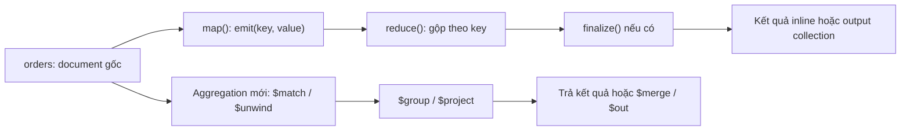
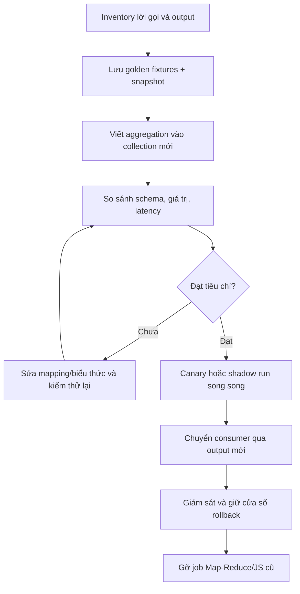

# Tiếp nhận hệ thống cũ dùng Map-Reduce hoặc JavaScript phía server

## Mục tiêu

Bài học thuộc chương **Phiên bản và nâng cấp** của **SPRING_DATA_MONGODB**. Khi tiếp nhận ứng dụng Java sử dụng Spring Data MongoDB để kết nối, ánh xạ document và thao tác MongoDB qua `MongoTemplate` hoặc repository, bạn có thể gặp logic tổng hợp dữ liệu viết từ nhiều năm trước bằng **Map-Reduce**, `$where`, `$function`, `$accumulator`, hoặc mã JavaScript được lưu trong database.

Mục tiêu không chỉ là làm mã cũ chạy qua lần nâng cấp server. Bạn cần hiểu **đầu vào, ý nghĩa phép tính, kết quả đầu ra, lịch chạy và nơi ghi dữ liệu**, rồi mới chuyển sang aggregation pipeline hoặc mã ứng dụng phù hợp.

Sau bài học, bạn có thể:

- Nhận diện các điểm sử dụng Map-Reduce và server-side JavaScript trong ứng dụng, job nền, script vận hành và database.
- Đối chiếu tình trạng hỗ trợ tính năng theo phiên bản MongoDB và Spring Data MongoDB, đặc biệt các thay đổi từ MongoDB 5.0 đến 9.0.
- Chuyển bài toán `emit(key, value) + reduce()` thành `$match`, `$unwind`, `$group`, `$project` và `$merge`/`$out` khi có yêu cầu ghi kết quả.
- Thay `$where` bằng toán tử truy vấn hoặc `$expr` khi có thể; đánh giá đúng các phép tính JavaScript chưa chuyển đổi được.
- Viết aggregation tương ứng bằng `MongoTemplate`, so sánh kết quả cũ/mới, kiểm tra hiệu năng, triển khai có kiểm soát và chuẩn bị rollback.

> **Nguyên tắc tiếp nhận:** Không tự động đổi từng lệnh Map-Reduce thành một stage có tên tương tự. Hãy bảo toàn **ngữ nghĩa** của phép tính, đặc biệt số lượng phần tử, điều kiện lọc, quy tắc gom nhóm, `finalize` và chế độ ghi lại kết quả.

## 1. Vì sao các tính năng cũ này đáng chú ý khi nâng cấp?

### Map-Reduce hoạt động thế nào?

Map-Reduce của MongoDB chạy các hàm JavaScript trong tiến trình server:

1. Hàm **map** đọc từng document, gọi `emit(key, value)` không lần nào, một lần hoặc nhiều lần.
2. Hàm **reduce** kết hợp các `value` có cùng `key`; cách và số lần reduce được gọi không nên bị phụ thuộc vào thứ tự xử lý.
3. Hàm **finalize** (tùy chọn) tính toán phần cuối.
4. Kết quả có thể trả về **inline** hoặc được ghi vào collection với các chế độ như replace, merge, reduce.



Một số hệ thống có nhiều lớp logic hơn: `query` lọc đầu vào, `sort` và `limit` thay đổi tập xử lý, `scope` cung cấp biến JavaScript, `finalize` bổ sung trường, còn `out` kiểm soát hành vi với dữ liệu đã tồn tại. Bỏ qua bất kỳ thành phần nào trong lúc chuyển đổi có thể làm báo cáo lệch dù code mới không phát lỗi.

### Ma trận tương thích quan trọng

| Phiên bản / API | Thay đổi cần biết | Hành động khi tiếp nhận |
| --- | --- | --- |
| MongoDB 4.2 | Lệnh `eval`/helper `db.eval()` cũ đã bị loại bỏ; `db.collection.group()` cũng không còn là hướng xử lý phù hợp | Chuyển logic sang native query, aggregation hoặc mã ứng dụng; không dựa vào `db.eval()` |
| MongoDB 5.0+ | **Map-Reduce deprecated**; MongoDB khuyến nghị aggregation pipeline | Ưu tiên `$group`, `$project`, `$merge`; không xây thêm chức năng mới trên Map-Reduce |
| MongoDB 6.0 | Động cơ JavaScript chuyển từ MozJS-60 sang MozJS-91; một số API chuỗi/mảng cũ, không chuẩn, bị loại bỏ | Thử lại mọi hàm JS còn sử dụng, không chỉ kiểm thử truy vấn thường |
| MongoDB 8.0 | `$where`, `$function`, `$accumulator` bị **deprecated**, server phát cảnh báo | Lập kế hoạch giảm phụ thuộc; kiểm tra log và kế hoạch nâng cấp |
| MongoDB 9.0 | Ba hàm JavaScript trên **không còn bị deprecated** và chạy bằng bộ máy JS dựa trên WebAssembly (WASM); Map-Reduce **vẫn deprecated từ 5.0** | Không lặp lại thông tin lỗi thời rằng 9.0 vẫn deprec ba toán tử; tiếp tục ưu tiên native pipeline khi biểu đạt được |
| MongoDB 9.0, thay đổi thời gian | Date operation mang tính *local time* trong server-side JS dùng **UTC**, thay vì timezone của host như các phiên bản trước | Kiểm tra phép nhóm theo ngày/tháng, `getHours()`, `getDate()`, `toString()`; ưu tiên `$dateTrunc` có timezone rõ ràng |
| Spring Data MongoDB 3.4+ | Một số overload `MongoTemplate.mapReduce(...)` được đánh dấu deprecated và có hướng chuyển sang `aggregate(...)` | Kiểm tra đúng Javadoc của dependency đang dùng; thiết kế aggregation mới |

**Điểm dễ nhầm:** “Deprecated” không đồng nghĩa “đã bị xóa” trong cùng phiên bản. Phiên bản 9.0 đã thay đổi trạng thái của `$function`, `$accumulator`, `$where`; song việc Map-Reduce vẫn bị khuyến nghị thay thế là một vấn đề riêng. Cần kiểm tra **version server, phiên bản driver/Spring Data, FCV và cấu hình** thực tế trước khi áp dụng quyết định nâng cấp.

## 2. Kiểm kê hệ thống cũ trước khi sửa

Một lần tiếp nhận tốt bắt đầu bằng **bảng inventory** chứ không bắt đầu bằng việc sửa hàng loạt lời gọi.

| Nguồn cần kiểm tra | Dấu hiệu | Thông tin phải ghi lại |
| --- | --- | --- |
| Java/Spring Data | `MongoTemplate.mapReduce(...)`, `MapReduceOptions`, resource JS, repository annotation hoặc callback gọi lệnh thô | API đang dùng, nguồn script, collection vào/ra, runtime mapping |
| Job/script quản trị | `db.collection.mapReduce(...)`, `db.runCommand({mapReduce:...})`, `$where` | Lịch chạy, user thực thi, tham số, quyền, timeout, chế độ `out` |
| Aggregation | `$function`, `$accumulator`, `$where` trong điều kiện query | Body JavaScript, nguồn dữ liệu, cách xử lý null/type và phạm vi khóa |
| Database legacy | Collection `system.js`, các collection kết quả materialized, metadata index | Hàm có còn được gọi hay chỉ còn lưu từ lần trước, ai đọc output |
| Cấu hình MongoDB | `security.javascriptEnabled`, `--noscripting`, quyền role, version server | Lệnh nào sẽ lỗi nếu scripting bị tắt, các ràng buộc môi trường |
| Consumer của báo cáo | API, dashboard, batch, export, job downstream | Kỳ vọng schema: `_id`, `value`, loại số, TTL, tính mới dữ liệu |

Mẫu tìm kiếm trong source code **chỉ đọc**, do người vận hành chạy ở repository của họ khi được phép:

```bash
rg -n -i 'mapReduce|MapReduceOptions|\$where|\$function|\$accumulator|system\.js|db\.eval|ExecutableMongoScript' .
```

Kết quả `rg` chỉ là đầu mối: code có thể dựng pipeline động, JavaScript nằm trong file resource, được tải từ cấu hình, hoặc tạo bởi ứng dụng khác. Không đọc được một lời gọi trong repository **không chứng minh** server không còn dùng tính năng.

Có thể ghi inventory theo mẫu:

| ID | Tác vụ cũ | Đầu vào | Đầu ra | Tần suất | Consumer | Độ rủi ro |
| --- | --- | --- | --- | --- | --- | --- |
| MR-01 | Tổng số lượng theo SKU | `orders`, chỉ `PAID` | `sku_totals` | Mỗi đêm | Trang báo cáo | Cao: ghi đè collection |
| JS-02 | Lọc đơn có tổng tiền vượt ngưỡng tính bằng JS | `orders` | Kết quả truy vấn | Theo request | API | Trung bình: chậm, khó tối ưu |
| JS-03 | Hàm chấm điểm lưu trong `system.js` | `customers` | Field tính toán | Hàng giờ | Job phân nhóm | Cao: phụ thuộc engine JS |

Không nên suy đoán độ rủi ro từ tên tính năng: hãy kiểm tra tác động business, nhu cầu rollback, số lần chạy, và có hệ thống nào **ghi thêm** vào collection output hay không.

### Phân biệt JavaScript trong `mongosh` với JavaScript trên server

File `.js` chạy qua `mongosh` chủ yếu là **mã chạy trong shell/client** và gửi lệnh tới MongoDB. Chỉ khi script gọi `mapReduce`, `$where`, `$function`, `$accumulator` hoặc cơ chế server-side liên quan thì mới có JavaScript được thực thi trong server.

Ví dụ `db.orders.aggregate([{ $group: ... }])` được viết trong một file `.js` **không tự biến** aggregation thành server-side JavaScript; `$group` thông thường được xử lý bởi query engine MongoDB. Phân biệt này rất quan trọng khi chuẩn bị tắt scripting để giảm bề mặt chức năng.

## 3. Mô hình hóa phép tính Map-Reduce bằng một ví dụ đủ nhỏ

Giả sử hệ thống cũ tổng hợp **tổng số lượng sản phẩm** của các đơn `PAID`, nhóm theo SKU. Collection thử nghiệm `legacy_orders`:

```javascript
db.legacy_orders.insertMany([
  {
    _id: "o-1", status: "PAID",
    items: [{ sku: "P1", qty: 2 }, { sku: "P2", qty: 1 }]
  },
  {
    _id: "o-2", status: "PAID",
    items: [{ sku: "P1", qty: 3 }, { sku: "P2", qty: 2 }]
  },
  {
    _id: "o-3", status: "CANCELLED",
    items: [{ sku: "P1", qty: 9 }]
  },
  {
    _id: "o-4", status: "PAID",
    items: [{ sku: "P3", qty: 4 }]
  }
]);
```

Kết quả nghiệp vụ đúng là **P1 = 5, P2 = 3, P3 = 4**. Đây là *tổng lượng hàng*, không phải số đơn duy nhất chứa SKU đó. Ví dụ này dùng số nguyên nhỏ để tập trung vào logic; hệ thống có tiền tệ/số lớn cần chọn kiểu BSON `Decimal128` hoặc `Long` thích hợp.

### Map-Reduce legacy: chỉ quan sát trong database thử nghiệm

```javascript
// Ví dụ legacy để hiểu và đối chiếu; không triển khai mới.
const mapFn = function () {
  for (const item of (this.items || [])) {
    emit(item.sku, item.qty);
  }
};

const reduceFn = function (key, values) {
  return values.reduce((total, qty) => total + qty, 0);
};

db.legacy_orders.mapReduce(
  mapFn,
  reduceFn,
  {
    query: { status: "PAID" },
    out: { inline: 1 }
  }
);
```

Map function tạo một cặp `key/value` trên **mỗi dòng đơn hàng**; một đơn có thể đóng góp nhiều SKU. Reduce function cộng các giá trị theo key; điều kiện `query` loại đơn `CANCELLED` ngay từ đầu.

Kết quả dạng Map-Reduce:

```javascript
[
  { _id: "P1", value: 5 },
  { _id: "P2", value: 3 },
  { _id: "P3", value: 4 }
]
```

`mapReduce` đã deprecated; ví dụ chỉ phục vụ đọc hiểu ở môi trường vẫn hỗ trợ lệnh, với `security.javascriptEnabled` bật. Khi review mã cũ, cần kiểm tra xem reducer có dùng `finalize`, có biến `scope` hoặc logic `out` khác hay không. Cách viết reducer đúng phải không phụ thuộc vào thứ tự gom và số lần server gọi reduce; việc gom nhiều cấp có thể khiến reducer nhận **giá trị đã reduce** từ lượt trước.

### Chuyển sang aggregation thuần MongoDB

```javascript
const skuTotalsPipeline = [
  { $match: { status: "PAID" } },
  { $unwind: "$items" },
  {
    $group: {
      _id: "$items.sku",
      value: { $sum: "$items.qty" }
    }
  },
  { $sort: { _id: 1 } }
];

db.legacy_orders.aggregate(skuTotalsPipeline);
```

Pipeline mới trả cùng cấu trúc `_id` và `value` như Map-Reduce. Vai trò từng stage:

| Map-Reduce cũ | Pipeline mới | Điều cần bảo toàn |
| --- | --- | --- |
| `query: {status:"PAID"}` | `$match` trước `$unwind` | Cùng tập document đầu vào |
| Vòng lặp `items` và `emit(item.sku, item.qty)` | `$unwind: "$items"` | Mỗi phần tử tạo một đầu vào cho nhóm |
| `reduce(key, values)` cộng `qty` | `$group` với `$sum` | Cùng khóa và phép cộng, cùng chính sách kiểu số |
| `finalize` (nếu có) | `$set`/`$project` sau `$group` | Tính field cuối đúng thứ tự |
| `out: {inline:1}` | `aggregate(...)` trả cursor | Consumer có thể duyệt kết quả theo batch |

**Lưu ý sai lệch:** Một Map-Reduce gọi `emit(sku, 1)` là **đếm dòng**, không phải cộng `qty`. Nếu map cũ chỉ emit **một lần cho mỗi order** dù có nhiều item, đổi sang `$unwind` có thể làm tăng số lần đếm. Hãy viết test cho đơn có SKU lặp, mảng rỗng, mảng `null` và trường `qty` thiếu trước khi quyết định pipeline tương đương.

Nếu mục tiêu là **số đơn duy nhất theo SKU**, cần xem xét logic `$addToSet: "$_id"` rồi `$size`, hoặc nhóm hai cấp theo `(sku, orderId)`; không dùng `$sum:1` mù quáng sau `$unwind`.

## 4. Viết pipeline bằng `MongoTemplate` thay cho `mapReduce()`

Với Spring Data MongoDB hiện đại, ưu tiên `Aggregation` hoặc `TypedAggregation` để có mapping tên field Java → BSON và kiểm soát rõ các stage.

Entity mẫu tương ứng với dữ liệu thử nghiệm:

```java
import java.util.List;
import org.springframework.data.annotation.Id;
import org.springframework.data.mongodb.core.mapping.Document;

@Document("legacy_orders")
public record OrderDocument(
    @Id String id,
    String status,
    List<OrderLine> items
) {
    public record OrderLine(String sku, long qty) {}
}

public record SkuTotal(String sku, long quantity) {}
```

Đây là hai kiểu Java đặt trong **hai file riêng** `OrderDocument.java` và `SkuTotal.java` của một ví dụ Java 17+. Trong entity thực tế, field đã lưu trong MongoDB có thể dùng `@Field` hoặc custom converter; hãy kiểm tra mapping trước khi chuyển đổi.

Viết aggregation tương đương:

```java
import java.util.List;
import org.springframework.data.mongodb.core.MongoTemplate;
import org.springframework.data.mongodb.core.aggregation.Aggregation;
import org.springframework.data.mongodb.core.aggregation.AggregationResults;
import org.springframework.data.mongodb.core.aggregation.TypedAggregation;
import org.springframework.data.mongodb.core.query.Criteria;

TypedAggregation<OrderDocument> pipeline =
    Aggregation.newAggregation(
        OrderDocument.class,
        Aggregation.match(Criteria.where("status").is("PAID")),
        Aggregation.unwind("items"),
        Aggregation.group("items.sku")
            .sum("items.qty").as("quantity"),
        Aggregation.project("quantity")
            .and("_id").as("sku")
            .andExclude("_id")
    );

// template là bean MongoTemplate do Spring quản lý.
AggregationResults<SkuTotal> output =
    template.aggregate(pipeline, SkuTotal.class);

List<SkuTotal> totals = output.getMappedResults();
```

Ở đây `$group` tạo trường `_id` là SKU, sau đó `$project` đổi thành `sku` để ánh xạ vào DTO `SkuTotal`. Vì DTO mới có hai field `sku` và `quantity`, nó không giữ hình dạng `{_id, value}` cũ. Nếu consumer đang phụ thuộc schema cũ, có thể giữ nguyên tên `value` và `_id` trong output rồi mapping bằng DTO tương ứng; đây là một quyết định **hợp đồng dữ liệu**, không phải chi tiết nhỏ về cú pháp.

`MongoTemplate.mapReduce(...)` vẫn có thể xuất hiện trong mã nguồn và Javadoc các phiên bản Spring Data; một số overload đã deprecated từ Spring Data MongoDB 3.4. Không giả định mọi overload giống nhau hoặc mọi bản Spring Data đã xóa hoàn toàn API; hãy rà Javadoc đúng phiên bản của dự án. Đối với code nâng cấp, thêm test so sánh hai cách tính và chuyển logic nghiệp vụ sang `MongoTemplate.aggregate(...)`.

### Nếu ứng dụng dùng repository

`@Aggregation` trên repository có thể chứa pipeline nhiều stage khi phù hợp, nhưng với tác vụ dài, cần kiểm soát materialization, explain, batch và lỗi ghi, `MongoTemplate` thường cho phép khai báo rõ hơn. Dù gọi qua repository hay template, **server MongoDB** quyết định kế hoạch thực thi và quy tắc `$group`/`$merge`.

## 5. Chế độ ghi output mới là nơi dễ mất dữ liệu nhất

Map-Reduce legacy thường ghi vào collection thay vì trả inline. Khi đổi sang aggregation, phải xác định **tính chất của output**:

- Là một **bảng kết quả tính lại toàn bộ** từ nguồn hiện tại?
- Là **cập nhật gia tăng** từ batch mới, cộng dồn với giá trị cũ?
- Consumer có yêu cầu **hình dạng document, index, TTL, quyền truy cập** và alias collection giữ nguyên hay không?

### Chỉ đọc / so sánh: không ghi output

```javascript
db.legacy_orders.aggregate(skuTotalsPipeline);
```

Đây là bước đầu tiên nên làm: giữ pipeline read-only, so kết quả trước khi cập nhật bất kỳ collection materialized nào.

### Tính lại toàn bộ và thay collection bằng `$out`

```javascript
// CHỈ minh họa trong database thử nghiệm; đích chỉ thuộc bài test.
db.legacy_orders.aggregate([
  { $match: { status: "PAID" } },
  { $unwind: "$items" },
  { $group: { _id: "$items.sku", value: { $sum: "$items.qty" } } },
  { $out: "sku_totals_candidate" }
]);
```

`$out` phải ở cuối pipeline. Nếu collection đích đã tồn tại, `$out` tạo kết quả mới và **thay thế collection đích một cách nguyên tử khi hoàn tất**. Vì vậy:

- Dùng collection **mới** như `sku_totals_candidate` để so sánh trước.
- Không trỏ `$out` vào collection đang được consumer ghi thêm hoặc đang chứa dữ liệu không thể tái tạo.
- Xác nhận index/collation/validator, quyền và thời điểm chuyển tuyến; nếu tính toán thất bại, xử lý theo trạng thái thực tế của đích.
- Khi cần thay kết quả toàn bộ, `$out` có thể thích hợp hơn `$merge`, vì nó loại bỏ cả **khóa cũ đã biến mất khỏi nguồn**.

### Ghi đè từng khóa với `$merge`

```javascript
db.legacy_orders.aggregate([
  { $match: { status: "PAID" } },
  { $unwind: "$items" },
  { $group: { _id: "$items.sku", value: { $sum: "$items.qty" } } },
  {
    $merge: {
      into: "sku_totals_candidate",
      on: "_id",
      whenMatched: "replace",
      whenNotMatched: "insert"
    }
  }
]);
```

`whenMatched: "replace"` làm mỗi khóa `_id` được tính lại từ nguồn hiện tại; chạy lại cùng pipeline không tự cộng thêm một lần. Tuy nhiên, nếu SKU không còn trong nguồn, `$merge` **không xóa** document cũ ở collection đích; đó là sự khác biệt lớn so với full replacement. Ngoài ra, các write đã thành công trước khi stage `$merge` phát lỗi **không tự rollback toàn bộ**.

`$merge` cần index unique phù hợp với trường `on` và collation tương ứng. Với `on: "_id"` trên collection unsharded thông thường, unique index `_id` có sẵn; nếu đổi `on` sang nhiều field hoặc target là sharded collection, phải kiểm tra index và shard key theo quy tắc của phiên bản server.

### Vì sao `out: { reduce: ... }` không thay bằng `whenMatched: "merge"`?

Trong Map-Reduce cũ, `out: { reduce: "..." }` có thể dùng reducer để **cộng dồn** kết quả mới vào output cũ. Nhưng `whenMatched: "merge"` của `$merge` là **hợp nhất field** của hai document, không phải tự động tính `existing.value + new.value`.

Một `$merge` với update pipeline có thể tự định nghĩa phép cộng:

```javascript
// Chỉ dùng khi batch đầu vào có checkpoint và đảm bảo không xử lý hai lần.
{
  $merge: {
    into: "sku_totals_incremental",
    on: "_id",
    whenMatched: [
      { $set: { value: { $add: ["$value", "$$new.value"] } } }
    ],
    whenNotMatched: "insert"
  }
}
```

Đoạn này minh họa **cấu hình stage** để gắn cuối pipeline có `_id` và `value`. Nó **không idempotent khi chạy lại cùng batch**: cùng dữ liệu có thể bị cộng hai lần. Chỉ dùng khi có checkpoint/watermark, kiểm soát retry, uniqueness và đối soát. Đối với dashboard báo cáo có thể tính lại, thiết kế **full recomputation sang collection mới** thường dễ xác minh và rollback hơn.

## 6. Chuyển `$where` và biểu thức JavaScript sang toán tử native

### `$where` so với `$expr`

Ví dụ legacy cần tìm document có `total` lớn hơn `budget`:

```javascript
// Legacy: JavaScript được chạy phía server cho các document.
db.orders.find({
  $where: function () {
    return this.total > this.budget;
  }
});
```

Nếu hai field là số đúng kiểu, có thể viết biểu thức native:

```javascript
db.orders.find({
  $expr: { $gt: ["$total", "$budget"] }
});
```

`$where` yêu cầu JavaScript và không dùng index cho **chính phần đánh giá `$where`**; điều kiện query thông thường khác có thể dùng index để lọc trước. `$expr` sử dụng toán tử của ngôn ngữ truy vấn MongoDB, nhìn chung dễ tối ưu hơn, nhưng **không bảo đảm mọi so sánh field–field đều dùng index**. Kiểm tra `explain()` thay vì đoán.

Nếu phải xử lý `null`, thiếu field hoặc string chứa số, hãy mô tả chính sách chuyển kiểu một cách tường minh. JavaScript cũ có thể tự ép kiểu khác với so sánh BSON trong MongoDB.

### Thay `$function` bằng biểu thức native khi đủ khả năng

Ví dụ một `$function` cũ gắn nhãn nhiệt độ:

```javascript
{
  $addFields: {
    level: {
      $function: {
        body: function (t) {
          return t >= 80 ? "HOT" : "NORMAL";
        },
        args: ["$temperature"],
        lang: "js"
      }
    }
  }
}
```

Có thể dùng `$cond`:

```javascript
{
  $addFields: {
    level: {
      $cond: [
        { $gte: ["$temperature", 80] },
        "HOT",
        "NORMAL"
      ]
    }
  }
}
```

Cả hai ví dụ giả định `temperature` là số, không rỗng. Nếu dữ liệu có string, `null` hoặc timestamp, hãy bổ sung cách xử lý `$type`, `$convert`, `$ifNull` hoặc validation theo nghiệp vụ; chỉ đổi cú pháp mà không kiểm tra kiểu có thể gây sai kết quả.

Một số phép chuyển thông dụng:

| Logic JS cũ | Toán tử native gợi ý | Điều cần xác minh |
| --- | --- | --- |
| `if / else` đơn giản | `$cond`, `$switch` | Thứ tự nhánh và giá trị mặc định |
| Cộng/tổng/đếm | `$sum`, `$count`, `$group` | Kiểu số, null, phạm vi nhóm |
| Xử lý từng phần tử mảng | `$map`, `$filter`, `$reduce`, `$unwind` | Empty array, mảng lồng nhau, số lần phát phần tử |
| Ghép, cắt, so khớp chuỗi | `$concat`, `$substrCP`, `$regexMatch` | Unicode, collation, quy tắc case |
| Tính theo ngày/tháng | `$dateTrunc`, `$dateDiff`, `$dateToString` | Timezone, lịch DST, UTC |
| Tính trường theo field khác | `$set`/`$addFields`, `$project` | Không làm rơi field mà stage sau cần |
| Logic phức tạp khó biểu đạt | Chạy trong service Java hoặc batch có kiểm soát | Payload mạng, giới hạn bộ nhớ, consistency |

### `$accumulator`: không phải lựa chọn mặc định để thay Map-Reduce

`$accumulator` chạy JavaScript tùy biến trong một phép gom nhóm; `$function` chạy hàm cho biểu thức. Chúng có thể hữu ích cho logic đặc thù nếu native operators không diễn đạt được, nhưng **vẫn là JavaScript chạy trong MongoDB**, chịu ảnh hưởng của cấu hình scripting, phiên bản engine và chi phí thực thi.

Cũng cần nhớ: thuật toán gom nhóm dạng Map-Reduce cần quan tâm **tính kết hợp và thứ tự**; khi chuyển sang `$accumulator`, việc merge state và trình tự xử lý không nên được giả định cố định. Nếu kết quả phụ thuộc thứ tự, hãy thiết kế lại pipeline/thuật toán rõ ràng thay vì chỉ bọc reducer cũ vào một hàm JS mới.

### Xử lý script lưu trong `system.js`

Một số hệ thống lưu hàm trong collection `system.js`. Khi tiếp nhận:

1. Ghi nhận những hàm nào còn được gọi và từ đâu; phân biệt **tồn tại trong DB** với **đang sử dụng**.
2. Đọc và kiểm thử logic đầu vào/đầu ra trên môi trường biệt lập, đặc biệt nếu hàm dùng các API JavaScript không chuẩn.
3. Đưa logic ứng dụng về source code được version control hoặc native aggregation khi có thể.
4. Chỉ xóa hàm legacy sau khi chắc chắn không còn consumer; có backup và rollback plan.

Không khuyến nghị giữ business logic mới trong `system.js` vì khó kiểm soát phiên bản và có ràng buộc/hiệu năng riêng. Đối với `db.eval()` legacy, hãy **thiết kế lại phép toán**, không đi tìm một lệnh “eval mới” để thay trực tiếp.

## 7. Rủi ro nâng cấp JavaScript engine và timezone

Đây là nguồn lỗi khó thấy vì query vẫn có thể chạy, nhưng **giá trị trả về thay đổi**.

### MongoDB 6.0: MozJS-91

MongoDB 6.0 thay engine phía server từ MozJS-60 sang MozJS-91. Các hàm JS không chuẩn đã bị loại bỏ có thể làm một `mapReduce`/`$where`/`$function` cũ báo lỗi dù trường dữ liệu và quyền truy cập không đổi.

Cần rà:

- Các API mảng/chuỗi đã bị loại khỏi engine mới; thay bằng JavaScript chuẩn hoặc native MongoDB expression.
- Phép dùng biến global, `this`, giá trị BSON và coercion; không giả định cùng với môi trường `mongosh` hoặc JVM.
- Các hàm dùng `Date`, `NumberLong`, `Decimal128` và số lớn; so output trên dữ liệu biên.

### MongoDB 8.0 → 9.0: tình trạng hỗ trợ và thay đổi giờ địa phương

MongoDB 8.0 deprec `$where`, `$function`, `$accumulator`. MongoDB 9.0 hỗ trợ chúng trở lại bằng động cơ WASM, nhưng từ 9.0, **server-side JS local date operations dùng UTC** không phụ thuộc timezone của máy chủ.

Ví dụ một hàm cũ:

```javascript
function() {
  emit(this.eventAt.getHours(), 1);
}
```

Nếu trước đây server chạy theo múi giờ địa phương, `getHours()` có thể nhóm theo giờ local. Khi nâng cấp lên 9.0, cùng timestamp có thể được phân nhóm khác vì giờ local được tính bằng UTC. Nếu nghiệp vụ muốn báo cáo theo giờ Việt Nam, biểu đạt rõ timezone bằng native operators:

```javascript
db.events.aggregate([
  {
    $group: {
      _id: {
        $dateToString: {
          format: "%Y-%m-%d %H",
          date: "$eventAt",
          timezone: "Asia/Ho_Chi_Minh"
        }
      },
      count: { $sum: 1 }
    }
  },
  { $sort: { _id: 1 } }
]);
```

Đây là ví dụ **nhóm theo giờ địa phương**. Với báo cáo theo khoảng thời gian có DST, cần xét quy tắc timezone IANA thực tế thay vì tự cộng cố định vài giờ vào timestamp. Những biểu thức UTC như `getTime()`, `toISOString()`, `getUTCHours()` không chịu thay đổi local-time tương tự, nhưng vẫn phải kiểm tra dữ liệu và kiểu BSON.

**Kết luận về phiên bản:** Việc 9.0 khôi phục trạng thái hỗ trợ một số JS operators không làm chiến lược chuyển đổi Map-Reduce thành native aggregation mất ý nghĩa. Khi có native operator cùng chức năng, cấu trúc rõ ràng, khả năng test và hiệu năng thường là lý do mạnh hơn để chuyển đổi.

## 8. Kế hoạch kiểm chứng tính tương đương

Không chấp nhận migration chỉ dựa vào việc code mới chạy không exception. Tạo bộ dữ liệu **golden fixtures** với đầu vào và kết quả legacy đã được xác nhận, sau đó đối chiếu kết quả pipeline.

### Ma trận dữ liệu biên

| Trường hợp | Rủi ro sai lệch |
| --- | --- |
| Mảng `items` rỗng hoặc thiếu | Map không emit, `$unwind` cũng loại document theo mặc định; nếu dùng `preserveNullAndEmptyArrays`, ngữ nghĩa khác |
| Một SKU xuất hiện nhiều lần trong cùng order | `$sum:1` đếm dòng khác đếm đơn duy nhất |
| `qty: null`, thiếu `qty`, chuỗi số | JavaScript có ép kiểu khác `$sum`; cần validation và chính sách giá trị |
| `qty` âm, số rất lớn, Decimal128 | Overflow, chuyển kiểu, độ chính xác số học |
| `status` khác chữ hoa/thường, whitespace | Query/collation và chuẩn hóa dữ liệu |
| `SKU` là null hoặc thiếu | Nhóm khóa null, khả năng consumer chấp nhận |
| Nhiều timezone hoặc dữ liệu sát đầu ngày | Sai số nhóm theo ngày/giờ, nhất là khi JS local Date thay đổi |
| Kết quả cũ có `finalize` | Bỏ sót trường kết quả hoặc thay đổi thứ tự tính |
| Output cũ chứa khóa không còn trong input | `$merge` replace từng khóa **không** xóa khóa stale |
| Batch bị chạy lại sau lỗi | Incremental `$merge` cộng dồn có thể đếm hai lần |

### So sánh kết quả cũ và mới

Trong môi trường thử nghiệm, có thể lấy hai bộ kết quả *read-only*:

```javascript
// Không ghi vào collection materialized.
const legacyResult = db.legacy_orders.mapReduce(
  mapFn, reduceFn, {
    query: { status: "PAID" },
    out: { inline: 1 }
  }
);

const aggregationResult = db.legacy_orders.aggregate(
  skuTotalsPipeline
).toArray();

function normalize(rows) {
  return rows
    .map(({ _id, value }) => ({ key: String(_id), value: Number(value) }))
    .sort((a, b) => a.key.localeCompare(b.key));
}

printjson({
  legacy: normalize(legacyResult),
  newPipeline: normalize(aggregationResult)
});
```

`Number(...)` trong helper chỉ phù hợp với ví dụ số nhỏ; **không dùng cách ép kiểu này** cho `NumberLong`, `Decimal128` hoặc giá trị vượt `Number.MAX_SAFE_INTEGER`. Trong bài toán tiền và số lớn, phải so sánh chính xác theo kiểu số đã chọn và chuẩn hóa định dạng một cách không mất dữ liệu.

Nếu môi trường mới đã **tắt server-side JavaScript**, không chạy lại lệnh legacy để so trực tiếp; thay vào đó dùng **golden output đã chụp trước** trong môi trường hỗ trợ, rồi kiểm tra với input tương đương trên môi trường mới. Không bật scripting trên production chỉ để lấy điểm đối chiếu.

### Đo hiệu năng có căn cứ

```javascript
db.legacy_orders
  .explain("executionStats")
  .aggregate(skuTotalsPipeline);
```

Các tiêu chí cần đo: `totalDocsExamined`, `totalKeysExamined`, `IXSCAN`/`COLLSCAN`, số document qua `$unwind`, bộ nhớ `$group`, spill ra đĩa, thời gian chạy, tải CPU, số byte trả về và thời gian cập nhật output. Cấu trúc explain thay đổi theo MongoDB version/SBE.

- Đặt `$match` trên field gốc trước `$unwind` và `$group`; xem xét index trên `status` hoặc các điều kiện chọn lọc hơn.
- Không cho rằng pipeline nhanh hơn chỉ vì dùng `$group`: cần dữ liệu đại diện, so output đúng và đo nhiều lần.
- Việc Map-Reduce ghi output và aggregation chỉ đọc cursor là **hai workload khác nhau**; khi benchmark phải so cùng công việc và cùng chiến lược materialization.
- Với job dài, kiểm tra `allowDiskUse`, giới hạn tài nguyên, quyền tạo/sửa collection, khung giờ chạy và tác động tới write production.

## 9. Cách chuyển đổi an toàn khi còn consumer cũ



### Giai đoạn 1 — Chốt hợp đồng dữ liệu

- Ghi chính xác input query, source collection, biến `scope`, `map`, `reduce`, `finalize`, `out`, index, collations và lịch chạy.
- Ghi nhận schema output đang được dashboard/API sử dụng: `{_id, value}`, trường con của `value`, kiểu BSON, thứ tự kết quả nếu consumer yêu cầu.
- Xác định **RPO/RTO** và thời gian chấp nhận độ trễ báo cáo. Snapshot và runbook phục hồi phải được thử trên môi trường riêng nếu có thay đổi output collection đang dùng.

### Giai đoạn 2 — Thử trên output mới

- Viết pipeline read-only trước, rồi materialize vào `sku_totals_candidate` hoặc tên/version mới.
- So sánh theo từng khóa: tập khóa, giá trị, schema, tổng số record, sai lệch, những khóa biến mất.
- Đo hiệu năng dưới dữ liệu đại diện, kiểm tra index, quyền, timeout và tác dụng lên nguồn.
- Nếu consumer cần kết quả cập nhật liên tục, thiết kế checkpoint/cửa sổ xử lý; tuyệt đối không giả định một job full recompute và một job incremental có cùng semantics.

### Giai đoạn 3 — Canary và chuyển đổi

- Bật pipeline mới trong chế độ **shadow** (đầu ra riêng), so sánh với output cũ trong nhiều chu kỳ.
- Chỉ chuyển **reader/consumer** sang collection mới sau khi dữ liệu và performance được xác minh.
- Giữ output cũ trong một thời gian có giới hạn để rollback reader; nếu tiếp tục chạy cả hai job, điều phối để tránh ghi chung một đích.
- Sau khi hết cửa sổ rollback, loại bỏ Map-Reduce/JS legacy theo kế hoạch, làm sạch các resource/hàm không dùng và xem xét tắt scripting nếu không còn phụ thuộc.

### Rollback

Nếu chỉ đổi đường đọc báo cáo, quay lại **output cũ** có thể đơn giản khi job cũ còn chạy hoặc snapshot vẫn còn hiệu lực. Nếu pipeline mới đã dùng `$out` ghi đè collection cũ, rollback có thể cần **restore**; vì vậy cần chọn output riêng ngay từ đầu.

Nếu đã thay đổi source schema hoặc output được hệ thống khác ghi thêm, **không** tự động chạy `$out` để “phục hồi”, vì nó có thể xóa dữ liệu không tái tạo được. Cần kiểm tra bản sao lưu, checkpoint, write phát sinh và quy trình đồng bộ trước khi quyết định.

## 10. Vận hành và giới hạn bảo mật

Server-side JavaScript phụ thuộc `security.javascriptEnabled` hoặc `--noscripting` trên `mongod`/`mongos` (tùy phiên bản). Khi đã xác nhận không còn consumer cần JavaScript, một tổ chức có thể quyết định tắt scripting để thu hẹp chức năng có thể thực thi trên server.

Tuy nhiên, thay đổi này sẽ khiến những lời gọi `mapReduce`, `$where`, `$function`, `$accumulator` còn tồn tại **thất bại**. Trước khi điều chỉnh:

1. Kiểm tra inventory và quyền truy cập thực tế của tất cả ứng dụng/job.
2. Chạy bộ kiểm thử trong môi trường staging cùng phiên bản và cấu hình.
3. Theo dõi log cảnh báo/lỗi, các dashboard cần output và tác động lên workload.
4. Triển khai theo quy trình quản trị cấu hình và có phương án quay lại khi phát hiện consumer bị bỏ sót.

Không cho JavaScript nhận chuỗi từ người dùng để ghép trực tiếp thành code server-side. Dùng query parameter, `Criteria` và các toán tử aggregation của Spring Data để biểu đạt logic; kiểm tra quyền tối thiểu cho các job ghi materialized output. Khi đọc script trong `system.js`, cần xử lý như **mã chương trình** để review/bảo vệ, không mặc định là dữ liệu an toàn.

## 11. Lỗi thường gặp khi tiếp nhận

| Triệu chứng | Nguyên nhân khả dĩ | Cách xử lý |
| --- | --- | --- |
| `mapReduce` phát cảnh báo deprecated | Server từ MongoDB 5.0 | Lập kế hoạch đổi sang aggregation; kiểm tra version và output |
| `$where`/`$function` bị deprec ở 8.0 | Cảnh báo tính năng ở 8.0 | Giảm phụ thuộc native; ghi nhớ MongoDB 9.0 đã thay đổi trạng thái hỗ trợ |
| JavaScript báo `... is not a function` khi nâng 6.0 | Hàm không chuẩn bị loại khi lên MozJS-91 | Rà hàm JS cũ; chuyển sang JS chuẩn/native operators |
| Hàm JavaScript bị từ chối chạy | `security.javascriptEnabled=false` / `--noscripting`, quyền hoặc ràng buộc môi trường | Kiểm tra config; không bật lại sản xuất khi chưa đánh giá |
| Kết quả aggregation lớn hơn Map-Reduce | `$unwind`/đếm phần tử sai | So số lần `emit`, khóa nhóm và logic đếm đơn |
| Giá trị tổng tiền hoặc số lượng sai | Coercion JS, kiểu số/overflow/null | Chuẩn hóa BSON, đối soát chính xác theo type |
| Báo cáo còn SKU đã không còn trong nguồn | `$merge` replace từng khóa để lại khóa stale | Xem xét full replace bằng `$out`/cleanup có kiểm soát |
| Batch retry làm tổng tăng hai lần | Incremental `$merge` cộng dồn không idempotent | Có checkpoint/định danh batch và khử trùng |
| Kết quả nhóm theo ngày lệch sau nâng cấp 9.0 | Local Date JS tính UTC | Dùng native date operator với timezone rõ ràng, test mốc biên |
| `$merge` báo lỗi index/unique | Trường `on` không có unique index phù hợp hoặc collation khác | Kiểm tra index/shard key/collation đích |
| Java output khác `mongosh` | `@Field`, mapping DTO hoặc `_id`→alias khác | So pipeline BSON và schema output, test `MongoTemplate` |
| `$where` chậm dù đã tạo index | Logic JS không tận dụng index trực tiếp | Thay bằng native `$expr`/predicate và đo `explain` |

## 12. Thực hành

Trên MongoDB **thử nghiệm** và một ứng dụng Spring Boot dùng Spring Data MongoDB:

1. Tạo `legacy_orders` theo dữ liệu mẫu; chạy Map-Reduce **chỉ ở phiên bản cho phép JavaScript**, chụp golden output P1=5, P2=3, P3=4.
2. Xây pipeline `$match → $unwind → $group`, kiểm tra schema `_id, value`; giải thích khác biệt giữa số dòng `items` và số đơn.
3. Thêm một đơn có cùng SKU hai lần; so tính đúng của Map-Reduce và pipeline; thử `items: []`, `items: null`, `qty` thiếu.
4. Xây `OrderDocument`, `SkuTotal` và `TypedAggregation<OrderDocument>`; gọi `MongoTemplate.aggregate` rồi so kết quả với `mongosh`.
5. Thực hiện materialization vào `sku_totals_candidate`; so `$merge: whenMatched:"replace"` với `$out` khi xóa SKU khỏi dữ liệu nguồn.
6. Đánh giá tình huống incremental cũ dùng `out.reduce`: giải thích vì sao `whenMatched:"merge"` không tương đương phép cộng và vì sao retry cần checkpoint.
7. Chuyển truy vấn `$where` so `total > budget` sang `$expr`; so `explain("executionStats")` trên dữ liệu lớn hơn.
8. Lập bảng phiên bản MongoDB 5.0/6.0/8.0/9.0, ghi nhận Map-Reduce deprecated và sự thay đổi trạng thái của server-side JS operators.
9. Viết test ngày/giờ cho trường `eventAt`, so cách dùng `getHours()` trong JS legacy với `$dateToString` có `timezone: "Asia/Ho_Chi_Minh"`.
10. Lập runbook chuyển consumer từ collection legacy sang candidate, xác định tiêu chí chấp nhận, backup, quan sát và rollback.

**Tiêu chí đạt:** Bạn chứng minh được kết quả tương đương trên dữ liệu biên; biết Map-Reduce khác `$group` ở đâu, phân biệt `$merge` với `$out`, trình bày đúng thay đổi 8.0/9.0 và triển khai không làm mất collection output đang dùng.

## Tài liệu tham khảo

- [MongoDB — Map-Reduce](https://www.mongodb.com/docs/manual/core/map-reduce/)
- [MongoDB — Map-Reduce to Aggregation Pipeline](https://www.mongodb.com/docs/manual/reference/map-reduce-to-aggregation-pipeline/)
- [MongoDB — Server-Side JavaScript](https://www.mongodb.com/docs/manual/core/server-side-javascript/)
- [MongoDB — Release Notes 9.0](https://www.mongodb.com/docs/manual/release-notes/9.0/)
- [MongoDB — Compatibility Changes 9.0 (JavaScript UTC)](https://www.mongodb.com/docs/manual/release-notes/9.0-compatibility/)
- [MongoDB — `$where`](https://www.mongodb.com/docs/manual/reference/operator/query/where/)
- [MongoDB — `$function`](https://www.mongodb.com/docs/manual/reference/operator/aggregation/function/)
- [MongoDB — `$accumulator`](https://www.mongodb.com/docs/manual/reference/operator/aggregation/accumulator/)
- [MongoDB — `$merge`](https://www.mongodb.com/docs/manual/reference/operator/aggregation/merge/)
- [MongoDB — `$out`](https://www.mongodb.com/docs/manual/reference/operator/aggregation/out/)
- [Spring Data MongoDB — Aggregation Framework](https://docs.spring.io/spring-data/mongodb/reference/mongodb/aggregation-framework.html)
- [Spring Data MongoDB — MongoTemplate API](https://docs.spring.io/spring-data/mongodb/docs/current/api/org/springframework/data/mongodb/core/MongoTemplate.html)
