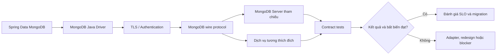
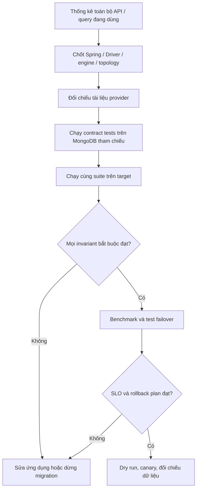

# Kiểm thử tương thích giao thức MongoDB với dịch vụ cơ sở dữ liệu khác

## 1. Vì sao kết nối được chưa chứng minh ứng dụng tương thích?

Trong một ứng dụng **Spring Data MongoDB**, các thao tác của `MongoRepository`, `MongoTemplate` và `ReactiveMongoTemplate` được thực thi qua MongoDB Java Driver. Một số dịch vụ cơ sở dữ liệu khác hỗ trợ **MongoDB wire protocol**, nhờ đó Java Driver có thể kết nối và gửi command tương tự khi làm việc với MongoDB Server.

Tuy nhiên, **wire protocol compatibility** chỉ mô tả khả năng giao tiếp giữa client và server. Nó không có nghĩa dịch vụ đích triển khai đầy đủ mọi MongoDB API, operator, index, transaction, change stream, timeout hay consistency model. Một ứng dụng có thể `ping` và `insertOne` thành công nhưng thất bại ở `$lookup` dạng pipeline, transaction hai collection hoặc resume change stream.

Ví dụ: hệ thống đặt hàng dùng Spring Data MongoDB để lưu `orders`, `order_items`, `outbox_events`. API báo cáo tính doanh thu bằng `$lookup`/`$group`, còn phương thức thanh toán yêu cầu ghi đơn hàng và sự kiện outbox **cùng commit**. Khi chuyển sang một dịch vụ MongoDB-compatible, kiểm thử phải chứng minh cả hai bất biến này, không chỉ khả năng đăng nhập.

Sau bài này, bạn sẽ biết cách:

1. Phân biệt **giao thức**, **lệnh/tính năng**, **ngữ nghĩa dữ liệu** và **vận hành**.
2. Lập ma trận kiểm thử theo **phiên bản driver, Spring Data, engine và API compatibility** của nhà cung cấp.
3. Chạy cùng contract/integration test trên MongoDB tham chiếu và dịch vụ đích.
4. Kiểm tra BSON mapping, aggregation, index, transaction, retry, change stream và lỗi.
5. Đưa ra quyết định nâng cấp/migration dựa trên kết quả có thể kiểm chứng.

## 2. Bốn tầng tương thích cần tách riêng

| Tầng | Câu hỏi kiểm thử | Dấu hiệu đạt |
| --- | --- | --- |
| **Kết nối và handshake** | Driver chọn được node, thương lượng wire version, xác thực và TLS đúng không? | Kết nối, ping, insert/read nhỏ với CA hợp lệ |
| **API / command** | Server hiểu command, aggregation stage, query operator và tùy chọn driver thực sự gửi không? | Thao tác thành công hoặc lỗi được phân loại chính xác |
| **Ngữ nghĩa và bảo đảm** | Kết quả, ràng buộc, atomicity và consistency có giống yêu cầu không? | Cùng fixture cho cùng kết quả, transaction/unique giữ đúng bất biến |
| **Hiệu năng và vận hành** | Throttling, failover, timeout, index và công cụ quan sát đáp ứng SLO không? | p95/p99 latency, throughput, lỗi/retry trong ngưỡng |



**Không thể suy đầy đủ tính năng chỉ từ `db.version()`, `hello` hay `buildInfo`**. Các lệnh đó hữu ích khi chẩn đoán, nhưng dịch vụ tương thích có thể trình bày version giao thức mà không triển khai tất cả tính năng của MongoDB Server mang số version tương ứng.

## 3. Phân biệt đúng các dịch vụ và phiên bản

| Dịch vụ | Điều phải xác minh | Ví dụ khác biệt |
| --- | --- | --- |
| **MongoDB Server / Atlas** | Server version, FCV, topology, tier, edition, phiên bản driver | Không phải topology nào cũng hỗ trợ mọi operation giống nhau |
| **Amazon DocumentDB (with MongoDB compatibility)** | Engine version **đầy đủ**, supported MongoDB API và functional differences | Khả năng retryable writes đã thay đổi từ engine 8.0.2 |
| **Azure Cosmos DB for MongoDB (RU)** | API version (3.6/4.0/5.0/7.0...), throughput RU/s, sharding/partition key | Tài liệu RU API 7.0 giới hạn transaction nhiều document trong một collection không sharded |
| **Azure DocumentDB (with MongoDB compatibility)** | Phiên bản dịch vụ Azure DocumentDB và bảng MongoDB compatibility riêng | Đây là tên mới của dịch vụ **vCore-based Azure Cosmos DB for MongoDB**, khác sản phẩm RU |
| **FerretDB** | Phiên bản FerretDB, backend, danh sách command được hỗ trợ | Một số command chưa triển khai hoặc thông điệp lỗi khác MongoDB |

Đặc biệt, **Azure DocumentDB**, **Amazon DocumentDB** và **Azure Cosmos DB for MongoDB (RU)** là **ba dịch vụ khác nhau**. Không chuyển bảng tính năng của một dịch vụ sang dịch vụ khác chỉ vì đều sử dụng MongoDB Java Driver.

Ví dụ cập nhật theo phiên bản: AWS công bố **Amazon DocumentDB 8.0.2** hỗ trợ retryable writes từ **28/09/2026**; các engine trước 8.0.2 yêu cầu tắt `retryWrites`. Do đó cả hai khẳng định “DocumentDB không bao giờ hỗ trợ retryable writes” và “DocumentDB nào cũng hỗ trợ retry” đều sai. Tương tự, nhà cung cấp có thể thêm các aggregation stage ở một **minor release**; đừng kiểm thử phiên bản 5.0 rồi kết luận về 8.0.2.

**Bảng thông tin phải đính kèm với mỗi lần chạy suite:**

```yaml
target:
  provider: "aws-documentdb"       # mongodb / cosmos-mongodb-ru / azure-documentdb / ferretdb
  engine: "8.0.2"                   # phiên bản thực tế của môi trường thử nghiệm
  apiCompatibility: "8.0"          # chỉ khi nhà cung cấp định nghĩa
  topology: "replicated"
application:
  springDataMongoDB: "<version>"
  mongoJavaDriver: "<version>"
  jdk: "<version>"
options:
  tls: true
  retryWrites: true
  readPreference: "primary"
  readConcern: "<configured-value>"
  writeConcern: "<configured-value>"
fixtureRevision: "<git-revision>"
```

Khi có nâng cấp, phải ghi lại **minor version**, configuration và feature flags. Kiểm tra [Spring Data MongoDB compatibility matrix](https://docs.spring.io/spring-data/mongodb/reference/preface.html) để biết driver tối thiểu và các bản MongoDB Server đã được Spring Data thử nghiệm; ma trận đó **không chứng nhận** mọi dịch vụ mô phỏng giao thức MongoDB.

## 4. Ma trận tính năng theo nhu cầu nghiệp vụ

Trước khi viết test, liệt kê lệnh và tính năng thực dùng trong code ứng dụng, migration và công cụ vận hành:

| Hợp đồng / tính năng | Mức độ | Cách chứng minh |
| --- | --- | --- |
| TLS, auth, read/write CRUD | **Must** | Kết nối CA hợp lệ; insert → find → update → delete |
| Mapping `ObjectId`, date, number, null/missing | **Must** nếu model dùng | Round-trip qua entity và driver, kiểm BSON thực |
| Compound unique index theo `tenantId, orderNo` | **Must** | Tạo index; hai ghi cùng khóa bị chặn kể cả chạy đồng thời |
| Sort, projection, pagination | **Must** nếu API dùng | Tất cả trang ổn định theo sort key + khóa phụ |
| `$lookup`, `$unwind`, `$group` | **Must** nếu báo cáo dùng | So tổng và số nhóm với MongoDB tham chiếu |
| Transaction `orders` + `outbox_events` | **Must** nếu cần atomic outbox | Commit cả hai, rollback cả hai |
| Change stream và resume token | **Must** nếu event consumer dùng | Nhận insert/update và resume sau ngắt |
| Retryable writes | Theo deployment | Khi lỗi mạng/primary failover không tạo side effect trùng |
| TTL, collation, partial/unique index, `$jsonSchema` | Theo schema | DDL và hành vi dữ liệu đúng |
| Time series, GridFS, geospatial, text/vector | Theo ứng dụng | Contract test riêng cho từng tính năng |
| `explain`, backup/restore, monitoring | Theo vận hành | Có đủ dữ liệu đo và khôi phục |

Mỗi test cần một trong bốn trạng thái rõ ràng:

| Trạng thái | Ý nghĩa |
| --- | --- |
| `PASS` | Đã chạy trên môi trường đích, mọi assertion bắt buộc đạt |
| `FAIL` | Lệnh trả kết quả sai, sai semantics hoặc lỗi không mong đợi |
| `UNSUPPORTED` | Provider công bố hoặc test chứng minh tính năng không hỗ trợ |
| `NOT_TESTED` | Chưa thực thi/không thu được kết quả; **không được coi là PASS** |

Nếu tính năng tùy chọn có fallback (ví dụ bỏ correlated lookup để query khác), cần test **fallback thực sự bảo toàn kết quả**. Nếu tính năng là điều kiện nghiệp vụ bắt buộc, `UNSUPPORTED` là **blocker** trừ khi thay đổi kiến trúc được đánh giá và chấp thuận.

## 5. Tổ chức môi trường chạy cùng một test suite

### 5.1. Cấu hình Spring Boot theo endpoint, không đổi assertion

Test trên **MongoDB Server tham chiếu** và **dịch vụ đích** bằng cùng mã kiểm thử, cùng fixture, chỉ thay URI, cấu hình provider và quyền cần thiết:

```yaml
# application-compat.yml
spring:
  data:
    mongodb:
      uri: ${MONGODB_COMPAT_URI}
compat:
  expected-database: ${MONGODB_COMPAT_DB}
```

Trong CI, đặt biến môi trường có credential bằng secret manager, không lưu mật khẩu trong repository. URI của provider có thể yêu cầu những tham số khác nhau:

- `tls=true`, CA/truststore, xác thực hostname chính xác.
- `authSource`, database mặc định, seed list, `replicaSet` hoặc cơ chế load balancer tương ứng.
- `readPreference`, `retryWrites`, read/write concern theo tài liệu provider.
- `mongodb+srv://` hay `mongodb://` phụ thuộc endpoint thực tế và bản driver.

**Không tắt kiểm chứng TLS certificate/hostname để test pass**. Nếu lệnh `ping` lỗi, chẩn đoán kết nối trước; không kết luận ngay tính năng MongoDB API bị thiếu.

Testcontainers có thể dùng để dựng **MongoDB reference** trong CI; nó **không tự biến thành** Amazon DocumentDB hay Azure DocumentDB. Với dịch vụ cloud, tạo môi trường thử nghiệm riêng, có hạn mức chi phí và quyền tối thiểu.

### 5.2. Cô lập dữ liệu test

Không dùng `dropDatabase()`, `deleteAll()` hoặc xóa collection nghiệp vụ trong môi trường chung. Mỗi test nên có tên collection theo UUID hoặc database test độc lập và cleanup đúng namespace đã tạo.

Nếu suite phải kiểm tra thao tác tạo index/schema, cấp quyền tạo collection/index **chỉ cho database test**; chạy migration có kiểm soát khi đích yêu cầu provisioning đặc thù. Các test chức năng không được phụ thuộc dữ liệu tồn dư từ lượt trước.

## 6. Ví dụ JUnit contract test trên MongoTemplate và Java Driver

Mẫu sau dùng Java 17+, Spring Boot 3.x, JUnit Jupiter, Spring Data MongoDB. Nó kiểm tra `ping`, unique index và một pipeline `$lookup` + `$unwind` + `$group`. **Cùng class** phải được chạy trên reference và target; khác biệt kết quả là đầu vào cho báo cáo tương thích.

```java
import java.util.ArrayList;
import java.util.List;
import java.util.UUID;

import com.mongodb.MongoException;
import com.mongodb.client.MongoCollection;
import com.mongodb.client.model.IndexOptions;
import com.mongodb.client.model.Indexes;
import org.bson.Document;
import org.junit.jupiter.api.AfterEach;
import org.junit.jupiter.api.BeforeEach;
import org.junit.jupiter.api.Test;
import org.springframework.beans.factory.annotation.Autowired;
import org.springframework.beans.factory.annotation.Value;
import org.springframework.boot.test.context.SpringBootTest;
import org.springframework.data.mongodb.core.MongoTemplate;

import static org.junit.jupiter.api.Assertions.*;

@SpringBootTest
class MongoProtocolContractIT {

    @Autowired MongoTemplate template;
    @Value("${compat.expected-database:}") String expectedDatabase;

    private String ordersName;
    private String itemsName;

    @BeforeEach
    void createOwnedCollections() {
        // Chặn việc test nhầm URI sang database không được phép.
        String actual = template.getDb().getName();
        if (expectedDatabase.isBlank() || !expectedDatabase.equals(actual)) {
            throw new IllegalStateException(
                "Chỉ chạy trên database thử nghiệm được chỉ định");
        }
        String suffix = UUID.randomUUID().toString().replace("-", "");
        ordersName = "compat_orders_" + suffix;
        itemsName = "compat_items_" + suffix;
        template.createCollection(ordersName);
        template.createCollection(itemsName);
    }

    private MongoCollection<Document> orders() {
        return template.getCollection(ordersName);
    }

    @Test
    void pingWorks() {
        Document result = template.getDb().runCommand(
            new Document("ping", 1));
        assertEquals(1.0,
            ((Number) result.get("ok")).doubleValue());
    }

    @Test
    void uniqueIndexPreventsDuplicateOrderNumberPerTenant() {
        orders().createIndex(
            Indexes.compoundIndex(
                Indexes.ascending("tenantId"),
                Indexes.ascending("orderNo")),
            new IndexOptions().unique(true));

        orders().insertOne(new Document("_id", "o-1")
            .append("tenantId", "tenant-a")
            .append("orderNo", "ORD-001"));

        MongoException error = assertThrows(MongoException.class,
            () -> orders().insertOne(new Document("_id", "o-2")
                .append("tenantId", "tenant-a")
                .append("orderNo", "ORD-001")));

        assertEquals(11000, error.getCode());
        assertEquals(1L, orders().countDocuments());

        // Email/orderNo trùng ở tenant khác được phép theo index compound.
        orders().insertOne(new Document("_id", "o-3")
            .append("tenantId", "tenant-b")
            .append("orderNo", "ORD-001"));
        assertEquals(2L, orders().countDocuments());
    }

    @Test
    void lookupAndGroupProduceCorrectTotals() {
        orders().insertOne(new Document("_id", "o-1")
            .append("tenantId", "tenant-a"));

        template.getCollection(itemsName).insertMany(List.of(
            new Document("_id", "i-1")
                .append("orderId", "o-1")
                .append("sku", "A")
                .append("quantity", 2),
            new Document("_id", "i-2")
                .append("orderId", "o-1")
                .append("sku", "B")
                .append("quantity", 3),
            new Document("_id", "i-3")
                .append("orderId", "o-1")
                .append("sku", "A")
                .append("quantity", 4)
        ));

        List<Document> pipeline = List.of(
            new Document("$match", new Document("tenantId", "tenant-a")),
            new Document("$lookup",
                new Document("from", itemsName)
                    .append("localField", "_id")
                    .append("foreignField", "orderId")
                    .append("as", "items")),
            new Document("$unwind", "$items"),
            new Document("$group",
                new Document("_id", "$items.sku")
                    .append("totalQuantity",
                        new Document("$sum", "$items.quantity"))),
            new Document("$sort", new Document("_id", 1))
        );

        List<Document> results = orders()
            .aggregate(pipeline).into(new ArrayList<>());

        assertEquals(2, results.size());
        assertEquals("A", results.get(0).getString("_id"));
        assertEquals(6L,
            ((Number) results.get(0).get("totalQuantity")).longValue());
        assertEquals("B", results.get(1).getString("_id"));
        assertEquals(3L,
            ((Number) results.get(1).get("totalQuantity")).longValue());
    }

    @AfterEach
    void cleanupOwnedCollections() {
        if (itemsName != null && template.collectionExists(itemsName)) {
            template.dropCollection(itemsName);
        }
        if (ordersName != null && template.collectionExists(ordersName)) {
            template.dropCollection(ordersName);
        }
    }
}
```

Giữ lại **mã lỗi duplicate key 11000** như một phần contract khi ứng dụng phụ thuộc Spring `DuplicateKeyException`. Nếu provider dùng mã khác nhưng chặn đúng dữ liệu, ghi **khác biệt có ảnh hưởng đến error mapping** và đánh giá việc sửa adapter; không sửa assertion thành “bất cứ exception nào” chỉ để test xanh.

Ví dụ này dùng Driver trực tiếp cho một vài thao tác. Cần kiểm thử **đường Spring Data thực**: `@Document`, `@Id`, `@Field`, custom converter, derived query và repository mapping, vì conversion/exception translation có thể tạo khác biệt mà test driver thô không phát hiện.

### 6.1. Kiểm thử round-trip BSON và Spring mapping

Thêm fixture gồm các kiểu dữ liệu mà domain đang dùng:

| Giá trị | Kiểm tra |
| --- | --- |
| `ObjectId` và String ID | `@Id` được chuyển đổi và tìm lại đúng |
| `Instant` và BSON Date | Thời gian UTC, độ chính xác ở mức mili giây |
| `Decimal128` / `BigDecimal` | Kiểu BSON thực và phép cộng tổng không sai số |
| `null` và field **thiếu** | `{field: null}`, `$exists`, partial/unique index |
| Arrays / nested objects | `$elemMatch`, dot notation, `arrayFilters` |
| Unicode và collation | So sánh, sort và uniqueness đúng yêu cầu |

Không so hai kết quả bằng cách chuyển tất cả giá trị sang String rồi bỏ mất khác biệt kiểu BSON. Khi contract không yêu cầu thứ tự, so tập kết quả theo key; khi có pagination/top-N, bắt buộc `$sort` theo khóa ổn định (thường có thêm `_id`).

## 7. Kiểm thử các khả năng nâng cao theo từng engine

### 7.1. Aggregation, index và schema

Mỗi operator đang dùng trong production cần test tương ứng, ví dụ `$lookup` dạng equality, correlated lookup với `let`/`pipeline`, `$group`, `$facet`, `$setWindowFields`, geospatial, text search hoặc vector search. Đừng suy từ việc một dạng `$lookup` hoạt động rằng **mọi biến thể** của `$lookup` đều được hỗ trợ.

Với index, cần test **tạo thành công và ngữ nghĩa thực thi**:

- Compound/unique index: ghi trùng `(tenantId, orderNo)` bị từ chối ngay cả khi request đồng thời.
- Partial unique index: chỉ document trong `partialFilterExpression` bị giới hạn.
- TTL: document cuối cùng hết hạn trong khoảng độ trễ chấp nhận được; TTL bất đồng bộ, không xóa đúng từng giây.
- Collation: case-insensitive uniqueness và sort không sai theo locale.
- `$jsonSchema`: insert/update sai kiểu bị từ chối; annotation Java không tự bảo đảm validator đã có trên server.

Với dịch vụ có partition/shard key, uniqueness hoặc transaction có thể có **phạm vi bảo đảm** khác. Phải kiểm tra ở cả partition khác nhau, không chỉ một fixture nằm trong cùng partition.

### 7.2. Transaction xuyên collection

Nếu nghiệp vụ cần `orders` và `outbox_events` được commit **cùng nhau**, tạo hai test riêng: **commit** thành công (cả hai có dữ liệu) và **rollback** (cả hai không có dữ liệu). Với Spring Data blocking, có thể dùng `MongoTransactionManager` và `TransactionTemplate`:

```java
// Mẫu logic trong integration test đã cấu hình transaction manager.
TransactionTemplate tx = new TransactionTemplate(mongoTransactionManager);

tx.executeWithoutResult(status -> {
    template.insert(
        new Document("_id", orderId).append("tenantId", "tenant-a"),
        ordersCollection);
    template.insert(
        new Document("_id", eventId).append("orderId", orderId),
        outboxCollection);
    status.setRollbackOnly();
});

// Đọc từ ngoài transaction và assert không còn cả order lẫn outbox.
```

MongoDB Server cần topology hỗ trợ transaction (như replica set/sharded cluster). **Azure Cosmos DB for MongoDB RU API 7.0** có hạn chế transaction nhiều document chỉ **trong một collection không sharded** theo tài liệu Microsoft. Một test transaction hai collection bắt buộc phải báo `UNSUPPORTED`/`FAIL` trong trường hợp này; không được âm thầm bỏ `@Transactional` rồi chấp nhận dữ liệu nửa vời.

Một số phiên bản Amazon DocumentDB hỗ trợ transaction nhưng có giới hạn khác MongoDB Server, ví dụ thời lượng và kích cỡ transaction log; cần đọc đúng tài liệu engine. Với reactive stack, thay `MongoTransactionManager` bằng `ReactiveMongoTransactionManager` và `TransactionalOperator`, kiểm tra commit/rollback khi publisher hoàn tất.

### 7.3. Change streams và resume

Nếu ứng dụng nghe change stream để xử lý sự kiện, cần kiểm tra:

1. Mở stream và nhận event của insert/update/delete có payload đúng.
2. Ghi lại **resume token**, ngắt consumer, tạo thêm event, mở lại bằng token và xác minh không mất event.
3. Kiểm tra khả năng resume sau failover và khi token quá hạn theo chính sách giữ lịch sử của provider.
4. Đo độ trễ event, kiểm soát duplicate delivery/idempotency.

Chạy với timeout và tài nguyên test sở hữu riêng; không dùng `Thread.sleep` tùy tiện hay mong sự kiện xuất hiện tức thời. Không giả định mọi provider đều hỗ trợ mọi tùy chọn `fullDocument`, `startAtOperationTime` và các stage change stream như MongoDB Server.

### 7.4. Retryable writes, transient failure và tính idempotent

**Retryable writes** phụ thuộc **driver + engine + loại operation**. Ví dụ:

- Amazon DocumentDB **trước 8.0.2**: tài liệu AWS yêu cầu `retryWrites=false`.
- Amazon DocumentDB **từ 8.0.2**: có hỗ trợ retryable writes cho các thao tác được xác định; `updateMany` và `deleteMany` không thuộc tập hỗ trợ này.
- Với Azure và FerretDB: tra tài liệu phiên bản thực và tự kiểm thử; không sao chép cấu hình retry của AWS sang.

Test failure injection cần đo kết quả cuối: sau lỗi mạng hoặc failover có **bao nhiêu document/side effect** được ghi? Trường hợp kết quả commit không rõ, việc retry thủ công `$inc`, tạo thanh toán hoặc gửi message có thể làm trùng nghiệp vụ; nên dùng idempotency key và đối chiếu trạng thái trước khi ghi lại.

### 7.5. Read/write concern và thứ tự kết quả

Hai provider có thể triển khai replication, đọc từ secondary, consistency hoặc failover khác nhau. Test read-after-write với cùng session và qua kết nối khác khi ứng dụng cần; ghi rõ `readPreference`, `readConcern`, `writeConcern` và thời hạn chờ đọc lại. Dữ liệu đọc chậm không nhất thiết là “lỗi giao thức”, nhưng có thể **vi phạm hợp đồng nghiệp vụ**.

Không so sánh thứ tự khi query không có `sort`. Ví dụ tài liệu AWS nêu sự khác biệt về thứ tự mặc định và hành vi sắp xếp trong aggregation; hãy xác định thứ tự rõ ràng cho pagination và các báo cáo có top-N.

## 8. Chẩn đoán lỗi theo lớp, không chỉ parse message

```javascript
// Các lệnh thăm dò chạy trong môi trường kiểm thử:
db.runCommand({ ping: 1 });
db.runCommand({ hello: 1 });
db.runCommand({ buildInfo: 1 });
```

`ping` chỉ chứng minh server trả lời. `hello` mô tả thông tin handshake/topology; `buildInfo` có thể không hỗ trợ hoặc bị giới hạn quyền trên dịch vụ đích. Lỗi ở một command chẩn đoán **không tự chứng minh** tất cả CRUD/aggregation không hỗ trợ.

| Nhóm lỗi | Triệu chứng | Hướng điều tra |
| --- | --- | --- |
| DNS/TLS/CA | `MongoSocketException`, `SSLHandshakeException`, hostname mismatch | SRV/TXT, endpoint, truststore, chain và hostname |
| Auth/permission | `MongoSecurityException` hoặc unauthorized | Credential, `authSource`, cơ chế auth, role |
| Topology | `MongoTimeoutException`/server selection | Replica set option, seed list, load balancer, read preference |
| Command/operator | `MongoCommandException`, unsupported feature | Command BSON thực và bảng supported APIs theo engine |
| Ràng buộc dữ liệu | Duplicate key, validator/index lỗi | Index thật, partition key, collation, BSON schema |
| Transaction/retry | Aborted, unsupported, unknown commit result | Engine limit, retryable writes, error labels, idempotency |
| Throttling/quota | Latency/error tăng khi tải | RU/s, quota, CPU/IO và telemetry của provider |

Lỗi Spring `DataAccessException` có thể wrap exception của Java Driver. Cần thu mã lỗi gốc, operation và correlation ID; **không log connection URI chứa mật khẩu hoặc document nhạy cảm**. Một số dịch vụ có tên/mã lỗi giống MongoDB nhưng thông điệp chi tiết khác; không parse message thành logic nghiệp vụ nếu không có contract bảo đảm.

## 9. So sánh kết quả và benchmark

Chạy cùng fixture với MongoDB Server tham chiếu và dịch vụ đích. Khi so sánh:

1. Giữ **BSON type**; không chuyển tất cả số, date và ID thành chuỗi rồi coi kết quả giống nhau.
2. Với tập kết quả không có thứ tự được cam kết, chuẩn hóa thứ tự khi diff; với phân trang/top-N, test `sort` rõ ràng.
3. Loại bỏ trường không quyết định như ID ngẫu nhiên hoặc timestamp do test sinh **chỉ khi** chúng không phải điều kiện nghiệp vụ.
4. Có **negative test**: duplicate key, schema sai, unsupported operator, write timeout, rollback và retry.
5. Với eventual consistency, dùng polling có timeout; không chờ vô hạn và không bỏ qua sai khác về thời hạn nhìn thấy dữ liệu.

Hiệu năng cần đo sau warm-up và với cùng tỷ lệ dữ liệu, số partition, mức tải. Ghi p50/p95/p99 latency, throughput, lỗi, CPU/IO, RU consumption/throttling nếu có, retry và chi phí lưu trữ/index. `explain` của từng provider có thể **không cùng cấu trúc**, nên dùng cả telemetry riêng của dịch vụ.

**Không kết luận “tương thích” chỉ vì query cho đúng kết quả trên 20 document mẫu**; hãy kiểm tra dữ liệu mảng lớn, phân bố skewed/hot partition, transaction dài, concurrency và thời điểm failover.

## 10. Quy trình quyết định khi nâng cấp hoặc chuyển dịch vụ



Một báo cáo mẫu:

| Contract | MongoDB tham chiếu | Target | Kết luận |
| --- | --- | --- | --- |
| TLS và CRUD | PASS | PASS | Kết nối hoạt động |
| Compound unique index | PASS | PASS | Đúng ràng buộc |
| `$lookup` và `$group` | PASS | PASS | Kết quả tính toán khớp |
| Transaction `orders` + `outbox_events` | PASS | UNSUPPORTED | **Blocker** nếu bắt buộc atomic |
| Change stream resume | PASS | FAIL | Chưa đáp ứng worker đồng bộ |
| Retryable writes | PASS | NOT_TESTED | Chưa thể kết luận |

**Các trạng thái trong bảng trên chỉ để minh họa cách báo cáo**, không phải kết quả thực của bất kỳ dịch vụ cụ thể nào.

Trước khi duyệt migration cần có: phiên bản cấu hình kiểm thử, log test, danh sách unsupported/khác ngữ nghĩa, biện pháp thay thế đã kiểm chứng, số liệu tải và SLO, kế hoạch dữ liệu, phương án rollback và người quyết định. Sau khi nâng engine minor/major, chạy lại suite vì tính năng và semantics có thể thay đổi.

## 11. Những sai lầm thường gặp

| Sai lầm | Hậu quả | Cách xử lý |
| --- | --- | --- |
| Ping thành công thì coi như hỗ trợ MongoDB đầy đủ | Lỗi ở transaction, aggregation hoặc index | Test API thực dùng và dữ liệu thật |
| Lấy số “MongoDB API version” làm toàn bộ tính năng server | Suy sai feature parity | Kiểm theo đúng provider/engine/minor/FCV |
| Nhầm Azure DocumentDB và Cosmos DB for MongoDB RU | Sai ma trận operator/transaction | Đọc tài liệu của đúng sản phẩm |
| Luôn tắt retryable writes trên mọi Amazon DocumentDB | Bỏ qua khả năng mới từ 8.0.2 | Cấu hình theo engine và loại operation |
| Test kết quả không có sort rồi so thứ tự | False failure hoặc pagination sai | Dùng sort key rõ và khóa phụ |
| Bỏ transaction để suite xanh | Có thể mất atomicity nghiệp vụ | Coi là blocker hoặc thiết kế lại có kiểm chứng |
| Tất cả unsupported đều được skip | Báo cáo xanh sai sự thật | Ghi `UNSUPPORTED` và mức độ bắt buộc |
| Dùng Testcontainers MongoDB rồi coi là đã test cloud target | Bỏ sót khác biệt engine | Chạy suite trên endpoint target thật |
| Benchmark dữ liệu rất nhỏ | Không thấy throttle, hot partition | Dùng workload đại diện và p95/p99 |
| Xóa toàn bộ database test dùng chung | Ảnh hưởng suite khác | Namespace riêng, cleanup theo quyền sở hữu |

## 12. Bài tập thực hành

Một ứng dụng Spring Data MongoDB chuẩn bị chuyển từ MongoDB Server sang **Amazon DocumentDB 5.0** hoặc **Azure Cosmos DB for MongoDB (RU) API 7.0**. Ứng dụng có `orders`, `order_items` và `outbox_events`; yêu cầu unique order number trong tenant, báo cáo `$lookup`/`$group`, transaction ghi đơn cùng outbox và consumer change stream.

1. Lập ma trận tính năng gồm: CRUD/TLS, BSON mapping, unique index, correlated `$lookup`, multi-collection transaction, change-stream resume, retryable writes và schema validation. Xác định tính năng nào là **Must**.
2. Giải thích vì sao thành công với `MongoTemplate.insert()` không chứng minh được tính tương thích ở `ReactiveMongoTemplate.changeStream()`.
3. Trên Amazon DocumentDB 5.0, `retryWrites` cần cấu hình thế nào? Khi nâng lên **8.0.2**, điều kiện nào cần kiểm tra lại?
4. Dựa vào tài liệu Cosmos DB for MongoDB (RU) API 7.0, transaction hai collection có bảo đảm không? Nếu không, phải xử lý yêu cầu atomic outbox thế nào?
5. Tạo fixture có `Decimal128`, `Instant`, null/missing, array và Unicode; so kết quả của cùng aggregation qua hai endpoint.
6. Viết test đồng thời tạo hai đơn trùng `(tenantId, orderNo)` và chứng minh cuối cùng chỉ một khóa tồn tại.
7. Thiết kế phép thử change-stream resume khi worker mất kết nối 10 giây; xác định timeout và cách kiểm đếm event để không chấp nhận mất/nhân bản dữ liệu.
8. Đề xuất tiêu chí **go/no-go** cho migration nếu một tính năng bắt buộc `UNSUPPORTED`, trong khi CRUD và benchmark đều đạt.

**Gợi ý:** Phân biệt unsupported tùy chọn và unsupported phá vỡ bất biến nghiệp vụ. Một dịch vụ tương thích MongoDB có thể phù hợp với **một workload cụ thể** mà không đạt 100% lệnh của MongoDB Server. Kết luận cần dựa vào **version cụ thể, test thực tế và SLO**.

## Tài liệu tham khảo

- [Spring Data MongoDB — Requirements and Compatibility Matrix](https://docs.spring.io/spring-data/mongodb/reference/preface.html)
- [MongoDB — Java Driver Connection Guide](https://www.mongodb.com/docs/drivers/java/sync/current/connection/)
- [MongoDB — Wire Protocol](https://www.mongodb.com/docs/manual/reference/mongodb-wire-protocol/)
- [Amazon DocumentDB — MongoDB Compatibility](https://docs.aws.amazon.com/documentdb/latest/devguide/compatibility.html)
- [Amazon DocumentDB — Supported MongoDB APIs](https://docs.aws.amazon.com/documentdb/latest/devguide/mongo-apis.html)
- [Amazon DocumentDB — Functional Differences](https://docs.aws.amazon.com/documentdb/latest/devguide/functional-differences.html)
- [Amazon DocumentDB — Transactions](https://docs.aws.amazon.com/documentdb/latest/devguide/transactions.html)
- [AWS — DocumentDB Retryable Writes từ 8.0.2, ngày 28/09/2026](https://aws.amazon.com/about-aws/whats-new/2026/09/amazon-documentdb-retryable-writes/)
- [Microsoft — Azure Cosmos DB for MongoDB (RU) API 7.0](https://learn.microsoft.com/en-us/azure/cosmos-db/mongodb/feature-support-70)
- [Microsoft — Azure DocumentDB Overview](https://learn.microsoft.com/en-us/azure/documentdb/overview)
- [FerretDB — Compatibility](https://docs.ferretdb.io/migration/compatibility/)
