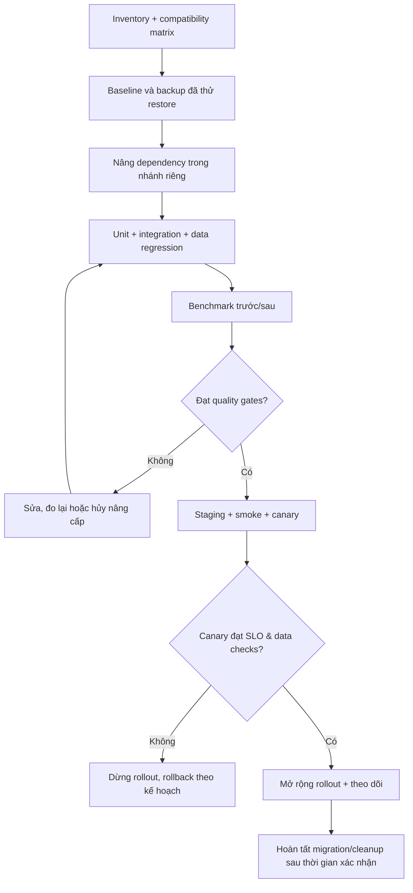
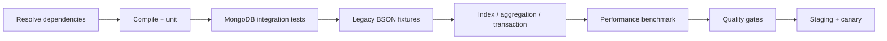

# Lập kế hoạch nâng cấp cùng kiểm thử hồi quy dữ liệu và hiệu năng

Nâng cấp một ứng dụng **Spring Data MongoDB** không chỉ là tăng phiên bản thư viện. Việc thay đổi Spring Boot, Spring Data MongoDB, MongoDB Java Driver hoặc MongoDB Server có thể ảnh hưởng đến cách ánh xạ BSON, chuyển đổi `ObjectId`/`String`, cách repository tạo truy vấn, hành vi aggregation, transaction, reactive publisher, kết nối và hiệu năng. Một ứng dụng vẫn khởi động được sau nâng cấp **không có nghĩa** dữ liệu được đọc/ghi giống trước hoặc các truy vấn vẫn đáp ứng SLO.

Bài thuộc chương **Phiên bản và nâng cấp** của module `SPRING_DATA_MONGODB`. Mục tiêu là thiết kế một quy trình nâng cấp có bằng chứng: biết phiên bản nào phụ thuộc phiên bản nào, thiết lập dữ liệu và hiệu năng **baseline**, chạy kiểm thử hồi quy trước/sau, triển khai theo từng giai đoạn, quan sát các tín hiệu bất thường và có kế hoạch quay về trạng thái an toàn.

Ví dụ dùng Java, Spring Boot, `MongoTemplate`, repository, aggregation và Testcontainers. Các số phiên bản và ngưỡng được trình bày theo **nguyên tắc**, không phải bảng tương thích chính thức cho mọi thời điểm: khi nâng cấp thật phải kiểm tra release notes, compatibility matrix và hướng dẫn migration của **đúng phiên bản nguồn và đích**.

## 1. Xác định điều gì cần giữ nguyên sau nâng cấp

Cần phân biệt ba loại hợp đồng:

1. **Hợp đồng dữ liệu:** document cũ vẫn đọc được; ghi mới có kiểu BSON đúng; tên field, `_id`, Decimal128, Date, enum, index, schema version và các tham chiếu không bị thay đổi ngoài dự kiến.
2. **Hợp đồng hành vi:** repository, `MongoTemplate`, aggregation, phân trang, transaction, retry, change stream và reactive pipeline vẫn tạo ra kết quả, lỗi và tính nhất quán như yêu cầu.
3. **Hợp đồng vận hành:** latency, throughput, số command, lượng quét document, memory/CPU, pool checkout, network bytes và tỷ lệ lỗi vẫn nằm trong giới hạn chấp nhận.

| Thay đổi | Một rủi ro đặc trưng | Bằng chứng cần có |
| --- | --- | --- |
| Spring Boot / Spring Framework | Auto-configuration hoặc lifecycle bean thay đổi | Context test, integration test và kiểm tra cấu hình |
| Spring Data MongoDB | Mapping/converter, repository query, transaction thay đổi | So sánh raw BSON và kết quả truy vấn |
| MongoDB Java Driver | Kết nối, codec, timeout, retry, pool hoặc topology khác | Driver metrics, test lỗi mạng và phiên tải |
| MongoDB Server | Planner, index, operator, wire protocol, transaction khác | Server compatibility test, `explain`, benchmark |
| Java runtime | TLS, bộ nhớ, GC, runtime behavior khác | Build/test, TLS smoke test, load test |
| Schema dữ liệu | Writer mới không còn tương thích reader cũ | Fixture đa phiên bản, migration test |

**Nâng cấp thành công** nghĩa là các điều kiện chấp nhận đã định trước được chứng minh bằng test và đo lường, không chỉ bằng việc build thành công hay health endpoint trả HTTP 200.

## 2. Kiểm kê hệ thống và lập ma trận tương thích

Trước khi sửa bất kỳ dependency nào, ghi lại **hiện trạng** của hệ thống:

- Phiên bản Java runtime, Spring Boot, Spring Framework, Spring Data release train và MongoDB Java Driver.
- Phiên bản MongoDB Server, loại triển khai (standalone, replica set, sharded cluster), Feature Compatibility Version (FCV) nếu áp dụng, cấu hình TLS/auth.
- Driver blocking, reactive hoặc cả hai; `MongoTemplate`, `ReactiveMongoTemplate`, repository, custom `MongoClient`, `MongoConverter`, `MongoCustomConversions`.
- Quy tắc ID (`@Id`, `@MongoId`), kiểu BSON quan trọng, collection/index, aggregation pipeline và script migration.
- Cơ chế transaction, read/write concern, retryable writes, change streams, connection pool và timeout.
- Hệ thống test: JUnit, Testcontainers, database test service, CI, dataset và observability.

Một bảng kế hoạch nên có dạng:

| Thành phần | Hiện tại | Đích | Nguồn xác nhận tương thích | Rủi ro / test bắt buộc |
| --- | --- | --- | --- | --- |
| Java | Ghi version thực | Ghi version đích | Yêu cầu của Spring Boot/driver | Build, TLS, throughput |
| Spring Boot | Ghi version thực | Ghi version đích | Release notes, migration guide | Auto-config và dependency |
| Spring Data MongoDB | Theo BOM hiện tại | Theo BOM đích | Release train, mapping changes | Converter/repository/aggregation |
| MongoDB Java Driver | Version đã resolve | Version được hỗ trợ | Driver compatibility docs | Pool, retry, connection |
| MongoDB Server | Version cluster | Version dự kiến | Server upgrade/FCV docs | Query planner, transaction |
| Testcontainers | Version test | Version tương thích | Docs của nhánh được chọn | Test startup và replica set |

Không điền bảng bằng phỏng đoán. Với dự án dùng Spring Boot BOM, ưu tiên để BOM quản lý phiên bản Spring Data và driver tương thích; nếu có **dependency override** cho driver hoặc Spring Data, phải có lý do và kiểm chứng riêng. Cần kiểm tra **dependency thực sự được resolve**, không chỉ version được khai báo trực tiếp.

### 2.1. Phân biệt nâng cấp thư viện và nâng cấp MongoDB Server

Hai thay đổi này có thể có lịch riêng:

- **Nâng Spring Boot/Spring Data/driver:** thay dependency và ứng dụng trước, test khả năng nói chuyện với server hiện tại; cần xác nhận driver hỗ trợ cả server cũ và server mục tiêu trong giai đoạn chuyển tiếp.
- **Nâng MongoDB Server:** chuẩn bị hạ tầng, backup, topology, thứ tự rolling upgrade và FCV theo tài liệu chính thức cho đúng cặp phiên bản. Việc nâng FCV có thể mở khóa hành vi/feature mới và ảnh hưởng lựa chọn rollback.
- **Đổi schema:** là hoạt động khác với thay runtime. Không nên gom thay code, đổi driver, nâng server và viết lại hàng triệu document thành một thay đổi không thể khoanh vùng.

MongoDB Server upgrade có thể yêu cầu đường nâng cấp qua phiên bản trung gian và các bước riêng cho replica set hoặc sharded cluster. Không giả định có thể nhảy qua mọi major version hoặc hạ server về bản cũ sau khi đã bật tính năng/FCV mới.

## 3. Thiết kế baseline trước khi thay đổi

Không có baseline thì một ứng dụng “chậm hơn sau nâng cấp” thường chỉ là cảm nhận. Trước khi thay đổi, chụp lại **hành vi** và **hiệu năng** của cùng tập request.

### 3.1. Baseline dữ liệu

Tạo các fixture BSON đại diện:

| Nhóm dữ liệu | Tình huống cần có | Bất thường muốn bắt |
| --- | --- | --- |
| ID | `ObjectId`, String 24 ký tự hex, ID ngoài hệ thống | Implicit ID conversion thay đổi |
| Số | Integer, Long, Double, Decimal128, số lớn, `null` | Mất độ chính xác, overflow, sai converter |
| Ngày | UTC, mốc gần biên ngày, legacy Date/String nếu có | Lệch múi giờ, đổi cách serialize |
| Field | Missing, null, field đổi tên, field deprecated | Mapping/reading sai dữ liệu cũ |
| Array/nested | Array rỗng, phần tử thiếu field, document lồng sâu | Projection, aggregation, mapping sai |
| Enum | Giá trị hiện tại và giá trị cũ không còn trong enum | Đọc dữ liệu cũ thất bại |
| Schema version | V1/V2/V3 cùng tồn tại | Reader mới không tương thích |
| Index | Unique/compound/TTL/text/collation theo hệ thống | Index bị mất, điều kiện query thay đổi |

Không chỉ so sánh giá trị từ Java object sau khi read: cần kiểm tra **raw BSON** trong MongoDB vì converter có thể che giấu kiểu gốc. Đặc biệt, `ObjectId("...")` và String `"..."` có thể có biểu diễn text giống nhau nhưng là hai khóa khác nhau.

### 3.2. Baseline hành vi

Ghi các use case quan trọng:

1. Repository CRUD, derived query và `@Query` với tham số bind.
2. `MongoTemplate` filter, sort, paging, projection và bulk operations.
3. Aggregation có `$match`, `$group`, `$lookup`, `$unwind`, `$project` và chuyển kiểu.
4. Unique constraint, index initialization, optimistic locking với `@Version`, upsert.
5. Transaction: commit, rollback, write conflict, retry và read/write concern.
6. Reactive: subscribe, cancellation, backpressure, error, timeout và change stream nếu dùng.
7. Phân quyền tenant, validation, các lỗi ID hoặc mapping đã được xử lý ở tầng API.

Kết quả kiểm tra phải ghi **input**, **kiểu BSON**, **output mong đợi** và **loại lỗi mong đợi**. Nếu behavior hiện tại đã sai, ghi nhận nợ kỹ thuật riêng; không âm thầm coi lỗi cũ là yêu cầu cần giữ mãi.

### 3.3. Baseline hiệu năng

Đo theo workload đại diện với cùng filter, dataset, kết nối và tải đồng thời:

| Tín hiệu | Nơi đo | Tại sao cần |
| --- | --- | --- |
| HTTP `p50/p95/p99` | Application/APM | Trải nghiệm người dùng |
| Duration theo thao tác DB | Timer/trace | Tách độ trễ database khỏi xử lý ứng dụng |
| Command count và duration | Driver command monitoring | Phát hiện N+1, `getMore`, retry |
| Pool checkout wait/failure | Driver CMAP | Phân biệt cạn pool và query chậm |
| `totalDocsExamined`, `totalKeysExamined`, `nReturned` | `explain("executionStats")` | So lượng quét và kế hoạch thực thi |
| BSON payload/byte mạng | Đo kích thước BSON, network metrics | Phát hiện projection/batching thay đổi |
| Throughput, CPU, heap, GC, disk I/O | Hạ tầng | Tránh “tối ưu latency” bằng cách chuyển tải sang tài nguyên khác |
| Error/timeout/retry rate | Logs, metrics, tracing | Phát hiện regression khi chịu tải |

Phân biệt **thời gian lệnh driver** với **thời gian server trong explain** và **thời gian request end-to-end**. Không dùng một con số `executionTimeMillis` để khẳng định người dùng sẽ thấy đúng cùng latency.

## 4. Chọn chiến lược nâng cấp theo từng giai đoạn

Một chiến lược an toàn thường gồm:



### Giai đoạn A — Chuẩn bị

- Chốt các phiên bản nguồn/đích có hỗ trợ chính thức; kiểm tra Java, Spring Data và driver.
- Lập danh sách thay đổi phá vỡ tương thích, API deprecated/removed, cấu hình auto-configuration và mapping.
- Chụp baseline, đóng băng test fixtures, backup dữ liệu, **thử restore** trên môi trường tách biệt và ghi thời gian phục hồi.
- Đặt ngưỡng chấp nhận trước khi xem số liệu phiên bản mới; chỉ định người quyết định go/no-go và rollback.

### Giai đoạn B — Nâng ứng dụng và chạy thử

- Ưu tiên đổi từng tầng (runtime/dependency, ứng dụng, MongoDB Server, schema) thay vì tất cả cùng lúc.
- Chạy build/compile, static checks, unit tests và các integration tests với MongoDB thật.
- Chạy cùng bộ fixture và benchmark ở cả bản cũ/lẫn bản nâng cấp; ghi version thực tế của driver/server trong test report.
- Với các đường đi quan trọng, kiểm tra kết quả lỗi/timeout và semantics chứ không chỉ “không ném exception”.

### Giai đoạn C — Staging/canary

- Triển khai staging với topology, index, TLS/auth và volume dữ liệu gần production.
- Tăng traffic canary từ nhỏ đến rộng theo checkpoint; mỗi checkpoint đối chiếu lỗi, latency, pool, command, chi phí query và invariant dữ liệu.
- Chuẩn bị cách dừng rollout hoặc quay về image ứng dụng trước đó khi điều kiện thất bại xảy ra.

### Giai đoạn D — Ổn định và dọn dẹp

- Theo dõi tiếp sau khi đã mở rộng traffic vì cache, TTL, batch job, nhiều ngày giờ/luồng nghiệp vụ có thể không xuất hiện trong một lần smoke test.
- Chỉ xóa field/reader legacy, adapter chuyển đổi và index cũ sau khi xác nhận không còn service/job phụ thuộc.
- Đóng biên bản nâng cấp gồm phiên bản thực tế, kết quả test, regression đã xử lý, ngưỡng đạt và hướng xử lý sự cố còn lại.

## 5. Kiểm thử hồi quy dữ liệu với Spring Data MongoDB

### 5.1. Ví dụ contract BSON dễ bị thay đổi

Giả sử collection `invoices` có ID từ hệ thống ngoài (luôn là BSON String) và số tiền được lưu bằng `Decimal128`. Entity:

**`Invoice.java`**

```java
package example.billing;

import java.math.BigDecimal;
import java.time.Instant;
import org.springframework.data.mongodb.core.mapping.Document;
import org.springframework.data.mongodb.core.mapping.Field;
import org.springframework.data.mongodb.core.mapping.FieldType;
import org.springframework.data.mongodb.core.mapping.MongoId;

@Document(collection = "invoices")
public record Invoice(
        @MongoId(FieldType.STRING) String id,
        @Field(value = "amount", targetType = FieldType.DECIMAL128)
        BigDecimal amount,
        Instant createdAt
) {}
```

**`InvoiceRepository.java`**

```java
package example.billing;

import org.springframework.data.mongodb.repository.MongoRepository;

public interface InvoiceRepository
        extends MongoRepository<Invoice, String> {}
```

Annotation `@MongoId(FieldType.STRING)` diễn đạt yêu cầu không tự đổi ID 24 ký tự hex thành BSON ObjectId. `@Field(targetType = FieldType.DECIMAL128)` giúp hợp đồng lưu số tiền rõ ràng. Khi nâng cấp, cần kiểm tra raw BSON thay vì chỉ xác nhận `repository.findById(...)` có kết quả.

### 5.2. Repository integration test bằng Testcontainers

Ví dụ dùng **Spring Boot 3.x với Testcontainers Java 1.x**. Project cần `spring-boot-starter-data-mongodb` trong ứng dụng; trong test dùng `spring-boot-starter-test`, `org.testcontainers:junit-jupiter` và `org.testcontainers:mongodb` ở phiên bản tương thích. Các nhánh Testcontainers mới hơn có thể khác artifact hoặc package; cần kiểm tra khi nâng cấp chính Testcontainers.

**`InvoiceRegressionTest.java`**

```java
package example.billing;

import com.mongodb.client.model.Filters;
import java.math.BigDecimal;
import java.time.Instant;
import org.bson.Document;
import org.bson.types.Decimal128;
import org.junit.jupiter.api.BeforeEach;
import org.junit.jupiter.api.Test;
import org.springframework.beans.factory.annotation.Autowired;
import org.springframework.boot.test.autoconfigure.data.mongo.DataMongoTest;
import org.springframework.data.mongodb.core.MongoTemplate;
import org.springframework.test.context.DynamicPropertyRegistry;
import org.springframework.test.context.DynamicPropertySource;
import org.testcontainers.containers.MongoDBContainer;
import org.testcontainers.junit.jupiter.Container;
import org.testcontainers.junit.jupiter.Testcontainers;
import org.testcontainers.utility.DockerImageName;

import static org.assertj.core.api.Assertions.assertThat;

@DataMongoTest
@Testcontainers
class InvoiceRegressionTest {

    @Container
    static final MongoDBContainer MONGO =
            new MongoDBContainer(DockerImageName.parse("mongo:7.0"));

    @DynamicPropertySource
    static void mongodb(DynamicPropertyRegistry registry) {
        registry.add("spring.data.mongodb.uri", MONGO::getReplicaSetUrl);
    }

    @Autowired InvoiceRepository repository;
    @Autowired MongoTemplate mongoTemplate;

    @BeforeEach
    void cleanOwnedCollection() {
        repository.deleteAll();
    }

    @Test
    void writesExpectedBsonTypes() {
        String id = "64b7f37a4e92b315c21d0abc";
        repository.insert(new Invoice(
                id,
                new BigDecimal("125.50"),
                Instant.parse("2026-01-01T10:00:00Z")));

        Document raw = mongoTemplate.getCollection("invoices")
                .find(Filters.eq("_id", id)).first();

        assertThat(raw).isNotNull();
        assertThat(raw.get("_id")).isInstanceOf(String.class);
        assertThat(raw.get("amount")).isInstanceOf(Decimal128.class);
        assertThat(raw.get("amount", Decimal128.class)
                .bigDecimalValue()).isEqualByComparingTo("125.50");
        assertThat(repository.findById(id)).isPresent();
    }

    @Test
    void readsFixtureFromBeforeUpgrade() {
        Document legacy = new Document("_id", "inv-old")
                .append("amount", new Decimal128(
                        new BigDecimal("19.95")))
                .append("createdAt", java.util.Date.from(
                        Instant.parse("2020-05-01T00:00:00Z")));
        mongoTemplate.getCollection("invoices").insertOne(legacy);

        Invoice loaded = repository.findById("inv-old").orElseThrow();
        assertThat(loaded.amount()).isEqualByComparingTo("19.95");
        assertThat(loaded.createdAt())
                .isEqualTo(Instant.parse("2020-05-01T00:00:00Z"));
    }
}
```

Test này nên được chạy **trước và sau nâng cấp**, trên MongoDB test cùng version hoặc trên từng server version đã định trong matrix. Trong ứng dụng thật, fixture phải lấy từ cấu trúc **thực tế đang tồn tại**, không chỉ từ entity hiện tại. Test cố định BSON String/Decimal128 sẽ phát hiện khi converter hoặc cách lưu ID thay đổi ngoài dự kiến.

Với Spring Boot 3.1+ và cấu hình hỗ trợ, có thể thay `@DynamicPropertySource` bằng `@ServiceConnection` cùng dependency `spring-boot-testcontainers`. Đừng thêm cả hai nguồn kết nối cho cùng container; nếu có `MongoClient` tự cấu hình, phải xác nhận client thực sự đọc nguồn connection details đó.

### 5.3. Kiểm thử document lịch sử không đúng kiểu đích

Nếu database cũ từng lưu `amount` dạng String `"19.95"`, cần thêm một fixture **riêng** và quyết định điều mong đợi:

```javascript
// Fixture legacy, khác về kiểu BSON so với Decimal128.
db.invoices.insertOne({
  _id: "inv-legacy",
  amount: "19.95",
  createdAt: ISODate("2020-05-01T00:00:00Z")
})
```

Nếu reader hiện tại đã hỗ trợ String → BigDecimal, viết regression test để chứng minh sau nâng cấp vẫn đọc đúng. Nếu không có contract hỗ trợ, test phải chỉ rõ lỗi hoặc yêu cầu migration/converter mới. **Không giả định** mọi conversion của document lịch sử đều được Spring Data tự xử lý trên mọi version.

Đặc biệt với `_id`, String và ObjectId là các kiểu BSON khác nhau. Không sửa “lỗi không tìm thấy” bằng cách đổi annotation trên toàn bộ entity khi chưa kiểm kê dữ liệu; việc đổi `_id` trực tiếp bằng `$set` là không hợp lệ vì khóa này immutable.

### 5.4. Golden data và tính ổn định của assertion

Các regression tests nên dùng:

- Giá trị thời gian cố định (`Instant.parse(...)`), không dựa vào đồng hồ hiện tại.
- ID cố định nằm trong database test riêng, dữ liệu dọn trước mỗi test khi không chạy song song.
- So sánh `BigDecimal` theo giá trị số phù hợp, và kiểm tra **kiểu BSON** riêng nếu đó là hợp đồng lưu trữ.
- Assertions tách biệt: đọc legacy, ghi mới, round trip, query, lỗi mapping và unique constraint.
- Tập snapshot/fixture được gắn version của schema để khi xuất hiện V3 vẫn kiểm được V1/V2.

Không gửi backup production có dữ liệu thật vào CI; dùng dữ liệu đã ẩn danh hoặc dữ liệu tổng hợp có phân bố giống hệ thống.

## 6. Kiểm thử hồi quy truy vấn, index và aggregation

### 6.1. Repository và `MongoTemplate`

Sau nâng cấp, chạy cùng các truy vấn quan trọng:

| Hành vi | Input cần giữ cố định | Assertion |
| --- | --- | --- |
| `findById` | BSON ObjectId/String và ID không tồn tại | Đúng document, không nhầm kiểu |
| `@Query` binding | Chuỗi chứa ký tự đặc biệt, giá trị null | Không đổi cấu trúc truy vấn |
| Filter/sort | Cùng Criteria, collation, limit | Danh sách ID và thứ tự giống contract |
| Pagination | Nhiều bản ghi cùng thời điểm | Không trùng/thiếu trang, sort ổn định |
| Projection | Field được yêu cầu, nested path | Chỉ trả các trường cần thiết |
| Upsert | Điều kiện khớp và không khớp | Không sinh document ngoài ý muốn |
| Versioning | `@Version` và hai writer cạnh tranh | Optimistic lock hoạt động đúng |
| Delete/update | Tenant scope và soft-delete | Không ảnh hưởng document khác tenant |

Ví dụ truy vấn dùng index ghép:

```javascript
db.orders.find(
  { tenantId: "tenant-A", status: "PAID" },
  { _id: 1, status: 1, createdAt: 1 }
).sort({ createdAt: -1 }).limit(50)
 .explain("executionStats")
```

Đối chiếu `winningPlan`, `totalDocsExamined`, `totalKeysExamined` và `nReturned` trước/sau. Một plan mới không tự động là regression: nếu cùng kết quả và hiệu năng tốt hơn thì có thể chấp nhận. Điều quan trọng là ngưỡng dựa trên workload và các query shape chủ chốt, không ép mọi lần chạy phải có JSON `explain` giống hệt nhau.

### 6.2. Aggregation

Với pipeline có `$match`, `$lookup`, `$group`, `$unwind`, `$project` hay toán tử xử lý ngày/số:

1. Kiểm tra document đầu ra, field, kiểu BSON và số lượng dòng.
2. Thêm fixture missing/null, array rỗng và BSON String/ObjectId trộn nếu lịch sử từng có.
3. Xác minh `$lookup` giữa khóa tham chiếu và `_id` không bị khác kiểu.
4. Quan sát memory/disk spill hoặc stage tốn tài nguyên khi dữ liệu lớn.
5. Kiểm thử tổng hợp với sort/collation/timezone cố định để tránh kết quả không quyết định.

Không chỉ snapshot chuỗi JSON của toàn bộ kết quả vì thứ tự field và biểu diễn Extended JSON có thể khác mà nghiệp vụ không thay đổi. Chuẩn hóa trước khi so sánh những phần không thuộc hợp đồng; kiểm tra kiểu BSON tường minh ở những field thuộc hợp đồng.

### 6.3. Index và constraints

Trong test database, có thể kiểm tra danh sách index:

```javascript
db.orders.getIndexes()
```

Xem tên, key pattern, unique/TTL/partial/collation và các option quan trọng. Nếu thay cơ chế tự tạo index của Spring Data, cần xác nhận index ở production được quản lý bằng script/migration riêng hay auto-index. Một annotation `@Indexed(unique = true)` trên entity không chứng minh index đã tồn tại nếu index creation không được bật hoặc chưa được triển khai.

TTL monitor không xóa bản ghi chính xác tại một mốc mili-giây. Đối với TTL, regression nên kiểm tra definition; chỉ kiểm tra xóa thực tế với timeout rộng và môi trường test ổn định khi thật sự cần.

## 7. Transaction, reactive, change stream và hành vi lỗi

### 7.1. Transaction và retry

Nếu ứng dụng dùng transaction nhiều document, test commit và rollback với MongoDB topology hỗ trợ (thường replica set/sharded deployment phù hợp), cùng `MongoTransactionManager` hoặc reactive transaction manager tương ứng.

Một test rollback phải xác nhận **trạng thái thực của nhiều collection sau lỗi**, không chỉ xác nhận method ném exception. Ngoài ra cần test write conflict, retryable writes và các thao tác cần idempotency: nâng driver có thể làm lộ những giả định sai về retry khi mạng chập chờn.

Không retry tùy tiện thao tác ghi không idempotent. Một timeout sau khi gửi write không phải lúc nào cũng chứng minh write chưa thành công; cần hiểu hành vi driver và quy tắc nghiệp vụ trước khi thử lại.

### 7.2. Reactive MongoDB

Với `ReactiveMongoTemplate` và reactive repository, mọi regression test phải **subscribe**. Ví dụ:

```java
import reactor.test.StepVerifier;

StepVerifier.create(reactiveInvoiceRepository.findById("inv-001"))
        .assertNext(invoice ->
                org.assertj.core.api.Assertions.assertThat(invoice.id())
                        .isEqualTo("inv-001"))
        .verifyComplete();
```

Đoạn mã minh họa giả định đã khai báo/inject reactive repository và seed fixture tương ứng. Cần dependency `reactor-test`. Chỉ gọi method trả `Mono`/`Flux` rồi bỏ publisher không chứng minh operation đã chạy.

Các test quan trọng khác: `Mono.empty()` khi không tìm thấy, cancellation của stream lớn, timeout phía Reactor so với server `maxTimeMS`, backpressure và lỗi pool checkout. Với change stream, cần topology hỗ trợ, timeout/hủy subscription có kiểm soát và kiểm tra resume token nếu ứng dụng dựa vào chức năng này.

### 7.3. Kết nối, TLS và pool

Khi đổi MongoDB driver, phải xem các metric về:

- Server selection, DNS, TLS handshake, authentication.
- Kích thước pool, checked-out connections, checkout wait/failure.
- `find`/`aggregate`/`getMore` command count và duration.
- Retry count, connection creation/close, hoạt động khi primary thay đổi.

Không tăng `maxPoolSize` chỉ vì ứng dụng chậm sau nâng cấp; nếu số command tăng vì N+1 hoặc query scan nhiều, pool lớn hơn có thể làm MongoDB server quá tải. Hãy xác định tầng tạo độ trễ trước khi sửa cấu hình.

## 8. Thiết kế phép đo hồi quy hiệu năng

### 8.1. Kịch bản thử cần phản ánh workload

Một phép đo có giá trị khi giữ ổn định:

| Yếu tố | Phải kiểm soát |
| --- | --- |
| Dataset | Cùng số document, phân bố kích thước, độ chọn lọc và index |
| Workload | Cùng endpoint/query shape, số người dùng, tỷ lệ đọc/ghi |
| Tham số | Filter, projection, sort, collation, limit và batch size |
| Cơ sở hạ tầng | Cùng CPU/RAM/disk, topology, TLS, connection pool và network tương đương |
| Trạng thái | Warm-up, cache, background jobs, tiến trình ghi |
| Thời gian | Đủ số mẫu, lặp nhiều lượt, ghi p50/p95/p99 và sai số |
| Phiên bản | Java, Boot, Spring Data, driver, MongoDB Server, index/schema version |

**Các kịch bản tối thiểu:** đọc theo ID; danh sách phân trang; aggregation nặng; bulk write; một transaction; workload hỗn hợp đọc/ghi ở concurrency thường và cao; reactive stream nếu hệ thống dùng. Khi nâng server, kiểm tra cả workload có dữ liệu thực tế và đường truy vấn phụ thuộc query planner.

Đừng chạy baseline trên máy ít tải rồi đo bản nâng cấp trên CI runner đang quá tải. Khi chỉ có một môi trường, có thể luân phiên chạy old/new, warm-up và lặp lại để giảm ảnh hưởng do thời điểm.

### 8.2. Các phép đo cần đối chiếu cùng lúc

```text
HTTP latency / throughput
  |
  +-- Service logic + mapping BSON + serialize response
  |
  +-- Driver:
       +-- Server selection / connect / pool checkout
       +-- Command find, aggregate, getMore, write
             |
             +-- MongoDB server:
                  +-- docsExamined / keysExamined / nReturned
                  +-- sort, index, aggregation, I/O
                  +-- bytes sent, lock/resource pressure
```

Ví dụ **giả định** cho cùng 50 đơn hàng, không phải kết quả benchmark:

| Chỉ số | Bản cũ | Bản mới | Cách đọc |
| --- | ---: | ---: | --- |
| HTTP p95 | 120 ms | 175 ms | Có dấu hiệu tăng latency |
| Command / request | 2 | 3 | Kiểm tra thêm `getMore`, count hoặc retry |
| `totalDocsExamined` | 50 | 15.000 | Kế hoạch/index có thể thay đổi |
| `nReturned` | 50 | 50 | Kết quả vẫn đúng số lượng |
| BSON bytes / request | 24 KB | 24 KB | Payload tương đương |
| Pool checkout p95 | 2 ms | 18 ms | Áp lực pool cũng tăng |

Không được kết luận chỉ từ bảng minh họa. Có thể nguyên nhân là query plan, nhưng cũng có thể do workload, index, pool hoặc cache chưa tương đương. Điều tra theo trace và `explain` của từng query shape cụ thể.

### 8.3. Đặt quality gates trước khi chạy benchmark

Ví dụ **ngưỡng giả định do đội dự án tự lựa chọn**:

```yaml
qualityGates:
  correctness:
    lostDocuments: 0
    incompatibleLegacyFixtures: 0
    unauthorizedCrossTenantReads: 0
  performance:
    p95RegressionPercentMax: 15
    p99RegressionPercentMax: 20
    throughputRetentionPercentMin: 95
    timeoutRatePercentMax: 0.5
  operational:
    checkoutFailureIncreaseAllowed: false
    newCriticalErrorsAllowed: 0
```

Các ngưỡng này **không phải tiêu chuẩn chung**. SLO của sản phẩm, mức độ dao động baseline, đặc tính workload và năng lực hạ tầng quyết định giới hạn thật. Nếu dữ liệu đo có biến thiên lớn, đừng đánh dấu pass/fail trên một phép đo duy nhất; cần lặp chạy, phân tích phân vị và so với budget đã thống nhất.

Đối với dữ liệu, zero mismatch thường phù hợp hơn ngưỡng phần trăm. Với hiệu năng, tránh “tối ưu” bằng cách làm mất projection/field nghiệp vụ hoặc giảm số lượng record phải trả.

## 9. Tổ chức CI để phát hiện regression sớm

Một pipeline nâng cấp nên tách các tầng test:



### 9.1. Phân tầng để giữ CI nhanh và đáng tin

1. **Unit test:** converter hoặc logic migration thuần, validation, chuyển DTO, không cần MongoDB.
2. **Data slice/integration:** Testcontainers hoặc MongoDB service với repository, `MongoTemplate`, raw BSON, aggregation và index.
3. **Compatibility matrix:** cùng test suite chạy với các phiên bản MongoDB Server được hỗ trợ trong cửa sổ nâng cấp, không tự ý dùng tất cả phiên bản cũ đã hết hỗ trợ.
4. **Transaction/reactive chuyên biệt:** cần replica set, đúng transaction manager, có subscription và cleanup.
5. **Benchmark:** job riêng, cố định môi trường và có cơ chế lưu/báo cáo kết quả để so sánh.
6. **Deployment smoke/canary:** kiểm chứng chức năng thiết yếu và số liệu vận hành sau phát hành.

Testcontainers giúp tạo MongoDB cô lập, nhưng không thay thế một môi trường staging có topology, dữ liệu lớn và network gần production. Một container local với vài trăm document không thể chứng minh throughput thật của sharded cluster.

### 9.2. Bảng traceability giữa rủi ro và test

| Rủi ro | Test | Điều kiện pass |
| --- | --- | --- |
| ID ObjectId/String thay đổi | Raw BSON + repository lookup | Kiểu lưu và lookup đúng hợp đồng |
| Decimal128 mất độ chính xác | Write/read round trip | Giá trị và kiểu BSON được giữ |
| Legacy document không đọc được | Seed fixture V1/V2 | Reader cũ/mới cho kết quả theo contract |
| Aggregation thay đổi | Golden result + edge cases | Giá trị và kiểu output đúng |
| Unique index thiếu | Index metadata + duplicate insert | Duplicate bị từ chối như mong đợi |
| Transaction rollback sai | Two-write failure test | Không có partial commit |
| Reactive không chạy | `StepVerifier` | Có subscription, đúng event/termination |
| Query plan hồi quy | `explain` và load test | Đạt giới hạn quét, latency, throughput |
| Pool nghẽn | Concurrency test + CMAP | Checkout wait/failure trong budget |
| Kết nối sai topology | TLS/replica failover smoke | Tìm primary/secondary đúng read preference |

## 10. Dữ liệu tương thích hai chiều và chiến lược schema migration

Trong rolling deployment, bản cũ và bản mới có thể cùng chạy. Vì vậy câu hỏi không chỉ là “bản mới đọc được dữ liệu cũ” mà còn là **bản cũ có đọc được dữ liệu do bản mới ghi không**.

### 10.1. Mô hình expand → migrate → contract

**Expand:**

- Reader mới hỗ trợ cả field cũ và mới; tránh bỏ field cũ ngay.
- Writer mới chỉ ghi định dạng mới khi có chính sách tương thích, hoặc tạm dual-write có kiểm soát.
- Quan sát tỷ lệ schema version cũ/mới và số lỗi conversion.

**Migrate:**

- Backfill theo batch nhỏ có checkpoint/idempotency, giới hạn tải và khả năng dừng.
- Đối soát số document, tổng tiền, các tham chiếu và index/unique constraints.
- Chỉ thay kiểu BSON/ID khi có kế hoạch cho `_id` immutable và các foreign-key-like references trong collection khác.

**Contract:**

- Xác nhận mọi service/job đã sử dụng reader mới, không còn writer cũ.
- Dừng hỗ trợ field/schema cũ theo lịch đã duyệt; xóa adapter/index legacy sau thời gian giám sát.
- Lưu bằng chứng đối soát và phương án xử lý bản ghi không thể migrate.

Đối với nhiều tenant, mọi script migration cần giữ tenant scope, quyền truy cập và kiểm toán. Đừng chạy một lệnh `updateMany` không giới hạn trên production chỉ vì đã thử thành công với 10 fixture.

### 10.2. Backup và rollback không phải thao tác đối xứng

Quay lại **image ứng dụng** không đồng nghĩa có thể quay lại **schema** hoặc **MongoDB Server**. Nếu bản mới đã ghi field/type mà bản cũ không đọc được, rollback app có thể gây lỗi hoặc mất tính năng. Nếu đã nâng FCV/server hoặc chạy migration destructive, đường lùi có thể cần phục hồi snapshot, cửa sổ downtime hoặc kế hoạch rollback riêng.

Trước khi bắt đầu, phải trả lời:

| Câu hỏi | Câu trả lời cần chuẩn bị |
| --- | --- |
| Bản cũ đọc được dữ liệu bản mới vừa ghi? | Kiểm thử tương thích hoặc giữ định dạng cũ khi canary |
| Có backup đáng tin cậy? | Snapshot/backup và **restore drill** đã thực hiện |
| Dữ liệu ghi trong canary xử lý ra sao khi rollback? | Quy tắc replay/đối soát, không tự xóa |
| Có thể hạ MongoDB Server/FCV? | Theo hướng dẫn phiên bản và trạng thái đã nâng, không đoán |
| Ai có quyền quyết định dừng/rollback? | Owner, điều kiện trigger, kênh thông báo |
| Rollback đạt khi nào? | Chạy lại smoke/regression và kiểm tra invariant dữ liệu |

## 11. Giám sát sau triển khai và phản ứng khi regression

Trong canary, theo dõi cùng một dashboard trước/sau deploy:

- Tỷ lệ lỗi HTTP, timeout, exception mapping, duplicate key, optimistic lock, write concern.
- p50/p95/p99 từng endpoint/query shape và throughput tổng.
- Driver command count/duration, `getMore`, retry, server selection, pool wait/failure.
- Server resource, slow queries, `docsExamined`/`keysExamined` và thay đổi index plan.
- Tỷ lệ schema version, số document migrate, số bản ghi lỗi conversion, lỗi tenant-scope.

Mẫu quyết định khi quan sát regression:

| Biểu hiện | Hướng điều tra | Quyết định tạm thời |
| --- | --- | --- |
| Mapping/converter lỗi với fixture cũ | BSON type và custom conversions | Dừng rollout, giữ reader tương thích |
| p95 tăng, command count tăng | N+1, retry, thêm count/getMore | Khoanh vùng call path, so trace |
| Docs examined tăng rất mạnh | Planner/index/collation/filter | Chạy explain, xem index trước/sau |
| Pool wait tăng nhưng server còn tài nguyên | Checkout/concurrency/connection lifecycle | Kiểm tra fan-out và pool config |
| Timeout server selection | DNS/TLS/replica topology/read preference | Ưu tiên tính khả dụng và kết nối |
| Chỉ canary ghi field mới | Reader cũ có thể không hiểu data | Dừng canary theo điều kiện, đánh giá rollback dữ liệu |

Nếu phát hiện lỗi dữ liệu, ưu tiên bảo toàn dữ liệu và hạn chế thêm writer gây ảnh hưởng. Đừng “sửa nhanh” bằng cách ép mapper đọc im lặng sai kiểu, tự động bỏ lỗi hoặc trả về mặc định làm mất thông tin nghiệp vụ.

## 12. Mẫu kế hoạch nâng cấp có thể mang vào dự án

Một tài liệu kế hoạch nên đủ cụ thể để người khác có thể kiểm tra và thực hiện:

```text
Upgrade: Spring Data MongoDB / MongoDB Server
Owner: [team/person]
Source versions: [Java, Spring Boot, Spring Data, Driver, MongoDB, FCV]
Target versions: [verified compatibility matrix]
Scope: [libraries only / server / schema migration]
High-risk paths: [IDs, Decimal128, aggregation, transactions, reactive]

Preflight:
  [ ] Release notes và migration guides đã duyệt
  [ ] Dependency tree và effective runtime versions đã xác minh
  [ ] Golden BSON fixtures + backup + restore drill hoàn tất
  [ ] Baseline correctness và performance đã lưu

Quality gates:
  [ ] Unit, integration và legacy data tests PASS
  [ ] Query, aggregation, index và transaction tests PASS
  [ ] Reactive/cancellation/retry tests PASS khi áp dụng
  [ ] p95/p99, throughput, pool, docsExamined trong budget
  [ ] Canaries và rollback đã được thử

Rollout:
  [ ] Staging
  [ ] Canary nhỏ
  [ ] Traffic tăng theo checkpoint
  [ ] Theo dõi hậu triển khai / migration reconciliation

Rollback:
  Trigger: [error or SLO threshold]
  Action: [application rollback or tested recovery procedure]
  Data compatibility: [how mixed-version writes are handled]
  Responsible people: [owners]
```

Các trường trong dấu ngoặc vuông là thông tin **phải điền bằng thực tế của hệ thống**; không coi chúng là cấu hình đã được xác nhận. Nếu không có restore drill hoặc chưa biết rõ rollback khi schema thay đổi, upgrade chưa sẵn sàng cho production.

## 13. Những sai lầm thường gặp

| Sai lầm | Tại sao nguy hiểm | Cách khắc phục |
| --- | --- | --- |
| Nâng tất cả thành phần trong một deploy | Khó xác định nguyên nhân và rollback | Tách dependency, server và schema theo giai đoạn |
| Chỉ chạy unit test mock repository | Không bắt được BSON/converter và query thực | Testcontainers / MongoDB service integration |
| Chỉ so sánh JSON DTO | Che khuất ObjectId/String và kiểu Decimal128 | Kiểm tra raw BSON |
| Dùng version dependency do tự override | Có thể vượt ma trận tương thích của Boot | Kiểm tra BOM và effective versions |
| Đổi schema cùng lúc bỏ reader cũ | Rolling deployment không tương thích | Expand–migrate–contract |
| So latency của các môi trường khác tải | Benchmark gây kết luận sai | Cố định workload, lặp và warm-up |
| Ép mọi `explain` phải giống hệt plan cũ | Planner có thể đổi nhưng vẫn tối ưu | Đặt ngưỡng theo workload/kết quả |
| Thấy timeout thì tăng pool ngay | Dịch tải sang MongoDB, che query chậm | Đo checkout, command, query plan |
| Xem rollback ứng dụng là rollback dữ liệu | Writer mới có thể ghi dữ liệu bản cũ không hiểu | Kiểm thử tương thích hai chiều, restore plan |
| Chỉ backup mà chưa restore thử | Không biết khả năng/chi phí khôi phục | Restore drill định kỳ |
| Dùng Testcontainers nhỏ thay benchmark production | Không tái hiện topology, volume và concurrency | Load test trên môi trường đại diện |
| Xem bản nâng cấp chạy xanh là đã publish an toàn | Sự cố có thể lộ khi canary hoặc batch job | Theo dõi sau rollout và có stop conditions |

## 14. Bài tập thực hành

**Bài 1 — Ma trận nâng cấp.** Với một ứng dụng có Java, Spring Boot, Spring Data MongoDB, MongoDB Driver và MongoDB Server, lập bảng phiên bản nguồn/đích. Chỉ rõ tài liệu compatibility/release notes cần kiểm tra, nơi có thể phát sinh dependency override và thời điểm cần nâng FCV theo hướng dẫn chính thức.

**Bài 2 — Regression BSON.** Tạo collection `invoices` có ID String 24 ký tự hex và amount Decimal128. Chạy test từ phần 5 trước/sau khi đổi phiên bản Spring Data. Thêm fixture legacy có amount dạng String; xác định contract cần giữ, test mong đợi hoặc conversion cần bổ sung.

**Bài 3 — Aggregation và index.** Chọn một pipeline có `$match`, `$lookup` và `$group`. Seed fixture bao gồm missing/null và ID trộn kiểu. So sánh output, kiểu BSON, `nReturned`, `totalDocsExamined` và query plan ở hai phiên bản server/driver đã xác minh tương thích.

**Bài 4 — Benchmark.** Xây dựng bốn kịch bản: lookup by ID, danh sách có sort/limit, bulk write và một aggregation. Chạy old/new với dataset và concurrency cố định, lặp đủ số lần; lập báo cáo p95/p99, throughput, command count, pool wait và mức quét document. Đưa ra kết luận theo quality gates đã chốt trước.

**Bài 5 — Canary và rollback.** Mô phỏng một writer mới thêm field V3 trong khi reader V2 còn chạy. Thiết kế expand–migrate–contract, kiểm thử khả năng reader cũ đọc dữ liệu mới, đề xuất ngưỡng dừng canary và các bước phục hồi mà không làm mất dữ liệu đã ghi trong giai đoạn trộn phiên bản.

**Tiêu chí hoàn thành:** Người học biết lập ma trận tương thích và phạm vi nâng cấp Spring Data MongoDB; tạo baseline dữ liệu/hiệu năng; viết regression test kiểm BSON, repository, aggregation, index, transaction và reactive; xây dựng phép benchmark so sánh công bằng; đặt quality gates, triển khai canary và chuẩn bị rollback có xét tới trạng thái dữ liệu.
