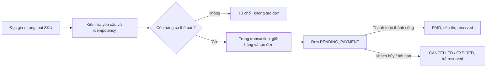
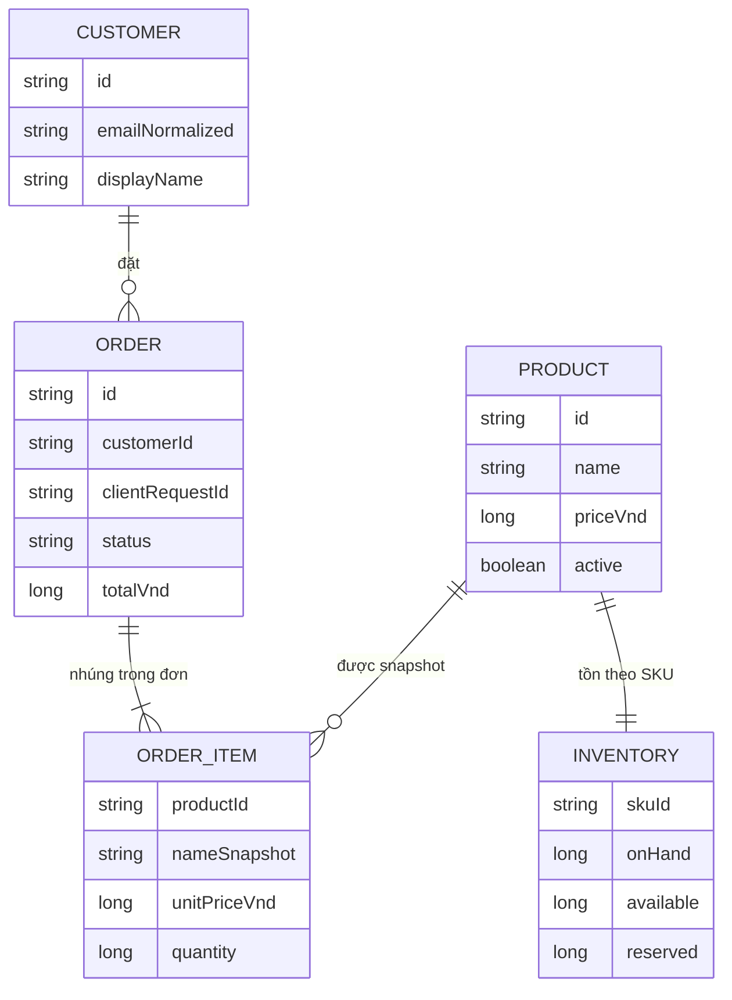

# Phân tích bài toán sản phẩm, khách hàng, tồn kho và đơn hàng với Spring Data MongoDB

## 1. Bối cảnh và mục tiêu của bài thực hành tổng hợp

Giả sử một cửa hàng trực tuyến cần xây dựng dịch vụ quản lý **sản phẩm**, **khách hàng**, **tồn kho** và **đơn hàng**. Khách có thể xem danh mục, chọn số lượng, đặt hàng, thanh toán hoặc hủy đơn. Nhân viên vận hành có thể cập nhật giá, điều chỉnh tồn kho, kiểm tra đơn đang chờ xử lý và xem báo cáo bán hàng.

Đây là bài **phân tích bài toán trước khi triển khai**, thuộc module **Spring Data MongoDB**. Mục tiêu là chuyển yêu cầu nghiệp vụ thành các quyết định có thể kiểm chứng về mô hình document, quan hệ dữ liệu, truy vấn, chỉ mục, kiểm soát ghi đồng thời, transaction, ánh xạ entity và chiến lược kiểm thử. Các ví dụ sử dụng `MongoTemplate`, MongoDB repository, aggregation và các cơ chế liên quan; không cần xây dựng một hệ thống thương mại điện tử hoàn chỉnh ngay ở bước đầu.

Kết quả cần đạt:

1. Xác định rõ vai trò, chức năng, luồng nghiệp vụ, phạm vi và những giả định còn phải xác nhận.
2. Thiết kế các collection và document sao cho hỗ trợ đường đọc/ghi thực tế.
3. Phát biểu được **bất biến nghiệp vụ** về tồn kho, giá, trạng thái đơn và idempotency.
4. Chỉ ra ranh giới cần cập nhật nguyên tử ở cấp document và trường hợp cần transaction nhiều document.
5. Chọn truy vấn, index và cách kiểm thử dựa trên yêu cầu chức năng cùng mục tiêu hiệu năng.
6. Định nghĩa tiêu chí chấp nhận để người khác có thể đánh giá thiết kế và hiện thực.

### Giả định dùng xuyên suốt

Để có một ví dụ nhất quán, bài chọn phạm vi **một cửa hàng, một kho, một loại tiền VND**, bán hàng vật lý và thanh toán không đồng bộ. Mỗi document `products` đại diện cho **một SKU có thể bán**; cùng một kiểu sản phẩm nhưng khác kích cỡ/màu có thể là SKU riêng. Không có logic khuyến mãi, nhiều kho, trả hàng, nhiều loại tiền hay phân bổ giao hàng ở phiên bản đầu. Đây là giả định của bài tập, không phải giới hạn của MongoDB hoặc Spring Data MongoDB.

VND được biểu diễn bằng `long` ở đơn vị đồng đối với ví dụ số tiền nguyên, tránh `double` cho giá trị tiền. Nếu sản phẩm cho phép phần thập phân hoặc nhiều loại tiền, cần mô hình tiền tệ rõ ràng hơn, ví dụ `Decimal128` và mã tiền tệ, cùng quy tắc làm tròn.

## 2. Chuyển nhu cầu kinh doanh thành use case có thể kiểm thử

| Tác nhân | Use case | Đầu vào | Kết quả và quy tắc |
| --- | --- | --- | --- |
| Khách vãng lai | Xem sản phẩm đang bán | Danh mục, từ khóa, trang, sort | Chỉ thấy sản phẩm `active=true` theo chính sách công khai |
| Khách đã đăng nhập | Cập nhật thông tin nhận hàng | Khách hàng, địa chỉ, số điện thoại | Thông tin hợp lệ, chỉ sửa dữ liệu được phép |
| Khách đã đăng nhập | Tạo đơn | Danh sách SKU và số lượng, khóa yêu cầu | Tạo đúng một đơn; giữ được hàng hoặc từ chối rõ ràng |
| Hệ thống thanh toán | Xác nhận kết quả | ID giao dịch, trạng thái, chữ ký sự kiện | Chuyển trạng thái đúng một lần và xử lý tồn kho tương ứng |
| Khách đã đăng nhập | Xem lịch sử đơn | Khách hàng, phân trang | Chỉ được xem các đơn thuộc về mình |
| Khách hoặc nhân viên | Hủy đơn hợp lệ | ID đơn, lý do | Không giải phóng tồn kho hai lần |
| Nhân viên kho | Nhập hoặc điều chỉnh hàng | SKU, lượng thay đổi, lý do | Cập nhật số lượng có kiểm soát, có dấu vết |
| Quản trị sản phẩm | Sửa giá, ẩn sản phẩm | SKU, thay đổi | Ảnh hưởng giá bán mới; đơn cũ vẫn giữ giá đã chốt |
| Nhân viên vận hành | Tìm đơn cần xử lý | Trạng thái, ngày, cửa hàng | Có thứ tự ổn định và chỉ mục hỗ trợ |

Một yêu cầu mô tả “không được bán quá tồn” chưa đủ cụ thể. Cần hỏi *tồn* là hàng thực trong kho, hàng còn có thể bán, hay hàng đã trừ các đơn đang giữ chỗ. Tương tự, “thanh toán thành công” cần có bằng chứng đáng tin cậy từ nhà cung cấp thanh toán, không chỉ dựa trên một request HTTP do khách tự gửi.

### Ngoài phạm vi phiên bản đầu

Không thiết kế các chức năng đấu giá, đấu giá đồng thời giá động, giao nhiều kho, gộp/tách vận đơn, đổi trả, khuyến mãi phức tạp hay phân tích dữ liệu thời gian thực. Khi mở rộng, phải xem lại quyết định về khóa định danh, phân vùng tồn kho, transaction, index, event và thông lượng ghi.

## 3. Từ vựng miền nghiệp vụ và bất biến

Sử dụng một từ vựng thống nhất giúp giảm nhầm lẫn giữa mã ở API, tên trường Java và tên trường BSON:

| Khái niệm | Ý nghĩa trong bài |
| --- | --- |
| `Product / SKU` | Đơn vị hàng bán được với ID, tên, giá và trạng thái hoạt động |
| `Customer` | Chủ tài khoản mua hàng và thông tin liên hệ |
| `Inventory` | Số lượng theo SKU tại một kho |
| `Order` | Thỏa thuận mua hàng gồm các dòng hàng, giá chốt và trạng thái |
| `OrderItem` | Ảnh chụp SKU, tên, đơn giá, số lượng lúc tạo đơn |
| `Reservation` | Số lượng đang giữ cho đơn chờ xử lý |
| `clientRequestId` | Khóa idempotency cho một yêu cầu tạo đơn từ client |
| `paymentEventId` | Định danh duy nhất của sự kiện thanh toán do nhà cung cấp gửi |
| `revision` | Version để phát hiện xung đột ghi ở đường lưu entity tương ứng |

**Các bất biến bắt buộc trong thiết kế:**

- `quantity > 0` và SKU thuộc danh mục được phép bán tại thời điểm nhận đơn.
- Giá và số tiền trong đơn được **chốt từ dữ liệu server tin cậy**, không lấy `unitPrice` do client tự gửi làm nguồn thẩm quyền.
- `totalVnd = sum(unitPriceVnd * quantity)` theo quy tắc tiền tệ đã thống nhất; phải kiểm tra tràn số hoặc dùng kiểu số thích hợp.
- Không bao giờ có `available < 0` hay `reserved < 0` do đặt hàng, hủy và xác nhận thanh toán.
- Trong mô hình đơn giản này, `onHand = available + reserved`. `onHand` là số lượng hàng còn được quản lý để bán hoặc giữ chỗ, `reserved` là hàng đang giữ và `available` là hàng còn nhận đơn. Bài tập ghi nhận tiêu thụ hàng khi thanh toán thành công; số lượng vật lý chờ xuất kho/giao hàng không được theo dõi riêng ở phiên bản này.
- Với một `(customerId, clientRequestId)`, hệ thống chỉ tạo **một** đơn hợp lệ. Gửi lại cùng khóa và cùng payload trả lại kết quả cũ; cùng khóa nhưng payload khác phải bị từ chối.
- Một đơn chỉ chuyển trạng thái qua các cạnh đã cho phép. Cùng sự kiện thanh toán hoặc hủy được xử lý lặp không được thay đổi tồn kho thêm lần nữa.
- Đơn hàng cũ vẫn giữ bản chụp tên/giá/địa chỉ theo chính sách lưu giữ, kể cả khi sản phẩm hoặc hồ sơ khách hàng đổi.
- Người dùng chỉ được đọc, sửa dữ liệu theo quyền của họ; định danh khách trong request không thay thế kiểm tra quyền.

Đây là **quy tắc của bài tập**, cần được ghi thành test. MongoDB không tự hiểu các bất biến nghiệp vụ chỉ vì document được lưu thành công.

## 4. Chu trình đặt hàng và các chuyển trạng thái

Trong phiên bản đầu, đặt hàng đồng thời **giữ hàng**, sau đó chờ kết quả thanh toán:



Trạng thái mẫu:

| Trạng thái đơn | Điều kiện vào trạng thái | Hệ quả tồn kho |
| --- | --- | --- |
| `PENDING_PAYMENT` | Tạo đơn và giữ hàng thành công | `available -= q`; `reserved += q` |
| `PAID` | Kết quả thanh toán được xác thực và đủ điều kiện chuyển | `reserved -= q`; `onHand -= q` |
| `CANCELLED` | Hủy khi còn `PENDING_PAYMENT` | `reserved -= q`; `available += q` |
| `EXPIRED` | Hết hạn giữ chỗ khi còn `PENDING_PAYMENT` | Giải phóng hàng tương tự hủy |

Ví dụ kho có 12 chiếc bàn phím:

```text
Trước đặt hàng:      onHand = 12, available = 12, reserved = 0
Giữ hàng q = 2:      onHand = 12, available = 10, reserved = 2
Nếu thanh toán xong: onHand = 10, available = 10, reserved = 0
Nếu hủy trước trả:   onHand = 12, available = 12, reserved = 0
```

Hai nhánh “thanh toán” và “hủy/hết hạn” **tranh nhau chuyển từ cùng trạng thái `PENDING_PAYMENT`**. Phải kiểm soát bằng thao tác cập nhật có điều kiện trạng thái, kết hợp transaction cho thay đổi đơn và kho, để không xảy ra trường hợp vừa trừ tồn thật vừa trả hàng về `available`.

Nếu nghiệp vụ chỉ ghi giảm tồn thực khi **giao hàng**, cần thêm khái niệm `allocated`/`shipped` hoặc sổ nhập xuất kho và các trạng thái giao vận tương ứng. Khi đó không thể dùng nguyên xi phép chuyển `PAID` ở bảng trên rồi gọi `onHand` là số lượng vật lý. Việc chọn mốc tiêu thụ phải được xác nhận trước khi triển khai.

Thông báo thanh toán đến trễ sau khi đơn hết hạn là **tình huống nghiệp vụ cần chính sách riêng**: không tự chuyển `EXPIRED` thành `PAID` và trừ hàng nếu trạng thái hiện tại không cho phép. Có thể đưa vào quy trình hoàn tiền/đối soát; không thể giải quyết chỉ bằng retry mù.

## 5. Phân định aggregate và quan hệ giữa collection

MongoDB hỗ trợ nhúng document (*embed*) và tham chiếu (*reference*). Quyết định nên dựa vào **cách dữ liệu được đọc và cập nhật**, kích thước/mức tăng trưởng, và ranh giới cần tính nguyên tử.



| Dữ liệu | Quyết định lưu | Lý do |
| --- | --- | --- |
| `products` | Collection độc lập | Danh mục đọc nhiều, sửa giá/trạng thái riêng |
| `customers` | Collection độc lập | Dữ liệu tài khoản/PII có chính sách bảo vệ riêng |
| `inventory` | Collection độc lập, một document theo SKU trong ví dụ | Ghi số lượng thường xuyên; tránh gây tranh chấp trên document sản phẩm |
| `orders` | Collection độc lập; `items[]` được nhúng | Đọc một đơn cần nguyên danh sách dòng hàng và tổng tiền |
| Đơn → khách | Lưu `customerId`, có thể thêm snapshot thông tin nhận hàng | Không sao chép toàn bộ thông tin hồ sơ khách hàng |
| Đơn → sản phẩm | Lưu `productId` **và** snapshot tên/đơn giá | Giá/tên sản phẩm về sau thay đổi không làm biến dạng đơn cũ |

Nhúng `items[]` là hợp lý khi số dòng hàng mỗi đơn được giới hạn và thường đọc cùng nhau. Nếu một đơn có thể chứa số lượng dòng không giới hạn, phải xem xét giới hạn kích thước BSON document và mô hình lưu riêng. Không nhúng **tất cả đơn** vào document khách hàng vì danh sách tăng không giới hạn, truy vấn lịch sử/phân trang khó hơn và khiến cập nhật tài khoản va chạm với ghi đơn hàng.

Đây là mô hình **denormalization có chủ đích**: `nameSnapshot` và `unitPriceVnd` lặp dữ liệu sản phẩm nhưng mang nghĩa lịch sử riêng. Không xây job tự cập nhật giá của đơn cũ mỗi khi `products.priceVnd` thay đổi.

## 6. Đề xuất schema BSON cho bốn collection

Các ví dụ dùng cú pháp `mongosh` với `ISODate(...)` để thể hiện BSON Date. ID dạng chuỗi được chọn cho bài tập; nếu hệ thống dùng `ObjectId`, cần nhất quán từ DTO đến repository và script. Các dữ liệu là giả lập.

### 6.1. `products`

```javascript
{
  _id: "sku-keyboard-01",
  skuCode: "KEYBOARD-01",
  name: "Bàn phím cơ",
  categoryId: "accessories",
  description: "Sản phẩm minh họa",
  priceVnd: NumberLong("1250000"),
  active: true,
  createdAt: ISODate("2026-01-10T10:00:00Z"),
  updatedAt: ISODate("2026-01-10T10:00:00Z"),
  revision: NumberLong("0")
}
```

`skuCode` dùng hiển thị/tích hợp, `_id` là định danh bất biến cho quan hệ. Giá phải không âm theo quy ước nghiệp vụ, và sản phẩm chỉ hiển thị khi `active=true`. `revision` có thể được Spring Data MongoDB quản lý qua `@Version` ở những đường ghi entity được hỗ trợ; không dùng nó thay khóa idempotency của đơn hàng.

### 6.2. `customers`

```javascript
{
  _id: "customer-101",
  displayName: "Khách hàng minh họa",
  emailNormalized: "khach@example.test",
  phoneMasked: "***1234",
  active: true,
  createdAt: ISODate("2026-01-11T08:00:00Z")
}
```

`phoneMasked` ở đây là giá trị **hiển thị đã che**. Nếu ứng dụng cần liên hệ hoặc giao hàng thật, phải có trường dữ liệu liên hệ hợp lệ được bảo vệ bằng chính sách phù hợp; không dùng số đã che làm nguồn liên hệ. Email chuẩn hóa theo chính sách tài khoản đã chọn, nhưng việc chuẩn hóa email không được tự giả định chỉ cần `toLowerCase()` trong mọi tình huống quốc tế.

### 6.3. `inventory`

```javascript
{
  _id: "sku-keyboard-01",
  onHand: NumberLong("12"),
  available: NumberLong("10"),
  reserved: NumberLong("2"),
  updatedAt: ISODate("2026-01-12T09:05:00Z")
}
```

Tại thời điểm này có một đơn đang giữ 2 chiếc, nên `12 = 10 + 2`. `inventory._id` trùng ID SKU vì bài chỉ có một kho; khi mở rộng nhiều kho, có thể dùng khóa riêng đại diện `(warehouseId, skuId)` kèm unique compound index và cập nhật quy trình phân bổ hàng. Các điều chỉnh mất mát/kiểm kê phải giữ bất biến hoặc ghi nhận chênh lệch theo mô hình nghiệp vụ mới.

### 6.4. `orders`

```javascript
{
  _id: "order-1001",
  customerId: "customer-101",
  clientRequestId: "checkout-abc-001",
  status: "PENDING_PAYMENT",
  currency: "VND",
  items: [
    {
      productId: "sku-keyboard-01",
      skuCodeSnapshot: "KEYBOARD-01",
      nameSnapshot: "Bàn phím cơ",
      unitPriceVnd: NumberLong("1250000"),
      quantity: NumberLong("2"),
      lineTotalVnd: NumberLong("2500000")
    }
  ],
  totalVnd: NumberLong("2500000"),
  shippingSnapshot: {
    recipient: "Người nhận minh họa",
    city: "TP. Hồ Chí Minh",
    addressLine: "Địa chỉ thử nghiệm"
  },
  placedAt: ISODate("2026-01-12T09:05:00Z"),
  reservedUntil: ISODate("2026-01-12T09:20:00Z"),
  revision: NumberLong("0")
}
```

`shippingSnapshot` giúp giữ thông tin đơn lúc chốt, nhưng cũng là dữ liệu cá nhân: phải giới hạn quyền đọc, áp dụng thời hạn lưu giữ và các biện pháp bảo vệ thích hợp. Nếu cần sửa địa chỉ trước giao hàng, nên ghi nhận một thay đổi có kiểm soát trên đơn thay vì tự đồng bộ mọi sửa đổi của hồ sơ khách.

**Nguyên tắc quan trọng:** dữ liệu client gửi để đặt hàng chỉ nên chứa `productId`, `quantity`, `clientRequestId` cùng thông tin được phép chỉnh. Server kiểm tra `products` và tự tính `unitPriceVnd`, `lineTotalVnd`, `totalVnd`. Không tin giá hoặc `status` do client tự chọn.

## 7. API và hợp đồng lỗi để bắt đầu hiện thực

| Endpoint minh họa | Tác dụng | Trường hợp cần xử lý |
| --- | --- | --- |
| `GET /api/products` | Tìm sản phẩm đang bán, phân trang và sort | Page/size giới hạn; không lộ hàng ẩn |
| `GET /api/products/{id}` | Đọc chi tiết SKU | Không tồn tại/không hiển thị |
| `GET /api/me` | Đọc hồ sơ từ danh tính đã xác thực | Không cho đọc customer khác |
| `POST /api/orders` | Tạo đơn và giữ hàng | SKU không hợp lệ, thiếu hàng, request trùng |
| `GET /api/orders/{id}` | Đọc đơn thuộc khách | Phân quyền, đơn không tồn tại |
| `GET /api/me/orders` | Lịch sử đơn của khách | Sort ổn định, phân trang |
| `POST /api/orders/{id}/cancel` | Hủy đơn đủ điều kiện | Đơn đã PAID/CANCELLED/EXPIRED |
| `POST /api/payment-events` | Nhận webhook thanh toán đã xác minh | Sự kiện trùng, đến muộn, trạng thái mâu thuẫn |
| `PATCH /api/admin/products/{id}` | Sửa thông tin/giá sản phẩm | Kiểm soát version và quyền quản trị |
| `POST /api/admin/stock-adjustments` | Nhập/điều chỉnh hàng | Không cho số lượng âm, phải có dấu vết |

Không bắt buộc xây đủ API trong bước phân tích, nhưng phải có **hợp đồng đầu vào/đầu ra** để kiểm thử. Ví dụ request đặt hàng:

```json
{
  "clientRequestId": "checkout-abc-001",
  "items": [
    { "productId": "sku-keyboard-01", "quantity": 2 }
  ]
}
```

Client không truyền `customerId` để tự quyết định quyền sở hữu; service lấy customer từ principal đã xác thực. Phản hồi thành công có `orderId`, `status`, `totalVnd` và `reservedUntil`. Các loại lỗi cần phân biệt rõ như `PRODUCT_NOT_ACTIVE`, `INSUFFICIENT_STOCK`, `DUPLICATE_REQUEST_CONFLICT`, `ORDER_STATE_CONFLICT` và `RETRYABLE_FAILURE`. HTTP status cụ thể phải thống nhất theo quy ước API của hệ thống, không cần tự suy ra từ tên lỗi.

Đối với request trùng, trả cùng kết quả đã commit khi payload hợp lệ và trùng khớp. Nếu chưa rõ transaction trước đã commit hay chưa, hệ thống phải đối soát theo `clientRequestId`, không tùy tiện tạo khóa yêu cầu mới.

## 8. Từ yêu cầu truy vấn đến index

MongoDB thường thiết kế dữ liệu và index theo **query pattern**. Trước khi tạo index, cần biết trường lọc, thứ tự sắp xếp, projection, số lượng kết quả, tần suất gọi và cập nhật.

| Đường đọc | Filter / sort | Index ứng viên |
| --- | --- | --- |
| Danh sách sản phẩm theo danh mục, tăng giá | `active=true, categoryId=?, sort priceVnd ASC, _id ASC` | `{active:1, categoryId:1, priceVnd:1, _id:1}` |
| Đọc SKU theo ID | `_id=?` | Index `_id` mặc định |
| Lấy khách theo email chuẩn hóa | `emailNormalized=?` | Unique `{emailNormalized:1}` theo chính sách |
| Kiểm tra tồn theo SKU | `_id=?` | Index `_id` mặc định |
| Lịch sử đơn của khách | `customerId=?, sort placedAt DESC, _id DESC` | `{customerId:1, placedAt:-1, _id:-1}` |
| Kiểm tra request đã xử lý | `customerId=?, clientRequestId=?` | Unique `{customerId:1, clientRequestId:1}` |
| Xử lý đơn đang chờ thanh toán | `status=PENDING_PAYMENT, reservedUntil <= now` | `{status:1, reservedUntil:1}` |

Ví dụ tạo các index chính trong `mongosh`:

```javascript
db.products.createIndex(
  {active: 1, categoryId: 1, priceVnd: 1, _id: 1},
  {name: "active_category_price"}
);

db.products.createIndex(
  {skuCode: 1},
  {unique: true, name: "unique_sku_code"}
);

db.customers.createIndex(
  {emailNormalized: 1},
  {unique: true, name: "unique_email_normalized"}
);

db.orders.createIndex(
  {customerId: 1, placedAt: -1, _id: -1},
  {name: "customer_order_history"}
);

db.orders.createIndex(
  {customerId: 1, clientRequestId: 1},
  {unique: true, name: "unique_checkout_request"}
);

db.orders.createIndex(
  {status: 1, reservedUntil: 1},
  {name: "pending_order_expiration"}
);
```

Các index là **ứng viên để thử với dataset thực tế**, không phải danh sách bắt buộc áp dụng nguyên xi cho production. Unique index cần được tạo sau khi xử lý dữ liệu trùng lịch sử; việc thêm nhiều index làm tăng chi phí ghi và dung lượng. Với multi-tenant, phải đưa `tenantId` vào mô hình truy vấn và unique constraint đúng phạm vi. Không tự giả định `customerId` là định danh tenant.

Đối với pagination lịch sử đơn, sort bằng `placedAt` đơn lẻ có thể không ổn định khi nhiều đơn trùng timestamp. Thêm `_id` làm tie-breaker; với trang rất sâu, cân nhắc keyset/cursor pagination thay `skip` lớn.

Ví dụ truy vấn và đo:

```javascript
db.orders.find(
  {customerId: "customer-101"},
  {status: 1, totalVnd: 1, placedAt: 1}
).sort({placedAt: -1, _id: -1}).limit(20)
 .explain("executionStats");
```

Khi phân tích `explain`, xem `nReturned`, `totalKeysExamined`, `totalDocsExamined` và stage thực tế, thay vì chỉ kiểm tra có `IXSCAN`. Không dùng dataset vài document để khẳng định index tối ưu; cũng phải đo latency và contention khi số lượng đơn tăng cao.

## 9. Bảo vệ tồn kho bằng cập nhật nguyên tử

Nếu hai request cùng đọc `available=1` rồi đều trừ một đơn vị trên bản sao đã đọc, ứng dụng có thể bán 2 sản phẩm trong khi kho chỉ còn 1. Cách tốt cho một SKU là thực hiện **cập nhật có điều kiện ngay tại MongoDB**, thay vì kiểm tra rồi `save` một entity không kiểm soát version.

Với `MongoTemplate`, hàm giữ hàng có thể biểu diễn:

```java
import com.mongodb.client.result.UpdateResult;
import org.springframework.data.mongodb.core.MongoTemplate;
import org.springframework.data.mongodb.core.query.Criteria;
import org.springframework.data.mongodb.core.query.Query;
import org.springframework.data.mongodb.core.query.Update;
import org.springframework.stereotype.Service;

@Service
public class InventoryReservationService {
    private final MongoTemplate template;

    public InventoryReservationService(MongoTemplate template) {
        this.template = template;
    }

    public boolean reserve(String productId, long quantity) {
        if (productId == null || productId.isBlank() || quantity <= 0) {
            throw new IllegalArgumentException("SKU và số lượng không hợp lệ");
        }

        Query query = Query.query(
            Criteria.where("_id").is(productId)
                .and("available").gte(quantity)
        );
        Update update = new Update()
            .inc("available", -quantity)
            .inc("reserved", quantity);

        UpdateResult result = template.updateFirst(query, update, "inventory");
        return result.getModifiedCount() == 1;
    }
}
```

Điều kiện `available >= quantity` và cặp thay đổi `available -= quantity`, `reserved += quantity` nằm trong **một update trên một document**; đó là mức nguyên tử cần thiết để không trừ vượt tồn với cùng SKU. Kiểu dữ liệu phải luôn là số nguyên hợp lệ và giá trị quantity phải dương, có giới hạn theo yêu cầu để tránh quá lớn hoặc tràn số.

Nếu kết quả `modifiedCount=0`, có thể SKU không tồn tại hoặc không đủ `available`; đọc lại dữ liệu phù hợp để phân biệt lỗi. Với update trực tiếp kiểu này, không mặc định `@Version` của một entity khác sẽ tự bảo vệ mọi đường ghi. Không được pha trộn những phép `repository.save(inventory)` dựa trên snapshot cũ với `updateFirst` nếu chúng có thể ghi đè bộ đếm mà không kiểm soát phiên bản.

Trong đơn có **nhiều SKU**, các lệnh `reserve` riêng lẻ không tạo thành một nhóm nguyên tử khi gọi ngoài transaction. Nếu giữ thành công SKU A rồi SKU B hết hàng, hệ thống phải rollback cả giao dịch đặt hàng hoặc có cơ chế bù trừ tin cậy. Bài chọn MongoDB transaction cho lần tạo đơn, bởi số SKU/order được giới hạn và dịch vụ chạy trên topology hỗ trợ.

## 10. Transaction khi tạo đơn và ranh giới với thanh toán

Thiết kế một transaction khi tạo đơn:

```text
Nhận request gồm customerId từ principal, clientRequestId và items.
Kiểm tra payload, gộp các dòng trùng SKU, kiểm tra giới hạn số dòng.
Tìm đơn đã commit theo (customerId, clientRequestId):
  - Đã tồn tại, cùng payload → trả đơn cũ.
  - Đã tồn tại, khác payload → báo conflict.
Đọc sản phẩm từ server; chặn SKU không active, chốt giá và tính tổng.
Trong một MongoDB transaction:
  1. Reserve lần lượt từng SKU bằng update điều kiện available >= quantity.
  2. Nếu bất kỳ SKU nào thiếu hàng, abort transaction.
  3. Insert đơn PENDING_PAYMENT với items/total/snapshot và clientRequestId.
Commit.
Trả orderId, totalVnd, reservedUntil.
```

Các thao tác thuộc transaction phải dùng **cùng session/transaction** do Spring quản lý. Trong Spring Data MongoDB, có thể đăng ký `MongoTransactionManager`:

Cần thống nhất **thời điểm chốt giá**. Nếu yêu cầu “giá và trạng thái SKU phải đúng tại lúc tạo đơn”, bước đọc sản phẩm cần nằm trong ranh giới nhất quán phù hợp và có cơ chế phát hiện thay đổi giá/trạng thái đồng thời (chẳng hạn điều kiện phiên bản hoặc chính sách giá có hiệu lực theo thời điểm). Chỉ đọc giá trước transaction rồi giữ hàng sau đó có thể tạo đơn theo mức giá đã thay đổi; đây có thể là hành vi hợp lệ nếu hợp đồng checkout quy định rõ thời gian hiệu lực báo giá.

```java
import org.springframework.context.annotation.Bean;
import org.springframework.context.annotation.Configuration;
import org.springframework.data.mongodb.MongoDatabaseFactory;
import org.springframework.data.mongodb.MongoTransactionManager;

@Configuration
public class MongoTransactionConfiguration {
    @Bean
    MongoTransactionManager mongoTransactionManager(MongoDatabaseFactory factory) {
        return new MongoTransactionManager(factory);
    }
}
```

Sau đó đặt orchestration trong một Spring bean có phương thức `@Transactional` được gọi **qua Spring proxy**, không dùng self-invocation. MongoDB phải chạy trên replica set hoặc sharded cluster phù hợp và có read/write concern theo yêu cầu. `@Transactional` không tự biến một MongoDB standalone thành hệ thống hỗ trợ transaction.

### Hai request trùng đồng thời

Một phép kiểm tra `findByCustomerIdAndClientRequestId` trước khi tạo đơn **không đủ** bảo vệ hai request chạy đồng thời: cả hai có thể chưa nhìn thấy đơn. Unique index `{customerId:1,clientRequestId:1}` là chốt chặn để không commit hai đơn cùng khóa. Khi một transaction bị duplicate key hoặc write conflict, phải xử lý rollback rồi đối soát đơn đã commit trong một phạm vi transaction mới; không bắt exception ở giữa transaction và tiếp tục như thể những thao tác giữ hàng trước đó chắc chắn đã được commit.

Nếu request mất kết nối ngay khi commit, hệ thống có thể **chưa xác định được transaction đã thành công hay chưa**. Không tự tạo `clientRequestId` mới rồi chạy lại. Cần reconcile theo khóa idempotency và kết quả commit bằng chính sách retry/timeout phù hợp.

### Gọi nhà cung cấp thanh toán

Không đặt một HTTP call sang cổng thanh toán bên trong MongoDB transaction rồi mong rollback được giao dịch bên ngoài. Thông thường:

1. Commit đơn `PENDING_PAYMENT` và giữ hàng trong MongoDB.
2. Tạo yêu cầu thanh toán bên ngoài với khóa idempotency ổn định và ràng buộc đơn.
3. Nhận kết quả từ callback/webhook **đã xác thực**.
4. Trong transaction mới, kiểm tra `status=PENDING_PAYMENT` trước khi chuyển sang `PAID`, giảm `reserved`/`onHand`, ghi nhận event đã xử lý.
5. Nếu hủy/hết hạn thắng cuộc đua, không tự ghi `PAID` từ một webhook đến muộn; xử lý theo chính sách đối soát/hoàn tiền.

Chuyển trạng thái và thay đổi tồn kho của bước 4 phải được điều phối như một đơn vị nhất quán. Để sự kiện gửi đi đáng tin cậy sau commit, có thể dùng **transactional outbox** và consumer idempotent. Idempotency cho webhook dựa trên `paymentEventId` hoặc khóa tương đương từ provider, nhưng còn phải xác minh payload, trạng thái, số tiền và chữ ký.

## 11. Tính giá tiền và lưu lại trạng thái lịch sử

Một sản phẩm có giá `1.250.000 VND` lúc khách đặt 2 chiếc. Ngày hôm sau quản trị viên đổi giá xuống `1.100.000 VND`. Đơn cũ vẫn phải có:

```text
items[0].unitPriceVnd = 1250000
items[0].quantity     = 2
items[0].lineTotalVnd = 2500000
order.totalVnd        = 2500000
```

Không tính lại `order.totalVnd` bằng cách đọc `products.priceVnd` mỗi khi hiển thị lịch sử. Tương tự, nếu tên sản phẩm đổi, màn hình đơn vẫn hiển thị `nameSnapshot` đã thỏa thuận lúc mua.

Một hàm tính toán ở tầng Java:

```java
import java.util.List;

public final class OrderTotals {
    private OrderTotals() {}

    public record PriceLine(long unitPriceVnd, long quantity) {}

    public static long totalVnd(List<PriceLine> lines) {
        if (lines == null || lines.isEmpty()) {
            throw new IllegalArgumentException("Đơn không có dòng hàng");
        }

        long total = 0;
        for (PriceLine line : lines) {
            if (line.unitPriceVnd() < 0 || line.quantity() <= 0) {
                throw new IllegalArgumentException("Giá hoặc số lượng không hợp lệ");
            }
            total = Math.addExact(
                total,
                Math.multiplyExact(line.unitPriceVnd(), line.quantity())
            );
        }
        return total;
    }
}
```

`Math.multiplyExact`/`addExact` giúp phát hiện tràn số thay vì âm thầm trả tổng sai. Với giảm giá, thuế, phí vận chuyển và đa tiền tệ, phải định nghĩa riêng từng thành phần, chính sách tính giá theo thứ tự và snapshot của các điều kiện tính toán.

## 12. Ánh xạ document và truy vấn bằng Spring Data MongoDB

Ở bước phân tích, có thể phác thảo entity cho document sản phẩm:

```java
import java.time.Instant;
import org.springframework.data.annotation.Id;
import org.springframework.data.annotation.Version;
import org.springframework.data.mongodb.core.mapping.Document;

@Document("products")
public class ProductDocument {
    @Id private String id;
    private String skuCode;
    private String name;
    private String categoryId;
    private long priceVnd;
    private boolean active;
    private Instant createdAt;
    private Instant updatedAt;

    @Version
    private Long revision;

    // Constructor và getter/setter theo quy ước của ứng dụng.
}
```

Repository được dùng cho đường đọc thông thường:

```java
import java.util.Optional;
import org.springframework.data.mongodb.repository.MongoRepository;

public interface ProductRepository
        extends MongoRepository<ProductDocument, String> {
    Optional<ProductDocument> findBySkuCode(String skuCode);
}
```

Truy vấn danh mục có filter, sort và giới hạn rõ ràng có thể dùng `MongoTemplate`:

```java
import java.util.List;
import org.springframework.data.domain.Sort;
import org.springframework.data.mongodb.core.MongoTemplate;
import org.springframework.data.mongodb.core.query.Criteria;
import org.springframework.data.mongodb.core.query.Query;

public class CatalogQueryService {
    private final MongoTemplate template;

    public CatalogQueryService(MongoTemplate template) {
        this.template = template;
    }

    public List<ProductDocument> listActiveByCategory(
            String categoryId, int pageSize) {
        if (pageSize < 1 || pageSize > 100) {
            throw new IllegalArgumentException("pageSize ngoài giới hạn");
        }

        Query query = Query.query(
            Criteria.where("active").is(true)
                .and("categoryId").is(categoryId)
        );
        query.with(Sort.by(
            Sort.Order.asc("priceVnd"), Sort.Order.asc("_id")
        ));
        query.limit(pageSize);

        return template.find(query, ProductDocument.class);
    }
}
```

Đây là mã **minh họa cho phân tích và prototyping**; cần bổ sung DTO, validation, authorization, pagination token, exception mapping và các quy ước của ứng dụng trước khi đưa vào production. Với `@Version`, optimistic locking có hiệu lực trên đường ghi entity phù hợp; các lệnh `updateFirst`/native update phải được xem xét riêng về điều kiện version.

### Aggregation cho báo cáo

Báo cáo tổng doanh số từ các đơn đã `PAID` có thể bắt đầu bằng pipeline:

```javascript
db.orders.aggregate([
  {$match: {status: "PAID"}},
  {$group: {
    _id: "$currency",
    paidOrders: {$sum: 1},
    grossTotal: {$sum: "$totalVnd"}
  }},
  {$sort: {_id: 1}}
]);
```

Chỉ gộp tổng cùng một đơn vị tiền tệ, và xác định rõ có bao gồm đơn hoàn tiền/đổi trả hay không khi mở rộng. Trên collection rất lớn, báo cáo cần filter khoảng ngày, index, pre-aggregation hoặc read model phù hợp; không mặc định một pipeline quét toàn bộ đơn là đủ tốt cho mọi yêu cầu realtime.

## 13. Bảo mật, vận hành và xử lý dữ liệu cũ

- **Phân quyền:** lấy `customerId` từ danh tính đã xác thực; mọi query đọc đơn cá nhân phải ràng buộc người sở hữu hoặc quyền quản trị. Chặn việc đổi ID trong URL để đọc đơn của người khác.
- **Dữ liệu cá nhân:** email, số điện thoại và địa chỉ nhận hàng phải có chính sách che, mã hóa khi cần, thời hạn lưu trữ và giới hạn log. Không đưa toàn bộ `CustomerDocument` vào response công khai.
- **Validation:** giới hạn độ dài tên, số dòng hàng/đơn, số lượng tối đa, trạng thái và kiểu dữ liệu BSON. Cân nhắc MongoDB JSON Schema validation để ngăn dữ liệu sai kiểu do những writer ngoài Spring tạo ra.
- **Kiểm toán tồn kho:** mỗi lần nhập/điều chỉnh số lượng nên có nguồn gốc và người thực hiện. Nếu yêu cầu đối soát cao, bổ sung collection `stockMovements` như một nhật ký bất biến hoặc thiết kế tương đương.
- **Cache:** có thể cache dữ liệu catalog ít thay đổi; sau khi đổi giá/ẩn sản phẩm phải invalidate bản sao thích hợp. Không tin cache là nguồn tồn kho tại thời điểm quyết định giữ hàng.
- **Replication:** đọc secondary có thể trễ; đường quyết định ghi/đặt hàng phải dùng nguồn và mức consistency đã được kiểm chứng. Không chọn `secondaryPreferred` mặc định cho mọi truy vấn chỉ vì muốn giảm tải primary.
- **Migration:** khi thêm `schemaVersion` hoặc thay tên/kiểu trường, cần bộ đọc tương thích và migration có thể chạy lại. Đơn hàng lịch sử có snapshot và trạng thái không được biến dạng khi đổi schema.
- **Khôi phục:** kiểm thử backup/restore dữ liệu sản phẩm, khách hàng, kho và đơn cùng các index/validation cần thiết; đối soát bất biến sau restore.

## 14. Phi chức năng: định nghĩa trước cách đo

Những mục tiêu sau chỉ là **mốc giả định để học cách đặt SLO**, không phải số liệu cam kết sẵn có của Spring Data MongoDB:

| Mục tiêu | Câu hỏi đo lường | Cách kiểm chứng |
| --- | --- | --- |
| Đọc catalog nhanh | p95 latency khi 90% request là đọc? | Load test với dữ liệu đại diện, đo cache hit/miss và MongoDB explain |
| Không oversell | 100 request giữ 1 sản phẩm có `available=1` thì bao nhiêu đơn được tạo? | Kiểm thử đồng thời, assert đúng một reservation |
| Một đơn cho một request | 10 lần gửi cùng `clientRequestId` có sinh đơn/giữ hàng thêm không? | Test idempotency cùng và khác payload |
| Không có đơn giữ hàng một nửa | SKU A còn, SKU B hết trong cùng order | Test rollback transaction, kiểm tra inventory và orders |
| Webhook lặp an toàn | Cùng `paymentEventId` được gửi nhiều lần | Test chuyển trạng thái/tồn kho chỉ một lần |
| Truy vấn lịch sử hiệu quả | `docsExamined`, `keysExamined` tăng thế nào theo số đơn? | `explain("executionStats")` và load test |
| Dữ liệu chính xác sau lỗi | Khi timeout gần commit còn trạng thái nào chưa rõ? | Fault injection + reconciliation bằng request ID |
| Bảo vệ thông tin | User A có thể xem đơn B bằng ID trực tiếp không? | Integration test authorization |

Metrics nên có: tỷ lệ request thành công/thất bại, `INSUFFICIENT_STOCK`, optimistic locking conflict, transaction retry, số đơn chờ quá hạn, độ trễ webhook, lệch bất biến tồn kho, latency p95/p99, số document/index key đã xét và tiến độ reconciliation. Log theo correlation ID và operation ID; tránh log nguyên văn địa chỉ, email, payment credential.

## 15. Bộ integration test trọng tâm

Một bài capstone có giá trị khi test thực sự chạy qua MongoDB, thay vì chỉ mock repository. Với Spring Boot Test và Testcontainers, cần cấu hình MongoDB replica set nếu kiểm thử transaction/Change Streams. Các test có thể nhóm theo miền:

| Nhóm | Dữ liệu chuẩn bị | Điều phải chứng minh |
| --- | --- | --- |
| Catalog | Sản phẩm active/inactive, nhiều danh mục, giá khác nhau | Filter, sort và giới hạn kết quả đúng |
| Customer | Hai tài khoản khác nhau | Không đọc được dữ liệu cá nhân hoặc đơn của tài khoản khác |
| Price snapshot | Tạo đơn rồi đổi giá sản phẩm | `order.items.unitPriceVnd` và `totalVnd` không đổi |
| Reserve thành công | Kho 12, request 2 | `available=10`, `reserved=2`, `onHand=12` |
| Hết hàng | Kho available 1, request 2 | Không có reservation/đơn commit một phần |
| Oversell cạnh tranh | Kho available 1, 2 request ID khác nhau đặt 1 | Nhiều nhất một order thành công, tồn không âm |
| Idempotency | Cùng customer + request ID gửi lặp | Một đơn, hàng giữ một lần; payload khác bị từ chối |
| Rollback nhiều SKU | A còn hàng, B hết hàng | Số lượng cả A và B giữ nguyên sau transaction lỗi |
| Thanh toán thành công | Đơn PENDING giữ 2 | Chuyển PAID, `reserved-=2`, `onHand-=2` một lần |
| Webhook trùng | Gửi lại event đã xử lý | Không trừ kho hay phát sự kiện nghiệp vụ thêm |
| Hủy/hết hạn | Đơn PENDING giữ 2 | Trả `available+=2`, `reserved-=2` đúng một lần |
| Paid/hủy tranh nhau | Gửi đồng thời hai luồng | Chỉ một chuyển trạng thái thắng; kho vẫn hợp lệ |
| Lỗi commit chưa rõ | Mất phản hồi gần commit | Reconcile theo request ID, không đặt thêm đơn mới |
| Hiệu năng | Nhiều sản phẩm/đơn có phân bố đại diện | Query plan, index và p95 phù hợp mục tiêu thử nghiệm |

Ví dụ kiểm tra race đặt hàng:

```text
Setup: inventory[sku-01].available = 1; reserved = 0; onHand = 1.
Hai request đồng thời với hai clientRequestId khác nhau, cùng qty = 1.

Kỳ vọng:
  - Chính xác một request tạo đơn PENDING_PAYMENT và giữ hàng.
  - Request còn lại nhận INSUFFICIENT_STOCK hoặc xung đột được xử lý an toàn.
  - inventory.available = 0, reserved = 1, onHand = 1.
  - Không có đơn thứ hai ở trạng thái đã giữ hàng.
```

Chỉ kiểm tra HTTP status không đủ. Cần đọc lại **document trong MongoDB** để kiểm chứng bất biến. Với hai thread, dùng barrier/latch để tạo cạnh tranh có kiểm soát; không dựa vào `Thread.sleep` cố định.

Để kiểm thử transaction, không đặt toàn bộ test trong một transaction bao ngoài rồi nhầm lẫn rollback của test với rollback của service. Mỗi đường ghi nghiệp vụ nên được gọi qua Spring proxy phù hợp và đối soát trạng thái sau khi transaction thực sự kết thúc.

## 16. Sản phẩm bàn giao của giai đoạn phân tích

Trước khi hiện thực đầy đủ, nhóm thực hiện nên bàn giao:

1. **Bảng use case** và giả định nghiệp vụ đã thống nhất; đánh dấu câu hỏi còn mở.
2. **Sơ đồ miền** gồm `Product`, `Customer`, `Inventory`, `Order` và `OrderItem`.
3. **JSON/BSON mẫu** và định nghĩa trường, kiểu, ID, field bắt buộc, trạng thái.
4. **Bảng bất biến** về tồn kho, giá, đơn, quyền truy cập, idempotency.
5. **Sơ đồ chuyển trạng thái** cùng transaction boundary và xử lý webhook/hủy.
6. **Danh sách API/query pattern** kèm chỉ mục ứng viên và kế hoạch `explain`.
7. **Ma trận test** cho đường thành công, lỗi, race và phục hồi.
8. **Kế hoạch đo lường** cùng giới hạn độ trễ, khả năng mở rộng và bảo vệ dữ liệu.

Một quyết định chưa rõ phải được ghi thành câu hỏi cụ thể, ví dụ: “Khi thanh toán đến muộn sau lúc `reservedUntil` hết hạn, quy trình hoàn tiền hay gia hạn giữ hàng được ưu tiên?” hoặc “Sản phẩm có hỗ trợ nhiều kho ngay ở phiên bản đầu không?”. Không nên tự biến giả định thành yêu cầu đã được khách hàng phê duyệt.

## 17. Bài thực hành tự triển khai và tiêu chí đánh giá

Áp dụng mô hình trên để làm một bản thử nhỏ bằng Java, Spring Boot, Spring Data MongoDB và MongoDB replica set thử nghiệm:

**Phần A — Phân tích và seed dữ liệu**

1. Tạo ít nhất 6 SKU thuộc 2 danh mục, 3 khách hàng và tồn kho tương ứng.
2. Viết contract cho sản phẩm, khách, tồn kho và đơn; tạo dữ liệu BSON đúng kiểu.
3. Chuẩn bị bảng giá, danh sách đơn, yêu cầu đặt hàng trùng và sản phẩm ngừng bán.

**Phần B — Đường đọc và cập nhật**

1. Tạo đường `GET` catalog, chi tiết sản phẩm và lịch sử đơn theo người sở hữu.
2. Tạo đường sửa giá có kiểm soát concurrency và chứng minh đơn cũ không đổi giá.
3. Dùng `MongoTemplate` để reserve có điều kiện và repository để đọc entity.
4. Tạo transaction giữ hàng của đơn nhiều SKU và lưu order snapshot.
5. Mô phỏng xác nhận thanh toán và hủy có kiểm soát trạng thái, lặp sự kiện an toàn.

**Phần C — Kiểm thử và quan sát**

1. Chạy test đặt hàng đồng thời, idempotency, rollback và bất biến tồn kho.
2. Dùng `explain("executionStats")` trên truy vấn catalog và lịch sử đơn với dataset mở rộng.
3. Thử gửi lại webhook, timeout/retry và kiểm tra đối soát theo operation ID.
4. Ghi kết quả đo, lỗi còn tồn tại và đề xuất index hoặc thay đổi thiết kế.

Có thể đánh giá theo rubric tham khảo:

| Tiêu chí | Tỷ trọng | Bằng chứng |
| --- | ---: | --- |
| Phân tích yêu cầu và giả định | 20% | Use case, câu hỏi mở và ranh giới phạm vi |
| Mô hình BSON và quan hệ dữ liệu | 20% | Sample document, giải thích embed/reference |
| Tính đúng đắn của tồn kho/đơn | 25% | Invariant, transaction, idempotency, test cạnh tranh |
| Truy vấn, index và hiệu năng | 15% | Query pattern, `explain`, lý do chọn index |
| Bảo mật và vận hành | 10% | Phân quyền, thông tin nhạy cảm, retry/recovery |
| Khả năng kiểm thử và bàn giao | 10% | Fixture, integration test và báo cáo kết quả |

**Tiêu chí hoàn thành:** một reviewer có thể lấy tài liệu để hiểu các quy tắc mua hàng, nhận diện chính xác ranh giới dữ liệu cần nhất quán, biết vì sao bốn collection được thiết kế như vậy, chạy được một luồng đặt/hủy/thanh toán mẫu trên MongoDB và kiểm chứng không oversell, không tạo đơn trùng, không thay đổi giá của đơn lịch sử. Bước triển khai và QA chuyên môn tiếp theo có thể mở rộng những quyết định này mà không phải đoán ý nghĩa của dữ liệu.
