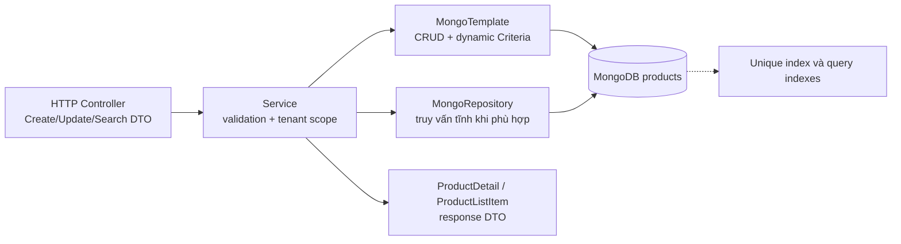

# Triển khai CRUD, bộ lọc động, projection và phân trang

Trong các bài học riêng lẻ về **Spring Data MongoDB**, ta thường viết một lệnh `insert`, `find` hoặc một `Criteria` ngắn. Khi xây dựng API thật, các phần này phải hoạt động cùng nhau: dữ liệu đầu vào được kiểm tra, thao tác CRUD giữ đúng phạm vi truy cập, bộ lọc động không cho phép tùy ý chèn toán tử, projection chỉ lấy trường cần thiết và phân trang phải có thứ tự ổn định.

Bài **thực hành tổng hợp** này xây dựng một API quản lý sản phẩm bằng **Spring Boot + Spring Data MongoDB**, kết hợp `MongoTemplate` và repository. Sau bài học, bạn sẽ có một thiết kế có thể triển khai, một bộ ví dụ Java xuyên suốt và các tình huống kiểm thử để đánh giá tính đúng đắn, bảo mật và hiệu năng.

## 1. Đề bài và tiêu chí hoàn thành

Giả sử một nền tảng có nhiều cửa hàng (*tenant*) muốn quản lý sản phẩm. Một sản phẩm có SKU, tên, danh mục, giá theo đơn vị nhỏ nhất, trạng thái bán và thời điểm tạo/cập nhật. Một tenant không được đọc hoặc sửa dữ liệu tenant khác.

API cần hỗ trợ:

| Chức năng | Endpoint | Hành vi |
| --- | --- | --- |
| Tạo | `POST /api/products` | Insert sản phẩm, kiểm tra SKU trùng trong tenant |
| Đọc chi tiết | `GET /api/products/{id}` | Chỉ trả sản phẩm trong tenant hiện tại |
| Cập nhật | `PUT /api/products/{id}` | Sửa các trường được phép, giữ ID/SKU/tenant |
| Xóa | `DELETE /api/products/{id}` | Xóa theo ID **và** tenant |
| Tìm kiếm | `GET /api/products` | Lọc động, sort, projection danh sách và phân trang |

Hợp đồng tìm kiếm:

- `sku`: bằng chính xác một SKU đã chuẩn hóa, nếu có.
- `category`: bằng một mã danh mục cho phép, nếu có.
- `active`: Boolean `true`/`false`, nếu có.
- `minPrice`, `maxPrice`: so sánh số nguyên theo cận, có thể dùng riêng hoặc kết hợp.
- `sort`: một trong `created`, `price`, `name`; `direction`: `asc` hoặc `desc`.
- `page`: từ 0; `size`: trong khoảng 1–100.
- Kết quả list là **DTO rút gọn** và có `totalElements`, `hasNext`.

**Yêu cầu bảo mật:** `tenantId` lấy từ principal/token đã được hệ thống xác thực, không tin một tham số `tenantId` do client gửi. Tất cả đường đọc/ghi đều phải áp dụng phạm vi tenant; thao tác bằng ID đơn lẻ không đủ.

Ví dụ document mong muốn:

```javascript
{
  _id: "0b5968b3-ced8-4af6-8d36-fcafbbd37221",
  tenantId: "shop-a",
  sku: "KB-001",
  name: "Bàn phím cơ",
  category: "peripherals",
  priceInCents: NumberLong("129900"),
  active: true,
  createdAt: ISODate("2026-11-10T08:00:00Z"),
  updatedAt: ISODate("2026-11-10T08:00:00Z")
}
```

Giá được lưu bằng **BSON Int64** để tránh lỗi làm tròn số thực. Với nghiệp vụ tiền tệ khác, có thể chọn `BigDecimal` ánh xạ BSON `Decimal128` và thiết kế quy tắc làm tròn riêng. Bài tập này thống nhất dùng `Long`, kể cả khi min/max filter được gửi qua HTTP.

## 2. Kiến trúc bài thực hành



Chọn công cụ theo công việc:

| Nhu cầu | Công cụ | Lý do |
| --- | --- | --- |
| Tìm theo ID/khóa đơn giản | `MongoRepository` hoặc `MongoTemplate` | Cú pháp ngắn, hỗ trợ ánh xạ entity |
| Query tổ hợp nhiều điều kiện tùy chọn | `MongoTemplate` với `Criteria` | Dễ xây filter theo nhánh và giữ điều kiện tenant |
| Update có chọn lọc field | `Update` + `updateFirst` | Không vô tình thay toàn bộ document hoặc field hệ thống |
| Phân trang và đếm | `PageRequest`, `Sort`, `count` | Rõ ràng về limit, skip và tổng số bản ghi |
| Dữ liệu list rút gọn | `Query.fields().include(...)` + DTO | Giảm lượng dữ liệu đọc và giới hạn kết quả công khai |
| Index duy nhất và hiệu năng | `IndexOperations` / migration | Ràng buộc được thực thi bởi MongoDB |

Ví dụ sử dụng Java 17+ để có `record` và `switch` expression. Package được giả định là `example.catalog`. Các lớp/record được trình bày theo từng nhiệm vụ; khi tạo project, đặt mỗi public type vào file Java tương ứng.

## 3. Dữ liệu và ánh xạ entity

Ta chọn `record Product` vì các đường ghi trong bài dùng `insert` hoặc atomic `Update`; không cần thay đổi trực tiếp một entity mutable:

```java
package example.catalog;

import java.time.Instant;
import org.springframework.data.mongodb.core.mapping.Document;
import org.springframework.data.mongodb.core.mapping.FieldType;
import org.springframework.data.mongodb.core.mapping.MongoId;

@Document("products")
public record Product(
    @MongoId(FieldType.STRING) String id,
    String tenantId,
    String sku,
    String name,
    String category,
    Long priceInCents,
    Boolean active,
    Instant createdAt,
    Instant updatedAt
) {}
```

Các quyết định ở entity:

- `@Document("products")` liên kết entity với collection.
- `@MongoId(FieldType.STRING)` giữ `_id` dưới BSON String, phù hợp ID UUID có dấu gạch nối của ví dụ. Nếu dùng `@Id String` với giá trị trông như ObjectId, cần hiểu quy tắc conversion của Spring Data; không nên tự trộn các kiểu `_id`.
- `Long priceInCents` ánh xạ giá thành BSON Int64 trong cấu hình converter thông thường. Chọn wrapper `Long`/`Boolean` còn giúp biểu diễn trường thiếu khi chỉ đọc **một phần** document bằng projection.
- `createdAt` và `updatedAt` là `Instant`. Ví dụ sẽ tự đặt giá trị qua một `Clock` do ứng dụng cung cấp, không phụ thuộc vào cơ chế auditing tự động.

Collection sẽ có một **unique compound index** trên `tenantId` + `sku`, vì SKU chỉ cần duy nhất **trong mỗi tenant**. Một unique index toàn cục chỉ trên `sku` có thể vô tình cấm hai cửa hàng dùng cùng mã.

### 3.1. Tạo index rõ ràng

Trong môi trường học hoặc khi khởi tạo schema, có thể dùng:

```java
import org.springframework.data.domain.Sort;
import org.springframework.data.mongodb.core.MongoTemplate;
import org.springframework.data.mongodb.core.index.Index;

void createIndexes(MongoTemplate template) {
    template.indexOps(Product.class).ensureIndex(
        new Index()
            .on("tenantId", Sort.Direction.ASC)
            .on("sku", Sort.Direction.ASC)
            .unique()
            .named("ux_products_tenant_sku")
    );

    template.indexOps(Product.class).ensureIndex(
        new Index()
            .on("tenantId", Sort.Direction.ASC)
            .on("createdAt", Sort.Direction.DESC)
            .on("id", Sort.Direction.ASC)
            .named("ix_products_tenant_created_id")
    );
}
```

Khi `indexOps(Product.class)` biết entity, tên property `id` được ánh xạ sang `_id` theo cấu hình mapping. Nếu tạo index trực tiếp qua `mongoTemplate.getCollection("products")`, phải dùng tên BSON thực tế, ví dụ `_id`.

**Không** đặt lệnh tạo/xóa index trong mọi request. Ở production nên quản lý qua quy trình bootstrap/migration có kiểm soát và xác minh chỉ mục đã tồn tại trước khi hệ thống nhận lưu lượng. Index cần xét thêm filter và sort thực tế bằng `explain`; chỉ mục minh họa ở trên không tối ưu được mọi tổ hợp `category`, `active` và `price`.

## 4. DTO đầu vào, DTO đầu ra và validation

Không cho HTTP client ghi trực tiếp một `Product` vì đối tượng này chứa cả `tenantId`, `id` và timestamp hệ thống. Định nghĩa các loại request tường minh:

```java
package example.catalog;

import jakarta.validation.constraints.Min;
import jakarta.validation.constraints.NotBlank;
import jakarta.validation.constraints.NotNull;
import jakarta.validation.constraints.Size;

public record CreateProductRequest(
    @NotBlank @Size(max = 40) String sku,
    @NotBlank @Size(max = 120) String name,
    @NotBlank @Size(max = 40) String category,
    @NotNull @Min(0) Long priceInCents,
    @NotNull Boolean active
) {}

public record ReplaceProductRequest(
    @NotBlank @Size(max = 120) String name,
    @NotBlank @Size(max = 40) String category,
    @NotNull @Min(0) Long priceInCents,
    @NotNull Boolean active
) {}
```

`CreateProductRequest` chứa SKU; `ReplaceProductRequest` không cho đổi SKU, tenant hoặc ID. Nếu nghiệp vụ muốn cho đổi SKU, cần thêm chức năng riêng và xử lý lỗi unique index.

DTO cho bộ lọc và trả kết quả:

```java
package example.catalog;

import java.time.Instant;
import java.util.List;

public record ProductSearchRequest(
    String sku,
    String category,
    Boolean active,
    Long minPrice,
    Long maxPrice,
    String sort,
    String direction,
    int page,
    int size
) {}

public record ProductListItem(
    String id,
    String sku,
    String name,
    String category,
    Long priceInCents,
    Boolean active,
    Instant createdAt
) {
    static ProductListItem from(Product product) {
        return new ProductListItem(
            product.id(), product.sku(), product.name(),
            product.category(), product.priceInCents(),
            product.active(), product.createdAt()
        );
    }
}

public record ProductDetail(
    String id,
    String sku,
    String name,
    String category,
    Long priceInCents,
    Boolean active,
    Instant createdAt,
    Instant updatedAt
) {
    static ProductDetail from(Product p) {
        return new ProductDetail(
            p.id(), p.sku(), p.name(), p.category(), p.priceInCents(),
            p.active(), p.createdAt(), p.updatedAt()
        );
    }
}

public record PageResult<T>(
    List<T> items,
    int page,
    int size,
    long totalElements,
    boolean hasNext
) {}
```

`ProductListItem` và `ProductDetail` không có `tenantId` hay field nội bộ. Đây là **response contract**; việc dùng projection phía database sẽ được bổ sung để giảm dữ liệu lấy về. Không trả trực tiếp entity trong HTTP controller khi entity chứa các trường không được phép công bố.

Với Spring Boot, cần starter validation tương thích nếu muốn `@Valid` hoạt động. Những trường liên quan đến miền dữ liệu và bộ lọc vẫn cần được kiểm tra tại service vì service có thể được gọi ngoài HTTP controller.

## 5. CRUD an toàn bằng `MongoTemplate`

Định nghĩa service dùng `Clock` để test timestamp có thể lặp lại và `MongoTemplate` để truy cập dữ liệu:

```java
package example.catalog;

import java.time.Clock;
import java.time.Instant;
import java.util.Locale;
import java.util.NoSuchElementException;
import java.util.UUID;
import org.springframework.data.mongodb.core.MongoTemplate;
import org.springframework.data.mongodb.core.query.Criteria;
import org.springframework.data.mongodb.core.query.Query;
import org.springframework.data.mongodb.core.query.Update;
import org.springframework.stereotype.Service;

@Service
public class ProductService {
    private final MongoTemplate mongoTemplate;
    private final Clock clock;

    public ProductService(MongoTemplate mongoTemplate, Clock clock) {
        this.mongoTemplate = mongoTemplate;
        this.clock = clock;
    }

    private Query scopedId(String tenantId, String id) {
        requireTenant(tenantId);
        if (id == null || id.isBlank()) {
            throw new IllegalArgumentException("Product ID không hợp lệ");
        }
        return Query.query(
            Criteria.where("tenantId").is(tenantId).and("id").is(id)
        );
    }

    private static void requireTenant(String tenantId) {
        if (tenantId == null || tenantId.isBlank()) {
            throw new IllegalArgumentException("Thiếu tenant đã xác thực");
        }
    }

    private static String normalizeSku(String raw) {
        if (raw == null) {
            throw new IllegalArgumentException("SKU bắt buộc");
        }
        String sku = raw.trim().toUpperCase(Locale.ROOT);
        if (!sku.matches("[A-Z0-9-]{1,40}")) {
            throw new IllegalArgumentException("SKU không hợp lệ");
        }
        return sku;
    }

    private static String requiredText(String value, int max) {
        if (value == null || value.isBlank() ||
                value.trim().length() > max) {
            throw new IllegalArgumentException("Chuỗi không hợp lệ");
        }
        return value.trim();
    }

    private static Long requiredPrice(Long value) {
        if (value == null || value < 0 || value > 1_000_000_000_000L) {
            throw new IllegalArgumentException("Giá ngoài miền hợp lệ");
        }
        return value;
    }

    private static Boolean requiredActive(Boolean value) {
        if (value == null) {
            throw new IllegalArgumentException("Trạng thái bắt buộc");
        }
        return value;
    }

    public ProductDetail create(
            String tenantId, CreateProductRequest request) {
        requireTenant(tenantId);
        if (request == null) {
            throw new IllegalArgumentException("Thiếu dữ liệu tạo");
        }
        Instant now = clock.instant();
        Product product = new Product(
            UUID.randomUUID().toString(),
            tenantId,
            normalizeSku(request.sku()),
            requiredText(request.name(), 120),
            requiredText(request.category(), 40),
            requiredPrice(request.priceInCents()),
            requiredActive(request.active()),
            now,
            now
        );
        return ProductDetail.from(mongoTemplate.insert(product));
    }

    public ProductDetail get(String tenantId, String id) {
        Product result = mongoTemplate.findOne(
            scopedId(tenantId, id), Product.class
        );
        if (result == null) {
            throw new NoSuchElementException("Sản phẩm không tồn tại");
        }
        return ProductDetail.from(result);
    }

    public ProductDetail replace(
            String tenantId, String id, ReplaceProductRequest request) {
        if (request == null) {
            throw new IllegalArgumentException("Thiếu dữ liệu cập nhật");
        }

        Update update = new Update()
            .set("name", requiredText(request.name(), 120))
            .set("category", requiredText(request.category(), 40))
            .set("priceInCents", requiredPrice(request.priceInCents()))
            .set("active", requiredActive(request.active()))
            .set("updatedAt", clock.instant());

        var result = mongoTemplate.updateFirst(
            scopedId(tenantId, id), update, Product.class
        );
        if (result.getMatchedCount() == 0) {
            throw new NoSuchElementException("Sản phẩm không tồn tại");
        }
        return get(tenantId, id);
    }

    public void delete(String tenantId, String id) {
        var result = mongoTemplate.remove(
            scopedId(tenantId, id), Product.class
        );
        if (result.getDeletedCount() == 0) {
            throw new NoSuchElementException("Sản phẩm không tồn tại");
        }
    }
}
```

Để cung cấp `Clock` cho Spring, định nghĩa bean:

```java
import java.time.Clock;
import org.springframework.context.annotation.Bean;
import org.springframework.context.annotation.Configuration;

@Configuration(proxyBeanMethods = false)
public class TimeConfiguration {
    @Bean
    Clock clock() {
        return Clock.systemUTC();
    }
}
```

Giải thích thiết kế CRUD:

1. **Create dùng `insert`:** tạo document mới và để unique index của MongoDB bảo đảm tính duy nhất của cặp tenant + SKU. Không coi `existsBySku` rồi `save` là bảo vệ đủ trước ghi đồng thời.
2. **Read kiểm tra tenant + ID:** không truy vấn theo ID đơn thuần, tránh lộ dữ liệu tenant khác.
3. **Replace dùng `Update.set`:** chỉ sửa những trường đã được phép. `tenantId`, `sku`, `id` và `createdAt` giữ nguyên; đây là full update của **tập field được API cho phép**, không phải replacement nguyên document.
4. **Delete dùng cùng phạm vi:** nếu không tìm thấy trong tenant hiện tại, trả cùng loại lỗi “không tồn tại”, không tiết lộ thông tin rằng ID đó thuộc tenant khác.
5. **Timestamp lấy từ `Clock`:** khi test có thể dùng `Clock.fixed(...)` thay vì phụ thuộc vào đồng hồ hệ thống.

**Giới hạn về đồng thời:** ở cách triển khai đơn giản trên, hai lệnh update cùng sản phẩm có thể ghi đè giá trị nhau theo thứ tự đến server. Nếu hệ thống cần chống *lost update*, bổ sung `@Version`/optimistic locking hoặc điều kiện version trong `Query` với `Update` kiểm soát; kiểm thử hai request cạnh tranh trước khi áp dụng. Một lời gọi `replace` còn có thao tác đọc sau update; nếu document bị xóa ngay sau đó, kết quả đọc có thể báo không tồn tại. Đây là bài toán đồng thời cần có chính sách riêng ở hệ thống thực.

## 6. Bộ lọc động với `Criteria`

**Bộ lọc động** nghĩa là một số điều kiện chỉ có mặt khi người dùng cung cấp giá trị. Server vẫn quyết định **field, toán tử và cấu trúc query**. Không nhận thẳng JSON như `{"$or":[...]}` hay `Map<String,Object>` rồi tạo `Document` từ dữ liệu chưa được kiểm tra.

Hợp đồng lọc:

| Tham số | Điều kiện được tạo | Khi tham số vắng mặt |
| --- | --- | --- |
| `sku` | `sku = value` | Không lọc SKU |
| `category` | `category = value` | Không lọc danh mục |
| `active` | `active = true/false` | Không lọc trạng thái |
| `minPrice` | `priceInCents >= value` | Không có cận dưới |
| `maxPrice` | `priceInCents <= value` | Không có cận trên |
| `tenantId` từ principal | `tenantId = authenticatedTenant` | **Luôn bắt buộc** |

Đoạn mã sau là các **method bổ sung vào `ProductService` ở phần 5**:

```java
// Imports thêm trong ProductService:
import java.util.ArrayList;
import java.util.List;
import org.springframework.data.domain.PageRequest;
import org.springframework.data.domain.Sort;

private static void validateSearch(ProductSearchRequest request) {
    if (request == null) {
        throw new IllegalArgumentException("Thiếu bộ lọc");
    }
    if (request.page() < 0 || request.page() > 1000 ||
        request.size() < 1 || request.size() > 100) {
        throw new IllegalArgumentException("Phân trang ngoài giới hạn");
    }
    if (request.sku() != null) {
        normalizeSku(request.sku()); // Chỉ kiểm tra định dạng, không tự đổi filter.
    }
    if (request.category() != null &&
            !request.category().matches("[a-z0-9-]{1,40}")) {
        throw new IllegalArgumentException("Danh mục không hợp lệ");
    }
    if (request.minPrice() != null) {
        requiredPrice(request.minPrice());
    }
    if (request.maxPrice() != null) {
        requiredPrice(request.maxPrice());
    }
    if (request.minPrice() != null && request.maxPrice() != null &&
            request.minPrice() > request.maxPrice()) {
        throw new IllegalArgumentException("Khoảng giá không hợp lệ");
    }
}

private static Criteria productFilters(
        String tenantId, ProductSearchRequest request) {
    List<Criteria> conditions = new ArrayList<>();
    conditions.add(Criteria.where("tenantId").is(tenantId));

    if (request.sku() != null) {
        conditions.add(Criteria.where("sku")
            .is(normalizeSku(request.sku())));
    }
    if (request.category() != null) {
        conditions.add(Criteria.where("category")
            .is(request.category()));
    }
    if (request.active() != null) {
        conditions.add(Criteria.where("active")
            .is(request.active()));
    }
    if (request.minPrice() != null || request.maxPrice() != null) {
        Criteria price = Criteria.where("priceInCents");
        if (request.minPrice() != null) {
            price.gte(request.minPrice());
        }
        if (request.maxPrice() != null) {
            price.lte(request.maxPrice());
        }
        conditions.add(price);
    }
    return new Criteria().andOperator(
        conditions.toArray(new Criteria[0])
    );
}
```

Chú ý điều kiện giá: sử dụng **một `Criteria`** cho trường `priceInCents` để kết hợp `$gte` và `$lte`. Không thêm hai `Criteria` cùng khóa rồi gọi `Query.addCriteria(...)` một cách tùy tiện, vì một số cách kết hợp sẽ tạo điều kiện trùng khóa ở cấp document.

Vì `active` dùng wrapper `Boolean`, giá trị `false` vẫn là một filter hợp lệ; chỉ kiểm tra `null` (vắng điều kiện), không viết `if (request.active())`. Điều tương tự áp dụng cho `minPrice = 0`, vốn khác với tham số không được cung cấp.

### 6.1. Kiểm soát sort

Client chọn tên **khóa API**, server ánh xạ sang property thật:

```java
private static Sort allowedSort(ProductSearchRequest request) {
    String key = request.sort() == null
        ? "created" : request.sort();
    String direction = request.direction() == null
        ? "desc" : request.direction();

    String property = switch (key) {
        case "created" -> "createdAt";
        case "price" -> "priceInCents";
        case "name" -> "name";
        default -> throw new IllegalArgumentException(
            "Sort field không được hỗ trợ");
    };
    Sort.Direction dir = switch (direction) {
        case "asc" -> Sort.Direction.ASC;
        case "desc" -> Sort.Direction.DESC;
        default -> throw new IllegalArgumentException(
            "Sort direction không hợp lệ");
    };
    return Sort.by(
        new Sort.Order(dir, property),
        new Sort.Order(Sort.Direction.ASC, "id")
    );
}
```

Khóa phụ `id` tạo thứ tự xác định khi nhiều sản phẩm có cùng giá, tên hoặc thời điểm tạo. Spring Data ánh xạ property `id` trong query/sort của entity thành BSON `_id` khi cần. Trong sản xuất, cần quan sát các tổ hợp filter/sort và xây index phù hợp, tránh cho client gửi tên field tùy ý.

## 7. Projection và phân trang

Một API danh sách không cần trả toàn bộ document. Ta chỉ lấy những field cần cho `ProductListItem`, giữ dữ liệu chi tiết cho endpoint `GET /{id}`.

Hai cách projection thường gặp:

- **Query field projection:** `query.fields().include(...)` giảm field được MongoDB trả về, sau đó mapping sang DTO. Phù hợp ví dụ hiện tại.
- **Typed projection:** Spring Data MongoDB hỗ trợ projection interface/DTO, kể cả qua repository hoặc fluent query API trong các phiên bản tương thích. Nên dùng khi cần ánh xạ trực tiếp DTO và tránh tạo entity thiếu field.

Tiếp tục bổ sung phương thức `search` vào `ProductService`:

```java
public PageResult<ProductListItem> search(
        String tenantId, ProductSearchRequest request) {
    requireTenant(tenantId);
    validateSearch(request);

    Criteria filters = productFilters(tenantId, request);

    // Count chỉ dùng filter, không có skip/limit/projection.
    long total = mongoTemplate.count(
        Query.query(filters), Product.class
    );

    Query pageQuery = Query.query(filters).with(
        PageRequest.of(
            request.page(), request.size(), allowedSort(request)
        )
    );

    // Những property này vừa đủ cho ProductListItem.
    pageQuery.fields()
        .include("id")
        .include("sku")
        .include("name")
        .include("category")
        .include("priceInCents")
        .include("active")
        .include("createdAt");

    List<ProductListItem> items = mongoTemplate
        .find(pageQuery, Product.class)
        .stream()
        .map(ProductListItem::from)
        .toList();

    long nextOffset = ((long) request.page() + 1)
        * request.size();
    return new PageResult<>(
        items,
        request.page(),
        request.size(),
        total,
        nextOffset < total
    );
}
```

**Tại sao phải tách query đếm?** Một `Query` đã có `skip`, `limit` và field projection phục vụ việc lấy một trang; phần tổng số bản ghi phải phản ánh toàn bộ kết quả thỏa filter. Vì vậy phương thức trên tạo riêng query `count` chỉ mang `Criteria`, rồi mới tạo query trang.

**Hạn chế cần biết:**

1. `count` và `find` là hai thao tác khác nhau, không mặc định thuộc cùng snapshot. Nếu có insert/delete đồng thời, `totalElements` và `items` có thể khác nhau đôi chút. Đây là đặc điểm cần chấp nhận hoặc thiết kế quy tắc nhất quán riêng.
2. Projection ở đây tạo **`Product` được ánh xạ một phần**, ví dụ không lấy `tenantId`/`updatedAt`. Chỉ chuyển nó sang DTO rồi bỏ đi, **không đưa object thiếu field đó trở lại `save`**, vì có thể làm mất dữ liệu.
3. Với page rất sâu, `skip` sẽ tăng công việc server phải thực hiện. Giới hạn `page` trong ví dụ là một lớp bảo vệ; nếu cần duyệt liên tục khối dữ liệu lớn, cân nhắc **cursor/keyset pagination**.
4. Thời gian MongoDB chịu tác động bởi số document quét, sort, index và kích thước payload. Projection có thể giảm byte truyền nhưng không mặc định giúp truy vấn được index cover.
5. Trường hợp endpoint không cần tổng số chính xác, dùng `Slice` hoặc chiến lược lấy thêm một bản ghi (`size + 1`) để xác định `hasNext` có thể giảm chi phí đếm.

### 7.1. Ví dụ request và response

```http
GET /api/products?category=peripherals&active=true&minPrice=100000&maxPrice=500000&sort=price&direction=asc&page=0&size=2
```

Một response minh họa:

```json
{
  "items": [
    {
      "id": "p-001",
      "sku": "KB-001",
      "name": "Bàn phím cơ",
      "category": "peripherals",
      "priceInCents": 129900,
      "active": true,
      "createdAt": "2026-11-10T08:00:00Z"
    },
    {
      "id": "p-002",
      "sku": "MOUSE-002",
      "name": "Chuột không dây",
      "category": "peripherals",
      "priceInCents": 299000,
      "active": true,
      "createdAt": "2026-11-11T08:00:00Z"
    }
  ],
  "page": 0,
  "size": 2,
  "totalElements": 7,
  "hasNext": true
}
```

`id` của ví dụ response là dữ liệu minh họa; khi tạo mới qua service, ID thực tế là UUID String. `priceInCents` trên JSON là number, còn trong MongoDB được serialize thành BSON Int64.

## 8. Đưa service ra REST API

Với Spring MVC, controller chỉ nhận request có cấu trúc và gọi service. Nó **không tự tạo MongoDB Query**. Để thể hiện rõ quyền truy cập, ta giả định một interface `TenantScope` do ứng dụng triển khai dựa trên principal đã xác thực:

```java
package example.catalog;

public interface TenantScope {
    String currentTenantId();
}
```

Ứng dụng thực phải cung cấp bean triển khai `TenantScope` và xác minh rằng giá trị đến từ hệ thống authentication/authorization đáng tin cậy. Không implement bằng cách đọc query parameter `tenantId`, header tự đặt không được xác thực hay request body.

Controller mẫu:

```java
package example.catalog;

import java.net.URI;
import jakarta.validation.Valid;
import org.springframework.http.ResponseEntity;
import org.springframework.web.bind.annotation.*;

@RestController
@RequestMapping("/api/products")
public class ProductController {
    private final ProductService service;
    private final TenantScope tenants;

    public ProductController(
            ProductService service, TenantScope tenants) {
        this.service = service;
        this.tenants = tenants;
    }

    @PostMapping
    public ResponseEntity<ProductDetail> create(
            @Valid @RequestBody CreateProductRequest body) {
        ProductDetail created = service.create(
            tenants.currentTenantId(), body
        );
        return ResponseEntity
            .created(URI.create("/api/products/" + created.id()))
            .body(created);
    }

    @GetMapping("/{id}")
    public ProductDetail get(@PathVariable String id) {
        return service.get(tenants.currentTenantId(), id);
    }

    @PutMapping("/{id}")
    public ProductDetail replace(
            @PathVariable String id,
            @Valid @RequestBody ReplaceProductRequest body) {
        return service.replace(
            tenants.currentTenantId(), id, body
        );
    }

    @DeleteMapping("/{id}")
    public ResponseEntity<Void> delete(@PathVariable String id) {
        service.delete(tenants.currentTenantId(), id);
        return ResponseEntity.noContent().build();
    }

    @GetMapping
    public PageResult<ProductListItem> search(
            @RequestParam(required = false) String sku,
            @RequestParam(required = false) String category,
            @RequestParam(required = false) Boolean active,
            @RequestParam(required = false) Long minPrice,
            @RequestParam(required = false) Long maxPrice,
            @RequestParam(defaultValue = "created") String sort,
            @RequestParam(defaultValue = "desc") String direction,
            @RequestParam(defaultValue = "0") int page,
            @RequestParam(defaultValue = "20") int size) {

        ProductSearchRequest request = new ProductSearchRequest(
            sku, category, active, minPrice, maxPrice,
            sort, direction, page, size
        );
        return service.search(tenants.currentTenantId(), request);
    }
}
```

Với Spring Boot, phần cấu hình cơ bản cần Spring Web, Spring Data MongoDB và Validation tương thích với phiên bản Boot đã chọn. Ví dụ:

```properties
spring.data.mongodb.uri=mongodb://localhost:27017/catalog
```

URI minh họa dành cho database phát triển trên máy cục bộ. Trong môi trường thực tế, lấy URI và credentials từ secret manager hoặc cấu hình môi trường, bật TLS và quyền database theo nguyên tắc tối thiểu; không commit password vào Git.

### 8.1. Ánh xạ lỗi HTTP

Định nghĩa thống nhất giữa service exception và response:

| Tình huống | HTTP status gợi ý | Cách phát hiện |
| --- | --- | --- |
| Tạo thành công | `201 Created` | `insert` thành công |
| Đọc/cập nhật thành công | `200 OK` | Tìm thấy sản phẩm trong tenant |
| Xóa thành công | `204 No Content` | `deletedCount > 0` |
| Filter, sort, page, body không hợp lệ | `400 Bad Request` | Validation hoặc `IllegalArgumentException` |
| Không tìm thấy/không thuộc tenant | `404 Not Found` | `NoSuchElementException` |
| Trùng SKU trong tenant | `409 Conflict` | `DuplicateKeyException` từ unique index |
| Lỗi kết nối hoặc server | `5xx` thích hợp | Driver/service exception, ghi log và correlation ID |

Có thể dùng `@RestControllerAdvice` với `@ExceptionHandler` để xử lý tập trung. Không nên trả thẳng stack trace, connection string, MongoDB query đầy đủ hay thông tin tenant khác trong HTTP response. Một request tạo sản phẩm bị trùng SKU phải được phát hiện nhờ **unique index thực sự tồn tại**, không chỉ dựa trên kiểm tra trước insert.

## 9. Dữ liệu mẫu và luồng thao tác tổng hợp

Để tự kiểm chứng, tạo fixture có ít nhất hai tenant và nhiều tổ hợp giá/trạng thái. Ví dụ sau dành cho `mongosh` trên database **test được phép xóa**:

```javascript
db.products.insertMany([
  {
    _id: "p-001", tenantId: "shop-a", sku: "KB-001",
    name: "Bàn phím cơ", category: "peripherals",
    priceInCents: NumberLong("129900"), active: true,
    createdAt: ISODate("2026-11-10T08:00:00Z"),
    updatedAt: ISODate("2026-11-10T08:00:00Z")
  },
  {
    _id: "p-002", tenantId: "shop-a", sku: "MOUSE-002",
    name: "Chuột không dây", category: "peripherals",
    priceInCents: NumberLong("299000"), active: true,
    createdAt: ISODate("2026-11-11T08:00:00Z"),
    updatedAt: ISODate("2026-11-11T08:00:00Z")
  },
  {
    _id: "p-003", tenantId: "shop-a", sku: "KB-003",
    name: "Bàn phím phổ thông", category: "peripherals",
    priceInCents: NumberLong("99000"), active: false,
    createdAt: ISODate("2026-11-12T08:00:00Z"),
    updatedAt: ISODate("2026-11-12T08:00:00Z")
  },
  {
    _id: "p-004", tenantId: "shop-b", sku: "KB-001",
    name: "Bàn phím của shop B", category: "peripherals",
    priceInCents: NumberLong("150000"), active: true,
    createdAt: ISODate("2026-11-12T08:00:00Z"),
    updatedAt: ISODate("2026-11-12T08:00:00Z")
  }
]);
```

Nếu dùng fixture này, không kỳ vọng `totalElements = 7` như response minh họa ở phần trước; với filter `shop-a + peripherals + active=true + price 100000–500000`, kết quả là **2 document**. Mỗi bộ dữ liệu thử phải có expected count đúng với chính nó.

Luồng nghiệm thu:

1. Đăng nhập theo tenant `shop-a`, gọi `GET /api/products` với filter như trên; nhận đúng `p-001`, `p-002` theo giá tăng.
2. Đăng nhập tenant `shop-b`, cùng filter/SKU nhưng chỉ nhận dữ liệu của `shop-b`; không đọc hoặc sửa được `p-001` bằng ID.
3. Tạo `KB-NEW` cho `shop-a`; nhận 201 và có document mới trong database.
4. Tạo tiếp cùng SKU cho `shop-a`; nhận 409. Tạo SKU giống vậy trong `shop-b` vẫn có thể hợp lệ nếu index unique theo tenant.
5. Cập nhật giá và trạng thái của một sản phẩm trong `shop-a`; xác nhận `tenantId`, `sku` và `createdAt` không bị thay đổi.
6. Xóa sản phẩm đã tạo; nhận 204, sau đó đọc lại trả 404.
7. Thử `page = -1`, `size = 10000`, `minPrice > maxPrice`, `sort = internalField` và giá âm; tất cả phải bị từ chối.

## 10. Kiểm thử tích hợp với MongoDB thật

Mock repository không kiểm chứng được unique index, kiểu BSON, ánh xạ projection hay behavior của server. Nên sử dụng Testcontainers hoặc MongoDB test chuyên dụng với phiên bản gần môi trường triển khai.

Ví dụ hướng kiểm thử với Spring Boot 3.x, JUnit 5 và Testcontainers:

```java
package example.catalog;

import java.time.Clock;
import java.time.Instant;
import java.time.ZoneOffset;
import org.junit.jupiter.api.BeforeEach;
import org.junit.jupiter.api.Test;
import org.springframework.beans.factory.annotation.Autowired;
import org.springframework.boot.test.autoconfigure.data.mongo.DataMongoTest;
import org.springframework.boot.test.context.TestConfiguration;
import org.springframework.context.annotation.Bean;
import org.springframework.context.annotation.Import;
import org.springframework.data.domain.Sort;
import org.springframework.data.mongodb.core.MongoTemplate;
import org.springframework.data.mongodb.core.index.Index;
import org.springframework.test.context.DynamicPropertyRegistry;
import org.springframework.test.context.DynamicPropertySource;
import org.testcontainers.containers.MongoDBContainer;
import org.testcontainers.junit.jupiter.Container;
import org.testcontainers.junit.jupiter.Testcontainers;

import static org.assertj.core.api.Assertions.*;

@DataMongoTest
@Testcontainers
@Import({ProductService.class, ProductServiceTest.TestClock.class})
class ProductServiceTest {
    @Container
    static final MongoDBContainer mongo =
        new MongoDBContainer("mongo:7.0");

    @DynamicPropertySource
    static void mongoUri(DynamicPropertyRegistry props) {
        props.add("spring.data.mongodb.uri", mongo::getReplicaSetUrl);
    }

    @TestConfiguration
    static class TestClock {
        @Bean
        Clock fixedClock() {
            return Clock.fixed(
                Instant.parse("2026-11-10T08:00:00Z"), ZoneOffset.UTC);
        }
    }

    @Autowired MongoTemplate mongoTemplate;
    @Autowired ProductService service;

    @BeforeEach
    void resetDatabase() {
        if (mongoTemplate.collectionExists(Product.class)) {
            mongoTemplate.dropCollection(Product.class);
        }
        mongoTemplate.createCollection(Product.class);
        mongoTemplate.indexOps(Product.class).ensureIndex(
            new Index()
                .on("tenantId", Sort.Direction.ASC)
                .on("sku", Sort.Direction.ASC)
                .unique()
                .named("ux_products_tenant_sku")
        );
    }

    @Test
    void createAndReadWithinTenant() {
        var created = service.create(
            "shop-a",
            new CreateProductRequest(
                "KB-001", "Bàn phím", "peripherals", 129900L, true)
        );
        assertThat(service.get("shop-a", created.id()).sku())
            .isEqualTo("KB-001");
        assertThatThrownBy(() -> service.get("shop-b", created.id()))
            .isInstanceOf(java.util.NoSuchElementException.class);
    }

    @Test
    void uniqueSkuIsScopedByTenant() {
        var input = new CreateProductRequest(
            "KB-001", "Bàn phím", "peripherals", 129900L, true);
        service.create("shop-a", input);
        assertThatThrownBy(() -> service.create("shop-a", input))
            .isInstanceOf(
                org.springframework.dao.DuplicateKeyException.class);
        service.create("shop-b", input); // Hợp lệ: tenant khác.
    }
}
```

Đây là test mẫu cho một số hành vi quan trọng; cần bổ sung dependencies Spring Boot Test, Data MongoDB, Validation, Testcontainers MongoDB/JUnit Jupiter và môi trường container. Với Spring Boot 4.x, package của test slice và một số auto-configuration có thể khác; đối chiếu phiên bản dự án trước khi chép import. Không dùng test này với database production vì `@BeforeEach` cố tình drop collection của môi trường test.

### 10.1. Test bộ lọc, projection và phân trang

Sau khi tạo fixture trong test:

```java
@Test
void dynamicFiltersAndPagingRespectTenant() {
    service.create("shop-a", new CreateProductRequest(
        "KB-001", "Bàn phím", "peripherals", 129900L, true));
    service.create("shop-a", new CreateProductRequest(
        "MS-002", "Chuột", "peripherals", 299000L, true));
    service.create("shop-a", new CreateProductRequest(
        "KB-003", "Bàn phím cũ", "peripherals", 99000L, false));
    service.create("shop-b", new CreateProductRequest(
        "KB-001", "Hàng shop B", "peripherals", 150000L, true));

    var request = new ProductSearchRequest(
        null, "peripherals", true,
        100000L, 500000L, "price", "asc", 0, 1
    );
    PageResult<ProductListItem> page =
        service.search("shop-a", request);

    assertThat(page.totalElements()).isEqualTo(2L);
    assertThat(page.items()).hasSize(1);
    assertThat(page.items().get(0).sku()).isEqualTo("KB-001");
    assertThat(page.hasNext()).isTrue();
}
```

Các ca test khác cần có:

| Trường hợp | Assertion chính |
| --- | --- |
| `active=false` | Chỉ lấy document inactive, không bỏ qua điều kiện false |
| `minPrice=0` | Cận dưới 0 vẫn được áp dụng |
| Chỉ `maxPrice` hoặc chỉ `minPrice` | Điều kiện một cận được xây đúng |
| `minPrice > maxPrice` | Trả lỗi validation |
| `sort=unknown` hoặc `direction=sideways` | Không thực hiện truy vấn |
| `size=0` / `size=1000` | Từ chối ngoài giới hạn |
| SKU khác tenant | Không đọc, sửa hoặc xóa chéo tenant |
| Projection list | Kết quả JSON không có `tenantId`, `updatedAt` |
| Page cuối | `hasNext=false` với `totalElements` phù hợp |
| Tạo trùng SKU | Lỗi duplicate key từ unique index |
| Update/delete ID không tồn tại | Trả 404 theo hợp đồng API |

Để kiểm chứng HTTP status và JSON serialization, bổ sung test controller bằng `@SpringBootTest`/`MockMvc` hoặc môi trường E2E với principal được xác thực. Unit/integration test trực tiếp `ProductService` chưa chứng minh các exception đã được ánh xạ thành 400/404/409 bởi controller advice.

## 11. Xem BSON, index và query plan

Sau khi chạy fixture, khảo sát trong `mongosh`:

```javascript
db.products.getIndexes();

db.products.find(
  {
    tenantId: "shop-a",
    category: "peripherals",
    active: true,
    priceInCents: { $gte: NumberLong("100000"), $lte: NumberLong("500000") }
  },
  {
    sku: 1,
    name: 1,
    category: 1,
    priceInCents: 1,
    active: 1,
    createdAt: 1
  }
).sort({ priceInCents: 1, _id: 1 })
 .limit(20)
 .explain("executionStats");
```

Các số liệu cần đọc:

- `nReturned`: số document trả về trong phép explain.
- `totalDocsExamined` và `totalKeysExamined`: khối lượng document/index key được kiểm tra.
- `winningPlan`: có `COLLSCAN`, `IXSCAN`, `FETCH` hoặc `SORT` hay không.
- Số lượng index thực tế và định nghĩa unique index của tenant + SKU.

Index unique không đồng nghĩa với index tối ưu tìm theo `category`/`active` rồi sort `priceInCents`. Với workload thực tế, có thể cần thử các index ghép khác như:

```javascript
// Ứng viên cần đánh giá bằng workload/query plan thực tế.
db.products.createIndex({
  tenantId: 1,
  category: 1,
  active: 1,
  priceInCents: 1,
  _id: 1
});
```

Không nên xây index cho mọi tổ hợp filter/sort: mỗi index tiêu tốn dung lượng và chi phí ghi. Cần đo tần suất truy vấn, độ chọn lọc, latency và chi phí insert/update trước khi quyết định.

## 12. Nâng cấp bài capstone

Sau khi hoàn thành luồng cơ bản, có thể mở rộng theo từng mục tiêu:

| Yêu cầu mở rộng | Hướng thực hiện | Điểm phải kiểm chứng |
| --- | --- | --- |
| Chống ghi đè khi cập nhật đồng thời | `@Version` hoặc query có điều kiện version | Chỉ một cập nhật với phiên bản cũ được chấp nhận |
| Phân trang sâu | Keyset pagination dựa trên khóa sort + `_id` | Cursor giữ đúng thứ tự và ràng buộc tenant |
| Thay đổi nhiều document trong một nghiệp vụ | MongoDB transaction khi thực sự cần | Replica set/topology hỗ trợ và rollback đúng |
| Lọc theo từ khóa | Search chuyên dụng hoặc prefix có giới hạn, đã escape | Không cho phép regex tùy ý gây quét lớn |
| Xuất dữ liệu lớn | Stream/cursor và xử lý theo batch | Đóng cursor, giới hạn bộ nhớ và kiểm soát tải |
| Thống kê theo danh mục | Aggregation `match` theo tenant, `group` và `project` | Cấu trúc pipeline và hiệu năng trên dữ liệu lớn |
| Audit | Trường người sửa, thời điểm, lưu lịch sử có kiểm soát | Không cho client tự đặt giá trị audit |
| Reactive API | `ReactiveMongoTemplate` và publisher theo ngữ cảnh | Không `block()` trong đường xử lý reactive |

### 12.1. Vì sao cần nghĩ tới optimistic locking?

Giả sử hai người cùng đọc giá `129900`. Người A thay thành `139900`, người B cập nhật một thuộc tính khác nhưng gửi kèm giá cũ `129900`. Với update kiểu “thay các trường” không kiểm soát phiên bản, request đến sau có thể ghi lại giá cũ.

Một cách khắc phục là thêm trường `version` được quản lý theo mô hình optimistic locking, buộc client gửi version nó đã đọc và chỉ cập nhật khi version vẫn khớp. Nếu dùng `MongoTemplate.updateFirst` tự xây, cần kiểm tra và cập nhật version đúng cách thay vì chỉ gắn annotation rồi mặc định mọi lệnh tùy ý đều chống mất cập nhật. Trong ứng dụng nhiều người chỉnh sửa, hãy xác định rõ response conflict (thường 409) và test request cạnh tranh.

### 12.2. Khi nào cần transaction?

Các thao tác `insert`, `updateFirst` hoặc `remove` trên **một document** là nguyên tử ở mức document của MongoDB. Bài capstone chủ yếu dùng thao tác một document nên không cần mặc định bọc tất cả CRUD trong transaction.

Nếu một nghiệp vụ cùng lúc thay đổi **tồn kho**, **đơn hàng** và **lịch sử thanh toán** trên nhiều document/collection, khi đó hãy đánh giá transaction, thứ tự rollback, retry và khả năng hỗ trợ của topology. Việc dùng transaction kéo dài không thay thế index, kiểm tra nghiệp vụ hoặc xử lý idempotency.

## 13. Những lỗi thường gặp khi ghép các tính năng

| Lỗi | Hệ quả | Cách tránh |
| --- | --- | --- |
| `findById(id)` không kèm tenant | Lộ hoặc cập nhật nhầm dữ liệu tenant khác | Scope bằng `tenantId` + `id` trên mọi đường thao tác |
| `save` entity được map từ projection một phần | Field không được tải có thể bị ghi đè/xóa | Projection list chỉ dùng để đọc DTO |
| Client gửi raw filter/field/sort | Có thể chèn toán tử hoặc yêu cầu truy vấn tốn kém | DTO và allowlist do server định nghĩa |
| Dùng `if (active)` thay vì `active != null` | Bỏ qua filter `false` | Dùng wrapper Boolean, kiểm tra null |
| Tách `$gte` và `$lte` thành điều kiện trùng khóa không đúng | Query lỗi hoặc chỉ giữ một cận | Dùng một `Criteria` cho cả khoảng |
| `count` dùng lại query có skip/limit không kiểm soát | Tổng bản ghi không đúng mong đợi | Tạo query đếm chỉ gồm filter |
| Không có sort ổn định | Trang dữ liệu không dự đoán được khi các khóa bằng nhau | Thêm tie-breaker theo ID |
| Unique index chỉ khai báo mà chưa được tạo | Hai request tạo trùng SKU đều thành công | Kiểm tra `getIndexes()` và test duplicate |
| Bắt `DuplicateKeyException` rồi coi là lỗi server | Client không biết SKU đã trùng | Ánh xạ 409 Conflict |
| Tăng `size`/`page` không giới hạn | Memory/skip/sort tốn tài nguyên | Giới hạn page/size, cân nhắc keyset |
| Tin rằng một test CRUD xanh chứng minh API an toàn | Thiếu test phân quyền, validation và projection | Test cả luồng hợp lệ và input trái phép |

## 14. Bài thực hành tự đánh giá

Hãy hoàn thiện một project Spring Boot với collection `products` như mô hình trên. Bài nộp cần có:

1. Entity và index unique theo `tenantId` + `sku`.
2. Các endpoint CRUD chỉ thao tác trong tenant hiện tại.
3. Ít nhất năm filter tùy chọn, trong đó có hai cận khoảng giá.
4. Allowlist sort, một khóa phụ ổn định và giới hạn page/size.
5. Projection cho danh sách và DTO chi tiết, không trả trực tiếp toàn bộ entity.
6. Hệ thống ánh xạ lỗi validation, not-found và duplicate key sang HTTP status thích hợp.
7. Integration tests có fixture của hai tenant, test filter, pagination, unique index, projection và quyền truy cập.
8. Một báo cáo ngắn từ `explain("executionStats")` cho filter/sort phổ biến, cùng kết luận có cần index bổ sung không.

**Thước đo hoàn thành:** các thao tác CRUD đúng dữ liệu, filter động chỉ tạo các toán tử đã cho phép, phân trang có tổng và thứ tự xác định, response chỉ công bố trường đúng hợp đồng, tenant không thể truy cập lẫn nhau, và kiểm thử trên MongoDB thật chứng minh được index/ràng buộc quan trọng.

Khi các yêu cầu cơ bản đã đạt, hãy thử nâng thêm optimistic locking hoặc keyset pagination như bài mở rộng. Mục tiêu của capstone là nhìn một API Spring Data MongoDB như **một hệ thống hoàn chỉnh**, nơi logic truy vấn, mô hình dữ liệu, ranh giới bảo mật, hiệu năng và kiểm thử hỗ trợ lẫn nhau.
