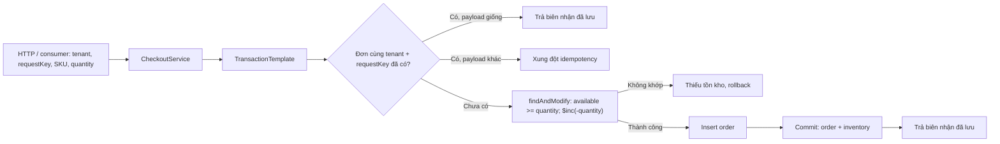
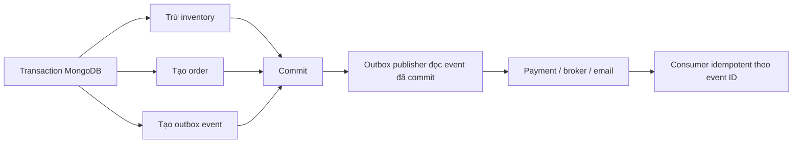

# Cập nhật tồn kho nguyên tử và xử lý đơn hàng ghi lặp

> **Chương:** Thực hành tổng hợp  
> **Công nghệ:** Spring Data MongoDB, `MongoTemplate`, MongoDB transactions, unique indexes, JUnit 5 và Testcontainers.  
> **Kết quả cần đạt:** không bán quá số hàng sẵn có, không trừ tồn kho hai lần cho cùng một yêu cầu, và có thể chẩn đoán những lần gửi/ghi lặp.

## 1. Bài toán thực tế

Một API đặt hàng nhận yêu cầu mua một sản phẩm (SKU) cho một tenant. Tồn kho được lưu trong MongoDB. Client có thể gửi lại request khi không nhận được phản hồi; message broker cũng có thể giao lại cùng sự kiện. Nhiều khách hàng có thể đặt cùng SKU ở cùng thời điểm.

Ví dụ tồn kho ban đầu:

```javascript
// Collection inventory
{
  _id: "tenant-a:SKU-01",
  tenantId: "tenant-a",
  sku: "SKU-01",
  available: NumberLong(5)
}
```

API nhận một yêu cầu như:

```json
{
  "tenantId": "tenant-a",
  "requestKey": "checkout-2026-001",
  "sku": "SKU-01",
  "quantity": 3
}
```

`requestKey` là **khóa định danh yêu cầu nghiệp vụ** do bên gọi giữ nguyên ở mọi lần retry. Trong ứng dụng có xác thực, `tenantId` cần lấy/đối chiếu từ principal hoặc ngữ cảnh tin cậy, không tin hoàn toàn giá trị tự khai báo trong body.

Yêu cầu chấp nhận:

1. Lần đầu đặt 3 sản phẩm khi còn 5: tạo đúng **một** đơn, tồn còn **2**.
2. Gửi lại cùng `tenantId + requestKey` và cùng SKU/số lượng: trả về **kết quả đã lưu**, tồn vẫn **2**, không tạo đơn thứ hai.
3. Dùng lại khóa cũ với SKU hoặc số lượng khác: trả lỗi **xung đột khóa idempotency** (có thể ánh xạ HTTP 409), không trừ kho.
4. Đặt 4 sản phẩm khi chỉ còn 2: từ chối **thiếu tồn kho**, không tạo đơn.
5. Hai request khác nhau cùng đặt sản phẩm: không để `available` âm; tổng lượng giữ chỗ không vượt lượng tồn ban đầu.
6. Nếu thay đổi tồn kho thành công nhưng ghi đơn thất bại, **cả hai thay đổi phải cùng rollback** khi dùng transaction.

Phạm vi bài thực hành: **mỗi đơn có một SKU và chỉ ghi vào một MongoDB database**. Đơn nhiều SKU, thanh toán và vận chuyển sẽ được thảo luận ở phần mở rộng.

## 2. Các bất biến cần bảo vệ

| Bất biến | Quy tắc | Cơ chế thực hiện |
| --- | --- | --- |
| Không bán quá tồn | `available >= 0` sau mọi reservation hợp lệ | Conditional update với `available >= quantity` và `$inc` |
| Mỗi yêu cầu có tối đa một đơn | Unique theo `(tenantId, requestKey)` | Unique compound index trong MongoDB |
| Mỗi SKU/tenant có một bản ghi tồn | Unique theo `(tenantId, sku)` | Unique compound index trong MongoDB |
| Tạo đơn và trừ tồn cùng thành công hoặc thất bại | Không tồn tại “đã trừ kho nhưng chưa tạo đơn” sau transaction thất bại | MongoDB multi-document transaction |
| Retry trả kết quả của lần đã xử lý | Cùng key, cùng payload => không ghi lần nữa | Đọc đơn đã lưu trước khi trừ kho |
| Key cũ không được dùng cho payload khác | Cùng key nhưng nội dung khác => conflict | So sánh immutable fields/payload fingerprint |

Trong tình huống trên, MongoDB phải bảo vệ bất biến ở **thời điểm ghi**, kể cả khi hai request cùng đọc số lượng tồn là 5.



## 3. Cách làm sai: đọc tồn rồi tự tính và `save`

Một cách viết dễ mắc lỗi là:

```java
// Ví dụ PHẢN DIỆN, không dùng cho đặt hàng thật:
Inventory stock = template.findOne(stockQuery, Inventory.class);
if (stock.available >= requestedQuantity) {
    stock.available -= requestedQuantity;
    template.save(stock);
}
```

Hai request song song đều có thể đọc `available = 5`, cùng thấy đủ để mua 4 và lần lượt `save(available = 1)`. Database cuối cùng còn 1, nhưng ứng dụng đã xác nhận **hai đơn mua tổng cộng 8 sản phẩm**. Một cách sửa khác chỉ gọi `updateFirst` với `$inc(-4)` nhưng **không có điều kiện số lượng** cũng có thể làm tồn âm.

Muốn tránh oversell, điều kiện “còn đủ hàng” và phép trừ phải nằm trong **cùng một lệnh ghi nguyên tử**.

## 4. Giữ chỗ tồn kho bằng một lệnh nguyên tử

MongoDB bảo đảm tính nguyên tử cho thao tác ghi **trên một document**. Khi hai update cạnh tranh cùng document, điều kiện lọc được kiểm tra tại lúc thực thi ghi; request đến sau không thể dựa vào kết quả kiểm tra cũ để trừ vượt quá tồn.

```java
import org.springframework.data.mongodb.core.FindAndModifyOptions;
import org.springframework.data.mongodb.core.MongoTemplate;
import org.springframework.data.mongodb.core.query.Criteria;
import org.springframework.data.mongodb.core.query.Query;
import org.springframework.data.mongodb.core.query.Update;

long quantity = 3;
Query filter = Query.query(
    Criteria.where("tenantId").is("tenant-a")
        .and("sku").is("SKU-01")
        .and("available").gte(quantity)
);
Update decrement = new Update().inc("available", -quantity);

Inventory after = template.findAndModify(
    filter,
    decrement,
    FindAndModifyOptions.options().returnNew(true),
    Inventory.class
);

if (after == null) {
    // SKU không tồn tại, hoặc available < quantity.
    throw new OutOfStockException();
}
// after.available là tồn kho sau lần trừ thành công.
```

Lệnh tương ứng trong MongoDB:

```javascript
db.inventory.findOneAndUpdate(
  { tenantId: "tenant-a", sku: "SKU-01", available: { $gte: NumberLong(3) } },
  { $inc: { available: NumberLong(-3) } },
  { returnDocument: "after" }
)
```

**Vì sao an toàn?** Chỉ document đủ tồn tại thời điểm ghi mới khớp bộ lọc và bị trừ. Nếu không khớp, `findAndModify` trả `null` (vì không bật upsert); không có write nào làm âm tồn kho. `returnNew(true)` lấy document sau cập nhật để lưu ảnh chụp số tồn cho biên nhận.

Không dùng `upsert(true)` ở đây: một lệnh giữ chỗ **không được tự tạo** bản ghi inventory khi chưa có SKU. Không trừ kho bằng `save` trên một entity chỉ chứa vài field; `save` có thể thay thế document và xóa thông tin không được nạp.

**Giới hạn:** lệnh này chỉ bảo đảm việc trừ một document tồn kho. Nếu sau đó ghi đơn ở collection khác bị lỗi, hai thao tác riêng lẻ **không tự rollback cho nhau**. Bài capstone vì thế bổ sung transaction.

## 5. Thiết kế collection, khóa duy nhất và trạng thái

Sử dụng hai collection trong cùng database:

| Collection | Các field cốt lõi | Mục đích |
| --- | --- | --- |
| `inventory` | `_id, tenantId, sku, available` | Số lượng còn được phép đặt cho một SKU |
| `orders` | `_id, tenantId, requestKey, sku, quantity, status, remainingAtPlacement` | Ghi một kết quả đặt hàng theo khóa idempotency |

`remainingAtPlacement` lưu **snapshot tồn sau lần trừ thành công**. Nó giúp một request được gửi lại nhận cùng biên nhận, ngay cả khi người khác đã tiếp tục đặt hàng và tồn thực tế thay đổi.

Tạo unique index bằng migration/`mongosh` **trước khi bắt đầu nhận request**:

```javascript
use sales

db.inventory.createIndex(
  { tenantId: 1, sku: 1 },
  { unique: true, name: "uq_inventory_tenant_sku" }
)

db.orders.createIndex(
  { tenantId: 1, requestKey: 1 },
  { unique: true, name: "uq_orders_tenant_request" }
)
```

Index ở `inventory` bảo đảm không có hai document khác nhau cho cùng tenant/SKU. Index ở `orders` là **hàng rào cuối cùng** chống ghi hai đơn có cùng khóa nếu nhiều instance ứng dụng cùng xử lý request.

Không dựa vào kiểm tra `findOne` rồi `insert` để bảo đảm duy nhất, vì hai tiến trình có thể cùng quan sát “chưa có đơn”. Hãy xác nhận index thực sự tồn tại bằng `db.orders.getIndexes()` và `db.inventory.getIndexes()`. `@Indexed`/`@CompoundIndex` trong Java không nhất thiết tạo index ở server nếu auto-index creation bị tắt.

Trong ví dụ này, `requestKey` không được null/rỗng; API phải xác thực trước khi thực hiện transaction. Trong hệ thống thật, cần quy định **thời gian giữ khóa** phù hợp với thời gian client có thể retry. Không xóa khóa khi yêu cầu vẫn có thể được phát lại.

## 6. Khai báo model Spring Data MongoDB

### 6.1. `Inventory.java`

```java
package example.checkout;

import org.springframework.data.annotation.Id;
import org.springframework.data.mongodb.core.mapping.Document;

@Document("inventory")
public class Inventory {
    @Id
    public String id;

    public String tenantId;
    public String sku;
    public long available;

    public Inventory() {}

    public Inventory(String id, String tenantId, String sku, long available) {
        this.id = id;
        this.tenantId = tenantId;
        this.sku = sku;
        this.available = available;
    }
}
```

### 6.2. `OrderRecord.java`

```java
package example.checkout;

import org.springframework.data.annotation.Id;
import org.springframework.data.mongodb.core.mapping.Document;

@Document("orders")
public class OrderRecord {
    @Id
    public String id;

    public String tenantId;
    public String requestKey;
    public String sku;
    public long quantity;
    public String status;
    public long remainingAtPlacement;

    public OrderRecord() {}

    public OrderRecord(
            String id, String tenantId, String requestKey,
            String sku, long quantity, String status, long remainingAtPlacement) {
        this.id = id;
        this.tenantId = tenantId;
        this.requestKey = requestKey;
        this.sku = sku;
        this.quantity = quantity;
        this.status = status;
        this.remainingAtPlacement = remainingAtPlacement;
    }
}
```

### 6.3. `PlaceOrderCommand.java` và `OrderReceipt.java`

```java
package example.checkout;

// Với Java 17+:
public record PlaceOrderCommand(
    String tenantId, String requestKey, String sku, long quantity
) {}
```

```java
package example.checkout;

// Biên nhận bất biến, có thể trả lại y hệt khi request được phát lại.
public record OrderReceipt(
    String orderId, String sku, long acceptedQuantity, long remainingAtPlacement
) {}
```

Mã minh họa dùng tên property Java trùng tên BSON để tập trung vào transaction. Với model có `@Field("tenant_id")`, `MongoTemplate` sẽ ánh xạ property khi dùng overload có entity class; còn lệnh `mongosh` phải dùng **tên BSON thực tế**.

## 7. Cấu hình MongoDB transaction

Trừ tồn và tạo đơn là hai write trên hai document/collection nên cần **multi-document transaction** nếu muốn tính nhất quán mạnh trong phạm vi này.

MongoDB transactions đòi hỏi topology hỗ trợ, chẳng hạn **replica set** hoặc **sharded cluster** được cấu hình tương thích. Đối với Spring Data, cần đăng ký `MongoTransactionManager`; `MongoTemplate` phải dùng cùng `MongoDatabaseFactory` được manager quản lý để thao tác tham gia cùng `ClientSession`.

```java
package example.checkout;

import org.springframework.context.annotation.Bean;
import org.springframework.context.annotation.Configuration;
import org.springframework.data.mongodb.MongoDatabaseFactory;
import org.springframework.data.mongodb.MongoTransactionManager;
import org.springframework.transaction.support.TransactionTemplate;

@Configuration(proxyBeanMethods = false)
public class MongoTxConfig {
    @Bean
    MongoTransactionManager mongoTransactionManager(MongoDatabaseFactory factory) {
        return new MongoTransactionManager(factory);
    }

    @Bean
    TransactionTemplate transactionTemplate(MongoTransactionManager manager) {
        return new TransactionTemplate(manager);
    }
}
```

`TransactionTemplate` được dùng để biểu diễn rõ **ranh giới transaction** trong ví dụ. Có thể dùng `@Transactional` trên public method được gọi qua Spring proxy nếu đã cấu hình manager, nhưng cần tránh lỗi self-invocation làm transaction không được kích hoạt.

**Chuẩn bị trước khi chạy:** tạo database/collection và index cần thiết ngoài transaction, cấu hình credentials, replica set/URI và write concern phù hợp. Không trông chờ tạo collection hoặc index lần đầu **bên trong** transaction. Với môi trường quan trọng, cân nhắc write concern `majority` và kiểm chứng cấu hình durability thực tế.

## 8. Checkout service: điều kiện nguyên tử + idempotency + transaction

Mẫu sau hoàn chỉnh cho trường hợp một SKU. Service kiểm tra request, tìm đơn theo khóa, trừ kho có điều kiện, lưu đơn rồi mới trả biên nhận. Toàn bộ thao tác đọc/ghi nghiệp vụ nằm trong một callback transaction.

```java
package example.checkout;

import java.util.Objects;
import java.util.UUID;

import org.springframework.dao.DuplicateKeyException;
import org.springframework.data.mongodb.core.FindAndModifyOptions;
import org.springframework.data.mongodb.core.MongoTemplate;
import org.springframework.data.mongodb.core.query.Criteria;
import org.springframework.data.mongodb.core.query.Query;
import org.springframework.data.mongodb.core.query.Update;
import org.springframework.stereotype.Service;
import org.springframework.transaction.support.TransactionTemplate;

@Service
public class CheckoutService {
    private final MongoTemplate template;
    private final TransactionTemplate transactions;

    public CheckoutService(MongoTemplate template, TransactionTemplate transactions) {
        this.template = template;
        this.transactions = transactions;
    }

    public OrderReceipt place(PlaceOrderCommand request) {
        validate(request);

        try {
            return Objects.requireNonNull(
                transactions.execute(status -> placeInTransaction(request))
            );
        } catch (DuplicateKeyException duplicate) {
            // Một instance khác có thể vừa ghi cùng requestKey.
            // Transaction đã fail và rollback; tra cứu lại bên ngoài transaction đó.
            OrderRecord committed = findByRequestKey(request);
            if (committed != null) {
                return samePayloadOrConflict(request, committed);
            }
            // Nếu write thắng cuộc chưa hiển thị hoặc lỗi không thuộc key này,
            // caller/retry policy phải giải quyết tiếp với CÙNG requestKey.
            throw duplicate;
        }
    }

    private OrderReceipt placeInTransaction(PlaceOrderCommand request) {
        // (1) Kiểm tra yêu cầu đã được xử lý, trước khi động tới tồn kho.
        OrderRecord existing = findByRequestKey(request);
        if (existing != null) {
            return samePayloadOrConflict(request, existing);
        }

        // (2) Trừ tồn bằng điều kiện gte và $inc trong MỘT lệnh nguyên tử.
        Query stockQuery = Query.query(
            Criteria.where("tenantId").is(request.tenantId())
                .and("sku").is(request.sku())
                .and("available").gte(request.quantity())
        );

        Inventory after = template.findAndModify(
            stockQuery,
            new Update().inc("available", -request.quantity()),
            FindAndModifyOptions.options().returnNew(true),
            Inventory.class
        );

        if (after == null) {
            throw new OutOfStockException();
        }

        // (3) Lưu đơn cùng transaction. Unique index bảo vệ race ở requestKey.
        OrderRecord order = new OrderRecord(
            UUID.randomUUID().toString(),
            request.tenantId(),
            request.requestKey(),
            request.sku(),
            request.quantity(),
            "PLACED",
            after.available
        );
        template.insert(order);
        return receipt(order);
    }

    private OrderRecord findByRequestKey(PlaceOrderCommand request) {
        Query query = Query.query(
            Criteria.where("tenantId").is(request.tenantId())
                .and("requestKey").is(request.requestKey())
        );
        return template.findOne(query, OrderRecord.class);
    }

    private OrderReceipt samePayloadOrConflict(
            PlaceOrderCommand request, OrderRecord existing) {
        if (!Objects.equals(existing.sku, request.sku())
                || existing.quantity != request.quantity()) {
            throw new IdempotencyConflictException();
        }
        return receipt(existing);
    }

    private static OrderReceipt receipt(OrderRecord order) {
        return new OrderReceipt(
            order.id, order.sku, order.quantity, order.remainingAtPlacement
        );
    }

    private static void validate(PlaceOrderCommand request) {
        if (request == null
                || request.tenantId() == null || request.tenantId().isBlank()
                || request.requestKey() == null || request.requestKey().isBlank()
                || request.sku() == null || request.sku().isBlank()
                || request.quantity() <= 0) {
            throw new IllegalArgumentException("Invalid checkout request");
        }
    }

    public static class OutOfStockException extends RuntimeException {
        public OutOfStockException() {
            super("SKU does not exist or has insufficient inventory");
        }
    }

    public static class IdempotencyConflictException extends RuntimeException {
        public IdempotencyConflictException() {
            super("Request key was already used for a different order");
        }
    }
}
```

### 8.1. Vì sao thứ tự các bước quan trọng?

- Kiểm tra khóa yêu cầu **trước** khi trừ tồn giúp replay thông thường không phát sinh write.
- Kiểm tra SKU/số lượng của đơn đã tồn tại giúp từ chối việc tái sử dụng key với nội dung khác. Nếu request thật có giá tiền, địa chỉ hay lựa chọn giao hàng, phải lưu và so sánh **đầy đủ payload có ý nghĩa nghiệp vụ** hoặc fingerprint chuẩn hóa, không chỉ SKU/số lượng.
- `findAndModify` bảo đảm một document tồn kho chỉ bị trừ khi còn đủ. Unique index `inventory(tenantId, sku)` khiến mỗi SKU chỉ có một record để cập nhật.
- `template.insert(order)` buộc việc ghi đơn mới tuân theo unique key; nếu lỗi làm transaction abort, việc trừ tồn bên trong cùng transaction sẽ rollback.
- Biên nhận được dựng từ **order đã lưu**, không đọc số tồn kho hiện tại vào lúc retry. Nhờ đó trả lại kết quả ổn định dù sau đó có người khác đặt hàng.

**Lưu ý trong môi trường nhiều request đồng thời:** `findOne` trước `insert` không đủ để xử lý mọi cuộc đua. Hai transaction có thể cùng nhìn thấy chưa có order; MongoDB có thể trả lỗi duplicate key hoặc `TransientTransactionError`/write conflict. Unique index ngăn tạo hai đơn; ứng dụng vẫn cần chính sách retry và khôi phục kết quả như phần tiếp theo.

## 9. Xử lý retry, duplicate key và kết quả commit chưa rõ

Có **ba loại retry** khác nhau:

| Loại retry | Vì sao xảy ra | Hành động an toàn |
| --- | --- | --- |
| Client gửi lại HTTP POST hoặc broker redeliver | Timeout, mất ACK hoặc ít nhất một lần giao message | Dùng lại **cùng requestKey**; tra đơn đã ghi trước khi cập nhật tồn |
| Transaction bị write conflict/`TransientTransactionError` | Hai transaction tranh chấp stock hoặc lỗi tạm thời | Retry **toàn bộ transaction** với số lần giới hạn, backoff; mỗi attempt bắt đầu transaction mới |
| Commit báo `UnknownTransactionCommitResult` | Không biết commit đã hoàn tất ở server chưa | Ưu tiên retry **commit của transaction hiện tại** theo driver/transaction manager, hoặc đối chiếu đơn theo key trước khi thử lại nghiệp vụ |

**Không tự động retry mọi exception.** Out-of-stock, payload mismatch, sai validation hoặc lỗi quyền truy cập là các lỗi cần trả về/khắc phục, không phải điều kiện để trừ kho lại.

Trong MongoDB, write bên trong multi-document transaction không tự được retry như một lệnh đơn độc theo `retryWrites=true`. Hệ thống cần phân biệt nhãn lỗi và retry **đúng cấp**. Spring Data lưu ý dùng cơ chế như Spring Retry và xử lý commit có kết quả không chắc chắn khi tích hợp `MongoTransactionManager`.

Quy trình khôi phục sau lỗi chưa biết kết quả:

1. Giữ nguyên `tenantId + requestKey` và payload; **không tạo requestKey mới**.
2. Đọc đơn đã commit theo unique key. Nếu có, kiểm tra payload rồi trả lại biên nhận đã lưu.
3. Nếu chưa thấy đơn, xác định lỗi có retry được hay không, xem trạng thái transaction/commit và thực hiện retry có giới hạn trên transaction mới khi phù hợp.
4. Nếu vẫn chưa chắc chắn, trả trạng thái có thể truy vấn lại (ví dụ mã request để polling) thay vì tự kết luận thất bại rồi trừ kho lần nữa.

Đoạn `catch (DuplicateKeyException)` trong service chỉ xử lý **một** trường hợp phổ biến; để chịu tải production, bổ sung retry policy cho lỗi MongoDB có nhãn phù hợp, kiểm soát backoff/time budget và xử lý unknown commit. Không lồng một transaction mới vào callback transaction đang lỗi.

Đối với consumer xử lý message, message ID hoặc business command ID nên làm `requestKey`. Chỉ ACK sau khi transaction commit. Khi broker giao lại, service đọc đơn theo key và không trừ kho lần nữa. Nếu quá hạn lưu idempotency record, hệ thống cần quy định rõ thời gian message có thể được phát lại.

## 10. Kiểm thử tích hợp bằng Testcontainers

Mock repository không mô phỏng được atomic update, unique index, write conflict hoặc MongoDB transaction. Cần một MongoDB thực chạy với topology hỗ trợ transactions, ví dụ `MongoDBContainer` (Testcontainers 1.x) được cấu hình làm replica set và Spring Boot 3.1+.

`@DataMongoTest` mặc định không nạp các `@Service` tùy biến, nên trong ví dụ cần `@Import(CheckoutService.class, MongoTxConfig.class)`.

### 10.1. Fixture và cấu hình test

```java
package example.checkout;

import static org.assertj.core.api.Assertions.assertThat;
import static org.assertj.core.api.Assertions.assertThatThrownBy;

import org.junit.jupiter.api.BeforeEach;
import org.junit.jupiter.api.Test;
import org.springframework.beans.factory.annotation.Autowired;
import org.springframework.boot.test.autoconfigure.data.mongo.DataMongoTest;
import org.springframework.boot.testcontainers.service.connection.ServiceConnection;
import org.springframework.context.annotation.Import;
import org.springframework.data.domain.Sort;
import org.springframework.data.mongodb.core.MongoTemplate;
import org.springframework.data.mongodb.core.index.Index;
import org.springframework.data.mongodb.core.query.Criteria;
import org.springframework.data.mongodb.core.query.Query;
import org.testcontainers.containers.MongoDBContainer;
import org.testcontainers.junit.jupiter.Container;
import org.testcontainers.junit.jupiter.Testcontainers;
import org.testcontainers.utility.DockerImageName;

@DataMongoTest
@Testcontainers
@Import({CheckoutService.class, MongoTxConfig.class})
class CheckoutServiceTest {

    @Container
    @ServiceConnection
    static final MongoDBContainer mongo =
        new MongoDBContainer(DockerImageName.parse("mongo:7.0"));

    @Autowired MongoTemplate template;
    @Autowired CheckoutService checkout;

    @BeforeEach
    void prepare() {
        // Tạo collection/index NGOÀI transaction; chỉ dùng DB test.
        template.dropCollection(Inventory.class);
        template.dropCollection(OrderRecord.class);
        template.createCollection(Inventory.class);
        template.createCollection(OrderRecord.class);

        template.indexOps(Inventory.class).ensureIndex(
            new Index()
                .on("tenantId", Sort.Direction.ASC)
                .on("sku", Sort.Direction.ASC)
                .unique()
        );
        template.indexOps(OrderRecord.class).ensureIndex(
            new Index()
                .on("tenantId", Sort.Direction.ASC)
                .on("requestKey", Sort.Direction.ASC)
                .unique()
        );

        template.insert(new Inventory("tenant-a:SKU-01", "tenant-a", "SKU-01", 5));
    }

    long remaining() {
        Inventory stock = template.findOne(
            Query.query(Criteria.where("tenantId").is("tenant-a")
                .and("sku").is("SKU-01")),
            Inventory.class
        );
        assertThat(stock).isNotNull();
        return stock.available;
    }

    // Các method @Test ở mục tiếp theo đặt trong class này.
}
```

`@ServiceConnection` cần dependency `spring-boot-testcontainers` và Docker khả dụng. Với Spring Boot cũ hơn có thể dùng `@DynamicPropertySource` để truyền `mongo.getReplicaSetUrl()`. Các import ở ví dụ trên dành cho Spring Boot 3.x/Testcontainers 1.x; phải đối chiếu package nếu dự án dùng Testcontainers 2.x.

### 10.2. Các ca kiểm thử cốt lõi

Đặt các method sau **bên trong** `CheckoutServiceTest` ở mục 10.1:

```java
@Test
void firstPlacementDecrementsAndCreatesOneOrder() {
    OrderReceipt receipt = checkout.place(
        new PlaceOrderCommand("tenant-a", "req-1", "SKU-01", 3)
    );

    assertThat(receipt.acceptedQuantity()).isEqualTo(3);
    assertThat(receipt.remainingAtPlacement()).isEqualTo(2);
    assertThat(remaining()).isEqualTo(2);
    assertThat(template.count(new Query(), OrderRecord.class)).isEqualTo(1);
}

@Test
void repeatedRequestReturnsSameReceiptWithoutDoubleReservation() {
    PlaceOrderCommand same =
        new PlaceOrderCommand("tenant-a", "req-1", "SKU-01", 3);

    OrderReceipt first = checkout.place(same);
    OrderReceipt replay = checkout.place(same);

    assertThat(replay).isEqualTo(first);
    assertThat(remaining()).isEqualTo(2);
    assertThat(template.count(new Query(), OrderRecord.class)).isEqualTo(1);
}

@Test
void keyCannotBeReusedForDifferentQuantity() {
    checkout.place(new PlaceOrderCommand("tenant-a", "req-1", "SKU-01", 2));

    assertThatThrownBy(() ->
        checkout.place(new PlaceOrderCommand("tenant-a", "req-1", "SKU-01", 1))
    ).isInstanceOf(CheckoutService.IdempotencyConflictException.class);

    assertThat(remaining()).isEqualTo(3);
    assertThat(template.count(new Query(), OrderRecord.class)).isEqualTo(1);
}

@Test
void insufficientStockDoesNotCreateAnOrder() {
    assertThatThrownBy(() ->
        checkout.place(new PlaceOrderCommand("tenant-a", "req-2", "SKU-01", 6))
    ).isInstanceOf(CheckoutService.OutOfStockException.class);

    assertThat(remaining()).isEqualTo(5);
    assertThat(template.count(new Query(), OrderRecord.class)).isZero();
}

@Test
void distinctRequestsCannotReserveMoreThanAvailable() {
    checkout.place(new PlaceOrderCommand("tenant-a", "req-1", "SKU-01", 4));

    assertThatThrownBy(() ->
        checkout.place(new PlaceOrderCommand("tenant-a", "req-2", "SKU-01", 2))
    ).isInstanceOf(CheckoutService.OutOfStockException.class);

    assertThat(remaining()).isEqualTo(1);
    assertThat(template.count(new Query(), OrderRecord.class)).isEqualTo(1);
}
```

Các test trên là **integration tests**: chúng xác minh hành vi thực của `MongoTemplate`, index và database. Việc xóa collection ở `@BeforeEach` chỉ an toàn vì test dùng container/database riêng; không áp dụng chiến lược cleanup này với dữ liệu chia sẻ.

### 10.3. Những ca concurrency cần bổ sung

Chạy test hai request trên hai thread khác nhau, khởi động đồng thời bằng `CountDownLatch` hoặc `CyclicBarrier`:

| Tình huống song song | Kết quả cần kiểm tra |
| --- | --- |
| Hai key khác nhau, mỗi key đặt 4 khi tồn là 5 | Tối đa **một** transaction commit thành công; tồn không âm |
| Hai thread cùng `requestKey` và cùng payload | Tối đa **một** order; stock bị trừ tối đa một lần; lần còn lại có thể cần retry hoặc đọc biên nhận |
| Hai thread cùng key nhưng payload khác | Tối đa một payload được chấp nhận; payload còn lại nhận conflict; không có hai đơn |
| Một request bị lỗi sau trừ stock nhưng trước insert order | Transaction abort; stock quay lại trạng thái ban đầu |
| Client mất kết nối sau khi server có thể đã commit | Gửi lại cùng key, nhận order cũ nếu đã commit; không trừ thêm |

Trong test nhiều thread, hãy thiết lập **retry bounded** cho lỗi transaction transient; nếu một attempt trả write conflict thì đó có thể là kết quả cạnh tranh dự kiến, không tự động chứng minh bán quá tồn. Sau khi mọi attempt kết thúc, xác minh bằng **raw BSON** và phép tổng hợp: `stockCuối + SUM(quantity của order PLACED) = stockĐầu` (khi chưa có nhập hàng/hủy đơn). Đồng thời bảo đảm không có order trùng `tenantId + requestKey`.

Một test unit mock `findAndModify` trả tồn 2 chỉ chứng minh service gọi phương thức đúng; nó không chứng minh MongoDB giữ nguyên tính nguyên tử dưới concurrency.

## 11. Hủy đơn hoặc hoàn tồn: chống ghi lặp ở chiều ngược lại

Nếu một đơn bị hủy, tồn kho phải cộng lại **một lần**, không cộng mỗi lần nhận event `CANCELLED`. Dùng điều kiện chuyển trạng thái `PLACED → CANCELLED` và tăng kho trong **cùng transaction**.

Ví dụ method bổ sung vào `CheckoutService`:

```java
// Cần import com.mongodb.client.result.UpdateResult.
public void cancel(String tenantId, String orderId) {
    transactions.execute(status -> {
        OrderRecord old = template.findOne(
            Query.query(Criteria.where("id").is(orderId)
                .and("tenantId").is(tenantId)),
            OrderRecord.class
        );
        if (old == null) {
            throw new IllegalArgumentException("Order not found");
        }
        if ("CANCELLED".equals(old.status)) {
            return null; // Event hủy được phát lại: không hoàn kho nữa.
        }
        if (!"PLACED".equals(old.status)) {
            throw new IllegalStateException("Order cannot be cancelled");
        }

        UpdateResult transition = template.updateFirst(
            Query.query(Criteria.where("id").is(orderId)
                .and("tenantId").is(tenantId)
                .and("status").is("PLACED")),
            new Update().set("status", "CANCELLED"),
            OrderRecord.class
        );
        if (transition.getMatchedCount() != 1) {
            throw new IllegalStateException("Concurrent status transition");
        }

        UpdateResult restock = template.updateFirst(
            Query.query(Criteria.where("tenantId").is(tenantId)
                .and("sku").is(old.sku)),
            new Update().inc("available", old.quantity),
            Inventory.class
        );
        if (restock.getMatchedCount() != 1) {
            throw new IllegalStateException("Inventory record missing");
        }
        return null;
    });
}
```

Nếu tăng tồn thất bại, transaction rollback cả trạng thái hủy. Nếu nhận lại event hủy khi order đã `CANCELLED`, method bỏ qua và không cộng kho lần nữa. Khi đơn có trạng thái như `SHIPPED`/`REFUNDED`, cần mô hình chuyển trạng thái nghiệp vụ chính xác, không xem mọi trạng thái khác `CANCELLED` đều được hoàn kho.

Với giao dịch phức tạp hơn, ví dụ hủy hai SKU, cần thực hiện các update kiểm soát điều kiện trên từng document trong transaction và xác minh tất cả thành công. Có thể cân nhắc cơ chế reservation riêng nếu vòng đời giữ hàng kéo dài nhiều phút/giờ.

## 12. Vì sao không gửi email hoặc gọi cổng thanh toán trong transaction?

MongoDB transaction **chỉ bao phủ những thao tác dữ liệu tham gia cùng session**. Nó không rollback được một lệnh HTTP gửi tới payment gateway, một email đã gửi hay một message đã publish tới Kafka.

Ví dụ lỗi:

1. Transaction trừ tồn và insert order.
2. Code gọi API thanh toán thành công.
3. MongoDB transaction abort khi commit.

Kết quả: đã thu tiền nhưng không có đơn hàng được commit.

Một thiết kế phù hợp hơn là **transactional outbox**:



Outbox event được insert trong cùng transaction với order. Một worker khác publish sau commit; event có thể được publish **hơn một lần** nếu worker chết sau khi gửi nhưng trước khi đánh dấu đã xử lý, vì thế consumer vẫn cần idempotency. Thanh toán thường phải có **payment idempotency key** riêng và quy trình đối soát/trạng thái, không coi MongoDB transaction là giao dịch xuyên các hệ thống.

## 13. Index, hiệu năng, giám sát và vận hành

Một giải pháp đúng về tính nhất quán vẫn cần đo khả năng chịu tải:

| Khía cạnh | Điều cần đo/kiểm tra | Cách xử lý |
| --- | --- | --- |
| Nhiều request tranh một SKU | Tỉ lệ write conflict, số lần retry, latency p95/p99 | Retry bounded, backoff, phân tích hotspot |
| Không tìm được inventory | Số request `OutOfStock`, SKU và tenant tương ứng | Kiểm tra tồn thực tế, phân biệt SKU không tồn tại và thiếu tồn nếu nghiệp vụ cần |
| Nhiều request lặp | Tỉ lệ đọc lại order theo `requestKey` | Giữ unique index, theo dõi client retry bất thường |
| Transaction kéo dài | Duration và tỉ lệ commit/abort | Giảm thao tác trong transaction, không gọi API ngoài |
| Index thiếu | Query scan lớn, tăng latency | Xác minh `getIndexes()` và `explain("executionStats")` khi thích hợp |
| Lệch tồn kho | Tồn thực so với tổng nghiệp vụ đặt/hoàn/nhập | Job đối soát, audit và điều tra write bypass |
| Phát lại message | Số lần delivery của cùng event ID | Consumer idempotent, ACK sau commit |

**Không log thông tin khách hàng nhạy cảm hoặc toàn bộ request body.** Log có cấu trúc có thể chứa mã correlation, tenant được phép ghi log, SKU, loại thao tác, requestKey được bảo vệ phù hợp, kết quả transaction và loại lỗi. Khi xây dashboard, tách lỗi “thiếu tồn” hợp lệ khỏi lỗi hệ thống.

Các thao tác “điều chỉnh tồn thủ công” hay nhập hàng cũng phải cập nhật cùng nguồn dữ liệu đúng quy trình. Nếu một job dùng `save` dựa trên bản sao tồn kho cũ và bỏ qua điều kiện cạnh tranh, nó có thể phá bất biến mà `findAndModify` đang bảo vệ.

## 14. Kịch bản kiểm thử chấp nhận cho capstone

Trước khi coi bài thực hành đã hoàn chỉnh, hãy đối chiếu kết quả:

| Bước | Request/động tác | Order mong đợi | Tồn mong đợi |
| --- | --- | --- | --- |
| 0 | Seed `SKU-01` với 5 sản phẩm | 0 | 5 |
| 1 | `req-1` đặt 3 | 1 đơn `PLACED` | 2 |
| 2 | Replay `req-1` đặt 3 | Vẫn 1 đơn, cùng ID/receipt | 2 |
| 3 | `req-1` đặt 1 | Conflict, không thêm đơn | 2 |
| 4 | `req-2` đặt 4 | Thiếu tồn, không thêm đơn | 2 |
| 5 | `req-2` đặt 2 | Thêm 1 đơn `PLACED` | 0 |
| 6 | Replay `req-2` đặt 2 | Không thêm đơn | 0 |
| 7 | Hủy đơn `req-1` | Đơn đầu `CANCELLED` | 3 |
| 8 | Replay hủy đơn `req-1` | Không đổi trạng thái | 3 |

**Lưu ý bước 4 → 5:** `req-2` chưa từng tạo đơn ở bước 4, nên theo thiết kế mẫu, có thể gửi lại cùng key với số lượng hợp lệ khác ở bước 5. Nếu API cần bảo đảm *mọi* request (kể cả thất bại nghiệp vụ) đều có kết quả idempotent bất biến, hãy lưu cả kết quả từ chối theo key trong một trạng thái/yêu cầu riêng và quy định rõ chính sách retry; đó là thiết kế mở rộng cần quyết định trước khi triển khai.

Một bài thực hành đạt yêu cầu nên có: mô hình dữ liệu, hai unique index, atomic decrement có filter, transaction tạo đơn, xử lý replay và payload conflict, test thiếu tồn và test hủy/hoàn kho không lặp. Các ca concurrency, mất kết nối khi commit và đối soát tồn là phần kiểm thử bổ sung cần thực hiện trước production.

## 15. Sai lầm thường gặp

| Sai lầm | Hậu quả | Cách sửa |
| --- | --- | --- |
| Đọc stock rồi `save` giá trị đã trừ | Lost update, oversell | Dùng conditional `$inc` trong một lệnh atomic |
| Chỉ có `$inc` mà không kiểm tra `available >= qty` | Stock âm | Đưa điều kiện đủ tồn vào filter cùng lệnh ghi |
| Check requestKey bằng `findOne` nhưng không có unique index | Hai instance cùng tạo hai đơn | Unique index ở MongoDB |
| Retry bằng requestKey mới | Hai đơn và hai lần trừ tồn | Giữ nguyên business request ID |
| Insert order sau khi trừ stock nhưng không có transaction | Có thể thiếu đơn mà kho đã bị trừ | Transaction hoặc cơ chế reservation/saga riêng |
| Nuốt lỗi transaction rồi trả success | Mất nhất quán nghiệp vụ | Phân biệt lỗi nghiệp vụ, retryable và unknown commit |
| Tạo collection/index lần đầu bên trong transaction | Có thể lỗi operation không được hỗ trợ | Migration/index setup trước khi xử lý đơn |
| Hủy đơn nào cũng `$inc(+qty)` | Replay hủy làm tăng kho nhiều lần | Guard trạng thái trong transaction |
| Gọi payment gateway giữa transaction | Side effect không rollback được | Outbox và idempotent external API |
| Dùng repository mock để khẳng định an toàn cạnh tranh | Không mô phỏng atomicity/index/commit thật | Testcontainers + concurrency tests |

## 16. Câu hỏi tự kiểm tra

1. Vì sao `available >= quantity` phải xuất hiện trong **filter của chính update** thay vì chỉ trong `if` sau `findById`?
2. Vì sao cần unique index `(tenantId, requestKey)` dù code đã gọi `findOne` trước khi insert order?
3. Sau khi giảm tồn thành công nhưng insert order bị duplicate key trong transaction, tồn kho phải ở trạng thái nào?
4. Khi MongoDB trả `UnknownTransactionCommitResult`, vì sao không được tự đổi `requestKey` rồi gửi lại?
5. Vì sao biên nhận retry nên lấy từ order đã lưu thay vì số tồn kho hiện tại?
6. Vì sao `retryWrites=true` không đủ để bảo vệ API đặt hàng trước request được gửi lại từ client?
7. Làm cách nào để hai lần xử lý `cancel order` không hoàn tồn hai lần?
8. Với một đơn gồm ba SKU, cần mở rộng transaction và phương án xử lý conflict như thế nào?
9. Tại sao unique index đúng nhưng không có transaction vẫn có thể xuất hiện lỗi “trừ kho xong, chưa ghi đơn”?
10. Nếu out-of-stock là kết quả phải idempotent tuyệt đối, cần thêm dữ liệu gì để ghi nhận lần từ chối?

## 17. Ghi nhớ

- **Atomicity cấp document:** `findAndModify` với `available >= quantity` và `$inc(-quantity)` bảo vệ kho khỏi bị trừ vượt quá lượng còn lại.
- **Idempotency cấp nghiệp vụ:** khóa `(tenantId, requestKey)` có unique index, đối chiếu payload và trả lại kết quả đã commit giúp tránh ghi đơn/trừ kho hai lần.
- **Transaction cấp nhiều document:** trừ inventory và insert order phải cùng commit hoặc cùng rollback; cần `MongoTransactionManager` và MongoDB deployment hỗ trợ.
- **Retry phải đúng cấp:** transaction transient retry toàn bộ transaction; unknown commit cần xử lý đặc biệt; request lặp giữ cùng key.
- **Thực hành phải kiểm chứng với MongoDB thật:** test các lần đặt, phát lại, thiếu tồn, cạnh tranh, hủy và lỗi commit; không dựa duy nhất vào unit test mock.

## Tài liệu tham khảo

- [Spring Data MongoDB — Saving, Updating and Removing Documents](https://docs.spring.io/spring-data/mongodb/reference/mongodb/template-crud-operations.html): `findAndModify`, `Update.inc`, `upsert` và các tùy chọn trả document sau cập nhật.
- [Spring Data MongoDB — Sessions & Transactions](https://docs.spring.io/spring-data/mongodb/reference/mongodb/client-session-transactions.html): `MongoTransactionManager`, `TransactionTemplate`, session binding và xử lý lỗi transaction.
- [MongoDB — Atomicity and Transactions](https://www.mongodb.com/docs/manual/core/write-operations-atomicity/): tính nguyên tử cấp document và filter cạnh tranh.
- [MongoDB — Transactions in Applications](https://www.mongodb.com/docs/manual/core/transactions-in-applications/): retry `TransientTransactionError` và `UnknownTransactionCommitResult`.
- [MongoDB — Unique Indexes](https://www.mongodb.com/docs/manual/core/index-unique/): enforce uniqueness khi có nhiều writer.
- [MongoDB — Transactions Production Considerations](https://www.mongodb.com/docs/manual/core/transactions-production-consideration/): yêu cầu topology, collection/index và chi phí transaction.
- [Spring Boot — Testcontainers](https://docs.spring.io/spring-boot/reference/testing/testcontainers.html): `@ServiceConnection` và chạy integration test trên MongoDB.
