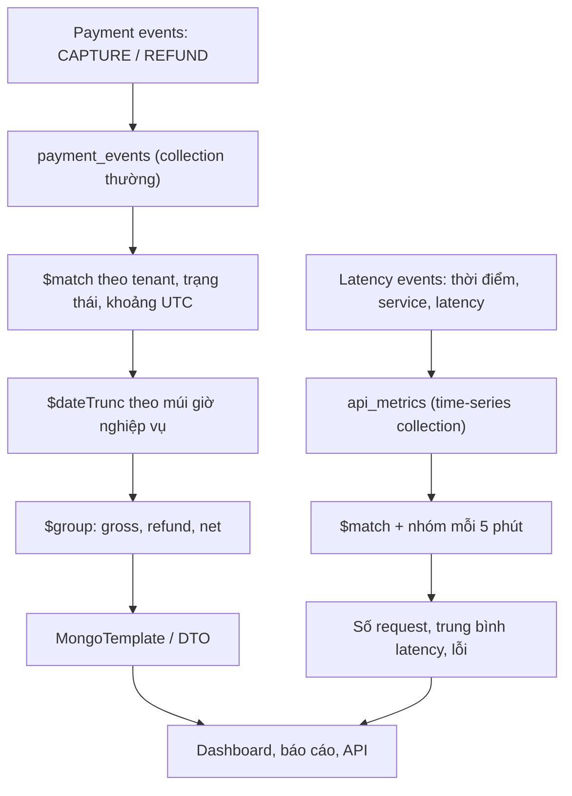

# Viết aggregation báo cáo doanh thu và dữ liệu thời gian

## 1. Bối cảnh bài thực hành tổng hợp

Trong hệ thống **Spring Data MongoDB**, đội phát triển cần xây dựng dashboard doanh thu của một nền tảng thương mại điện tử đồng thời phân tích số liệu hoạt động theo thời gian. Một dịch vụ lưu giao dịch thanh toán bằng MongoDB; một dịch vụ khác thu thập dữ liệu độ trễ của API. Cả hai đều có timestamp, nhưng ngữ nghĩa dữ liệu và cách tính toán khác nhau.

**Đề bài:** viết các aggregation có thể kiểm chứng để:

1. Tính tổng tiền thu (**gross**), tiền hoàn (**refund**) và dòng tiền thuần (**net**) theo **ngày kinh doanh** của một tenant và từng loại tiền tệ.
2. Chỉ tính sự kiện thanh toán thành công; xử lý chính xác sự kiện ở gần nửa đêm và ranh giới ngày.
3. Đưa aggregation vào **`MongoTemplate`** của Spring Data MongoDB, ánh xạ kết quả sang DTO và bảo vệ truy vấn bằng điều kiện tenant, thời gian và timeout.
4. Phân tích dữ liệu hoạt động dạng **time series** theo các cửa sổ năm phút.
5. Kiểm thử kết quả trên dữ liệu có kiểm soát, giải thích lựa chọn index và nêu phương án xử lý ngày không có dữ liệu.

Mục đích là luyện cách thiết kế truy vấn, aggregation, ánh xạ document và chẩn đoán hiệu năng trong module **SPRING_DATA_MONGODB**. Nội dung dùng một collection thường cho sự kiện tài chính và một time-series collection cho số liệu vận hành; việc chọn loại collection là một quyết định thiết kế cần được lý giải.

### Quy tắc nghiệp vụ được chốt trước khi viết truy vấn

Báo cáo tài chính trong bài **đo dòng tiền từ các sự kiện thanh toán**; đây là một ví dụ phục vụ thực hành, **không tự động tương đương doanh thu được ghi nhận theo chuẩn kế toán**.

- `CAPTURE` thành công làm tăng tiền thu.
- `REFUND` thành công làm giảm tiền thu, được ghi nhận vào **ngày hoàn tiền phát sinh**, không chuyển ngược về ngày thanh toán ban đầu.
- Sự kiện `FAILED` hoặc `PENDING` không đóng góp vào báo cáo.
- `amount` là số **dương** kiểu BSON Decimal128; dấu của dòng tiền được suy từ `type`.
- Mỗi sự kiện có `eventId` duy nhất trong phạm vi tenant để xử lý retry ở đầu vào.
- **Không cộng trực tiếp các đồng tiền khác nhau.** Mỗi kết quả luôn chứa `currency`.
- Ngày kinh doanh tính trong múi giờ `Asia/Ho_Chi_Minh`; khoảng ngày được truy vấn theo quy ước nửa mở **`[from, to)`**.

Nếu sản phẩm cần doanh thu ghi nhận theo thời điểm cung cấp dịch vụ, thuế, phí giao dịch, chargeback hay tỷ giá quy đổi, phải định nghĩa lại các quy tắc và nguồn dữ liệu trước khi áp dụng vào thực tế.

## 2. Kiến trúc dữ liệu và luồng xử lý



### Collection `payment_events`

Mỗi document là một sự kiện tài chính được ghi một lần; một giao dịch có thể có một sự kiện thu tiền và nhiều sự kiện hoàn tiền. Ví dụ:

```javascript
{
  _id: "lab-evt-02",
  tenantId: "lab-revenue-2026",
  eventId: "evt-02",
  orderId: "order-02",
  type: "CAPTURE",
  status: "SUCCEEDED",
  currency: "VND",
  amount: NumberDecimal("240000"),
  occurredAt: ISODate("2026-11-18T17:05:00Z")
}
```

Chọn **Decimal128** vì đây là số tiền; không đi qua Java `double` hoặc BSON Double nếu nghiệp vụ yêu cầu độ chính xác thập phân. Giá trị VND trong ví dụ là số tiền VND; với đồng tiền có phần lẻ như USD có thể dùng `NumberDecimal("12.50")`. Phải có chính sách về scale, rounding và đơn vị tiền theo từng currency khi tiếp nhận dữ liệu.

### Vì sao lưu `occurredAt` là UTC?

`occurredAt` đại diện một **thời điểm thực** trên trục thời gian. BSON Date lưu epoch milliseconds, không lưu tên múi giờ. Cùng thời điểm `2026-11-18T17:05:00Z` tại Việt Nam tương ứng **00:05 ngày 19/11/2026**. Nếu lấy ngày UTC bằng `$dateToString` mà bỏ qua timezone, báo cáo sẽ phân nhóm sai.

Trong Java nên xử lý khoảng ngày địa phương thành hai mốc UTC:

```java
import java.time.Instant;
import java.time.LocalDate;
import java.time.ZoneId;

ZoneId businessZone = ZoneId.of("Asia/Ho_Chi_Minh");
LocalDate firstDay = LocalDate.of(2026, 11, 18);
LocalDate endDayExclusive = LocalDate.of(2026, 11, 21);

Instant from = firstDay.atStartOfDay(businessZone).toInstant();
Instant to = endDayExclusive.atStartOfDay(businessZone).toInstant();

// from = 2026-11-17T17:00:00Z
// to   = 2026-11-20T17:00:00Z
```

Dùng `day.plusDays(1).atStartOfDay(zone)` để tính ngày kết thúc. Ở các múi giờ có giờ mùa hè, một ngày địa phương có thể dài 23 hoặc 25 giờ; không mặc định mọi ngày đều là 24 giờ UTC.

## 3. Chuẩn bị dữ liệu mẫu có kết quả dự đoán trước

Ví dụ dưới đây dành cho database thử nghiệm `capstone_lab`. Chạy một lần trên collection trống; các `_id` và `eventId` cố định giúp phân biệt dữ liệu. Không thực hiện thao tác xóa toàn bộ collection trên database dùng chung.

```javascript
var lab = db.getSiblingDB("capstone_lab");

lab.payment_events.insertMany([
  {
    _id: "lab-evt-01",
    tenantId: "lab-revenue-2026",
    eventId: "evt-01",
    orderId: "order-01",
    type: "CAPTURE",
    status: "SUCCEEDED",
    currency: "VND",
    amount: NumberDecimal("150000"),
    occurredAt: ISODate("2026-11-18T16:55:00Z")
  },
  {
    _id: "lab-evt-02",
    tenantId: "lab-revenue-2026",
    eventId: "evt-02",
    orderId: "order-02",
    type: "CAPTURE",
    status: "SUCCEEDED",
    currency: "VND",
    amount: NumberDecimal("240000"),
    occurredAt: ISODate("2026-11-18T17:05:00Z")
  },
  {
    _id: "lab-evt-03",
    tenantId: "lab-revenue-2026",
    eventId: "evt-03",
    orderId: "order-02",
    type: "REFUND",
    status: "SUCCEEDED",
    currency: "VND",
    amount: NumberDecimal("25000"),
    occurredAt: ISODate("2026-11-19T02:00:00Z")
  },
  {
    _id: "lab-evt-04",
    tenantId: "lab-revenue-2026",
    eventId: "evt-04",
    orderId: "order-03",
    type: "CAPTURE",
    status: "FAILED",
    currency: "VND",
    amount: NumberDecimal("900000"),
    occurredAt: ISODate("2026-11-19T05:00:00Z")
  },
  {
    _id: "lab-evt-05",
    tenantId: "lab-revenue-2026",
    eventId: "evt-05",
    orderId: "order-04",
    type: "CAPTURE",
    status: "SUCCEEDED",
    currency: "USD",
    amount: NumberDecimal("12.50"),
    occurredAt: ISODate("2026-11-19T05:35:00Z")
  },
  {
    _id: "lab-evt-06",
    tenantId: "lab-revenue-2026",
    eventId: "evt-06",
    orderId: "order-05",
    type: "CAPTURE",
    status: "SUCCEEDED",
    currency: "VND",
    amount: NumberDecimal("100000"),
    occurredAt: ISODate("2026-11-20T08:10:00Z")
  },
  {
    _id: "lab-evt-07",
    tenantId: "lab-revenue-2026",
    eventId: "evt-07",
    orderId: "order-06",
    type: "CAPTURE",
    status: "SUCCEEDED",
    currency: "VND",
    amount: NumberDecimal("99999"),
    occurredAt: ISODate("2026-11-20T17:00:00Z")
  }
]);

// Chống tiếp nhận lặp một eventId của cùng tenant.
lab.payment_events.createIndex(
  { tenantId: 1, eventId: 1 },
  { unique: true, name: "uq_tenant_event" }
);
```

`lab-evt-07` diễn ra **đúng 00:00 ngày 21/11 tại Việt Nam** nên phải bị loại khỏi khoảng truy vấn từ ngày 18 đến hết ngày 20. `lab-evt-04` có `FAILED` cũng phải bị loại. Không dựa trên `orderId` để đếm sự kiện thành công: một đơn có thể có thêm các khoản hoàn tiền.

## 4. Viết pipeline doanh thu theo ngày kinh doanh

Ta xây dựng pipeline theo thứ tự:

1. `$match` sớm để hạn chế số document.
2. `$project` tính ngày kinh doanh, gross và refund theo loại sự kiện.
3. `$group` cộng giá trị theo `(day, currency)`.
4. `$set` tính net = gross − refund.
5. `$sort` và `$project` chuẩn hóa cấu trúc kết quả.

```javascript
var lab = db.getSiblingDB("capstone_lab");
const from = ISODate("2026-11-17T17:00:00Z");
const to = ISODate("2026-11-20T17:00:00Z");

const dailyRevenuePipeline = [
  {
    $match: {
      tenantId: "lab-revenue-2026",
      status: "SUCCEEDED",
      type: { $in: ["CAPTURE", "REFUND"] },
      occurredAt: { $gte: from, $lt: to }
    }
  },
  {
    $project: {
      currency: 1,
      businessDay: {
        $dateTrunc: {
          date: "$occurredAt",
          unit: "day",
          timezone: "Asia/Ho_Chi_Minh"
        }
      },
      gross: {
        $cond: [
          { $eq: ["$type", "CAPTURE"] },
          "$amount",
          NumberDecimal("0")
        ]
      },
      refunds: {
        $cond: [
          { $eq: ["$type", "REFUND"] },
          "$amount",
          NumberDecimal("0")
        ]
      },
      captureCount: {
        $cond: [{ $eq: ["$type", "CAPTURE"] }, 1, 0]
      },
      refundCount: {
        $cond: [{ $eq: ["$type", "REFUND"] }, 1, 0]
      }
    }
  },
  {
    $group: {
      _id: {
        day: "$businessDay",
        currency: "$currency"
      },
      gross: { $sum: "$gross" },
      refunds: { $sum: "$refunds" },
      captures: { $sum: "$captureCount" },
      refundEvents: { $sum: "$refundCount" }
    }
  },
  {
    $set: {
      net: { $subtract: ["$gross", "$refunds"] }
    }
  },
  { $sort: { "_id.day": 1, "_id.currency": 1 } },
  {
    $project: {
      _id: 0,
      dayStartUtc: "$_id.day",
      businessDay: {
        $dateToString: {
          format: "%Y-%m-%d",
          date: "$_id.day",
          timezone: "Asia/Ho_Chi_Minh"
        }
      },
      currency: "$_id.currency",
      gross: 1,
      refunds: 1,
      net: 1,
      captures: 1,
      refundEvents: 1
    }
  }
];

lab.payment_events.aggregate(dailyRevenuePipeline, {
  maxTimeMS: 5000,
  allowDiskUse: false
});
```

### Vì sao pipeline được xây theo thứ tự này?

**`$match` trước `$project`** giúp MongoDB lọc theo tenant, trạng thái và khoảng thời gian trước khi tính toán. Với index phù hợp, server có thể tránh đọc nhiều document không cần thiết.

**`$dateTrunc`** đưa `occurredAt` về đầu ngày của múi giờ nghiệp vụ. Giá trị BSON Date `dayStartUtc` vẫn là một timestamp UTC: ví dụ đầu ngày 19/11 tại Việt Nam là `2026-11-18T17:00:00Z`. Dùng `$dateToString` với cùng timezone khi hiển thị ngày để không bị lệch.

**`$group` theo currency** tránh cộng VND và USD thành một số vô nghĩa. Nếu sản phẩm có nhiều kênh thanh toán, có thể thêm `channel` vào khóa nhóm, nhưng phải chấp nhận thêm số nhóm và mức độ chi tiết của báo cáo.

**`$sum` trên Decimal128** giữ tính toán tiền ở dạng thập phân khi đầu vào đúng kiểu. Đừng chuyển `amount` sang `double` trước khi group; cần xác định chính sách làm tròn khi xuất dữ liệu, thay vì làm tròn từng event rồi cộng.

**`net` được tính sau group**: `gross - refunds`. Nếu hệ thống có chargeback, commission hoặc thuế, chúng phải có thêm quy tắc và field riêng; không dùng `refund` để đại diện mọi khoản điều chỉnh.

### Kết quả kỳ vọng trên fixture

| Ngày tại Việt Nam | Tiền tệ | Gross | Refunds | Net | Captures | Refund events |
|---|---|---:|---:|---:|---:|---:|
| 2026-11-18 | VND | 150000 | 0 | 150000 | 1 | 0 |
| 2026-11-19 | USD | 12.50 | 0 | 12.50 | 1 | 0 |
| 2026-11-19 | VND | 240000 | 25000 | 215000 | 1 | 1 |
| 2026-11-20 | VND | 100000 | 0 | 100000 | 1 | 0 |

Thứ tự hiển thị ngày 19/11 là USD rồi VND vì pipeline sắp xếp theo mã currency tăng dần. Tổng VND trong ba ngày là **490000 gross, 25000 refund và 465000 net**. Hàng USD được giữ riêng, không quy đổi khi thiếu tỷ giá và quy tắc tỷ giá.

## 5. Biến thể: báo cáo theo giờ, tuần và tháng

Không cần viết một hệ thống báo cáo mới chỉ để đổi độ phân giải thời gian. Với MongoDB có hỗ trợ `$dateTrunc`, thay cấu hình bucket:

```javascript
// Gom theo từng giờ địa phương:
{
  $dateTrunc: {
    date: "$occurredAt",
    unit: "hour",
    timezone: "Asia/Ho_Chi_Minh"
  }
}

// Gom theo tuần, tuần bắt đầu từ thứ Hai:
{
  $dateTrunc: {
    date: "$occurredAt",
    unit: "week",
    startOfWeek: "monday",
    timezone: "Asia/Ho_Chi_Minh"
  }
}

// Gom theo tháng:
{
  $dateTrunc: {
    date: "$occurredAt",
    unit: "month",
    timezone: "Asia/Ho_Chi_Minh"
  }
}
```

Nếu cần mỗi 15 phút, dùng `unit: "minute", binSize: 15`. Cần phân biệt:

- **Bucket ngày/tuần/tháng** phản ánh ngày kinh doanh theo timezone.
- **Bucket giờ** có thể cần xử lý giờ lặp khi chuyển daylight saving time trong các vùng có DST; nên giữ bucket timestamp thật, không chỉ hiển thị một nhãn giờ.
- **Báo cáo theo ngày thanh toán** khác báo cáo theo ngày đơn hàng được tạo; chọn field thời gian theo nghiệp vụ.
- **Dữ liệu đến muộn:** sự kiện được ingest hôm nay nhưng `occurredAt` thuộc ngày trước có thể làm thay đổi báo cáo lịch sử. Cần quy tắc làm mới cache/rollup.

`$dateTrunc` và các window operators yêu cầu MongoDB hỗ trợ theo phiên bản (nhóm operator này xuất hiện từ MongoDB 5.0). Nếu cluster cũ không hỗ trợ, cần chiến lược khác đã được kiểm thử; không thay bằng phép cộng 24 giờ một cách máy móc.

## 6. Dữ liệu ngày thiếu: điền số 0 đúng ngữ nghĩa

Pipeline `$group` chỉ trả những ngày **có sự kiện**. Nếu trong khoảng 7 ngày chỉ có giao dịch vào 3 ngày, kết quả không tự chứa bốn dòng `net = 0`. Với dashboard đường biểu diễn liên tục, cần quyết định:

- **Không có sự kiện hợp lệ:** có thể hiển thị 0 nếu pipeline đã xác nhận collection và dữ liệu hoàn chỉnh.
- **Chưa nhận dữ liệu / import lỗi:** không được tự đánh đồng với 0; nên có trạng thái thiếu dữ liệu.
- **Tiền tệ không có giao dịch:** chỉ tự sinh dòng 0 cho những currency mà sản phẩm yêu cầu hiển thị.

Có thể tạo lịch ngày bằng Java `LocalDate` và điền các ngày thiếu sau khi aggregate, theo từng currency đã chọn. Ví dụ một currency:

```java
import java.math.BigDecimal;
import java.time.LocalDate;
import java.util.Map;

LocalDate first = LocalDate.of(2026, 11, 18);
LocalDate endExclusive = LocalDate.of(2026, 11, 21);

// netByDay chứa các ngày đã đọc từ aggregation cho duy nhất currency "VND".
Map<LocalDate, BigDecimal> netByDay = Map.of(
    LocalDate.of(2026, 11, 18), new BigDecimal("150000"),
    LocalDate.of(2026, 11, 19), new BigDecimal("215000"),
    LocalDate.of(2026, 11, 20), new BigDecimal("100000")
);

for (LocalDate day = first; day.isBefore(endExclusive); day = day.plusDays(1)) {
    BigDecimal net = netByDay.getOrDefault(day, BigDecimal.ZERO);
    System.out.println(day + " VND: " + net);
}
```

Nếu muốn điền ngày trống ngay tại server, có thể xem các toán tử `$densify` và `$fill` trên phiên bản MongoDB tương thích. Khi có nhiều currency, cần phân vùng riêng và kiểm tra timezone, giới hạn khoảng ngày, số dòng phát sinh. Đối với API báo cáo ngắn, điền ngày trong Java thường dễ kiểm soát hơn.

## 7. Đưa aggregation vào Spring Data MongoDB

Spring Data cung cấp `Aggregation`, `AggregationOperation` và `MongoTemplate.aggregate`. Khi biểu thức BSON phức tạp như `$dateTrunc`, `$cond` và Decimal128, có thể kết hợp **`Aggregation.match` dùng `Criteria`** với các stage BSON tường minh.

Ví dụ sau dành cho **Java 17+** và API Spring Data MongoDB có `AggregationOptions.maxTime`; các stage JSON là **hằng số do lập trình viên định nghĩa**, không phải JSON query nhận trực tiếp từ client.

```java
import java.math.BigDecimal;
import java.time.Duration;
import java.time.Instant;
import java.time.LocalDate;
import java.time.ZoneId;
import java.util.Date;
import java.util.List;

import org.bson.Document;
import org.bson.types.Decimal128;
import org.springframework.data.mongodb.core.MongoTemplate;
import org.springframework.data.mongodb.core.aggregation.Aggregation;
import org.springframework.data.mongodb.core.aggregation.AggregationOperation;
import org.springframework.data.mongodb.core.aggregation.AggregationOptions;
import org.springframework.data.mongodb.core.query.Criteria;

public final class RevenueReportService {
    private static final ZoneId ZONE = ZoneId.of("Asia/Ho_Chi_Minh");
    private final MongoTemplate mongoTemplate;

    public RevenueReportService(MongoTemplate mongoTemplate) {
        this.mongoTemplate = mongoTemplate;
    }

    public record DailyRevenue(
        LocalDate day,
        String currency,
        BigDecimal gross,
        BigDecimal refunds,
        BigDecimal net,
        long captures,
        long refundEvents
    ) {}

    private static AggregationOperation raw(String json) {
        return context -> Document.parse(json);
    }

    public List<DailyRevenue> daily(
            String authorizedTenantId,
            LocalDate first,
            LocalDate endExclusive) {

        if (authorizedTenantId == null || authorizedTenantId.isBlank()
                || first == null || endExclusive == null
                || !first.isBefore(endExclusive)
                || first.plusDays(31).isBefore(endExclusive)) {
            throw new IllegalArgumentException("Invalid report range");
        }

        Instant from = first.atStartOfDay(ZONE).toInstant();
        Instant to = endExclusive.atStartOfDay(ZONE).toInstant();

        Criteria filter = Criteria.where("tenantId").is(authorizedTenantId)
            .and("status").is("SUCCEEDED")
            .and("type").in("CAPTURE", "REFUND")
            .and("occurredAt").gte(Date.from(from)).lt(Date.from(to));

        String projection = """
            { "$project": {
              "currency": 1,
              "businessDay": { "$dateTrunc": {
                "date": "$occurredAt", "unit": "day",
                "timezone": "Asia/Ho_Chi_Minh"
              }},
              "gross": { "$cond": [
                { "$eq": ["$type", "CAPTURE"] }, "$amount", 0
              ]},
              "refunds": { "$cond": [
                { "$eq": ["$type", "REFUND"] }, "$amount", 0
              ]},
              "captures": { "$cond": [
                { "$eq": ["$type", "CAPTURE"] }, 1, 0
              ]},
              "refundEvents": { "$cond": [
                { "$eq": ["$type", "REFUND"] }, 1, 0
              ]}
            }}
            """;

        String group = """
            { "$group": {
              "_id": { "day": "$businessDay", "currency": "$currency" },
              "gross": { "$sum": "$gross" },
              "refunds": { "$sum": "$refunds" },
              "captures": { "$sum": "$captures" },
              "refundEvents": { "$sum": "$refundEvents" }
            }}
            """;

        Aggregation aggregation = Aggregation.newAggregation(
            Aggregation.match(filter),
            raw(projection),
            raw(group),
            raw("""
                { "$set": {
                  "net": { "$subtract": ["$gross", "$refunds"] }
                }}
                """),
            raw("""
                { "$sort": { "_id.day": 1, "_id.currency": 1 } }
                """)
        ).withOptions(AggregationOptions.builder()
            .maxTime(Duration.ofSeconds(5))
            .allowDiskUse(false)
            .build());

        List<Document> rows = mongoTemplate.aggregate(
            aggregation, "payment_events", Document.class
        ).getMappedResults();

        return rows.stream().map(row -> {
            Document id = row.get("_id", Document.class);
            LocalDate day = id.getDate("day").toInstant()
                .atZone(ZONE).toLocalDate();

            return new DailyRevenue(
                day,
                id.getString("currency"),
                decimal(row.get("gross")),
                decimal(row.get("refunds")),
                decimal(row.get("net")),
                ((Number) row.get("captures")).longValue(),
                ((Number) row.get("refundEvents")).longValue()
            );
        }).toList();
    }

    private static BigDecimal decimal(Object value) {
        if (value instanceof Decimal128 decimal) {
            return decimal.bigDecimalValue();
        }
        throw new IllegalStateException(
            "Expected Decimal128 aggregation amount, got " + value
        );
    }
}
```

**Lưu ý tích hợp:**

- `authorizedTenantId` phải lấy từ kết quả xác thực/phân quyền của ứng dụng. Không nhận trực tiếp tenant tùy ý từ URL rồi đưa vào truy vấn.
- Với Java 17, `record` và text block dùng được. Các tên field trong raw JSON phải khớp **BSON field thực tế**. Nếu dùng `@Field` đổi tên field hoặc custom converter, cần kiểm chứng aggregation ở tầng MongoDB; raw `Document` stage không tự bảo đảm đổi tên theo entity.
- `getMappedResults()` materialize kết quả; ở đây số dòng được khống chế bằng khoảng ngày tối đa 31 ngày và số currency của hệ thống. Nếu cardinality currency không bị giới hạn hoặc group theo quá nhiều chiều, cần thêm policy kết quả/bộ nhớ.
- Phương thức `decimal` kiểm tra hợp đồng Decimal128. Dữ liệu cũ có BSON Double/String phải được migration hoặc chuyển đổi có chủ đích; không tự âm thầm ép sang `doubleValue()`.
- `$cond` với giá trị 0 nguyên và Decimal128 đầu vào vẫn cho `$sum` giá trị Decimal128 khi có ít nhất một event Decimal128 trong mỗi nhóm; integration test phải kiểm tra BSON type để tránh giả định sai khi schema thay đổi.
- `allowDiskUse(false)` và `maxTime` là chính sách tài nguyên cho báo cáo tương tác. Khi tải lớn, nên chuyển sang job báo cáo hoặc rollup thay vì tăng timeout vô hạn.

Nếu chỉ cần dùng repository, có thể gọi service này từ controller; repository method naming thông thường không phù hợp để biểu diễn đầy đủ pipeline nhiều stage có `$dateTrunc` và phân nhóm currency. `MongoTemplate` là lựa chọn rõ ràng cho phép biến đổi phức tạp.

## 8. Bài thực hành dữ liệu time-series: độ trễ API theo cửa sổ năm phút

Báo cáo doanh thu ở trên xử lý sự kiện tài chính. Giờ mở rộng sang số liệu vận hành gồm thời điểm, service và độ trễ của từng request. Dữ liệu có đặc tính **ghi liên tục, hiếm sửa và truy vấn theo thời gian**, phù hợp để cân nhắc MongoDB **time-series collection**.

### Tạo time-series collection

```javascript
var lab = db.getSiblingDB("capstone_lab");

lab.createCollection("api_metrics", {
  timeseries: {
    timeField: "observedAt",
    metaField: "metadata",
    granularity: "seconds"
  }
});

lab.api_metrics.insertMany([
  {
    observedAt: ISODate("2026-11-20T08:00:10Z"),
    metadata: { service: "checkout", region: "ap-southeast-1" },
    latencyMs: 120,
    ok: true
  },
  {
    observedAt: ISODate("2026-11-20T08:01:20Z"),
    metadata: { service: "checkout", region: "ap-southeast-1" },
    latencyMs: 180,
    ok: true
  },
  {
    observedAt: ISODate("2026-11-20T08:04:30Z"),
    metadata: { service: "checkout", region: "ap-southeast-1" },
    latencyMs: 300,
    ok: false
  },
  {
    observedAt: ISODate("2026-11-20T08:05:05Z"),
    metadata: { service: "checkout", region: "ap-southeast-1" },
    latencyMs: 90,
    ok: true
  }
]);
```

Time-series collection có **bucket nội bộ do MongoDB quản lý**; ứng dụng vẫn insert và aggregate từng measurement logic. Kiểm tra khả năng hỗ trợ index, update, delete và các tùy chọn time-series theo phiên bản MongoDB đang dùng; không giả định mọi thao tác collection thường đều được hỗ trợ giống hệt.

### Tạo aggregation mỗi năm phút

```javascript
const metricsPipeline = [
  {
    $match: {
      "metadata.service": "checkout",
      "metadata.region": "ap-southeast-1",
      observedAt: {
        $gte: ISODate("2026-11-20T08:00:00Z"),
        $lt: ISODate("2026-11-20T08:10:00Z")
      }
    }
  },
  {
    $group: {
      _id: {
        service: "$metadata.service",
        bucket: {
          $dateTrunc: {
            date: "$observedAt",
            unit: "minute",
            binSize: 5,
            timezone: "UTC"
          }
        }
      },
      requests: { $sum: 1 },
      errors: {
        $sum: {
          $cond: [{ $eq: ["$ok", false] }, 1, 0]
        }
      },
      avgLatencyMs: { $avg: "$latencyMs" },
      maxLatencyMs: { $max: "$latencyMs" }
    }
  },
  {
    $set: {
      errorRate: {
        $cond: [
          { $eq: ["$requests", 0] },
          0,
          { $divide: ["$errors", "$requests"] }
        ]
      }
    }
  },
  { $sort: { "_id.bucket": 1 } }
];

lab.api_metrics.aggregate(metricsPipeline, {
  maxTimeMS: 5000
});
```

Kết quả mong đợi:

| Bucket UTC | Requests | Errors | Avg latency (ms) | Max latency (ms) | Error rate |
|---|---:|---:|---:|---:|---:|
| 2026-11-20T08:00:00Z | 3 | 1 | 200 | 300 | 1/3 ≈ 33,33% |
| 2026-11-20T08:05:00Z | 1 | 0 | 90 | 90 | 0% |

`$avg` ở đây lấy trung bình số học theo measurement. Nếu một document chứa lượng request đã tổng hợp cùng `requestCount`, phải tính **trung bình có trọng số** bằng tổng `latencySum / requestCount`; trung bình của các giá trị trung bình không trọng số có thể sai.

Muốn tính p95 latency có thể cân nhắc `$percentile` trong phiên bản MongoDB hỗ trợ (operator xuất hiện từ MongoDB 7.0) hoặc dùng hệ thống đo đạc chuyên dụng. Không dùng `$max` để thay thế percentile; hai đại lượng có ý nghĩa khác nhau.

### Truy vấn dữ liệu thời gian nên lưu ý gì?

- Giữ `metadata` tương đối ổn định; không đặt timestamp hay ID duy nhất của mỗi sự kiện vào metadata vì làm giảm hiệu quả bucket.
- Lọc theo metadata và `observedAt` sớm. Đánh giá index và performance bằng `explain`, tránh giả định time-series collection đã tối ưu cho mọi bộ lọc.
- Chọn `binSize` phù hợp đồ thị; cửa sổ quá nhỏ tạo nhiều nhóm và trả dữ liệu lớn.
- Dữ liệu đến trễ có thể thay đổi bucket lịch sử. Dashboard cần chiến lược refresh hoặc rollup được cập nhật.
- Đối với dữ liệu có nhiều measurement trong cùng một thời điểm, thống nhất cách tính số request và độ trễ theo business definition; không nhầm số measurement với số request thật.

## 9. Phân tích xu hướng: tổng cộng dồn bằng window function

Báo cáo tài chính có thể cần tổng dòng tiền thuần **lũy kế** theo ngày cho từng currency. Sau khi đã có stage `$group` và `$set` tính `net`, áp dụng:

```javascript
{
  $setWindowFields: {
    partitionBy: "$_id.currency",
    sortBy: { "_id.day": 1 },
    output: {
      cumulativeNet: {
        $sum: "$net",
        window: {
          documents: ["unbounded", "current"]
        }
      }
    }
  }
}
```

Stage này chèn **sau bước tính `net` và trước bước chiếu output cuối cùng**. `partitionBy` bảo đảm không cộng chéo VND và USD. Nếu có ngày không giao dịch, window chỉ chạy trên những dòng đã có; muốn đường biểu diễn liên tục, điền ngày thiếu sau khi aggregate hoặc xây lịch trước bước window.

Với fixture VND, tổng net lũy kế lần lượt là **150000 → 365000 → 465000**. Với USD, tổng riêng là **12.50**.

`$setWindowFields` yêu cầu MongoDB 5.0 trở lên và có yêu cầu sắp xếp/tài nguyên tương ứng. Khi report lớn, cần kiểm tra giới hạn RAM, spill và latency. Không dùng window function chỉ để thay một phép cộng đơn giản có thể thực hiện trên vài chục dòng đã tải về Java.

## 10. Index và đo hiệu năng

Với event ledger, truy vấn được lọc bằng tenant, trạng thái, type và thời gian. Index ứng viên:

```javascript
var lab = db.getSiblingDB("capstone_lab");

lab.payment_events.createIndex(
  {
    tenantId: 1,
    status: 1,
    type: 1,
    occurredAt: 1
  },
  { name: "idx_tenant_status_type_time" }
);
```

Đối với pipeline đã cho, thứ tự index đặt các field equality trước khoảng thời gian. Vì `type` dùng `$in` với hai giá trị, hiệu quả cụ thể còn phụ thuộc phân bố dữ liệu và optimizer; cần **đo** và có thể so với index dạng `{tenantId:1,status:1,occurredAt:1}`. `$group` vẫn cần cộng các dòng trong khoảng lọc; index không tự biến báo cáo ngày thành truy vấn thời gian hằng số.

Kiểm tra:

```javascript
lab.payment_events.explain("executionStats").aggregate(
  dailyRevenuePipeline,
  { maxTimeMS: 5000 }
);
```

Tùy phiên bản server và cấu trúc pipeline, `explain` có thể hiển thị dạng classic hoặc SBE; chú ý những tín hiệu chung:

| Chỉ số | Mục tiêu quan sát |
|---|---|
| `nReturned` / tổng nhóm | Số dòng báo cáo có hợp lý theo số ngày và currency? |
| `totalDocsExamined` | Có scan quá nhiều document ngoài khoảng báo cáo? |
| `totalKeysExamined` | Index có thu hẹp phạm vi hay quét lớn? |
| `IXSCAN` / `COLLSCAN` | Có kế hoạch truy cập index hay scan collection? |
| Sort/group và mức dùng bộ nhớ | Có blocking stage lớn hoặc spill đĩa? |
| `executionTimeMillis` | Có nằm trong ngân sách endpoint? |
| CPU/IO và latency khi nhiều tenant cùng chạy | Có gây ảnh hưởng lên ingest và các endpoint khác? |

Với time-series collection, nên chạy `explain` riêng trên pipeline metrics và quan sát cả hiệu quả lọc theo metadata/thời gian lẫn số bucket được truy xuất. Tập dữ liệu 4–7 document chỉ dùng để **xác nhận logic**, không đủ để kết luận query plan tối ưu trên dữ liệu production.

### Tránh tạo báo cáo nặng ngay trong HTTP request

Nếu dữ liệu có hàng trăm triệu event, báo cáo theo ngày có thể cần đọc lượng lớn transaction dù kết quả chỉ vài chục dòng. Tùy SLA, có thể:

- Dùng job theo giờ/ngày để tính **rollup** vào collection tổng hợp có khóa `(tenantId, currency, businessDay)`.
- Cập nhật rollup có idempotency và khả năng chạy lại; dữ liệu đến muộn/refund phải cập nhật đúng bucket.
- Đặt version/watermark cho báo cáo để biết dữ liệu đã bao phủ đến đâu.
- Phân biệt dữ liệu gốc (nguồn sự thật) với dữ liệu tổng hợp (có thể tái tạo).
- Không thay dữ liệu giao dịch bằng một time-series collection chỉ vì muốn báo cáo theo thời gian; lựa chọn storage phải dựa trên mô hình update, unique constraint, transaction và khả năng truy vấn thật.

Index/rollup là thay đổi thiết kế cần đo chi phí ghi, dung lượng và khả năng khôi phục, không thể quyết định chỉ từ số dòng kết quả.

## 11. Kiểm thử có ý nghĩa: đối chiếu số tiền và ranh giới thời gian

Một bộ kiểm thử tốt cần tách **kiểm tra logic trên fixture nhỏ** khỏi **benchmark trên dữ liệu đại diện**.

### Ma trận nghiệp vụ bắt buộc

| Trường hợp | Kỳ vọng |
|---|---|
| CAPTURE thành công 150000 lúc 16:55Z ngày 18/11 | Nhóm vào **ngày 18/11 tại Việt Nam** |
| CAPTURE lúc 17:05Z ngày 18/11 | Nhóm vào **ngày 19/11**, không phải 18/11 |
| REFUND thành công 25000 | Giảm net của ngày hoàn tiền, gross không bị giảm |
| CAPTURE `FAILED` 900000 | Không xuất hiện trong gross/net |
| CAPTURE USD 12.50 | Tạo nhóm USD độc lập; không cộng vào VND |
| Event đúng `to = 2026-11-20T17:00Z` | Bị loại khỏi khoảng `[from,to)` |
| Có hai sự kiện cùng `eventId` | Unique index chặn duplicate trong phạm vi tenant |
| Một ngày không có event | Không có nhóm; tầng biểu diễn điền 0 khi đúng ngữ nghĩa |
| `amount` là Decimal128 | Aggregation giữ giá trị thập phân, không chuyển sang Double |
| Ngày nằm sát chuyển DST tại timezone khác | Tính từ `LocalDate + ZoneId`, không cộng cố định 24 giờ |

Kiểm thử integration nên chạy MongoDB thật (ví dụ Testcontainers) vì các operator `$dateTrunc`, `$group`, BSON Decimal128 và index chỉ được xác nhận đầy đủ ở server. Với JUnit/AssertJ, một phần assertion kết quả của service:

```java
import static org.assertj.core.api.Assertions.assertThat;
import java.math.BigDecimal;
import java.time.LocalDate;

var rows = reportService.daily(
    "lab-revenue-2026",
    LocalDate.of(2026, 11, 18),
    LocalDate.of(2026, 11, 21)
);

assertThat(rows).hasSize(4);

var nov19Vnd = rows.stream()
    .filter(r -> r.day().equals(LocalDate.of(2026, 11, 19)))
    .filter(r -> r.currency().equals("VND"))
    .findFirst().orElseThrow();

assertThat(nov19Vnd.gross())
    .isEqualByComparingTo(new BigDecimal("240000"));
assertThat(nov19Vnd.refunds())
    .isEqualByComparingTo(new BigDecimal("25000"));
assertThat(nov19Vnd.net())
    .isEqualByComparingTo(new BigDecimal("215000"));
assertThat(nov19Vnd.captures()).isEqualTo(1);
assertThat(nov19Vnd.refundEvents()).isEqualTo(1);

assertThat(rows)
    .noneMatch(r -> r.day().equals(LocalDate.of(2026, 11, 21)));
```

Bài test ở trên giả định `reportService` được khởi tạo trong Spring test context, và fixture đã được insert ở database test. Nên có thêm assertion với **ngày 18/11 VND**, **ngày 20/11 VND**, **USD**, cùng count tổng và `Decimal128` trong dữ liệu gốc.

### Kiểm tra idempotency và tính đúng đắn của nguồn dữ liệu

Unique index `tenantId + eventId` ngăn insert trùng cùng sự kiện theo cặp khóa đó, nhưng không tự xác minh rằng:

- Hai `eventId` khác nhau không đại diện cùng một payment bị nhân đôi ở upstream.
- Một refund không vượt quá số tiền CAPTURE tương ứng theo quy tắc nghiệp vụ.
- Sự kiện thuộc đúng order, currency và tenant.
- Thời điểm `occurredAt` là sự kiện tài chính đã hoàn tất, không phải thời điểm dự kiến.

Những quy tắc này cần được kiểm tra ở **ingestion/domain service** hoặc mô hình đối soát với payment provider. Aggregation chỉ đáng tin khi các sự kiện đầu vào đúng.

## 12. Các lỗi thường gặp và cách chẩn đoán

| Triệu chứng | Nguyên nhân khả dĩ | Cách sửa |
|---|---|---|
| Số liệu lệch một ngày | Group theo UTC trong khi yêu cầu ngày Việt Nam | Dùng `$dateTrunc` và hiển thị cùng timezone |
| Net cao bất thường | Đã cộng event thất bại hoặc bỏ qua REFUND | `$match status` và tính refund theo `type` |
| Net thấp bất thường | REFUND bị ghi số âm rồi lại trừ thêm | Chuẩn hóa `amount` luôn dương; dùng quy tắc dấu duy nhất |
| Tổng doanh thu vô nghĩa | Group tất cả currency vào một nhóm | Thêm `currency` vào `_id`, quy đổi chỉ khi có chính sách tỷ giá |
| Có giao dịch đúng nửa đêm bị đếm hai lần | Dùng `$lte to` ở hai khoảng liền kề | Dùng `$gte from`, `$lt to` |
| Mất độ chính xác tiền | Chuyển qua `double` trước `$sum` | Dùng Decimal128/BigDecimal và test raw BSON |
| Thiếu ngày trên biểu đồ | `$group` chỉ tạo nhóm có dữ liệu | Sinh lịch ngày hoặc `$densify` với kiểm tra tính đầy đủ |
| Aggregation nhanh trên fixture nhưng chậm ở production | Collection lớn, thiếu index, nhiều tenant, group/sort nặng | `explain`, chọn index, rollup, giới hạn thời gian |
| API giữ nhiều dữ liệu trong RAM | Group quá chi tiết hoặc `getMappedResults()` cho kết quả lớn | Giới hạn số nhóm/khoảng thời gian, streaming/job |
| Báo cáo lịch sử thay đổi | Refund hoặc event đến muộn, sửa dữ liệu gốc | Định nghĩa watermark và chiến lược tái tính |
| Kết quả time-series thiếu/đúp bucket | Đọc sai metadata, timezone hoặc `binSize` | Kiểm tra `$dateTrunc`, bộ lọc và sự kiện ranh giới |
| Trung bình latency sai | Trung bình của các trung bình không trọng số | Dùng tổng latency chia tổng request hoặc đo từng event |

## 13. Nhiệm vụ mở rộng cho người học

Sau khi hoàn tất cả hai pipeline và kiểm tra expected results, tiếp tục các phần mở rộng theo thứ tự tăng độ khó:

1. Thêm `channel` cho giao dịch (CARD, BANK_TRANSFER), báo cáo gross/refund/net theo ngày và từng channel, nhưng luôn giữ currency trong khóa nhóm.
2. Tính số đơn hàng duy nhất có CAPTURE thành công; phân biệt `$addToSet` orderId với số lượng capture event (nhiều capture có thể thuộc một order). Đánh giá giới hạn RAM của tập distinct khi dữ liệu lớn.
3. Trả cả **doanh thu ngày** và **doanh thu lũy kế** bằng `$setWindowFields`; so với phép cộng trên các dòng Java đã nhận.
4. Thiết kế ngày không giao dịch: trả 0 cho currency được yêu cầu và trạng thái `DATA_PENDING` cho ngày chưa hoàn thành ingest.
5. Thay input ngày Việt Nam bằng timezone do tenant cấu hình; kiểm thử một ngày chuyển DST ở timezone có giờ mùa hè.
6. Viết một aggregation time-series khác tính số lỗi và latency theo vùng `metadata.region`, so sánh giữa bucket 1 phút và 5 phút.
7. Đề xuất chiến lược rollup 90 ngày, chính sách recalculation khi REFUND đến muộn và index phục vụ dashboard.
8. Benchmark cùng pipeline với 1 triệu payment events và vài triệu metrics; ghi p95 latency, tài nguyên, `docsExamined` và tác động của index.

### Tiêu chí nghiệm thu

Bài thực hành được coi là đạt khi **có thể tái tạo kết quả từ fixture**, biểu thức thời gian không lệch ngày, net/gross/refund và currency đúng; mã Spring Data dùng tenant có quyền truy cập, xử lý Decimal128 không mất độ chính xác; pipeline time-series cho ra số request và độ trễ kỳ vọng; đồng thời có bằng chứng kiểm tra `explain`/tài nguyên trước khi chọn cấu hình production.

Phần kiến thức cốt lõi là phối hợp **aggregation trên server**, **quy tắc nghiệp vụ về thời gian và tiền tệ**, **`MongoTemplate` ở Java**, **index** và **kiểm thử dữ liệu thật**. Khi những hợp đồng này được xác định rõ, báo cáo doanh thu và phân tích time-series có thể mở rộng mà vẫn giữ tính chính xác, khả năng giải thích và khả năng vận hành.
