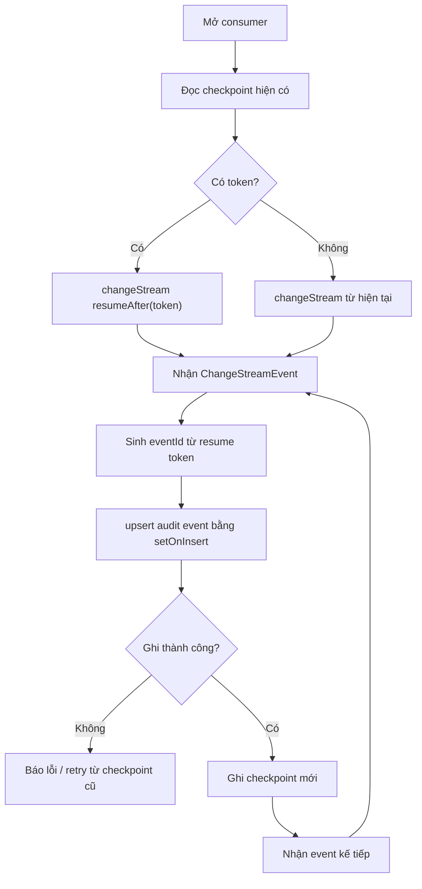

# Theo dõi thay đổi bằng change stream với checkpoint

## 1. Đề bài thực hành tổng hợp

Trong hệ thống quản lý đơn hàng dùng **Spring Data MongoDB**, collection `orders` liên tục có thao tác `insert`, `update`, `replace` và `delete`. Nhóm vận hành cần một nhật ký thay đổi để tra cứu và kiểm tra tiến trình đồng bộ, đồng thời muốn dịch vụ đọc sự kiện có thể **khởi động lại từ vị trí đã xử lý** khi mất kết nối hoặc tiến trình bị dừng.

Hãy xây dựng dịch vụ **Order Change Stream Consumer** bằng Java, Spring Boot, MongoDB và `ReactiveMongoTemplate`. Dịch vụ phải:

1. Theo dõi các thay đổi của collection `orders` bằng MongoDB change stream.
2. Lưu mỗi sự kiện vào `order_change_events` với một khóa duy nhất ổn định để **chống ghi trùng** khi đọc lại.
3. Chỉ ghi **checkpoint** sau khi thao tác xử lý sự kiện đã thành công.
4. Khi chạy lại, nạp resume token đã lưu và mở stream từ vị trí tiếp theo.
5. Xử lý an toàn các sự kiện không có `fullDocument`, ví dụ `delete`.
6. Có cách kiểm chứng tình huống dừng giữa chừng, sự kiện bị phát lại, lỗi token và oplog hết thời gian lưu.

Bài thực hành kết hợp thiết kế dữ liệu, API reactive, chẩn đoán lỗi, idempotency, theo dõi vận hành và kiểm thử — các kỹ năng cốt lõi của module `SPRING_DATA_MONGODB`.

### Tiêu chí hoàn thành

| Tiêu chí | Kết quả cần quan sát |
| --- | --- |
| Nhận thay đổi | Mỗi thao tác thử nghiệm trên `orders` sinh sự kiện mà watcher nhận được |
| Lưu dấu vết | Collection `order_change_events` có record tương ứng, kể cả `delete` |
| Ghi checkpoint | `stream_checkpoints` có resume token hợp lệ sau khi record sự kiện đã được lưu |
| Restart | Dịch vụ đọc tiếp từ token đã lưu, không cần bắt đầu lại toàn bộ stream |
| Phát lại | Nếu sự kiện được đọc lại, số record audit không tăng do khóa idempotency |
| Sai phạm vi | Dịch vụ không vô tình theo dõi hoặc tạo vòng lặp từ collection checkpoint |
| Lỗi nghiêm trọng | Token hết hiệu lực/invalidate được phát hiện để xử lý có kiểm soát |

**Phạm vi:** ví dụ thiết kế cho **một consumer chủ động** trên một subscription ID. Phần mở rộng lên nhiều instance sẽ được phân tích riêng. Đây là hệ thống **at-least-once với xử lý idempotent**, không đưa ra cam kết “exactly once” cho mọi tác động bên ngoài.

## 2. Kiến thức nền và điều kiện triển khai

MongoDB change streams thông báo các thay đổi đã được commit trên replica set hoặc sharded cluster. Một MongoDB standalone thông thường **không hỗ trợ** `$changeStream`. Ứng dụng cần MongoDB triển khai ở chế độ replica set (có thể là single-node replica set cho môi trường học tập), user đủ quyền đọc change stream, và MongoDB Java Driver/Spring Data MongoDB tương thích.

Spring Data hỗ trợ hai hướng tiêu thụ:

- **Reactive:** `ReactiveMongoTemplate.changeStream(...)` trả về `Flux<ChangeStreamEvent<T>>`; phù hợp stream dài hạn, quản lý backpressure và hủy subscription.
- **Imperative:** `DefaultMessageListenerContainer` đăng ký `ChangeStreamRequest` chạy trên tác vụ blocking riêng; cần quản lý vòng đời listener và error handler.

Bài này chọn **reactive** làm triển khai chính. Nếu ứng dụng đang dùng `MongoTemplate` đồng bộ, có thể dùng listener container hoặc MongoDB Driver theo cơ chế tương đương; không nên gọi một cursor blocking trên request thread của WebFlux.

### Một event có gì?

Các thông tin quan trọng trong `ChangeStreamEvent<Document>`:

| Trường | Ý nghĩa |
| --- | --- |
| `getResumeToken()` | `BsonValue` opaque dùng để mở stream tiếp từ sau event |
| `getOperationType()` | Loại thao tác, ví dụ `INSERT`, `UPDATE`, `REPLACE`, `DELETE` |
| `getRaw()` | Dữ liệu driver `ChangeStreamDocument<Document>`, gồm `documentKey` và mô tả cập nhật |
| `getBody()` | Document đã được map, có thể `null` tùy loại event và options |
| `getBsonTimestamp()` | Cluster time dạng `BsonTimestamp`, khác với đồng hồ máy ứng dụng |

Trong change event của MongoDB, trường `_id` **là resume token của sự kiện**, không phải ID của đơn hàng. ID đơn hàng nằm ở `documentKey._id`; nếu dùng `getBody().get("_id")`, ứng dụng có thể lỗi với `delete` khi không có full document.

**Không giải mã hoặc tự tạo resume token.** MongoDB coi token là cấu trúc opaque; khi lưu và khôi phục phải giữ nguyên mọi giá trị BSON bên trong. Token không bảo đảm tồn tại mãi nếu lịch sử oplog cần thiết đã bị loại bỏ.

## 3. Thiết kế dữ liệu và luồng xử lý

Chúng ta dùng ba collection:

| Collection | Vai trò | Khóa/field chính |
| --- | --- | --- |
| `orders` | Dữ liệu nghiệp vụ được theo dõi | `_id`, `tenantId`, `status`, `updatedAt` |
| `order_change_events` | Nhật ký sự kiện idempotent | `_id` = SHA-256 của token, `operationType`, `documentKeyJson`, `observedAt` |
| `stream_checkpoints` | Vị trí xử lý gần nhất theo subscription | `_id` = `orders-audit-v1`, `resumeTokenJson`, `lastEventId`, `updatedAt` |

Một checkpoint mẫu:

```javascript
{
  _id: "orders-audit-v1",
  resumeTokenJson: "{\"_data\":\"...opaque token...\"}",
  lastEventId: "9f...sha256...",
  updatedAt: ISODate("2026-11-20T09:00:00Z")
}
```

`resumeTokenJson` trong ví dụ là **chuỗi Extended JSON** của một `BsonDocument`, không phải JSON đã tự trích riêng giá trị `_data`. Trong implementation, chúng ta sử dụng `JsonMode.EXTENDED` để giữ thông tin kiểu BSON và `BsonDocument.parse(...)` để khôi phục token.



Hai bất biến bắt buộc:

1. **Xử lý trước, checkpoint sau.** Nếu checkpoint được cập nhật trước khi xử lý và ứng dụng crash, event chưa xử lý sẽ bị bỏ qua khi `resumeAfter`.
2. **Giữ thứ tự trong mỗi consumer.** Nếu thực thi nhiều event đồng thời và event sau ghi checkpoint trước event trước, restart có thể bỏ sót sự kiện đang xử lý. Ví dụ này dùng `concatMap` để xử lý tuần tự.

## 4. Chuẩn bị MongoDB và ứng dụng

### 4.1. Replica set và kết nối

Ví dụ cấu hình một replica set dùng trong bài học: `rs0` đã được khởi tạo và có một node nghe ở cổng `27017`. Kết nối qua Spring Boot:

```properties
# application.properties (môi trường thực hành)
spring.data.mongodb.uri=mongodb://localhost:27017/capstone_streams?replicaSet=rs0&w=majority
```

`w=majority` yêu cầu phía ghi dữ liệu nhận xác nhận majority. Điều này có ích cho độ bền checkpoint, nhưng **không biến hai lệnh ghi riêng thành transaction**. Đường URI/host phải phản ánh cấu hình replica set thực tế. Không khai báo user/password thật trong tài liệu hoặc commit secret vào repository.

Nếu dùng Docker Compose/Testcontainers để học, hãy bảo đảm container MongoDB thực sự **khởi tạo replica set**; chỉ chạy `mongod` như standalone sẽ khiến watcher gặp lỗi. Với Testcontainers 1.x, `MongoDBContainer` cung cấp replica set cho integration test. Chọn bản MongoDB và dependency phù hợp với BOM dự án; không trộn tùy tiện các phiên bản Driver do Spring Boot quản lý.

Xác minh MongoDB từ `mongosh`:

```javascript
rs.status().ok
// Kỳ vọng: 1 khi replica set đang hoạt động.

db.getSiblingDB("capstone_streams").runCommand({ ping: 1 })
// Kỳ vọng: { ok: 1 }.
```

### 4.2. Dữ liệu mẫu

Chạy trên database thử nghiệm:

```javascript
use capstone_streams

db.orders.insertOne({
  _id: "ORDER-001",
  tenantId: "tenant-a",
  status: "NEW",
  totalMinor: NumberLong("125000"),
  updatedAt: new Date()
});

db.orders.createIndex({ tenantId: 1, status: 1 });
```

Index `tenantId/status` phục vụ truy vấn nghiệp vụ thông thường và chỉ là một phần bối cảnh capstone; change stream không thay thế index hoặc query. Đừng xóa collection hay chạy lại `insertOne` với cùng `_id` trước khi kiểm tra trạng thái dữ liệu.

### 4.3. Dependency tối thiểu

Dự án Spring Boot có thể dùng starter tương ứng:

```groovy
dependencies {
    implementation 'org.springframework.boot:spring-boot-starter-data-mongodb-reactive'
    testImplementation 'org.springframework.boot:spring-boot-starter-test'
    testImplementation 'io.projectreactor:reactor-test'
    testImplementation 'org.testcontainers:junit-jupiter'
    testImplementation 'org.testcontainers:mongodb'
}
```

Các tọa độ Testcontainers ở trên thể hiện mô hình phổ biến của nhánh **1.x**; với nhánh 2.x hãy dùng artifact/module name và package đúng với BOM tương ứng. Ví dụ không ghi cứng số version vì phiên bản tương thích phụ thuộc Spring Boot đang sử dụng.

## 5. Đọc change stream bằng Spring Data MongoDB

Một phép theo dõi tối giản:

```java
import org.bson.Document;
import org.springframework.data.mongodb.core.ChangeStreamEvent;
import org.springframework.data.mongodb.core.ChangeStreamOptions;
import org.springframework.data.mongodb.core.ReactiveMongoTemplate;
import reactor.core.publisher.Flux;

Flux<ChangeStreamEvent<Document>> events =
        reactiveMongoTemplate.changeStream(
                "orders",
                ChangeStreamOptions.builder()
                        .returnFullDocumentOnUpdate()
                        .build(),
                Document.class
        );
```

`reactiveMongoTemplate` là bean `ReactiveMongoTemplate` đã được inject. `Flux` chưa làm gì cho đến khi có subscriber; khi được subscribe, nó mở stream dài hạn và tiếp tục nhận sự kiện cho đến khi bị hủy hoặc gặp lỗi.

`returnFullDocumentOnUpdate()` tương ứng cơ chế `updateLookup` của MongoDB. Với `update`, server có thể tra bản document **mới nhất tại thời điểm lookup**, không phải lúc nào cũng là ảnh chụp đúng sau thao tác vừa sinh event; trong một số tình huống nó có thể không tồn tại. Với `delete`, `getBody()` thường `null`.

Vì vậy, capstone này ghi **loại thao tác và document key** từ event raw làm dữ liệu audit tối thiểu. Nếu một bài toán yêu cầu trạng thái trước/sau chính xác, hãy thiết kế thêm change stream pre/post images (với version MongoDB hỗ trợ và cấu hình thích hợp) hoặc event nghiệp vụ ở tầng ứng dụng.

## 6. Mã chính: đọc checkpoint và lưu từng event

Ví dụ sau có thể đặt trong `OrderChangeStreamProcessor.java`. Nó giả định **Java 17+**, Spring Data MongoDB với reactive API, Reactor và MongoDB Java Driver từ BOM của dự án. Dùng `Document` cho output để hạn chế phụ thuộc vào ánh xạ entity khi chỉ cần metadata thay đổi.

```java
import java.nio.charset.StandardCharsets;
import java.security.MessageDigest;
import java.security.NoSuchAlgorithmException;
import java.time.Instant;
import java.util.Date;
import java.util.HexFormat;

import org.bson.BsonDocument;
import org.bson.BsonValue;
import org.bson.Document;
import org.bson.json.JsonMode;
import org.bson.json.JsonWriterSettings;
import org.springframework.data.mongodb.core.ChangeStreamEvent;
import org.springframework.data.mongodb.core.ChangeStreamOptions;
import org.springframework.data.mongodb.core.ReactiveMongoTemplate;
import org.springframework.data.mongodb.core.query.Criteria;
import org.springframework.data.mongodb.core.query.Query;
import org.springframework.data.mongodb.core.query.Update;
import org.springframework.stereotype.Service;
import reactor.core.publisher.Flux;
import reactor.core.publisher.Mono;

@Service
public class OrderChangeStreamProcessor {

    private static final String SUBSCRIPTION = "orders-audit-v1";
    private static final String CHECKPOINTS = "stream_checkpoints";
    private static final String EVENTS = "order_change_events";

    private static final JsonWriterSettings TOKEN_JSON =
            JsonWriterSettings.builder()
                    .outputMode(JsonMode.EXTENDED)
                    .build();

    private final ReactiveMongoTemplate mongo;

    public OrderChangeStreamProcessor(ReactiveMongoTemplate mongo) {
        this.mongo = mongo;
    }

    // Đọc checkpoint mỗi lần tạo subscription mới.
    private Mono<ChangeStreamOptions> optionsFromCheckpoint() {
        return mongo.findById(
                        SUBSCRIPTION, Document.class, CHECKPOINTS)
                .map(stored -> {
                    String tokenJson = stored.getString("resumeTokenJson");
                    if (tokenJson == null || tokenJson.isBlank()) {
                        throw new IllegalStateException(
                                "Checkpoint exists without resume token");
                    }
                    BsonDocument token = BsonDocument.parse(tokenJson);
                    return ChangeStreamOptions.builder()
                            .resumeAfter(token)
                            .returnFullDocumentOnUpdate()
                            .build();
                })
                .defaultIfEmpty(
                        ChangeStreamOptions.builder()
                                .returnFullDocumentOnUpdate()
                                .build()
                );
    }

    // Dòng xử lý tuần tự: event sau chỉ được xử lý khi event trước
    // đã ghi audit và checkpoint thành công.
    public Flux<String> consume() {
        return optionsFromCheckpoint()
                .flatMapMany(options ->
                        mongo.changeStream(
                                    "orders", options, Document.class)
                                .concatMap(this::recordAndCheckpoint, 1));
    }

    private Mono<String> recordAndCheckpoint(
            ChangeStreamEvent<Document> event) {

        BsonValue token = event.getResumeToken();
        if (token == null || !token.isDocument()) {
            return Mono.error(new IllegalStateException(
                    "Missing/unexpected change stream resume token"));
        }

        // Không chỉ lưu riêng _data; giữ nguyên BsonDocument token.
        String tokenJson = token.asDocument().toJson(TOKEN_JSON);
        String eventId = sha256Hex(tokenJson);

        String operation = event.getOperationType() == null
                ? "UNKNOWN"
                : event.getOperationType().name();

        var raw = event.getRaw();
        String documentKeyJson =
                raw == null || raw.getDocumentKey() == null
                        ? null
                        : raw.getDocumentKey().toJson(TOKEN_JSON);

        // Nếu cùng event bị đọc lại, chỉ insert lần đầu.
        Update audit = new Update()
                .setOnInsert("operationType", operation)
                .setOnInsert("documentKeyJson", documentKeyJson)
                .setOnInsert("observedAt", Date.from(Instant.now()));

        Query sameEvent = Query.query(Criteria.where("_id").is(eventId));

        Document checkpoint = new Document("_id", SUBSCRIPTION)
                .append("resumeTokenJson", tokenJson)
                .append("lastEventId", eventId)
                .append("updatedAt", Date.from(Instant.now()));

        // Bước 1: xử lý idempotent.
        // Bước 2: chỉ sau khi bước 1 ack thành công mới ghi checkpoint.
        return mongo.upsert(sameEvent, audit, EVENTS)
                .then(mongo.save(checkpoint, CHECKPOINTS))
                .thenReturn(eventId);
    }

    private static String sha256Hex(String input) {
        try {
            byte[] hash = MessageDigest.getInstance("SHA-256")
                    .digest(input.getBytes(StandardCharsets.UTF_8));
            return HexFormat.of().formatHex(hash);
        } catch (NoSuchAlgorithmException ex) {
            throw new IllegalStateException(
                    "SHA-256 unavailable in JVM", ex);
        }
    }
}
```

### Tại sao chọn những thao tác này?

**`findById(...)`:** checkpoint dùng một `_id` cố định cho mỗi subscription. Nếu chưa có, chúng ta mở stream không có resume token, nghĩa là chỉ theo dõi các thay đổi kể từ khi stream bắt đầu; đây **không phải** cơ chế đọc lại mọi thay đổi trong quá khứ.

**`resumeAfter(token)`:** khi có checkpoint, MongoDB bắt đầu từ **sau** event tương ứng. Tránh tự cộng timestamp hoặc lấy `Instant.now()` để suy vị trí tiếp theo — hai event có thể cùng thời gian và đồng hồ ứng dụng khác đồng hồ server.

**`JsonMode.EXTENDED` và `BsonDocument.parse`:** giúp round-trip resume token mà giữ thông tin kiểu BSON, kể cả khi định dạng token thay đổi giữa các phiên bản driver/server.

**`sha256Hex(tokenJson)`:** tạo khóa ngắn, ổn định cho event. Token được xem là opaque; digest chỉ dùng cho **deduplication**, không có chức năng diễn giải hoặc sắp thứ tự token. Một cách khác là lưu trực tiếp token BSON làm một field và dùng khóa riêng ổn định; trong bài này digest giúp dùng index mặc định trên `_id`.

**`Update.setOnInsert(...)`:** khi một event được đọc lại, upsert thấy `_id` đã tồn tại sẽ giữ bản audit hiện có. Nếu ghi trực tiếp một record mới với ID ngẫu nhiên, replay sẽ tạo trùng.

**`concatMap(..., 1)`:** giữ một thao tác đang xử lý tại một thời điểm; không để checkpoint của event sau vượt qua event trước. Điều này giảm throughput tối đa nhưng làm cơ chế recovery dễ kiểm chứng. Chỉ tăng concurrency sau khi có partitioning/sequence checkpoint an toàn.

### Giới hạn về nguyên tử

`mongo.upsert(...)` và `mongo.save(...)` **là hai lệnh ghi riêng**. Nếu tiến trình chết sau upsert nhưng trước save checkpoint, lần chạy tiếp theo có thể nhận lại event đó. Idempotent upsert bảo đảm record audit không bị nhân đôi.

Nếu audit là hai hay nhiều thay đổi dữ liệu cần đúng một lần **trong cùng MongoDB replica set**, cân nhắc transaction để commit side effect và checkpoint cùng lúc (cần cấu hình transaction manager/reactive transaction đúng). Một change stream cursor không nên được mở như thao tác bên trong transaction xử lý dữ liệu. Với lời gọi HTTP, email, Kafka hoặc hệ thống khác, transaction MongoDB không tự làm các side effect bên ngoài trở nên atomic; cần idempotency key, outbox hoặc cơ chế đối soát chuyên biệt.

## 7. Quản lý vòng đời subscriber và phục hồi lỗi

`Flux` của change stream sống lâu và không kết thúc như một truy vấn bình thường. Ứng dụng cần **subscribe một lần khi sẵn sàng**, giữ `Disposable` để hủy lúc shutdown và xử lý `onError` rõ ràng.

Ví dụ component điều phối:

```java
import java.time.Duration;

import com.mongodb.MongoSocketException;
import com.mongodb.MongoTimeoutException;
import jakarta.annotation.PreDestroy;
import org.slf4j.Logger;
import org.slf4j.LoggerFactory;
import org.springframework.boot.context.event.ApplicationReadyEvent;
import org.springframework.context.event.EventListener;
import org.springframework.stereotype.Component;
import reactor.core.Disposable;
import reactor.core.publisher.Flux;
import reactor.util.retry.Retry;

@Component
public class OrderChangeStreamRunner {

    private static final Logger log =
            LoggerFactory.getLogger(OrderChangeStreamRunner.class);

    private final OrderChangeStreamProcessor processor;
    private volatile Disposable subscription;

    public OrderChangeStreamRunner(OrderChangeStreamProcessor processor) {
        this.processor = processor;
    }

    @EventListener(ApplicationReadyEvent.class)
    public synchronized void start() {
        if (subscription != null && !subscription.isDisposed()) {
            return;
        }

        // Flux.defer giúp mỗi lần retry tạo lại pipeline,
        // đọc checkpoint đã ghi thay vì dùng mãi offset cũ.
        subscription = Flux.defer(processor::consume)
                .retryWhen(
                        Retry.backoff(5, Duration.ofSeconds(1))
                                .maxBackoff(Duration.ofSeconds(30))
                                .filter(OrderChangeStreamRunner::isTransportError)
                )
                .subscribe(
                        id -> log.info("Processed change event {}", id),
                        err -> log.error(
                                "Change stream stopped: intervention required",
                                err)
                );
    }

    // Ví dụ phân loại sơ bộ; production cần nhận diện cả
    // các exception đã được Spring Data dịch/wrap.
    private static boolean isTransportError(Throwable error) {
        for (Throwable cause = error; cause != null;
                cause = cause.getCause()) {
            if (cause instanceof MongoSocketException
                    || cause instanceof MongoTimeoutException) {
                return true;
            }
        }
        return false;
    }

    @PreDestroy
    public void stop() {
        Disposable current = subscription;
        if (current != null) {
            current.dispose();
        }
    }
}
```

Ứng dụng thực tế cần gắn tình trạng consumer vào **readiness/health metric**: khi hết retry hoặc gặp token không thể resume, một dòng log không đủ để đảm bảo có người xử lý. Có thể chuyển sang restart theo process supervisor hoặc cảnh báo vận hành. Đừng bật retry vô hạn cho mọi exception: một lỗi schema, lỗi logic trong consumer hoặc token không hợp lệ sẽ lặp lại mãi mà không có tiến triển.

**Lưu ý về auto-resume:** MongoDB Driver có thể tự resume một số lỗi mạng/change stream tạm thời. Retry ở tầng ứng dụng vẫn phải nạp **checkpoint mới nhất**, phân loại lỗi và dùng backoff; không được mặc định mọi lỗi stream đều resumable.

### Tại sao không dùng `flatMap` tùy ý?

```java
// Không dùng kiểu này cho checkpoint toàn cục nếu chưa thiết kế
// cơ chế thứ tự/commit liên quan:
events.flatMap(this::recordAndCheckpoint, 32);
```

Nếu event B được ghi xong checkpoint trước event A, sau crash hệ thống có thể resume từ B dù A chưa hoàn tất. `concatMap` loại bỏ tình huống đó trong phạm vi một subscriber.

## 8. Thực hành từng bước trên MongoDB thử nghiệm

### Bước A — Khởi chạy watcher

Khởi động ứng dụng Spring Boot với replica set. Kiểm tra kết nối, quyền của user và thông tin giám sát subscriber. Hãy bảo đảm watcher đã thực sự mở trước khi phát sự kiện thử; `doOnSubscribe` chỉ xác nhận Reactor đã có subscriber, **không bảo đảm** server đã sẵn sàng cursor.

### Bước B — Thay đổi đơn hàng

Trong `mongosh`, sau khi watcher sẵn sàng:

```javascript
use capstone_streams

db.orders.insertOne({
  _id: "ORDER-002",
  tenantId: "tenant-a",
  status: "NEW",
  totalMinor: NumberLong("85000"),
  updatedAt: new Date()
});

db.orders.updateOne(
  { _id: "ORDER-002" },
  { $set: { status: "PAID", updatedAt: new Date() } }
);

db.orders.replaceOne(
  { _id: "ORDER-002" },
  {
    _id: "ORDER-002",
    tenantId: "tenant-a",
    status: "SHIPPED",
    totalMinor: NumberLong("85000"),
    updatedAt: new Date()
  }
);

db.orders.deleteOne({ _id: "ORDER-002" });
```

Đợi consumer xử lý đến checkpoint cuối cùng trước khi kiểm tra. Stream có thể có những event khác từ các writer dùng chung collection; dùng database/collection thử nghiệm cô lập để suy luận số lượng.

### Bước C — Kiểm tra dấu vết và token

```javascript
db.order_change_events.find(
  {},
  { operationType: 1, documentKeyJson: 1, observedAt: 1 }
).sort({ observedAt: 1 });

db.stream_checkpoints.findOne({
  _id: "orders-audit-v1"
});

db.order_change_events.countDocuments({});
```

Kỳ vọng có các event cho `INSERT`, `UPDATE`, `REPLACE` và `DELETE`. Mỗi record audit có `_id` riêng và checkpoint chứa `resumeTokenJson`. Không giả định ID của record audit là ID đơn hàng; nó đại diện cho **một lần thay đổi**, nên cùng đơn hàng có nhiều record.

### Bước D — Dừng và khởi động lại

1. Dừng ứng dụng sau khi checkpoint được lưu.
2. Trong khi consumer tắt, ghi thêm một update hoặc insert vào `orders`.
3. Khởi động lại ứng dụng **trước khi** lịch sử oplog chứa token hết hạn.
4. Kiểm tra event được ghi khi dịch vụ tắt đã xuất hiện trong `order_change_events`.
5. Kiểm tra các event từng ghi trước đó không tạo thêm record audit trùng.

Sau restart, `optionsFromCheckpoint()` dùng `resumeAfter`; MongoDB sẽ phát sự kiện **sau token** đã lưu. Việc service có “chạy nền liên tục” hay không không bảo đảm recovery nếu checkpoint biến mất hoặc token đã vượt ngoài oplog retention.

## 9. Thử lỗi có chủ đích để hiểu delivery semantics

### Trường hợp 1 — Crash trước khi ghi audit

Không có bản audit và checkpoint chưa tiến lên. Sau restart, event sẽ được đọc lại từ token trước đó (nếu lịch sử còn sẵn) và có cơ hội xử lý thành công.

### Trường hợp 2 — Crash sau khi ghi audit, trước checkpoint

Event đã nằm trong `order_change_events` nhưng checkpoint vẫn ở vị trí cũ. Sau restart, event có thể đến lại:

```text
Lần 1: receive E → upsert(E) thành công → CRASH → chưa save checkpoint
Lần 2: resume token cũ → receive E → upsert(E) không tạo trùng
        → save checkpoint của E → tiếp tục E+1
```

Vì `_id` audit = digest token và `setOnInsert` không ghi đè bản cũ, số document audit vẫn như kỳ vọng. Có thể mô phỏng lỗi bằng test fault injection ở điểm sau `upsert` nhưng trước `save`. Không cần kill database đang phục vụ người dùng để kiểm chứng.

### Trường hợp 3 — Crash sau khi ghi checkpoint

Audit đã được xử lý thành công trước checkpoint; restart tiếp từ sau E. Trong mô hình một consumer và write concern phù hợp, không cần xử lý lại E. **Không đảo thứ tự hai thao tác** chỉ vì muốn giảm độ trễ.

### Trường hợp 4 — Retry tự động ở Driver

Driver có thể tự resume trước khi error đến application; ứng dụng vẫn cần chống duplicate bởi delivery semantics tổng thể là at-least-once. Đừng cố đếm số lần callback `onNext` như “số business operation duy nhất” nếu chưa có khóa dedup.

| Điểm lỗi | Audit E | Checkpoint E | Khi chạy lại |
| --- | --- | --- | --- |
| Trước audit | Chưa có | Chưa có | Đọc lại E và xử lý |
| Sau audit, trước checkpoint | Đã có | Chưa có | Đọc lại E, upsert idempotent |
| Sau checkpoint | Đã có | Đã có | Tiếp tục sau E |
| Lỗi logic cố định trên E | Có thể chưa có | Chưa có | Dừng/cảnh báo; sửa lỗi hoặc đưa vào quy trình xử lý |
| Token mất khỏi oplog | Không xác định | Token cũ | Không tự bỏ token để đọc từ “hiện tại” |

## 10. Checkpoint không còn dùng được và sự kiện invalidate

### `resumeAfter`, `startAfter` và `resumeAt`

| Lựa chọn | Ý nghĩa | Khi nên dùng |
| --- | --- | --- |
| `resumeAfter(token)` | Tiếp tục **sau event token** đã lưu | Đường bình thường sau checkpoint |
| `startAfter(token)` | Bắt đầu stream mới **sau token**, cho phép xử lý tình huống invalidate | Khi đã đánh giá và xử lý vòng đời collection/namespace |
| `resumeAt(Instant/BsonTimestamp)` | Bắt đầu tại cluster time tương ứng | Khi có mốc thời gian server đáng tin cậy và mục tiêu khôi phục cụ thể |

Đừng thay `resumeAfter` bằng `resumeAt(Instant.now())` khi restart: mốc hiện tại có thể bỏ qua toàn bộ sự kiện trong thời gian dịch vụ tắt. `Instant` cũng có thể không đủ chính xác trong một số trường hợp cần `BsonTimestamp`.

### Trường hợp `invalidate`

Đổi tên hoặc drop collection có thể sinh `invalidate` và đóng stream. `resumeAfter` **không thể** tiếp tục qua một invalidate event. `startAfter` là khả năng được MongoDB hỗ trợ để mở stream mới sau token invalidate; tuy nhiên, thao tác drop/rename có thể làm thay đổi namespace và ý nghĩa dữ liệu. Quy trình xử lý cần xem liệu tạo lại collection và dựng lại projection có đúng nghiệp vụ hay không.

Nếu lỗi chỉ ra rằng resume token không còn trong lịch sử oplog, không xóa checkpoint rồi tự động mở watcher từ hiện tại — như vậy có thể **mất sự kiện mà không ai biết**. Thay vào đó, dừng worker, phát cảnh báo và chạy quy trình khôi phục (backfill/snapshot + đối soát). Sau khi dựng lại trạng thái ở một điểm nhất quán mới, mới khởi tạo checkpoint phù hợp.

**Giữ nguyên pipeline và options** khi resume từ token cũ. MongoDB cảnh báo việc thay pipeline hoặc options giữa hai lần mở stream có thể làm hỏng tính nhất quán hoặc không thể resume. Nếu cần thay đổi đáng kể bộ lọc/namespace, tạo một subscription/checkpoint version mới, đồng thời thiết kế cách chuyển dữ liệu hoặc backfill.

## 11. Khởi tạo lần đầu: bài toán snapshot và khoảng trống sự kiện

Với code ví dụ, **không có checkpoint** nghĩa là watcher theo dõi từ khi nó được mở. Điều đó phù hợp cho nhật ký chỉ ghi sự kiện mới kể từ lúc triển khai, nhưng **không đủ** nếu ứng dụng phải phản ánh toàn bộ trạng thái đơn hàng đã tồn tại.

Một cách làm sai:

```text
1. find() tất cả orders để dựng projection.
2. Sau khi find() xong mới mở change stream.
3. Bỏ qua mọi ghi diễn ra giữa bước 1 và bước 2.
```

Để có bootstrap không bỏ sót, cần một giao thức đáng tin cậy hơn, chẳng hạn:

1. Mở change stream và ghi nhận mốc bắt đầu có thể resume **trước hoặc đồng thời** với snapshot.
2. Chụp snapshot/đọc dữ liệu hiện tại ở mức nhất quán phù hợp yêu cầu.
3. Buffer hoặc phát lại các event xảy ra trong quá trình snapshot.
4. Khử trùng lặp/giải quyết thứ tự giữa snapshot và event để projection không bị ghi đè bởi trạng thái cũ.
5. Chỉ công bố checkpoint mới khi snapshot và phần delta đã được đối soát.

Giao thức cụ thể phụ thuộc consistency requirement, tài nguyên sẵn có và khả năng lấy mốc cluster time/post-batch token; không thể chỉ dùng một lệnh `find()` và một lệnh `watch()` là bảo đảm gap-free trong mọi trường hợp.

Nếu mục tiêu là “tất cả thay đổi kể từ khi bật dịch vụ”, hãy ghi rõ thời điểm bắt đầu và dùng checkpoint sau đó. Nếu mục tiêu là “trạng thái lịch sử đầy đủ”, thiết kế snapshot + change stream như một hạng mục riêng.

## 12. Lọc event, cập nhật và xóa

### 12.1. Không lọc bỏ dữ liệu cần cho checkpoint

Nếu chỉ quan tâm `status`, bạn có thể thêm change stream pipeline lọc `operationType` hoặc namespace để giảm lưu lượng. Tuy nhiên, mọi bộ lọc phải được đánh giá cùng với mục tiêu và checkpoint: khi đổi pipeline, token cũ có thể không còn an toàn để sử dụng.

Đặc biệt, không dùng `$project` làm biến mất hoặc thay đổi `_id` của **change event**; `_id` là resume token và MongoDB cần nó để khôi phục. Với pipeline tùy chỉnh, kiểm tra trên MongoDB phiên bản mục tiêu, đồng thời giữ filter đủ rõ để không vô tình bỏ qua insert/replace/delete có liên quan.

### 12.2. Không giả định update luôn trả trạng thái sau sự kiện

`updateLookup` giúp lấy full document mới nhất, nhưng khi các thay đổi diễn ra nhanh, nó có thể phản ánh trạng thái ở thời điểm tra cứu và **khác** ảnh chụp ngay sau từng update. Nếu audit cần “giá trị field trước và sau mỗi lần thay đổi”, xem xét `updateDescription` (chỉ mô tả field thay đổi) hoặc pre/post images có điều kiện hỗ trợ; không suy ra dữ liệu lịch sử chính xác từ `getBody()`.

### 12.3. Event delete chỉ còn document key

Ví dụ dữ liệu sự kiện:

```javascript
{
  _id: { _data: "...resume token..." },
  operationType: "delete",
  documentKey: { _id: "ORDER-002" },
  ns: { db: "capstone_streams", coll: "orders" }
  // Không có fullDocument của order đã bị xóa.
}
```

Nếu ứng dụng đồng bộ một read model theo trạng thái hiện tại, xử lý `DELETE` bằng `documentKey._id` thay vì truy cập `fullDocument._id`. Với audit log minh họa, chỉ cần giữ `operationType` và `documentKeyJson`.

## 13. Nhiều instance, bảo mật và khả năng vận hành

### 13.1. Tại sao một checkpoint toàn cục cần một consumer chủ động?

Nếu hai instance cùng đọc `orders` và cùng ghi `stream_checkpoints._id = "orders-audit-v1"`, cả hai có thể xử lý event song song, checkpoint có nguy cơ bị **ghi lùi** hoặc bị nhảy theo tiến độ của instance khác. Audit dedup giúp không nhân đôi record, nhưng **không** làm an toàn thứ tự checkpoint.

Để scale out, cân nhắc:

- Bầu **một leader** và dùng lease/fencing token khi ghi checkpoint; instance mất quyền phải dừng xử lý.
- Chia workload thành các stream/partition độc lập có bộ lọc, ownership và checkpoint riêng được thiết kế cẩn thận.
- Chuyển change stream thành một luồng sự kiện bền vững ở message broker rồi phân phối cho consumer group (sau khi đã giải quyết độ bền khi publish).

Không chọn song song `flatMap` hoặc chạy nhiều pod cùng checkpoint chỉ dựa vào khả năng upsert idempotent.

### 13.2. Quyền truy cập và dữ liệu nhạy cảm

Tài khoản MongoDB phải có quyền phù hợp để xem change stream trên collection/namespace cần thiết, cùng quyền ghi vào hai collection của consumer. Áp dụng **least privilege**, không cấp quyền đọc toàn bộ database nếu chỉ cần `orders`.

Resume token và event metadata có thể chứa thông tin nội bộ; tránh log cả `fullDocument` hoặc token thô vào log thường, đặc biệt khi chúng chứa ID khách hàng/dữ liệu nhạy cảm. Ví dụ chỉ ghi `eventId` đã hash và loại thao tác để phục vụ vận hành. Phân quyền truy cập vào collection checkpoint/audit cũng quan trọng như phân quyền collection nghiệp vụ.

### 13.3. Những metric cần đo

| Metric/đầu ra | Ý nghĩa |
| --- | --- |
| `events_processed_total{operationType}` | Tần suất sự kiện đã xử lý |
| `event_process_failure_total` | Số lần xử lý lỗi, có thể phân loại transient/fatal |
| `checkpoint_write_failure_total` | Không thể ghi vị trí đã xử lý |
| `last_checkpoint_at` | Thời điểm checkpoint gần nhất; chú ý stream có thể nhàn rỗi |
| `consumer_active` | Có subscription đang hoạt động hay không |
| `end_to_end_lag_seconds` | Độ trễ giữa cluster event time và thời điểm xử lý |
| `replayed_event_total` | Số sự kiện lặp lại được dedup nhận diện |

Không chỉ cảnh báo từ `last_checkpoint_at` vì collection có thể không có ghi trong nhiều giờ. Kết hợp readiness, lỗi cursor, oplog retention, write rate và trạng thái tiến trình. Với sharded cluster, token high-watermark/postBatchResumeToken có ý nghĩa bổ sung; triển khai ví dụ này chỉ checkpoint khi **có event**, nên cần giám sát thời gian nhàn rỗi rất dài nếu oplog có nguy cơ cuộn qua token cuối.

## 14. Kiểm thử tự động và fault injection

### Cấp độ kiểm thử

**Unit test:** xác minh hàm `sha256Hex` trả cùng kết quả cho cùng chuỗi token; ghi/đọc token bằng `BsonDocument.toJson(JsonMode.EXTENDED)` và `BsonDocument.parse` không làm đổi giá trị.

**Integration test:** dùng MongoDB replica set thật (Testcontainers), mở subscription, ghi insert/update/delete và kiểm tra audit record + checkpoint. Vì change stream là luồng dài hạn, test phải chủ động hủy subscription sau khi đạt điều kiện; không để test treo vĩnh viễn chờ `verifyComplete()` tự kết thúc.

**Fault injection:** giả lập lỗi sau khi audit upsert nhưng trước checkpoint save; khởi động lại consumer, đo kết quả idempotency. Một test khác cố ý ngắt kết nối để kiểm tra retry và đọc lại checkpoint.

### Test cho round-trip resume token

Đây là unit test đơn giản, không cần MongoDB và không giả định hiểu nội dung token:

```java
import static org.junit.jupiter.api.Assertions.assertEquals;

import org.bson.BsonDocument;
import org.bson.json.JsonMode;
import org.bson.json.JsonWriterSettings;
import org.junit.jupiter.api.Test;

class ResumeTokenEncodingTest {

    @Test
    void tokenRoundTripPreservesBson() {
        BsonDocument original = BsonDocument.parse(
                "{ \"_data\": \"opaque-sample-value\" }");

        String stored = original.toJson(
                JsonWriterSettings.builder()
                        .outputMode(JsonMode.EXTENDED)
                        .build());

        BsonDocument loaded = BsonDocument.parse(stored);
        assertEquals(original, loaded);
    }
}
```

`opaque-sample-value` chỉ là chuỗi kiểm tra serialization; **không phải** resume token MongoDB có thể dùng để mở change stream thật.

### Ma trận kịch bản tích hợp

| Kịch bản | Cách chuẩn bị | Assertion |
| --- | --- | --- |
| Watch nhận insert | Subscribe trước, sau đó insert | Có event `INSERT` và key đơn hàng |
| Update không có body chắc chắn | Update rồi đọc raw event | Không phụ thuộc vào `getBody()` để lưu audit |
| Delete | Xóa một đơn | Có audit `DELETE` và `documentKeyJson` |
| Restart sau checkpoint | Dừng watcher, ghi thêm một đơn, chạy lại | Nhận event mới không bỏ sót |
| Crash trước checkpoint | Inject lỗi giữa upsert và save | Replay không tạo audit record thứ hai |
| Mất checkpoint | Chạy consumer mới không có token | Chỉ thấy thay đổi kể từ lúc watcher bắt đầu; không ngầm backfill |
| Token hết hạn | Kiểm thử với token không thể resume hoặc môi trường TTL oplog ngắn | Dừng/cảnh báo, không xóa token và chạy lại từ hiện tại |
| Hai instance | Mô phỏng cùng checkpoint trên hai runner | Chứng minh cần cơ chế ownership/fencing |

Để tránh test không ổn định, đừng chỉ `Thread.sleep(100)` rồi giả định cursor đã mở. Test nên có **điểm đồng bộ xác nhận stream sẵn sàng** hoặc khởi tạo mốc resume rõ ràng, rồi mới ghi dữ liệu. Với các test chạy song song, cấp collection/subscription ID riêng và cleanup sau khi hủy subscription; không dùng checkpoint từ lần chạy trước.

## 15. Bài tập mở rộng

**Bài 1 — Đồng bộ read model:** Thay collection `order_change_events` bằng `order_read_model`. Với `INSERT/UPDATE/REPLACE`, cập nhật bản tóm tắt trạng thái; với `DELETE`, xóa theo `documentKey._id`. Hãy giải thích vì sao `updateLookup` có thể không phải ảnh chụp đúng của từng update và cần thử tính idempotent khi replay.

**Bài 2 — Audit có metadata nguồn:** Bổ sung `clusterTime`, namespace, operation type và event ID vào record. Chọn kiểu lưu BSON thích hợp; không ghi toàn bộ document nếu không có yêu cầu nghiệp vụ/kiểm soát dữ liệu.

**Bài 3 — Phát sự kiện ra hệ thống khác:** Từ một order change, gửi message sang broker. Đưa ra giao thức tránh mất message giữa “publish” và “checkpoint”; cân nhắc transactional outbox và idempotency key ở phía consumer.

**Bài 4 — Recovery sau invalidate:** Thử nghiệm drop/rename trên collection riêng trong lab, quan sát `invalidate`, xác định khi nào được phép dùng `startAfter` và khi nào cần dựng lại toàn bộ read model.

**Bài 5 — Multi-instance:** Thiết kế lease/fencing cho checkpoint toàn cục, nêu cách phát hiện tiến trình mất quyền và chứng minh checkpoint không bị ghi lùi sau failover.

## 16. Checklist bàn giao bài capstone

- [ ] MongoDB đang là replica set/sharded cluster và user có quyền cần thiết.
- [ ] Change stream chỉ theo dõi đúng namespace dự kiến.
- [ ] Resume token được lưu nguyên dạng BSON-compatible, có test round-trip.
- [ ] Side effect đã được ghi nhận thành công **trước** khi cập nhật checkpoint.
- [ ] Xử lý tuần tự, không để checkpoint chạy vượt qua event chưa hoàn tất.
- [ ] Dùng khóa idempotency để xử lý replay.
- [ ] Có test `INSERT`, `UPDATE`, `REPLACE`, `DELETE` và trường hợp `getBody() == null`.
- [ ] Có test restart khi event mới được ghi trong thời gian consumer tắt.
- [ ] Có test failure injection sau side effect và trước checkpoint.
- [ ] Lỗi token hết oplog/invalidate được phân loại và có runbook khôi phục.
- [ ] Không ghi đè checkpoint của phiên bản/pipeline khác.
- [ ] Có kế hoạch bootstrap dữ liệu cũ nếu sản phẩm yêu cầu lịch sử đầy đủ.
- [ ] Có ownership khi chạy nhiều replica consumer.
- [ ] Có metrics, cảnh báo và cơ chế shutdown hủy subscription.

## Tài liệu tham khảo

- [Spring Data MongoDB — Change Streams](https://docs.spring.io/spring-data/mongodb/reference/mongodb/change-streams.html)
- [Spring Data MongoDB API — ReactiveMongoTemplate](https://docs.spring.io/spring-data/mongodb/reference/api/java/org/springframework/data/mongodb/core/ReactiveMongoTemplate.html)
- [Spring Data MongoDB API — ChangeStreamOptions Builder](https://docs.spring.io/spring-data/mongodb/docs/current/api/org/springframework/data/mongodb/core/ChangeStreamOptions.ChangeStreamOptionsBuilder.html)
- [Spring Data MongoDB API — ChangeStreamEvent](https://docs.spring.io/spring-data/mongodb/reference/api/java/org/springframework/data/mongodb/core/ChangeStreamEvent.html)
- [MongoDB Manual — Change Streams / Resume Tokens](https://www.mongodb.com/docs/manual/changestreams/)
- [MongoDB Manual — `db.collection.watch()`](https://www.mongodb.com/docs/manual/reference/method/db.collection.watch/)
- [MongoDB Manual — `$changeStream`](https://www.mongodb.com/docs/manual/reference/operator/aggregation/changestream/)
- [MongoDB Java Driver — Extended JSON](https://www.mongodb.com/docs/drivers/java/sync/current/data-formats/document-data-format-extended-json/)
