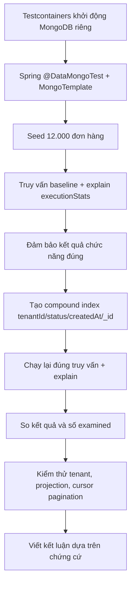

# Kiểm thử bằng Testcontainers và tối ưu theo executionStats

## 1. Bối cảnh và mục tiêu của bài capstone

Bạn đang phát triển dịch vụ quản lý đơn hàng bằng **Spring Data MongoDB**. Mỗi đơn hàng lưu trong collection `orders`, được phân chia theo `tenantId`. Trang quản trị có API lấy **25 đơn hàng đã thanh toán gần nhất của một tenant**. Khi dữ liệu tăng lên, endpoint chậm và có lúc làm tăng tải database.

Nhiệm vụ của bài **Thực hành tổng hợp** là xây dựng một quy trình **có thể tái hiện, kiểm thử và đo lường**:

1. Chạy MongoDB thực trong container dành riêng cho integration test.
2. Ghi dữ liệu thử đủ lớn và có phân bố rõ ràng.
3. Thực thi truy vấn thông qua `MongoTemplate`/repository.
4. Thu thập `explain("executionStats")` **trước** khi tối ưu.
5. Thiết kế compound index dựa trên filter, sort và limit của query.
6. Thu thập lại `executionStats`, chứng minh **kết quả nghiệp vụ không đổi**.
7. Kiểm tra cách ly tenant, projection, phân trang và giới hạn của các phép đo.
8. Đề xuất kế hoạch tối ưu tiếp theo nếu index chưa giải quyết nút cổ chai.

Đây là bài thực hành về **chất lượng truy vấn và dữ liệu**, không phải cuộc thi tìm số mili-giây nhỏ nhất. Trên máy CI, độ trễ bị ảnh hưởng bởi CPU, disk, khởi động container, cache và những tác vụ chạy song song; vì vậy test nên khẳng định điều kiện **đúng và tái hiện được**, còn benchmark định lượng cần chạy có kiểm soát.

### Đầu ra mong đợi

| Đầu ra | Nội dung cần chứng minh |
| --- | --- |
| Fixture MongoDB | Có database test độc lập và dữ liệu seed ổn định |
| Integration test | CRUD/query Spring Data chạy trên MongoDB thật, không dùng mock cho database |
| Báo cáo baseline | Có `nReturned`, `totalDocsExamined`, `totalKeysExamined` và execution plan |
| Compound index | Có giải thích thứ tự các trường và trade-off |
| Báo cáo sau tối ưu | Cùng filter, sort, limit, dataset và kết quả; số examined được đối chiếu |
| Regression tests | Không lộ dữ liệu tenant khác, sort đúng, phân trang đúng |
| Kết luận | Có bằng chứng cải thiện hoặc phân tích vì sao planner chọn phương án khác |

## 2. Kiến trúc bài thực hành

Giả sử endpoint của ứng dụng là:

```text
GET /api/tenants/{tenantId}/orders?status=PAID&limit=25
```

Trong ứng dụng production, **tenantId phải xuất phát từ ngữ cảnh đã xác thực hoặc được kiểm tra quyền**, không tự động tin path parameter. Trong integration test, ta dùng một `tenantId` cố định để kiểm tra query. Điều kiện lọc nghiệp vụ:

```javascript
{
  tenantId: "tenant-2",
  status: "PAID"
}
```

Thứ tự trang đầu:

```javascript
{ createdAt: -1, _id: -1 }
```

Thêm `_id` vào khóa sort là một **tie-breaker** giúp thứ tự xác định khi nhiều đơn hàng có cùng `createdAt`. Giá trị `limit` là 25. Với tập dữ liệu hàng chục nghìn bản ghi, baseline không có index phù hợp có thể phải quét nhiều document và sort trong bộ nhớ; compound index có thể làm giảm lượng quét đáng kể.



### Mô hình dữ liệu

Để tập trung vào truy vấn và index, bắt đầu với một model không có quan hệ phức tạp:

```json
{
  "_id": "ORD-00042",
  "tenantId": "tenant-2",
  "status": "PAID",
  "createdAt": { "$date": "2026-01-01T00:00:42Z" },
  "amountCents": 1042
}
```

Các field được dùng:

| Field | Kiểu | Mục đích |
| --- | --- | --- |
| `_id` | String trong fixture này | Định danh duy nhất và tie-breaker |
| `tenantId` | String | Phạm vi truy cập theo tenant |
| `status` | String | Equality filter |
| `createdAt` | BSON Date | Sort giảm dần, keyset pagination |
| `amountCents` | Long | Dữ liệu nghiệp vụ; không cần đọc cho mọi query thống kê |

Thực tế có thể dùng `ObjectId` cho `_id`. Ví dụ cố ý dùng chuỗi như `ORD-00042` để rõ ràng trong test; khi áp dụng cho project thật phải **giữ nhất quán kiểu BSON** giữa filter, sort và checkpoint.

## 3. Thiết lập Testcontainers và Spring Data MongoDB

### 3.1. Vì sao không dùng mock cho bài này?

Mock `MongoTemplate`/repository giúp kiểm thử logic service, nhưng **không thể xác nhận**:

- Driver tạo lệnh MongoDB thực sự như thế nào.
- Mapping Java ↔ BSON, conversion, `@Field`, query derivation.
- MongoDB Query Planner chọn `COLLSCAN` hay `IXSCAN`.
- `executionStats` và hành vi index, sort, limit.
- Quyền, replica set, transaction hoặc change stream nếu mở rộng bài.

**Testcontainers** cho phép chạy MongoDB cô lập bằng Docker/engine tương thích và làm việc với database thật. Test không phải phụ thuộc vào database trên máy phát triển hoặc production.

### 3.2. Chọn version tương thích

Các ví dụ Java bên dưới hướng đến **Spring Boot 3.x / Spring Data MongoDB tương ứng, JDK 17+, Testcontainers 1.x** với API `org.testcontainers.containers.MongoDBContainer`. Với Testcontainers 2.x hoặc Spring Boot phiên bản khác, package/tọa độ module và property kết nối có thể thay đổi. Cần đối chiếu tài liệu và dependency management của đúng phiên bản project; không nên copy mù một phiên bản mới nhất bất kỳ.

Một đoạn phụ thuộc Gradle **minh họa**:

```groovy
dependencies {
    implementation 'org.springframework.boot:spring-boot-starter-data-mongodb'

    testImplementation 'org.springframework.boot:spring-boot-starter-test'
    testImplementation 'org.testcontainers:junit-jupiter'
    testImplementation 'org.testcontainers:mongodb'
}
```

Giả định version Testcontainers được quản lý bởi Spring Boot BOM hoặc BOM riêng tương thích; nếu không, cần khai báo phiên bản một cách nhất quán. Những dependency này phục vụ **test**, không đưa container runtime vào code ứng dụng production.

Các điều kiện môi trường:

1. Docker/container engine có thể chạy và pull image MongoDB.
2. CI có quyền truy cập container engine phù hợp; không buộc test dùng MongoDB public.
3. Image MongoDB được **pin theo phiên bản kiểm thử** thay vì thả nổi tag `latest`.
4. Có cơ chế dọn container khi test kết thúc; không tái sử dụng container chứa dữ liệu nhạy cảm.
5. Runner đủ CPU/RAM/disk để seed và chạy `explain`, tránh đo benchmark trên môi trường quá thiếu tài nguyên.

### 3.3. Entity Java

Sử dụng Java record để ví dụ gọn và immutable:

```java
import java.time.Instant;
import org.springframework.data.annotation.Id;
import org.springframework.data.mongodb.core.mapping.Document;

@Document("orders")
public record Order(
        @Id String id,
        String tenantId,
        String status,
        Instant createdAt,
        long amountCents
) {}
```

Spring Data MongoDB có thể ánh xạ record với canonical constructor theo khả năng của version đang dùng. Kiểm thử **cả hai chiều** `insert` và `find` để đảm bảo mapping chính xác.

Nếu ứng dụng dùng Java class thông thường, có thể thay record bằng entity có constructor/getters rõ ràng. Dù cấu trúc nào, test phải dùng đúng mapping mà ứng dụng production sử dụng.

### 3.4. Container và dynamic property

Ví dụ integration test chạy container **trước** khi Spring context nhận URI:

```java
import org.junit.jupiter.api.Test;
import org.springframework.beans.factory.annotation.Autowired;
import org.springframework.boot.test.autoconfigure.data.mongo.DataMongoTest;
import org.springframework.test.context.DynamicPropertyRegistry;
import org.springframework.test.context.DynamicPropertySource;
import org.testcontainers.containers.MongoDBContainer;
import org.testcontainers.junit.jupiter.Container;
import org.testcontainers.junit.jupiter.Testcontainers;
import org.testcontainers.utility.DockerImageName;

@DataMongoTest
@Testcontainers
class OrderQueryOptimizationIT {

    @Container
    static final MongoDBContainer MONGO =
            new MongoDBContainer(
                    DockerImageName.parse("mongo:7.0"));

    @DynamicPropertySource
    static void mongoProperties(DynamicPropertyRegistry registry) {
        registry.add(
                "spring.data.mongodb.uri",
                MONGO::getReplicaSetUrl);
    }

    @Autowired
    MongoTemplate mongoTemplate;

    // Seed, truy vấn và kiểm tra ở các phần kế tiếp.
}
```

Ví dụ sử dụng `@DataMongoTest` để tạo slice MongoDB, không khởi động mọi thành phần web của ứng dụng. `MONGO.getReplicaSetUrl()` trong dòng Testcontainers 1.x cung cấp URI đến MongoDB replica set phục vụ test; điều này hữu ích khi mở rộng sang transaction/change stream. **Không giả định mọi bản MongoDBContainer/driver đều có cùng API**.

Với Spring Boot 3.x, `spring.data.mongodb.uri` là property được dùng phổ biến. Trong các dòng Boot khác, namespace property có thể thay đổi; xác nhận đúng phiên bản của project để tránh trường hợp test vô tình kết nối URI mặc định.

Nếu ứng dụng khai báo `MongoClient`/`MongoDatabaseFactory` bean thủ công, `@DynamicPropertySource` chỉ đặt property, **không ép** bean tùy biến sử dụng property đó. Hãy xác minh instance MongoClient và database đang chạy trong test.

## 4. Chuẩn bị fixture dữ liệu có thể tái hiện

Bộ dữ liệu quá nhỏ có thể khiến server chủ động chọn `COLLSCAN` dù đã có index, vì quét vài document rẻ hơn sử dụng index. Ngược lại, dataset cực lớn khiến CI chậm và khó lặp lại. Cho bài này, bắt đầu với **12.000 đơn hàng**, trải qua 10 tenant và hai trạng thái.

Dữ liệu được tạo **deterministic**: ID, tenant, status, timestamp và amount phụ thuộc chỉ số vòng lặp, không dùng `Random`. Nhờ vậy baseline và after-index so sánh trên cùng dữ liệu.

```java
import java.time.Instant;
import java.util.List;
import java.util.stream.IntStream;
import org.junit.jupiter.api.BeforeEach;

@BeforeEach
void seedOrders() {
    // Chỉ drop collection trong database test được cấp bởi container.
    mongoTemplate.dropCollection(Order.class);

    Instant start = Instant.parse("2026-01-01T00:00:00Z");

    List<Order> orders = IntStream.range(0, 12_000)
            .mapToObj(i -> new Order(
                    "ORD-%05d".formatted(i),
                    "tenant-" + (i % 10),
                    i % 4 == 0 ? "PAID" : "NEW",
                    start.plusSeconds(i),
                    1_000L + i))
            .toList();

    mongoTemplate.insert(orders, Order.class);
}
```

Lệnh `dropCollection` là thao tác **phá hủy dữ liệu**, chỉ được chạy trong fixture MongoDB Testcontainers được kiểm soát. Không chép nguyên thao tác này sang database dùng chung hoặc môi trường production.

Với cách sinh này:

- Có 10 tenant, mỗi tenant khoảng 1.200 document.
- Một phần document có `status=PAID`, đủ để truy vấn `tenant-2` trả về trên 25 đơn.
- `createdAt` khác nhau giữa các bản ghi, giúp dễ kiểm chứng sort; phần sau sẽ kiểm thử riêng trường hợp timestamp trùng nhau.
- Dữ liệu đủ lớn để quan sát sự khác biệt giữa scan toàn collection với index scan trong nhiều môi trường.

**Tính đúng quan trọng:** baseline và after-index phải chạy trên **cùng bộ fixture chưa bị thay đổi**. Nếu seed lại dữ liệu hoặc index khác tồn tại giữa hai phép thử, hãy ghi nhận khác biệt thay vì quy kết toàn bộ cho index mới.

## 5. Viết query nghiệp vụ bằng `MongoTemplate`

Truy vấn của endpoint: lấy 25 đơn `PAID` mới nhất trong `tenant-2`, sắp xếp theo `createdAt` giảm dần và `_id` giảm dần.

```java
import java.util.List;
import org.springframework.data.domain.Sort;
import org.springframework.data.mongodb.core.query.Criteria;
import org.springframework.data.mongodb.core.query.Query;

private List<Order> findLatestPaidOrders() {
    Query query = Query.query(
            Criteria.where("tenantId").is("tenant-2")
                    .and("status").is("PAID"));

    query.with(Sort.by(
                    Sort.Order.desc("createdAt"),
                    Sort.Order.desc("_id")))
         .limit(25);

    return mongoTemplate.find(query, Order.class);
}
```

Tại sao cần cả filter, sort và limit?

- `tenantId` là ranh giới nghiệp vụ; ở production, giá trị phải được kiểm tra quyền truy cập.
- `status` giảm tập kết quả còn các đơn phù hợp.
- `createdAt: -1` cho thứ tự mới nhất trước.
- `_id: -1` tạo tie-breaker ổn định khi timestamp trùng.
- `limit(25)` chặn kích thước response; **không** bảo đảm server chỉ quét 25 document nếu không có index thích hợp.

Trong MongoDB, `_id` có index mặc định, nhưng index chỉ trên `_id` không giải quyết hiệu quả bộ lọc `tenantId/status` kết hợp sort `createdAt`.

### 5.1. Kiểm tra kết quả chức năng trước khi tối ưu

```java
List<Order> actual = findLatestPaidOrders();

assertThat(actual).hasSize(25);
assertThat(actual).allSatisfy(order -> {
    assertThat(order.tenantId()).isEqualTo("tenant-2");
    assertThat(order.status()).isEqualTo("PAID");
});

for (int i = 1; i < actual.size(); i++) {
    assertThat(actual.get(i - 1).createdAt())
            .isAfterOrEqualTo(actual.get(i).createdAt());
}
```

Các assertion trên cần import `org.assertj.core.api.Assertions.assertThat`. Nếu dữ liệu có timestamp trùng, kiểm tra thêm `_id` để chắc chắn đúng thứ tự thứ cấp. Đừng chỉ kiểm tra “API trả 25 phần tử” mà bỏ qua tenant hoặc trạng thái.

## 6. `executionStats`: số liệu cần đọc

`explain` mô tả kế hoạch MongoDB dùng để thực thi truy vấn. Chế độ `executionStats` cung cấp **thông tin thực thi** của lệnh giải thích, ngoài thông tin query planner.

Có thể thử query trực tiếp trong `mongosh` kết nối với **database test**:

```javascript
db.orders
  .find({ tenantId: "tenant-2", status: "PAID" })
  .sort({ createdAt: -1, _id: -1 })
  .limit(25)
  .explain("executionStats")
```

Các trường thường cần quan sát:

| Trường | Ý nghĩa | Cách diễn giải |
| --- | --- | --- |
| `nReturned` | Số document được trả về | So với limit và kết quả nghiệp vụ |
| `totalDocsExamined` | Số lần examination document theo plan | Quét quá nhiều so với 25 có thể là dấu hiệu filter/index chưa tốt |
| `totalKeysExamined` | Số index keys examined | Chỉ có giá trị khi đọc cùng plan; bằng 0 có thể là COLLSCAN |
| `executionTimeMillis` | Thời gian server thực thi trong lần explain | Không dùng làm assertion tốc độ tuyệt đối trong CI |
| `queryPlanner.winningPlan` và stage bên trong | Plan được lựa chọn | Tìm scan, fetch, sort và cách index được áp dụng |
| `executionStages` hoặc stage tree tương ứng | Chi tiết thực thi | Vị trí/cấu trúc phụ thuộc engine và version server |

### 6.1. Đọc `COLLSCAN` và `IXSCAN`

- **`COLLSCAN`:** thường đọc lần lượt document trong collection rồi lọc các field.
- **`IXSCAN`:** duyệt index keys; thường phối hợp `FETCH` để đọc document cần thiết.
- **`SORT`:** stage sort có thể phải xử lý nhiều kết quả, tiêu thụ CPU và bộ nhớ nếu index không cung cấp đúng thứ tự.
- **`LIMIT`:** giới hạn kết quả cuối nhưng có thể không giảm chi phí của một sort/group phía trước.
- **Covered query:** có thể trả dữ liệu từ index mà không cần fetch document, nếu mọi field cần đọc và điều kiện liên quan được index đáp ứng; việc này phải được xác nhận từ plan thực tế.

MongoDB có nhiều query execution engine và định dạng explain thay đổi theo phiên bản. Không nên viết parser chỉ tìm string `"IXSCAN"` ở một đường JSON cố định rồi coi mọi phiên bản MongoDB khác là lỗi.

### 6.2. Tỷ lệ hiệu quả của query

Một chỉ số dễ hiểu:

```text
document scan ratio = totalDocsExamined / max(nReturned, 1)
index key ratio     = totalKeysExamined / max(nReturned, 1)
```

Nếu trả 25 đơn nhưng quét 12.000 document, tỷ lệ document examination rất cao. Sau khi có index, tỷ lệ có thể giảm đáng kể. **Không coi tỷ lệ bằng 1 là quy tắc cứng cho mọi truy vấn**: `$lookup`, điều kiện phức tạp, độ chọn lọc của filter và projection có thể khiến tỷ lệ khác mà vẫn hợp lý.

Khi `nReturned=0`, tỷ lệ trên chỉ là công cụ tránh chia cho 0 chứ không nói được hiệu quả truy vấn. Hãy kiểm tra dữ liệu/điều kiện riêng.

## 7. Lấy explain bằng Java Driver thông qua `MongoTemplate`

Ta có thể gọi MongoDB `explain` command trực tiếp bằng `mongoTemplate.getDb().runCommand(...)` để lấy document có `executionStats`. Cách này giúp bài integration test chạy **trong cùng test method** trước và sau khi tạo index.

```java
import org.bson.Document;

private Document explainLatestPaidOrders() {
    Document findCommand = new Document("find", "orders")
            .append("filter", new Document("tenantId", "tenant-2")
                    .append("status", "PAID"))
            .append("sort", new Document("createdAt", -1)
                    .append("_id", -1))
            .append("limit", 25);

    Document explainCommand =
            new Document("explain", findCommand)
                    .append("verbosity", "executionStats");

    return mongoTemplate.getDb().runCommand(explainCommand);
}

private static long metric(Document report, String field) {
    Document stats = report.get("executionStats", Document.class);

    if (stats == null || !(stats.get(field) instanceof Number value)) {
        throw new IllegalStateException(
                "Missing executionStats field: " + field);
    }
    return value.longValue();
}
```

Trong ví dụ này, truy vấn giải thích dùng **cùng tên collection, filter, sort và limit** với `MongoTemplate`. Vì entity `Order` không đổi tên field qua `@Field`, tên BSON trùng tên Java property. Nếu dự án dùng `@Field("tenant_id")` hoặc converter riêng, phải kiểm tra lệnh explain tương ứng với **BSON thực** mà Spring Data gửi đi.

Một số lưu ý:

- `explain` có thể dùng quyền hoặc khả năng server nhất định; fixture cần account test được phép.
- `executionStats` có ý nghĩa cho lệnh cụ thể, không phải số đo trọn đường HTTP/JSON serialization.
- `explain` không thay thế một benchmark tải liên tục; tối ưu cache và lựa chọn plan có thể khác giữa các lần.
- Đối với aggregation, execution stats có thể nằm ở những stage/đường JSON khác; helper ở trên được viết **cho find command**.

## 8. Tạo compound index dựa vào filter và sort

Truy vấn có hai điều kiện **equality**:

```javascript
{ tenantId: "tenant-2", status: "PAID" }
```

và sort:

```javascript
{ createdAt: -1, _id: -1 }
```

Ứng viên compound index:

```javascript
db.orders.createIndex(
  { tenantId: 1, status: 1, createdAt: -1, _id: -1 },
  { name: "idx_orders_tenant_status_created_id" }
)
```

Thứ tự này thường phù hợp quy tắc **Equality → Sort → Range (ESR)** khi query có equality trên `tenantId` và `status`, tiếp theo sort theo `createdAt` và `_id`. Cách sắp xếp field là một **ứng viên cần đo bằng explain**, không phải công thức đúng tuyệt đối cho mọi query workload.

### 8.1. Tạo index bằng Spring Data MongoDB

```java
import org.springframework.data.domain.Sort.Direction;
import org.springframework.data.mongodb.core.index.Index;

private static final String INDEX_NAME =
        "idx_orders_tenant_status_created_id";

private void ensureOrderIndex() {
    Index index = new Index()
            .on("tenantId", Direction.ASC)
            .on("status", Direction.ASC)
            .on("createdAt", Direction.DESC)
            .on("_id", Direction.DESC)
            .named(INDEX_NAME);

    mongoTemplate.indexOps(Order.class).ensureIndex(index);
}
```

Một ứng dụng production thường quản lý index qua migration hoặc công cụ vận hành, không tạo/drop index tùy tiện khi xử lý request. Tạo index trên collection lớn có chi phí CPU, I/O, disk và có thể ảnh hưởng ghi; cần lên kế hoạch rollout và quan sát.

Trong bài test, ta chủ động tạo index **sau khi có baseline** để thấy sự khác biệt. Nếu cấu hình tự tạo index hoặc fixture có index từ trước, baseline phải được xác minh thay vì mặc nhiên coi là không có index.

### 8.2. Khi index không có tác dụng như mong đợi

Các nguyên nhân đáng kiểm tra:

- Query thực tế thiếu hoặc dùng sai `tenantId`/`status`.
- Query sort khác thứ tự hoặc chiều so với index.
- Dữ liệu ít hoặc selectivity thấp, Query Planner chọn COLLSCAN là hợp lý.
- `$expr`, regex, biến đổi field hoặc collation khiến index không phù hợp.
- Index là partial/sparse nhưng query không đáp ứng điều kiện index.
- Collection có nhiều index cạnh tranh, statistic/plan cache và workload khác.
- Query cần fetch nhiều document lớn, dù phần tìm kiếm được hỗ trợ bởi index.

Một index chỉ tốt khi phục vụ **mẫu query quan trọng**, đồng thời chấp nhận được chi phí ghi và lưu trữ.

## 9. Integration test so sánh trước và sau tối ưu

Có thể ghép các đoạn code từ phần 3–8 thành một test duy nhất. Test tạo fixture trước, chạy baseline, tạo index, chạy lại và so sánh.

```java
@Test
void compoundIndexReducesDocumentExamination() {
    // Baseline: chưa tự tạo compound index trong fixture này.
    List<String> beforeIds = findLatestPaidOrders().stream()
            .map(Order::id)
            .toList();

    Document before = explainLatestPaidOrders();

    ensureOrderIndex();

    List<String> afterIds = findLatestPaidOrders().stream()
            .map(Order::id)
            .toList();

    Document after = explainLatestPaidOrders();

    // Đúng nghiệp vụ: thêm index KHÔNG được đổi kết quả query.
    assertThat(afterIds).containsExactlyElementsOf(beforeIds);
    assertThat(afterIds).hasSize(25);

    // Đúng schema: index dự kiến thực sự tồn tại.
    assertThat(mongoTemplate.indexOps(Order.class)
            .getIndexInfo())
            .anyMatch(i -> INDEX_NAME.equals(i.getName()));

    long beforeExamined = metric(before, "totalDocsExamined");
    long afterExamined  = metric(after,  "totalDocsExamined");

    long beforeKeys = metric(before, "totalKeysExamined");
    long afterKeys  = metric(after,  "totalKeysExamined");

    long beforeReturned = metric(before, "nReturned");
    long afterReturned  = metric(after,  "nReturned");

    assertThat(afterReturned).isEqualTo(beforeReturned);
    assertThat(afterReturned).isEqualTo(25);

    // Dataset cố định có độ chọn lọc đủ để index ứng viên
    // thường giảm rõ document examined.
    assertThat(afterExamined).isLessThan(beforeExamined);

    System.out.printf(
            "Before: returned=%d docs=%d keys=%d%n",
            beforeReturned, beforeExamined, beforeKeys);
    System.out.printf(
            "After:  returned=%d docs=%d keys=%d%n",
            afterReturned, afterExamined, afterKeys);
}
```

Những đoạn code này dùng `JUnit 5`, `AssertJ`, `MongoTemplate`, `Index`, `Document` và các import được chỉ ra ở từng phần. Khi đưa vào project, ghép `@BeforeEach` cùng helper trong `OrderQueryOptimizationIT` và bảo đảm `Order` là class/record hợp lệ trong source test.

### 9.1. Tại sao có thể assert số document examined, nhưng không nên assert milliseconds?

Bài test này cố ý dùng fixture có cấu trúc và kích thước biết trước: truy vấn baseline thường phải đi qua nhiều document, còn index có đường đến đúng tập kết quả theo sort. Trong môi trường kiểm thử được kiểm soát, `totalDocsExamined` là tín hiệu hữu ích.

Tuy nhiên, **`afterExamined < beforeExamined` cũng không phải luật phổ quát**. Nếu MongoDB Server/version hoặc dữ liệu thực tế khác khiến planner chọn một plan khác hợp lý, hãy **đọc explain** để xác định nguyên nhân. Trong CI quan trọng, có thể đặt kiểm tra plan hoặc ngưỡng scan được hiệu chỉnh trên fixture ổn định, thay vì áp dụng một ngưỡng chung cho mọi dự án.

Không viết:

```java
// Ví dụ kiểm thử mong manh, KHÔNG nên dùng trong CI:
// assertThat(metric(after, "executionTimeMillis")).isLessThan(5);
```

Vì `executionTimeMillis` là phép đo có nhiễu do warmup, cache, CPU share, disk và môi trường runner. Thời gian dưới một ngưỡng mili-giây tùy ý không phải bằng chứng đáng tin cậy rằng index phù hợp.

### 9.2. Cách diễn giải kết quả minh họa

Ví dụ số liệu **giả định**, không phải kết quả chạy thật:

| Metric | Baseline (ví dụ) | Sau index (ví dụ) | Diễn giải |
| --- | ---: | ---: | --- |
| `nReturned` | 25 | 25 | Tính đúng số kết quả giữ nguyên |
| `totalDocsExamined` | 12.000 | 25 | Dùng index để tìm số ít document cần lấy |
| `totalKeysExamined` | 0 | 25 | Baseline scan collection, sau đó scan index |
| Stage nổi bật | `COLLSCAN` + `SORT` | `IXSCAN` + `FETCH` | Tránh sort trên nhiều document |
| `executionTimeMillis` | Phải đo | Phải đo | Dùng benchmark có lặp, không suy ra từ bảng |

Không làm giả metric để cho bài test “PASS”. Khi thực hành, ghi **output thật** từ container và giải thích nếu con số khác.

## 10. Kiểm thử quyền truy cập tenant và trường trả về

Index tối ưu chỉ là một phần. Một query rất nhanh nhưng đọc dữ liệu tenant khác vẫn là lỗi nghiêm trọng.

### 10.1. Kiểm tra isolation

```java
@Test
void queryMustOnlyReturnChosenTenant() {
    List<Order> result = findLatestPaidOrders();

    assertThat(result).isNotEmpty();
    assertThat(result)
            .allMatch(order -> "tenant-2".equals(order.tenantId()));
}
```

Đây là test điều kiện query, **không thay thế** test authentication/authorization của API. Ở service/controller thật, tenant phải lấy từ principal đã xác thực hoặc được kiểm tra membership; không tin `tenantId` client gửi nếu chưa qua policy.

### 10.2. Chỉ lấy field cần thiết bằng projection

Giả sử API danh sách chỉ cần `id`, `status` và `createdAt`. Nếu entity còn lưu payload nhạy cảm hoặc mảng lịch sử, không nên trả nguyên `Order` chỉ vì query đã có index.

```java
Query query = Query.query(
        Criteria.where("tenantId").is("tenant-2")
                .and("status").is("PAID"));

query.with(Sort.by(
                Sort.Order.desc("createdAt"),
                Sort.Order.desc("_id")))
     .limit(25);

query.fields()
     .include("_id")
     .include("status")
     .include("createdAt");

List<Document> rows =
        mongoTemplate.find(query, Document.class, "orders");
```

Trong ví dụ này `Document.class` là `org.bson.Document`, nên tên field được viết theo BSON lưu trữ. Trên tầng API, ánh xạ tiếp sang **DTO chỉ có field được phép** thay vì trả `Document` nguyên vẹn.

Projection giảm dữ liệu truyền qua mạng/mapping ở client nhưng **không tự bảo đảm covered query**. Index của ta có `tenantId`, `status`, `createdAt` và `_id`; với query cụ thể, plan có thể đọc bằng index mà không cần fetch những field ngoài index. Phải dùng explain với **projection thực** để xác định.

## 11. Tối ưu phân trang: tại sao cần keyset pagination?

Khi danh sách đơn hàng lớn, `skip` lớn có thể làm MongoDB phải bước qua nhiều index entries trước khi trả kết quả. Với sắp xếp theo `createdAt DESC, _id DESC`, hãy dùng **cursor/keyset pagination** để lấy trang kế tiếp.

Giả sử phần tử cuối của trang trước có `createdAt=lastCreatedAt` và `id=lastId`. Điều kiện để lấy phần tử cũ hơn:

```javascript
{
  tenantId: "tenant-2",
  status: "PAID",
  $or: [
    { createdAt: { $lt: lastCreatedAt } },
    {
      createdAt: lastCreatedAt,
      _id: { $lt: lastId }
    }
  ]
}
```

Ví dụ Spring Data:

```java
Criteria older = new Criteria().orOperator(
        Criteria.where("createdAt").lt(lastCreatedAt),
        new Criteria().andOperator(
                Criteria.where("createdAt").is(lastCreatedAt),
                Criteria.where("_id").lt(lastId))
);

Criteria filter = new Criteria().andOperator(
        Criteria.where("tenantId").is("tenant-2"),
        Criteria.where("status").is("PAID"),
        older
);

Query nextPage = Query.query(filter)
        .with(Sort.by(
                Sort.Order.desc("createdAt"),
                Sort.Order.desc("_id")))
        .limit(25);

List<Order> olderOrders =
        mongoTemplate.find(nextPage, Order.class);
```

Đặc điểm:

- `lastCreatedAt` và `lastId` lấy từ **phần tử cuối** của trang trước; cùng kiểu dữ liệu với BSON thực.
- Compound index đề xuất có thể hỗ trợ điều kiện equality và phần sort/range; cần xem explain vì `$or` và đặc tính dữ liệu ảnh hưởng plan.
- Thứ tự xác định giúp tránh sự thiếu ổn định khi nhiều phần tử cùng thời điểm.
- Keyset giảm chi phí offset lớn, nhưng **không tự tạo snapshot bất biến** nếu dữ liệu được thêm/sửa trong quá trình phân trang.

### 11.1. Test trường hợp timestamp trùng

Trong fixture chính, mọi `createdAt` khác nhau. Để kiểm thử tie-breaker, hãy thêm vài đơn `PAID` cùng timestamp vào tenant kiểm thử, so sánh thứ tự `_id` với yêu cầu và xác minh không trùng/mất đơn giữa hai trang.

Khi đánh giá index, nên đo cả **trang đầu và trang sâu**; index có thể giúp trang đầu nhanh nhưng không cứu được một API dùng offset rất lớn.

## 12. Mở rộng capstone: aggregation và `executionStats`

Ngoài endpoint danh sách, giả sử dashboard cần tổng hợp số đơn và doanh thu của tenant theo `status`:

```javascript
db.orders.aggregate([
  { $match: { tenantId: "tenant-2" } },
  {
    $group: {
      _id: "$status",
      orderCount: { $sum: 1 },
      totalCents: { $sum: "$amountCents" }
    }
  },
  { $sort: { orderCount: -1 } }
])
```

Có thể viết bằng Spring Data MongoDB:

```java
Aggregation aggregation = Aggregation.newAggregation(
        Aggregation.match(
                Criteria.where("tenantId").is("tenant-2")),
        Aggregation.group("status")
                .count().as("orderCount")
                .sum("amountCents").as("totalCents"),
        Aggregation.sort(
                Sort.Direction.DESC, "orderCount")
);

AggregationResults<Document> result =
        mongoTemplate.aggregate(
                aggregation, "orders", Document.class);
```

Lúc này cần đánh giá **khác biệt workload**:

- Compound index phục vụ trang danh sách có thể giúp filter `tenantId` nhưng chưa chắc tối ưu aggregation.
- `$group` phải tổng hợp các document phù hợp; `$sort` trên `orderCount` là sort của **giá trị đã tính**, không thể mặc định dùng index trên `createdAt`.
- Nếu dashboard được truy cập rất thường xuyên và dữ liệu lớn, cân nhắc materialized summary hoặc cập nhật thống kê theo đợt, có quy tắc nhất quán.
- `allowDiskUse` chỉ giúp các stage được hỗ trợ spill khi vượt memory threshold; nó không nới giới hạn một document BSON 16 MiB.

Có thể dùng `explain` cho `aggregate`:

```javascript
db.runCommand({
  explain: {
    aggregate: "orders",
    pipeline: [
      { $match: { tenantId: "tenant-2" } },
      { $group: { _id: "$status", orderCount: { $sum: 1 } } }
    ],
    cursor: {}
  },
  verbosity: "executionStats"
})
```

Đối với aggregation, thông tin execution stages có thể xuất hiện ở nhiều vị trí như `stages` hoặc phần `queryPlanner/executionStats` tùy phiên bản và pipeline. **Không dùng helper `metric(...)` của `find` rồi giả định mọi kết quả `aggregate` đều có cùng cấu trúc.**

## 13. Khi Testcontainers thất bại: phân biệt lỗi môi trường và lỗi query

Một integration test MongoDB có thể fail vì chính môi trường container, không phải logic tối ưu.

| Triệu chứng | Nên kiểm tra |
| --- | --- |
| Không tạo được container | Docker engine, quyền daemon/socket, image registry |
| Pull image thất bại | Registry, network, tag image, chính sách CI |
| Container chạy nhưng test timeout | MongoDB startup/replica set init, URI và server-selection timeout |
| Spring context dùng sai database | `DynamicPropertySource` có bind đúng version/bean không |
| `AuthenticationFailed` hoặc TLS error | URI/secret/truststore khi fixture có xác thực/TLS |
| Dữ liệu từ test trước làm lệch số đo | Isolation, collection cleanup và test parallel |
| `COLLSCAN` cả trước và sau index | Index có tồn tại, query BSON có khớp, data/cardinality thế nào |
| Số liệu latency dao động lớn | Warmup, cache, CPU share, disk CI và mức concurrency |
| Index scan nhưng response API vẫn chậm | Projection, BSON/JSON mapping, network, payload lớn, service logic |

Đặc biệt, test chạy được trên máy cá nhân nhưng không chạy được trong CI có thể vì **Docker chưa sẵn sàng trong CI**, chứ không phải vì MongoDB query sai. Không bật bỏ qua TLS hay nới quyền production để chữa một lỗi fixture không liên quan.

### 13.1. Các nguyên tắc test isolation

- Không dùng database production hoặc một MongoDB dùng chung để chạy `dropCollection`.
- Không cho các test tạo/drop cùng collection chạy song song nếu chưa có namespace riêng.
- Pin MongoDB image/version; ghi nhận thay đổi khi nâng Spring Data/driver.
- Không chia sẻ container/dataset giữa các test nếu có thể gây interdependence.
- Cleanup fixture sau test hoặc dùng container riêng.
- Không đưa mật khẩu và dữ liệu cá nhân thật vào seed hoặc log explain.

## 14. Benchmark ngoài CI assertion: đo p95/p99 và throughput

Một execution plan đẹp không nhất thiết đồng nghĩa endpoint đã hết chậm. Sau khi test xác minh query correctness và giảm scan, cần đo thêm:

- **Độ trễ API p50/p95/p99** ở tải và concurrency phù hợp.
- **Throughput** (request/giây) cùng tỷ lệ lỗi/timeout.
- **CPU và I/O MongoDB**, cache hit, index size, disk usage.
- **Độ trễ driver/MongoTemplate**, connection pool checkout, số kết nối.
- **Bytes truyền và chi phí mapping Java**, nhất là khi document có array dài hoặc payload lớn.
- **Chi phí ghi** trước/sau thêm index (`insert`/`update`, write amplification).
- **Query shape** của các endpoint khác để chắc index mới không chỉ tối ưu một use case nhưng gây chi phí cao toàn cục.

### 14.1. Kiểm soát biến số

Nếu so sánh trước/sau trong hai môi trường khác nhau, kết quả có thể bị lẫn bởi CPU, storage, data distribution hoặc index khác. Hãy:

1. Tạo dataset theo cùng quy tắc hoặc snapshot test tương đương.
2. Kiểm tra các index khác, MongoDB server version và settings.
3. Warm up và đo đủ số lần; báo cáo phân vị chứ không chỉ trung bình.
4. Dùng cùng concurrency, page size, projection và output contract.
5. Ghi lại thời điểm, cấu hình Docker/CI, trạng thái cache và sai số.
6. So sánh cả tổng chi phí đọc/ghi sau khi tạo index.

Nếu thay filter/sort trong quá trình tối ưu, phép đo không còn là A/B trên **cùng một truy vấn**. Cần đánh giá việc thay query có thay đổi semantics không, rồi mới đối chiếu hiệu năng.

## 15. Tiêu chí hoàn thành capstone

Một báo cáo thực hành đạt yêu cầu nên trả lời được các câu hỏi sau:

| Tiêu chí | Minh chứng |
| --- | --- |
| MongoDB thật trong test? | `@Testcontainers` + URI container, không sử dụng mock database |
| Dữ liệu có tái hiện được không? | Seed deterministic và lifecycle rõ |
| Query có đúng không? | Assertion tenant, status, limit, thứ tự |
| Baseline được đo chưa? | `explain("executionStats")` trước khi tạo index |
| Có lý do chọn compound index? | Equality fields rồi sort fields, giải thích phạm vi workload |
| Index thực sự tồn tại? | `indexOps(...).getIndexInfo()` |
| Query sau index giữ nguyên nghĩa? | So ID và thứ tự kết quả |
| Có giảm công việc server không? | `totalDocsExamined`, `totalKeysExamined` và plan được đối chiếu |
| Có tránh CI timing assertion mong manh? | Không ép `executionTimeMillis` dưới ngưỡng tùy ý |
| Có kiểm tra bảo mật tenant không? | Test filter/authorization phù hợp |
| Có xem chi phí ghi và query khác? | Mô tả trade-off của compound index |
| Có kết luận bằng dữ liệu thực không? | Báo cáo đo thật, ghi rõ giả định và môi trường |

### Mẫu bảng báo cáo điền sau khi chạy

```text
Dataset:
  MongoDB version: ...
  Spring Data / Driver / Testcontainers versions: ...
  Document count: ...
  Query: filter tenantId+status, sort createdAt/_id desc, limit 25

Baseline (no target compound index):
  nReturned: ...
  totalDocsExamined: ...
  totalKeysExamined: ...
  Key plan stages: ...

After compound index:
  Index key: { tenantId:1, status:1, createdAt:-1, _id:-1 }
  nReturned: ...
  totalDocsExamined: ...
  totalKeysExamined: ...
  Key plan stages: ...

Functional:
  Same result IDs and order? ...
  No cross-tenant results? ...
  Pagination behavior checked? ...

Decision:
  Keep/change/reject index because ...
  Observed write cost and additional metrics ...
```

**Không ghi số liệu giả định vào bảng này như kết quả chạy thật.** Chỉ điền từ container thực tế hoặc một môi trường benchmark đã mô tả rõ.

## 16. Bài tập nâng cao

### Bài A — Index nào hợp với cả danh sách và thống kê?

Dự án có hai endpoint:

- `find` theo `tenantId/status`, sort `createdAt DESC`.
- `aggregate` group theo `status` và sum `amountCents` cho một tenant.

Hãy so sánh query plans và lựa chọn giữa một index chung hoặc nhiều index theo workload. Chứng minh rằng index có thêm `amountCents` chưa chắc cải thiện aggregation đủ để bù chi phí ghi.

### Bài B — Tăng kích thước document và projection

Bổ sung một array `history` có hàng trăm event vào một số đơn. Đo thời gian server, bytes response và chi phí mapping Java cho:

1. `find` trả cả entity.
2. `find` chỉ chọn `_id`, `status`, `createdAt`.

Giải thích vì sao projection có thể giảm network/mapping nhưng không tự xóa document lớn trên storage hay khắc phục hotspot khi cập nhật cùng document.

### Bài C — Transaction và replica set

Thêm thao tác tạo `Order` và cập nhật `inventory` theo transaction trong MongoDB Testcontainers có replica set phù hợp. Kiểm tra:

- Commit thành công khi cả hai thao tác hợp lệ.
- Rollback khi bước thứ hai lỗi.
- Không dùng một container standalone không hỗ trợ transaction mà kết luận Spring Data transaction code sai.
- Index trên các collection liên quan và tác động tới hiệu năng transaction.

### Bài D — Reactive MongoDB

Nếu dự án dùng `ReactiveMongoTemplate` hoặc reactive repository, tạo test với `StepVerifier` để chắc publisher được subscribe và thao tác thật chạy đến MongoDB container. So sánh query/filter/index với blocking implementation; không coi reactive là cách thay thế cho việc xây compound index.

### Bài E — Hiệu năng khi có nhiều tenant

Seed dữ liệu phân bố lệch: một tenant có 80% tổng đơn hàng, các tenant còn lại chia 20%. Đo `executionStats` cho tenant lớn và nhỏ; lý giải vì sao **cardinality, selectivity và phân bố thực tế** quan trọng hơn việc chỉ nhìn số document trung bình.

## 17. Câu hỏi tự kiểm tra

1. Tại sao unit test mock `MongoTemplate` không thay thế được `executionStats` thật?
2. Với filter equality trên `tenantId` và `status`, sort `createdAt DESC, _id DESC`, vì sao index có thứ tự `tenantId/status/createdAt/_id` đáng thử?
3. Vì sao `limit(25)` không bảo đảm chỉ 25 document được kiểm tra?
4. Phân biệt `totalDocsExamined` với `totalKeysExamined`; trường hợp nào cả hai chỉ số có ý nghĩa khác nhau?
5. Vì sao không nên assert query phải hoàn thành dưới 5 ms trên CI?
6. Tại sao thêm index chỉ được coi là thành công khi kết quả nghiệp vụ vẫn đúng?
7. Khi `IXSCAN` xuất hiện nhưng `totalDocsExamined` vẫn cao, nên kiểm tra gì tiếp?
8. Vì sao cần test với dữ liệu nhiều tenant và kiểm soát quyền truy cập, không chỉ đo tốc độ?
9. Keyset pagination khác `skip/limit` ở điểm nào khi người dùng đi đến trang rất sâu?
10. Vì sao aggregation `$group` cần cách đọc `explain` khác với lệnh `find`?
11. Khi Docker không sẵn sàng trên CI, phải phân biệt thế nào giữa lỗi fixture và lỗi MongoDB query?
12. Nếu index giúp đọc nhanh nhưng làm ghi chậm rõ rệt, nhóm nên ra quyết định dựa trên những số liệu nào?

## 18. Ghi nhớ

- **Testcontainers + Spring Data MongoDB** cho phép kiểm tra query, BSON mapping và index trên MongoDB thực nhưng vẫn cô lập khỏi production.
- **`explain("executionStats")` là công cụ tìm nguyên nhân**, không chỉ là bảng số trang trí. Cần đọc cả `nReturned`, `totalDocsExamined`, `totalKeysExamined` và winning plan.
- **Compound index** cần xuất phát từ filter, sort, giới hạn và phân bố dữ liệu; luôn kiểm tra Query Planner có sử dụng hay không.
- **Tối ưu phải giữ kết quả nghiệp vụ**: tenant, trạng thái, thứ tự, limit và phân trang đều cần kiểm thử.
- **Không đánh giá bằng milliseconds đơn lẻ của CI**. Dùng execution stats cho kiểm tra plan, kết hợp benchmark có lặp cho latency/throughput.
- **Projection, keyset pagination, aggregation, transaction và reactive access** đều là phần mở rộng cần đo bằng use case thực.
- **Index có chi phí ghi, cache và storage**; quyết định cuối cùng dựa trên workload tổng thể và bằng chứng trước/sau.

Bài capstone kết thúc khi bạn có thể giải thích **vì sao truy vấn chậm, đã thay đổi gì, MongoDB thực thi khác đi ra sao và kết quả nghiệp vụ có giữ nguyên không**. Đây là cách biến tối ưu hiệu năng Spring Data MongoDB thành một quy trình có thể kiểm thử, review và lặp lại.

