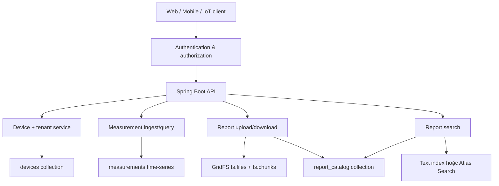
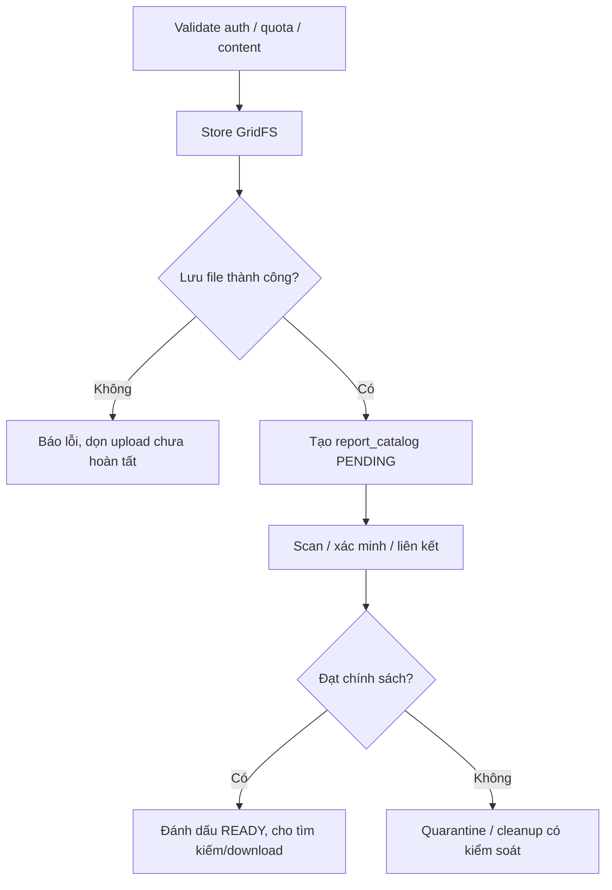

# Bài tập mở rộng: GridFS, time series, tìm kiếm và nhiều tenant

Đây là bài thực hành tổng hợp thuộc chương **Thực hành tổng hợp** của module **SPRING_DATA_MONGODB**. Thay vì viết bốn ví dụ rời rạc, người học sẽ xây dựng một phần backend cho nền tảng giám sát thiết bị: nhiều khách hàng sử dụng chung dịch vụ, thiết bị gửi số đo liên tục, kỹ thuật viên tải lên báo cáo hoặc hình ảnh, và người dùng có thể tìm kiếm tài liệu liên quan đến thiết bị của chính mình.

Bài tập kết hợp bốn năng lực:

1. **GridFS** để lưu và phục vụ file có metadata, kiểm soát quyền tải xuống.
2. **Time series** để lưu các số đo theo thời gian và chính sách lưu giữ.
3. **Tìm kiếm** với MongoDB text index hoặc Atlas Search tùy điều kiện triển khai.
4. **Multi-tenancy** để mọi truy vấn, upload, download và phân tích đều bị giới hạn theo tenant đã xác thực.

Học viên vận dụng `MongoTemplate`, repository, Java Driver khi cần tính năng collection đặc thù, index, aggregation, kiểm thử MongoDB thật và các phép đo hiệu năng. Không yêu cầu mọi dự án phải dùng GridFS, time-series collection hoặc Atlas Search: mục đích là hiểu khi nào chúng phù hợp, thiết kế ranh giới an toàn và chứng minh hành vi bằng test.

> **Phạm vi kỹ thuật:** Các ví dụ minh họa hướng tới Java 17+, Spring Boot 3.x, Spring Data MongoDB và MongoDB Server **7.0 trong môi trường test**. Time-series collection được MongoDB giới thiệu từ 5.0, nhưng một số khả năng index, update, transaction, retention và truy vấn phụ thuộc phiên bản. Trước khi triển khai, đối chiếu khả năng của **phiên bản MongoDB Server thực tế**; Atlas Search chỉ dùng được ở môi trường hỗ trợ dịch vụ đó. Ví dụ mã là các phần ghép có chú thích, không phải dự án build hoàn chỉnh.

## 1. Bối cảnh và yêu cầu nghiệp vụ

Một doanh nghiệp cung cấp dịch vụ theo dõi thiết bị lạnh cho nhiều khách hàng. Mỗi khách hàng là một **tenant**, có nhiều thiết bị. Hệ thống nhận nhiệt độ, độ ẩm theo thời gian; lưu các báo cáo kiểm tra PDF, hình ảnh bảo trì; và hỗ trợ tìm kiếm tên thiết bị, tiêu đề báo cáo hoặc thẻ chủ đề.

### 1.1. Các vai trò và API dự kiến

| Vai trò | Quyền | Ví dụ |
| --- | --- | --- |
| Người xem thuộc tenant | Đọc thiết bị, số đo và báo cáo trong tenant | Xem biểu đồ 24 giờ, tìm tài liệu |
| Kỹ thuật viên thuộc tenant | Đọc và tải lên báo cáo, gửi số đo được ủy quyền | Upload PDF bảo trì |
| Quản trị viên tenant | Quản lý thiết bị và chính sách trong tenant | Đăng ký sensor, xem mức sử dụng |
| Dịch vụ ingest | Ghi số đo của thiết bị được cấp quyền | Đẩy batch telemetry |

API tham khảo:

| Method và path | Tác vụ | Nguyên tắc bảo vệ |
| --- | --- | --- |
| `POST /api/devices/{id}/measurements` | Ghi một hoặc nhiều số đo | Kiểm tra thiết bị thuộc tenant, giới hạn batch |
| `GET /api/devices/{id}/measurements?from=&to=` | Đọc số đo trong khoảng | Giới hạn khoảng thời gian và số document |
| `POST /api/devices/{id}/reports` | Upload file | Xác thực quyền ghi, kích thước, loại file và quota |
| `GET /api/reports/{id}/content` | Download file | Kiểm tra tenant và quyền trước khi trả bytes |
| `GET /api/reports/search?q=&limit=` | Tìm tài liệu | Bind từ khóa, tenant filter, giới hạn kết quả |
| `GET /api/devices/{id}/temperature-summary` | Tổng hợp số đo | Tenant filter, aggregation theo khoảng thời gian |

**Không nhận `tenantId` từ query parameter hoặc request body để quyết định phạm vi bảo mật.** Tenant phải được lấy từ danh tính đã xác thực, sau khi kiểm tra thành viên/quyền tương ứng. Trong bài, `authenticatedTenantId` biểu thị giá trị đã được kiểm chứng ở tầng security.

### 1.2. Kiến trúc logic



GridFS quản lý **bytes** và metadata file; `report_catalog` lưu thông tin có thể tìm kiếm; time-series collection lưu số đo. Cách tách này giúp từng nhóm dữ liệu có vòng đời, index và cách truy cập riêng.

## 2. Thiết kế dữ liệu và hợp đồng ID

Ví dụ các document:

```javascript
// devices: catalog thiết bị; _id được coi là BSON ObjectId.
{
  _id: ObjectId("64b7f37a4e92b315c21d0abc"),
  tenantId: "tenant-A",
  serial: "FREEZER-007",
  displayName: "Tủ đông kho số 7",
  location: "Kho Bắc",
  active: true
}

// measurements: mỗi document là một sự kiện đo theo thời gian.
{
  measuredAt: ISODate("2026-01-20T10:00:00Z"),
  metadata: {
    tenantId: "tenant-A",
    deviceId: "64b7f37a4e92b315c21d0abc"
  },
  temperatureC: -17.8,
  humidityPercent: 53.2
}

// report_catalog: phần mô tả và liên kết tới GridFS.
{
  _id: ObjectId("64b7f37a4e92b315c21d0abd"),
  tenantId: "tenant-A",
  deviceId: "64b7f37a4e92b315c21d0abc",
  gridFsId: ObjectId("64b7f37a4e92b315c21d0abe"),
  title: "Kiểm tra máy nén tháng 1",
  description: "Áp suất và tình trạng máy nén",
  tags: ["maintenance", "compressor"],
  createdAt: ISODate("2026-01-20T10:05:00Z")
}
```

**Quy ước quan trọng:** Trong ví dụ, `devices._id` và `report_catalog._id` là BSON ObjectId, còn `measurements.metadata.deviceId` và `report_catalog.deviceId` là **String chứa biểu diễn hex** của ID thiết bị. Quy ước này phải được chuyển đổi tường minh ở boundary, không dựa vào việc MongoDB so sánh ObjectId với String như thể chúng bằng nhau. Một hệ thống khác có thể dùng cùng kiểu BSON ở tất cả nơi, nhưng phải nhất quán.

### 2.1. Index cơ bản

```javascript
// Mỗi serial chỉ duy nhất trong một tenant, không phải trên toàn hệ thống.
db.devices.createIndex(
  { tenantId: 1, serial: 1 },
  { unique: true }
);

// Liệt kê báo cáo theo thiết bị và thời gian.
db.report_catalog.createIndex(
  { tenantId: 1, deviceId: 1, createdAt: -1 }
);

// Liệt kê tất cả báo cáo của tenant theo thời gian.
db.report_catalog.createIndex(
  { tenantId: 1, createdAt: -1 }
);
```

Các index phải được đánh giá theo filter, sort, phân bố dữ liệu, khối lượng ghi và hạn chế của phiên bản server; không coi danh sách trên là cấu hình tối ưu tuyệt đối. Tenant ID là thành phần của **hợp đồng truy vấn**, không chỉ là một trường hiển thị.

## 3. Bài tập A — Lưu và tải báo cáo bằng GridFS

### 3.1. Khi nào dùng GridFS?

MongoDB có giới hạn kích thước BSON document là 16 MiB. GridFS chia nội dung file thành nhiều chunk và lưu metadata ở collection `fs.files` cùng dữ liệu chunk ở `fs.chunks` (hoặc tên bucket tùy chỉnh). GridFS phù hợp khi muốn lưu file lớn cùng hệ sinh thái MongoDB và quản lý download/metadata thông qua ứng dụng.

Nếu đã có object storage chuyên dụng, cần so sánh chi phí, hiệu năng streaming, khả năng phục vụ file và chính sách lưu trữ trước khi chọn GridFS. GridFS không tự cung cấp quét virus, phân quyền tenant, quota hoặc tìm kiếm toàn văn nội dung file.

### 3.2. Upload có tenant metadata

`GridFsTemplate` là API của Spring Data MongoDB dành cho GridFS. Ví dụ service tối giản:

```java
package example.capstone;

import java.io.InputStream;
import java.time.Instant;
import java.util.Date;
import org.bson.Document;
import org.bson.types.ObjectId;
import org.springframework.data.mongodb.gridfs.GridFsTemplate;
import org.springframework.stereotype.Service;

@Service
public class ReportFileService {
    private final GridFsTemplate gridFsTemplate;

    public ReportFileService(GridFsTemplate gridFsTemplate) {
        this.gridFsTemplate = gridFsTemplate;
    }

    public ObjectId store(
            String authenticatedTenantId,
            String authorizedDeviceId,
            InputStream content,
            String safeFilename,
            String verifiedContentType) {

        // Các kiểm tra bắt buộc thực hiện TRƯỚC lời gọi:
        // 1) tenant và device thuộc phạm vi caller;
        // 2) filename đã chuẩn hóa, content type đã xác minh;
        // 3) giới hạn bytes/quota và chính sách quét file đã áp dụng.
        Document metadata = new Document(
                "tenantId", authenticatedTenantId)
                .append("deviceId", authorizedDeviceId)
                .append("uploadedAt", Date.from(Instant.now()));

        return gridFsTemplate.store(
                content, safeFilename, verifiedContentType, metadata);
    }
}
```

Code trên **không tự kiểm tra kích thước hay quét virus**; đó là tiền điều kiện của bài tập, không phải tính năng sẵn có của `GridFsTemplate.store(...)`. Khi triển khai thật, giới hạn số byte **trong lúc đọc stream**, không chỉ kiểm tra header `Content-Length` do client cung cấp. Nếu quá giới hạn hoặc scan thất bại, phải đóng stream và có cơ chế xử lý file/chunk đã ghi dở theo chính sách cleanup.

Một bộ quy tắc upload ví dụ: tối đa 20 MiB mỗi file, chỉ chấp nhận PDF/PNG/JPEG sau khi kiểm tra signature phù hợp, làm sạch tên file để không phản chiếu đường dẫn nguy hiểm, giới hạn dung lượng theo tenant, scan và đánh dấu trạng thái trước khi công bố file. Các ngưỡng là **yêu cầu giả định của bài**, không phải giới hạn GridFS.

### 3.3. Download phải lọc tenant trước khi mở stream

Không nên chỉ gọi `findOne` theo `_id` rồi trả bytes cho mọi người đã đăng nhập. Trước khi đọc GridFS, kiểm tra tenant metadata:

```java
import com.mongodb.client.gridfs.model.GridFSFile;
import org.bson.types.ObjectId;
import org.springframework.data.mongodb.core.query.Criteria;
import org.springframework.data.mongodb.core.query.Query;
import org.springframework.data.mongodb.gridfs.GridFsResource;

public GridFsResource openForTenant(
        ObjectId fileId, String authenticatedTenantId) {
    Query scopedQuery = Query.query(
            Criteria.where("_id").is(fileId)
                    .and("metadata.tenantId").is(authenticatedTenantId));
    GridFSFile file = gridFsTemplate.findOne(scopedQuery);
    if (file == null) {
        throw new java.util.NoSuchElementException("Report not found");
    }
    return gridFsTemplate.getResource(file);
}
```

Đoạn này là phương thức bổ sung cho `ReportFileService` ở trên. Lớp controller còn phải kiểm tra người gọi có quyền xem **báo cáo/thiết bị cụ thể** (tenant là điều kiện tối thiểu, không phải toàn bộ authorization), rồi stream `GridFsResource` sang response và đóng `InputStream` đúng vòng đời HTTP. Không tải hết một file lớn vào `byte[]` chỉ để trả response.

Nếu API báo 404 cả khi file không tồn tại lẫn khi thuộc tenant khác, client không biết được file của tenant khác có tồn tại hay không. Không log toàn bộ file, credential hoặc metadata nhạy cảm khi xảy ra lỗi.

### 3.4. Metadata và tính nhất quán với catalog

Sau khi `store(...)` trả `ObjectId`, ứng dụng tạo document trong `report_catalog` có `gridFsId`, tiêu đề, mô tả và tag. File/chunk GridFS và catalog nằm ở nhiều document/collection, nên không giả định một thao tác upload có **transaction nguyên tử** bao trùm toàn bộ quy trình.

Thiết kế một workflow có trạng thái:



Khi thao tác catalog thất bại sau khi GridFS đã ghi, tạo bước **compensation** xóa file thuộc tenant với ID vừa nhận hoặc chạy job reconciliation tìm file không có catalog. Khi cleanup, chỉ xóa theo ID và tenant đã xác minh; nếu lỗi xảy ra ở giữa các bước, xử lý phải idempotent. Không dựa vào GridFS để cung cấp transactional guarantees ngoài những gì driver/server thực sự hỗ trợ.

**Yêu cầu hoàn thành bài A:** upload/download được PDF hoặc ảnh; khách hàng A không mở/xóa file của B; metadata có tenant/device; giới hạn file/quota có test; catalog và GridFS được đối soát khi lỗi.

## 4. Bài tập B — Lưu số đo trong time-series collection

Time-series collection được thiết kế cho chuỗi bản ghi theo thời gian với trường thời điểm và metadata nhóm chuỗi. Bài này dùng MongoDB để lưu telemetry của thiết bị thay vì tạo vô hạn document array bên trong một document thiết bị.

### 4.1. Tạo collection với timeField và metaField

Chạy **một lần** trong database test (ví dụ qua `mongosh` hoặc migration script được kiểm soát), trước khi có dữ liệu:

```javascript
db.createCollection("measurements", {
  timeseries: {
    timeField: "measuredAt",
    metaField: "metadata",
    granularity: "seconds"
  },
  expireAfterSeconds: 60 * 60 * 24 * 30
});
```

Trong thiết kế này:

- `measuredAt` phải là BSON Date thực; không lưu thời gian dưới String tùy ý.
- `metadata` chứa thông tin tương đối ổn định cho một chuỗi đo, như `tenantId` và `deviceId`. Không đưa giá trị nhiệt độ thay đổi liên tục vào metadata.
- `temperatureC` và `humidityPercent` là các giá trị đo; có thể bổ sung cờ chất lượng dữ liệu hoặc nguồn ghi.
- `expireAfterSeconds` minh họa thời hạn lưu **30 ngày**; dữ liệu được dọn bởi cơ chế TTL, không bảo đảm xóa chính xác ở thời điểm giây/mili-giây. Muốn lưu dài hạn cần thiết kế archival trước khi TTL xóa.

Không chạy `createCollection` lặp lại mỗi request. Nếu collection đã tồn tại với option khác, phải thiết kế migration và kiểm tra tương thích phiên bản; không coi lệnh create là cách cập nhật cấu hình collection.

### 4.2. Viết measurement qua MongoTemplate/Java Driver

Ví dụ dùng Java Driver collection lấy từ `MongoTemplate` để bảo đảm kiểu `Date` và kiểm soát BSON:

```java
package example.capstone;

import java.time.Instant;
import java.util.Date;
import org.bson.Document;
import org.springframework.data.mongodb.core.MongoTemplate;

public class MeasurementWriter {
    private final MongoTemplate template;

    public MeasurementWriter(MongoTemplate template) {
        this.template = template;
    }

    public void insert(
            String authenticatedTenantId,
            String authorizedDeviceId,
            Instant measuredAt,
            double temperatureC,
            double humidityPercent) {
        if (measuredAt == null
                || !Double.isFinite(temperatureC)
                || !Double.isFinite(humidityPercent)
                || humidityPercent < 0
                || humidityPercent > 100) {
            throw new IllegalArgumentException("Invalid measurement");
        }

        Document metadata = new Document(
                "tenantId", authenticatedTenantId)
                .append("deviceId", authorizedDeviceId);
        Document measurement = new Document(
                "measuredAt", Date.from(measuredAt))
                .append("metadata", metadata)
                .append("temperatureC", temperatureC)
                .append("humidityPercent", humidityPercent);

        template.getCollection("measurements").insertOne(measurement);
    }
}
```

Trong bài thực hành, **service gọi đoạn này phải xác minh** `authenticatedTenantId` và `authorizedDeviceId` được cấp từ trust boundary, kiểm tra quyền ghi số đo, mức nhiệt độ hợp lệ theo loại sensor, giới hạn timestamp tương lai/quá khứ và throughput của thiết bị. Không cho request gửi một object `metadata` tùy ý rồi chuyển thẳng vào document, vì client có thể giả tenant.

Với lưu lượng lớn, đánh giá `insertMany`/bulk write theo batch giới hạn, lỗi từng bản ghi, write concern và retry. Time-series collection có các hạn chế khác collection thường đối với update/delete/transaction theo phiên bản; thiết kế **append-only**, tránh dựa vào việc sửa tùy ý số đo cũ.

### 4.3. Truy vấn theo tenant, device và khoảng thời gian

```java
import java.time.Instant;
import java.util.Date;
import java.util.List;
import org.bson.Document;
import org.springframework.data.domain.Sort;
import org.springframework.data.mongodb.core.query.Criteria;
import org.springframework.data.mongodb.core.query.Query;

public List<Document> recentMeasurements(
        MongoTemplate template,
        String authenticatedTenantId,
        String authorizedDeviceId,
        Instant fromInclusive,
        Instant toExclusive) {
    if (fromInclusive == null || toExclusive == null
            || !fromInclusive.isBefore(toExclusive)) {
        throw new IllegalArgumentException("Invalid time range");
    }

    Query query = Query.query(new Criteria().andOperator(
            Criteria.where("metadata.tenantId")
                    .is(authenticatedTenantId),
            Criteria.where("metadata.deviceId").is(authorizedDeviceId),
            Criteria.where("measuredAt")
                    .gte(Date.from(fromInclusive))
                    .lt(Date.from(toExclusive))));

    query.with(Sort.by(Sort.Direction.DESC, "measuredAt"));
    query.limit(100);
    return template.find(query, Document.class, "measurements");
}
```

Ở API thật, **thêm giới hạn độ rộng khoảng thời gian** (ví dụ không quá 7 ngày cho endpoint danh sách), kiểm tra device thuộc tenant và phân trang khi có hơn 100 bản ghi. Một truy vấn dùng `limit` chưa chắc rẻ nếu filter/sort không hiệu quả; xem `explain("executionStats")` và khả năng dùng index trong phiên bản MongoDB đang triển khai.

### 4.4. Tính trung bình theo giờ

MongoDB aggregation có thể gom chuỗi thời gian thành các khoảng. Ví dụ yêu cầu nhiệt độ trung bình mỗi giờ trong một ngày:

```javascript
db.measurements.aggregate([
  {
    $match: {
      "metadata.tenantId": "tenant-A",
      "metadata.deviceId": "64b7f37a4e92b315c21d0abc",
      measuredAt: {
        $gte: ISODate("2026-01-20T00:00:00Z"),
        $lt: ISODate("2026-01-21T00:00:00Z")
      }
    }
  },
  {
    $group: {
      _id: {
        $dateTrunc: {
          date: "$measuredAt",
          unit: "hour",
          timezone: "UTC"
        }
      },
      avgTemperatureC: { $avg: "$temperatureC" },
      count: { $sum: 1 }
    }
  },
  { $sort: { _id: 1 } }
]);
```

Với Spring Data MongoDB, có thể xây pipeline tương đương bằng `Aggregation`, hoặc dùng stage/raw BSON do ứng dụng kiểm soát nếu phiên bản API chưa biểu đạt một operator cụ thể. Không nhận raw aggregation pipeline từ client. Đưa tenant filter vào `$match`; nếu có thêm `$lookup` tới collection khác, quyền truy cập của collection được join cũng phải được kiểm tra.

**Yêu cầu hoàn thành bài B:** tạo được time-series collection, chèn và đọc BSON Date đúng kiểu, lọc theo tenant/device/time, tổng hợp theo giờ, giải thích retention/TTL và giới hạn nguồn ingest.

## 5. Bài tập C — Tìm kiếm report catalog

### 5.1. Cách cơ bản: MongoDB text index

Với MongoDB thông thường, có thể dùng text index cho tiêu đề, mô tả và tag:

```javascript
db.report_catalog.createIndex(
  { title: "text", description: "text", tags: "text" },
  { name: "report_text_v1",
    weights: { title: 8, tags: 4, description: 1 } }
);
```

Chạy truy vấn kiểm tra:

```javascript
db.report_catalog.find(
  {
    tenantId: "tenant-A",
    $text: { $search: "compressor pressure" }
  },
  { title: 1, deviceId: 1, createdAt: 1,
    score: { $meta: "textScore" } }
).sort({ score: { $meta: "textScore" } }).limit(20);
```

Ở Spring Data, dùng `TextCriteria` và `TextQuery` để bind giá trị cần tìm kiếm mà không ghép JSON từ request:

```java
import java.util.List;
import org.springframework.data.mongodb.core.MongoTemplate;
import org.springframework.data.mongodb.core.query.Criteria;
import org.springframework.data.mongodb.core.query.TextCriteria;
import org.springframework.data.mongodb.core.query.TextQuery;

public List<ReportCatalog> searchCatalog(
        MongoTemplate template,
        String authenticatedTenantId,
        String validatedKeyword) {
    if (validatedKeyword == null
            || validatedKeyword.isBlank()
            || validatedKeyword.length() > 100) {
        throw new IllegalArgumentException("Invalid search");
    }
    TextCriteria words = TextCriteria.forDefaultLanguage()
            .matching(validatedKeyword);
    TextQuery query = TextQuery.queryText(words).sortByScore();
    query.addCriteria(
            Criteria.where("tenantId").is(authenticatedTenantId));
    query.limit(20);
    return template.find(query, ReportCatalog.class);
}
```

Ví dụ trên giả định entity `ReportCatalog` được ánh xạ tới collection `report_catalog`. Trong dự án thật, kiểm tra API `TextQuery` của phiên bản Spring Data đang dùng, quy tắc ngôn ngữ/stemming, stop words và kết quả so khớp trên dữ liệu thử.

### 5.2. Entity tối giản cho catalog

```java
package example.capstone;

import java.time.Instant;
import java.util.List;
import org.bson.types.ObjectId;
import org.springframework.data.annotation.Id;
import org.springframework.data.mongodb.core.mapping.Document;

@Document(collection = "report_catalog")
public record ReportCatalog(
        @Id ObjectId id,
        String tenantId,
        String deviceId,
        ObjectId gridFsId,
        String title,
        String description,
        List<String> tags,
        Instant createdAt
) {}
```

Sau khi tìm thấy catalog, **vẫn** kiểm tra quyền ở endpoint download GridFS; không coi một kết quả tìm kiếm là giấy phép truy cập bytes. Client không được gửi tên field, operator hoặc JSON query tự do; nếu hỗ trợ sắp xếp theo ngày hoặc score, dùng lựa chọn cố định và giới hạn số kết quả.

### 5.3. Mở rộng: Atlas Search

Khi ứng dụng cần autocomplete, fuzzy matching, highlight hoặc khả năng tìm kiếm nâng cao, Atlas Search có thể là phương án phù hợp nếu đang triển khai MongoDB Atlas có hỗ trợ. Khác với text index thông thường, Atlas Search yêu cầu tạo **search index riêng** có mapping thích hợp.

Ví dụ pipeline minh họa sau khi đã cấu hình search index tên `report-search-v1`, trong đó `tenantId` được index theo kiểu hỗ trợ `equals`:

```javascript
db.report_catalog.aggregate([
  {
    $search: {
      index: "report-search-v1",
      compound: {
        must: [
          { text: {
              query: "compressor",
              path: ["title", "description", "tags"]
          }}
        ],
        filter: [
          { equals: { path: "tenantId", value: "tenant-A" } }
        ]
      }
    }
  },
  { $limit: 20 },
  { $project: {
      tenantId: 1, deviceId: 1, gridFsId: 1,
      title: 1, createdAt: 1,
      score: { $meta: "searchScore" }
  }}
]);
```

Với Atlas Search, đặt **tenant filter trong `$search.compound.filter`** để thu hẹp phạm vi ngay trong search; cũng nên kiểm tra quyền tại tầng ứng dụng trước khi trả nội dung. Stage `$search` thường phải đứng đầu pipeline theo quy tắc của Atlas Search; cần đối chiếu phiên bản/dịch vụ khi dùng thêm stage đặc thù. Không gửi nguyên pipeline JSON từ client.

Text index và Atlas Search không có cùng semantics hay tính sẵn có. Atlas Search có thể cập nhật index theo cơ chế gần thời gian thực, nên test cần tính đến độ trễ index và không giả định bản ghi mới xuất hiện tức thời trong mọi trường hợp. Nếu không có Atlas, **bài C bắt buộc** dùng text index, còn Atlas Search là bài mở rộng tùy chọn.

**Yêu cầu hoàn thành bài C:** tìm theo từ khóa được validate, giới hạn kết quả, bảo toàn tenant scope và chứng minh không trả catalog tenant khác; mô tả trade-off giữa text index và Atlas Search.

## 6. Bài tập D — Multi-tenancy từ API tới database

Ứng dụng SaaS có thể chọn shared database/shared collections, database riêng mỗi tenant hoặc một cluster riêng mỗi tenant. Bài này chọn **shared collections với `tenantId` trong mỗi document** để người học buộc phải kiểm tra tenancy tại mọi thao tác.

| Mô hình | Ưu điểm | Rủi ro/chi phí |
| --- | --- | --- |
| Shared collection + tenantId | Vận hành, index, pooling tập trung | Dễ rò dữ liệu nếu quên tenant filter |
| Database riêng mỗi tenant | Ranh giới dữ liệu rõ hơn, cấu hình riêng | Nhiều database, migration/index phức tạp |
| Cluster riêng mỗi tenant | Cách ly tài nguyên/tenant mạnh | Chi phí và vận hành cao |

Trong mô hình shared collection, **tenantId không được xem là điều kiện filter tùy chọn**. Nó là thành phần bắt buộc của mọi truy vấn hoặc thao tác ghi.

### 6.1. Cách lấy tenant đáng tin cậy

```java
// Giả định authentication middleware đã xác minh token/identity.
String authenticatedTenantId =
        tenantContext.requireAuthorizedTenant();

// KHÔNG làm thế này:
// String authenticatedTenantId = request.getParameter("tenantId");
```

`tenantContext` là abstraction của ứng dụng, không phải một class có sẵn của Spring Data. Trong triển khai thực tế, thiết kế ánh xạ principal → tenant membership/role và kiểm tra quyền tại entry point. Với reactive WebFlux, truyền tenant qua Reactor/Security Context thích hợp; không phụ thuộc một `ThreadLocal` tùy tiện giữa các scheduler.

### 6.2. Repository luôn đi cùng tenant

Với domain thiết bị:

```java
package example.capstone;

import java.util.Optional;
import org.bson.types.ObjectId;
import org.springframework.data.mongodb.repository.MongoRepository;

public interface DeviceRepository
        extends MongoRepository<Device, ObjectId> {
    Optional<Device> findByIdAndTenantId(
            ObjectId id, String tenantId);
}
```

Ví dụ giả định entity `Device` khai báo `@Id ObjectId id` và field `tenantId` tương ứng. **Không** dùng `findById(id)` để quyết định quyền truy cập rồi trả nội dung luôn; truy vấn theo ID phải kết hợp tenant/owner authorization. Với thao tác ghi bằng `MongoTemplate`, đặt tenant vào query điều kiện:

```java
import org.springframework.data.mongodb.core.query.Criteria;
import org.springframework.data.mongodb.core.query.Query;
import org.springframework.data.mongodb.core.query.Update;

Query scoped = Query.query(new Criteria().andOperator(
        Criteria.where("_id").is(authorizedDeviceObjectId),
        Criteria.where("tenantId").is(authenticatedTenantId)));
Update changes = new Update().set("displayName", validatedDisplayName);
mongoTemplate.updateFirst(scoped, changes, "devices");
```

Biến `authorizedDeviceObjectId` đã được parse/validate; `validatedDisplayName` đã kiểm tra kiểu, độ dài và nội dung. Không nhận nguyên BSON update từ client, không cho sửa `tenantId` bằng filter/update tự do.

### 6.3. Kiểm soát tenant cho GridFS, time series và search

| Tài nguyên | Bắt buộc kiểm tra | Rủi ro điển hình |
| --- | --- | --- |
| `devices` | `tenantId` ở query và quyền thiết bị | Đọc/sửa ID của tenant khác |
| `measurements` | `metadata.tenantId` và device scope | Ghi giả tenant, truy vấn analytics xuyên tenant |
| `fs.files` | `metadata.tenantId` trước khi stream/delete | Download file chỉ theo GridFS ID |
| `report_catalog` | `tenantId` ở query/search | Lộ tiêu đề/metadata tenant khác |
| Aggregation/`$lookup` | Scope ở mọi nguồn dữ liệu liên quan | Join chéo tenant do khóa trùng |
| Cache/API/queue | Tenant trong key và message identity | Dữ liệu sai tenant dù MongoDB query đúng |

Khi dùng `$lookup` qua `deviceId` String, không quên tenant ID ở phía collection liên kết; cùng một `deviceId` hoặc logical key có thể xuất hiện ở nhiều tenant. Trong bài này, kiểm thử riêng một case cross-tenant với cùng từ khóa, cùng thiết bị giả lập và báo cáo giống nhau.

## 7. Tích hợp bốn bài thành một luồng nghiệp vụ

Một kỹ thuật viên thuộc tenant A nhận cảnh báo nhiệt độ cao và tải báo cáo bảo trì:

1. API xác thực kỹ thuật viên, lấy tenant A, xác nhận thiết bị thuộc tenant A.
2. Thiết bị gửi telemetry: service validate, ghi document time-series với `metadata.tenantId=A`.
3. Aggregation tính giá trị trung bình/đỉnh theo giờ, chỉ với tenant A và thiết bị được phép xem.
4. Kỹ thuật viên tải báo cáo; kiểm tra file, quota và policy trước khi lưu GridFS.
5. Tạo catalog gắn `gridFsId`, tenant, device, title và tags; hoàn tất scan rồi đánh dấu sẵn sàng.
6. Người xem tìm `compressor`, truy vấn catalog theo tenant A.
7. Khi download, server kiểm tra catalog và metadata GridFS cùng tenant/quyền thiết bị, rồi stream bytes.
8. Job reconciliation kiểm tra file orphan và catalog trỏ file không tồn tại.

Các bài tập nối liền nhau tại ranh giới: ID, tenant, lifecycle dữ liệu, error handling và giới hạn tài nguyên. Không nên “xây GridFS trước rồi bỏ mọi kiểm tra quyền đến cuối” vì như vậy test ban đầu dễ vô tình công bố file không thuộc tenant.

## 8. Kiểm thử với MongoDB thật

Mock repository không chứng minh được BSON mapping, GridFS chunk/file behavior, time-series options, search index hoặc cách MongoDB thực hiện filter. Dùng Testcontainers hoặc MongoDB service kiểm thử.

### 8.1. Testcontainers cho Spring Boot 3.x

Ví dụ phụ thuộc test trong nhánh Testcontainers Java 1.x: `spring-boot-starter-test`, `org.testcontainers:junit-jupiter`, `org.testcontainers:mongodb`. Dùng Spring Boot BOM/Testcontainers BOM tương thích; ở phiên bản mới hơn, kiểm tra lại artifact và package. Mẫu setup:

```java
import org.springframework.boot.test.context.SpringBootTest;
import org.springframework.test.context.DynamicPropertyRegistry;
import org.springframework.test.context.DynamicPropertySource;
import org.testcontainers.containers.MongoDBContainer;
import org.testcontainers.junit.jupiter.Container;
import org.testcontainers.junit.jupiter.Testcontainers;
import org.testcontainers.utility.DockerImageName;

@SpringBootTest
@Testcontainers
class CapstoneIntegrationTest {
    @Container
    static final MongoDBContainer MONGO =
            new MongoDBContainer(DockerImageName.parse("mongo:7.0"));

    @DynamicPropertySource
    static void mongoUri(DynamicPropertyRegistry registry) {
        registry.add("spring.data.mongodb.uri", MONGO::getReplicaSetUrl);
    }

    // @Autowired services, repositories, MongoTemplate, GridFsTemplate...
    // @BeforeEach tạo fixture/cleanup collection được test sở hữu.
}
```

Đây là khung test: project phải có Spring Boot application configuration trong package phù hợp và các bean ứng dụng. Với Spring Boot 3.1+, có thể dùng `@ServiceConnection` cùng `spring-boot-testcontainers` thay cho `@DynamicPropertySource`. Nếu dùng service CI thay container, cung cấp URI database test từ môi trường và không tạo container trong test.

**Quan trọng:** Time-series collection cần được tạo với options đúng trước khi insert. Một collection thường tên `measurements` đã tồn tại sẽ không tự biến thành time series chỉ vì thêm annotation lên entity. Trong test, kiểm tra `listCollections`/collection options sau khởi tạo; tạo collection test một lần theo fixture setup.

### 8.2. Ma trận tình huống bắt buộc

| Mã test | Tình huống | Kết quả mong đợi |
| --- | --- | --- |
| T01 | Upload report có tenant đúng | GridFS có file/chunk và metadata tenant |
| T02 | Tenant B download file của A | Không trả bytes; response theo chính sách 404/403 |
| T03 | Upload file vượt quota, sai loại | Từ chối; không công bố catalog/file dở |
| T04 | Catalog save lỗi sau GridFS store | Compensation hoặc reconciliation xử lý orphan |
| T05 | Insert measurement hợp lệ | BSON Date, metadata tenant/device chính xác |
| T06 | Measurement sai thời điểm/giá trị | Từ chối trước khi ghi |
| T07 | Query time range của tenant A | Chỉ số đo của A trong khoảng và limit |
| T08 | Tổng hợp theo giờ | Bucket và trung bình chính xác, UTC rõ ràng |
| T09 | Tìm từ khóa thông thường | Trả catalog tenant A, giới hạn 20 |
| T10 | Tenant B có cùng từ khóa | Không xuất hiện trong tìm kiếm của A |
| T11 | `sortBy`/query JSON bất thường | Bị chặn hoặc chỉ được coi là dữ liệu |
| T12 | Update thiết bị không thuộc tenant | Không document của B bị sửa |
| T13 | Chạy lại test và đảo thứ tự | Không phụ thuộc dữ liệu cũ |
| T14 | Cùng một report ID được tham chiếu | Không stream nếu thiếu catalog/không được cấp quyền |

Với test cross-tenant, seed tối thiểu hai tenant có **dữ liệu trông giống nhau**; nếu chỉ seed một tenant thì test không thể chứng minh truy vấn không rò chéo. Kiểm thử quyền ở cả controller/security layer lẫn service/query layer, vì một job nền hoặc entry point khác có thể gọi service.

### 8.3. Reactive là lựa chọn mở rộng

Nếu dự án sử dụng `ReactiveMongoTemplate` hoặc reactive repository, có thể chuyển phần truy vấn/ingest sang API reactive, nhưng phải **subscribe** để thao tác chạy. Dùng `StepVerifier` để xác nhận dữ liệu/complete/error/cancel:

```java
import reactor.test.StepVerifier;

StepVerifier.create(reactiveDeviceRepository
        .findByTenantId(authenticatedTenantId))
        .expectNextCount(1)
        .verifyComplete();
```

Đoạn minh họa giả định đã khai báo repository reactive và fixture có đúng một thiết bị trong tenant; project cần dependency `reactor-test`. Không gọi `subscribe()` thủ công trong service HTTP để “kích hoạt” write rồi trả thành công trước khi write hoàn tất. Chỉ chuyển sang reactive khi có mục tiêu tải/concurrency cụ thể và đủ năng lực quan sát lỗi, backpressure, pool và timeout.

## 9. Hiệu năng, index và quản trị tài nguyên

### 9.1. Đo nhiều tầng thay vì chỉ đo HTTP

| Phép đo | Lý do |
| --- | --- |
| HTTP p50/p95/p99 theo endpoint | Độ trễ người dùng cảm nhận |
| Driver command count/duration | Phát hiện N+1, `getMore` hoặc retry |
| CMAP pool checkout wait/failure | Tách nghẽn pool khỏi truy vấn chậm |
| `explain("executionStats")` | `totalDocsExamined`, `totalKeysExamined`, `nReturned` |
| Tổng BSON/result bytes | Kiểm soát payload time-series/catalog |
| GridFS upload/download throughput | Độ trễ streaming, áp lực mạng và I/O |
| MongoDB CPU/memory/disk/bytes network | Kiểm tra tải server và chi phí |
| Tenant quota/rate | Ngăn một tenant chiếm toàn bộ tài nguyên |

Đo thời gian từ API và thời gian MongoDB driver/server có phạm vi khác nhau; không suy rằng `executionTimeMillis` từ `explain` là HTTP p95. Với time-series, so sánh query có và không có khoảng thời gian; với search, đo trên số lượng catalog và phân bố keyword đại diện. Với GridFS, test streaming các file nhiều kích thước và cả hủy download giữa chừng.

### 9.2. Index cho time-series và search

Đề xuất index cần được đo trước khi duyệt:

```javascript
// Kiểm tra khả năng hỗ trợ index trên time-series của phiên bản đang chạy.
db.measurements.createIndex({
  "metadata.tenantId": 1,
  "metadata.deviceId": 1,
  measuredAt: -1
});
```

Các hạn chế index time-series thay đổi theo phiên bản/server; hãy xác nhận lệnh được hỗ trợ trong môi trường thực tế và chạy `explain` để thấy query planner lựa chọn ra sao. Text index cũng có chi phí cập nhật khi write catalog; Atlas Search có hệ thống indexing riêng. Không tạo index chỉ vì câu lệnh minh họa trông hợp lý.

### 9.3. Các lỗi vận hành cần có phương án xử lý

- **GridFS upload bị ngắt:** xác định file/chunk đã tồn tại chưa, xử lý file không hoàn tất và release quota theo chính sách.
- **File có metadata nhưng thiếu catalog:** reconciliation và tránh trả file chưa sẵn sàng.
- **Time-series nhận dữ liệu trễ:** xác định có cho phép timestamp cũ không, tính lại aggregation khi cần.
- **TTL retention:** monitor xóa không ngay lập tức; không dùng TTL làm cơ chế revoke tức thời.
- **Search không ra kết quả mới:** kiểm tra index, filter tenant, ngôn ngữ, và độ trễ cập nhật index.
- **Tenant tăng tải đột biến:** rate limit/quotas, pooling, batch size, dashboard theo tenant nhưng metric tags phải tránh cardinality không kiểm soát.
- **Query timeout:** phân biệt Reactor timeout, connection pool checkout, server selection và MongoDB server `maxTimeMS`.

## 10. Chọn thứ tự triển khai và sản phẩm bàn giao

Không cần làm mọi extension trong một lượt. Nên chia thành các mốc có thể đánh giá:

| Mốc | Nội dung | Bằng chứng bàn giao |
| --- | --- | --- |
| M0 — Khung bảo mật | Authentication/tenant context, device model, index | Hai tenant test, không đọc/sửa chéo |
| M1 — GridFS | Upload, metadata, download, quota và reconciliation | T01–T04 và endpoint smoke test |
| M2 — Time series | Create collection, ingest, query, aggregation, retention | T05–T08, kiểm BSON Date và explain |
| M3 — Search | Text index, query theo tenant, giới hạn result | T09–T11, test từ khóa trùng tenant |
| M4 — Tích hợp | Luồng technician → report → search → download | T12–T14, quan sát lỗi |
| M5 — Vận hành | Benchmark, dashboard, CI, rollback | Bảng p95/p99, rate, pool, checklist |

Sản phẩm học viên cần nộp:

1. Source code Spring Boot/Spring Data MongoDB với API và service theo yêu cầu, không hard-code tenant ID.
2. Script setup collection/index/fixture cho MongoDB test; có hướng dẫn MongoDB version và option cần thiết.
3. Integration tests chạy trên MongoDB thật; dữ liệu của ít nhất hai tenant.
4. Ví dụ request/response thành công và lỗi; chú thích cách phân quyền và cleanup.
5. Bảng performance baseline, `explain` cho ít nhất hai truy vấn, nhận xét trade-off.
6. Tài liệu lựa chọn GridFS/time-series/search/tenancy và giới hạn bảo mật/vận hành.

## 11. Tiêu chí chấm điểm gợi ý

| Hạng mục | Điểm tối đa | Căn cứ đánh giá |
| --- | ---: | --- |
| Mô hình dữ liệu và hợp đồng ID | 15 | BSON type rõ ràng, metadata, index, không nhầm String/ObjectId |
| GridFS và vòng đời file | 20 | Upload/download theo tenant, quota, stream, xử lý orphan |
| Time series | 20 | Collection đúng options, ingest, query theo thời gian, aggregation, retention |
| Tìm kiếm | 15 | Text index hoặc Atlas Search, bind đầu vào, tenant filter, phân trang |
| Multi-tenancy và bảo mật | 15 | Không rò chéo tenant trên mọi đường truy cập và thao tác ghi |
| Kiểm thử và hiệu năng | 15 | Tối thiểu các test trọng yếu, explain, latency/pool/byte, CI lặp lại được |
| **Tổng** | **100** | |

**Điều kiện bắt buộc:** Bất kỳ đường tải file, tìm kiếm, truy vấn time-series hoặc update nào cho phép truy cập chéo tenant đều chưa đạt, bất kể điểm tính năng. Không công bố file chưa qua kiểm soát loại file/giới hạn dung lượng chỉ vì upload thành công.

## 12. Câu hỏi mở rộng cho phần bảo vệ đồ án

1. Vì sao `GridFsTemplate.findOne` theo ID đơn thuần không đủ để bảo vệ file trong hệ thống nhiều tenant?
2. File đã lưu vào GridFS nhưng insert `report_catalog` thất bại: hệ thống sẽ phát hiện và xử lý ra sao khi job bị kill đúng thời điểm đó?
3. Tại sao `metadata.tenantId`/`metadata.deviceId` thích hợp làm time-series metaField hơn nhiệt độ hiện tại? Những giới hạn nào của time-series collection cần kiểm tra theo server version?
4. Khi aggregation trả 24 bucket giờ nhưng `docsExamined` là 2 triệu, đâu là các bước chẩn đoán trước khi chỉ tăng timeout?
5. Khi nào text index đủ dùng, khi nào cần Atlas Search? Atlas Search index update không tức thời ảnh hưởng test như thế nào?
6. Một tài khoản thuộc tenant A nhập `tenantId=B` vào request: vì sao hệ thống vẫn phải dùng tenant đã xác thực thay vì dữ liệu client gửi?
7. Một file tên `report.pdf` thực chất chứa mã thực thi: vì sao kiểm tra extension và MIME type do browser gửi chưa đủ?
8. Nếu cần đổi từ shared collections sang database-per-tenant, service, index, migration và cơ chế tạo `MongoTemplate` phải thay đổi ở đâu?
9. Nếu tiến trình reactive subscribe hai lần vào publisher cold lưu một báo cáo, những thao tác nào có thể bị lặp và làm sao thiết kế idempotency?
10. Nếu TTL xóa telemetry sau 30 ngày, khách hàng yêu cầu báo cáo lịch sử 1 năm thì nên thay đổi data lifecycle ra sao?

## 13. Tổng kết và tiêu chí hoàn thành

Bài mở rộng này thành công khi người học **không chỉ gọi đúng API MongoDB**, mà chứng minh được toàn bộ dữ liệu của một request được giới hạn theo tenant, dữ liệu được lưu đúng kiểu BSON, file có lifecycle an toàn, số đo được truy vấn theo thời gian và kết quả tìm kiếm không lộ tài liệu của tenant khác.

Người học phải giải thích được:

- GridFS lưu file theo chunk, cần kiểm tra cả tenant metadata và quyền nghiệp vụ trước khi tải xuống.
- Time-series collection có cấu trúc và retention đặc thù; dữ liệu đo nên được ghi append-only và giới hạn bằng tenant/device/time.
- Text search và Atlas Search có khả năng/điều kiện triển khai khác nhau, đều cần filter tenant cùng validation từ khóa.
- Multi-tenancy là một **invariant xuyên suốt**, không phải một tham số tùy chọn trên vài API.
- Test MongoDB thật, `explain("executionStats")`, command/pool metrics và benchmark có thể lặp lại là bằng chứng cho tính đúng và hiệu năng của thiết kế.

**Tiêu chí hoàn thành cuối cùng:** Có bốn nhóm chức năng chạy được trên MongoDB test, dữ liệu hai tenant độc lập, các test cross-tenant đều PASS, biết cách xử lý lỗi file/catalog, aggregation theo giờ đúng kết quả và có báo cáo đo hiệu năng với điều kiện thử được mô tả rõ ràng. Các tính năng tùy chọn như Atlas Search, reactive ingest và database-per-tenant được đánh giá theo giới hạn môi trường, không bắt buộc nếu hạ tầng không hỗ trợ.
