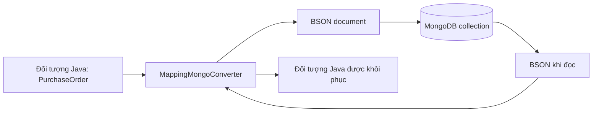

# Quy ước ánh xạ tên lớp và thuộc tính

> **Chương:** Ánh xạ cơ bản  
> **Module:** `SPRING_DATA_MONGODB` — sử dụng Spring Data MongoDB để kết nối, ánh xạ document và thao tác MongoDB qua `MongoTemplate` hoặc repository. Nắm vững tên collection và tên field là tiền đề để viết đúng truy vấn, aggregation, index, transaction, reactive access, kiểm thử và chẩn đoán hiệu năng.

## 1. Một đối tượng Java trở thành document MongoDB như thế nào?

Trong MongoDB, dữ liệu được lưu thành **document BSON** trong các **collection**. Trong Java, ta thường thao tác với một kiểu domain như `PurchaseOrder` có các thuộc tính `id`, `customerCode`, `createdAt`. Spring Data MongoDB dùng hệ thống mapping, chủ yếu qua `MappingMongoConverter` và metadata của entity, để chuyển qua lại giữa đối tượng Java và document BSON.

Ba câu hỏi cần trả lời khi đọc một class:

1. **Document thuộc collection nào?** Tên collection được suy ra từ tên class hoặc được khai báo bằng `@Document(collection = "...")`.
2. **Mỗi thuộc tính Java tương ứng field BSON nào?** Mặc định dùng tên thuộc tính Java; `@Field` cho phép khai báo tên khác.
3. **Thuộc tính nào là định danh?** `@Id` và một số quy ước đặt tên ánh xạ sang field đặc biệt `_id`.

Luồng ánh xạ:



Spring Data xử lý cả ánh xạ khi **ghi** lẫn khi **đọc**. Điều này không có nghĩa MongoDB biết tên getter, class hay package Java; những tên đó là quy ước mà tầng ứng dụng dùng để quyết định collection và field lưu trên server.

## 2. Quy ước ánh xạ tên lớp thành tên collection

### 2.1. Khi không chỉ định tên collection

Với domain class thông thường, Spring Data MongoDB mặc định lấy **tên đơn giản của class và chuyển chữ cái đầu thành chữ thường** làm tên collection.

| Tên class Java | Tên collection mặc định |
| --- | --- |
| `Person` | `person` |
| `Order` | `order` |
| `PurchaseOrder` | `purchaseOrder` |
| `CustomerProfile` | `customerProfile` |

Quy ước mặc định **không tự chuyển sang số nhiều** (`Order` không thành `orders`) và **không tự chuyển camelCase thành snake_case** (`PurchaseOrder` không thành `purchase_orders`). Tên collection trong MongoDB có phân biệt chữ hoa/chữ thường, vì vậy `order` và `Order` không phải luôn là cùng một collection.

Ví dụ:

```java
import org.springframework.data.mongodb.core.mapping.Document;

@Document
public class PurchaseOrder {
    // Các thuộc tính được lược bỏ để tập trung vào tên collection.
}
```

Nếu không cấu hình khác, domain trên được ánh xạ đến `purchaseOrder`. `@Document` giúp thể hiện ý định ánh xạ của domain class; trong nhiều trường hợp, cơ chế mapping cũng có thể nhận diện class được sử dụng qua `MongoTemplate` ngay cả khi không có annotation này. Với domain cần ổn định lâu dài, nên khai báo collection rõ ràng.

### 2.2. Khai báo tường minh bằng `@Document`

```java
@Document(collection = "purchase_orders")
public class PurchaseOrder {
    // ...
}
```

Từ đây, dù tên class là `PurchaseOrder`, MongoDB sẽ lưu document ở collection `purchase_orders` khi repository hoặc template dùng metadata của class.

**Tại sao nên đặt tên tường minh cho hệ thống production?** Giả sử team đổi tên class `PurchaseOrder` thành `OrderAggregate` nhưng vẫn giữ dữ liệu cũ. Nếu đang dùng tên collection suy ra từ class, ứng dụng có thể bất ngờ truy cập collection `orderAggregate` thay vì `purchaseOrder`. Khai báo `@Document(collection = "purchase_orders")` giúp giữ ranh giới dữ liệu ổn định qua các lần refactor tên class.

Annotation không tự đổi tên collection đang tồn tại và không di chuyển dữ liệu cũ: thay `collection` trên một class có thể khiến code bắt đầu đọc/ghi ở nơi khác. Nếu thực sự cần đổi tên collection, phải có kế hoạch migration và kiểm soát thời điểm chuyển đổi.

### 2.3. Class lồng nhau không mặc nhiên có collection riêng

Một thuộc tính là object hoặc danh sách object thường được ghi **nhúng** vào document cha:

```text
PurchaseOrder
├── id
├── customerCode
├── shippingAddress
│   ├── city
│   └── postalCode
└── lines[]
    ├── sku
    └── quantity
```

`ShippingAddress` và `OrderLine` trong ví dụ không trở thành hai collection chỉ vì chúng có tên class Java. Muốn lưu tham chiếu sang document độc lập cần thiết kế riêng, có thể dùng `@DocumentReference` hoặc `@DBRef` theo yêu cầu và phiên bản Spring Data. Reference không phải khóa ngoại có ràng buộc tự động như hệ quản trị quan hệ; phải cân nhắc vòng đời và tính nhất quán dữ liệu.

## 3. Quy ước ánh xạ tên thuộc tính thành BSON field

### 3.1. Không có `@Field`: giữ nguyên tên thuộc tính

Với các thuộc tính thông thường, tên field BSON mặc định trùng **tên property Java**:

| Java property | BSON field mặc định |
| --- | --- |
| `customerCode` | `customerCode` |
| `createdAt` | `createdAt` |
| `shippingAddress` | `shippingAddress` |
| `lines` | `lines` |
| `unitPriceVnd` | `unitPriceVnd` |

Spring Data MongoDB không tự áp dụng quy tắc đổi `customerCode` thành `customer_code` trừ khi bạn cấu hình chiến lược đặt tên khác hoặc dùng `@Field`. Việc viết query trong Mongo shell bằng sai tên field có thể dẫn tới kết quả rỗng mà không xuất hiện lỗi cú pháp.

### 3.2. Dùng `@Field` để đặt tên lưu trữ khác tên Java

```java
import org.springframework.data.mongodb.core.mapping.Field;

@Field("customer_code")
private String customerCode;

@Field("created_at")
private Instant createdAt;
```

Các annotation ở đây khai báo **tên field BSON**:

- Java vẫn truy cập `customerCode` và `createdAt`.
- MongoDB lưu dưới `customer_code` và `created_at`.
- Khi đọc BSON, `MappingMongoConverter` khôi phục các giá trị về đúng property Java.

`@Field` không đổi tên biến Java, không đổi tên collection và không tự tạo index. Trong Java code của repository/`Criteria`, nhìn chung bạn vẫn tham chiếu theo **đường dẫn property Java** để Spring Data áp dụng metadata mapping.

Một API REST có thể dùng `@JsonProperty("customerCode")` hoặc quy tắc Jackson khác cho JSON trả về. **Tên field trong HTTP JSON và tên field lưu trong MongoDB là hai hợp đồng độc lập**: `@JsonProperty` thuộc Jackson, `@Field` thuộc Spring Data MongoDB. Tương tự, `@Column` của JPA không phải công cụ đổi tên field MongoDB.

### 3.3. Quy ước cho định danh `_id`

Mỗi MongoDB document có field định danh `_id` và trong cùng collection giá trị này là duy nhất. Spring Data MongoDB có các quy tắc đặc biệt:

| Property Java | BSON field | Ghi chú |
| --- | --- | --- |
| `@Id String id` | `_id` | Cách khai báo rõ ràng, dễ đọc. |
| `@Id ObjectId id` | `_id` | Java dùng trực tiếp `org.bson.types.ObjectId`. |
| Property tên `id` mà không có `@Id` | Thường là `_id` | Quy ước tự nhận diện khi không có metadata xung đột. |
| Property tên `_id` mà không có `@Id` | `_id` | Có thể ánh xạ theo tên nhưng thường kém tự nhiên ở tầng Java. |

Với `@Id String id`, Spring Data có thể chuyển giá trị string biểu diễn ObjectId hợp lệ thành BSON ObjectId; nếu không thể chuyển, giá trị có thể được lưu dưới dạng BSON string. Ví dụ `"ORDER-001"` là ID string theo nghiệp vụ, còn chuỗi gồm 24 ký tự hex hợp lệ có thể được xử lý như ObjectId. Không nên trộn ngẫu nhiên hai kiểu BSON của `_id` trong một collection vì các bộ lọc truy vấn và migration sẽ phức tạp.

Khi muốn kiểm soát rõ kiểu và quy tắc chuyển đổi ID, tìm hiểu `@MongoId` và `FieldType` của phiên bản Spring Data MongoDB đang sử dụng; `@MongoId` có semantics chuyển đổi khác `@Id`. Việc đổi loại `_id` sau khi dữ liệu đã được lưu là một thay đổi schema đáng kể, không phải một refactor Java thông thường.

**Lưu ý:** `@Field("some_name")` không phải cách đổi tên field định danh `_id`. Với domain entity, dùng một thuộc tính ID rõ ràng và dựa trên quy tắc `@Id`/`@MongoId`.

## 4. Ví dụ hoàn chỉnh: class Java và document thực tế

Ví dụ dùng **Java record** (Java 17+) và một phiên bản Spring Data MongoDB hiện đại hỗ trợ ánh xạ record qua constructor. Đặt các kiểu dưới đây trong file `PurchaseOrder.java` cùng package; các record phụ không khai báo `public`.

```java
package demo.orders;

import java.time.Instant;
import java.util.List;
import org.springframework.data.annotation.Id;
import org.springframework.data.mongodb.core.mapping.Document;
import org.springframework.data.mongodb.core.mapping.Field;

@Document(collection = "purchase_orders")
public record PurchaseOrder(
    @Id String id,
    @Field("customer_code") String customerCode,
    @Field("created_at") Instant createdAt,
    ShippingAddress shippingAddress,
    List<OrderLine> lines
) {}

record ShippingAddress(
    String city,
    @Field("postal_code") String postalCode
) {}

record OrderLine(
    String sku,
    int quantity
) {}
```

Một đối tượng để ghi:

```java
PurchaseOrder order = new PurchaseOrder(
    "ORDER-001",
    "C-42",
    Instant.parse("2026-11-20T02:00:00Z"),
    new ShippingAddress("Ha Noi", "100000"),
    List.of(new OrderLine("BOOK-01", 2))
);

PurchaseOrder saved = orderRepository.save(order);
```

Giả sử `orderRepository` là bean `MongoRepository<PurchaseOrder, String>` đã cấu hình. ID `"ORDER-001"` không phải chuỗi ObjectId hợp lệ nên ví dụ lưu `_id` dưới dạng BSON string. Document có thể được biểu diễn dưới dạng **Extended JSON** để dễ đọc:

```json
{
  "_id": "ORDER-001",
  "customer_code": "C-42",
  "created_at": { "$date": "2026-11-20T02:00:00Z" },
  "shippingAddress": {
    "city": "Ha Noi",
    "postal_code": "100000"
  },
  "lines": [
    { "sku": "BOOK-01", "quantity": 2 }
  ],
  "_class": "demo.orders.PurchaseOrder"
}
```

`$date` là dạng biểu diễn của kiểu ngày giờ BSON trong Extended JSON, không có nghĩa giá trị trong MongoDB chỉ là một chuỗi JSON. Field `_class` ở cuối là **type hint** mà `MappingMongoConverter` mặc định có thể ghi cho document gốc; cấu hình type mapper khác có thể thay đổi hoặc loại bỏ nó. Không viết business logic dựa trên giả định mọi document đều có `_class`.

### 4.1. Bảng ánh xạ chính xác trong ví dụ

| Phần tử Java | Nơi lưu MongoDB | Lý do |
| --- | --- | --- |
| `PurchaseOrder` | Collection `purchase_orders` | `@Document(collection = "...")` |
| `id` | `_id` | `@Id` |
| `customerCode` | `customer_code` | `@Field("customer_code")` |
| `createdAt` | `created_at` | `@Field("created_at")` |
| `shippingAddress` | Object lồng nhau cùng tên | Không có `@Field` trên property cha |
| `shippingAddress.city` | `shippingAddress.city` | Giữ nguyên tên property |
| `shippingAddress.postalCode` | `shippingAddress.postal_code` | `@Field("postal_code")` trên record phụ |
| `lines` | Mảng document nhúng `lines` | Mapping collection/list |
| `lines[].quantity` | `lines[].quantity` | Giữ nguyên tên property |

Vì đã đặt collection tường minh, việc đổi class `PurchaseOrder` thành một tên Java khác **không bắt buộc** đổi collection. Tuy nhiên, nếu dùng type hint `_class` theo tên class Java đầy đủ, refactor package/class có thể ảnh hưởng việc đọc document cũ; cần lập kế hoạch tương thích hoặc dùng type alias thích hợp.

### 4.2. `_class` và `@TypeAlias` không phải tên collection

Một cách giảm phụ thuộc vào tên class đầy đủ trong BSON là dùng `@TypeAlias` (Spring Data Commons), ví dụ:

```java
import org.springframework.data.annotation.TypeAlias;
import org.springframework.data.mongodb.core.mapping.Document;

// Cấu hình thay thế: giữ nguyên các field của ví dụ phía trên.
@Document(collection = "purchase_orders")
@TypeAlias("purchase-order")
public class PurchaseOrder {
    // Khai báo các property theo mô hình domain của ứng dụng.
}
```

Khi ánh xạ type hint theo cấu hình mặc định và entity đã được `MappingContext` nhận diện, `_class` có thể chứa alias `"purchase-order"` thay cho tên package/class dài. `@TypeAlias` **không thay thế** `@Document(collection = "purchase_orders")` và không tạo collection mới. Nếu thay đổi alias sau khi dữ liệu đã được ghi, cần xử lý các type hint cũ; việc đọc type alias còn phụ thuộc entity được đăng ký/khám phá trong mapping context.

## 5. Repository và MongoTemplate dùng tên nào để truy vấn?

Điểm quan trọng là **tên trong mã Java** và **tên lưu trong MongoDB** thuộc hai tầng khác nhau.

### 5.1. Repository: đặt tên phương thức theo Java property

```java
import java.util.List;
import org.springframework.data.mongodb.repository.MongoRepository;

public interface PurchaseOrderRepository
        extends MongoRepository<PurchaseOrder, String> {

    List<PurchaseOrder> findByCustomerCodeOrderByCreatedAtDesc(
        String customerCode
    );
}
```

Spring Data phân tích `CustomerCode` và `CreatedAt` theo thuộc tính `PurchaseOrder`. Mỗi tên property được ánh xạ sang field BSON tương ứng, vì vậy truy vấn thực tế sử dụng `customer_code` và `created_at`. Không cần đổi tên phương thức thành `findByCustomer_code...`; cách viết đó có thể bị phân tích sai và gây lỗi tạo query.

### 5.2. `MongoTemplate` và `Criteria`: dùng property path Java

```java
import java.util.List;
import org.springframework.data.domain.Sort;
import org.springframework.data.mongodb.core.MongoTemplate;
import org.springframework.data.mongodb.core.query.Criteria;
import org.springframework.data.mongodb.core.query.Query;

Query query = Query.query(
    Criteria.where("customerCode").is("C-42")
);
query.with(Sort.by(Sort.Direction.DESC, "createdAt"));

List<PurchaseOrder> results =
    mongoTemplate.find(query, PurchaseOrder.class);

String collectionName =
    mongoTemplate.getCollectionName(PurchaseOrder.class);
// collectionName == "purchase_orders"
```

Với truy vấn có domain class, Spring Data có ngữ cảnh mapping và chuyển tên Java sang field BSON. Trường hợp nested:

```java
Query query = Query.query(
    Criteria.where("shippingAddress.postalCode").is("100000")
);

List<PurchaseOrder> results =
    mongoTemplate.find(query, PurchaseOrder.class);
```

Property path `shippingAddress.postalCode` được mapping tới BSON path `shippingAddress.postal_code`. Điều này hữu ích khi dùng thêm projection, sorting và aggregation có ngữ cảnh domain; cần kiểm tra các pipeline thô hoặc bước dùng tên field tùy biến vì không phải mọi API thấp hơn đều áp dụng mapping như nhau.

### 5.3. Mongo shell/driver thô: dùng tên field đã lưu

MongoDB server không hiểu Java property `customerCode`. Khi truy vấn trực tiếp bằng `mongosh`, dùng đúng tên BSON:

```javascript
db.purchase_orders.find({ customer_code: "C-42" })
  .sort({ created_at: -1 })

db.purchase_orders.find({
  "shippingAddress.postal_code": "100000"
})
```

Nếu dùng `MongoTemplate.getCollection("purchase_orders")` để lấy `MongoCollection<Document>` của Java Driver, câu lệnh driver trực tiếp cũng làm việc với **tên BSON thật** và thường không tự dịch `customerCode` thành `customer_code`. Ranh giới này đặc biệt quan trọng khi debug query, viết pipeline aggregation thô, tạo index bằng shell hoặc phân tích `explain("executionStats")`.

### 5.4. Nếu chủ động truyền tên collection cho template

Một số API của `MongoTemplate` cho phép truyền tên collection riêng, ví dụ:

```java
List<PurchaseOrder> archived =
    mongoTemplate.find(query, PurchaseOrder.class, "purchase_orders_archive");
```

Lúc này template dùng collection `purchase_orders_archive` do caller chỉ định thay vì tên mặc định từ `@Document`. Vì vậy khi sửa tên collection trong entity nhưng code vẫn truyền tên collection thủ công, kết quả có thể khác dự kiến. Kiểm tra cả annotation **và** nơi gọi template khi chẩn đoán dữ liệu thất lạc.

## 6. Không ánh xạ một số thuộc tính với `@Transient`

Đôi khi một thuộc tính chỉ phục vụ hiển thị hoặc được tính từ dữ liệu khác và **không nên lưu xuống MongoDB**:

```java
import org.springframework.data.annotation.Transient;

public class CustomerProfile {
    private String firstName;
    private String lastName;

    @Transient
    private String displayLabel;
}
```

`@Transient` ở đây là annotation thuộc **`org.springframework.data.annotation`**. Spring Data bỏ qua `displayLabel` khi persist và không khôi phục giá trị này từ BSON trong quá trình đọc, dù Java vẫn có property. Đừng phụ thuộc vào giá trị transient được tạo ở runtime sẽ còn nguyên sau khi tải lại document. Nếu cần, tính giá trị hiển thị từ `firstName` và `lastName` tại service/DTO.

Đối chiếu:

| Annotation | Tầng tác động |
| --- | --- |
| `@Field` | Tên hoặc đặc tính BSON field trong mapping MongoDB |
| `@Id` / `@MongoId` | Định danh MongoDB `_id` và quy tắc chuyển đổi liên quan |
| `@Transient` (Spring Data) | Bỏ qua property khi ánh xạ persistence |
| `@JsonProperty` / `@JsonIgnore` (Jackson) | Hợp đồng JSON ở API/serialization, không tự quyết định BSON field |
| `@Column` (JPA) | Mapping quan hệ JPA, không phải annotation ánh xạ MongoDB |

## 7. Chiến lược đặt tên thống nhất cho cả dự án

Nếu dự án muốn tất cả BSON field theo `snake_case` trong khi Java dùng `camelCase`, có hai hướng:

1. **Khai báo `@Field` tường minh** ở những property khác tên: dễ xem một class là biết ngay nơi lưu; cần nhiều annotation.
2. **Cấu hình `FieldNamingStrategy` trong `MongoMappingContext`** để thay đổi quy ước mặc định cho các field chưa có alias tường minh, chẳng hạn chiến lược chuyển camelCase thành snake_case. Cách này cần tích hợp đúng cơ chế cấu hình Spring Data của phiên bản ứng dụng và kiểm tra tác động đến mọi entity.

Không nên bật chiến lược đặt tên toàn cục trên cơ sở dữ liệu đã có dữ liệu rồi chỉ thay code Java: property `createdAt` trước đó lưu `createdAt` có thể bắt đầu được tra ở `created_at`. Điều này là **thay đổi schema lưu trữ**, cần migration, kiểm thử tương thích và chiến lược triển khai.

Một quy ước thực tế có thể là:

- Collection đặt tên rõ ràng ở `@Document(collection = "...")`, ví dụ `purchase_orders`.
- Java property đặt theo camelCase dễ đọc, ví dụ `customerCode`.
- Tên BSON khác Java thì khai báo `@Field("customer_code")` và tránh rải string BSON trong business code.
- Các thao tác bằng repository/`MongoTemplate` dùng Java property; query và index bằng Mongo shell dùng tên BSON.
- Tên class và tên collection được quản lý độc lập để refactor Java không vô tình chuyển dữ liệu sang collection mới.

### Dấu chấm và ký tự đặc biệt trong tên field

MongoDB có quy tắc riêng đối với các tên field chứa dấu chấm (`.`) hoặc bắt đầu bằng ký tự `$`. Trong Spring Data, dấu chấm trong field path thường biểu diễn **đường dẫn thuộc tính lồng nhau**. Một số phiên bản hỗ trợ cấu hình cách coi tên có dấu chấm là khóa literal khi dùng `@Field`, nhưng không nên đưa kiểu tên khó truy vấn này vào ví dụ cơ bản. Với hệ thống mới, ưu tiên tên field rõ ràng, tránh ký tự đặc biệt nếu không có yêu cầu nghiệp vụ cụ thể.

## 8. Thay đổi tên sau khi đã có dữ liệu: những rủi ro thực tế

### 8.1. Đổi tên Java property nhưng giữ nguyên BSON field

Giả sử class ban đầu có `customerCode` lưu mặc định thành `customerCode`. Khi refactor thành `buyerCode` mà không có annotation, Spring Data sẽ bắt đầu tìm field `buyerCode`; document cũ chỉ có `customerCode` và giá trị mới có thể là `null` khi đọc.

Có thể giữ tương thích lưu trữ bằng cách:

```java
@Field("customerCode")
private String buyerCode;
```

Ở đây đổi tên Java thành `buyerCode`, nhưng field BSON tiếp tục là `customerCode`. Nếu muốn **đổi cả tên lưu trữ** thành `buyer_code`, cần thực hiện migration và phối hợp các phiên bản ứng dụng trong thời gian chuyển tiếp.

### 8.2. Đổi tên class làm thay đổi collection hoặc type hint

- Nếu dùng tên collection mặc định, đổi `PurchaseOrder` thành `SalesOrder` có thể chuyển target từ `purchaseOrder` sang `salesOrder`.
- Nếu dùng `@Document(collection = "purchase_orders")`, target collection giữ nguyên, nhưng `_class` mặc định có thể vẫn lưu tên class/package cũ trong document trước đây.
- Nếu dùng `@TypeAlias`, cần duy trì hoặc chuyển đổi alias nhất quán và bảo đảm mapping context nhận diện đúng loại.

Vì vậy, **đổi tên trong IDE không tương đương migration schema**. Nên chạy integration test đọc document cũ trước khi triển khai rộng.

### 8.3. Trường vắng mặt, `null` và dữ liệu cũ

MongoDB cho phép các document cùng collection có field khác nhau. Nếu ứng dụng mới thêm một Java property, document cũ có thể không có field tương ứng. Giá trị khi đọc sẽ phụ thuộc kiểu Java, constructor, mapping/converter và giá trị mặc định. Với kiểu primitive như `int`, phải chú ý thiếu field và giá trị mặc định `0`; với kiểu tham chiếu, thường có thể nhận `null`.

Không nên xem `null`, field vắng mặt và chuỗi rỗng luôn tương đương nhau khi lập query. Khi schema thay đổi, xác định cách cung cấp giá trị mặc định, validation và migration dữ liệu để đảm bảo quy tắc nghiệp vụ.

### 8.4. Index, aggregation và schema validation cũng dùng tên field BSON

Giả sử repository truy vấn theo `customerCode` nhưng BSON đang lưu `customer_code`. Index viết trực tiếp bằng Mongo shell phải dùng:

```javascript
db.purchase_orders.createIndex({
  customer_code: 1,
  created_at: -1
})
```

Không tạo `{ customerCode: 1 }` theo tên Java nếu trong database không có field đó. Với index annotation trên entity, Spring Data có thể sử dụng mapping metadata để tính tên field, nhưng **annotation không bảo đảm index đã tồn tại**: chính sách tự tạo index phụ thuộc cấu hình và phiên bản. Trong production, cần xác nhận index trên server và kế hoạch triển khai/migration.

## 9. Cách kiểm tra ánh xạ đang hoạt động đúng

Chạy trên một MongoDB dành cho phát triển hoặc test, có dependency Spring Data MongoDB và kết nối hợp lệ.

**Bước 1: xác minh tên collection do Spring Data tính.**

```java
String actualName = mongoTemplate.getCollectionName(PurchaseOrder.class);
// Kỳ vọng: "purchase_orders"
```

**Bước 2: lưu một object với dữ liệu phân biệt được tên Java và BSON.** Dùng ví dụ `PurchaseOrder` ở mục 4 hoặc một repository tương đương.

**Bước 3: xem raw document bằng Mongo shell.**

```javascript
db.purchase_orders.findOne({ _id: "ORDER-001" })
```

Xác nhận field `customer_code`, `created_at`, `shippingAddress.postal_code` xuất hiện, còn `customerCode` và `createdAt` **không phải** field lưu trữ của ví dụ trên.

**Bước 4: so sánh query Java với query BSON.**

```java
// Spring Data: property Java, được ánh xạ.
Criteria.where("customerCode").is("C-42");
```

```javascript
// mongosh: field BSON thực tế.
db.purchase_orders.find({ customer_code: "C-42" })
```

**Bước 5: bổ sung integration test.** Khi có cơ sở dữ liệu test riêng, kiểm tra `mongoTemplate.getCollectionName(PurchaseOrder.class)`, nội dung BSON đọc bằng driver thô, khả năng đọc lại entity và truy vấn theo property Java. Nếu dùng `@DataMongoTest` hoặc Testcontainers, bảo đảm môi trường khởi tạo đúng phiên bản Spring Boot và không kết nối nhầm database production.

### Checklist chẩn đoán khi truy vấn trả về rỗng

| Triệu chứng | Điều cần kiểm tra |
| --- | --- |
| Repository không tìm thấy document nhưng shell có dữ liệu | Tên collection suy ra/`@Document` và database kết nối. |
| `Criteria.where("customerCode")` không khớp | Property Java có đúng tên và có `@Field` tương ứng không? |
| Shell query theo `customerCode` không ra kết quả | Tên BSON đang là `customer_code` hay field nào khác? |
| Truy vấn lồng nhau sai | Kiểm tra `shippingAddress.postal_code` thay vì `shippingAddress.postalCode` trong shell. |
| Sau refactor class thì thấy collection mới trống | Tên collection mặc định đã thay đổi? |
| Sau refactor field thì dữ liệu cũ bị `null` | Dữ liệu cũ vẫn dùng tên BSON cũ; cần alias hoặc migration. |
| Chỉ một số document deserialize lỗi | Có type hint `_class` cũ, thiếu field bắt buộc, type khác hoặc converter không tương thích? |

Khi phân tích vấn đề hiệu năng bằng `explain("executionStats")` hoặc thiết kế aggregation/index, trước hết phải nắm tên field **thực sự lưu trên MongoDB**. Có mapping sai, việc bổ sung index theo tên Java sẽ không giải quyết đúng vấn đề.

## 10. Câu hỏi và bài thực hành

### Câu hỏi tự kiểm tra

1. Vì sao class `PurchaseOrder` mặc định đi đến collection `purchaseOrder` thay vì `purchase_orders`?
2. Nếu đã có collection `customerProfile`, việc đổi tên class `CustomerProfile` thành `ClientProfile` mà không đặt `@Document(collection = "...")` gây điều gì?
3. `@Field("customer_code")` thay đổi tên nào: tên biến Java, tên JSON API, tên BSON hay tên collection?
4. Khi repository có `findByCustomerCode`, bạn nên dùng `customerCode` hay `customer_code` trong tên phương thức? Khi dùng `mongosh` thì sao?
5. `@Id String id` khác field thông thường ở chỗ nào? Vì sao cần kiểm soát BSON type của `_id`?
6. Vì sao `shippingAddress.postalCode` trong `Criteria` tương ứng `shippingAddress.postal_code` trong Mongo shell?
7. `@TypeAlias` và `@Document(collection = ...)` giải quyết hai nhu cầu khác nhau như thế nào?

### Bài thực hành nhỏ

Tạo class `ProductCatalogItem` gồm `id`, `productCode`, `displayName`, `priceVnd` và một object `dimensions` có `widthCm`, `heightCm`. Yêu cầu:

1. Lưu trong collection `product_catalog`, giữ nguyên tên Java nhưng BSON dùng `product_code` và `price_vnd`; các field khác để theo quy ước mặc định.
2. Sử dụng `@Id` cho định danh và `@Field` cho hai alias.
3. Viết repository `findByProductCode` và một truy vấn `MongoTemplate` theo `productCode`.
4. Ghi một document, dùng `mongosh` kiểm tra đúng field BSON; ghi lại tên collection thực tế từ `getCollectionName`.
5. Giải thích thay đổi cần thiết nếu muốn đổi `displayName` thành `name` trong Java nhưng vẫn giữ nguyên field BSON `displayName` cho dữ liệu đã lưu.

**Kết quả mong đợi:** một class Java có tên độc lập với collection; các property Java có thể giữ tên khác với field MongoDB một cách chủ ý; code dùng mapping context truy vấn theo property Java, còn truy vấn thô và index dùng tên field BSON.

## 11. Ghi nhớ

- **Tên collection mặc định** thường là tên class với chữ cái đầu viết thường; không tự thêm `s` hoặc đổi sang `snake_case`.
- **`@Document(collection = "...")`** cố định tên collection để giảm rủi ro khi refactor tên class.
- **Tên field mặc định** giống Java property; **`@Field("...")`** cho phép dùng tên BSON khác.
- **`@Id`** ánh xạ định danh sang `_id`; chú ý quy tắc chuyển đổi String/ObjectId.
- **Object lồng nhau** mặc định được nhúng, không tự sinh collection hoặc khóa ngoại riêng.
- **Repository và `MongoTemplate`** dùng property Java để ánh xạ; **mongosh/driver thô** làm việc với tên BSON đã lưu.
- **Đổi tên class, property hoặc chiến lược đặt tên** có thể là thay đổi schema thật, cần kiểm thử và migration khi đã có dữ liệu.

Tài liệu tham khảo để đối chiếu API với phiên bản đang dùng: [Spring Data MongoDB Reference](https://docs.spring.io/spring-data/mongodb/reference/), đặc biệt các phần **Object Mapping**, **Mapping Annotation Overview** và **MongoTemplate**.
