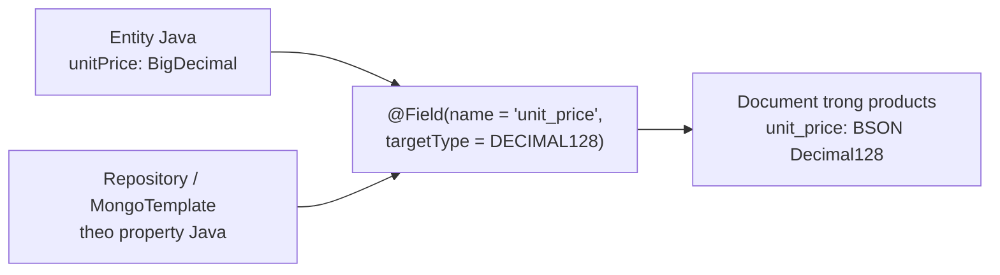

# Đổi tên trường bằng @Field và cấu hình kiểu BSON đích

## 1. Mục tiêu bài học

Trong **Spring Data MongoDB**, entity Java là biểu diễn trong chương trình của một document BSON trong MongoDB. Tên property Java và tên trường lưu trong MongoDB **có thể khác nhau**; kiểu Java cũng không nhất thiết tương ứng một-một với kiểu BSON. Annotation `@Field` giúp mô tả cả hai quyết định:

- **Đổi tên field lưu trữ**: ví dụ property Java `displayName` được ghi vào field BSON `display_name`.
- **Chỉ định kiểu BSON đích**: ví dụ property Java `BigDecimal unitPrice` được ghi dưới dạng BSON **Decimal128** thay vì dựa hoàn toàn vào mặc định của converter.

Hai việc này quan trọng khi truy vấn bằng repository hoặc `MongoTemplate`, xây index, thực hiện aggregation, kiểm thử schema và chẩn đoán lỗi dữ liệu.

Sau bài này, bạn có thể đọc một entity có `@Field`, dự đoán document được lưu, dùng đúng tên trường khi truy vấn và nhận diện rủi ro khi đổi tên hoặc đổi kiểu BSON trên collection đã có dữ liệu.

## 2. Phân biệt ba lớp: property Java, field MongoDB và kiểu BSON

Xét một sản phẩm có mã `BOOK-101`, tên hiển thị và giá 199,90:

| Ở phía Java | Tên field trong MongoDB | Kiểu BSON mong muốn | Vai trò |
| --- | --- | --- | --- |
| `id`, kiểu `String`, có `@Id` | `_id` | Thường là `ObjectId` nếu ID được sinh theo cơ chế mặc định | Định danh document |
| `sku`, kiểu `String` | `sku` | String | Mã sản phẩm |
| `displayName`, kiểu `String` | `display_name` | String | Tên dùng trên giao diện |
| `unitPrice`, kiểu `BigDecimal` | `unit_price` | Decimal128 | Giá cần biểu diễn theo hệ thập phân |
| `createdAt`, kiểu `Instant` | `created_at` | Date | Thời điểm tạo |
| `supplier.displayName` | `supplier.display_name` | String | Tên nhà cung cấp được nhúng |

Trong ví dụ này:

1. **Tên property Java** dùng trong mã nguồn, như `unitPrice`.
2. **Tên field MongoDB** xuất hiện trong document BSON và các lệnh viết trực tiếp bằng `mongosh`, như `unit_price`.
3. **Kiểu BSON** xác định cách dữ liệu được lưu và so sánh trong MongoDB, chẳng hạn Decimal128 khác String hoặc Double.



Lưu ý: `@Field` là thông tin **ánh xạ giữa hai bên**. Nó không tự sửa dữ liệu đang có trong database và không tự tạo index hay ràng buộc schema.

## 3. `@Field` đổi tên trường như thế nào?

Mặc định, khi không có quy tắc đặt tên tùy chỉnh, Spring Data MongoDB thường lưu một property bằng tên của chính property đó:

```java
private String displayName;
```

Document sẽ có field `displayName`. Nếu muốn đặt tên field trong BSON theo kiểu snake_case, dùng `@Field`:

```java
import org.springframework.data.mongodb.core.mapping.Field;

@Field("display_name")
private String displayName;
```

Khi ghi document, giá trị từ `displayName` được lưu ở `display_name`; khi đọc document, converter đưa giá trị từ `display_name` về `displayName`.

Các dạng cú pháp thường gặp:

```java
@Field("display_name")
private String displayName;

@Field(name = "created_at")
private Instant createdAt;
```

`value`/giá trị ngắn và `name` được dùng để chỉ định **tên trường lưu trữ**; ở một property, chỉ cần chọn một cách khai báo. Đặt tên rõ ràng giúp schema MongoDB ít phụ thuộc việc tái cấu trúc tên property Java, nhưng đổi tên trong BSON vẫn là thay đổi schema và cần được quản lý cẩn thận.

### Trường hợp không cần `@Field`

```java
private String sku;
```

Nếu mong muốn tên field BSON cũng là `sku`, không cần chú thích riêng. Chỉ thêm `@Field` khi có ý đồ ánh xạ hoặc cần chỉ định kiểu BSON đích. Việc khai báo tràn lan làm mã dài hơn mà ít thêm thông tin.

### `@Id` và trường `_id`

`_id` là trường định danh đặc biệt của MongoDB. Với Spring Data MongoDB, dùng `@Id` hoặc cấu hình ID phù hợp để ánh xạ property định danh:

```java
import org.springframework.data.annotation.Id;

@Id
private String id;
```

Không nên coi `@Field("_id")` là cách thay thế cho thiết kế định danh. `@Id` có các quy tắc ánh xạ và chuyển đổi riêng; với kiểu `String`, giá trị có thể được chuyển thành BSON ObjectId khi thích hợp. Nếu cần kiểm soát chính xác cách lưu kiểu ID, Spring Data còn có `@MongoId`, nhưng chủ đề đó tách biệt với đổi tên field thông thường.

## 4. Ví dụ entity đầy đủ: tên lưu trữ và Decimal128

Giả sử ứng dụng quản lý danh mục sản phẩm có collection `products`. Ta dùng các annotation của Spring Data MongoDB:

```java
package com.example.catalog;

import java.math.BigDecimal;
import java.time.Instant;
import org.springframework.data.annotation.Id;
import org.springframework.data.mongodb.core.mapping.Document;
import org.springframework.data.mongodb.core.mapping.Field;
import org.springframework.data.mongodb.core.mapping.FieldType;

@Document(collection = "products")
public class Product {

    @Id
    private String id;

    private String sku;

    @Field("display_name")
    private String displayName;

    @Field(name = "unit_price", targetType = FieldType.DECIMAL128)
    private BigDecimal unitPrice;

    @Field("created_at")
    private Instant createdAt;

    protected Product() {
        // Hỗ trợ cơ chế khởi tạo đối tượng khi mapping.
    }

    public Product(String sku, String displayName,
                   BigDecimal unitPrice, Instant createdAt) {
        this.sku = sku;
        this.displayName = displayName;
        this.unitPrice = unitPrice;
        this.createdAt = createdAt;
    }

    public String getId() {
        return id;
    }

    public String getSku() {
        return sku;
    }

    public String getDisplayName() {
        return displayName;
    }

    public BigDecimal getUnitPrice() {
        return unitPrice;
    }

    public Instant getCreatedAt() {
        return createdAt;
    }
}
```

Khi lưu một `Product` mới, document BSON có thể được quan sát bằng `mongosh` ở dạng gần như sau:

```javascript
{
  _id: ObjectId("507f1f77bcf86cd799439011"),
  sku: "BOOK-101",
  display_name: "Nhập môn Spring Data MongoDB",
  unit_price: NumberDecimal("199.90"),
  created_at: ISODate("2026-11-20T03:00:00Z")
}
```

Đây là biểu diễn có thể đọc được trong `mongosh`: `NumberDecimal("199.90")` biểu thị **BSON Decimal128** và `ISODate(...)` biểu thị **BSON Date**. Không phải mọi công cụ quản lý MongoDB đều hiển thị BSON giống nhau. Giá trị `_id` và thời gian ở trên chỉ nhằm minh họa.

| Annotation / property | Kết quả |
| --- | --- |
| `@Document(collection = "products")` | Chọn collection `products` |
| `@Id` trên `id` | Ánh xạ đến `_id` |
| Không có `@Field` trên `sku` | Lưu với tên `sku` |
| `@Field("display_name")` | Đổi tên field lưu trữ |
| `@Field(name = "unit_price", targetType = FieldType.DECIMAL128)` | Vừa đổi tên field, vừa yêu cầu kiểu BSON Decimal128 |
| `@Field("created_at")` trên `Instant` | Đổi tên field; kiểu ngày giờ được xử lý theo cơ chế converter thích hợp |

Thành phần `@Field("created_at")` **không có nghĩa** annotation tự chọn thời gian theo múi giờ nào. `Instant` biểu diễn một thời điểm; BSON Date lưu giá trị thời gian, thường được diễn giải qua UTC, còn việc hiển thị theo múi giờ là trách nhiệm riêng của ứng dụng.

## 5. Vì sao cần `targetType` cho `BigDecimal`?

### Sự khác nhau giữa `BigDecimal` và kiểu BSON

`BigDecimal` của Java biểu diễn số thập phân với độ chính xác tùy ý theo thiết kế của lớp Java; MongoDB cung cấp kiểu BSON **Decimal128**, có giới hạn độ chính xác và phạm vi giá trị theo chuẩn decimal128. Hai kiểu có liên hệ nhưng không hoàn toàn giống nhau.

Nếu không yêu cầu kiểu BSON cụ thể, Spring Data MongoDB có thể áp dụng cách ánh xạ mặc định của converter; trong các cấu hình phổ biến, `BigDecimal` có thể được lưu thành **String** để giữ biểu diễn thập phân. Khi dữ liệu dùng cho truy vấn so sánh số, tính tổng hoặc sắp xếp theo giá, String không tương đương Decimal128.

Ví dụ hai giá:

| Giá trị | Lưu dạng String | Lưu dạng Decimal128 |
| --- | --- | --- |
| 20.00 | `"20.00"` | `NumberDecimal("20.00")` |
| 100.00 | `"100.00"` | `NumberDecimal("100.00")` |

So sánh **chuỗi** theo thứ tự từ điển có thể cho kết quả khác so sánh **số**. Đồng thời, MongoDB xử lý truy vấn so sánh phụ thuộc vào kiểu BSON của giá trị lưu và giá trị truy vấn. Vì vậy, phải thống nhất kiểu lưu trữ ngay từ đầu thay vì mặc định rằng Java `BigDecimal` luôn tạo BSON Decimal128.

### Khai báo chính xác kiểu BSON đích

```java
import java.math.BigDecimal;
import org.springframework.data.mongodb.core.mapping.Field;
import org.springframework.data.mongodb.core.mapping.FieldType;

@Field(name = "unit_price", targetType = FieldType.DECIMAL128)
private BigDecimal unitPrice;
```

Trong annotation này:

- `name = "unit_price"` quyết định **tên field BSON**.
- `targetType = FieldType.DECIMAL128` yêu cầu converter xử lý dữ liệu tương ứng như **BSON Decimal128** khi lưu.
- `BigDecimal` vẫn là **kiểu của property Java** mà nghiệp vụ sử dụng.

Đây là hai quyết định độc lập; có thể chỉ đổi tên:

```java
@Field("display_name")
private String displayName;
```

Hoặc chỉ định kiểu BSON mà giữ nguyên tên property:

```java
@Field(targetType = FieldType.DECIMAL128)
private BigDecimal price;
```

Trường hợp thứ hai lưu ở field `price` với kiểu BSON Decimal128.

**Giới hạn cần quan tâm:** Decimal128 không biểu diễn được mọi `BigDecimal` tùy ý. Nếu giá trị vượt khả năng biểu diễn hoặc cần chính sách làm tròn khác, thao tác chuyển đổi có thể thất bại hoặc cần xử lý rõ ràng. Với dữ liệu tiền tệ, còn phải xác định đơn vị tiền, số chữ số thập phân, cách làm tròn và kiểm tra hợp lệ đầu vào; `targetType` không thay thế quy tắc nghiệp vụ đó.

### Khi nào nên chọn Decimal128?

Decimal128 phù hợp khi hệ thống muốn **MongoDB thực hiện phép so sánh, lọc theo khoảng hoặc aggregation số thập phân** với giá trị thực sự được lưu ở kiểu decimal. Một lựa chọn khác cho tiền tệ là số nguyên theo đơn vị nhỏ nhất, chẳng hạn `Long priceMinor`; lựa chọn phù hợp phụ thuộc đơn vị tiền tệ và quy tắc tính toán. Không có kiểu nào tự đảm bảo mọi phép tính tiền đều đúng khi chưa có chính sách độ chính xác và làm tròn.

## 6. Ghi và kiểm tra kiểu BSON thực tế

Với Spring Data repository:

```java
package com.example.catalog;

import java.util.List;
import java.util.Optional;
import org.springframework.data.mongodb.repository.MongoRepository;

public interface ProductRepository extends MongoRepository<Product, String> {

    Optional<Product> findBySku(String sku);

    List<Product> findByDisplayName(String displayName);
}
```

Một đoạn mã sử dụng repository:

```java
import java.math.BigDecimal;
import java.time.Instant;

Product newProduct = new Product(
    "BOOK-101",
    "Nhập môn Spring Data MongoDB",
    new BigDecimal("199.90"),
    Instant.parse("2026-11-20T03:00:00Z")
);

Product saved = productRepository.save(newProduct);
System.out.println("ID: " + saved.getId());

productRepository.findBySku("BOOK-101").ifPresent(p ->
    System.out.println(p.getDisplayName() + " / " + p.getUnitPrice())
);
```

Đoạn mã trên được đặt **trong một service hoặc runner đã được inject `ProductRepository`**; biến `productRepository` là instance repository từ Spring, không phải biến toàn cục được định nghĩa sẵn. Dùng constructor `new BigDecimal("199.90")` thay vì `new BigDecimal(199.90)` để tránh mang sai số từ literal `double` vào giá trị khởi tạo.

Sau khi `save` thành công, kiểm tra từ `mongosh`:

```javascript
use catalog_demo

db.products.findOne({ sku: "BOOK-101" })
```

Muốn **xác minh kiểu BSON** mà không phụ thuộc cách công cụ hiển thị, dùng aggregation `$type`:

```javascript
db.products.aggregate([
  { $match: { sku: "BOOK-101" } },
  {
    $project: {
      _id: 0,
      sku: 1,
      priceType: { $type: "$unit_price" },
      createdAtType: { $type: "$created_at" },
      nameType: { $type: "$display_name" }
    }
  }
])
```

Kết quả mong đợi có `priceType: "decimal"`, `createdAtType: "date"`, `nameType: "string"`. Đây là phép kiểm tra trực tiếp dữ liệu **đã lưu**, hữu ích hơn việc chỉ quan sát kiểu Java của entity.

Trong ví dụ này database `catalog_demo` là nơi ứng dụng đã cấu hình kết nối (ví dụ URI `mongodb://localhost:27017/catalog_demo`). Cần kết nối đúng database của ứng dụng trước khi chạy `mongosh`; annotation `@Document` chỉ xác định collection, không quyết định database.

## 7. Truy vấn dùng tên Java hay tên BSON?

Một trong những điểm dễ gây nhầm lẫn nhất là **API mapping-aware** của Spring Data và **lệnh trực tiếp với MongoDB** dùng hai góc nhìn khác nhau.

### Derived query trong repository

Với entity `Product` đã khai báo `@Field("display_name")`, phương thức:

```java
List<Product> findByDisplayName(String displayName);
```

được đặt tên theo **property Java** `displayName`. Spring Data tra cứu metadata của entity rồi tạo truy vấn nhắm đến field BSON `display_name`. Việc đặt tên phương thức `findByDisplay_name` theo schema lưu trữ là cách không phù hợp với quy tắc derived query thông thường.

### `MongoTemplate` với entity được ánh xạ

```java
import java.math.BigDecimal;
import java.util.List;
import org.springframework.data.mongodb.core.MongoTemplate;
import org.springframework.data.mongodb.core.query.Criteria;
import org.springframework.data.mongodb.core.query.Query;

public class ProductSearch {

    private final MongoTemplate mongoTemplate;

    public ProductSearch(MongoTemplate mongoTemplate) {
        this.mongoTemplate = mongoTemplate;
    }

    public List<Product> findExpensiveProducts(BigDecimal minPrice) {
        Query query = Query.query(
            Criteria.where("unitPrice").gte(minPrice)
        );
        return mongoTemplate.find(query, Product.class);
    }
}
```

Vì `find(query, Product.class)` có ngữ cảnh mapping của `Product`, tiêu chí `unitPrice` được ánh xạ sang `unit_price` và giá trị `BigDecimal` được xử lý theo cấu hình chuyển đổi của field. Với truy vấn entity thông thường, nên dùng **tên property Java** để mã không bị ràng buộc vào cách đặt tên vật lý.

Nếu thêm sắp xếp hoặc projection trong Spring Data, cũng cần xác định API đang làm việc qua metadata entity hay qua một document BSON thô. Khi dùng các cấu trúc MongoDB thô, có thể phải chỉ rõ **tên trường lưu trữ**.

### `mongosh` và truy vấn BSON trực tiếp

`mongosh` không đọc annotation Java:

```javascript
db.products.find({
  display_name: "Nhập môn Spring Data MongoDB",
  unit_price: { $gte: NumberDecimal("100.00") }
})
```

Ở đây phải dùng **`display_name`** và **`unit_price`**, cùng giá trị truy vấn kiểu decimal phù hợp. Lệnh dùng `displayName` chỉ đúng nếu trong database thật có field tên đó.

| Công cụ | Tên field thường viết | Ví dụ |
| --- | --- | --- |
| Derived query repository | Property Java | `findByDisplayName(...)` |
| `MongoTemplate.find(..., Product.class)` | Property Java, được mapping | `Criteria.where("unitPrice")` |
| `mongosh` | Tên field BSON | `{ unit_price: { $gte: NumberDecimal("100.00") } }` |
| Pipeline BSON thô tự viết, không có ngữ cảnh mapping entity | Tên field BSON | `"$unit_price"` |

Với aggregation được xây bằng API ánh xạ của Spring Data, một số stage có thể được map theo entity. Với pipeline thô, hành vi phụ thuộc API và ngữ cảnh; hãy xem câu lệnh phát ra hoặc kiểm thử thay vì giả định mọi chuỗi tên field đều được tự động đổi.

## 8. `@Field` trên đối tượng lồng nhau

Một document MongoDB có thể chứa **embedded document**. Việc đổi tên field được thực hiện theo cấu trúc đối tượng, không chỉ ở cấp ngoài cùng.

Ví dụ:

```java
public class Supplier {

    @Field("display_name")
    private String displayName;

    @Field("phone_number")
    private String phoneNumber;

    protected Supplier() {}

    public Supplier(String displayName, String phoneNumber) {
        this.displayName = displayName;
        this.phoneNumber = phoneNumber;
    }
}
```

Thêm vào entity `Product`:

```java
private Supplier supplier;
```

Và khi lưu, document có thể chứa:

```javascript
{
  sku: "BOOK-101",
  supplier: {
    display_name: "Nhà sách A",
    phone_number: "0123456789"
  }
}
```

Với `MongoTemplate` và entity `Product`, câu lệnh sau đi theo **đường dẫn property Java**:

```java
Query query = Query.query(
    Criteria.where("supplier.displayName").is("Nhà sách A")
);
List<Product> result = mongoTemplate.find(query, Product.class);
```

Spring Data có thể ánh xạ đường dẫn đó sang `supplier.display_name` khi biết metadata của đối tượng lồng nhau. Trong `mongosh`, phải sử dụng tên field BSON:

```javascript
db.products.find({ "supplier.display_name": "Nhà sách A" })
```

Điều này cho thấy việc đổi tên field cần được kiểm tra cả ở **cấp lồng nhau**, đặc biệt với các truy vấn tìm kiếm, index trên nested field và aggregation.

## 9. Index và aggregation phải khớp schema BSON

Khi dùng `mongosh` để tạo index, tên khóa index là **tên field vật lý trong MongoDB**:

```javascript
db.products.createIndex(
  { unit_price: 1 },
  { name: "products_unit_price" }
)
```

Nếu vô tình tạo `{ unitPrice: 1 }` trong khi dữ liệu thực được lưu ở `unit_price`, index đó không phục vụ đúng mẫu truy vấn mong muốn. Ngược lại, những cơ chế tạo index theo metadata entity của Spring Data có thể ánh xạ tên property Java khi cấu hình hợp lệ; phải xác minh index đã tồn tại thực sự ở database.

Với aggregation, cần phân biệt giá có kiểu decimal với giá đang bị lưu dưới dạng string:

```javascript
db.products.aggregate([
  { $match: { unit_price: { $type: "decimal" } } },
  {
    $group: {
      _id: null,
      averagePrice: { $avg: "$unit_price" },
      totalPrice: { $sum: "$unit_price" },
      productCount: { $sum: 1 }
    }
  }
])
```

Pipeline minh họa phép tính trên **các document có `unit_price` kiểu Decimal128**. Bộ lọc `$type` tránh trộn dữ liệu sai kiểu trong ví dụ; hệ thống thật nên bảo đảm schema thống nhất bằng xác thực và quy trình migration. Khi tính số liệu tài chính, cần thêm quy tắc nghiệp vụ về tiền tệ, trạng thái và độ chính xác của kết quả.

Về hiệu năng, index hỗ trợ một số mẫu lọc và sắp xếp, nhưng mỗi index có chi phí lưu trữ và cập nhật. Chỉ tạo index dựa trên mẫu truy vấn thực tế và kiểm tra `explain("executionStats")` với dữ liệu đại diện. Kiểu BSON khác nhau có thể làm kết quả lọc, sắp xếp và aggregation khác kỳ vọng dù cùng một tên field.

## 10. Khi đổi tên hoặc đổi kiểu trên dữ liệu đã tồn tại

Giả sử phiên bản cũ lưu:

```javascript
{
  sku: "BOOK-101",
  displayName: "Nhập môn Spring Data MongoDB",
  unit_price: "199.90"
}
```

Phiên bản mới lại mong muốn:

```javascript
{
  sku: "BOOK-101",
  display_name: "Nhập môn Spring Data MongoDB",
  unit_price: NumberDecimal("199.90")
}
```

Nếu chỉ thêm `@Field("display_name")` và `targetType = FieldType.DECIMAL128` rồi triển khai mã mới:

- **Document cũ không tự đổi tên** `displayName` thành `display_name`.
- **Giá lưu dưới dạng String không tự trở thành Decimal128** khi chưa thực hiện cập nhật dữ liệu.
- Collection có thể chứa **nhiều thế hệ schema**, khiến ứng dụng đọc thiếu trường hoặc truy vấn theo khoảng không trả kết quả mong muốn.

Một kế hoạch thay đổi schema cần ít nhất: sao lưu hoặc bảo đảm khả năng phục hồi, đo số document bị ảnh hưởng, kiểm tra giá trị không hợp lệ, chuyển dữ liệu trên môi trường thử nghiệm, xác minh kết quả và phối hợp thời điểm triển khai phiên bản Java.

### Ví dụ chuyển đổi dữ liệu bằng `mongosh`

Nếu đã xác nhận tên cũ là `displayName`, có thể cân nhắc:

```javascript
db.products.updateMany(
  {
    displayName: { $exists: true },
    display_name: { $exists: false }
  },
  { $rename: { displayName: "display_name" } }
)
```

Với các chuỗi `unit_price` đều là số thập phân hợp lệ trong phạm vi Decimal128, có thể **thử** chuyển đổi trên dữ liệu mẫu trước:

```javascript
db.products.updateMany(
  { unit_price: { $type: "string" } },
  [
    {
      $set: {
        unit_price: { $toDecimal: "$unit_price" }
      }
    }
  ]
)
```

Đây là ví dụ migration **có thay đổi dữ liệu**: không thực hiện trên production khi chưa kiểm tra và có kế hoạch khôi phục. `$toDecimal` có thể gây lỗi với chuỗi không chuyển đổi được hoặc số ngoài phạm vi; khi cần xử lý bản ghi lỗi có chủ đích, cân nhắc `$convert` với nhánh `onError` và `onNull`. Các thao tác cần tính tới quá trình ứng dụng cũ và mới cùng chạy, cũng như index, validator và các truy vấn phụ thuộc tên field.

Sau chuyển đổi, kiểm tra lại kiểu bằng `$type` và đối chiếu số document bị ảnh hưởng. Nếu ứng dụng cần tương thích ngược trong giai đoạn chuyển phiên bản, thiết kế cách đọc/ghi chuyển tiếp rõ ràng rồi mới loại bỏ schema cũ.

## 11. Kiểm thử mapping và chẩn đoán lỗi

Để khẳng định ánh xạ hoạt động như mong muốn, nên có **kiểm thử tích hợp với MongoDB thật** (ví dụ môi trường MongoDB dành cho kiểm thử, có thể chạy qua Testcontainers) và xác minh cả hai phía:

1. Tạo `Product` với `displayName = "Nhập môn Spring Data MongoDB"` và `unitPrice = new BigDecimal("199.90")`.
2. Lưu bằng `ProductRepository.save`.
3. Đọc lại qua repository, xác nhận property Java giữ đúng giá trị.
4. Kiểm tra trực tiếp document thô: có `display_name`, `unit_price` và không phát sinh field `displayName` hay `unitPrice` ngoài ý muốn.
5. Dùng `$type` kiểm tra `unit_price` là `"decimal"`.
6. Kiểm tra truy vấn `Criteria.where("unitPrice").gte(...)` tìm được sản phẩm và đúng tên field BSON.
7. Kiểm tra dữ liệu lịch sử nếu có kế hoạch migration.

Một đoạn kiểm tra kiểu BSON qua `MongoTemplate` có thể viết như sau:

```java
import org.bson.Document;
import org.bson.types.Decimal128;
import org.springframework.data.mongodb.core.MongoTemplate;

Document stored = mongoTemplate.getCollection("products")
    .find(new Document("sku", "BOOK-101"))
    .first();

if (stored == null) {
    throw new IllegalStateException("Chưa có sản phẩm mẫu");
}

if (!stored.containsKey("display_name")) {
    throw new IllegalStateException("Tên field BSON chưa đúng");
}

if (!(stored.get("unit_price") instanceof Decimal128)) {
    throw new IllegalStateException("unit_price chưa là BSON Decimal128");
}
```

Đoạn này dùng **MongoDB Driver API trực tiếp** qua `getCollection`, nên `new Document("sku", ...)` và `stored.get("unit_price")` dùng tên field BSON. Đây là cách quan sát dữ liệu gốc; các lớp repository và entity vẫn nên là đường truy cập chính cho nghiệp vụ thường ngày.

### Các lỗi thường gặp

| Triệu chứng | Nguyên nhân khả dĩ | Kiểm tra và hướng xử lý |
| --- | --- | --- |
| `findByDisplayName` trả rỗng dù `mongosh` thấy tài liệu | Dữ liệu cũ lưu `displayName`, mã mới tìm `display_name`; hoặc sai database | Kiểm tra document thô, URI/database và migration |
| `getUnitPrice()` đúng ở Java nhưng aggregation tính sai | Trường BSON thực tế là String hoặc có nhiều kiểu lẫn lộn | Dùng `$type`, kiểm tra `targetType` và dữ liệu lịch sử |
| Query dùng `unitPrice` trong `mongosh` không có kết quả | Tên field BSON là `unit_price` | Dùng `unit_price` trong truy vấn MongoDB trực tiếp |
| Index không cải thiện truy vấn theo giá | Index tạo nhầm tên field hoặc query không phù hợp với index | Kiểm tra `getIndexes()`, `explain` và bộ lọc thực tế |
| Lưu `BigDecimal` rất lớn bị lỗi chuyển đổi | Giá trị vượt phạm vi hoặc độ chính xác của Decimal128 | Thiết kế giới hạn miền giá trị và chính sách làm tròn |
| Đổi annotation nhưng document cũ giữ schema | `@Field` không phải công cụ migration | Lập kế hoạch chuyển đổi dữ liệu |
| Query trên nested field không đúng | Nhầm `supplier.displayName` với `supplier.display_name` | Đối chiếu property Java, `@Field` ở lớp nhúng và BSON thực tế |

## 12. Ghi nhớ và tự luyện tập

**Ba câu hỏi phải trả lời khi thấy `@Field`:**

1. Property Java tên gì và được gọi ở đâu? Ví dụ `unitPrice` được truy cập từ Java và trong derived query.
2. Field MongoDB lưu dưới tên nào? Ví dụ `unit_price` xuất hiện trong `mongosh`, index và document thô.
3. Kiểu BSON thực tế là gì? Ví dụ `Decimal128`, cần xác minh qua `$type` khi kết quả truy vấn hoặc aggregation phụ thuộc kiểu dữ liệu.

### Bài tập 1: đọc annotation

```java
@Field(name = "discount_rate", targetType = FieldType.DECIMAL128)
private BigDecimal discountRate;
```

**Câu hỏi:** Tên property Java là gì, tên field MongoDB là gì, và kiểu BSON mong muốn là gì?

**Đáp án:** `discountRate`; `discount_rate`; Decimal128. Nếu cần truy vấn bằng `MongoTemplate` trên entity có mapping, có thể viết `Criteria.where("discountRate")`.

### Bài tập 2: nhận diện lỗi truy vấn

Entity có `@Field("display_name") private String displayName;` nhưng bạn chạy:

```javascript
db.products.find({ displayName: "Sách A" })
```

**Câu hỏi:** Vì sao câu lệnh có thể không tìm được document?

**Đáp án:** `mongosh` truy vấn trực tiếp field BSON; nếu dữ liệu lưu ở `display_name`, cần dùng `{ display_name: "Sách A" }`.

### Bài tập 3: dữ liệu cũ

Một collection có `unit_price` kiểu String, còn ứng dụng vừa bổ sung `@Field(targetType = FieldType.DECIMAL128)`. **Câu hỏi:** Như vậy đã đủ để chạy aggregation số một cách nhất quán chưa?

**Đáp án:** Chưa. Phải kiểm tra và chuyển dữ liệu cũ sang Decimal128 (hoặc điều chỉnh schema theo thiết kế), xác minh giá trị chuyển đổi và thử lại truy vấn/aggregation.

**Kết luận:** `@Field` mô tả **tên field lưu trữ** và có thể chỉ định **kiểu BSON đích** cho property Java. Dùng `@Field("...")` khi tên BSON cần khác tên Java; dùng `targetType = FieldType.DECIMAL128` khi cần lưu `BigDecimal` theo kiểu decimal thực sự. Mọi quyết định mapping cần được kiểm chứng trên document BSON, truy vấn thực tế và dữ liệu đã tồn tại.
