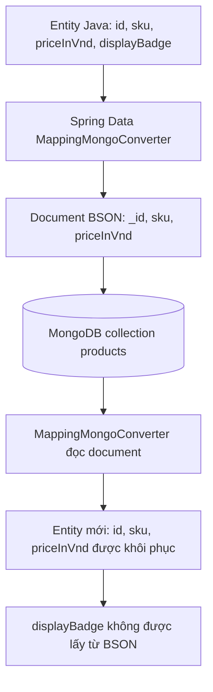

# Loại trừ dữ liệu không lưu bằng @Transient

## 1. Vì sao cần loại trừ một thuộc tính khỏi document?

Trong **Spring Data MongoDB**, một entity Java thường có các thuộc tính được ánh xạ vào document MongoDB. Tuy nhiên, không phải mọi dữ liệu tồn tại trên đối tượng Java đều cần hoặc nên được ghi xuống cơ sở dữ liệu.

Giả sử một màn hình sản phẩm cần hiển thị:

- `sku`: mã sản phẩm, cần lưu bền vững để tìm kiếm và cập nhật;
- `priceInVnd`: giá niêm yết, cần lưu để phục vụ nghiệp vụ;
- `displayBadge`: nhãn tạm thời như “Ưu đãi hôm nay”, được tính theo chiến dịch đang chạy hoặc người đang xem.

`displayBadge` chỉ phục vụ một lần xử lý hoặc một lần trả kết quả. Nếu lưu nhãn này vào collection `products`, ứng dụng dễ giữ lại thông tin hết hạn, tăng số thao tác cập nhật và phát sinh sai lệch giữa dữ liệu nguồn với giá trị hiển thị.

Spring Data cung cấp annotation **`org.springframework.data.annotation.Transient`** để đánh dấu một thuộc tính **không tham gia quá trình ánh xạ dữ liệu bền vững**.

```java
import org.springframework.data.annotation.Transient;

@Transient
private String displayBadge;
```

Khi Spring Data chuyển entity sang BSON để lưu, thuộc tính đó bị loại khỏi document được tạo. Khi Spring Data đọc document để dựng lại entity, nó cũng không lấy giá trị trong MongoDB để gán cho thuộc tính ấy.

**Điểm cốt lõi:** `@Transient` điều khiển *persistence mapping* của Spring Data MongoDB. Nó không quyết định dữ liệu có được trả về HTTP/JSON, được ghi vào log, hoặc được Java giữ trong bộ nhớ hay không.

## 2. Cách @Transient hoạt động trong hai chiều ánh xạ

Xét luồng xử lý một entity:



| Thao tác | Với thuộc tính thông thường | Với thuộc tính gắn `@Transient` |
| --- | --- | --- |
| `MongoTemplate.save(entity)` | Được ánh xạ và ghi vào BSON | Bỏ qua khi converter tạo document |
| `MongoRepository.save(entity)` | Tương tự, thông qua Spring Data mapping | Bỏ qua |
| `MongoTemplate.findById(...)` | Giá trị được đọc và gán về entity | Không được nạp từ BSON |
| `ReactiveMongoTemplate` / reactive repository | Mapping giống nhánh đồng bộ | Vẫn bị loại khỏi mapping |
| Thay đổi giá trị trong bộ nhớ | Object Java nhận giá trị mới | Vẫn thay đổi bình thường trong bộ nhớ |
| Jackson xuất JSON HTTP | Theo các quy tắc serialization JSON | Không tự động bị ẩn chỉ vì có `@Transient` của Spring Data |

Nếu không có khởi tạo mặc định nào khác, một trường tham chiếu `@Transient` chưa được gán sẽ có giá trị `null` trên object vừa đọc từ MongoDB. Nếu trường có initializer, ví dụ `private String displayBadge = "Mặc định";`, giá trị khởi tạo đó vẫn có thể hiện diện sau khi Spring tạo object; nó không đến từ MongoDB.

**Một lưu ý quan trọng về dữ liệu cũ:** thêm `@Transient` vào entity không tự động thực hiện migration xóa field đã tồn tại trong document trước đó. Những lệnh ghi raw BSON hoặc `$set` trực tiếp vào field vẫn có thể tạo field ấy trên MongoDB. Annotation tác động vào converter của Spring Data, không phải quy tắc schema cưỡng chế ở server.

## 3. Ví dụ hoàn chỉnh với @Document, @Id và @Transient

### 3.1. Khai báo entity

Ví dụ sau dùng kiểu `long` cho số tiền nguyên VND để tập trung vào mapping. Trong ứng dụng tài chính thực tế, cần chọn biểu diễn số tiền, đơn vị và quy tắc làm tròn rõ ràng.

```java
package example.catalog;

import org.springframework.data.annotation.Id;
import org.springframework.data.annotation.Transient;
import org.springframework.data.mongodb.core.mapping.Document;

@Document(collection = "products")
public class Product {

    @Id
    private String id;

    private String sku;

    private long priceInVnd;

    @Transient
    private String displayBadge;

    public Product() {
    }

    public Product(String id, String sku, long priceInVnd) {
        this.id = id;
        this.sku = sku;
        this.priceInVnd = priceInVnd;
    }

    public String getId() {
        return id;
    }

    public String getSku() {
        return sku;
    }

    public long getPriceInVnd() {
        return priceInVnd;
    }

    public String getDisplayBadge() {
        return displayBadge;
    }

    public void setDisplayBadge(String displayBadge) {
        this.displayBadge = displayBadge;
    }
}
```

Ở đây:

- `@Document(collection = "products")` khai báo collection cho entity;
- `@Id` ánh xạ `id` sang khóa `_id` của MongoDB;
- `sku` và `priceInVnd` là các thuộc tính được lưu;
- `displayBadge` tồn tại trong object Java nhưng không được Spring Data MongoDB lưu hoặc nạp từ document.

### 3.2. Ghi dữ liệu bằng MongoTemplate

```java
import org.springframework.data.mongodb.core.MongoTemplate;

public class ProductWriter {
    private final MongoTemplate template;

    public ProductWriter(MongoTemplate template) {
        this.template = template;
    }

    public void saveSample() {
        Product product = new Product(
            "product-demo-001",
            "SKU-001",
            350_000L
        );

        product.setDisplayBadge("Giảm giá cuối tuần");
        template.save(product);
    }
}
```

Sau lời gọi `save`, document thực tế có cấu trúc tương đương:

```javascript
{
  _id: "product-demo-001",
  sku: "SKU-001",
  priceInVnd: NumberLong("350000")
}
```

Trường `displayBadge` không được ghi. Trong ví dụ, `_id` cố ý là một chuỗi không có dạng ObjectId hợp lệ để biểu diễn đơn giản; nếu dùng `@Id String` với các giá trị khác, cách chuyển đổi khóa `_id` cần được hiểu theo quy tắc chuyển đổi của Spring Data MongoDB.

### 3.3. Đọc dữ liệu và làm giàu giá trị tạm thời

```java
import java.util.Objects;
import org.springframework.data.mongodb.core.MongoTemplate;

public class ProductReader {
    private final MongoTemplate template;

    public ProductReader(MongoTemplate template) {
        this.template = template;
    }

    public Product findForDisplay(String id) {
        Product product = Objects.requireNonNull(
            template.findById(id, Product.class),
            "Không tìm thấy sản phẩm"
        );

        // Dữ liệu chỉ phục vụ lần hiển thị hiện tại.
        product.setDisplayBadge("Giao nhanh hôm nay");
        return product;
    }
}
```

Vì `displayBadge` chưa được ánh xạ từ BSON, ứng dụng có thể tính lại nhãn theo ngữ cảnh hiện tại. Giá trị được gán cho object trước khi trả kết quả là dữ liệu trong bộ nhớ; nếu sau đó lưu entity bằng `save`, giá trị vẫn không được Spring Data MongoDB ghi xuống collection.

Đối với hệ thống có nhiều client hoặc nhiều người dùng, dữ liệu trình bày theo từng request thường thích hợp hơn trong **DTO/response model**. `@Transient` là một lựa chọn khi cần giữ trường tạm trên entity, nhưng không bắt buộc phải đưa mọi dữ liệu hiển thị vào lớp entity.

## 4. Phân biệt các cơ chế dễ nhầm

| Cơ chế | Tác động chính | Có loại field khỏi Spring Data MongoDB mapping? | Có tự ẩn field khi trả JSON? |
| --- | --- | --- | --- |
| `org.springframework.data.annotation.Transient` | Loại thuộc tính khỏi persistence mapping | Có | Không được đảm bảo |
| Từ khóa Java `transient` | Đánh dấu trường không tham gia Java object serialization thông thường; Spring Data cũng thường bỏ qua trường được khai báo transient | Thường có theo quy tắc khám phá thuộc tính của Spring Data; dùng annotation để biểu đạt ý định rõ ràng | Phụ thuộc thư viện JSON và cấu hình |
| `com.fasterxml.jackson.annotation.JsonIgnore` | Điều khiển Jackson serialization/deserialization | Không | Có, theo phạm vi áp dụng của Jackson |
| `org.springframework.data.annotation.ReadOnlyProperty` | Thuộc tính chỉ đọc từ datastore theo Spring Data mapping | Khác `@Transient`: có thể được đọc nhưng không ghi bởi mapping | Không được đảm bảo |
| Projection khi query (`fields().exclude(...)`) | Giới hạn field trả về từ một truy vấn | Không; dữ liệu vẫn được lưu | Không nhất thiết |
| `@Field("...")` | Đổi tên/kiểu trường BSON khi ánh xạ | Không; trường vẫn tham gia mapping | Không quyết định JSON |
| DTO hoặc response view | Thiết kế dữ liệu trao đổi với client | Không trực tiếp thay đổi entity mapping | Theo cấu trúc DTO và serializer |

### 4.1. @Transient của Spring Data và transient của Java

Hai cách viết trông gần giống nhau:

```java
// Annotation của Spring Data
@org.springframework.data.annotation.Transient
private String displayBadge;

// Modifier của ngôn ngữ Java
private transient String temporaryNote;
```

Từ khóa `transient` bắt nguồn từ cơ chế serialization của Java. Spring Data cũng loại các trường Java được đánh dấu transient khi khám phá thuộc tính cần lưu trong những mapping thông thường. Tuy vậy, dùng `@Transient` của Spring Data làm **ý định loại khỏi persistence** rõ ràng hơn và không tự trộn lẫn với các yêu cầu khác về Java serialization.

Không nên thay import `org.springframework.data.annotation.Transient` bằng một annotation cùng tên của hệ thống ORM khác rồi giả định Spring Data MongoDB chắc chắn xử lý hệt nhau. Với bài toán này, dùng annotation đúng của **Spring Data**.

### 4.2. @Transient không tương đương @JsonIgnore

Giả sử field `internalNote` là thông tin chỉ để ứng dụng xử lý:

```java
import com.fasterxml.jackson.annotation.JsonIgnore;
import org.springframework.data.annotation.Transient;

@Transient
@JsonIgnore
private String internalNote;
```

Ở đây `@Transient` loại khỏi MongoDB mapping còn `@JsonIgnore` yêu cầu Jackson không đưa thuộc tính tương ứng vào JSON. Đối với Jackson, kết quả cụ thể còn phụ thuộc getter/setter và cấu hình property access.

Nếu chỉ gắn `@Transient` mà vẫn có getter public, một API dùng Jackson có thể trả field đó trong JSON. Vì vậy **không dùng `@Transient` làm cơ chế bảo mật dữ liệu của API**. Kiểm soát việc trả dữ liệu bằng DTO, quyền truy cập và annotation JSON phù hợp.

### 4.3. @Transient khác với bỏ field khi đọc bằng projection

```java
import org.springframework.data.mongodb.core.query.Criteria;
import org.springframework.data.mongodb.core.query.Query;

Query query = Query.query(Criteria.where("sku").is("SKU-001"));
query.fields().include("sku").exclude("_id");
```

Projection chỉ làm một truy vấn cụ thể trả về ít trường hơn. `priceInVnd` vẫn được lưu trong MongoDB, nhưng sẽ không có trong kết quả của truy vấn trên. Ngược lại, khi đánh dấu `displayBadge` bằng `@Transient`, Spring Data MongoDB bỏ thuộc tính ấy khỏi mapping ghi/đọc của entity trong các thao tác thông thường.

Với các thuộc tính bị thiếu do projection, nên cân nhắc DTO/projection interface phù hợp thay vì gán kết quả thiếu trường vào entity rồi vô tình `save` ghi đè dữ liệu đầy đủ.

### 4.4. @ReadOnlyProperty dành cho tình huống khác

Nếu một giá trị **đã có trong MongoDB** và ứng dụng cần đọc nó nhưng muốn Spring Data không ghi giá trị đó trở lại, `@ReadOnlyProperty` có ngữ nghĩa khác `@Transient`. Trường đọc từ nguồn dữ liệu không nên được đánh dấu `@Transient` nếu ứng dụng vẫn cần mapper điền giá trị của nó.

Một biến thể khác là trường tính toán trong truy vấn aggregation được ánh xạ vào projection riêng; lựa chọn annotation và class cần phù hợp với đường đọc thực tế.

## 5. Những trường hợp nên sử dụng @Transient

### 5.1. Giá trị tính toán từ dữ liệu đã lưu

Ví dụ entity lưu `firstName` và `lastName` nhưng cần chuỗi `fullName` phục vụ hiển thị. Có thể dùng một getter tính toán mà không cần field:

```java
public String getFullName() {
    return firstName + " " + lastName;
}
```

Nếu muốn cache giá trị tính trong object vì phép tính đắt hoặc được dùng nhiều lần, có thể khai báo trường cache:

```java
@Transient
private String cachedFullName;

public String getFullName() {
    if (cachedFullName == null) {
        cachedFullName = firstName + " " + lastName;
    }
    return cachedFullName;
}
```

Khi `firstName` hoặc `lastName` thay đổi, phải xóa cache hoặc tính lại. `@Transient` không quản lý cache invalidation; nó chỉ ngăn lưu giá trị cache vào database. Với phép nối chuỗi đơn giản, getter tính trực tiếp thường dễ bảo trì hơn.

### 5.2. Dữ liệu chỉ tồn tại trong một request

Các ví dụ có thể gồm mã xác thực tạm trong một bước xử lý, metadata phục vụ kiểm tra nghiệp vụ, giá trị form chưa xác nhận hoặc kết quả tra cứu tức thời từ hệ thống khác. Những dữ liệu này không nhất thiết thuộc về trạng thái bền vững của MongoDB.

Tuy nhiên, dữ liệu nhạy cảm cần được quản lý thêm về thời gian sống, quyền truy cập, log và serialization; `@Transient` **không xóa giá trị khỏi RAM, không mã hóa và không ẩn nó khỏi response**.

### 5.3. Thông tin hiển thị có thể hết hạn

Nhãn khuyến mại theo ngày, trạng thái giao hàng lấy tức thời từ đối tác hoặc mô tả đã địa phương hóa có thể được tính mỗi lần lấy dữ liệu. Cần cân nhắc liệu nên đặt trên entity, xây DTO trong service hay tạo cache có TTL bên ngoài.

### 5.4. Giảm dữ liệu dư thừa

Nếu giá trị được suy ra hoàn toàn từ các trường đã lưu và luôn cần tính lại, việc loại trừ nó giúp tránh trạng thái không đồng bộ. Chẳng hạn, lưu đồng thời `quantity`, `unitPrice` và `calculatedTotal` có thể tạo mâu thuẫn nếu một phép cập nhật quên tính lại total.

Nhưng nếu nghiệp vụ cần **chụp lại tổng tiền tại thời điểm đặt hàng** để làm hóa đơn hoặc đối soát, tổng tiền lại là dữ liệu bền vững cần lưu. Không thể quyết định dùng `@Transient` chỉ dựa trên việc giá trị có thể tính toán được.

## 6. Các trường hợp không nên dùng @Transient

| Nhu cầu | Vì sao `@Transient` có thể sai? | Hướng phù hợp |
| --- | --- | --- |
| Cần lọc hoặc sắp xếp trên MongoDB theo trường | Trường không được ghi bởi mapper nên query không có dữ liệu bền vững để dựa vào | Lưu trường có chủ đích, tạo index đúng truy vấn, hoặc tính trong aggregation |
| Cần giữ snapshot tài chính hay lịch sử audit | Giá trị có thể cần khôi phục chính xác như thời điểm phát sinh | Lưu record/snapshot hoặc event bất biến |
| Cần phân trang theo trường trên server | Trường tính trong RAM sau khi đọc không hỗ trợ trực tiếp sort/pagination ở database | Ánh xạ dữ liệu có thể truy vấn, hoặc thiết kế projection/aggregation |
| Cần cập nhật đồng thời và kiểm soát version | Nếu đánh dấu trường version là transient, dữ liệu version không được lưu như yêu cầu | Dùng `@Version` đúng cách, kiểm thử optimistic locking |
| Cần giữ ID để cập nhật lại entity | ID phải được ánh xạ đúng để nhận diện document | Dùng `@Id` hoặc mapping khóa tương ứng |
| Muốn giấu dữ liệu khỏi API | `@Transient` không điều khiển mọi JSON serializer | Dùng DTO và cơ chế serialization/authorization |
| Muốn xóa field cũ khỏi database | Annotation không tự động migration dữ liệu lịch sử | Viết migration/`$unset` có kiểm soát |

### 6.1. Không dùng trường transient làm tiêu chí tìm kiếm bền vững

Đoạn sau tạo cảm giác entity có thể tìm theo nhãn `displayBadge`:

```java
// Ý tưởng không phù hợp với displayBadge là transient:
// repository.findByDisplayBadge("Giao nhanh hôm nay");
```

Giá trị này không được Spring Data MongoDB lưu theo entity, nên không có cơ sở dữ liệu bền vững để lọc theo nhãn đó. Cách API truy vấn xử lý tên thuộc tính transient còn phụ thuộc dạng repository method và mapping context; không dựa vào đó để xây tính năng.

Nếu cần lọc theo một giá trị tính toán, hãy cân nhắc lưu dữ liệu nguồn để truy vấn, dùng aggregation phù hợp, hoặc dùng một tiêu chí khác có index rồi tính nhãn cho kết quả.

### 6.2. Cẩn thận với constructor dùng để khôi phục entity

Spring Data có thể sử dụng constructor được chọn để tạo đối tượng từ BSON. Với class có constructor dành cho persistence, các tham số phải được ánh xạ từ dữ liệu mà mapper biết cách cung cấp.

```java
// Ví dụ minh họa tình huống cần tránh:
@PersistenceCreator
public Product(String id, String sku, String displayBadge) {
    this.id = id;
    this.sku = sku;
    this.displayBadge = displayBadge; // transient, không có nguồn BSON để bind
}
```

Một tham số tương ứng với thuộc tính transient không có giá trị được mapper đọc từ document, nên có thể làm quá trình dựng entity thất bại. Cách an toàn là constructor dành cho persistence chỉ nhận các giá trị được ánh xạ; thiết lập dữ liệu tạm sau khi object được tạo. Ví dụ `Product` ở phần 3 dùng no-args constructor và constructor chỉ có các field cần lưu.

Trong các dự án dùng Lombok, Java record hoặc Kotlin data class, cần kiểm tra constructor/canonical constructor được framework chọn. Cách khai báo bất biến phù hợp với mỗi ngôn ngữ có thể làm thay đổi khả năng đặt một thuộc tính tạm trên entity.

### 6.3. Không nhầm trạng thái object và trạng thái lưu

Sau khi gọi:

```java
product.setDisplayBadge("Đang được xử lý");
Product saved = repository.save(product);
```

Đối tượng `product` và kết quả `saved` có thể vẫn chứa giá trị tạm trong bộ nhớ, tùy cách repository và converter xử lý object. **Không lấy điều đó làm bằng chứng rằng MongoDB đã lưu trường này.**

Muốn xác nhận, phải đọc document raw từ collection hoặc đọc lại entity bằng một lần truy vấn mới và kiểm tra đường mapping.

## 7. Repository và reactive access có xử lý khác nhau không?

Không. Spring Data MongoDB sử dụng metadata mapping để quyết định trường nào được persist. Một entity được đánh dấu `@Transient` vẫn có cùng ý nghĩa khi truy cập bằng:

- `MongoRepository<Product, String>`;
- `MongoTemplate`;
- `ReactiveMongoRepository<Product, String>`;
- `ReactiveMongoTemplate`.

Ví dụ với reactive repository:

```java
import org.springframework.data.mongodb.repository.ReactiveMongoRepository;

public interface ReactiveProductRepository
        extends ReactiveMongoRepository<Product, String> {
}
```

```java
import reactor.core.publisher.Mono;

public Mono<Product> saveForPreview(
        ReactiveProductRepository repository,
        Product product) {
    product.setDisplayBadge("Chỉ dùng để hiển thị");
    return repository.save(product);
}
```

`Mono<Product>` mô tả thao tác reactive và được thực thi theo cơ chế subscription. Việc `displayBadge` có được lưu hay không vẫn do `@Transient` và Spring Data mapping quyết định, không phụ thuộc publisher là `Mono` hay thread có blocking.

Khi cần thao tác MongoDB ở tầng thấp bằng Java driver hoặc dùng `Document`/BSON thô thay cho entity mapper, hãy nhớ rằng những thao tác đó không tự tuân theo annotation trên lớp `Product`: dữ liệu thô được lưu theo đúng các trường mà lệnh gửi tới MongoDB yêu cầu.

## 8. Kiểm thử: phải nhìn vào BSON thật

Một bài kiểm thử tốt cần chứng minh đồng thời ba điều:

1. Entity Java có thể nhận giá trị `displayBadge` trong bộ nhớ.
2. Document thực tế được lưu không chứa khóa `displayBadge`.
3. Đọc entity mới từ MongoDB không khôi phục `displayBadge` từ document.

Ví dụ kiểm thử tích hợp bằng JUnit 5, Spring Boot Test và MongoTemplate:

```java
package example.catalog;

import static com.mongodb.client.model.Filters.eq;
import static org.junit.jupiter.api.Assertions.*;

import java.util.UUID;
import org.bson.Document;
import org.junit.jupiter.api.Test;
import org.springframework.beans.factory.annotation.Autowired;
import org.springframework.boot.test.autoconfigure.data.mongo.DataMongoTest;
import org.springframework.data.mongodb.core.MongoTemplate;

@DataMongoTest
class ProductMappingTest {

    @Autowired
    MongoTemplate template;

    @Test
    void transientFieldIsNotStoredOrRestored() {
        String id = "p-" + UUID.randomUUID();
        Product product = new Product(id, "SKU-001", 350_000L);
        product.setDisplayBadge("Khuyến mại theo request");

        assertEquals(
            "Khuyến mại theo request",
            product.getDisplayBadge()
        );

        template.save(product);

        Document stored = template.getCollection("products")
            .find(eq("_id", id))
            .first();

        assertNotNull(stored);
        assertEquals("SKU-001", stored.getString("sku"));
        assertFalse(stored.containsKey("displayBadge"));

        Product reloaded = template.findById(id, Product.class);
        assertNotNull(reloaded);
        assertEquals(350_000L, reloaded.getPriceInVnd());
        assertNull(reloaded.getDisplayBadge());
    }
}
```

Test yêu cầu một MongoDB có thể kết nối từ môi trường chạy test; có thể cấu hình MongoDB riêng hoặc dùng Testcontainers MongoDB cho kiểm thử tích hợp. `@DataMongoTest` chỉ giới hạn Spring context cho phần MongoDB; nó không đồng nghĩa MongoDB server luôn được tự động khởi chạy.

Đối với các phiên bản Spring Boot khác nhau, đường import annotation test hoặc cơ chế cấu hình test có thể thay đổi. Cần dùng phiên bản dependency nhất quán với Spring Data MongoDB trong dự án.

### Trường hợp dữ liệu cũ đã có field bị loại

Giả sử document lưu từ phiên bản trước vẫn chứa:

```javascript
{
  _id: "product-legacy-001",
  sku: "SKU-OLD",
  priceInVnd: NumberLong("250000"),
  displayBadge: "Nhãn cũ"
}
```

Sau khi thêm `@Transient` vào Java entity, Spring Data sẽ bỏ qua `displayBadge` khi đọc entity. Nhưng **document cũ có thể vẫn giữ trường này**; một thao tác thay thế toàn bộ document về sau có thể ảnh hưởng tới field cũ theo cách khác với cập nhật từng phần.

Nếu mục tiêu là xóa dữ liệu cũ, cần migration riêng, chẳng hạn:

```javascript
db.products.updateMany(
  { displayBadge: { $exists: true } },
  { $unset: { displayBadge: "" } }
);
```

Trước khi chạy trên dữ liệu thật, xác định phạm vi, backup, khả năng rollback và tác động đến phiên bản ứng dụng còn đọc field cũ. Migration này là một tác vụ vận hành có chủ đích, không phải hành vi tự động của annotation.

## 9. Lỗi thường gặp và cách chẩn đoán

| Triệu chứng | Nguyên nhân có thể | Cách kiểm tra |
| --- | --- | --- |
| Lưu xong object vẫn hiện nhãn, nhưng truy vấn lại mất | Giá trị transient chỉ tồn tại trong object tại thời điểm xử lý | Truy vấn raw BSON và tải entity mới |
| Field vẫn có trong HTTP JSON | Jackson và Spring Data MongoDB là hai cơ chế khác nhau | Kiểm tra getter, DTO và annotation Jackson |
| Field cũ còn tồn tại trong MongoDB | `@Transient` không tự xóa field của document lịch sử | Tìm raw document, lên kế hoạch migration |
| Không thể lọc theo thuộc tính transient | Không có trường dữ liệu bền vững tương ứng để query | Xem query thực tế, giải pháp persist hoặc aggregation |
| Đọc entity bị lỗi khi dùng constructor tùy chỉnh | Constructor yêu cầu giá trị transient không có trong BSON | Xem constructor được chọn và field mapping |
| Dữ liệu tính toán trở nên lỗi thời | Cache transient không được invalidation khi dữ liệu nguồn đổi | Tính lại hoặc dùng DTO/service |
| Nghĩ annotation bảo vệ thông tin bí mật | Field vẫn có thể xuất hiện trong log, JSON, heap | Kiểm tra đường trả dữ liệu, logging, quyền truy cập |
| Dùng driver trực tiếp nhưng field vẫn được ghi | Driver BSON thô không đọc annotation của Spring Data entity | Kiểm tra đường ghi và kiểu object gửi tới driver |

Một quy trình chẩn đoán ngắn:

1. Xác nhận đã import đúng `org.springframework.data.annotation.Transient`.
2. Kiểm tra annotation đặt trên thuộc tính mà Spring Data thực sự mapping.
3. Quan sát object trong bộ nhớ trước/sau `save` và *tách biệt* nó với document raw.
4. Đọc document bằng Mongo shell/driver hoặc `MongoTemplate.getCollection(...)`.
5. Đọc lại entity mới bằng repository/template, rồi kiểm tra JSON/DTO nếu vấn đề nằm ở HTTP.
6. Nếu vẫn khác kỳ vọng, kiểm tra custom converter, lifecycle callback, constructor và đường ghi BSON trực tiếp.

## 10. Bài tập thực hành

### Bài 1 — Thuộc tính hiển thị không lưu

Tạo entity `Customer` có `id`, `email` và `temporaryGreeting`. Gắn `@Transient` lên `temporaryGreeting`. Lưu một entity qua `MongoRepository`, rồi kiểm tra document raw và entity đọc lại. Giải thích tại sao giá trị greeting không được lưu dù getter vẫn có thể trả greeting trong object ban đầu.

### Bài 2 — Phân biệt JSON và BSON

Xây endpoint trả `Customer` ở bài 1 dưới dạng JSON. Thử trường hợp chỉ có `@Transient` và trường hợp thêm `@JsonIgnore`. Quan sát JSON và BSON bằng hai công cụ khác nhau; lý giải sự khác biệt.

### Bài 3 — Dữ liệu tính toán nên lưu hay không?

Một đơn hàng có `quantity`, `unitPrice`, `discountPercent` và `finalAmount`. Xét hai tình huống:

- Giỏ hàng đang được người dùng chỉnh sửa, tổng tiền luôn được tính lại từ giá hiện tại.
- Hóa đơn đã thanh toán, cần khôi phục số tiền chính xác của giao dịch trong tương lai.

Với mỗi tình huống, quyết định trường nào nên persist, trường nào có thể tính lại, và có nên dùng `@Transient` hoặc DTO hay không. Giải thích hệ quả về tính nhất quán và audit.

### Bài 4 — Mapping reactive

Dùng `ReactiveMongoRepository` để lưu một `Product` có `displayBadge` tạm, sau đó sử dụng `StepVerifier` hoặc một kiểm thử reactive tương đương để đọc lại. Xác nhận `displayBadge` không được khôi phục từ MongoDB và giải thích tại sao reactive không thay đổi quy tắc mapping.

### Câu hỏi tự kiểm tra

- `@Transient` của Spring Data tác động vào chiều ghi, chiều đọc hay cả hai?
- Một field transient có thể xuất hiện trong HTTP JSON không? Vì sao?
- Nếu thêm `@Transient` vào một field đã được lưu trong các document cũ, dữ liệu cũ có lập tức bị xóa không?
- Vì sao không nên truyền một trường transient bắt buộc vào constructor mà Spring Data dùng để khôi phục entity?
- Khi nào nên tạo DTO thay vì thêm một field `@Transient` vào entity?

## Ghi nhớ

Trong **Spring Data MongoDB**, `@Transient` là chỉ dẫn rõ ràng để **loại một thuộc tính khỏi persistence mapping ở cả chiều ghi và đọc**. Nó phù hợp với dữ liệu tạm thời, giá trị phục vụ hiển thị và cache tính toán trong bộ nhớ. Annotation không tự xóa field đã lưu trước đó, không điều khiển JSON, không thay thế phân quyền và không giúp truy vấn MongoDB theo một giá trị không được lưu. Khi thiết kế entity, hãy xác định giá trị nào là **trạng thái bền vững** và giá trị nào chỉ tồn tại trong **ngữ cảnh xử lý hiện tại**, rồi kiểm chứng bằng cách đọc document BSON thực tế.
