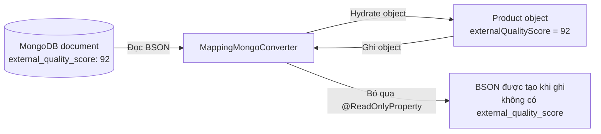

# Thuộc tính chỉ đọc bằng @ReadOnlyProperty

## 1. Bối cảnh và mục tiêu

Trong **Spring Data MongoDB**, một Java object thường được ánh xạ hai chiều: đọc document BSON từ MongoDB để tạo object và ghi object trở lại database qua `MongoTemplate` hoặc repository. Nhưng có những trường cần **đọc được từ MongoDB mà không được đưa vào dữ liệu ghi do bộ ánh xạ Spring Data tạo ra**. `@ReadOnlyProperty` được sử dụng cho nhu cầu đó.

Bài học thuộc phần **Ánh xạ cơ bản** và tiếp tục sử dụng mô hình bán hàng **Mini Commerce** với `Product` (sản phẩm), `Customer` (khách hàng) và `Order` (đơn hàng). Chúng ta giả sử một hệ thống kiểm định hàng hóa bên ngoài bổ sung điểm chất lượng vào document sản phẩm. Ứng dụng bán hàng cần hiển thị điểm này, trong khi việc quyết định và cập nhật điểm thuộc về hệ thống kiểm định.

Sau bài này, người học có thể:

- Hiểu `@ReadOnlyProperty` là annotation của **Spring Data mapping**, không phải cơ chế phân quyền database.
- Ánh xạ một trường có sẵn trong BSON thành thuộc tính Java chỉ đọc theo chiều persistence.
- Phân biệt `@ReadOnlyProperty` với `@Transient`, `@Field`, Java `final`, annotation JSON và `@Version`.
- Dùng `MongoTemplate`/`MongoRepository` để kiểm chứng trường được **đọc** nhưng không được **ghi ra** bởi `MappingMongoConverter`.
- Nhận diện rủi ro **thay thế cả document khi gọi `save()`**, hiểu cách cập nhật từng trường an toàn hơn khi nhiều hệ thống cùng sở hữu dữ liệu.
- Biết khi nào kết hợp `@ReadOnlyProperty` với `@DocumentReference` và cách kiểm thử thực tế.

**Điều kiện thực hành:** ứng dụng Spring Boot đã có `spring-boot-starter-data-mongodb`, kết nối MongoDB thành công và có kiến thức cơ bản về `@Document`, `@Id`, BSON, repository, `MongoTemplate`. Ví dụ Java dành cho API đồng bộ; nguyên tắc mapping cũng có ý nghĩa trong nhánh reactive.

## 2. @ReadOnlyProperty thực sự làm gì?

Annotation được import từ:

```java
import org.springframework.data.annotation.ReadOnlyProperty;
```

Đây là annotation thuộc **Spring Data Commons**, có thể được đặt trên trường, phương thức hoặc một annotation khác theo định nghĩa của nó. Trong Spring Data MongoDB, trường được đánh dấu vẫn thuộc mô hình ánh xạ để **đọc giá trị từ document**, nhưng khi converter ghi object thành document, trường đó **không được ghi ra**.



Hành vi cần nắm:

1. Khi **đọc**, nếu trường BSON tương ứng tồn tại và có kiểu tương thích, mapping framework có thể điền giá trị vào thuộc tính Java.
2. Khi **insert** bằng `MongoTemplate.insert(entity)` hoặc `repository.save(entity)` cho entity mới, converter không xuất trường chỉ đọc vào BSON.
3. Khi **ghi một object**, giá trị đã được gán trên object không thay đổi quy tắc: trường vẫn bị bỏ qua ở bước mapping ghi.
4. Annotation không tự tính toán, tự đồng bộ hoặc tự tải một giá trị từ dịch vụ bên ngoài. Document phải chứa trường, hoặc phải có cơ chế đọc/tham chiếu phù hợp.
5. Annotation không bảo vệ trường khỏi các lệnh MongoDB trực tiếp, `$set` chủ đích, driver gốc, script hay hệ thống khác.

Điểm cuối rất quan trọng: `@ReadOnlyProperty` là **quy tắc của bộ ánh xạ object**, không phải ràng buộc bất biến do MongoDB thực thi.

## 3. So sánh với các cơ chế thường bị nhầm

| Cơ chế | Đọc BSON vào entity | Ghi entity thành BSON | Mục đích |
| --- | --- | --- | --- |
| Trường thông thường | Có | Có | Dữ liệu nghiệp vụ đọc/ghi bình thường |
| `@ReadOnlyProperty` | Có, khi có dữ liệu phù hợp | **Không** qua object mapping | Đọc trường do nguồn khác quản lý hoặc quan hệ suy ra |
| `@Transient` của Spring Data | **Không** | **Không** | Giá trị chỉ dùng trong runtime, không thuộc ánh xạ persistence |
| `@Field("...")` | Có, đổi tên/kiểu lưu nếu cấu hình | Có, theo quy tắc mapping khác | Ánh xạ tên/kiểu BSON; không tự đặt read-only |
| Java `final` hoặc thiếu setter | Tùy constructor và chiến lược materialization | Vẫn có thể ghi | Bất biến ở cấp API/đối tượng Java |
| Jackson `@JsonProperty(access = READ_ONLY)` | Không quyết định MongoDB mapping | Không quyết định MongoDB mapping | Kiểm soát JSON của HTTP API |
| `@Version` | Có | Có; hỗ trợ optimistic locking | Phát hiện xung đột cập nhật giữa các phiên bản |

**Ví dụ:** `@Transient String displayLabel` có thể được tính từ SKU và tên để hiển thị trên UI. Nếu cần đọc một giá trị `external_quality_score` vốn đã có trong MongoDB, `@ReadOnlyProperty` hợp hơn. Nếu cần tự tính điểm mỗi lần gọi getter, thường dùng phương thức tính toán hoặc DTO; annotation read-only **không tự tạo giá trị**.

## 4. Ví dụ xuyên suốt: điểm chất lượng do hệ thống khác quản lý

Giả sử MongoDB có document thuộc collection `products`:

```json
{
  "_id": "prod-001",
  "sku": "LAP-001",
  "name": "Bàn phím cơ Mini",
  "stock": 20,
  "external_quality_score": 92
}
```

- `sku`, `name`, `stock` do ứng dụng bán hàng quản lý.
- `external_quality_score` do dịch vụ kiểm định cập nhật. Ứng dụng bán hàng chỉ hiển thị hoặc dùng giá trị này để lọc dữ liệu.
- Giá trị `92` là dữ liệu mẫu, không phải điểm được tính bởi Spring Data.
- `_id` được chọn là chuỗi `"prod-001"` để ví dụ không phải xử lý việc chuyển đổi chuỗi hexadecimal thành BSON `ObjectId`.

### 4.1. Khai báo entity

```java
package com.example.minicommerce.domain;

import org.springframework.data.annotation.Id;
import org.springframework.data.annotation.ReadOnlyProperty;
import org.springframework.data.annotation.Transient;
import org.springframework.data.mongodb.core.mapping.Document;
import org.springframework.data.mongodb.core.mapping.Field;

@Document(collection = "products")
public class Product {

    @Id
    private String id;

    private String sku;
    private String name;
    private int stock;

    @ReadOnlyProperty
    @Field("external_quality_score")
    private Integer externalQualityScore;

    @Transient
    private String displayLabel;

    public Product() {}

    public Product(String id, String sku, String name, int stock) {
        this.id = id;
        this.sku = sku;
        this.name = name;
        this.stock = stock;
    }

    public String getId() { return id; }
    public void setId(String id) { this.id = id; }

    public String getSku() { return sku; }
    public void setSku(String sku) { this.sku = sku; }

    public String getName() { return name; }
    public void setName(String name) { this.name = name; }

    public int getStock() { return stock; }
    public void setStock(int stock) { this.stock = stock; }

    public Integer getExternalQualityScore() {
        return externalQualityScore;
    }

    public void setExternalQualityScore(Integer score) {
        this.externalQualityScore = score;
    }

    public String getDisplayLabel() {
        return displayLabel;
    }

    public void setDisplayLabel(String displayLabel) {
        this.displayLabel = displayLabel;
    }
}
```

Các annotation đóng vai trò khác nhau:

- `@Document(collection = "products")` chọn collection.
- `@Id` ánh xạ `id` thành khóa `_id`.
- `@Field("external_quality_score")` ánh xạ tên Java `externalQualityScore` với khóa BSON `external_quality_score`.
- `@ReadOnlyProperty` yêu cầu **bỏ qua trường khi ghi object** thông qua Spring Data mapping.
- `@Transient` loại `displayLabel` khỏi quá trình đọc và ghi của bộ ánh xạ.

Để dễ quan sát kết quả, ví dụ có setter cho `externalQualityScore`. Việc setter tồn tại **không làm mất tác dụng của `@ReadOnlyProperty`**: ứng dụng vẫn có thể thay giá trị trong bộ nhớ, nhưng converter không đưa trường đó vào BSON khi ghi object.

Ở model domain được thiết kế bất biến, có thể bỏ setter và dùng constructor/`@PersistenceCreator` phù hợp. Tuy nhiên, constructor, field `final` hoặc getter đơn thuần là vấn đề **materialization của object Java**; không thay thế quy tắc read-only của mapping.

### 4.2. Mô phỏng hai nguồn ghi

Trong ứng dụng Mini Commerce, hãy tách trách nhiệm:

| Thành phần | Trường được quyền quản lý theo nghiệp vụ |
| --- | --- |
| Dịch vụ bán hàng | `sku`, `name`, `stock`, trạng thái sản phẩm |
| Dịch vụ kiểm định | `external_quality_score` |
| API đọc danh mục | Đọc cả thông tin sản phẩm và điểm kiểm định |

Đây là **thỏa thuận nghiệp vụ**. Muốn biến thỏa thuận đó thành ràng buộc kỹ thuật thực sự, cần áp dụng kiểm soát quyền ghi, định tuyến cập nhật và giám sát phù hợp. Không xem annotation như một hàng rào bảo mật.

## 5. Kiểm chứng bằng MappingMongoConverter trước khi chạy database

Cách trực tiếp nhất để hiểu annotation là quan sát document mà Spring Data converter tạo ra. `MongoTemplate` cho phép lấy converter thông qua `getConverter()`.

### 5.1. Chiều đọc: có trường BSON thì entity nhận giá trị

```java
Document bson = new Document("_id", "prod-001")
    .append("sku", "LAP-001")
    .append("name", "Bàn phím cơ Mini")
    .append("stock", 20)
    .append("external_quality_score", 92);

Product product = mongoTemplate.getConverter()
    .read(Product.class, bson);

System.out.println(product.getExternalQualityScore()); // 92
System.out.println(product.getSku());                  // LAP-001
```

Trong đoạn trên, `Document` là `org.bson.Document`; biến `mongoTemplate` là bean `org.springframework.data.mongodb.core.MongoTemplate` được inject. Việc đọc được `92` chứng minh trường đã được ánh xạ sang entity.

Nếu document **không có** `external_quality_score`, thuộc tính kiểu `Integer` thường nhận `null`; cần xử lý trường hợp vắng dữ liệu một cách tường minh trong service/DTO.

### 5.2. Chiều ghi: converter không phát sinh trường chỉ đọc

```java
Product product = new Product(
    "prod-002", "MOU-001", "Chuột không dây", 12);
product.setExternalQualityScore(99);
product.setDisplayLabel("Chuột - MOU-001");

Document bson = new Document();
mongoTemplate.getConverter().write(product, bson);

System.out.println(bson.toJson());
System.out.println(
    bson.containsKey("external_quality_score")); // false
System.out.println(
    bson.containsKey("displayLabel"));            // false
```

Converter vẫn ghi các trường thông thường như `_id`, `sku`, `name`, `stock`, và có thể bổ sung metadata mapping như `_class` theo cấu hình. **Không đối chiếu toàn bộ chuỗi JSON byte-for-byte** vì cấu hình type mapper và thứ tự field có thể khác nhau; chỉ cần kiểm tra các khóa liên quan.

Điểm khác biệt giữa hai trường bị bỏ qua:

- `externalQualityScore`: **đọc được** từ BSON, **không ghi** qua object mapping.
- `displayLabel`: **không đọc và không ghi** qua object mapping.

## 6. Dùng repository và MongoTemplate trong một ứng dụng thực tế

Khai báo repository:

```java
package com.example.minicommerce.repository;

import java.util.Optional;
import org.springframework.data.mongodb.repository.MongoRepository;
import com.example.minicommerce.domain.Product;

public interface ProductRepository
        extends MongoRepository<Product, String> {
    Optional<Product> findBySku(String sku);
}
```

Giả sử document `prod-001` đã tồn tại và có trường do dịch vụ kiểm định ghi. Khi gọi:

```java
Product product = repository.findById("prod-001")
    .orElseThrow();

Integer score = product.getExternalQualityScore();
// score == 92 nếu document lưu giá trị 92.
```

`MongoRepository` cũng sử dụng mapping metadata, nên kết quả đọc có thuộc tính chỉ đọc giống `MongoTemplate`. Không cần viết query MongoDB thủ công chỉ để lấy trường này.

### 6.1. Nạp dữ liệu bằng công cụ ngoài Spring Data mapping

Để mô phỏng dữ liệu do dịch vụ khác ghi, trong môi trường thực hành có thể dùng `mongosh`:

```javascript
use mini_commerce

db.products.insertOne({
  _id: "prod-001",
  sku: "LAP-001",
  name: "Bàn phím cơ Mini",
  stock: 20,
  external_quality_score: 92
})

db.products.findOne({ _id: "prod-001" })
```

Chỉ chạy lệnh insert lần đầu trong database thử nghiệm; nếu `_id` đã tồn tại, MongoDB trả lỗi duplicate key. Hoặc sử dụng thao tác `$set` theo chính sách của hệ thống kiểm định để bổ sung/cập nhật điểm trên document có sẵn.

Sau đó gọi `repository.findById("prod-001")` hoặc `mongoTemplate.findById("prod-001", Product.class)`. Cả hai đều nên đọc được `externalQualityScore = 92`.

### 6.2. Cập nhật có điều kiện một trường do ứng dụng sở hữu

Ví dụ cập nhật tên sản phẩm nhưng **giữ nguyên trường do hệ thống khác quản lý**:

```java
import org.springframework.data.mongodb.core.query.Criteria;
import org.springframework.data.mongodb.core.query.Query;
import org.springframework.data.mongodb.core.query.Update;

Query query = Query.query(
    Criteria.where("_id").is("prod-001"));

Update update = new Update()
    .set("name", "Bàn phím cơ Mini V2");

mongoTemplate.updateFirst(query, update, Product.class);
```

Phép `$set` ở đây chỉ thay `name`. Các trường khác, trong đó có `external_quality_score`, không bị thay thế bởi một document mới. Đọc lại raw BSON để xác nhận điểm vẫn bằng `92`:

```javascript
db.products.findOne(
  { _id: "prod-001" },
  { name: 1, external_quality_score: 1 }
)
```

Việc update chỉ một field an toàn về **phạm vi thay đổi** so với thay toàn bộ document. Với tình huống cập nhật tồn kho, nên dùng `$inc` kết hợp điều kiện `stock >= quantity` để ngăn bán vượt tồn; annotation read-only không thay thế kiểm tra cạnh tranh dữ liệu.

## 7. Cảnh báo quan trọng: save() có thể thay thế cả document

Một hiểu nhầm nguy hiểm là: “Đánh dấu `@ReadOnlyProperty` thì khi gọi `repository.save(product)`, trường bên ngoài chắc chắn sẽ được giữ nguyên trong MongoDB”.

Điều đó **không được bảo đảm**. Cần phân biệt hai việc:

- **Mapping write:** converter bỏ qua `external_quality_score` khi tạo document thay thế.
- **MongoDB replace:** khi lưu entity hiện có, thao tác `save` có thể thay thế **toàn bộ document**. Field không có trong document thay thế có thể bị **xóa khỏi bản đang lưu**.

Minh họa trạng thái:

```text
Trước khi save:
{ _id: "prod-001", name: "Bàn phím cơ Mini",
  external_quality_score: 92 }

Mapping Product -> BSON thay thế:
{ _id: "prod-001", name: "Bàn phím cơ Mini V2" }
                      // Không có external_quality_score

Sau khi replace toàn document:
{ _id: "prod-001", name: "Bàn phím cơ Mini V2" }
                      // Điểm bên ngoài có thể đã bị xóa
```

Vì thế, nếu nhiều hệ thống cùng ghi các trường khác nhau trên **cùng một document**, đừng dựa vào `@ReadOnlyProperty` như một cơ chế bảo toàn trường khi save:

1. Ưu tiên các lệnh `$set`/`$inc` nhắm đúng những field mà service sở hữu.
2. Thiết kế API cập nhật DTO với danh sách field được phép sửa; tránh binding tùy ý mọi trường từ request.
3. Cân nhắc lưu thông tin do dịch vụ khác quản lý trong collection riêng rồi tổng hợp khi đọc, nhất là khi vòng đời và tần suất cập nhật khác biệt.
4. Nếu vẫn phải replace document, cần quyết định rõ cơ chế merge/concurrency; đừng đoán rằng mapper tự giữ các field bị bỏ qua.
5. Viết integration test bao gồm tình huống **đọc document có field bên ngoài rồi lưu lại**; đây là phép thử phát hiện mất dữ liệu quan trọng.

Một phép kiểm tra riêng lẻ ở tầng converter chỉ cho biết field bị bỏ khỏi BSON mới; nó **không đủ** để chứng minh dữ liệu có sẵn trong MongoDB vẫn được bảo toàn sau `save`.

## 8. @ReadOnlyProperty có phải cơ chế kiểm soát ghi tuyệt đối?

**Không.** Annotation áp dụng cho quy trình object mapping của Spring Data MongoDB. Những thao tác sau có thể đi qua đường ghi khác:

| Đường cập nhật | Annotation có ngăn mọi thay đổi không? | Ghi chú |
| --- | --- | --- |
| `mongoTemplate.insert(product)` | Trường chỉ đọc không được xuất ra bởi converter | Đây là mục đích chính |
| `repository.save(product)` | Converter không xuất trường, nhưng replace có thể xóa field cũ | Cần kiểm thử trước khi áp dụng |
| `mongoTemplate.updateFirst(query, update, Product.class)` | **Không** xem annotation như bộ lọc bảo mật cho mọi `Update` | Code có thể cố ý `$set` field |
| `mongoTemplate.getCollection(...).updateOne(...)` | Không | Gọi MongoDB driver trực tiếp |
| `mongosh` hoặc một dịch vụ khác | Không | Không đi qua mapping của entity Java |
| HTTP request body | Không | Quy tắc JSON/binding cần kiểm soát riêng |

Ví dụ sau **vẫn có khả năng ghi** trường do hệ thống khác sở hữu vì lập trình viên chỉ định cập nhật tường minh:

```java
mongoTemplate.updateFirst(
    Query.query(Criteria.where("_id").is("prod-001")),
    new Update().set("external_quality_score", 10),
    Product.class
);
```

Đây là ví dụ về thao tác **không được phép theo nghiệp vụ Mini Commerce**, không phải hướng dẫn sử dụng cho luồng bán hàng. Muốn ngăn ghi trái phép, triển khai phân quyền database, tách vai trò service, validate DTO và review truy vấn update. Đặc biệt, không dựa vào việc thiếu setter Java làm biện pháp bảo mật.

## 9. Khi nào nên dùng @Transient, getter tính toán hoặc snapshot?

Trong Mini Commerce có nhiều loại “dữ liệu chỉ để đọc”, nhưng không phải loại nào cũng dùng `@ReadOnlyProperty`.

### 9.1. Trường được database hoặc dịch vụ khác điền

Ví dụ `external_quality_score` đã nằm trong BSON do hệ thống kiểm định ghi. Dùng:

```java
@ReadOnlyProperty
@Field("external_quality_score")
private Integer externalQualityScore;
```

Đây là ứng viên tốt cho read-only mapping, kèm chiến lược update an toàn ở mục 7.

### 9.2. Trường tính trong ứng dụng, không hề tồn tại trong BSON

Ví dụ nhãn hiển thị từ SKU và tên:

```java
public String getComputedDisplayLabel() {
    return sku + " - " + name;
}
```

Không cần `@ReadOnlyProperty` để Spring Data “tự tính” nhãn; chính getter chứa phép tính. Nếu cần một field lưu cache tạm trong object nhưng không thuộc persistence, dùng `@Transient` của Spring Data. Giá trị này sẽ không tự có khi đọc từ MongoDB nếu không được gán bởi ứng dụng.

### 9.3. Giá và tên sản phẩm chụp trong dòng đơn hàng

`OrderLine.productName` và `OrderLine.unitPrice` phải được **ghi vào đơn hàng** khi khách đặt. Các trường đó giữ nguyên về nghiệp vụ sau khi đã chốt đơn, nhưng chúng **phải persisted** để lịch sử đặt hàng không thay đổi khi `Product` đổi giá. Không đánh dấu chúng bằng `@ReadOnlyProperty` chỉ vì “đơn cũ không được sửa”; việc cấm sửa về sau thuộc tầng nghiệp vụ/API và thiết kế luồng cập nhật.

### 9.4. Trường kiểm soát phiên bản

`@Version` hỗ trợ optimistic locking khi nhiều request cùng cập nhật document. `@ReadOnlyProperty` không thực hiện kiểm tra phiên bản và không phát hiện người khác vừa sửa dữ liệu. Với `Product.stock`, cần update nguyên tử có điều kiện hoặc cơ chế concurrency tương ứng.

## 10. Mẫu nâng cao: quan hệ ngược với @DocumentReference

Trong MongoDB, một `Order` thường lưu `customerId` để tham chiếu đến `Customer`, trong khi document `Customer` **không cần chứa toàn bộ danh sách order IDs**. Đôi khi ta muốn khi đọc khách hàng, có thể xem các đơn liên quan mà không lưu mảng liên kết trong document khách hàng.

Spring Data MongoDB hỗ trợ mẫu **reverse lookup** kết hợp `@ReadOnlyProperty` với `@DocumentReference`. Ví dụ:

```java
import java.util.List;

import org.springframework.data.annotation.Id;
import org.springframework.data.annotation.ReadOnlyProperty;
import org.springframework.data.mongodb.core.mapping.Document;
import org.springframework.data.mongodb.core.mapping.DocumentReference;

@Document(collection = "customers")
public class Customer {
    @Id
    private String id;

    private String fullName;

    @ReadOnlyProperty
    @DocumentReference(
        lookup = "{ 'customerId' : ?#{#self._id} }"
    )
    private List<Order> orders;

    // Constructor/getter/setter phù hợp với persistence mapping.
}

@Document(collection = "orders")
public class Order {
    @Id
    private String id;

    private String customerId;
    private String status;

    // Constructor/getter/setter...
}
```

Giả sử MongoDB lưu:

```json
{
  "_id": "customer-001",
  "fullName": "Nguyễn Thị Lan"
}
```

Và một document khác:

```json
{
  "_id": "order-001",
  "customerId": "customer-001",
  "status": "PLACED"
}
```

Ở đây:

- `Order.customerId` là liên kết được lưu trên **order**.
- `Customer.orders` là tập quan hệ được suy ra bằng query, không lưu mảng ID trên **customer**.
- `#self._id` tham chiếu ID của document `Customer` đang được đọc.
- `@ReadOnlyProperty` tránh ghi mảng tham chiếu ngược vào document khách hàng qua object mapper.
- Khi đọc reference, Spring Data cần truy vấn collection `orders` để giải quyết quan hệ; không có tự động cascade save sang order.

**Cảnh báo hiệu năng:** nếu một khách có hàng nghìn đơn, việc tự động materialize `List<Order>` có thể gây đọc quá nhiều dữ liệu, thêm round-trip hoặc N+1 khi tải danh sách khách. Với API lịch sử đơn cần phân trang, **thường tốt hơn** dùng `OrderRepository.findByCustomerIdOrderByPlacedAtDesc(...)`, có index `{ customerId: 1, placedAt: -1 }` và giới hạn kích thước trang. Mẫu reverse lookup này chỉ phù hợp khi quan hệ có kích thước và tần suất đọc được kiểm soát.

Mẫu `@DocumentReference` là một khả năng riêng của Spring Data MongoDB; kiểm tra phiên bản đang dùng nếu dự án cũ chưa hỗ trợ annotation/lookup này. Không nhầm `@DocumentReference` với `@DBRef`.

## 11. Kiểm thử hành vi bằng MongoDB thật

Nên có hai lớp kiểm tra: **mapping converter** và **tương tác thực tế với MongoDB**. Kiểm thử bằng MongoDB thật có thể dùng Testcontainers để tránh phụ thuộc môi trường của người phát triển.

### 11.1. Kiểm thử mapping thuần qua converter

Trong một test đã có bean `MongoTemplate` (ví dụ integration test được khởi tạo bằng Spring Boot):

```java
import static org.junit.jupiter.api.Assertions.*;

import org.bson.Document;
import org.junit.jupiter.api.Test;
import org.springframework.beans.factory.annotation.Autowired;
import org.springframework.boot.test.context.SpringBootTest;
import org.springframework.data.mongodb.core.MongoTemplate;

@SpringBootTest
class ProductReadOnlyMappingTest {
    @Autowired
    MongoTemplate template;

    @Test
    void readsFieldButDoesNotWriteIt() {
        Document stored = new Document("_id", "prod-001")
            .append("sku", "LAP-001")
            .append("name", "Bàn phím cơ Mini")
            .append("stock", 20)
            .append("external_quality_score", 92);

        Product loaded = template.getConverter()
            .read(Product.class, stored);
        assertEquals(92, loaded.getExternalQualityScore());

        loaded.setExternalQualityScore(13);

        Document writeResult = new Document();
        template.getConverter().write(loaded, writeResult);

        assertFalse(writeResult.containsKey("external_quality_score"));
        assertEquals("LAP-001", writeResult.getString("sku"));
    }
}
```

Đoạn trên cần thêm import `Product` đúng package của ứng dụng. Vì chỉ gọi converter, nó không yêu cầu MongoDB thực sự có document `prod-001`; tuy nhiên cách tạo `@SpringBootTest` có thể vẫn cần cấu hình Spring context hợp lệ.

### 11.2. Kiểm thử cập nhật một trường không làm mất dữ liệu bên ngoài

Khi chạy integration test với MongoDB thật:

```java
@Test
void partialUpdatePreservesExternalScore() {
    String id = "prod-partial-update-test";
    MongoCollection<Document> raw = template.getCollection("products");

    // Dọn fixture của lần chạy trước nếu có.
    raw.deleteOne(new Document("_id", id));

    try {
        raw.insertOne(new Document("_id", id)
            .append("sku", "KEY-TEST")
            .append("name", "Tên cũ")
            .append("stock", 5)
            .append("external_quality_score", 92));

        Product readBack = template.findById(id, Product.class);
        assertNotNull(readBack);
        assertEquals(92, readBack.getExternalQualityScore());

        template.updateFirst(
            Query.query(Criteria.where("_id").is(id)),
            new Update().set("name", "Tên mới"),
            Product.class
        );

        Document after = raw.find(new Document("_id", id)).first();
        assertNotNull(after);
        assertEquals(92, after.getInteger("external_quality_score"));
        assertEquals("Tên mới", after.getString("name"));
    } finally {
        raw.deleteOne(new Document("_id", id));
    }
}
```

Đây là phương thức test đặt trong lớp test có `@Autowired MongoTemplate template` ở trên. Cần import `com.mongodb.client.MongoCollection`, `org.springframework.data.mongodb.core.query.Query`, `Criteria` và `Update`. Thao tác dọn fixture chỉ dành cho **database test riêng**, không được chạy vào production.

Viết thêm một test đối chiếu `repository.save(readBack)` trong collection test riêng để chứng minh rủi ro thay document: kiểm tra chính xác giá trị `external_quality_score` sau khi save, và quyết định chiến lược cập nhật tương ứng. Không lấy kết quả của test converter để suy ra hành vi bảo toàn trường khi replace.

### 11.3. Ma trận kiểm thử tối thiểu

| Trường hợp | Kết quả cần quan sát |
| --- | --- |
| BSON có `external_quality_score` | `Product.externalQualityScore` nhận đúng giá trị |
| BSON không có trường đó | Object đọc thành công; code xử lý `null` hợp lý |
| Converter ghi entity có score khác null | BSON tạo ra **không chứa** `external_quality_score` |
| Converter ghi entity có `displayLabel` | BSON không chứa `displayLabel` |
| Raw insert từ nguồn ngoài và đọc bằng repository | Repository vẫn trả về score |
| `MongoTemplate.updateFirst` chỉ `$set name` | Score raw của document vẫn còn |
| `repository.save` entity đã tải | Kiểm chứng hệ quả replace; không giả định score được giữ |
| Query lọc theo điểm kiểm định | Kiểm tra mapping đúng tên BSON và index phù hợp |
| Reverse lookup trên khách hàng (nếu dùng) | Orders được tìm theo `customerId`; không có mảng orders trong document khách |

## 12. Truy vấn và hiệu năng với trường chỉ đọc

`@ReadOnlyProperty` **không có nghĩa là không thể tìm kiếm theo trường đó**. Nếu BSON lưu `external_quality_score` và entity có `@Field("external_quality_score")`, ứng dụng có thể đặt điều kiện query để đọc sản phẩm có điểm chất lượng cao.

```java
Query query = Query.query(
    Criteria.where("externalQualityScore").gte(80));

List<Product> result = mongoTemplate.find(query, Product.class);
```

Với query gắn entity class, Spring Data mapping có thể chuyển tên thuộc tính Java `externalQualityScore` sang khóa BSON `external_quality_score`. Đối với truy vấn `mongosh` hoặc raw driver, dùng đúng tên BSON:

```javascript
db.products.find({ external_quality_score: { $gte: 80 } })
```

Nếu truy vấn lọc/sắp xếp theo điểm thường xuyên, đánh giá index phục vụ query:

```javascript
db.products.createIndex({ external_quality_score: -1 })
db.products
  .find({ external_quality_score: { $gte: 80 } })
  .explain("executionStats")
```

Index phụ thuộc **workload thực tế**, không phụ thuộc annotation read-only. Theo dõi `totalDocsExamined`, `totalKeysExamined` và `nReturned`; tránh thêm index chỉ vì một field có thể được query. Nếu điểm được nguồn ngoài cập nhật nhiều lần, index cũng có chi phí ghi.

Aggregation, repository derived query và reactive query vẫn làm việc trên **dữ liệu BSON đang lưu**. Annotation chỉ tác động đến chiều mapping ghi field tương ứng, không tự tạo chỉ mục hay thay đổi kết quả aggregation.

## 13. Reactive access và transaction có liên quan gì?

Nếu dự án dùng `spring-boot-starter-data-mongodb-reactive`, cơ chế mapping với `@ReadOnlyProperty` vẫn theo cùng ý nghĩa. Điểm khác là API truy cập dữ liệu trả về `Mono`/`Flux` và dùng `ReactiveMongoTemplate`/`ReactiveMongoRepository`.

Ví dụ interface:

```java
public interface ReactiveProductRepository
        extends ReactiveMongoRepository<Product, String> {
    Mono<Product> findBySku(String sku);
}
```

Cần import `ReactiveMongoRepository` từ Spring Data MongoDB và `Mono` từ Reactor. Khi subscriber nhận entity, `externalQualityScore` đã được ánh xạ nếu BSON có giá trị; không cần blocking để đọc điểm. Tránh `block()` trong request pipeline reactive.

Transaction cũng không biến `@ReadOnlyProperty` thành ràng buộc ghi bất biến. Khi một transaction đồng thời xử lý `Product.stock` và ghi `Order`, phải lựa chọn cập nhật có điều kiện/transaction manager thích hợp; với multi-document transaction MongoDB cần topology hỗ trợ. Các phép ghi raw hoặc `Update.set(...)` được gọi trong transaction vẫn cần tuân theo chính sách sở hữu trường.

## 14. Lỗi thường gặp

| Biểu hiện | Nguyên nhân thường gặp | Hướng xử lý |
| --- | --- | --- |
| Annotation không được nhận diện | Import nhầm hoặc thiếu Spring Data | Dùng `org.springframework.data.annotation.ReadOnlyProperty` |
| Đọc score ra `null` | BSON không có trường, key khác tên hoặc projection bỏ trường | Kiểm tra raw BSON, `@Field`, projection và query |
| Score xuất hiện trong JSON API dù đã đánh dấu read-only | Annotation tác động persistence, không quyết định JSON serialization | Dùng DTO/Jackson annotation riêng cho API |
| Client vẫn sửa được score bằng request | Không có kiểm soát đầu vào/authorization | Chỉ nhận field cần sửa, phân quyền và validate |
| Score biến mất sau `repository.save` | Save thay toàn bộ document, converter không ghi field read-only | Dùng partial update hoặc thiết kế lại quyền sở hữu dữ liệu |
| Tưởng score được Spring tự tính | Read-only không phải computed expression | Tính trong service/aggregation hoặc dùng giá trị thực đã lưu |
| Trường biến mất cả khi đọc | Dùng `@Transient` thay vì `@ReadOnlyProperty` | Chọn annotation theo hướng đọc/ghi mong muốn |
| Mapper không khởi tạo được entity immutable | Constructor/property access không phù hợp | Điều chỉnh constructor, `@PersistenceCreator`, wither nếu cần |
| Reverse lookup chậm khi liệt kê khách | Materialize nhiều `orders`, thiếu index/N+1 | Dùng repository phân trang, index theo `customerId` |
| Dữ liệu cập nhật trái phép dù có annotation | Lệnh raw MongoDB/`$set` không bị annotation chặn | Áp dụng quyền database và kiểm soát service |

## 15. Bài tập ứng dụng và tiêu chí hoàn thành

**Bài tập 1 — Đọc một field do nguồn ngoài sở hữu.** Tạo `products` có `external_quality_score` bằng `mongosh`. Khai báo `Product.externalQualityScore` với `@ReadOnlyProperty` và `@Field`. Đọc bằng repository, xác minh giá trị và xử lý trường hợp null.

**Bài tập 2 — So sánh ánh xạ.** Thêm `@Transient String displayLabel`, tạo object với cả hai thuộc tính, dùng `mongoTemplate.getConverter().write(...)` và kiểm tra cả hai khóa không xuất hiện. Đọc một BSON có score để chỉ ra sự khác biệt giữa read-only và transient.

**Bài tập 3 — An toàn khi cập nhật.** Cập nhật `Product.name` bằng `$set`, xác minh score do nguồn ngoài ghi không đổi. Sau đó trên dữ liệu test riêng, thử `repository.save(...)` và xem field có thể bị mất thế nào khi replace. Đề xuất quy tắc update để hai hệ thống cùng vận hành an toàn.

**Bài tập mở rộng — Quan hệ ngược.** Cho `orders.customerId` tham chiếu `customers._id`. Xây dựng `Customer.orders` bằng `@ReadOnlyProperty` và `@DocumentReference(lookup = "...")`, rồi so sánh với query lịch sử đơn bằng repository có phân trang. Đánh giá số query, kích thước kết quả và index cần thiết.

Người học hoàn thành khi trả lời chắc chắn được năm câu hỏi:

1. `@ReadOnlyProperty` ảnh hưởng chiều **đọc** và **ghi** của `MappingMongoConverter` ra sao?
2. Vì sao `@Transient` không thay thế `@ReadOnlyProperty` khi BSON đã có một trường cần đọc?
3. Vì sao `repository.save(entity)` có thể làm mất giá trị field read-only đang tồn tại?
4. Lệnh `MongoTemplate.updateFirst(..., new Update().set(...))` có chịu ràng buộc phân quyền từ annotation hay không?
5. Khi nào nên đặt reverse lookup trong entity bằng `@DocumentReference`, và khi nào nên dùng repository phân trang?

**Kết quả mong đợi:** hiểu rõ `@ReadOnlyProperty` là công cụ **đọc có mapping, bỏ qua khi ghi object**, biết giới hạn khi replace document và có thể triển khai/kiểm thử chiến lược cập nhật dữ liệu an toàn trong Mini Commerce. Nền tảng này giúp thiết kế entity, truy vấn, index, transaction, reactive access và kiểm thử Spring Data MongoDB chính xác hơn.

## Tài liệu tham khảo

- [Spring Data Commons — `@ReadOnlyProperty` API](https://docs.spring.io/spring-data/commons/docs/current/api/org/springframework/data/annotation/ReadOnlyProperty.html) — định nghĩa annotation và phạm vi mapping.
- [Spring Data MongoDB — Object Mapping](https://docs.spring.io/spring-data/mongodb/reference/mongodb/mapping/mapping.html) — ánh xạ entity, constructor, `@Field` và `@Transient`.
- [Spring Data MongoDB — Document References](https://docs.spring.io/spring-data/mongodb/reference/mongodb/mapping/document-references.html) — mẫu `@ReadOnlyProperty` kết hợp `@DocumentReference` cho reverse lookup.
- [Spring Data MongoDB — Saving, Updating, and Removing Documents](https://docs.spring.io/spring-data/mongodb/reference/mongodb/template-crud-operations.html) — sự khác biệt giữa cập nhật từng trường và thay thế document.
