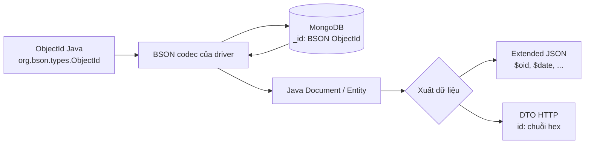

# ObjectId trong Java và biểu diễn Extended JSON

Trong ứng dụng dùng **Spring Data MongoDB**, trường `_id` định danh duy nhất một document trong collection. Ta có thể biểu diễn giá trị đó bằng `org.bson.types.ObjectId` trong Java, lưu dưới dạng **BSON ObjectId** trong MongoDB và xuất ra **Extended JSON** khi cần trao đổi hoặc kiểm tra dữ liệu. Ba biểu diễn này liên quan với nhau nhưng không đồng nhất: một chuỗi 24 ký tự trông giống ObjectId chưa chắc đã được lưu dưới kiểu BSON ObjectId.

Bài học thuộc chương **Định danh và trạng thái**, làm rõ cấu trúc ObjectId, vòng đời ID khi ghi/đọc bằng repository hoặc `MongoTemplate`, cơ chế ánh xạ `@Id`/`@MongoId`, hai chế độ Extended JSON và cách kiểm thử, xử lý lỗi thường gặp trong hệ thống Java.

## 1. Phân biệt định danh, kiểu BSON và cách hiển thị

Giả sử có hai document:

```javascript
// Document A: trường _id có kiểu BSON ObjectId.
{
  _id: ObjectId("674000000000000000000123"),
  customer_id: "KH-101",
  status: "NEW"
}

// Document B: trường _id có kiểu BSON String.
{
  _id: "674000000000000000000123",
  customer_id: "KH-102",
  status: "NEW"
}
```

Mặc dù ký tự bên trong nhìn giống nhau, **A và B có hai khóa `_id` khác kiểu**. MongoDB so sánh giá trị theo kiểu BSON; truy vấn `{_id: ObjectId("...")}` không tương đương truy vấn `{_id: "..."}`. Điều này đặc biệt quan trọng khi chuyển dữ liệu từ hệ thống cũ, viết truy vấn `$lookup`, xử lý đầu vào từ HTTP hoặc dùng Java `String` làm ID.

| Khái niệm | Ví dụ | Vai trò |
| --- | --- | --- |
| Java ObjectId | `new ObjectId("674000000000000000000123")` | Đối tượng Java do MongoDB BSON library cung cấp |
| BSON ObjectId | 12 byte, kiểu BSON ObjectId | Giá trị được driver mã hóa để lưu trữ/truyền tới MongoDB |
| Chuỗi hex | `"674000000000000000000123"` | Biểu diễn văn bản 24 ký tự của 12 byte |
| MongoDB Shell | `ObjectId("674000000000000000000123")` | Cú pháp JavaScript trong mongosh |
| Extended JSON | `{"$oid":"674000000000000000000123"}` | Biểu diễn JSON chuẩn hóa cho giá trị BSON ObjectId |
| JSON thông thường | `"674000000000000000000123"` | Một chuỗi; không mang thông tin kiểu BSON ObjectId |

**Định danh không đồng nghĩa trạng thái:** `_id` chủ yếu trả lời “document nào?”, còn các trường như `status`, `version`, `createdAt` mô tả nghiệp vụ và vòng đời dữ liệu. Một số byte trong ObjectId có thông tin thời gian tạo ID nhưng không thay thế trường thời gian nghiệp vụ.

## 2. Cấu trúc 12 byte của ObjectId

MongoDB ObjectId thường được tạo bởi driver. Giá trị có kích thước **12 byte**, hiển thị thành **24 ký tự thập lục phân** (mỗi byte tương ứng hai ký tự hex).

```text
ObjectId: 67400000 123456789a 00abcd
          └── 4B ──┘└── 5B ───┘└─3B─┘
           timestamp  random   counter
           (giây)     value
```

| Thành phần | Kích thước | Diễn giải |
| --- | ---: | --- |
| Timestamp | 4 byte | Số giây kể từ Unix epoch, được mã hóa trong ObjectId |
| Random value | 5 byte | Giá trị ngẫu nhiên được sinh một lần cho tiến trình tạo ID trong cơ chế sinh ObjectId thông thường |
| Counter | 3 byte | Bộ đếm tăng dần, bắt đầu từ giá trị ngẫu nhiên |
| **Tổng** | **12 byte** | Có thể biểu diễn bằng chuỗi hex 24 ký tự |

Đây là cấu trúc phổ biến của ObjectId hiện đại; phần 5 byte giữa không nên được diễn giải thành địa chỉ máy, PID hay định danh có thể dùng cho kiểm toán. ObjectId được thiết kế để có xác suất trùng rất thấp khi nhiều tiến trình cùng sinh khóa, nhưng **không phải cơ chế bảo mật hay bảo đảm thứ tự toàn cục tuyệt đối**.

ObjectId có đặc điểm hữu ích:

- Thường được sinh ở phía ứng dụng/driver trước khi insert, giúp biết ID trước khi document được ghi hoàn tất.
- Có timestamp độ phân giải **một giây**, hữu ích để nhận biết gần đúng lúc ID được tạo.
- Khi so sánh những ObjectId được sinh trong điều kiện thông thường, phần timestamp đầu thường cho thứ tự thời gian gần đúng.
- MongoDB tạo sẵn **unique index trên `_id`** của collection thông thường, bảo đảm không có hai document cùng một giá trị `_id` trong collection đó.

Tuy nhiên, ObjectId không thích hợp làm mật khẩu, access token, mã bí mật hoặc căn cứ duy nhất để phân quyền. Cũng không nên dùng timestamp trong ObjectId làm thời điểm server nhận ghi, vì đồng hồ nguồn sinh ID có thể khác nhau và ID có thể được tạo trước hoặc được nhập lại từ hệ thống khác.

## 3. Làm việc với `org.bson.types.ObjectId` trong Java

MongoDB Java Driver cung cấp `ObjectId` qua package `org.bson.types`.

### 3.1. Tạo mới, đọc chuỗi hex và thời gian

```java
import java.time.Instant;
import org.bson.types.ObjectId;

public class ObjectIdDemo {
    public static void main(String[] args) {
        ObjectId generated = new ObjectId();

        String hex = generated.toHexString();
        ObjectId parsed = new ObjectId(hex);

        boolean same = generated.equals(parsed);  // true
        int epochSeconds = generated.getTimestamp();
        Instant approximateCreationTime =
                generated.getDate().toInstant();

        System.out.println(hex);
        System.out.println("Equal IDs? " + same);
        System.out.println("Timestamp (seconds): " + epochSeconds);
        System.out.println("Approximate time: " + approximateCreationTime);
    }
}
```

`new ObjectId()` sinh giá trị mới. `new ObjectId(hex)` dựng lại cùng ID từ một chuỗi hex hợp lệ. `toHexString()` trả biểu diễn chuẩn dạng chữ thường, thích hợp để truyền qua API hoặc ghi vào URI. `getDate()` được tính từ timestamp nằm bên trong ObjectId, **không phải thời gian MongoDB xác nhận đã ghi**.

Để tránh hiểu nhầm khi hiển thị thời gian, Java `Instant` thể hiện một mốc UTC; giao diện người dùng có thể định dạng nó theo múi giờ hiển thị. Nếu nghiệp vụ cần độ chính xác millisecond hoặc theo dõi thao tác thực tế, hãy lưu `createdAt`/`updatedAt` riêng.

### 3.2. Kiểm tra chuỗi đầu vào

```java
import org.bson.types.ObjectId;

public final class ObjectIds {
    private ObjectIds() {}

    public static ObjectId parseRequired(String rawId) {
        if (rawId == null || !ObjectId.isValid(rawId)) {
            throw new IllegalArgumentException(
                    "ID phải là chuỗi hex ObjectId gồm 24 ký tự");
        }
        return new ObjectId(rawId);
    }
}
```

`ObjectId.isValid(String)` giúp xác nhận định dạng chuỗi hex 24 ký tự trước khi dựng đối tượng; chuỗi quá ngắn, chứa ký tự ngoài hệ hex hoặc `null` không phải một ObjectId hợp lệ. Với API web, có thể ánh xạ `IllegalArgumentException` do đầu vào sai định dạng thành **HTTP 400 Bad Request**; ID đúng định dạng nhưng không tìm thấy document thường dẫn tới **HTTP 404 Not Found**. Việc phân biệt hai trường hợp làm API rõ nghĩa và dễ chẩn đoán hơn.

**Định dạng hợp lệ không chứng minh document tồn tại**, càng không chứng minh người gọi được phép truy cập document đó. Sau khi parse, service vẫn phải kiểm tra phân quyền và điều kiện nghiệp vụ.

## 4. Ánh xạ `@Id ObjectId` trong Spring Data MongoDB

Một lựa chọn rõ ràng là sử dụng `ObjectId` làm kiểu ID trong entity Java.

```java
import java.time.Instant;
import org.bson.types.ObjectId;
import org.springframework.data.annotation.Id;
import org.springframework.data.mongodb.core.mapping.Document;
import org.springframework.data.mongodb.core.mapping.Field;

@Document(collection = "orders")
public class Order {
    @Id
    private ObjectId id;

    @Field("customer_id")
    private String customerId;

    private String status;
    private Instant createdAt;

    public Order() {}

    public Order(String customerId, String status, Instant createdAt) {
        this.customerId = customerId;
        this.status = status;
        this.createdAt = createdAt;
    }

    public ObjectId getId() { return id; }
    public String getCustomerId() { return customerId; }
    public String getStatus() { return status; }
    public Instant getCreatedAt() { return createdAt; }
}
```

`@Id` chỉ ra thuộc tính `id` của Java tương ứng với trường BSON `_id`; tên field `customerId` đổi thành `customer_id` nhờ `@Field`. `Instant` được chuyển đổi sang giá trị thời gian BSON theo cơ chế chuyển đổi đã cấu hình. Các constructor/getter trong ví dụ đủ để minh họa mô hình; có thể dùng constructor bất biến, record hoặc callback tùy kiến trúc.

Repository tương ứng phải dùng cùng **kiểu ID**:

```java
import org.bson.types.ObjectId;
import org.springframework.data.mongodb.repository.MongoRepository;

public interface OrderRepository
        extends MongoRepository<Order, ObjectId> {
}
```

Tạo và tìm theo ID:

```java
import java.time.Instant;
import java.util.Optional;
import org.bson.types.ObjectId;

Order draft = new Order("KH-101", "NEW", Instant.now());
Order saved = orderRepository.save(draft);

ObjectId id = saved.getId();
String idForHttp = id.toHexString();

Optional<Order> loaded =
        orderRepository.findById(new ObjectId(idForHttp));
```

Trong trường hợp insert document mới không có ID, Spring Data/driver có thể sinh ObjectId và gán lại cho entity trong quá trình lưu. Giá trị `saved.getId()` dùng để liên hệ document vừa ghi với request hoặc tài nguyên API. Với thao tác `save` trên một entity đã có ID, Spring Data sẽ quyết định đường ghi theo trạng thái entity; không nên mặc định mọi lần gọi `save` là insert.

### 4.1. Dùng `MongoTemplate` với ID

```java
import org.bson.types.ObjectId;
import org.springframework.data.mongodb.core.MongoTemplate;
import org.springframework.data.mongodb.core.query.Criteria;
import org.springframework.data.mongodb.core.query.Query;

ObjectId id = ObjectIds.parseRequired(idFromRequest);

Order byId = mongoTemplate.findById(id, Order.class);

Query query = Query.query(Criteria.where("id").is(id));
Order viaQuery = mongoTemplate.findOne(query, Order.class);
```

Hai cách trên đều làm việc với `Order` có `@Id ObjectId`. Khi dùng `Criteria.where("id")` trong ngữ cảnh `Order.class`, Spring Data ánh xạ property `id` sang trường lưu trữ `_id`; khi truy vấn trực tiếp qua mongosh hoặc driver native, dùng tên thực tế `_id`.

```javascript
db.orders.findOne({
  _id: ObjectId("674000000000000000000123")
});
```

Đối với ID có kiểu BSON ObjectId, truy vấn sau không tương đương:

```javascript
// Đây là BSON String, không phải ObjectId.
db.orders.findOne({
  _id: "674000000000000000000123"
});
```

Nếu `findById` trả rỗng dù document tồn tại, hãy kiểm tra **database/collection**, kiểu BSON của `_id`, giá trị truyền vào và quy tắc mapping của entity trước khi kết luận MongoDB bị lỗi.

## 5. Khi Java dùng `String id`: khác nhau giữa `@Id` và `@MongoId`

Vì HTTP path parameter và JSON API thường dùng chuỗi, một số ứng dụng khai báo `String id` trên entity. Spring Data MongoDB có quy tắc chuyển đổi ID cần hiểu rõ.

```java
import org.springframework.data.annotation.Id;
import org.springframework.data.mongodb.core.mapping.Document;

@Document("string_id_examples")
class OrderWithStringId {
    @Id
    private String id;
}
```

Theo quy tắc mapping mặc định, `@Id String` sẽ được chuyển thành BSON ObjectId **nếu giá trị chuỗi có thể chuyển đổi thành ObjectId**; với giá trị không chuyển đổi được, giá trị có thể được lưu dưới dạng BSON String. Vì vậy cùng một entity Java `String id` có khả năng dẫn tới collection chứa **nhiều kiểu BSON của `_id`** nếu ứng dụng tạo ID không nhất quán.

Spring Data còn có `@MongoId` để khai báo rõ hơn cách xử lý kiểu dữ liệu của trường ID:

```java
import org.springframework.data.mongodb.core.mapping.Document;
import org.springframework.data.mongodb.core.mapping.FieldType;
import org.springframework.data.mongodb.core.mapping.MongoId;

@Document("external_orders")
class ExternalOrder {
    @MongoId(FieldType.STRING)
    private String id;
}

@Document("object_id_orders")
class OrderWithExplicitObjectId {
    @MongoId(FieldType.OBJECT_ID)
    private String id;
}
```

| Cách khai báo | Cách hiểu và lựa chọn |
| --- | --- |
| `@Id ObjectId id` | Java và BSON đều dùng ObjectId; dễ quan sát kiểu, repository nhận `ObjectId` |
| `@Id String id` | Cho phép ứng dụng dùng chuỗi, nhưng có quy tắc chuyển đổi chuỗi hex hợp lệ sang BSON ObjectId |
| `@MongoId String id` | Mặc định giữ kiểu theo giá trị khai báo, tránh phép chuyển đổi chuỗi sang ObjectId của `@Id` |
| `@MongoId(FieldType.STRING) String id` | Diễn đạt rõ mục đích lưu ID dưới dạng BSON String |
| `@MongoId(FieldType.OBJECT_ID) String id` | Yêu cầu chuyển đổi theo BSON ObjectId khi giá trị phù hợp; cần kiểm chứng xử lý giá trị không chuyển được theo cấu hình/phiên bản |

Không thay annotation định danh tùy tiện trên dữ liệu đang vận hành. Thay `@Id String` thành `@MongoId(FieldType.STRING)` có thể khiến các truy vấn sau triển khai dùng **BSON String** để tìm những document `_id` trước đó được lưu là **BSON ObjectId**, dẫn đến không tìm thấy dữ liệu.

**Khuyến nghị thực hành:** chọn một chiến lược ID cho mỗi collection, mô tả kiểu BSON mong muốn, cố định việc sinh và parse ID tại ranh giới API, rồi kiểm thử round-trip với MongoDB thực.

## 6. BSON, JSON thông thường và MongoDB Extended JSON

BSON hỗ trợ những kiểu dữ liệu mà JSON chuẩn không thể hiện đầy đủ, ví dụ `ObjectId`, `Date`, `Int32`, `Int64`, `Decimal128`, binary và timestamp của MongoDB. Khi xuất sang văn bản JSON, ta cần quy ước để **bảo toàn kiểu**.

**MongoDB Extended JSON phiên bản 2 (EJSON v2)** định nghĩa cách biểu diễn các kiểu BSON bằng đối tượng JSON chứa khóa mở đầu bằng `$`, ví dụ:

```json
{
  "_id": {
    "$oid": "674000000000000000000123"
  },
  "customer_id": "KH-101",
  "status": "NEW"
}
```

Ở đây `{"$oid":"..."}` là cách **biểu diễn giá trị BSON ObjectId trong Extended JSON**. Dấu `$oid` không có nghĩa MongoDB lưu nguyên một subdocument chứa trường tên `$oid` trong `_id`. Sau khi parse đúng theo EJSON, giá trị của `_id` là BSON ObjectId.

### 6.1. Relaxed Extended JSON và Canonical Extended JSON

Hai chế độ EJSON v2 được dùng phổ biến:

- **Relaxed:** ưu tiên JSON dễ đọc và tương thích hơn; một số kiểu số được biểu diễn thành số JSON thông thường khi thích hợp.
- **Canonical:** diễn đạt kiểu BSON rõ ràng, thuận tiện khi cần round-trip type fidelity, ví dụ phân biệt Int32 với Int64.

| Kiểu BSON | Relaxed EJSON v2 (ví dụ) | Canonical EJSON v2 (ví dụ) |
| --- | --- | --- |
| ObjectId | `{"$oid":"674000000000000000000123"}` | Giống Relaxed |
| Int32 (42) | `42` | `{"$numberInt":"42"}` |
| Int64 (42) | `42` | `{"$numberLong":"42"}` |
| Double (3.5) | `3.5` | `{"$numberDouble":"3.5"}` |
| Decimal128 (19.90) | `{"$numberDecimal":"19.90"}` | Giống Relaxed |
| BSON Date ở `2024-01-01T00:00:00Z` | `{"$date":"2024-01-01T00:00:00Z"}` | `{"$date":{"$numberLong":"1704067200000"}}` |

Một document có nhiều loại dữ liệu, diễn đạt ở dạng Canonical EJSON:

```json
{
  "_id": {"$oid": "674000000000000000000123"},
  "quantity": {"$numberInt": "2"},
  "totalVnd": {"$numberLong": "1250000"},
  "createdAt": {
    "$date": {"$numberLong": "1704067200000"}
  },
  "status": "PAID"
}
```

Trong Relaxed EJSON, nhiều kiểu số mất ký hiệu phân biệt khi xuất thành JSON number. Khi JavaScript hoặc một hệ thống trung gian xử lý các số nguyên lớn hơn giới hạn integer an toàn của JavaScript (`2^53 - 1`), việc round-trip có thể mất độ chính xác. Với dữ liệu trao đổi đòi hỏi bảo toàn chính xác kiểu, hãy chọn Canonical EJSON hoặc hợp đồng API quy định chuyển giá trị lớn thành chuỗi.

### 6.2. Cú pháp mongosh không đồng nghĩa văn bản Extended JSON

Trong MongoDB Shell, ví dụ:

```javascript
ObjectId("674000000000000000000123")
ISODate("2024-01-01T00:00:00Z")
NumberLong("1250000")
```

Đây là những biểu thức/cách hiển thị trong môi trường **mongosh**, không phải văn bản JSON chuẩn. Không gửi `ObjectId("...")` vào một JSON parser rồi mong nó hiểu kiểu BSON. Ngược lại, dùng chuỗi JSON thông thường `"674..."` cũng không tự khôi phục kiểu ObjectId nếu không có logic chuyển đổi.

## 7. Chuyển BSON Document sang Extended JSON trong Java

Để tạo Extended JSON, hãy dùng chức năng mã hóa của BSON library thay vì tự ghép chuỗi `$oid` và các trường số/ngày. Ví dụ sau dùng `org.bson.Document`, `JsonWriterSettings` và `JsonMode`:

```java
import java.time.Instant;
import java.util.Date;
import org.bson.Document;
import org.bson.json.JsonMode;
import org.bson.json.JsonWriterSettings;
import org.bson.types.ObjectId;

public class ExtendedJsonDemo {
    public static void main(String[] args) {
        ObjectId id = new ObjectId("674000000000000000000123");

        Document document = new Document("_id", id)
            .append("quantity", 2)
            .append("totalVnd", 1_250_000L)
            .append("createdAt",
                Date.from(Instant.parse("2024-01-01T00:00:00Z")));

        JsonWriterSettings relaxed = JsonWriterSettings.builder()
            .outputMode(JsonMode.RELAXED)
            .build();

        JsonWriterSettings canonical = JsonWriterSettings.builder()
            .outputMode(JsonMode.EXTENDED)
            .build();

        String relaxedJson = document.toJson(relaxed);
        String canonicalJson = document.toJson(canonical);

        Document restored = Document.parse(canonicalJson);
        ObjectId restoredId = restored.getObjectId("_id");

        System.out.println(relaxedJson);
        System.out.println(canonicalJson);
        System.out.println(id.equals(restoredId)); // true
    }
}
```

Trong Java Driver, `JsonMode.EXTENDED` là chế độ mã hóa **Canonical Extended JSON**. `Document.parse(...)` hiểu các wrapper EJSON hợp lệ và dựng giá trị BSON tương ứng, ví dụ `getObjectId("_id")` cho ID đã khôi phục. Với dữ liệu từ nguồn không tin cậy, vẫn phải kiểm tra cấu trúc, kích thước và schema trước khi đưa vào truy vấn hoặc ghi.

Thành phần `Document.toJson()` dùng định dạng JSON được BSON library hỗ trợ; khi cần bảo đảm chế độ cụ thể, nên truyền `JsonWriterSettings` rõ ràng. Đừng tự suy ra rằng framework HTTP/JSON khác cũng sẽ sử dụng EJSON: serializer của Jackson, JSON-B hay một API gateway có thể tạo biểu diễn khác.



Sơ đồ tách hai mục tiêu khác nhau: **EJSON** hướng tới biểu diễn BSON có thông tin kiểu, còn **DTO HTTP** hướng tới hợp đồng JSON đơn giản, ổn định cho client của ứng dụng.

## 8. Thiết kế API: khi nào trả chuỗi hex, khi nào trả Extended JSON?

Đối với REST API thông thường, một DTO với ID dạng chuỗi thường dễ dùng hơn:

```java
public record OrderResponse(
    String id,
    String status,
    String customerId
) {
    public static OrderResponse from(Order order) {
        return new OrderResponse(
            order.getId().toHexString(),
            order.getStatus(),
            order.getCustomerId()
        );
    }
}
```

JSON gửi cho frontend:

```json
{
  "id": "674000000000000000000123",
  "status": "NEW",
  "customerId": "KH-101"
}
```

Đây là hợp đồng ứng dụng: frontend thấy một **string ID** nhưng backend vẫn lưu BSON ObjectId. Với API kiểu này, server có trách nhiệm parse ID ở đầu vào rồi xử lý lỗi rõ ràng:

```java
public OrderResponse loadOrder(String pathId) {
    ObjectId id = ObjectIds.parseRequired(pathId);

    Order order = orderRepository.findById(id)
        .orElseThrow(() ->
            new OrderNotFoundException("Không tìm thấy đơn hàng"));

    return OrderResponse.from(order);
}
```

`OrderNotFoundException` là lỗi nghiệp vụ minh họa cần định nghĩa và ánh xạ HTTP thích hợp. Đối với những API không cần bảo toàn toàn bộ kiểu BSON, không bắt buộc công khai `$oid` ra ngoài. Trái lại, khi xây dựng công cụ **export/import dữ liệu MongoDB**, audit kỹ thuật hoặc giao thức có quy định EJSON, wrapper `$oid` rất hữu ích.

### Chú ý khi dùng Jackson

Không nên giả định rằng chỉ cần trả một entity chứa `ObjectId id` từ Spring MVC/WebFlux thì JSON sẽ luôn thành `{"$oid":"..."}` hoặc luôn thành chuỗi hex. Kết quả tùy serializer và cấu hình. Hãy dùng DTO hoặc cấu hình serialization có chủ đích, và có test hợp đồng HTTP để kiểm tra đúng hình dạng JSON mà client nhận được.

## 9. Truy vấn, index, aggregation và tham chiếu liên quan đến ObjectId

### 9.1. Index `_id`

Trong collection MongoDB thông thường, unique index `_id` được MongoDB duy trì. Tra cứu chính xác bằng `_id` thường hiệu quả khi cung cấp đúng kiểu và giá trị. Tuy nhiên, không nên suy luận tất cả truy vấn trên `customer_id`, `status` hoặc collection liên kết đều nhanh chỉ vì collection có index `_id`: các trường đó cần thiết kế index theo truy vấn riêng.

```javascript
db.orders
  .find({_id: ObjectId("674000000000000000000123")})
  .explain("executionStats");
```

Đọc `winningPlan`, `nReturned`, `totalKeysExamined`, `totalDocsExamined` để quan sát tình huống thực tế. Truy vấn `_id` sai kiểu có thể trả rỗng dù index vẫn hoạt động đúng.

### 9.2. `$lookup` cần trùng cả giá trị và kiểu BSON

Ví dụ bảng `order_items` lưu `order_id` để trỏ tới `orders._id`:

```javascript
// orders:
{ _id: ObjectId("674000000000000000000123"), status: "NEW" }

// order_items:
{
  _id: ObjectId("674000000000000000000456"),
  order_id: ObjectId("674000000000000000000123"),
  sku: "SKU-01"
}
```

Nếu `order_items.order_id` bị lưu thành `"674000..."` (BSON String), một `$lookup` so bằng `order_id` và `_id` sẽ không khớp với ObjectId ở collection cha. Giữ một kiểu ID ổn định giữa các collection liên kết hoặc triển khai migration rõ ràng.

Trong Java, `ObjectId` cũng có thể dùng làm kiểu field tham chiếu:

```java
@Document("order_items")
class OrderItem {
    @Id
    private ObjectId id;

    @Field("order_id")
    private ObjectId orderId;

    private String sku;
}
```

Với trường `orderId` trên, dữ liệu được lưu thành BSON ObjectId; MongoDB không tự tạo khóa ngoại hay bảo đảm `orderId` chắc chắn trỏ tới một document đang tồn tại. Quy tắc toàn vẹn và xử lý xóa cha là trách nhiệm thiết kế ứng dụng hoặc quy trình transaction tương ứng.

### 9.3. Sắp xếp và lọc theo thời gian bằng ObjectId

Vì 4 byte đầu chứa timestamp theo giây, `_id` ObjectId có thể cung cấp **thứ tự thời gian gần đúng**. Ví dụ `sort({_id: -1})` thường hữu ích khi ID được sinh theo trình tự thông thường và chỉ cần thứ tự ước lượng.

Tuy nhiên, trong cùng một giây, giữa các tiến trình/máy khác nhau, hoặc khi ID được tạo trước rồi nhập lại sau, thứ tự ObjectId **không tương ứng chắc chắn** với thời điểm ghi hay thời điểm nghiệp vụ. Nếu yêu cầu phân trang theo “thời điểm tạo đơn” chính xác, hãy lưu `createdAt` riêng, tạo index phù hợp và dùng `_id` làm khóa phụ ổn định:

```javascript
db.orders.createIndex({ createdAt: -1, _id: -1 });

db.orders.find({status: "PAID"})
  .sort({createdAt: -1, _id: -1})
  .limit(20);
```

Ví dụ index trên hỗ trợ thứ tự sắp xếp theo `createdAt` và `_id`, nhưng truy vấn còn lọc `status`; cần đo `explain` trên dữ liệu thật và cân nhắc compound index có `status` nếu đây là access pattern phổ biến. Không tự động coi ObjectId là `createdAt` hoặc dùng timestamp ObjectId làm tiêu chí duy nhất để đặt TTL index.

## 10. Chuyển đổi từ `String` sang `ObjectId` trên hệ thống đang có dữ liệu

Trường hợp dễ gặp: hệ thống trước đây lưu `_id` là chuỗi, sau đó entity Java đổi sang `ObjectId`. Đây là **thay đổi schema dữ liệu**, không chỉ thay một kiểu Java.

Trước khi chuyển đổi:

1. Kiểm tra kiểu `_id` thực tế trên MongoDB (`objectId`, `string` hay lẫn cả hai), và xem các collection đang tham chiếu ID qua trường nào.
2. Quyết định kiểu ID đích và cách ánh xạ API; xác định xem ID hiện hữu có thể biểu diễn bằng ObjectId hợp lệ hay không.
3. Tạo kế hoạch migration dữ liệu có kiểm soát, chuyển/cập nhật tham chiếu, unique constraint và tính tương thích giữa các phiên bản ứng dụng.
4. Kiểm thử tìm kiếm, `$lookup`, aggregation, update, xóa và phân trang với dữ liệu đại diện trước khi chuyển production.

Không dùng thao tác `$set: {_id: ...}` để đổi kiểu `_id` trên document đã tồn tại: **MongoDB không cho sửa giá trị `_id` của document**. Việc đổi sang một ID khác cần quá trình tạo document đích, cập nhật mọi tham chiếu liên quan, xác minh và xử lý document cũ theo kế hoạch dữ liệu.

Nếu dữ liệu đang có `String` ID nghiệp vụ như `"ORDER-2026-001"`, không thể ép chuỗi đó thành ObjectId mà giữ nguyên giá trị. Khi đó nên giữ ID nghiệp vụ trong field riêng (ví dụ `orderNumber`) và dùng `_id` kiểu ObjectId nếu thật sự cần, hoặc tiếp tục dùng BSON String làm `_id` một cách nhất quán.

## 11. Kiểm thử ObjectId và Extended JSON

### 11.1. Unit test định dạng và round-trip

Ví dụ với JUnit 5 và BSON library:

```java
import static org.junit.jupiter.api.Assertions.*;

import org.bson.Document;
import org.bson.json.JsonMode;
import org.bson.json.JsonWriterSettings;
import org.bson.types.ObjectId;
import org.junit.jupiter.api.Test;

class ObjectIdMappingTest {
    @Test
    void shouldRoundTripThroughCanonicalExtendedJson() {
        ObjectId id = new ObjectId("674000000000000000000123");
        Document source = new Document("_id", id);

        String json = source.toJson(
            JsonWriterSettings.builder()
                .outputMode(JsonMode.EXTENDED)
                .build()
        );

        Document restored = Document.parse(json);

        assertTrue(json.contains("\"$oid\""));
        assertEquals(id, restored.getObjectId("_id"));
        assertEquals(24, id.toHexString().length());
    }

    @Test
    void shouldRejectMalformedObjectIdText() {
        assertFalse(ObjectId.isValid("not-an-object-id"));
        assertThrows(IllegalArgumentException.class,
            () -> new ObjectId("not-an-object-id"));
    }
}
```

Đây là unit test đối với BSON serialization và định dạng đầu vào. Nó **không xác minh** ánh xạ `@Id String` hay `@MongoId` của Spring Data khi đọc/ghi trên server.

### 11.2. Integration test với MongoDB thật

Khi dùng Testcontainers hoặc một MongoDB dành riêng cho test, nên xác minh:

- `repository.save(order)` với `@Id ObjectId` tạo `_id` BSON ObjectId và `findById(ObjectId)` đọc lại đúng entity.
- `@Id String`, `@MongoId(FieldType.STRING)` và `@MongoId(FieldType.OBJECT_ID)` có hành vi lưu và truy vấn phù hợp hợp đồng kiểu dữ liệu đã chọn.
- Truy vấn native bằng `ObjectId("...")` và chuỗi `"..." ` không bị nhầm lẫn.
- Xuất Canonical/Relaxed EJSON rồi parse lại bảo toàn ObjectId; khi có Int32/Int64/Date thì kiểm tra kiểu và giá trị tương ứng.
- API HTTP trả ID trong đúng cấu trúc mong đợi và xử lý ID không hợp lệ thành lỗi rõ ràng.
- Nếu có tham chiếu giữa collection, `$lookup` và index vẫn hoạt động sau các lần migration.

Ví dụ phân tích kiểu `_id` trực tiếp trên MongoDB Shell:

```javascript
db.orders.aggregate([
  { $group: { _id: { $type: "$_id" }, count: { $sum: 1 } } },
  { $sort: { count: -1 } }
]);
```

Kết quả có thể phân nhóm `"objectId"` và `"string"` nếu collection đã từng ghi bằng các chiến lược khác nhau. Đây là tín hiệu quan trọng trước khi đổi mapping, cập nhật query hoặc thêm tham chiếu.

## 12. Những lỗi dễ gặp và cách xử lý

| Hiện tượng | Nguyên nhân khả dĩ | Hướng kiểm tra |
| --- | --- | --- |
| Query theo `_id` không thấy document, nhưng Shell vẫn hiện dữ liệu | BSON String và BSON ObjectId bị dùng lẫn | Dùng `$type` kiểm tra `_id`, so kiểu của điều kiện và field |
| `new ObjectId(rawId)` ném `IllegalArgumentException` | Chuỗi không phải 24 ký tự hex hợp lệ | Validate tại ranh giới API, trả HTTP 400 |
| REST JSON có dạng ngoài dự kiến | Serializer của HTTP framework khác BSON EJSON codec | Dùng DTO hoặc cấu hình JSON serialization rõ ràng |
| Xuất rồi nhập số nguyên lớn bị sai | Relaxed JSON đi qua hệ thống dùng số dấu phẩy động không đủ chính xác | Dùng Canonical EJSON hoặc hợp đồng dữ liệu giữ số lớn dưới dạng chuỗi |
| `@Id String` đọc được một số ID nhưng mất một số khác | Collection trộn `string`/`objectId` hoặc thay annotation | Kiểm tra mapping và dữ liệu thực tế; lập kế hoạch migration |
| Sắp xếp `_id` khác thứ tự ghi | ObjectId được sinh tại các thời điểm/tiến trình khác nhau | Có `createdAt` riêng và tie-breaker khi nghiệp vụ cần thứ tự chắc chắn |
| Tưởng `$oid` là field thực trong document | Nhầm EJSON serialization với BSON lưu trữ | Dùng BSON codec và kiểm tra loại giá trị thay vì tự ghép JSON |
| Chỉ nhìn `_id` rồi cấp quyền truy cập | Đồng nhất định danh với xác thực/ủy quyền | Luôn kiểm tra user/tenant và quy tắc phân quyền |

## 13. Tự đánh giá và thực hành

**Câu 1.** Vì sao `"674000000000000000000123"` trong JSON không tương đương `{"$oid":"674000000000000000000123"}`?  
**Đáp án:** trường hợp đầu là JSON String; trường hợp sau là biểu diễn EJSON có tag để khôi phục BSON ObjectId.

**Câu 2.** Với `@Id ObjectId id`, repository phải khai báo `MongoRepository<Order, String>` hay `MongoRepository<Order, ObjectId>`?  
**Đáp án:** `MongoRepository<Order, ObjectId>` để kiểu tham số `findById` đúng với thuộc tính ID.

**Câu 3.** Đổi entity `@Id String id` thành `@MongoId(FieldType.STRING) String id` khi collection đang chứa BSON ObjectId có an toàn không?  
**Đáp án:** không thể mặc định là an toàn; cần xác minh kiểu BSON thực, cách query được mapping và migration nếu cần.

**Câu 4.** `ObjectId.getDate()` có phải thời điểm MongoDB đã commit một transaction?  
**Đáp án:** không; đó là mốc thời gian gần đúng được mã hóa khi ID được sinh, có độ phân giải giây và có thể khác thời điểm server ghi.

**Câu 5.** Vì sao nên dùng Canonical EJSON khi trao đổi dữ liệu Int64 với hệ thống JavaScript cần giữ nguyên kiểu?  
**Đáp án:** Canonical EJSON dùng `$numberLong` để bảo toàn thông tin kiểu và biểu diễn giá trị bằng chuỗi, tránh bị diễn giải nhầm thành JSON number kém chính xác.

**Bài thực hành:** tạo một entity có `@Id ObjectId`, lưu bằng `MongoRepository`, lấy `toHexString()` trả ra API, parse lại từ request bằng `ObjectId.isValid` và `new ObjectId(...)`, truy vấn đọc theo ID, sau đó dùng `Document.toJson(JsonWriterSettings)` để in cả Relaxed và Canonical EJSON. So sánh `_id` bằng hai điều kiện `ObjectId(...)` và `"..." ` trong mongosh; cuối cùng kiểm tra round-trip bằng test.

Khi phân tích một vấn đề định danh trong Spring Data MongoDB, hãy theo dõi rõ **bốn lớp**: thuộc tính Java (`ObjectId` hoặc `String`) → quy tắc mapping (`@Id`/`@MongoId`) → **kiểu BSON thật của `_id`** → định dạng xuất (`$oid` trong EJSON hoặc chuỗi trong API). Làm rõ bốn lớp này giúp tránh nhầm kiểu truy vấn, mất dữ liệu khi đổi schema và sai lệch khi trao đổi MongoDB document giữa các hệ thống.
