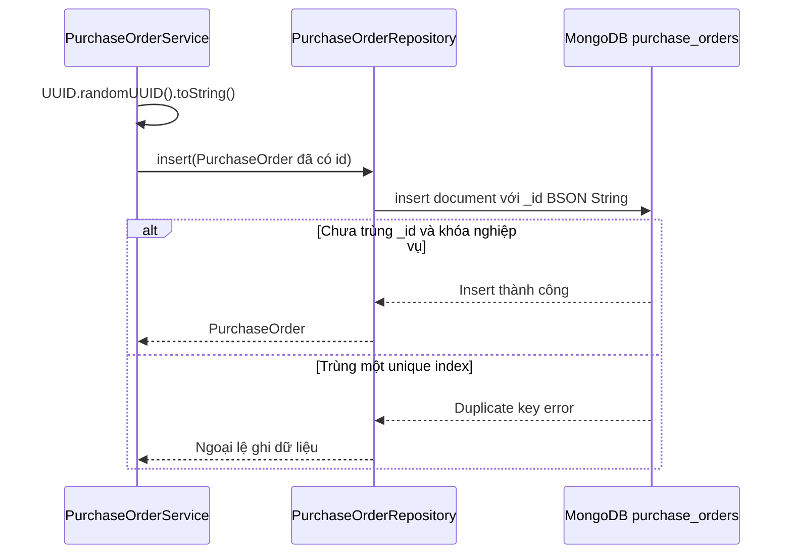

# UUID, mã nghiệp vụ và ID do ứng dụng tự cấp

## 1. Bài toán định danh trong Spring Data MongoDB

Khi làm việc với **Spring Data MongoDB**, mỗi document trong một collection MongoDB đều có trường định danh đặc biệt `_id`. Trong ứng dụng Java, ta thường ánh xạ trường này thành thuộc tính như `id` rồi dùng `MongoRepository<Entity, IdType>` hoặc `MongoTemplate` để lưu và truy vấn.

Tuy nhiên, `_id` không nhất thiết phải là `ObjectId` do MongoDB hoặc driver tạo. Một ứng dụng có thể **tự cấp ID**, chẳng hạn UUID, mã chuỗi hoặc số được sinh từ một dịch vụ cấp phát định danh. Đồng thời, đối tượng nghiệp vụ có thể có **mã riêng** như `SO-2026-00421` để khách hàng tra cứu. Ba câu hỏi sau phải được trả lời độc lập:

1. **Document này được định danh kỹ thuật bằng giá trị nào?** Ví dụ `_id` là UUID dạng chuỗi.
2. **Người dùng hoặc hệ thống bên ngoài nhận diện nó bằng mã nào?** Ví dụ số đơn hàng `SO-2026-00421`.
3. **Ai cấp ID, vào lúc nào và làm sao tránh trùng?** MongoDB/driver có thể cấp ObjectId; ứng dụng cũng có thể tạo UUID trước khi ghi.

Mục tiêu của bài là thiết kế định danh rõ ràng cho entity, chọn cách biểu diễn UUID phù hợp, viết repository an toàn khi ID đã được cấp trước, đặt ràng buộc duy nhất cho mã nghiệp vụ và kiểm thử bằng dữ liệu BSON thật.

## 2. `_id`, `@Id` và khóa nghiệp vụ không đồng nghĩa

Trong MongoDB:

- Mỗi document có trường `_id`; giá trị của `_id` là duy nhất **trong phạm vi collection**.
- Một collection thường có **unique index** mặc định trên `_id`.
- `_id` có thể là `ObjectId`, chuỗi, số, giá trị UUID được mã hóa dưới dạng BSON Binary, hoặc kiểu hợp lệ khác theo ràng buộc MongoDB. Kiểu BSON thực tế là một phần của định danh.
- Nếu ứng dụng chèn document mà không cung cấp `_id`, MongoDB driver thường tạo `ObjectId`. Nếu đã cung cấp `_id`, MongoDB dùng giá trị được cung cấp và kiểm tra trùng trong collection.

Trong Spring Data MongoDB, annotation:

```java
import org.springframework.data.annotation.Id;

@Id
private String id;
```

đánh dấu property Java làm định danh và ánh xạ nó đến `_id`. **Kiểu Java `String` không bảo đảm `_id` sẽ được lưu bằng BSON String**: với quy tắc chuyển đổi của `@Id`, một chuỗi trông như ObjectId hợp lệ có thể được chuyển thành BSON ObjectId. Sự khác biệt này đặc biệt quan trọng khi ứng dụng nhận ID từ nguồn ngoài.

Trong cùng một document đơn hàng, ta có thể lưu cả hai loại định danh:

```javascript
{
  _id: "c971248e-8a88-43f0-94ae-6b8f9e4d1bf7",
  tenant_id: "SHOP-A",
  order_no: "SO-2026-00421",
  status: "CREATED",
  total_minor: NumberLong("350000")
}
```

Ở đây `_id` là định danh kỹ thuật độc lập; cặp `(tenant_id, order_no)` là **khóa nghiệp vụ** để tra cứu trong ngữ cảnh cửa hàng. Mã đơn có thể được hiển thị cho người dùng, còn ID kỹ thuật có thể lưu trong URL nội bộ hoặc sự kiện hệ thống.

| Khía cạnh | `_id` kỹ thuật | Mã nghiệp vụ, ví dụ `order_no` |
| --- | --- | --- |
| Mục đích | Nhận diện chính xác document trong collection | Giao tiếp với người dùng hoặc hệ thống nghiệp vụ |
| Tính duy nhất | MongoDB bảo đảm trong collection | Phải xác định phạm vi: toàn hệ thống hay từng tenant |
| Khả năng đổi | Nên bất biến; `_id` không được cập nhật trực tiếp | Có thể cần đổi khi nghiệp vụ sửa quy tắc |
| Định dạng | ObjectId, UUID, chuỗi hoặc loại BSON hợp lệ | Số đơn, mã hóa đơn, SKU, mã khách hàng |
| Tra cứu | `findById(...)` | Derived query hoặc `MongoTemplate` theo trường nghiệp vụ |
| Index | Có sẵn unique index trên `_id` | Cần index riêng nếu muốn tra cứu nhanh/bảo đảm duy nhất |

**Quy tắc nền tảng:** không dùng mã nghiệp vụ làm `_id` chỉ vì cả hai cùng “duy nhất” ở hiện tại. Hãy kiểm tra xem mã đó có thể đổi, có bị tái sử dụng, có khác nhau giữa tenant hoặc có phụ thuộc vào quy trình cấp số hay không.

## 3. Các lựa chọn ID và cách cân nhắc

| Lựa chọn | Ví dụ BSON | Ai cấp? | Phù hợp khi | Điểm cần lưu ý |
| --- | --- | --- | --- | --- |
| ObjectId | `ObjectId("507f1f77bcf86cd799439011")` | Thường là driver | Cần ID kỹ thuật đơn giản, không cần tự quản lý | Có thông tin thời gian tạo gần đúng; không phải bí mật hay cơ chế phân quyền |
| UUID v4 dạng String | `"c971248e-8a88-43f0-94ae-6b8f9e4d1bf7"` | Ứng dụng | Muốn có ID trước khi lưu; dễ truyền qua JSON/log | Tốn dung lượng hơn dạng binary; UUID v4 không mang thứ tự thời gian |
| UUID dạng BSON Binary | BSON Binary subtype 4 | Ứng dụng | Cần lưu UUID dạng binary chuẩn giữa các hệ thống | Phải thống nhất `UuidRepresentation` giữa driver, công cụ và dịch vụ |
| Mã nghiệp vụ làm `_id` | `"SO-2026-00421"` | Quy trình nghiệp vụ | Mã bất biến và duy nhất toàn collection | Dễ xung đột khi nhiều tenant; đổi mã đồng nghĩa thay định danh |
| Chuỗi ID từ hệ thống ngoài | `"crm-customer-789"` | Dịch vụ nguồn | Đồng bộ thực thể với nguồn sở hữu ID | Chuẩn hóa, xung đột không gian tên và cơ chế ghi lại |

Trong nhiều hệ thống, lựa chọn dễ bảo trì là **`_id` kỹ thuật ổn định + mã nghiệp vụ nằm trong trường riêng**. Đó là một quyết định thiết kế, không phải yêu cầu bắt buộc của MongoDB.

### ObjectId có những đặc điểm gì?

`ObjectId` có kích thước BSON 12 byte và chứa thành phần timestamp; vì thế các ID được sinh theo thời gian thường có xu hướng tăng. Tuy nhiên, thứ tự ObjectId **không phải cơ chế đảm bảo thứ tự sự kiện chính xác tuyệt đối** giữa mọi máy hoặc mọi tiến trình. Đừng dùng timestamp nhúng trong ObjectId thay cho trường thời gian nghiệp vụ như `created_at`; cũng không dùng việc ID khó đoán làm cơ chế cấp quyền.

### UUID có những đặc điểm gì?

`UUID.randomUUID()` trong Java sinh UUID phiên bản 4 ngẫu nhiên:

```java
import java.util.UUID;

String generatedId = UUID.randomUUID().toString();
System.out.println(generatedId);
```

Giá trị thường có 36 ký tự kể cả dấu gạch nối. UUID v4 có xác suất va chạm rất thấp nếu bộ sinh ngẫu nhiên hoạt động đúng, nhưng **không có nghĩa cơ sở dữ liệu được bỏ qua ràng buộc duy nhất**: MongoDB vẫn kiểm tra `_id`. UUID v4 cũng không có thứ tự theo thời gian; workload chèn dày đặc cần đo tác động lên index và kích thước lưu trữ.

Các biến thể UUID có thứ tự thời gian, ví dụ UUID v7, có thể hữu ích ở một số hệ thống, nhưng việc chọn biến thể phải thống nhất cách tạo, thư viện và cách so sánh. Bài thực hành dùng UUID v4 từ JDK vì dễ hiểu và có sẵn.

## 4. UUID dạng String và UUID dạng BSON Binary

Hai tài liệu dưới đây **không có cùng kiểu định danh BSON** dù con người có thể đọc chúng là cùng một UUID:

```javascript
// Phương án A: chuỗi BSON
{
  _id: "c971248e-8a88-43f0-94ae-6b8f9e4d1bf7",
  status: "CREATED"
}

// Phương án B: UUID dạng BSON Binary chuẩn subtype 4
{
  _id: UUID("c971248e-8a88-43f0-94ae-6b8f9e4d1bf7"),
  status: "CREATED"
}
```

Trong `mongosh`, `UUID("...")` là hàm dựng biểu diễn UUID dạng BSON Binary, không phải một giá trị String. Khi truy vấn `_id`, giá trị và **kiểu BSON** cần khớp với dữ liệu đã lưu. Một câu lệnh tìm bằng chuỗi không mặc nhiên truy cập được document có `_id` kiểu Binary.

| Tiêu chí | UUID dưới dạng BSON String | UUID dưới dạng BSON Binary subtype 4 |
| --- | --- | --- |
| Dễ đọc trong log và JSON | Rất thuận tiện | Thường cần chuyển sang chuỗi khi hiển thị |
| Chi phí lưu | Chuỗi dài hơn | Biểu diễn nhị phân gọn hơn |
| Tương tác trực tiếp từ `mongosh` | Dùng chuỗi | Dùng `UUID("...")` hoặc biểu diễn binary phù hợp |
| Cấu hình driver | Không cần chọn biểu diễn UUID binary nếu property luôn là String | Cần thống nhất chuẩn `UuidRepresentation.STANDARD` |
| Rủi ro khi thay đổi schema | Dễ kiểm tra sai chính tả/chuẩn hóa chuỗi | Dễ nhầm subtype 3 của driver legacy và subtype 4 chuẩn |

Khi dùng Java `UUID` làm kiểu property được ghi theo BSON Binary, cần cấu hình **UUID representation** của MongoDB Java Driver thống nhất, thường là `UuidRepresentation.STANDARD` (BSON subtype 4). Một số hệ thống cũ có thể lưu UUID theo kiểu legacy với thứ tự byte khác. Trước khi chọn Binary trên hệ thống đang vận hành, phải khảo sát dữ liệu hiện có và kiểm thử round-trip theo đúng driver/framework đang dùng.

Ví dụ tài liệu này chọn **UUID v4 dưới dạng String** để tránh phụ thuộc cấu hình binary, đồng thời giữ cách cấp ID độc lập và dễ đối chiếu trong `mongosh`.

## 5. Entity dùng ID do ứng dụng tự cấp

Để lưu chuỗi UUID đúng kiểu BSON String, có thể khai báo định danh bằng `@MongoId(FieldType.STRING)` thay cho việc phụ thuộc quy tắc chuyển đổi `String` của `@Id`.

Tạo entity `PurchaseOrder` trong một ứng dụng Spring Boot đã có dependency `spring-boot-starter-data-mongodb` và kết nối tới database `orders_demo`:

```java
package com.example.orders;

import org.springframework.data.mongodb.core.mapping.Document;
import org.springframework.data.mongodb.core.mapping.Field;
import org.springframework.data.mongodb.core.mapping.FieldType;
import org.springframework.data.mongodb.core.mapping.MongoId;

@Document(collection = "purchase_orders")
public class PurchaseOrder {

    @MongoId(FieldType.STRING)
    private String id;

    @Field("tenant_id")
    private String tenantId;

    @Field("order_no")
    private String orderNo;

    private String status;

    protected PurchaseOrder() {
        // Dành cho cơ chế khởi tạo khi Spring Data ánh xạ document.
    }

    public PurchaseOrder(String id, String tenantId,
                         String orderNo, String status) {
        this.id = id;
        this.tenantId = tenantId;
        this.orderNo = orderNo;
        this.status = status;
    }

    public String getId() {
        return id;
    }

    public String getTenantId() {
        return tenantId;
    }

    public String getOrderNo() {
        return orderNo;
    }

    public String getStatus() {
        return status;
    }
}
```

Những annotation quan trọng:

- `@Document(collection = "purchase_orders")` chọn collection lưu đơn hàng.
- `@MongoId(FieldType.STRING)` đánh dấu `id` là định danh và yêu cầu biểu diễn MongoDB bằng **BSON String**, kể cả khi nội dung tình cờ có 24 ký tự hex giống ObjectId.
- `@Field("tenant_id")` và `@Field("order_no")` đổi tên property Java khi lưu. Repository dùng property `tenantId` và `orderNo` trong các tên phương thức truy vấn.
- `status` lưu theo tên property Java khi không có quy tắc mapping khác.

`@MongoId` ở đây được import từ `org.springframework.data.mongodb.core.mapping.MongoId`; `FieldType` từ cùng package. Đó là annotation riêng cho định danh MongoDB, không phải `@Id` của JPA.

**Vì sao constructor nhận sẵn `id`?** Ta muốn cấp ID trong application **trước khi lưu**, để có thể gắn ID vào log, sự kiện hoặc thao tác liên quan mà không phải chờ kết quả insert. Nhưng ứng dụng vẫn chỉ được công bố “tạo đơn thành công” sau khi lệnh ghi database đã thành công.

## 6. Repository: tạo mới với `insert` và tra cứu bằng khóa nghiệp vụ

Tạo `PurchaseOrderRepository`:

```java
package com.example.orders;

import java.util.Optional;
import org.springframework.data.mongodb.repository.MongoRepository;

public interface PurchaseOrderRepository
        extends MongoRepository<PurchaseOrder, String> {

    Optional<PurchaseOrder> findByTenantIdAndOrderNo(
        String tenantId, String orderNo);
}
```

Trong `MongoRepository<PurchaseOrder, String>`, tham số `String` là kiểu của định danh `PurchaseOrder.id`. Phương thức `findByTenantIdAndOrderNo` là derived query theo **tên property Java**; Spring Data chuyển `tenantId` thành `tenant_id` và `orderNo` thành `order_no` theo mapping của entity.

### Cấp ID và lưu bằng `insert`

Tạo một service:

```java
package com.example.orders;

import java.util.Optional;
import java.util.UUID;
import org.springframework.stereotype.Service;

@Service
public class PurchaseOrderService {

    private final PurchaseOrderRepository repository;

    public PurchaseOrderService(PurchaseOrderRepository repository) {
        this.repository = repository;
    }

    public PurchaseOrder create(String tenantId, String orderNo) {
        if (tenantId == null || tenantId.isBlank()
                || orderNo == null || orderNo.isBlank()) {
            throw new IllegalArgumentException(
                "tenantId và orderNo không được rỗng");
        }

        String id = UUID.randomUUID().toString();
        PurchaseOrder order =
            new PurchaseOrder(id, tenantId, orderNo, "CREATED");

        return repository.insert(order);
    }

    public Optional<PurchaseOrder> findByBusinessCode(
            String tenantId, String orderNo) {
        return repository.findByTenantIdAndOrderNo(tenantId, orderNo);
    }
}
```

Luồng thực thi:



Ví dụ dùng `insert` vì mục đích là **chỉ tạo mới**. Nếu `_id` đã tồn tại, lệnh insert sẽ thất bại với lỗi duplicate key thay vì vô tình ghi đè nội dung cũ. Trong Spring Data, lỗi trùng khóa thường được chuyển sang nhóm ngoại lệ truy cập dữ liệu, ví dụ `DuplicateKeyException`; cách xử lý nghiệp vụ nên được xác định rõ.

### Vì sao không mặc định dùng `save` cho yêu cầu “tạo mới”?

`save` có ngữ nghĩa lưu entity; tùy trạng thái entity, cách mapping, version và API thực thi, nó có thể thực hiện thao tác **thay thế/cập nhật hoặc upsert** theo định danh. Khi ứng dụng cấp sẵn ID khác null, không nên coi `save` tương đương chắc chắn với một lệnh insert chỉ tạo mới.

| Ý định nghiệp vụ | Lựa chọn thường phù hợp |
| --- | --- |
| Tạo document mới, báo lỗi nếu đã có ID | `repository.insert(entity)` |
| Lưu entity theo vòng đời repository, có thể cập nhật document hiện có | `repository.save(entity)` với cơ chế trạng thái/version đúng |
| Chỉ cập nhật khi document ở trạng thái kỳ vọng | `MongoTemplate.updateFirst` hoặc update có điều kiện |
| Đảm bảo không ghi đè thay đổi đồng thời | Kết hợp `@Version`/optimistic locking hoặc điều kiện cập nhật phù hợp |

Không được dựa vào một bước “kiểm tra tồn tại rồi insert” để bảo đảm tính duy nhất dưới tải đồng thời. Hai request có thể đều thấy chưa có dữ liệu trước khi cùng ghi. **Unique index ở MongoDB là rào chắn cuối cùng cho bất biến duy nhất.**

## 7. Mã nghiệp vụ: thiết kế phạm vi duy nhất và index

Giả sử cửa hàng A và B đều được phép có đơn `SO-2026-00421`. Khi đó quy tắc nghiệp vụ là:

> Mỗi cặp `(tenant_id, order_no)` xuất hiện nhiều nhất một lần trong collection `purchase_orders`.

Tạo compound unique index bằng `mongosh`:

```javascript
use orders_demo

db.purchase_orders.createIndex(
  { tenant_id: 1, order_no: 1 },
  {
    unique: true,
    name: "purchase_orders_tenant_order_no_unique"
  }
)
```

**Điều kiện trước khi tạo index:** nếu collection đã có các cặp giá trị trùng nhau, việc tạo unique index sẽ thất bại. Cần kiểm tra và xử lý dữ liệu cũ, bao gồm cả document thiếu trường hoặc có giá trị null, theo quy tắc dữ liệu của hệ thống. Unique index cũng không tự chuẩn hóa chữ hoa/chữ thường hoặc khoảng trắng; nếu mã `so-001` và `SO-001` phải được xem là cùng một mã, hãy định nghĩa quy tắc chuẩn hóa và/hoặc collation phù hợp, nhất quán giữa lúc ghi và truy vấn.

Sau đó có thể chạy:

```javascript
db.purchase_orders.findOne({
  tenant_id: "SHOP-A",
  order_no: "SO-2026-00421"
})
```

Với repository, dùng:

```java
repository.findByTenantIdAndOrderNo(
    "SHOP-A", "SO-2026-00421");
```

Tên phương thức dùng `tenantId` và `orderNo` của Java; tên field `tenant_id`/`order_no` xuất hiện trong index và `mongosh`.

### Khi nào có thể chọn mã nghiệp vụ làm `_id`?

Có thể cân nhắc khi mã nghiệp vụ **bất biến**, **duy nhất trong toàn collection**, không cần đổi định dạng và mọi hệ thống liên quan thống nhất cách cấp mã. Ví dụ một danh mục có mã chuẩn không đổi có thể dùng trực tiếp mã đó làm `_id`. Tuy nhiên, với hệ thống nhiều tenant, mã `SO-2026-00421` có thể lặp giữa các tenant nên không đủ làm khóa toàn collection; ghép chuỗi `tenantId + ":" + orderNo` cũng cần quy tắc escape/chuẩn hóa và có thể gây khó khăn khi đổi mã.

Vì vậy, ở ví dụ này, mã nghiệp vụ giữ trong `order_no`, còn UUID ổn định được dùng làm `_id`.

## 8. Xem dữ liệu và kiểm tra kiểu `_id` thực tế

Giả sử ứng dụng đã cấu hình URI:

```properties
spring.data.mongodb.uri=mongodb://localhost:27017/orders_demo
```

Sau khi service tạo đơn thành công, lệnh trong `mongosh`:

```javascript
use orders_demo

db.purchase_orders.findOne({
  tenant_id: "SHOP-A",
  order_no: "SO-2026-00421"
})
```

có thể trả document dạng:

```javascript
{
  _id: "c971248e-8a88-43f0-94ae-6b8f9e4d1bf7",
  tenant_id: "SHOP-A",
  order_no: "SO-2026-00421",
  status: "CREATED"
}
```

Giá trị UUID ở đây là ví dụ, mỗi lần tạo sẽ khác. Kiểm tra **kiểu BSON** bằng aggregation:

```javascript
db.purchase_orders.aggregate([
  { $match: { tenant_id: "SHOP-A" } },
  {
    $project: {
      _id: 0,
      order_no: 1,
      idType: { $type: "$_id" }
    }
  },
  { $limit: 5 }
])
```

Với `@MongoId(FieldType.STRING)` và UUID String do service cấp, `idType` phải là `"string"`. Nếu nhận `"objectId"` hoặc `"binData"`, cần xem lại entity, dữ liệu cũ và cách ID được tạo/lưu. Với UUID Binary chuẩn, `$type` chỉ cho biết `binData`; để phân biệt subtype 4 với subtype legacy, cần kiểm tra chi tiết BSON hoặc công cụ/driver hỗ trợ.

Có thể xem những index đã có:

```javascript
db.purchase_orders.getIndexes()
```

Kết quả mong đợi có index `_id_` và `purchase_orders_tenant_order_no_unique` (nếu đã chạy lệnh `createIndex` thành công).

## 9. Tạo mã nghiệp vụ không giống tạo UUID

`UUID.randomUUID()` giải quyết nhu cầu **ID kỹ thuật có xác suất va chạm cực nhỏ và cấp được phân tán**. Trong khi đó, số đơn `SO-2026-00421` có thể chứa năm và bộ đếm mà con người cần hiểu. Việc sinh mã tuần tự đòi hỏi quy tắc khác:

- Phạm vi bộ đếm: toàn hệ thống, theo tenant, theo năm hay theo cửa hàng?
- Có cho phép “lỗ hổng” dãy số khi giao dịch thất bại không?
- Hai tiến trình cấp số cùng lúc phải phối hợp thế nào?
- Có cần bảo mật/giới hạn việc suy ra tổng số đơn từ mã hiển thị không?

Không dùng công thức `count() + 1` để cấp số trong môi trường đồng thời; hai request có thể nhận cùng kết quả. Nếu cần bộ đếm, có thể dùng **document counter** và cập nhật nguyên tử bằng `findOneAndUpdate` với `$inc`, rồi kiểm soát yêu cầu idempotency và lỗi giữa bước cấp số với bước ghi đơn.

Ví dụ *ý tưởng* bộ đếm theo tenant/năm:

```javascript
db.counters.findOneAndUpdate(
  { _id: "SHOP-A:2026" },
  { $inc: { next_value: 1 } },
  {
    upsert: true,
    returnDocument: "after"
  }
)
```

Đây **chưa phải quy trình cấp mã hoàn chỉnh**: phải xác định giá trị ban đầu, bước định dạng số, cơ chế retry, hành vi khi ghi đơn thất bại, và giới hạn throughput nếu nhiều yêu cầu cùng tăng một counter. Trường hợp nhiều service phát sinh đơn cũng cần thống nhất nơi sở hữu quy tắc cấp mã. Unique index `(tenant_id, order_no)` vẫn cần thiết, kể cả khi mã được cấp bằng counter.

## 10. ID tự cấp, trạng thái “mới” và `@Version`

Trong Spring Data, việc một entity có `id != null` không tự chứng minh rằng document đã có trong database. Với ID do ứng dụng cấp trước, “đã có ID” và “đã được persist” là hai trạng thái khác nhau.

Khi dùng repository thông thường, **xác định entity mới hay cũ** có thể dựa trên ID, property `@Version`, hoặc cơ chế như `Persistable.isNew()` tùy kiểu entity và cấu hình. Đây là lý do `save` trên entity có ID tự cấp phải được hiểu và kiểm thử cẩn thận.

### Chống mất cập nhật bằng optimistic locking

Nếu hai người đồng thời sửa cùng một đơn, ID duy nhất **không ngăn được mất cập nhật**. Với những entity cần kiểm soát phiên bản, Spring Data MongoDB hỗ trợ:

```java
import org.springframework.data.annotation.Version;

@Version
private Long version;
```

Đây là một property bổ sung có thể đặt trong entity khi cần optimistic locking. Khi được cấu hình và dùng đúng, Spring Data kiểm tra version lúc cập nhật; trường hợp một bản sao đã cũ có thể gây ngoại lệ như `OptimisticLockingFailureException` thay vì lặng lẽ ghi đè. Việc phát hiện thất bại cần **acknowledged write concern**; ứng dụng phải quyết định tải lại/retry hoặc trả lỗi xung đột.

Nếu chỉ muốn chuyển trạng thái đơn từ `CREATED` sang `PAID` một lần, có thể dùng update có điều kiện trên cùng document:

```java
import com.mongodb.client.result.UpdateResult;
import org.springframework.data.mongodb.core.MongoTemplate;
import org.springframework.data.mongodb.core.query.Criteria;
import org.springframework.data.mongodb.core.query.Query;
import org.springframework.data.mongodb.core.query.Update;

Query query = Query.query(
    Criteria.where("id").is(orderId)
        .and("status").is("CREATED")
);

UpdateResult result = mongoTemplate.updateFirst(
    query,
    new Update().set("status", "PAID"),
    PurchaseOrder.class
);

boolean transitioned = result.getModifiedCount() == 1;
```

Đoạn mã này thuộc service có sẵn `mongoTemplate` và `orderId` (UUID String). `id` trong tiêu chí được Spring Data ánh xạ tới `_id`. Update một document trong MongoDB là thao tác nguyên tử; nếu trạng thái đã khác `CREATED`, truy vấn không cập nhật document đó.

**Phân biệt trách nhiệm:**

- **ID duy nhất:** ngăn hai document trong một collection có cùng `_id`.
- **Mã nghiệp vụ duy nhất:** bảo đảm bằng unique index theo phạm vi nghiệp vụ.
- **Version hoặc cập nhật có điều kiện:** giải quyết xung đột trạng thái của *cùng document*.
- **Transaction hoặc quy trình bù:** có thể cần khi phải duy trì bất biến trên *nhiều document* (ví dụ đồng thời tạo đơn và trừ tồn kho).

Reactive access thay đổi API thành `ReactiveMongoRepository`/`ReactiveMongoTemplate` và kiểu kết quả bất đồng bộ, nhưng không thay đổi các yêu cầu định danh, unique index hay kiểm soát đồng thời ở database.

## 11. Kiểm thử, hiệu năng và lỗi thường gặp

Với ID do ứng dụng tự cấp, kiểm thử phải bao gồm **kiểu BSON**, **trùng khóa** và **hành vi ghi**. Nên chạy kiểm thử tích hợp với MongoDB thật (ví dụ bằng Testcontainers) và kiểm tra dữ liệu theo cách độc lập với entity Java.

| Kiểm thử | Điều cần xác minh |
| --- | --- |
| Tạo đơn bằng UUID String | ID có trước khi gọi `insert`, lưu xong `_id` vẫn là BSON String |
| Đọc theo ID | `repository.findById(uuidString)` trả đúng document |
| ID chuỗi dài 24 ký tự hex | `@MongoId(FieldType.STRING)` giữ BSON String, không chuyển nhầm ObjectId |
| Chèn lại cùng `_id` bằng `insert` | MongoDB báo duplicate key; dữ liệu cũ không bị ghi đè |
| Cùng `order_no` trong một tenant | Compound unique index chặn lần chèn thứ hai |
| Cùng `order_no` ở hai tenant khác nhau | Được phép nếu quy tắc nghiệp vụ xác nhận phạm vi theo tenant |
| Hai lần chuyển `CREATED → PAID` đồng thời | Chỉ một lần cập nhật thành công nhờ điều kiện trạng thái |
| Dữ liệu cũ có ID BSON ObjectId/Binary | Truy vấn String không được coi là tự động tương thích; cần chiến lược migration |

### Đo truy vấn theo mã nghiệp vụ

```javascript
db.purchase_orders.find({
  tenant_id: "SHOP-A",
  order_no: "SO-2026-00421"
}).explain("executionStats")
```

Kiểm tra `winningPlan`, `totalKeysExamined`, `totalDocsExamined` và `nReturned` để đánh giá khả năng sử dụng index. Một index duy nhất còn phục vụ **ràng buộc dữ liệu**, ngoài việc hỗ trợ truy vấn; không nên bỏ index chỉ vì bộ dữ liệu thử nghiệm rất nhỏ.

### Những lỗi thực tế

| Hiện tượng | Nguyên nhân có thể | Cách xử lý |
| --- | --- | --- |
| `findById` không trả bản ghi dù nhìn thấy cùng ký tự ID | `_id` là ObjectId/Binary, còn truy vấn gửi String hoặc ngược lại | Kiểm tra `$type`, quy tắc `@Id`/`@MongoId` và cách chuyển đổi |
| Thêm ID tự cấp rồi `save` tạo hoặc ghi ngoài dự kiến | Hiểu sai việc xác định entity mới | Dùng `insert` cho create-only; dùng version/logic cập nhật phù hợp |
| Hai đơn có cùng số đơn hiển thị | Chỉ kiểm tra tồn tại ở Java, chưa có unique index | Tạo index đúng phạm vi và xử lý duplicate key |
| Tạo unique index thất bại | Dữ liệu đang trùng hoặc vi phạm quy tắc null/missing | Khảo sát và dọn dữ liệu có kế hoạch |
| UUID Binary đọc sai giữa ứng dụng | Khác biểu diễn standard và legacy | Đồng bộ `UuidRepresentation`, kiểm tra subtype và byte order |
| Dùng `_id` để phân quyền | ID chỉ là định danh | Luôn xác thực và kiểm tra tenant/quyền truy cập |
| Dựa vào UUID v4 để sắp theo ngày tạo | UUID v4 là ngẫu nhiên | Lưu `created_at` riêng, lập index theo mẫu truy vấn |

**Đặc biệt với ứng dụng nhiều tenant:** `findById(id)` chỉ chứng minh một document có ID tương ứng. Nó **không chứng minh người gọi có quyền xem document**. Các truy vấn nghiệp vụ cần giới hạn theo tenant và cơ chế phân quyền của ứng dụng, kể cả khi UUID khó đoán.

## 12. Quy trình lựa chọn ID cho một mô hình mới

Khi thiết kế một entity MongoDB mới, có thể dùng quy trình sau:

1. **Định nghĩa ranh giới duy nhất.** `_id` duy nhất trong collection; mã nghiệp vụ có thể duy nhất theo tenant, cửa hàng hoặc kỳ kế toán.
2. **Xác định nơi sinh ID.** Nếu cần ID trước khi gọi MongoDB, cân nhắc UUID do ứng dụng sinh. Nếu không, ObjectId mặc định thường đủ.
3. **Chọn kiểu BSON thực tế.** Với UUID, quyết định String hay Binary subtype 4; áp dụng thống nhất trong cả ứng dụng và công cụ truy vấn.
4. **Ánh xạ đúng trong Spring Data.** Dùng `@Id` hoặc `@MongoId` với kiểu phù hợp, và khai báo đúng tham số `ID` của repository.
5. **Giữ mã nghiệp vụ riêng nếu cần.** Thiết kế unique index theo phạm vi; tránh ghép mã thiếu quy tắc chuẩn hóa.
6. **Chọn API ghi đúng ý định.** `insert` cho create-only; `save`/update theo vòng đời và trạng thái thực; bổ sung optimistic locking nếu cần.
7. **Kiểm thử dữ liệu BSON và cạnh tranh.** Xác minh kiểu `_id`, xung đột khóa, truy vấn theo tenant và các cập nhật đồng thời.
8. **Đo và giám sát.** Theo dõi index, độ trễ đọc/ghi, tốc độ sinh mã và khả năng xử lý retry/idempotency dưới tải thực tế.

### Tự kiểm tra kiến thức

**Câu 1.** Nếu `@Id private String id` nhận giá trị `"507f1f77bcf86cd799439011"`, có chắc MongoDB lưu `_id` là BSON String không?

**Đáp án:** Không. Quy tắc chuyển đổi của Spring Data có thể chuyển chuỗi hợp lệ thành BSON ObjectId; với nhu cầu giữ String, dùng cách ánh xạ định danh tường minh như `@MongoId(FieldType.STRING)` và kiểm thử `$type`.

**Câu 2.** UUID v4 do ứng dụng sinh có thay thế được unique index trên `(tenant_id, order_no)` không?

**Đáp án:** Không. UUID bảo đảm xác suất va chạm thấp cho ID kỹ thuật; index kết hợp mới kiểm soát mã nghiệp vụ trùng trong cùng tenant.

**Câu 3.** Khi người dùng nhấn “tạo đơn”, nên dùng `save` hay `insert` nếu yêu cầu thất bại khi document cùng ID đã có?

**Đáp án:** `insert` phù hợp với ý định chỉ tạo mới, vì trùng `_id` gây duplicate key thay vì ghi lại document hiện có.

**Câu 4.** Có thể dùng `findById` làm toàn bộ kiểm tra quyền truy cập trong hệ thống đa tenant không?

**Đáp án:** Không. Cần kiểm tra quyền và tenant riêng; định danh không phải chứng thực hay phân quyền.

**Ghi nhớ:** `_id` là định danh document, UUID là một chiến lược tạo ID, còn mã nghiệp vụ là quy tắc của miền ứng dụng. Khi ứng dụng tự cấp ID trong Spring Data MongoDB, hãy xác định kiểu BSON bằng annotation phù hợp, dùng đúng API tạo mới, thêm unique index cho mã nghiệp vụ và kiểm thử cả truy vấn lẫn cập nhật đồng thời.
