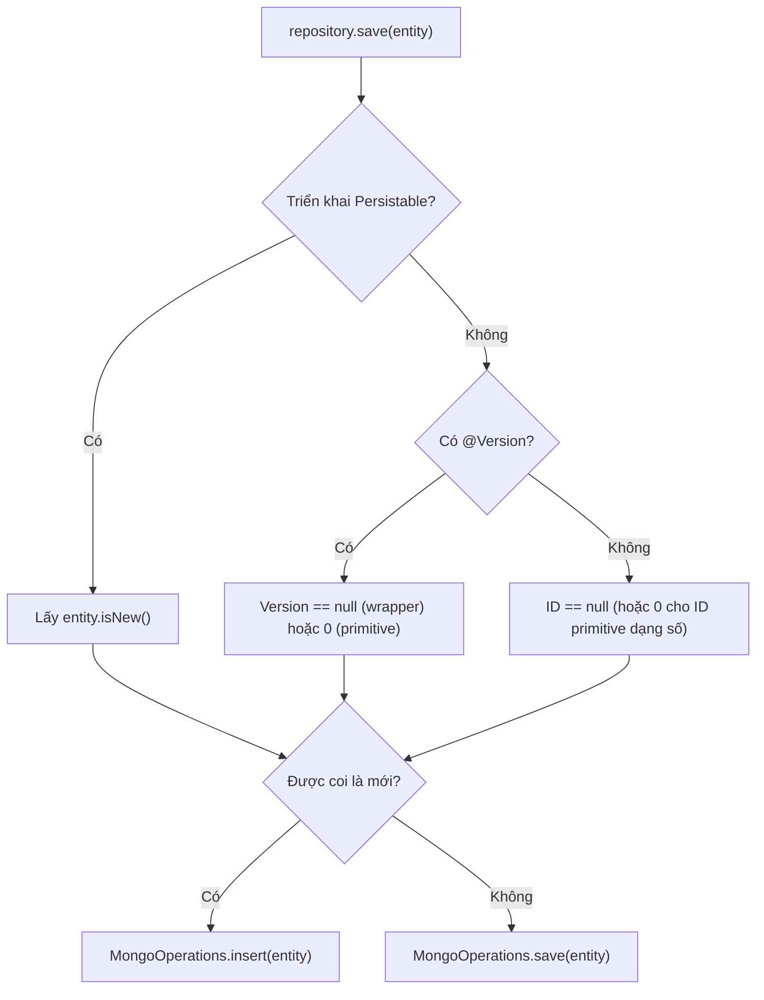
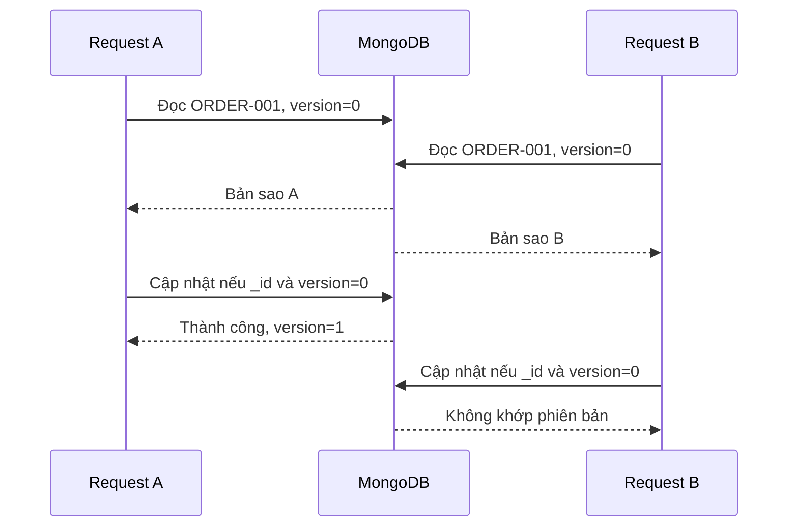

# Phát hiện entity mới bằng ID, @Version hoặc Persistable

> **Chương:** Định danh và trạng thái  
> **Phạm vi:** `SPRING_DATA_MONGODB` — sử dụng Spring Data MongoDB để kết nối, ánh xạ document và làm việc với MongoDB qua `MongoTemplate` hoặc repository. Bài này giải thích cách Spring Data xác định entity **mới hay đã tồn tại về mặt trạng thái đối tượng**, từ đó ảnh hưởng đến thao tác lưu, optimistic locking, auditing và kiểm thử. Đây cũng là nền tảng để thiết kế cập nhật an toàn khi sử dụng truy vấn, aggregation, index, transaction và reactive access.

## 1. Vấn đề: có ID chưa chắc là document đã tồn tại

Giả sử hệ thống nhập dữ liệu nhận một đơn hàng với mã nghiệp vụ được gán trước:

```java
Order order = new Order("ORDER-2026-001", "PENDING");
orderRepository.save(order);
```

Giá trị `id` đã khác `null` nhưng MongoDB có thể **chưa có** document mang mã này. Ngược lại, một entity vừa được đọc từ MongoDB đã có `id` và thường phải được xử lý như đối tượng đã tồn tại khi lưu thay đổi.

Spring Data cần một cơ chế trả lời câu hỏi:

> *Entity hiện tại có được xem là mới (`isNew == true`) khi repository thực hiện thao tác lưu không?*

Câu hỏi này khác với việc chạy một truy vấn lên MongoDB để kiểm tra document có thật sự tồn tại. **Phát hiện entity mới là quyết định dựa trên trạng thái của đối tượng và metadata**, thường không phải truy vấn `existsById` trước mỗi lần `save`.

Điều này quan trọng vì `SimpleMongoRepository.save(…)` về cơ bản chọn hai nhánh:

```java
// Mã minh họa ý tưởng, không phải mã chép nguyên từ thư viện.
if (entityInformation.isNew(entity)) {
    return mongoOperations.insert(entity);
}
return mongoOperations.save(entity);
```

Nhánh `insert` tạo document mới và gặp lỗi nếu `_id` đã được sử dụng. Nhánh `save` của `MongoOperations` có thể ghi/thay thế document theo định danh, với những quy tắc khác khi dùng `@Version`. **Đừng đồng nhất “Spring Data coi entity là cũ” với “document chắc chắn đã tồn tại trên server”.**

## 2. Thứ tự ưu tiên của các chiến lược phát hiện entity mới

Với một entity trong Spring Data MongoDB, các chiến lược thường được xem xét theo thứ tự sau:

1. **Entity triển khai `Persistable<ID>`:** Spring Data dùng kết quả `entity.isNew()`. Ứng dụng chủ động kiểm soát trạng thái mới/cũ.
2. **Có thuộc tính được đánh dấu `@Version` và entity không dùng `Persistable`:** phiên bản là dấu hiệu ưu tiên so với ID.
   - Kiểu tham chiếu như `Long`: `null` được coi là mới.
   - Kiểu số nguyên nguyên thủy như `long`: `0` được coi là mới.
3. **Không có hai trường hợp trên:** xét giá trị ID. Với các ID kiểu tham chiếu thông dụng (`String`, `ObjectId`, `UUID`), `null` được coi là mới; ID khác `null` được coi là đã tồn tại. Với kiểu ID nguyên thủy dạng số được hỗ trợ, giá trị `0` có thể là dấu hiệu mới.



| Entity đang có | Trạng thái Spring Data suy ra | Điều cần nhớ |
| --- | --- | --- |
| `@Id String id = null`, không có version | **Mới** | Thường là document chuẩn bị được tạo với ID sinh tự động. |
| `@Id String id = "A-1"`, không có version | **Không mới** | Dù trên server chưa có document `A-1`, Spring Data không suy luận từ database. |
| `@Id String id = "A-1"` và `@Version Long version = null` | **Mới** | Version kiểu wrapper được ưu tiên so với ID gán trước. |
| `@Id String id = "A-1"` và `@Version Long version = 0L` | **Không mới** | `0L` ở kiểu wrapper là phiên bản hợp lệ của entity đã được lưu. |
| `@Version long version = 0L` | **Mới** | Với primitive, số `0` là giá trị nhận diện entity mới. |
| `Persistable.isNew() == true` dù ID khác `null` | **Mới** | Quyết định từ `Persistable` được dùng cho repository. |
| `Persistable.isNew() == false` dù ID khác `null` | **Không mới** | Trạng thái do entity quản lý; không chứng minh document thật sự tồn tại. |

**Lưu ý:** các quy tắc trên nói về **repository state detection**, không phải sự bảo đảm tồn tại dữ liệu. Những API như `MongoTemplate.insert`, `MongoTemplate.save`, `updateFirst` hoặc lệnh driver thô có các semantics riêng và không nhất thiết rẽ nhánh theo cùng `EntityInformation.isNew`.

## 3. Chiến lược mặc định: phát hiện bằng ID

### 3.1. ID `null` được coi là mới

Ví dụ một entity đơn giản:

```java
import org.springframework.data.annotation.Id;
import org.springframework.data.mongodb.core.mapping.Document;

@Document(collection = "notes")
public class Note {
    @Id
    private String id;
    private String title;

    protected Note() {}

    public Note(String id, String title) {
        this.id = id;
        this.title = title;
    }

    public String getId() {
        return id;
    }

    public String getTitle() {
        return title;
    }

    public void rename(String newTitle) {
        this.title = newTitle;
    }
}
```

Và repository:

```java
import org.springframework.data.mongodb.repository.MongoRepository;

public interface NoteRepository extends MongoRepository<Note, String> {}
```

Khi tạo `new Note(null, "Ghi chú A")`, Spring Data coi entity là mới và repository đi theo nhánh insert. Với kiểu ID và cấu hình mapping phù hợp, MongoDB/Spring Data có thể tạo `ObjectId` rồi ánh xạ ID về Java. **Luôn sử dụng giá trị trả về từ `save`**, nhất là với entity immutable, vì ID/version có thể được cập nhật trên một bản thể mới.

### 3.2. ID được gán trước thường bị coi là đã tồn tại

```java
Note note = new Note("NOTE-001", "Ghi chú nhập từ hệ thống cũ");
Note saved = noteRepository.save(note);
```

`NOTE-001` khác `null`, vì vậy nếu không có `@Version` hoặc `Persistable`, repository coi entity là không mới và gọi nhánh `save`. Trong trường hợp không dùng version, thao tác lưu của MongoDB có thể có semantics **upsert**: document chưa tồn tại vẫn có thể được tạo.

Điểm dễ gây nhầm lẫn:

- `isNew == false` không có nghĩa repository đã chạy `findById` để chứng minh tồn tại.
- `save` không phải lệnh “chỉ update nếu document đã tồn tại” trong mọi trường hợp.
- Việc lưu toàn bộ entity có thể **ghi đè những field hiện có**; với cập nhật từng phần và điều kiện đồng thời, nên dùng API update phù hợp.
- Muốn buộc tạo mới và phát hiện trùng ID, sử dụng `insert` hoặc một chiến lược kiểm soát tạo mới rõ ràng.

Đặt tên định danh nghiệp vụ nên cân nhắc loại BSON lưu trong `_id`. Ví dụ `String` có thể được mapping thành BSON `ObjectId` nếu giá trị hợp lệ theo quy tắc chuyển đổi `@Id`; nếu muốn kiểm soát chặt kiểu ID, có thể dùng `@MongoId` và khai báo kiểu phù hợp với phiên bản đang sử dụng. **Vấn đề loại BSON của ID khác với vấn đề phát hiện entity mới**.

## 4. `@Version`: phát hiện entity mới và khóa lạc quan

`@Version` mang hai vai trò liên quan nhưng không giống nhau:

1. **Nhận diện entity mới:** nếu version chưa có giá trị theo quy tắc wrapper/primitive, entity được xem là mới dù ID đã được gán.
2. **Optimistic locking:** khi cập nhật entity đã tồn tại qua thao tác hỗ trợ version, Spring Data đưa giá trị version hiện tại vào điều kiện ghi và tăng version để phát hiện cập nhật dựa trên dữ liệu cũ.

### 4.1. Ví dụ domain dùng version kiểu wrapper

```java
import org.springframework.data.annotation.Id;
import org.springframework.data.annotation.Version;
import org.springframework.data.mongodb.core.mapping.Document;

@Document(collection = "orders")
public class Order {
    @Id
    private String id;

    @Version
    private Long version;

    private String status;

    protected Order() {}

    public Order(String id, String status) {
        this.id = id;
        this.status = status;
    }

    public String getId() { return id; }
    public Long getVersion() { return version; }
    public String getStatus() { return status; }
    public void changeStatus(String value) { status = value; }
}
```

`Long` được chọn có chủ đích: `null` có nghĩa *chưa từng có phiên bản*, còn `0L` là một số phiên bản thực. Với bản entity mới `new Order("ORDER-001", "PENDING")`, ID đã có nhưng `version == null`, nên repository **chọn insert**. Sau insert thành công, version kiểu wrapper được khởi tạo ở `0` theo quy tắc Spring Data MongoDB.

```java
Order initial = new Order("ORDER-001", "PENDING");
// ID != null, nhưng version == null: được coi là entity mới.

Order inserted = orderRepository.save(initial);
// Phiên bản khởi tạo của Long là 0.

Order loaded = orderRepository.findById("ORDER-001").orElseThrow();
loaded.changeStatus("PAID");
Order updated = orderRepository.save(loaded);
// Với entity đã tồn tại, version tăng khi cập nhật thành công.
```

Ở đây `orderRepository` là bean thuộc kiểu:

```java
public interface OrderRepository extends MongoRepository<Order, String> {}
```

Với **primitive `long`**, giá trị khởi tạo mặc định là `0` nên Spring Data dùng `0` để nhận diện entity mới và thường khởi tạo version lưu ở `1`. Với **wrapper `Long`**, chỉ `null` biểu thị mới; `0L` đã biểu thị entity tồn tại. Dùng wrapper thường dễ diễn đạt “chưa được lưu” và tránh nhầm lẫn trong vòng đời đối tượng.

### 4.2. Phát hiện xung đột cập nhật

Giả sử hai request đồng thời đọc cùng document ở version `0`:



Với các thao tác lưu entity versioned của Spring Data MongoDB, request B thường nhận `OptimisticLockingFailureException` thay vì âm thầm ghi đè trạng thái mới. Đối với một request API, ứng dụng có thể trả về lỗi xung đột phù hợp hoặc đọc lại để xử lý theo quy tắc nghiệp vụ.

Mã mô phỏng:

```java
Order a = orderRepository.findById("ORDER-001").orElseThrow();
Order b = orderRepository.findById("ORDER-001").orElseThrow();

a.changeStatus("PAID");
orderRepository.save(a); // Thành công: version tăng.

b.changeStatus("CANCELLED");
orderRepository.save(b); // Dữ liệu cũ: có thể ném OptimisticLockingFailureException.
```

Ví dụ giả định không có request khác xen vào và thao tác ghi có **acknowledged write concern**. Nếu dùng unacknowledged write concern, ứng dụng có thể không phát hiện được lỗi optimistic locking theo cách mong đợi. Một số API cập nhật trực tiếp bằng driver hoặc pipeline riêng không tự áp dụng cùng logic version; cần kiểm tra cách API đó quản lý version trước khi dựa vào khả năng phát hiện xung đột.

**`@Version` không phải transaction đa document.** Nó giúp phát hiện xung đột trên entity khi thao tác dùng optimistic locking; nếu quy trình nghiệp vụ cần tính nguyên tử trên nhiều document, phải thiết kế transaction và điều kiện topology MongoDB riêng.

### 4.3. Bẫy khi ID đã có nhưng version lại `null`

Trường hợp sau dễ xuất hiện khi nhận request body từ API và tự dựng entity mới:

```java
// Trong database đã có _id = ORDER-001, version = 3.
Order fromRequest = new Order("ORDER-001", "CANCELLED");
orderRepository.save(fromRequest);
```

`fromRequest.version == null`, vì vậy repository coi entity là **mới** và cố insert. Vì `_id` đã tồn tại, MongoDB có thể trả lỗi duplicate key thay vì cập nhật.

Điều này là hành vi đúng theo state detection; không nên “chữa” bằng cách bỏ `@Version` hoặc gán version tùy tiện. Cách an toàn hơn cho cập nhật từ API:

1. Nhận ID và dữ liệu cần thay đổi trong DTO.
2. Đọc entity hiện tại từ repository để lấy đúng version đang lưu.
3. Áp dụng thay đổi lên entity đã đọc, kiểm tra quy tắc nghiệp vụ.
4. `save` và xử lý `OptimisticLockingFailureException` nếu có cập nhật cạnh tranh.

Đọc rồi ghi theo optimistic locking vẫn cần xử lý xung đột; nó không bảo đảm thành công ở mọi thời điểm. Nếu API cung cấp version từ client (ví dụ qua ETag/`If-Match`), kiểm tra version theo hợp đồng API và có thể áp dụng cập nhật có điều kiện phù hợp.

## 5. `Persistable<ID>`: tự quyết định trạng thái mới/cũ

Đôi khi không thể suy ra “mới” chỉ từ ID hoặc version:

- Dữ liệu nhập từ hệ thống khác luôn có **ID được gán trước**, nhưng phải **insert lần đầu** và báo lỗi nếu ID đã tồn tại.
- Entity dùng state lifecycle đặc biệt, ví dụ record cần thể hiện rõ trạng thái tạo mới so với bản đã được tải từ MongoDB.
- Ứng dụng muốn quản lý chính xác nhánh `insert`/`save` theo business workflow.

Spring Data Commons cung cấp interface:

```java
package org.springframework.data.domain;

public interface Persistable<ID> {
    ID getId();
    boolean isNew();
}
```

Đoạn trên minh họa chữ ký cốt lõi. Khi entity triển khai `Persistable`, repository dùng `isNew()` để xác định entity mới, thay vì mặc định suy từ `@Id` hoặc `@Version`.

### 5.1. Ví dụ thực tế: ID do đối tác cấp trước

```java
import org.springframework.data.annotation.Id;
import org.springframework.data.annotation.Transient;
import org.springframework.data.domain.Persistable;
import org.springframework.data.mongodb.core.mapping.Document;

@Document(collection = "import_jobs")
public class ImportJob implements Persistable<String> {

    @Id
    private String id;

    private String source;

    @Transient
    private boolean newEntity = true;

    protected ImportJob() {}

    public ImportJob(String id, String source) {
        this.id = id;
        this.source = source;
    }

    @Override
    public String getId() { return id; }

    @Override
    public boolean isNew() { return newEntity; }

    public String getSource() { return source; }

    public void markPersisted() { newEntity = false; }
}
```

`new ImportJob("JOB-PARTNER-2026", "partner-A")` có ID nhưng trả `isNew() == true`, nên repository chọn `insert`. Nếu ID đã tồn tại, server sẽ báo duplicate key thay vì chuyển thành cập nhật ngầm.

**Điểm quan trọng:** `newEntity` là trạng thái **của đối tượng Java**, không phải dữ liệu nghiệp vụ cần lưu. Vì vậy field được đánh dấu `org.springframework.data.annotation.Transient` để không persist xuống BSON.

### 5.2. Phải đổi trạng thái sau khi lưu và sau khi đọc

Nếu chỉ khởi tạo `newEntity = true` thì một document được đọc từ MongoDB cũng có thể mang cờ mặc định `true`, rồi `save` tiếp theo cố insert và lỗi trùng ID. Cần một chiến lược vòng đời rõ ràng.

Với entity mutable trong ví dụ, có thể dùng Spring Data MongoDB entity callbacks để đánh dấu “đã tồn tại” sau khi đọc và lưu:

```java
import org.bson.Document;
import org.springframework.data.mongodb.core.mapping.event.AfterConvertCallback;
import org.springframework.data.mongodb.core.mapping.event.AfterSaveCallback;
import org.springframework.stereotype.Component;

@Component
public class ImportJobStateCallbacks
        implements AfterConvertCallback<ImportJob>, AfterSaveCallback<ImportJob> {

    @Override
    public ImportJob onAfterConvert(
            ImportJob entity, Document document, String collection) {
        entity.markPersisted();
        return entity;
    }

    @Override
    public ImportJob onAfterSave(
            ImportJob entity, Document document, String collection) {
        entity.markPersisted();
        return entity;
    }
}
```

Hai callback đáp ứng các tình huống:

- **Đọc từ MongoDB:** `AfterConvertCallback` đánh dấu entity đã được tải là không mới.
- **Lưu thành công:** `AfterSaveCallback` đánh dấu entity vừa được lưu là không mới, để lần lưu sau không nhầm thành insert lần đầu.

Đây là **một mẫu triển khai**, không phải chiến lược duy nhất. Khi dùng entity immutable, có thể trả về bản thể mới với trạng thái tương ứng thay vì sửa field. Cần kiểm thử lifecycle của callback và các đường truy cập dữ liệu thực tế; dữ liệu đọc bằng **raw MongoDB Driver** sẽ không tự chạy entity callback của Spring Data.

Trạng thái `isNew` không nên bị thay đổi tùy tiện trước khi thao tác ghi thật sự thành công. Nếu đánh dấu “đã lưu” quá sớm rồi insert thất bại, lần thử lại có thể rẽ sang nhánh sai. Với persistence framework dùng property access, còn phải tránh ánh xạ nhầm `isNew` thành field bằng annotation/cấu hình phù hợp.

### 5.3. Khi entity vừa dùng `Persistable` vừa có `@Version`

`Persistable.isNew()` quyết định nhánh tạo mới trong repository; `@Version` vẫn có thể tham gia kiểm soát optimistic locking ở các thao tác ghi có hỗ trợ version. Hai cơ chế phục vụ các mục đích khác nhau.

Tránh một entity tự báo `isNew() == false` trong khi ID/version chưa hợp lệ: repository có thể chọn nhánh cập nhật nhưng server không có document hoặc phép kiểm tra version không khớp. Nếu có `@Version` mà không thật sự cần state tùy chỉnh, **ưu tiên cơ chế version chuẩn** để giảm rủi ro trạng thái không đồng bộ.

## 6. `insert`, `save`, cập nhật có điều kiện: chọn đúng ý định

| API/ý định | Hành vi chính | Lưu ý |
| --- | --- | --- |
| `MongoRepository.save(entity)` | Quyết định nhánh dựa trên `isNew` rồi gọi `insert` hoặc `save`. | Có thể phụ thuộc `@Version`/`Persistable`; không truy vấn existence trước mỗi lần gọi. |
| `MongoRepository.insert(entity)` | Yêu cầu tạo mới. | Trùng `_id` bị từ chối; không phải cập nhật. |
| `MongoTemplate.insert(entity)` | Yêu cầu insert document. | Không dùng `Persistable.isNew` để suy xem có upsert hay không. |
| `MongoTemplate.save(entity)` | Lưu theo semantics template; với dữ liệu không version thường có hành vi upsert. | Không suy ra nhánh repository `isNew`; phải hiểu xử lý version khi dùng. |
| `MongoTemplate.updateFirst(…)` | Cập nhật document khớp điều kiện. | Dùng filter, update operator và kiểm tra số document được sửa; không dựa vào `Persistable.isNew`. |
| `MongoTemplate.upsert(…)` | Cập nhật document khớp, nếu thiếu thì tạo theo quy tắc upsert. | Phù hợp khi upsert là yêu cầu nghiệp vụ thật sự, phải thiết kế filter và unique index tránh trùng dữ liệu. |

**Ví dụ phân biệt ý định tạo mới và cập nhật:**

```java
// Tạo mới: trùng ID sẽ thất bại.
noteRepository.insert(new Note("NOTE-001", "Bản ghi mới"));

// Cập nhật theo dữ liệu đã đọc.
Note existing = noteRepository.findById("NOTE-001").orElseThrow();
existing.rename("Bản ghi đã sửa");
noteRepository.save(existing);
```

Với dữ liệu cần cập nhật đồng thời, có thể dùng truy vấn có điều kiện theo ID và trạng thái/version thay vì đọc–sửa–ghi toàn bộ document. MongoDB đảm bảo tính nguyên tử cho một thao tác cập nhật trên **một document**; điều kiện trong filter phải thể hiện rõ ràng business invariant cần bảo vệ.

## 7. Trạng thái entity liên quan gì đến auditing, transaction và reactive?

### 7.1. Auditing: created và modified

Spring Data có cơ chế auditing như `@CreatedDate` và `@LastModifiedDate` khi bật auditing phù hợp. Việc phân biệt entity mới với entity đã lưu có thể ảnh hưởng cách gán các dấu thời gian này. Nếu entity đã tồn tại nhưng bị báo “mới” vì version `null` hoặc `Persistable.isNew()` sai, ứng dụng có thể nhận hành vi auditing không mong muốn.

Hãy kiểm thử các trường hợp tạo mới, đọc lại và cập nhật, nhất là khi dùng ID gán trước và callback quản lý trạng thái.

### 7.2. Transaction: không thay thế phát hiện new entity

Đặt `repository.save(entity)` trong một MongoDB transaction **không làm thay đổi** quy tắc `isNew`. Transaction điều phối sự nhất quán của nhóm thao tác phù hợp; chiến lược phân biệt insert/update vẫn là việc của repository/template. Multi-document transaction yêu cầu topology MongoDB hỗ trợ và transaction manager/session được cấu hình đúng.

### 7.3. Reactive repository: cùng ý tưởng trạng thái, khác mô hình I/O

`ReactiveMongoRepository.save(entity)` vẫn cần xác định cách lưu entity mới/cũ theo metadata phù hợp; khác biệt chính là kết quả nằm trong publisher như `Mono<Order>` thay vì đối tượng trực tiếp. Ví dụ:

```java
Mono<Order> saved =
    reactiveOrderRepository.save(new Order("ORDER-RX-1", "PENDING"));
```

Việc thao tác thật chỉ diễn ra khi publisher được subscribe trong luồng reactive. Nếu cần dùng entity có ID/version mới sau lưu, **dùng giá trị được phát ra từ `Mono`**. Reactive access không giúp tránh duplicate key, không tự sửa version cũ và không thay đổi ràng buộc atomicity ở MongoDB.

## 8. Những lỗi thường gặp và cách xử lý

| Triệu chứng | Nguyên nhân có thể gặp | Hướng kiểm tra |
| --- | --- | --- |
| Lưu entity có ID mới nhưng xuất hiện document dù `isNew == false` | Nhánh save không version có thể thực hiện upsert. | Kiểm tra `@Version`, `Persistable` và API `save`/`insert` được gọi. |
| Gọi `save` với ID gán trước và nhận duplicate key | Có `@Version Long` đang `null` hoặc `Persistable.isNew() == true` khiến repository chọn insert. | Xác định có chủ đích tạo mới hay cập nhật. |
| Update bị `OptimisticLockingFailureException` | Version đã cũ, document bị xóa, hoặc thao tác cập nhật không khớp version. | Đọc lại và xử lý xung đột, không tự gán version cao hơn. |
| Sau khi load entity, lần `save` kế tiếp lại insert | Cờ `Persistable.isNew` không được reset sau `AfterConvert`. | Kiểm tra `@Transient` và callback sau đọc. |
| Sau khi insert thành công, lần `save` tiếp theo lại insert | Cờ new không được đổi sau lưu. | Dùng `AfterSaveCallback` hoặc quy trình state rõ ràng. |
| Version kiểu primitive luôn bị coi mới khi bằng `0` | `0` là sentinel cho new entity với primitive. | Cân nhắc dùng wrapper `Long` nếu cần phân biệt `null` và `0`. |
| Dữ liệu bị ghi đè khi nhiều request cùng cập nhật | Lưu entity không version hoặc thao tác bypass optimistic locking. | Dùng `@Version`, conditional update hoặc transaction phù hợp. |
| API update gửi DTO rồi tự dựng entity với ID + version `null` | Spring Data coi đó là entity mới và insert. | Đọc entity cũ trước khi áp dụng DTO hoặc viết update có điều kiện. |

**Không dùng `existsById` trước `insert` như cách duy nhất chống trùng.** Hai request có thể cùng kiểm tra “chưa tồn tại” rồi đồng thời insert. Để đảm bảo duy nhất, dựa vào unique index trên `_id` (mặc định) hoặc unique index cho khóa nghiệp vụ, đồng thời xử lý lỗi duplicate key.

## 9. Kiểm thử hành vi thay vì chỉ kiểm tra giá trị field

Một bộ test có giá trị nên dùng MongoDB thật ở môi trường kiểm thử riêng, chẳng hạn Testcontainers; với optimistic locking cần write concern có xác nhận. Các assert dưới đây minh họa những kết quả cần quan sát:

### Kịch bản A — ID có sẵn, version `null` vẫn là entity mới

```java
Order first = new Order("ORDER-T1", "PENDING");
assert first.getVersion() == null;

Order saved = orderRepository.save(first);
assert saved.getVersion() != null;
assert saved.getVersion() == 0L;
```

Trong test thật, nên dùng assertion framework như JUnit/AssertJ và làm sạch collection giữa test. Đối với entity immutable, so sánh state trên **`saved`** thay vì mặc định đối tượng `first` đã được mutation tại chỗ.

### Kịch bản B — cùng ID và version `null` không phải update

```java
orderRepository.save(new Order("ORDER-T2", "PENDING"));

// New instance cùng ID, version vẫn null.
Order duplicate = new Order("ORDER-T2", "CANCELLED");

// Mong đợi một lỗi duplicate key khi repository cố insert.
orderRepository.save(duplicate);
```

### Kịch bản C — hai bản sao cập nhật cạnh tranh

```java
Order left = orderRepository.findById("ORDER-T1").orElseThrow();
Order right = orderRepository.findById("ORDER-T1").orElseThrow();

left.changeStatus("PAID");
orderRepository.save(left);

right.changeStatus("CANCELLED");
// Mong đợi optimistic locking failure ở lần save sau.
orderRepository.save(right);
```

### Kịch bản D — `Persistable` giữ trạng thái sau vòng đời

1. Tạo `ImportJob` với ID nghiệp vụ đã có nhưng `isNew() == true`.
2. `save` thành công và xác nhận entity được đánh dấu không mới.
3. `findById` lại từ database, xác nhận `isNew() == false` nhờ `AfterConvertCallback`.
4. Thay đổi một field và `save` tiếp theo; xác nhận không bị duplicate key.
5. Tạo một instance mới cùng ID với `isNew() == true`; xác nhận bị từ chối do trùng `_id`.

Test D quan trọng vì cách dùng `Persistable` dễ đúng ở bước insert đầu tiên nhưng sai khi đọc lại và lưu lần hai.

## 10. Bài thực hành: nhập dữ liệu có ID gán trước

Một dịch vụ đồng bộ nhận các sự kiện có `externalId` ổn định. Yêu cầu: nhận sự kiện mới thì tạo document; nếu ID đã tồn tại thì báo xung đột; khi người quản trị sửa ghi chú của sự kiện đã lưu thì cập nhật an toàn.

**Thiết kế đề xuất:**

1. Tạo entity `ExternalEvent` với `@Id String id`, `@Version Long version`, trường `payload` và `note`.
2. Với luồng **tạo mới**, dùng entity có ID do đối tác cấp và version `null` để repository chọn insert; trùng ID báo duplicate key.
3. Với luồng **chỉnh ghi chú**, đọc entity hiện tại, thay đổi `note` và `save` để tận dụng optimistic locking.
4. Nếu có yêu cầu ghi “cập nhật nếu có, tạo nếu chưa có”, thiết kế thao tác upsert riêng và kiểm tra concurrency/unique index; không trộn ngẫu nhiên upsert vào luồng tạo mới.
5. Nếu nhóm quyết định dùng `Persistable` để tự kiểm soát trạng thái, thêm callback vòng đời, test đọc lại/lưu lại và kiểm tra state marker không lọt vào BSON.

**Câu hỏi tự đánh giá:**

- Vì sao `id != null` không chứng minh entity đã tồn tại?
- Vì sao `@Version Long version = null` làm entity được xem là mới dù ID được gán?
- `@Version long version = 0` khác `Long version = 0L` như thế nào?
- Vì sao `Persistable.isNew()` cần cơ chế cập nhật trạng thái sau khi đọc/lưu?
- Những API nào thực sự kiểm tra tồn tại trên server, và API nào chỉ dùng metadata để chọn nhánh?
- Khi có optimistic locking failure, nên xử lý xung đột thế nào để không ghi đè thay đổi của request khác?

## 11. Ghi nhớ và tài liệu đối chiếu

- **`Persistable.isNew()` được ưu tiên** nếu entity triển khai interface này.
- **`@Version` được ưu tiên so với ID** khi xác định entity mới, với `null` cho kiểu wrapper và `0` cho primitive.
- **Không có version/Persistable** thì ID `null` thường có nghĩa entity mới; ID khác `null` thường có nghĩa không mới.
- **Phát hiện mới/cũ không tương đương query existence**; repository dùng trạng thái entity để chọn nhánh `insert` hoặc `save`.
- **`@Version` còn phục vụ optimistic locking**, giúp phát hiện cập nhật cạnh tranh khi API ghi có hỗ trợ version và write concern phù hợp.
- **`Persistable` cần quản lý vòng đời chính xác**, đặc biệt sau khi load entity hoặc khi insert đã thành công.
- **Insert, save, upsert, conditional update** có ý định nghiệp vụ khác nhau. Chọn API theo điều kiện tạo mới/cập nhật và kiểm chứng bằng integration test.

Tài liệu tham khảo để kiểm tra các chi tiết của phiên bản đang sử dụng: [Spring Data MongoDB Reference — Optimistic Locking](https://docs.spring.io/spring-data/mongodb/reference/mongodb/template-crud-operations.html#mongo-template.optimistic-locking), [Spring Data Commons — Entity State Detection Strategies](https://docs.spring.io/spring-data/commons/reference/repositories/core-concepts.html#repositories.entity-state-detection-strategies) và [Spring Data MongoDB Reference](https://docs.spring.io/spring-data/mongodb/reference/).
