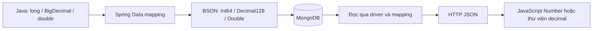

# Số nguyên, số thực và nguy cơ mất độ chính xác

## 1. Vì sao kiểu số là một quyết định thiết kế dữ liệu?

Trong **Spring Data MongoDB**, ứng dụng Java thường thao tác với `int`, `long`, `double` hoặc `BigDecimal`, trong khi MongoDB lưu giá trị dưới dạng các kiểu số BSON khác nhau. Một con số nhìn giống nhau trên màn hình chưa chắc có cùng **kiểu**, **phạm vi**, **độ chính xác** hoặc **cách so sánh** ở mọi tầng.

Hãy xét một hệ thống đặt hàng có ba dữ liệu:

- `quantity = 3`: số lượng sản phẩm, là số nguyên tương đối nhỏ;
- `total = 199.99`: số tiền cần khớp chính xác theo quy tắc nghiệp vụ;
- `eventSequence = 9007199254740993`: mã thứ tự có thể vượt vùng số nguyên an toàn của JavaScript.

Nếu chọn sai kiểu:

1. Số tiền có thể xuất hiện sai lệch vì được tính bằng dấu phẩy động nhị phân.
2. Bộ đếm có thể tràn phạm vi lưu trữ của `int` hoặc `long`.
3. Giá trị `long` lưu chính xác trong BSON lại có thể bị làm tròn khi đi qua một JSON client dùng JavaScript `Number`.
4. Một collection chứa lẫn `string`, `double` và `decimal` cho cùng trường giá trị có thể gây ra hành vi lọc, sắp xếp và aggregation khó dự đoán.

Mục tiêu của bài này trong chương **Kiểu dữ liệu** là chọn biểu diễn số phù hợp cho từng nhu cầu, ánh xạ Java/BSON chính xác bằng Spring Data MongoDB, bảo toàn giá trị qua API, và nhận diện vấn đề bằng truy vấn, kiểm thử và công cụ chẩn đoán dữ liệu.

## 2. Các kiểu số BSON cần phân biệt

MongoDB có các kiểu BSON số phổ biến sau:

| Kiểu BSON | Biểu diễn | Phạm vi hoặc đặc tính chính | Ví dụ mục đích |
| --- | --- | --- | --- |
| `Int32` (`int`) | Số nguyên có dấu 32 bit | Từ −2.147.483.648 đến 2.147.483.647 | Số lượng, năm, trạng thái dạng số |
| `Int64` (`long`) | Số nguyên có dấu 64 bit | Từ −9.223.372.036.854.775.808 đến 9.223.372.036.854.775.807 | Bộ đếm lớn, timestamp dạng epoch, định danh dạng số |
| `Double` (`double`) | Dấu phẩy động nhị phân IEEE 754, 64 bit | Khoảng 15–17 chữ số có nghĩa; không biểu diễn chính xác mọi phân số thập phân | Đo lường, thống kê, tọa độ nếu chấp nhận sai số |
| `Decimal128` (`decimal`) | Dấu phẩy động **thập phân** 128 bit theo IEEE 754 | Tối đa 34 chữ số có nghĩa; hỗ trợ biểu diễn thập phân chính xác trong phạm vi của kiểu | Tiền tệ, tỷ lệ, số thập phân cần quy tắc làm tròn rõ ràng |

Điểm quan trọng: `Double` và `Decimal128` đều là kiểu số thực, nhưng **cơ số biểu diễn** khác nhau. `Double` lưu theo cơ số 2 nên nhiều giá trị thập phân như 0,1 không biểu diễn đúng tuyệt đối. `Decimal128` lưu theo cơ số 10 nên có thể biểu diễn chính xác 0,1 hay 19,99, miễn giá trị nằm trong giới hạn biểu diễn.

`Decimal128` **không phải** kiểu số thập phân với độ chính xác vô hạn. Khi giá trị vượt 34 chữ số có nghĩa hoặc ngoài khoảng số mũ có thể biểu diễn, cần chính sách xử lý rõ ràng; không thể giả định chuyển đổi nào cũng không mất dữ liệu.

### Ví dụ typed value trong mongosh

```javascript
db.numeric_examples.insertOne({
  _id: "demo-1",
  quantity: NumberInt("3"),
  totalViews: NumberLong("9007199254740993"),
  ratio: 0.1, // JavaScript Number: lưu kiểu BSON Double
  price: NumberDecimal("19.99")
});
```

Các constructor ở trên giúp chỉ rõ ý định khi tạo dữ liệu từ mongosh. Dùng chuỗi với giá trị `NumberLong` lớn để tránh việc literal số bị JavaScript làm tròn **trước khi** lệnh tạo BSON được gọi.

Để xem kiểu thực tế đã lưu:

```javascript
db.numeric_examples.aggregate([
  { $match: { _id: "demo-1" } },
  {
    $project: {
      quantityType: { $type: "$quantity" },
      viewsType: { $type: "$totalViews" },
      ratioType: { $type: "$ratio" },
      priceType: { $type: "$price" }
    }
  }
]);
```

Kết quả kỳ vọng về **tên kiểu** là `int`, `long`, `double` và `decimal` tương ứng. Đừng chỉ nhìn số hiển thị trong giao diện quản trị: cùng ký tự “19.99” có thể là `Double`, `Decimal128` hoặc `String`.

## 3. Số nguyên: chính xác trong phạm vi, nhưng vẫn có thể tràn

### 3.1. `int` và `long` trong Java

`int` Java là số nguyên có dấu 32 bit; `long` là số nguyên có dấu 64 bit. Cả hai lưu chính xác giá trị nguyên trong phạm vi cho phép.

```java
int quantity = 12;
long sequence = 9_007_199_254_740_993L;
```

`quantity` phù hợp với `int` vì giới hạn nghiệp vụ nhỏ. `sequence` cần `long` vì vượt giới hạn `int`. Nhưng nếu một ứng dụng liên tục cộng vào bộ đếm `long`, bản thân kiểu `long` cũng có giới hạn.

Phép tính Java với kiểu nguyên có thể tràn mà không ném ngoại lệ:

```java
long next = Long.MAX_VALUE + 1L;
System.out.println(next); // Long.MIN_VALUE: đã tràn
```

Dùng phép toán có kiểm tra nếu cần phát hiện lỗi:

```java
long current = Long.MAX_VALUE;
long increment = 1L;

try {
    long next = Math.addExact(current, increment);
} catch (ArithmeticException overflow) {
    // Từ chối thao tác hoặc chuyển sang chiến lược lưu giá trị khác.
}
```

MongoDB cũng có quy tắc biểu diễn và nâng kiểu khi thực hiện phép toán aggregation. Không nên suy luận rằng vì kết quả của một phép tính lớn hơn `Int64` nên MongoDB sẽ tự động biến mọi thứ thành một số nguyên chính xác tùy ý; có tình huống kết quả được nâng sang kiểu dấu phẩy động và mất độ chính xác.

### 3.2. Giới hạn 2^53−1 ở JavaScript/JSON client

JavaScript `Number` có thể biểu diễn **chính xác mọi số nguyên** trong khoảng:

\[
-(2^{53}-1) \le n \le 2^{53}-1
\]

Tức là từ −9.007.199.254.740.991 đến 9.007.199.254.740.991. Đây là khoảng số nguyên an toàn của JavaScript; phạm vi của `long` Java/BSON lớn hơn nhiều.

Ví dụ:

```javascript
const id = 9007199254740993;
console.log(id); // 9007199254740992: mất 1 đơn vị
console.log(Number.isSafeInteger(id)); // false
```

Nếu backend Spring Data đọc đúng một `Int64` nhưng controller gửi JSON number và frontend dùng `JSON.parse` mặc định, frontend có thể **nhận sai ID**. Khi đó gửi lại ID để tìm document có thể thất bại dù dữ liệu MongoDB hoàn toàn đúng.

Giải pháp hợp đồng API: với số nguyên lớn dùng để định danh hoặc cần giữ nguyên từng đơn vị, biểu diễn thành **chuỗi thập phân** khi trao đổi với hệ thống không bảo đảm số nguyên 64 bit; hoặc dùng giao thức/serializer và kiểu `BigInt`/`Int64` được kiểm soát ở cả hai phía. Không nên chuyển bừa mọi `long` thành `double` để JSON dễ xử lý.

```json
{
  "eventSequence": "9007199254740993"
}
```

Đây là ví dụ quy ước JSON **string** cho số nguyên lớn; phía nhận phải xác thực cú pháp và giới hạn giá trị trước khi chuyển về `long`.

## 4. Số thực: tại sao 0,1 + 0,2 có thể khác 0,3?

Trong Java, `float` và `double` sử dụng biểu diễn dấu phẩy động nhị phân. Phần lớn phân số thập phân có mẫu số chứa thừa số 5 không thể biểu diễn hữu hạn trong hệ nhị phân. Vì vậy các phép tính có thể tạo sai số nhỏ:

```java
double a = 0.1;
double b = 0.2;

System.out.println(a + b);        // 0.30000000000000004
System.out.println(a + b == 0.3); // false
```

Điều này không có nghĩa `double` là kiểu “hỏng”. Nó rất phù hợp cho tính toán khoa học, phép đo có sai số, thống kê, hình học hoặc dữ liệu cảm biến khi thiết kế nghiệp vụ xác định được sai số chấp nhận. Vấn đề xuất hiện khi ứng dụng **yêu cầu kết quả thập phân chính xác**, chẳng hạn số tiền phải khớp tới đơn vị nhỏ nhất.

### 4.1. Tránh so sánh double bằng ==

Với dữ liệu đo lường, có thể xác định sai số tuyệt đối hoặc tương đối phù hợp với miền giá trị:

```java
double actual = 0.1 + 0.2;
double expected = 0.3;
double tolerance = 1e-9;

boolean closeEnough = Math.abs(actual - expected) <= tolerance;
```

`tolerance` phải được chọn từ yêu cầu nghiệp vụ, không có một hằng số phù hợp mọi trường hợp. Với số quá lớn hoặc quá gần 0, có thể cần tiêu chí sai số hỗn hợp tuyệt đối và tương đối; không được đem cách so sánh “gần bằng” áp dụng cho số tiền phải cân đối chính xác.

### 4.2. BigDecimal và Decimal128

`java.math.BigDecimal` biểu diễn số thập phân theo độ chính xác và thang đo (scale) do ứng dụng kiểm soát. Nó là lựa chọn tự nhiên khi nghiệp vụ tài chính cần thao tác theo cơ số 10.

```java
import java.math.BigDecimal;

BigDecimal a = new BigDecimal("0.1");
BigDecimal b = new BigDecimal("0.2");
BigDecimal sum = a.add(b);

System.out.println(sum.toPlainString()); // 0.3
```

**Không nên dùng `new BigDecimal(0.1)`** khi mục tiêu là nhận chính xác giá trị thập phân “0.1”, vì constructor này chuyển chính xác giá trị nhị phân đã được lưu trong `double` và có thể cho một chuỗi thập phân rất dài. Tạo `BigDecimal` từ chuỗi đầu vào đã xác thực, hoặc số nguyên/scaled integer. `BigDecimal.valueOf(double)` có hành vi khác constructor trên nhưng vẫn không sửa được sai số từ những phép tính `double` đã xảy ra trước đó.

## 5. Bảng ánh xạ Java, Spring Data và BSON

| Kiểu Java | Kiểu BSON thường dùng | Ghi chú thiết kế |
| --- | --- | --- |
| `int` / `Integer` | `Int32` | Dùng cho giá trị nguyên nhỏ, có giới hạn rõ. |
| `long` / `Long` | `Int64` | Dùng cho số nguyên lớn; kiểm tra đường đi qua client JavaScript. |
| `float` / `Float` | Thường chuyển sang dạng BSON số thực do driver/converter hỗ trợ, phổ biến là `Double` | Có thể mất độ chính xác ngay tại `float` Java; nên hạn chế khi nghiệp vụ yêu cầu tính chính xác. |
| `double` / `Double` | `Double` | Phù hợp tính toán gần đúng, không phù hợp lưu số tiền đòi hỏi chính xác thập phân. |
| `BigDecimal` | **Mặc định thường là `String` trong Spring Data MongoDB** | Để lưu `Decimal128`, cần chỉ rõ target type/mapping. |
| `BigDecimal` gắn `@Field(targetType = FieldType.DECIMAL128)` | `Decimal128` | Chấp nhận giới hạn 34 chữ số có nghĩa của Decimal128; kiểm tra khả năng chuyển đổi. |
| `org.bson.types.Decimal128` | `Decimal128` | Gần với BSON/driver; có thể chuyển qua `BigDecimal` khi phù hợp. |
| `BigInteger` | Thường lưu dưới dạng chuỗi qua Spring Data | Không phải mọi `BigInteger` đều vừa `Int64`; cần quy ước dữ liệu và truy vấn riêng. |

Quy tắc chuyển đổi chính xác phụ thuộc phiên bản Spring Data MongoDB, cấu hình converter và custom conversion của dự án. Vì vậy, khi độ chính xác là yêu cầu quan trọng, hãy **kiểm thử kiểu BSON thực tế** thay vì chỉ kiểm tra object Java đã lưu và trả về.

### 5.1. Vì sao BigDecimal không mặc nhiên đồng nghĩa Decimal128?

Spring Data MongoDB có thể lưu `BigDecimal` ở dạng chuỗi để không bị giới hạn bởi độ chính xác của `Decimal128`. Cách này giúp bảo toàn biểu diễn giá trị Java, nhưng **trường kiểu BSON String không phải trường số BSON**.

Ví dụ, nếu `amount` đang được lưu dưới dạng `"100.00"`, MongoDB không thể mặc nhiên xử lý như `NumberDecimal("100.00")` trong mọi phép tính, filter và index. Sắp xếp chuỗi theo thứ tự từ điển cũng khác sắp xếp số.

Khi cần tính toán, lọc và tổng hợp trên MongoDB bằng số thập phân, hãy cân nhắc `Decimal128` với mapping rõ ràng và đảm bảo giá trị nằm trong giới hạn biểu diễn.

## 6. Ví dụ entity Spring Data MongoDB đúng kiểu

Giả sử hệ thống bán hàng cần lưu đơn giá, số lượng và tổng tiền bằng giá trị thập phân. Một entity Java:

```java
package example.billing;

import java.math.BigDecimal;
import org.springframework.data.annotation.Id;
import org.springframework.data.mongodb.core.mapping.Document;
import org.springframework.data.mongodb.core.mapping.Field;
import org.springframework.data.mongodb.core.mapping.FieldType;

@Document(collection = "invoice_lines")
public class InvoiceLine {

    @Id
    private String id;

    private String sku;

    private int quantity;

    private long auditSequence;

    @Field(targetType = FieldType.DECIMAL128)
    private BigDecimal unitPrice;

    @Field(targetType = FieldType.DECIMAL128)
    private BigDecimal total;

    public InvoiceLine() {
    }

    public InvoiceLine(
            String id,
            String sku,
            int quantity,
            long auditSequence,
            BigDecimal unitPrice,
            BigDecimal total) {
        this.id = id;
        this.sku = sku;
        this.quantity = quantity;
        this.auditSequence = auditSequence;
        this.unitPrice = unitPrice;
        this.total = total;
    }

    public String getId() {
        return id;
    }

    public String getSku() {
        return sku;
    }

    public int getQuantity() {
        return quantity;
    }

    public long getAuditSequence() {
        return auditSequence;
    }

    public BigDecimal getUnitPrice() {
        return unitPrice;
    }

    public BigDecimal getTotal() {
        return total;
    }
}
```

Tính tổng tiền từ `BigDecimal` và `int`, sau đó lưu qua `MongoTemplate`:

```java
import java.math.BigDecimal;
import org.springframework.data.mongodb.core.MongoTemplate;

public void saveExample(MongoTemplate template) {
    int quantity = 3;
    BigDecimal price = new BigDecimal("19.99");
    BigDecimal total = price.multiply(BigDecimal.valueOf(quantity));

    InvoiceLine line = new InvoiceLine(
        "invoice-line-001",
        "SKU-A12",
        quantity,
        9_007_199_254_740_993L,
        price,
        total
    );
    template.save(line);
}
```

Với cấu hình mapping mặc định và annotation trên, document tương đương:

```javascript
{
  _id: "invoice-line-001",
  sku: "SKU-A12",
  quantity: NumberInt("3"),
  auditSequence: NumberLong("9007199254740993"),
  unitPrice: NumberDecimal("19.99"),
  total: NumberDecimal("59.97")
}
```

Một repository đồng bộ có thể dùng entity này trực tiếp:

```java
import org.springframework.data.mongodb.repository.MongoRepository;

public interface InvoiceLineRepository
        extends MongoRepository<InvoiceLine, String> {
}
```

Tương tự, `ReactiveMongoRepository<InvoiceLine, String>` hoặc `ReactiveMongoTemplate` sử dụng cùng metadata mapping và các kiểu BSON. Reactive access ảnh hưởng cách tổ chức I/O và kết quả `Mono`/`Flux`, **không tự tăng độ chính xác của số thực**.

## 7. Quy tắc làm tròn, scale và so sánh với BigDecimal

### 7.1. Làm tròn là một quyết định nghiệp vụ

`BigDecimal` giữ kết quả thập phân chính xác khi phép toán có thể biểu diễn hữu hạn, nhưng phép chia có thể cho kết quả lặp vô hạn. Ví dụ:

```java
import java.math.BigDecimal;
import java.math.RoundingMode;

BigDecimal one = BigDecimal.ONE;
BigDecimal three = new BigDecimal("3");

// one.divide(three) không chỉ rõ rounding có thể ném ArithmeticException.
BigDecimal result = one.divide(three, 2, RoundingMode.HALF_EVEN);
System.out.println(result); // 0.33
```

Khi lưu số tiền có hai chữ số thập phân, ứng dụng có thể xác định trước:

```java
BigDecimal normalized = new BigDecimal("19.995")
    .setScale(2, RoundingMode.HALF_EVEN);

System.out.println(normalized); // 20.00
```

**Không có quy tắc làm tròn áp dụng cho mọi loại tiền và nghiệp vụ**: có hệ thống yêu cầu `HALF_UP`, có hệ thống dùng `HALF_EVEN`, có giao dịch cần giữ nhiều chữ số nội bộ rồi chỉ làm tròn ở biên thanh toán. Cần quyết định thời điểm làm tròn, scale, đơn vị tiền tệ và cách xử lý phần dư.

### 7.2. `equals` và `compareTo` không giống nhau

`BigDecimal` xét cả giá trị và scale trong `equals`:

```java
BigDecimal a = new BigDecimal("1.0");
BigDecimal b = new BigDecimal("1.00");

System.out.println(a.equals(b));         // false
System.out.println(a.compareTo(b) == 0); // true
```

Nếu yêu cầu so sánh **giá trị số** thì `compareTo` thường phù hợp hơn. Nếu yêu cầu giữ nguyên số chữ số thập phân như một quy ước định dạng, cần quản lý scale có chủ đích. Khi dùng `BigDecimal` làm key trong `HashMap`/`HashSet`, nhớ rằng `equals` và `hashCode` phân biệt scale.

### 7.3. Mô hình dùng số nguyên đơn vị nhỏ nhất

Một lựa chọn khác cho số tiền là lưu **số nguyên của đơn vị nhỏ nhất**, ví dụ số xu (cent):

```java
long cents = 1_999L; // 19.99 trong một đơn vị tiền có 100 phần nhỏ
long threeItems = Math.multiplyExact(cents, 3L); // 5997
```

Ưu điểm: phép cộng/trừ/nhân nguyên chính xác trong phạm vi `long`, không phụ thuộc số thực nhị phân. Nhưng cần quy định đơn vị nhỏ nhất theo tiền tệ, giới hạn khi quy đổi tỷ giá, thuế và kiểm tra tràn số. Đừng mặc định mọi loại tiền đều có hai chữ số thập phân.

**Chọn giữa Decimal128 và scaled integer** dựa trên miền giá trị, số chữ số thập phân cần giữ, phép tính ở server, khả năng tương tác với API và quy định nghiệp vụ. Hai lựa chọn đều có thể chính xác nếu được dùng nhất quán.

## 8. Query, aggregation và index: kiểu số ảnh hưởng kết quả

### 8.1. Tránh lưu lẫn số và chuỗi trong cùng một trường

Ví dụ collection có dữ liệu không đồng nhất:

```javascript
[
  { _id: "a", amount: NumberDecimal("9.50") },
  { _id: "b", amount: "10.00" },
  { _id: "c", amount: 10.0 },
  { _id: "d", amount: NumberLong("10") }
]
```

Mỗi giá trị có thể hiển thị như một số, nhưng `"10.00"` là **BSON String**. Query theo số, aggregation `$sum` và thứ tự sort theo kiểu BSON có thể cho kết quả khác mong đợi nếu trộn số và chuỗi. Trường string có thể bị bỏ qua trong những tình huống cộng tổng vốn chỉ xử lý đầu vào số.

MongoDB có các quy tắc so sánh số **xuyên các BSON numeric types**; do đó không nên khẳng định `Int32(10)` và `Int64(10)` luôn là hai giá trị khác nhau trong điều kiện lọc số. Tuy nhiên, **giá trị số thực đã làm tròn không thể được khôi phục chỉ vì MongoDB so sánh các kiểu số**. Việc đọc, sắp xếp, index, aggregation và phép cộng/trừ cũng cần kiểm thử khi các kiểu thực tế pha trộn.

### 8.2. Kiểm tra phân bố kiểu bằng aggregation

```javascript
db.invoice_lines.aggregate([
  {
    $group: {
      _id: { $type: "$total" },
      count: { $sum: 1 }
    }
  },
  { $sort: { count: -1 } }
]);
```

Một collection được quản lý tốt nên có quy ước rõ kiểu BSON cho mỗi trường tiền. Nếu kết quả bất ngờ có `string`, `double` và `decimal`, cần truy tìm nguồn ghi, custom converters, phiên bản triển khai và lịch sử migration.

Để xem riêng những document có tổng tiền lưu sai kiểu so với quy ước Decimal128:

```javascript
db.invoice_lines.find(
  { total: { $exists: true, $not: { $type: "decimal" } } },
  { _id: 1, total: 1 }
);
```

Trên collection lớn, truy vấn kiểm kê kiểu có thể tốn chi phí quét. Hãy giới hạn phạm vi hoặc chạy trong cửa sổ vận hành phù hợp.

### 8.3. Aggregation tính tổng bằng Decimal128

Khi `total` được lưu bằng Decimal128, một aggregation đơn giản:

```javascript
db.invoice_lines.aggregate([
  {
    $group: {
      _id: "$sku",
      revenue: { $sum: "$total" },
      lines: { $sum: 1 }
    }
  },
  { $sort: { revenue: -1 } }
]);
```

Lợi ích: phép tính sử dụng số thập phân đã được lưu thay vì chuyển tiền về `double` ngay từ đầu. Tuy vậy, hệ thống vẫn cần kiểm tra giới hạn Decimal128, quy tắc làm tròn và type promotion theo operator. Một số phép toán trong MongoDB có thể trả kiểu khác tùy kiểu đầu vào; **không để dữ liệu Double không chính xác trộn vào pipeline rồi kỳ vọng một bước `$toDecimal` sẽ khôi phục các chữ số đã mất**.

Nếu tất cả các field tiền là chuỗi số thập phân do hệ thống cũ lưu, cần chuyển đổi có kiểm soát trước khi dùng aggregation số. Không nên kỳ vọng MongoDB tự hiểu mọi chuỗi là số ở mọi operator.

### 8.4. Index hoạt động trên giá trị lưu thực tế

```javascript
db.invoice_lines.createIndex({ total: 1 });

db.invoice_lines.find({
  total: { $gte: NumberDecimal("100.00") }
});
```

Index lưu khóa theo giá trị BSON thực tế. Nếu một phần dữ liệu `total` là string, index và query trên Decimal128 không tự chuẩn hóa chúng thành số. Trong ứng dụng Spring Data, nếu dự án chuyển từ lưu `BigDecimal` dạng String sang Decimal128, cần xem lại **truy vấn, index, aggregation và code đọc dữ liệu cũ** cùng lúc.

Đánh giá index qua `explain("executionStats")` và workload đại diện, đặc biệt khi vừa migration kiểu dữ liệu.

## 9. Đường đi Java → BSON → JSON có thể làm sai số ở đâu?



Tại mỗi biên cần kiểm tra:

| Biên chuyển đổi | Ví dụ rủi ro | Hướng xử lý |
| --- | --- | --- |
| Đầu vào người dùng → Java | Parse `19.99` qua `double` rồi mới thành `BigDecimal` | Parse trực tiếp chuỗi thập phân vào `BigDecimal` và validate |
| Java → BSON | `BigDecimal` bị lưu dưới dạng String ngoài mong đợi | `@Field(targetType = FieldType.DECIMAL128)` hoặc cấu hình converter có chủ đích |
| MongoDB aggregation | Trộn Decimal128 với Double đã làm tròn | Chuẩn hóa kiểu đầu vào, kiểm thử kết quả aggregation |
| BSON → Java | Converter/custom mapping đổi `Decimal128` thành `double` | Dùng kiểu Java phù hợp, kiểm tra raw BSON và readback |
| Java → JSON | API trả `long` lớn dưới dạng JSON number | Quy ước string cho ID/số nguyên lớn hoặc protocol hỗ trợ an toàn |
| JSON → JavaScript | `JSON.parse` dùng Number không giữ mọi `Int64` | Dùng string + `BigInt`/decimal library theo hợp đồng API |

Đặc biệt với tiền, frontend không nên làm các phép tính quyết định khoản phải thu bằng `Number` rồi coi đó là nguồn sự thật. Số tiền được chốt nên do service nghiệp vụ xác định theo quy tắc làm tròn thống nhất và trả kết quả phù hợp.

### Ví dụ DTO bảo toàn giá trị khi trao đổi

```java
public record InvoiceLineResponse(
    String id,
    String auditSequence,
    String total
) {
    public static InvoiceLineResponse from(InvoiceLine line) {
        return new InvoiceLineResponse(
            line.getId(),
            Long.toString(line.getAuditSequence()),
            line.getTotal().toPlainString()
        );
    }
}
```

JSON có thể là:

```json
{
  "id": "invoice-line-001",
  "auditSequence": "9007199254740993",
  "total": "59.97"
}
```

Chuỗi ở đây là **định dạng truyền tải**, không có nghĩa phải lưu tiền trong MongoDB dưới dạng BSON String. Backend có thể giữ `Decimal128`, API trả decimal string để client xử lý chính xác, và biến chuỗi thành kiểu số thích hợp ở biên vào.

## 10. Schema validation để giảm dữ liệu pha trộn

Ngoài annotation Java, có thể đặt **JSON Schema validation** trên MongoDB collection để kiểm soát kiểu BSON được ghi bởi các công cụ và ứng dụng khác nhau.

Ví dụ áp dụng khi tạo mới một collection:

```javascript
db.createCollection("invoice_lines_validated", {
  validator: {
    $jsonSchema: {
      bsonType: "object",
      required: ["quantity", "auditSequence", "unitPrice", "total"],
      properties: {
        quantity: { bsonType: "int", minimum: 1 },
        auditSequence: { bsonType: "long" },
        unitPrice: { bsonType: "decimal" },
        total: { bsonType: "decimal" }
      }
    }
  }
});
```

Validation làm giảm khả năng một tác vụ ghi trực tiếp gửi `unitPrice` dạng String hoặc Double khi hệ thống đã chuẩn hóa về Decimal128. Tuy vậy:

- Validator trên collection mới không tự chuyển document từ phiên bản cũ.
- Chính sách validation và cách thay đổi validator ở collection đã tồn tại cần được triển khai, giám sát và kiểm tra trên dữ liệu thật.
- Annotation và validation có thể mâu thuẫn nếu Spring Data chưa được cấu hình lưu `BigDecimal` thành Decimal128.
- Mức độ chính xác nghiệp vụ vẫn cần kiểm tra ở tầng service: schema chỉ xác nhận kiểu và một số ràng buộc, không bảo đảm một hóa đơn đã tính đúng thuế/chiết khấu.

## 11. Kiểm thử kiểu dữ liệu và độ chính xác

Kiểm thử chỉ so sánh `BigDecimal` trước và sau `repository.save` có thể chưa đủ, vì converter có thể lưu dạng String rồi đọc về `BigDecimal` khiến test vẫn PASS. Cần kiểm tra cả **BSON thực tế**.

Ví dụ kiểm thử tích hợp dùng JUnit 5, Spring Boot và `MongoTemplate`:

```java
package example.billing;

import static com.mongodb.client.model.Filters.eq;
import static org.junit.jupiter.api.Assertions.*;

import java.math.BigDecimal;
import java.util.UUID;
import org.bson.Document;
import org.bson.types.Decimal128;
import org.junit.jupiter.api.Test;
import org.springframework.beans.factory.annotation.Autowired;
import org.springframework.boot.test.context.SpringBootTest;
import org.springframework.data.mongodb.core.MongoTemplate;

@SpringBootTest
class InvoiceLineMappingTest {

    @Autowired
    MongoTemplate template;

    @Test
    void storesExactDecimalAndLargeInteger() {
        String id = "invoice-test-" + UUID.randomUUID();
        BigDecimal price = new BigDecimal("19.99");
        BigDecimal total = price.multiply(BigDecimal.valueOf(3));
        long sequence = 9_007_199_254_740_993L;

        template.save(new InvoiceLine(
            id, "SKU-A12", 3, sequence, price, total
        ));

        Document stored = template.getCollection("invoice_lines")
            .find(eq("_id", id))
            .first();

        assertNotNull(stored);
        assertEquals(3, stored.getInteger("quantity"));
        assertEquals(sequence, stored.getLong("auditSequence"));

        Object rawTotal = stored.get("total");
        assertInstanceOf(Decimal128.class, rawTotal);
        BigDecimal decimalTotal =
            ((Decimal128) rawTotal).bigDecimalValue();
        assertEquals(0, decimalTotal.compareTo(
            new BigDecimal("59.97")
        ));

        InvoiceLine reloaded = template.findById(id, InvoiceLine.class);
        assertNotNull(reloaded);
        assertEquals(sequence, reloaded.getAuditSequence());
        assertEquals(0, reloaded.getTotal().compareTo(
            new BigDecimal("59.97")
        ));
    }
}
```

Ví dụ cần một MongoDB test có thể kết nối. Có thể chạy bằng Testcontainers hoặc một instance kiểm thử riêng, với cấu hình Spring Boot phù hợp phiên bản dự án. Ở bước soạn nội dung này, đoạn mã là ví dụ học tập; chưa chạy suite build/test của repository.

Ngoài kiểm thử mapping, bổ sung:

1. Giá trị nguyên tại biên `Integer.MAX_VALUE` và `Long.MAX_VALUE`; kiểm tra lỗi tràn.
2. Giá trị `2^53−1` và `2^53+1` khi đi qua JSON frontend.
3. Các số thập phân như `0.1`, `0.2`, `19.995` và kết quả sau làm tròn.
4. Một giá trị nhiều hơn 34 chữ số có nghĩa để xác định phản ứng khi chuyển sang Decimal128.
5. Aggregation `$sum` trên dữ liệu Decimal128 đồng nhất và dữ liệu pha trộn String/Double.
6. Dữ liệu cũ sau migration: số lượng, tổng tiền, type BSON và thứ tự sort/query.

## 12. Chuyển dữ liệu cũ sang kiểu đúng mà không làm sai giá trị

Giả sử `invoice_lines.total` có cả dữ liệu String, Double và Decimal128. Cần khảo sát trước khi sửa:

```javascript
db.invoice_lines.aggregate([
  {
    $group: {
      _id: { $type: "$total" },
      count: { $sum: 1 }
    }
  }
]);
```

Một chiến lược chuyển đổi theo lô:

1. **Xác định ý nghĩa và nguồn dữ liệu gốc:** đơn vị là gì, giá trị đã được làm tròn ở đâu, dữ liệu nào có thể tính lại từ nguồn tin cậy.
2. **Chuẩn hóa code ghi mới:** cấu hình Spring Data `@Field(targetType = FieldType.DECIMAL128)`, validation và contract API để không phát sinh thêm giá trị sai kiểu.
3. **Đối chiếu dữ liệu cũ:** với String số thập phân hợp lệ, có thể parse sang Decimal128 nếu trong phạm vi; với Double, nhận diện sai số sẵn có và chỉ sửa bằng chứng từ nguồn gốc, không giả định một phép cast là đủ.
4. **Thử chuyển theo batch có kiểm soát:** tính tổng và đếm trước/sau, log bản ghi không hợp lệ, có backup/đường phục hồi.
5. **Kiểm tra query, index, aggregation:** xác nhận ứng dụng vẫn đọc đúng cả dữ liệu đã chuyển và phần chưa chuyển trong giai đoạn triển khai.
6. **Khóa quy ước sau migration:** bổ sung validation, test tích hợp và giám sát phân bố type để phát hiện ứng dụng cũ tiếp tục ghi sai.

MongoDB có operator `$convert` và `$toDecimal` để chuyển đổi. Ví dụ thử **đọc** số dưới dạng Decimal128:

```javascript
db.invoice_lines.aggregate([
  {
    $project: {
      oldValue: "$total",
      oldType: { $type: "$total" },
      parsedValue: {
        $convert: {
          input: "$total",
          to: "decimal",
          onError: null,
          onNull: null
        }
      }
    }
  }
]);
```

Đây là aggregation kiểm tra kết quả **không cập nhật database**. `onError: null` giúp nhận diện đầu vào không chuyển đổi được; trước khi migration thật, phải phân loại những bản ghi đó và xử lý theo quy tắc nghiệp vụ. Chuyển `Double` sang `Decimal128` không thể phục hồi độ chính xác đã mất nếu giá trị gốc từng bị làm tròn.

## 13. Chẩn đoán lỗi thường gặp

| Triệu chứng | Nguồn gốc khả dĩ | Cách xác minh |
| --- | --- | --- |
| `0.1 + 0.2` thành `0.30000000000000004` | Dùng `double`/binary floating point | Kiểm tra kiểu Java, BSON Double và phép tính đầu vào |
| Total lưu vào MongoDB lại là String | `BigDecimal` chưa ánh xạ Decimal128 hoặc custom converter | Dùng aggregation `$type` và xem annotation/converter |
| ID lớn thay đổi ở frontend | JavaScript Number vượt safe integer | Test JSON round-trip với `9007199254740993` |
| Tổng tiền MongoDB khác tổng service | Dữ liệu lẫn Double/Decimal, chính sách làm tròn khác | So sánh pipeline, từng toán hạng và type BSON |
| `BigDecimal.equals` trả false dù số nhìn bằng nhau | Scale khác nhau | Dùng `compareTo` cho so sánh giá trị số |
| Lưu Decimal128 thất bại với số cực lớn | Vượt giới hạn biểu diễn hoặc conversion | Kiểm tra precision, scale, giá trị thực và lỗi driver |
| Sắp xếp chuỗi tiền khác sắp xếp số | Lưu field dưới dạng BSON String | Xem `$type`, index và dữ liệu di trú |
| `long` biến thành số âm sau khi tăng | Tràn số nguyên | Dùng `Math.addExact`/`multiplyExact` và kiểm tra biên |

Một lộ trình điều tra ngắn:

1. Đọc kiểu **Java** tại điểm tiếp nhận dữ liệu và trước lúc lưu.
2. Xem giá trị đã được parse từ String hay từ Double.
3. Truy vấn dữ liệu BSON thô, kiểm tra `$type` và giá trị cụ thể.
4. Xem mapping `@Field`, custom converter, repository và các đường ghi trực tiếp bằng driver.
5. Kiểm tra aggregation, index và kết quả `explain` nếu lệch khi filter/sort.
6. Kiểm tra JSON response và kiểu parse ở client; không chỉ debug tại server.

## 14. Bài tập thực hành

**Bài tập 1 — Xác định kiểu.** Tạo bốn field trong MongoDB bằng `NumberInt("12")`, `NumberLong("9007199254740993")`, `NumberDecimal("19.99")` và một số literal `0.1`. Dùng `$type` xác định từng kiểu BSON và giải thích vì sao màn hình hiển thị số không đủ để biết độ chính xác.

**Bài tập 2 — So sánh cách tính.** Tính tổng 3 sản phẩm giá 19,99 theo ba cách: Java `double`, Java `BigDecimal` và số nguyên cent. So sánh kết quả khi nhân, cộng nhiều lần và làm tròn; ghi nhận quy ước nghiệp vụ cần thiết.

**Bài tập 3 — Spring Data mapping.** Tạo entity `InvoiceLine` và lưu bằng `MongoRepository`/`MongoTemplate`. Quan sát kiểu BSON khi `BigDecimal` không có annotation, sau đó thêm `@Field(targetType = FieldType.DECIMAL128)` rồi kiểm tra lại bằng collection mới hoặc dữ liệu thử mới.

**Bài tập 4 — Kiểm thử API.** Trả về `auditSequence = 9007199254740993` qua HTTP JSON dạng số và dạng chuỗi. Phía JavaScript đọc từng kết quả, kiểm tra `Number.isSafeInteger` và xác định contract API có khả năng round-trip chính xác.

**Bài tập 5 — Dữ liệu pha trộn.** Chuẩn bị ba document có `total` tương đương nhưng lưu kiểu String, Double và Decimal128. Chạy `$type`, `$sum`, filter theo ngưỡng và sort. Viết phương án migration bảo đảm các số tiền cũ không bị tự động thay đổi nghĩa.

### Câu hỏi tự kiểm tra

- Tại sao `double` có thể phù hợp cho sensor measurement nhưng không nên là lựa chọn mặc định cho tổng tiền phải thanh toán?
- Số nguyên lớn nhất JavaScript Number có thể biểu diễn an toàn là bao nhiêu? Liên hệ thế nào với Java/BSON `Int64`?
- `BigDecimal` trong Java có mặc nhiên được MongoDB lưu thành `Decimal128` khi dùng Spring Data không?
- Việc đổi BSON `Double` thành `Decimal128` có phục hồi các chữ số đã mất do biểu diễn nhị phân hay không?
- Khi nào nên chọn số tiền dạng `long` theo đơn vị nhỏ nhất thay cho Decimal128?
- Tại sao kiểm thử cần đọc **raw BSON** và kiểm tra API JSON thay vì chỉ so sánh object trước và sau lưu?

## Ghi nhớ

**Số nguyên** giữ giá trị chính xác trong phạm vi của `Int32`/`Int64` nhưng có thể tràn; `Int64` còn có thể bị làm tròn khi đi qua JavaScript Number. **Double** phù hợp với tính toán gần đúng, còn **BigDecimal/Decimal128** giúp xử lý số thập phân khi cần độ chính xác và chính sách làm tròn rõ ràng, trong giới hạn biểu diễn của chúng. Với **Spring Data MongoDB**, phải kiểm tra mapping `BigDecimal` (thường lưu String nếu không cấu hình khác), chọn kiểu BSON nhất quán, xác minh bằng `$type` và kiểm thử đường đi Java → BSON → aggregation → JSON. Quy tắc chọn kiểu, phạm vi, scale và đơn vị phải xuất phát từ nghiệp vụ và được thực thi xuyên suốt mọi tầng của hệ thống.
