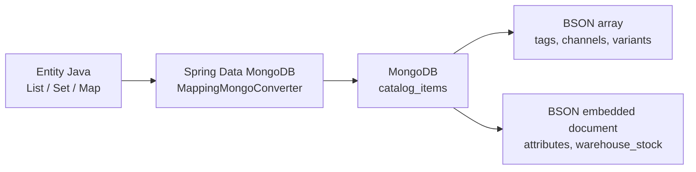

# List, Set, Map và kiểu phần tử trong document

## 1. Từ collection Java đến dữ liệu BSON

Trong **Spring Data MongoDB**, một entity Java có thể chứa các property `List<T>`, `Set<T>` và `Map<String, T>`. Những collection này thường được ánh xạ như sau:

| Property Java | Dạng BSON thường gặp | Đặc tính cần nhớ |
| --- | --- | --- |
| `List<String> tags` | Array các String | Có thứ tự, cho phép giá trị trùng |
| `Set<String> channels` | Array các String | Bên Java không chứa phần tử trùng theo `equals/hashCode`; BSON không có Set riêng |
| `Map<String,String> attributes` | Embedded document | Khóa String trở thành tên field động |
| `Map<String,Integer> stocks` | Embedded document | Giá trị được chuyển theo kiểu phần tử |
| `List<Variant> variants` | Array của embedded document | Mỗi phần tử là object lồng trong document |

Điều cần phân biệt là **collection Java quyết định API và ngữ nghĩa trong chương trình**, còn **BSON quyết định kiểu dữ liệu thực sự trong MongoDB**. Java generic không tự tạo ràng buộc schema cho mọi client ghi vào collection; một ứng dụng khác vẫn có thể ghi dữ liệu BSON có kiểu hoặc cấu trúc khác.



Để xây dựng truy vấn, index và aggregation đúng, ta cần biết cả tên field lưu trữ và kiểu BSON của các phần tử. Điều đó đặc biệt quan trọng khi sử dụng `MongoRepository`, `MongoTemplate` hoặc các API reactive tương ứng.

## 2. Ví dụ một entity chứa List, Set và Map

Giả sử ứng dụng bán sách lưu một sản phẩm có nhiều nhãn tìm kiếm, tập kênh bán, thuộc tính động, số lượng hàng theo kho và các biến thể.

```java
package com.example.catalog;

import java.util.ArrayList;
import java.util.LinkedHashMap;
import java.util.LinkedHashSet;
import java.util.List;
import java.util.Map;
import java.util.Set;
import org.springframework.data.annotation.Id;
import org.springframework.data.mongodb.core.mapping.Document;
import org.springframework.data.mongodb.core.mapping.Field;

@Document(collection = "catalog_items")
public class CatalogItem {
    @Id
    private String id;

    private String sku;

    @Field("tag_list")
    private List<String> tags = new ArrayList<>();

    private Set<String> channels = new LinkedHashSet<>();

    private Map<String, String> attributes = new LinkedHashMap<>();

    @Field("warehouse_stock")
    private Map<String, Integer> stockByWarehouse = new LinkedHashMap<>();

    private List<Variant> variants = new ArrayList<>();

    protected CatalogItem() {}

    public CatalogItem(
            String sku,
            List<String> tags,
            Set<String> channels,
            Map<String, String> attributes,
            Map<String, Integer> stockByWarehouse,
            List<Variant> variants) {
        this.sku = sku;
        this.tags = new ArrayList<>(tags);
        this.channels = new LinkedHashSet<>(channels);
        this.attributes = new LinkedHashMap<>(attributes);
        this.stockByWarehouse = new LinkedHashMap<>(stockByWarehouse);
        this.variants = new ArrayList<>(variants);
    }

    public String getId() { return id; }
    public String getSku() { return sku; }
    public List<String> getTags() { return tags; }
    public Set<String> getChannels() { return channels; }
    public Map<String, String> getAttributes() { return attributes; }
    public Map<String, Integer> getStockByWarehouse() {
        return stockByWarehouse;
    }
    public List<Variant> getVariants() { return variants; }

    public static class Variant {
        private String sku;
        private int stock;

        protected Variant() {}

        public Variant(String sku, int stock) {
            this.sku = sku;
            this.stock = stock;
        }

        public String getSku() { return sku; }
        public int getStock() { return stock; }
    }
}
```

Ở đây, `@Field("tag_list")` đổi tên property Java `tags` thành field BSON `tag_list`; `@Field("warehouse_stock")` làm điều tương tự với `stockByWarehouse`. Những key như `HCM` hoặc `HN` thuộc về map được lưu bên trong field `warehouse_stock`. Lớp `Variant` mô tả kiểu phần tử cho `List<Variant>`.

Đoạn sau giả định đã inject một repository `CatalogItemRepository` vào service hoặc runner:

```java
import java.util.LinkedHashSet;
import java.util.List;
import java.util.Map;

CatalogItem item = new CatalogItem(
    "BOOK-101",
    List.of("java", "spring", "java"),
    new LinkedHashSet<>(List.of("web", "store", "web")),
    Map.of("color", "red", "size", "M"),
    Map.of("HCM", 12, "HN", 4),
    List.of(
        new CatalogItem.Variant("BOOK-101-A", 8),
        new CatalogItem.Variant("BOOK-101-B", 2)
    )
);
catalogItemRepository.save(item);
```

Trong MongoDB, document có thể được hiển thị tương tự:

```javascript
{
  _id: ObjectId("507f1f77bcf86cd799439011"),
  sku: "BOOK-101",
  tag_list: ["java", "spring", "java"],
  channels: ["web", "store"],
  attributes: { color: "red", size: "M" },
  warehouse_stock: { HCM: 12, HN: 4 },
  variants: [
    { sku: "BOOK-101-A", stock: 8 },
    { sku: "BOOK-101-B", stock: 2 }
  ]
}
```

Đây là dữ liệu minh họa. `_id` thực tế được sinh theo quy tắc mapping và cách cấp ID; converter có thể ghi thêm metadata như `_class`. Đặc biệt, **không xem thứ tự các phần tử của Set là cam kết của thiết kế**, ngay cả khi ví dụ khởi tạo bằng `LinkedHashSet`.

## 3. List: có thứ tự, có thể trùng và chứa object

`List<T>` phù hợp khi thứ tự mang ý nghĩa nghiệp vụ: các bước thực hiện, thứ tự ảnh trong sản phẩm hoặc danh sách biến thể được hiển thị. Khi lưu, MongoDB dùng BSON array và giữ thứ tự của các phần tử:

```javascript
tag_list: ["java", "spring", "java"]
```

Trong array này có **ba phần tử**, trong đó `"java"` xuất hiện hai lần. MongoDB không tự loại trùng. Nếu bài toán coi tag là tập hợp không trùng, cần chuẩn hóa dữ liệu hoặc chọn thao tác cập nhật phù hợp; chỉ dùng `List` không diễn đạt yêu cầu đó.

Với `List<Variant>`, mỗi phần tử là một embedded document:

```javascript
variants: [
  { sku: "BOOK-101-A", stock: 8 },
  { sku: "BOOK-101-B", stock: 2 }
]
```

Đây là cấu trúc hợp lý khi các biến thể thường được đọc cùng sản phẩm và số lượng được kiểm soát. Nếu biến thể có vòng đời độc lập, cần phân trang riêng hoặc cập nhật rất thường xuyên, có thể nên lưu ở collection riêng và tham chiếu. MongoDB có giới hạn kích thước **16 MiB cho một document BSON**; không nhúng toàn bộ lịch sử vô hạn vào một array trong cùng document.

## 4. Set: duy nhất phía Java nhưng vẫn lưu bằng BSON array

Trong Java, `Set<T>` bảo đảm không chứa hai phần tử được coi là bằng nhau theo `equals`/`hashCode`:

```java
Set<String> channels =
    new LinkedHashSet<>(List.of("web", "store", "web"));
System.out.println(channels.size()); // 2
```

Spring Data MongoDB thường lưu `Set<String>` thành BSON array, ví dụ:

```javascript
channels: ["web", "store"]
```

**BSON không có kiểu Set riêng**, vì vậy không có unique constraint ở cấp phần tử chỉ vì entity khai báo `Set`. Một client khác hoàn toàn có thể ghi `channels: ["web", "web"]`. Khi đọc dữ liệu trùng vào Set Java, phần tử trùng có thể bị gộp trong bộ nhớ mà **document gốc không hề được sửa**.

Một số điểm cần ghi nhớ:

- `Set` không có ngữ nghĩa thứ tự chung. Nếu cần hiển thị đúng thứ tự đã lưu, chọn `List`.
- Với `Set<Variant>`, hai biến thể có cùng `sku` chỉ được coi là trùng theo Java khi quy tắc equality của class `Variant` định nghĩa như vậy. Object mặc định không tự so sánh dựa trên `sku`.
- Các quy tắc kiểm tra trùng ở Java không thay thế kiểm tra dữ liệu khi có nhiều chương trình cùng ghi vào MongoDB.

MongoDB cung cấp toán tử `$addToSet`:

```javascript
db.catalog_items.updateOne(
  { sku: "BOOK-101" },
  { $addToSet: { channels: "mobile" } }
)
```

Toán tử thêm `"mobile"` nếu giá trị đó chưa có trong mảng. Tuy nhiên, `$addToSet` không tự xóa phần tử trùng đã tồn tại, không hứa hẹn thứ tự phần tử và sử dụng quy tắc so sánh BSON chứ không phải tùy ý dựa trên `equals` của Java. Cần phân biệt **`Set` trong bộ nhớ** và **`$addToSet` khi cập nhật document**.

## 5. Map: embedded document với những khóa động

`Map<String, T>` thường được ánh xạ thành BSON embedded document. Mỗi khóa String là tên field, còn giá trị được chuyển theo kiểu `T`:

```java
Map<String, String> attributes =
    Map.of("color", "red", "size", "M");

Map<String, Integer> stockByWarehouse =
    Map.of("HCM", 12, "HN", 4);
```

```javascript
{
  attributes: { color: "red", size: "M" },
  warehouse_stock: { HCM: 12, HN: 4 }
}
```

BSON document dùng **tên field là chuỗi**, nên `Map<String,T>` là lựa chọn rõ ràng. Với `Map<Integer,T>` hay Map có khóa object phức tạp, không nên giả định converter có thể ánh xạ mọi khóa ổn định; hãy thiết kế chuyển đổi khóa riêng hoặc biểu diễn dưới dạng danh sách các object `{ key, value }`.

### Những khóa chứa dấu chấm hoặc dấu `$`

Truy vấn đường dẫn `"attributes.color"` dùng dấu chấm để truy cập field lồng nhau. Nếu tên khóa map thực sự chứa dấu chấm, chẳng hạn `"display.color"`, dot notation có thể trở nên mơ hồ. MongoDB hiện đại hỗ trợ một số tên field chứa dấu chấm và `$`, nhưng nhiều thao tác truy vấn, index, import/export và cơ chế mapping có các hạn chế khác nhau. Không nên khẳng định mọi tên như vậy đều bị MongoDB cấm, cũng không nên coi chúng an toàn mặc định.

Khi khóa đến từ người dùng, ưu tiên **chuẩn hóa hoặc giới hạn danh sách khóa được phép** như `color`, `size`, `HCM`. Nếu phải hỗ trợ ký tự đặc biệt, cần kiểm thử quy tắc chuyển key của Spring Data (ví dụ cơ chế thay thế dấu chấm trong map key ở phiên bản tương ứng) và hành vi đọc/ghi thực tế. Khi khóa quá đa dạng hoặc cần truy vấn riêng từng cặp, có thể chọn `List<AttributeEntry>` hoặc collection riêng thay cho Map.

## 6. Kiểu phần tử T có tác dụng gì?

Generic `T` định hướng Spring Data chuyển từng phần tử BSON thành kiểu Java mong đợi. Tuy nhiên, MongoDB **không tự cưỡng chế generic của class Java** trên toàn collection.

| Kiểu trong entity | Kiểu BSON thông thường | Rủi ro cần kiểm tra |
| --- | --- | --- |
| `List<String>` | Array of String | Dữ liệu cũ có thể chứa số hoặc boolean |
| `List<Integer>` | Array of Int32 | Cần chú ý dữ liệu có String hoặc Int64 |
| `List<Long>` | Array of Int64 | Chú ý phạm vi số và chuyển đổi |
| `List<Instant>` | Array of BSON Date theo converter | Múi giờ khi hiển thị và lọc khoảng ngày |
| `Set<String>` | Array of String | Không có duy nhất ở cấp BSON array |
| `List<Variant>` | Array of embedded document | Mỗi phần tử cần đủ trường và kiểu đúng |
| `Map<String,Integer>` | Embedded document có giá trị số | Kiểu BSON và tên khóa động |
| `Map<String,Variant>` | Embedded document chứa embedded document | Khóa động và kiểu object lồng nhau |
| `List<Object>` / `Map<String,Object>` | Có thể chứa nhiều kiểu BSON | Khó bảo đảm schema và an toàn kiểu |

Một document BSON có thể chứa:

```javascript
{ tag_list: ["java", 42, true] }
```

nhưng Java khai báo `List<String> tags`. Khi đọc, converter có thể chuyển đổi hoặc báo lỗi tùy dữ liệu/cấu hình; dù không báo lỗi, chương trình có thể nhận giá trị không đúng ngữ nghĩa. Cần kiểm tra dữ liệu thô, xác thực đầu vào và dùng **JSON Schema validation** ở MongoDB khi nghiệp vụ yêu cầu cưỡng chế kiểu.

### BigDecimal và kiểu BSON đích

`BigDecimal` của Java không mặc nhiên bảo đảm BSON Decimal128 trong mọi cấu hình. Đặc biệt với `List<BigDecimal>` hoặc `Map<String,BigDecimal>`, cần xác định converter, cách làm tròn, giới hạn độ chính xác và kiểu BSON thực tế của **từng phần tử**. Không nên giả định một annotation trên property collection tự động hoạt động giống nhau ở mọi cấp và mọi phiên bản Spring Data.

Khi lưu số tiền, cũng có thể dùng `Long` theo đơn vị nhỏ nhất. Dù chọn Decimal128 hay số nguyên, cần thống nhất đơn vị tiền tệ, quy tắc làm tròn, giá trị tối đa và kiểu dữ liệu khi thực hiện aggregation.

## 7. Truy vấn array: phần tử, tập giá trị và $elemMatch

Giả sử entity `CatalogItem` đã lưu dữ liệu mẫu ở mục 2. Trong `mongosh` ta sử dụng **tên field BSON** như `tag_list`; với `MongoTemplate` có ngữ cảnh entity, ta thường dùng **tên property Java** như `tags` rồi Spring Data ánh xạ sang field MongoDB.

### Tìm document có chứa một phần tử

Khi một field BSON là array, điều kiện bằng với một giá trị đơn có thể khớp nếu array chứa giá trị đó:

```javascript
db.catalog_items.find({ tag_list: "spring" })
```

Ví dụ tương ứng với `MongoTemplate`:

```java
import java.util.List;
import org.springframework.data.mongodb.core.MongoTemplate;
import org.springframework.data.mongodb.core.query.Criteria;
import org.springframework.data.mongodb.core.query.Query;

Query query = Query.query(
    Criteria.where("tags").is("spring")
);
List<CatalogItem> results =
    mongoTemplate.find(query, CatalogItem.class);
```

Trong lời gọi `find(query, CatalogItem.class)`, Spring Data có thông tin `@Field("tag_list")` để chuyển tên property Java `tags` sang field BSON `tag_list`.

### Toán tử $in, $all và $size

```javascript
// Chứa ít nhất một trong hai nhãn.
db.catalog_items.find({
  tag_list: { $in: ["java", "mongodb"] }
})

// Chứa cả hai nhãn, không yêu cầu thứ tự cụ thể.
db.catalog_items.find({
  tag_list: { $all: ["java", "spring"] }
})

// Array có chính xác 3 phần tử.
db.catalog_items.find({
  tag_list: { $size: 3 }
})
```

`$all` xác nhận các giá trị có mặt trong array nhưng không biến array thành Set. `$size` là điều kiện theo độ dài array, không nên tự giả định nó được tối ưu bằng index theo mọi trường hợp; nếu nhu cầu lọc theo số phần tử thường xuyên, cần đánh giá mô hình và kế hoạch thực thi.

### Dùng $elemMatch để ràng buộc **cùng một phần tử**

Yêu cầu: tìm sản phẩm có **một biến thể** vừa có `sku = "BOOK-101-A"`, vừa có `stock >= 5`.

```javascript
db.catalog_items.find({
  variants: {
    $elemMatch: {
      sku: "BOOK-101-A",
      stock: { $gte: 5 }
    }
  }
})
```

Tương ứng với `MongoTemplate`:

```java
Query query = Query.query(
    Criteria.where("variants").elemMatch(
        Criteria.where("sku").is("BOOK-101-A")
            .and("stock").gte(5)
    )
);
List<CatalogItem> matches =
    mongoTemplate.find(query, CatalogItem.class);
```

Giả sử BSON array như sau:

```javascript
variants: [
  { sku: "BOOK-101-A", stock: 1 },
  { sku: "BOOK-101-B", stock: 20 }
]
```

Document trên **không thỏa `$elemMatch`** vì không có một phần tử nào đáp ứng đồng thời hai điều kiện. Nếu viết hai điều kiện riêng trên `variants.sku` và `variants.stock` mà không có `$elemMatch`, MongoDB có thể dùng **hai phần tử khác nhau** để thỏa các điều kiện, khiến kết quả khác ý định.

## 8. Truy vấn Map bằng đường dẫn đến key

Map trong ví dụ được lưu thành:

```javascript
warehouse_stock: { HCM: 12, HN: 4 }
```

Trong `mongosh`, truy vấn số lượng tại kho `HCM`:

```javascript
db.catalog_items.find({
  "warehouse_stock.HCM": { $gte: 10 }
})
```

Với `MongoTemplate` và entity `CatalogItem`:

```java
Query query = Query.query(
    Criteria.where("stockByWarehouse.HCM").gte(10)
);
List<CatalogItem> matches =
    mongoTemplate.find(query, CatalogItem.class);
```

Spring Data ánh xạ phần `stockByWarehouse` thành `warehouse_stock`; `HCM` là **khóa của Map**, không phải thuộc tính được khai báo riêng trong Java class.

Nếu key của map được nhận từ HTTP request hoặc dữ liệu ngoài, hãy kiểm tra nó thuộc các giá trị hợp lệ. Không nối chuỗi key không đáng tin vào đường dẫn cập nhật/truy vấn khi có thể chứa dấu chấm hoặc ký tự đặc biệt, vì cách hiểu của dot notation có thể khác với tên field mong muốn.

Map có rất nhiều field động khiến việc tạo index khó hơn những property cố định. Nếu chỉ truy vấn theo `attributes.color` và `attributes.size`, có thể tạo index cụ thể. Khi bắt buộc tìm theo nhiều key khác nhau, MongoDB có **wildcard index** phù hợp với một số mẫu truy vấn:

```javascript
db.catalog_items.createIndex({
  "attributes.$**": 1
})
```

Chi phí ghi, kích thước index và khả năng hỗ trợ từng query cần được đo với phiên bản MongoDB và workload thực tế. Không nên tạo wildcard index chỉ vì schema dùng Map.

## 9. Cập nhật từng phần tử bằng MongoTemplate

Các toán tử cập nhật MongoDB giúp sửa một phần của document mà không phải đọc toàn entity rồi `save` lại.

### Thêm, loại hoặc tránh trùng trong array

```java
import org.springframework.data.mongodb.core.query.Update;

Query bySku = Query.query(
    Criteria.where("sku").is("BOOK-101")
);

// $push: thêm phần tử, dù phần tử đó đã có.
mongoTemplate.updateFirst(
    bySku,
    new Update().push("tags", "mongodb"),
    CatalogItem.class
);

// $addToSet: thêm nếu giá trị chưa có trong array.
mongoTemplate.updateFirst(
    bySku,
    new Update().addToSet("channels", "mobile"),
    CatalogItem.class
);

// $pull: xóa phần tử có giá trị khớp.
mongoTemplate.updateFirst(
    bySku,
    new Update().pull("tags", "java"),
    CatalogItem.class
);
```

Khi dùng `CatalogItem.class`, Spring Data xử lý ánh xạ tên trường theo entity: `tags` tương ứng `tag_list`. Mỗi lệnh cập nhật riêng trên **một document** là nguyên tử trong MongoDB, nhưng ba lệnh độc lập trên không tự trở thành một transaction chung.

Không dùng `$push` để thực thi yêu cầu “không trùng”; `$addToSet` cũng không tự dọn phần tử trùng đã có. Nếu cần giữ thứ tự hoặc chèn vào một vị trí cụ thể, phải thiết kế thao tác tương ứng thay vì ngẫu nhiên phụ thuộc vào cách các collection Java lặp phần tử.

### Cập nhật một phần của Map

```java
// Thay giá trị của key color.
mongoTemplate.updateFirst(
    bySku,
    new Update().set("attributes.color", "blue"),
    CatalogItem.class
);

// Giảm số lượng hàng ở kho HCM đi 2.
mongoTemplate.updateFirst(
    bySku,
    new Update().inc("stockByWarehouse.HCM", -2),
    CatalogItem.class
);
```

`$set` trên `attributes.color` không cần thay toàn bộ map `attributes`. `$inc` cập nhật số ở `warehouse_stock.HCM` nhưng **chưa bảo đảm tồn kho không âm**. Với nghiệp vụ trừ tồn kho, cần thêm điều kiện đủ số lượng trong query rồi kiểm tra số document cập nhật thành công; trường hợp kiểu BSON hiện có không phải số có thể làm thao tác thất bại.

### Rủi ro khi thay toàn bộ collection

Thao tác `set("tags", newTags)` hoặc `save` toàn entity có thể thay toàn bộ array theo phiên bản object đang nằm trong bộ nhớ. Hai request cùng đọc dữ liệu cũ rồi ghi lại có thể làm mất thay đổi của nhau. Khi cần đồng thời, hãy cân nhắc cập nhật theo toán tử, điều kiện trạng thái và/hoặc `@Version` (optimistic locking) phù hợp với nghiệp vụ.

## 10. Index cho array và document lồng

Index trên field array có thể trở thành **multikey index**: MongoDB lập chỉ mục các giá trị thành phần theo quy tắc của index.

```javascript
// Tìm sản phẩm theo nhãn.
db.catalog_items.createIndex(
  { tag_list: 1 },
  { name: "catalog_item_tags" }
)

// Tìm sản phẩm có biến thể theo sku.
db.catalog_items.createIndex(
  { "variants.sku": 1 },
  { name: "catalog_item_variant_sku" }
)

// Truy vấn số tồn kho tại kho HCM.
db.catalog_items.createIndex(
  { "warehouse_stock.HCM": 1 },
  { name: "catalog_item_stock_hcm" }
)
```

| Collection field | Index ứng viên | Cần lưu ý |
| --- | --- | --- |
| `List<String> tags` | `{ tag_list: 1 }` | Mỗi array có thể tạo nhiều index key |
| `Set<String> channels` | `{ channels: 1 }` | Index không áp đặt tính duy nhất **bên trong** một array |
| `List<Variant> variants` | `{ "variants.sku": 1 }` | Điều kiện trên cùng phần tử nên dùng `$elemMatch` |
| `Map<String,Integer> stockByWarehouse` | `{ "warehouse_stock.HCM": 1 }` | Index này dành cho key `HCM` cụ thể |

**Compound multikey index có giới hạn khi nhiều trường index cùng chứa array trong một document**. Không nên giả định index `{ tag_list: 1, channels: 1 }` sẽ luôn hợp lệ và hiệu quả vì hai field đều là array. Hãy chọn index dựa trên truy vấn thực tế và kiểm tra với dữ liệu đại diện.

```javascript
db.catalog_items.find({
  tag_list: "spring"
}).explain("executionStats")
```

Xem `winningPlan`, `totalKeysExamined`, `totalDocsExamined` và `nReturned` để đánh giá index. Số khóa phải duyệt có thể lớn hơn số document trả về khi một document chứa nhiều phần tử array. Index cũng tốn dung lượng và làm tăng công việc khi ghi.

## 11. Phân biệt empty, null, missing và dữ liệu sai kiểu

Trong MongoDB, những document dưới đây có **bốn trạng thái BSON khác nhau**:

```javascript
{ sku: "A" }                        // Thiếu tag_list
{ sku: "B", tag_list: null }        // Có field null
{ sku: "C", tag_list: [] }          // Array rỗng
{ sku: "D", tag_list: "java" }      // Có field nhưng sai kiểu
```

Trong Java, việc khai báo `tags = new ArrayList<>()` không chứng minh mọi document cũ thiếu field đều sẽ được converter đọc theo một quy tắc nhất định. Kết quả còn phụ thuộc constructor, setter, metadata và converter; cần kiểm thử với dữ liệu lịch sử. `attributes: {}` cũng khác `attributes: null` hoặc không tồn tại field `attributes`.

Nếu muốn **MongoDB cưỡng chế kiểu phần tử**, có thể bổ sung JSON Schema validation. Ví dụ dưới đây chỉ minh họa cách tạo **collection mới** có schema đơn giản; không chạy `createCollection` nếu collection đã tồn tại:

```javascript
db.createCollection("catalog_items", {
  validator: {
    $jsonSchema: {
      bsonType: "object",
      properties: {
        tag_list: {
          bsonType: "array",
          items: { bsonType: "string" }
        },
        channels: {
          bsonType: "array",
          items: { bsonType: "string" }
        },
        warehouse_stock: {
          bsonType: "object",
          additionalProperties: { bsonType: "int" }
        }
      }
    }
  }
})
```

Validator minh họa chỉ kiểm tra **kiểu** ở vài field, chưa thể hiện mọi bất biến nghiệp vụ (ví dụ không có tag trùng, tồn kho không âm, không có SKU biến thể trùng). Với collection có sẵn, bổ sung validator phải theo quy trình quản trị riêng và xem xét dữ liệu cũ.

## 12. Kiểm thử mapping bằng repository và BSON thật

Một repository đơn giản cho entity:

```java
package com.example.catalog;

import java.util.List;
import org.springframework.data.mongodb.repository.MongoRepository;

public interface CatalogItemRepository
        extends MongoRepository<CatalogItem, String> {

    List<CatalogItem> findByTags(String tag);
}
```

Tên phương thức `findByTags` dùng property Java `tags`; Spring Data chuyển truy vấn sang `tag_list`. Khi `tag_list` là array String, truy vấn bằng một giá trị thường tìm document chứa phần tử tương ứng.

Nên kiểm thử tích hợp với MongoDB thật, ví dụ sử dụng Testcontainers để quan sát BSON gốc. Đoạn sau thuộc một test/service có sẵn `mongoTemplate` và document đã lưu:

```java
import java.util.List;
import org.bson.Document;
import static org.assertj.core.api.Assertions.assertThat;

Document stored = mongoTemplate.getCollection("catalog_items")
    .find(new Document("sku", "BOOK-101"))
    .first();

assertThat(stored).isNotNull();
assertThat(stored.get("tag_list")).isInstanceOf(List.class);
assertThat(stored.get("channels")).isInstanceOf(List.class);
assertThat(stored.get("attributes")).isInstanceOf(Document.class);
assertThat(stored.get("warehouse_stock")).isInstanceOf(Document.class);
assertThat(stored.get("variants")).isInstanceOf(List.class);
```

`mongoTemplate.getCollection(...)` trả về API của MongoDB Java Driver, vì vậy tên field khi thao tác với `Document` ở đây là **tên BSON**. `assertThat` thuộc AssertJ và cần dependency kiểm thử tương ứng. Đây là mẫu kiểm tra có chủ đích, không phải một chương trình Java độc lập.

Các trường hợp nên thử:

1. `List<String>` có phần tử trùng: xác nhận giữ thứ tự và số lượng khi đọc lại.
2. `Set<String>` có phần tử đầu vào trùng: xác nhận ngữ nghĩa Java và không giả định thứ tự BSON.
3. `List<Variant>`: kiểm tra từng object có đúng `sku`, `stock` và truy vấn `$elemMatch` không khớp nhầm hai biến thể.
4. `Map<String,Integer>`: kiểm tra tên key, kiểu số, cập nhật `$inc` và cách xử lý khóa bất thường.
5. Tài liệu thiếu field, field null, array rỗng và array sai kiểu: thống nhất chính sách chuyển đổi.
6. Index `tag_list` và đường dẫn `variants.sku`: xem `explain("executionStats")` khi có dữ liệu mẫu đủ lớn.

### Lỗi thường gặp

| Hiện tượng | Nguyên nhân cần kiểm tra | Cách xử lý |
| --- | --- | --- |
| List có giá trị lặp | BSON array cho phép lặp | Chuẩn hóa đầu vào hoặc dùng `$addToSet` phù hợp khi cập nhật |
| Set đọc lại không giữ thứ tự | Set không có hợp đồng thứ tự tổng quát | Dùng List khi thứ tự có ý nghĩa |
| `Set<Variant>` có hai SKU giống nhau | `equals/hashCode` không so sánh theo SKU | Thiết kế equality hoặc ràng buộc nghiệp vụ rõ ràng |
| Truy vấn theo `tags` trong `mongosh` không có kết quả | Field thực là `tag_list` | Tra `@Field` và tên BSON |
| Map key có dấu chấm gây khó tra cứu | Dot notation hiểu thành đường dẫn | Chuẩn hóa key hoặc đổi mô hình dữ liệu |
| Truy vấn variants khớp sai | Điều kiện áp lên hai phần tử khác nhau | Dùng `$elemMatch` |
| Aggregation số sai | Có phần tử BSON khác kiểu mong đợi | Kiểm tra `$type`, converter và dữ liệu cũ |
| Document ngày càng lớn | Array/map tăng không giới hạn | Giới hạn số phần tử hoặc tách collection |

## 13. Bài tập thực hành và kết luận

**Bài tập 1.** Entity khai báo:

```java
private List<String> keywords;
private Set<String> supportedLanguages;
private Map<String, Integer> remainingByLocation;
```

**Hỏi:** Ba property sẽ tương ứng kiểu BSON nào? **Đáp án:** hai property đầu thường là BSON array; property thứ ba là embedded document với tên field là mã địa điểm và giá trị là số. `Set` không trở thành một BSON Set riêng.

**Bài tập 2.** Một document chứa:

```javascript
variants: [
  { sku: "A", stock: 0 },
  { sku: "B", stock: 10 }
]
```

**Hỏi:** Có biến thể nào vừa có `sku = "A"` vừa `stock >= 5` không? **Đáp án:** Không. Phải kiểm tra cả hai điều kiện trên cùng phần tử bằng `$elemMatch`.

**Bài tập 3.** Java có `Set<String> tags`, nhưng một client khác ghi `tags: ["java", "java"]`. **Hỏi:** Đọc lại thành Set có sửa document BSON gốc không? **Đáp án:** Không. Converter có thể gộp phần tử trùng trong bộ nhớ; muốn sửa BSON phải thực hiện thao tác ghi/migration.

**Bài tập 4.** Bạn muốn truy vấn tồn kho kho `HN` bằng `MongoTemplate` trên `CatalogItem` đã có `@Field("warehouse_stock")`. **Đáp án gợi ý:** dùng `Criteria.where("stockByWarehouse.HN")` trong truy vấn có ngữ cảnh entity; dùng `"warehouse_stock.HN"` trong `mongosh`.

**Ghi nhớ:** `List` và `Set` đều thường được lưu thành **BSON array**, còn `Map<String,T>` thành **embedded document**. Generic `T` định hướng Spring Data chuyển từng phần tử về Java, nhưng không thay thế schema validation hay bất biến nghiệp vụ. Hãy thiết kế thứ tự, tính duy nhất, tên key, cách cập nhật, index và kiểm thử dựa trên dữ liệu BSON thật và mẫu truy cập của ứng dụng.
