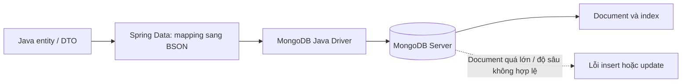
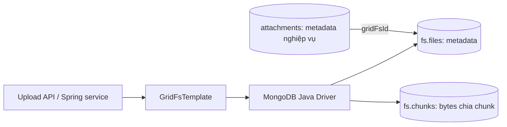

# Giới hạn kích thước, độ sâu document và lựa chọn dữ liệu ngoài document

MongoDB lưu dữ liệu theo **BSON document** thay vì hàng và cột cố định. Một document có thể chứa chuỗi, số, thời gian, mảng, object lồng nhau, dữ liệu nhị phân và nhiều kiểu BSON khác. Cách biểu diễn linh hoạt này giúp ứng dụng **Spring Data MongoDB** ánh xạ object Java vào cấu trúc dữ liệu tự nhiên, nhưng **không đồng nghĩa một document có thể tăng vô hạn**.

Khi thiết kế document, hai giới hạn quan trọng nhất cần nhớ là **kích thước BSON tối đa 16 MiB cho một document** và **độ sâu lồng nhau tối đa 100 cấp**. Các giới hạn này ảnh hưởng đến cách nhúng dữ liệu, xây dựng danh sách tăng trưởng, lưu tệp lớn và xử lý payload JSON nhiều tầng. Một thiết kế tốt thường đặt ngưỡng nhỏ hơn nhiều so với giới hạn kỹ thuật, dựa trên cách truy vấn, cập nhật, phân trang và đo hiệu năng thực tế.

Bài học thuộc chương **Kiểu dữ liệu** trong module `SPRING_DATA_MONGODB`. Ta sẽ học cách kiểm tra BSON thật trên MongoDB Server, ánh xạ bằng `MongoTemplate` hoặc repository, lựa chọn giữa nhúng và tham chiếu, dùng GridFS hoặc object storage cho nội dung lớn, và kiểm thử/chẩn đoán khi dữ liệu tăng trưởng.

Sau bài học, bạn có thể:

- Giải thích vì sao 16 MiB là giới hạn **BSON document**, khác với kích thước JSON và dung lượng cả collection.
- Nhận diện cấu trúc lồng sâu, mảng không giới hạn và các trường nhị phân có nguy cơ vượt giới hạn.
- Đo kích thước BSON và độ dài mảng bằng `mongosh`/aggregation, phân tích tác động đến query và index.
- Chọn **embedded document**, **collection riêng có tham chiếu**, **GridFS** hoặc **object storage** theo nhu cầu.
- Thiết kế cách lưu metadata và đọc tệp lớn trong Spring Data MongoDB, lưu ý tính nhất quán, bảo mật và kiểm thử.

## 1. Hai giới hạn cần hiểu chính xác

| Giới hạn MongoDB | Giá trị | Phạm vi và hệ quả |
| --- | --- | --- |
| **Kích thước một BSON document** | **16 MiB = 16.777.216 byte** | Bao gồm mọi field và giá trị của document. Một document quá lớn không thể lưu bằng insert/update thông thường. |
| **Độ sâu BSON document lồng nhau** | **Tối đa 100 cấp** | Cấu trúc object/mảng lồng nhau không được vượt giới hạn độ sâu mà MongoDB hỗ trợ. |

### 1.1. 16 MiB đo theo BSON, không theo JSON hiển thị

Xét một document:

```javascript
{
  _id: "POST-001",
  title: "Hướng dẫn MongoDB",
  author: {
    id: "U-12",
    displayName: "Lan"
  },
  tags: ["mongodb", "spring-data"],
  body: "Nội dung..."
}
```

BSON chứa **kiểu dữ liệu, tên trường, độ dài chuỗi, byte kết thúc và cấu trúc lồng**. Kích thước này không nhất thiết bằng số ký tự của JSON hay kích thước một chuỗi Java trước khi lưu:

- Chuỗi Unicode có thể cần nhiều byte UTF-8 cho một ký tự.
- Mảng có thông tin phần tử và chỉ số; một mảng rất dài làm BSON tăng thêm chi phí lưu trữ.
- Dữ liệu nhị phân (`byte[]`/`BinData`), các mảng lồng và object con đều được tính vào **cùng document cha**.
- Nén ở tầng lưu trữ không giúp một document vượt qua **giới hạn BSON logic 16 MiB**.

Do đó không nên kiểm tra bằng `json.length()` hoặc chỉ dựa vào kích thước tệp ở filesystem. Đối tượng có thể nhỏ khi nén nhưng vẫn vượt 16 MiB sau khi biểu diễn bằng BSON.

MongoDB có thể lưu collection với **nhiều document, tổng dung lượng vượt xa 16 MiB**. Giới hạn 16 MiB áp dụng cho **từng document**, không phải database, collection hay một tệp GridFS được chia thành nhiều chunk.

### 1.2. Giới hạn độ sâu 100 cấp

Độ sâu được tạo bởi các object/mảng BSON lồng nhau, ví dụ:

```javascript
{
  account: {
    profile: {
      address: {
        city: "Hà Nội"
      }
    }
  }
}
```

Cấu trúc trên chỉ lồng vài cấp nên thông thường không có vấn đề. Ngược lại, dữ liệu JSON được tạo đệ quy như `child.child.child...` hàng trăm lần có thể vượt giới hạn lồng nhau. **Đừng nhầm số lượng phần tử của một mảng phẳng với độ sâu:** một mảng có một triệu phần tử có thể không sâu, nhưng vẫn có thể vượt 16 MiB và là một thiết kế khó vận hành.

Giới hạn 100 cấp là ngưỡng của hệ thống, **không phải khuyến nghị thiết kế ở 99 cấp**. Cấu trúc quá sâu còn gây khó khăn cho mapping Java, validation, truy vấn bằng đường dẫn field, cập nhật từng phần, bảo trì schema và quan sát dữ liệu.

### 1.3. Lỗi xảy ra ở đâu?



Spring Data và driver chuẩn bị dữ liệu để gửi đi, còn MongoDB Server bảo vệ các giới hạn lưu trữ. Tùy trường hợp và phiên bản, lỗi có thể được phát hiện ở bước mã hóa BSON hoặc khi server xử lý lệnh. Tên exception cụ thể có thể khác; hãy đọc thông báo, kích thước dữ liệu và thao tác gây lỗi thay vì dựa vào một chuỗi exception duy nhất.

## 2. Thiết kế theo truy vấn, không theo giới hạn tối đa

Giả sử hệ thống quản lý khóa học có `courses`, `lessons`, `comments` và tệp đính kèm:

- Một khóa có khoảng 20–60 bài; danh sách tiêu đề bài thường hiển thị cùng khóa.
- Nội dung của một bài có thể chứa nhiều đoạn văn, code và media.
- Bình luận tăng đều theo số học viên, có thể đạt hàng trăm nghìn.
- Tệp video hoặc PDF có thể lớn hàng chục đến hàng trăm MiB.

Một document `course` nhúng **mọi bài, mọi bình luận và toàn bộ byte của media** sẽ nhanh chóng trở nên quá lớn. Trong khi đó, tách cả những field nhỏ luôn đọc cùng nhau cũng có thể tạo quá nhiều truy vấn.

| Loại dữ liệu | Thiết kế thường phù hợp | Lý do |
| --- | --- | --- |
| Metadata nhỏ, ổn định: tiêu đề, trạng thái, tác giả | **Nhúng trong document chính** | Thường đọc và cập nhật cùng nhau |
| Danh sách tóm tắt bài học **có giới hạn** | Có thể **nhúng subset** như `lessonSummaries` | Hiển thị nhanh trang tổng quan; chỉ nhúng field cần thiết |
| Nội dung bài học lớn và sửa độc lập | **Collection `lessons` riêng**, tham chiếu `courseId` | Đọc/ghi riêng, phân trang, versioning, không phình document khóa |
| Bình luận, sự kiện, log tăng không giới hạn | **Collection riêng** với index theo parent ID/thời gian | Tránh mảng vô hạn, hỗ trợ lọc và phân trang |
| Ảnh, PDF, video lớn | **GridFS** hoặc **object storage**, document chỉ lưu metadata và khóa tham chiếu | Tránh nhét byte nhị phân vào document |
| Cấu hình JSON rất sâu do nguồn ngoài gửi | **Làm phẳng/chuẩn hóa**, chia thành document hợp lý hoặc lưu bản gốc ngoài MongoDB | Tránh quá sâu, khó query và khó mapping |

**Điểm quyết định:** document nên đại diện cho một nhóm dữ liệu thường được truy cập/cập nhật cùng nhau, với kích thước và tăng trưởng **có thể dự đoán được**. Nếu một phần cần vòng đời, quyền truy cập, truy vấn và kích thước riêng, đó là dấu hiệu nên tách.

### 2.1. Nhúng mảng có giới hạn

Ví dụ danh sách bài học tóm tắt:

```javascript
// Collection: courses
{
  _id: "COURSE-001",
  title: "Spring Data MongoDB",
  lessonCount: 36,
  lessonSummaries: [
    { lessonId: "LESSON-001", title: "Giới thiệu", order: 1 },
    { lessonId: "LESSON-002", title: "Mapping BSON", order: 2 }
  ]
}
```

Nếu `lessonSummaries` chỉ chứa tối đa một số lượng đã biết và mỗi phần tử nhỏ, nhúng có thể giúp đọc một lần. **Không hiểu ví dụ trên là khuyến nghị nhúng toàn bộ nội dung khóa học**. Khi `lessonSummaries` thay đổi theo nội dung gốc, ứng dụng cần định nghĩa cách cập nhật bản sao.

### 2.2. Tránh mảng phát triển không giới hạn

Thiết kế có nguy cơ cao:

```javascript
// Không phù hợp nếu comment tăng mãi:
{
  _id: "POST-001",
  title: "Bài viết",
  comments: [
    /* ... hàng trăm nghìn comment ... */
  ]
}
```

Thiết kế thay thế:

```javascript
// posts: metadata nhỏ
{ _id: "POST-001", title: "Bài viết", commentCount: 250000 }

// comments: mỗi bình luận là một document độc lập
{
  _id: "COMMENT-001",
  postId: "POST-001",
  authorId: "U-01",
  body: "Nội dung bình luận",
  createdAt: ISODate("2026-11-20T02:00:00Z")
}
```

Với mô hình tham chiếu logic, có thể đánh index:

```javascript
db.comments.createIndex({ postId: 1, createdAt: -1, _id: -1 });
db.comments.find({ postId: "POST-001" })
  .sort({ createdAt: -1, _id: -1 })
  .limit(20);
```

Mô hình này giúp phân trang bình luận, giảm kích thước một document và cho phép ghi bình luận mà không liên tục mở rộng cùng một document cha. Trường `commentCount` là dữ liệu dẫn xuất: cần cập nhật có kiểm soát hoặc chấp nhận chênh lệch ngắn hạn theo yêu cầu nghiệp vụ.

## 3. Đo kích thước BSON và phát hiện document tăng trưởng

### 3.1. Đo một document bằng `mongosh`

Khi làm việc với database thử nghiệm, có thể dùng:

```javascript
const course = db.courses.findOne({ _id: "COURSE-001" });
if (course !== null) {
  print("BSON bytes:", Object.bsonsize(course));
}
```

`Object.bsonsize` đo kích thước BSON của object (sau khi được biểu diễn dưới dạng BSON), hữu ích để so với 16.777.216 byte. Hãy đo object **đúng như dữ liệu được lưu**, bao gồm `_id` và các field thực tế; khi đang mapping qua Spring Data, document BSON có thể khác object Java ban đầu.

### 3.2. Xem những document lớn nhất trong collection

MongoDB cung cấp toán tử aggregation `$bsonSize` để tính kích thước document:

```javascript
db.courses.aggregate([
  {
    $project: {
      _id: 1,
      title: 1,
      sizeBytes: { $bsonSize: "$$ROOT" }
    }
  },
  { $sort: { sizeBytes: -1 } },
  { $limit: 10 }
]);
```

Trên collection lớn, phép đo này có thể phải duyệt nhiều document và tính toán kích thước; chạy có chủ đích hoặc trên mẫu dữ liệu phù hợp, tránh gây tải không cần thiết cho production. `sizeBytes` là BSON size của từng document, không phải dung lượng vật lý đã nén trên đĩa.

Để phát hiện mảng dài bất thường:

```javascript
db.courses.aggregate([
  {
    $project: {
      _id: 1,
      lessonSummaryCount: {
        $size: { $ifNull: ["$lessonSummaries", []] }
      },
      sizeBytes: { $bsonSize: "$$ROOT" }
    }
  },
  { $sort: { lessonSummaryCount: -1 } },
  { $limit: 10 }
]);
```

`$ifNull` tránh lỗi `$size` khi field vắng mặt hoặc `null`; nếu dữ liệu legacy có field không phải mảng, cần kiểm tra kiểu trước khi dùng phép đo này.

### 3.3. Chọn ngưỡng vận hành nội bộ

MongoDB áp dụng giới hạn cứng 16 MiB, nhưng ứng dụng nên đặt **ngưỡng cảnh báo nhỏ hơn**, dựa trên payload trung bình, kích thước cực đại, tốc độ tăng trưởng, đặc điểm mạng và chi phí cập nhật. Không có một con số “an toàn” cố định cho mọi hệ thống.

Ví dụ một đội có thể đặt ngưỡng cảnh báo khi document của một collection bắt đầu đạt vài MiB, rồi phân tích thiết kế trước khi chạm 16 MiB. Đây là **chính sách vận hành do đội tự chọn**, không phải giới hạn mới của MongoDB.

Các chỉ số hữu ích gồm:

- Kích thước BSON trung bình, phân vị cao và những document lớn nhất.
- Số phần tử trong mảng có khả năng tăng liên tục.
- Thời gian `find`/`update` và số byte trả về cho các API quan trọng.
- Tỷ lệ query quét collection, hiệu quả index, thời gian serialize/deserialize và độ trễ mạng.
- Tần suất cập nhật những document lớn, mức tăng dung lượng và chi phí lưu trữ.

## 4. Chiến lược cho dữ liệu lớn hoặc thay đổi thường xuyên

### 4.1. Tách document theo vòng đời và kiểu truy cập

Với hồ sơ người dùng, có thể giữ `profiles` chứa thông tin thường đọc, còn lịch sử hoạt động nằm ở `activityEvents`:

```javascript
// profiles
{ _id: "U-100", displayName: "An", avatarFileId: "FILE-123" }

// activityEvents
{
  _id: ObjectId("507f1f77bcf86cd799439011"),
  userId: "U-100",
  type: "LOGIN",
  occurredAt: ISODate("2026-11-19T12:00:00Z")
}
```

Một trang hồ sơ không nên tải toàn bộ lịch sử sự kiện chỉ để hiển thị tên và avatar. Nếu lịch sử chỉ dùng báo cáo, có thể cân nhắc TTL, tổng hợp theo thời gian hoặc cơ chế lưu trữ dài hạn tùy yêu cầu giữ dữ liệu.

### 4.2. Subset pattern và bucket pattern

- **Subset pattern:** nhúng **một phần nhỏ, có giới hạn** dữ liệu thường dùng (ví dụ 3 comment mới nhất) và lưu toàn bộ trong collection riêng.
- **Bucket pattern:** nhóm một số lượng phần tử **có giới hạn** vào mỗi document, chẳng hạn log đo cảm biến theo cửa sổ thời gian hoặc số lượng bản ghi cố định. Mỗi bucket vẫn phải nhỏ hơn 16 MiB.
- **Extended reference:** giữ `fileId`/`productId` kèm các trường tóm tắt cần hiển thị; không sao chép toàn bộ object liên quan.

Các mẫu này cần chính sách về **nguồn dữ liệu chuẩn, đồng bộ, sửa/xóa và phân trang**. Việc nhúng bản tóm tắt không có nghĩa MongoDB tự đồng bộ với bản gốc ở collection khác.

### 4.3. Projection và phân trang không làm document được lưu nhỏ đi

Truy vấn chỉ chọn field cần thiết:

```javascript
db.courses.find(
  { _id: "COURSE-001" },
  { title: 1, lessonCount: 1, lessonSummaries: { $slice: 5 } }
);
```

Projection hoặc `$slice` giúp hạn chế dữ liệu **trả về cho client**, nhưng **không thay đổi kích thước document lưu trữ** hay xóa nguy cơ vượt giới hạn 16 MiB. Nếu mảng tiếp tục tăng vô hạn, phải thay đổi cách lưu.

Tương tự, phân trang `skip`/`limit` trên một collection có thể giới hạn lượng kết quả nhưng không thay thế việc thiết kế index và truy vấn theo khóa phù hợp. Với phân trang sâu, cân nhắc keyset/cursor pagination theo trường sắp xếp ổn định.

## 5. Khi nào đưa dữ liệu ra ngoài document?

Có ít nhất ba nhóm dữ liệu nên xem xét đưa ra ngoài document ứng dụng:

1. **Tệp nhị phân lớn:** PDF, hình ảnh độ phân giải cao, âm thanh, video, tài liệu đính kèm.
2. **Tập dữ liệu con không giới hạn:** bình luận, lịch sử thao tác, log, event, phiên bản phát sinh liên tục.
3. **Payload quá sâu/khó truy vấn:** JSON lồng nhiều tầng từ hệ thống khác, nội dung cấu trúc không ổn định hoặc chỉ cần lưu nguyên bản để tải xuống.

“Đưa ra ngoài document” có hai nghĩa khác nhau:

- **Đưa sang collection khác** nhưng vẫn nằm trong MongoDB, phù hợp cho dữ liệu có cấu trúc cần query/index.
- **Đưa nội dung nhị phân ra hệ thống lưu trữ tệp**, ví dụ GridFS chạy trên MongoDB hoặc object storage bên ngoài; MongoDB chỉ giữ metadata và khóa trỏ đến nội dung.

| Lựa chọn | Dùng khi nào | Đánh đổi |
| --- | --- | --- |
| Field `String`/`Binary` trong document | Nội dung nhỏ, có giới hạn, luôn đi cùng document | Tăng BSON size; tất cả vẫn chịu 16 MiB |
| Collection riêng và tham chiếu ID | Nhiều record cần query, lọc, index, sửa độc lập | Có thêm truy vấn hoặc `$lookup`, cần quản lý tham chiếu |
| **MongoDB GridFS** | Muốn lưu/stream tệp lớn bằng MongoDB; tệp có thể vượt 16 MiB | Quản lý bucket/chunk, tải xuống qua ứng dụng, chi phí lưu trữ và vận hành trên MongoDB |
| **Object storage** (S3, GCS, Azure Blob hoặc tương đương) | Tệp lớn, phân phối qua CDN, lifecycle, tải trực tiếp, yêu cầu mở rộng riêng | Phải điều phối metadata MongoDB với object bên ngoài; quyền truy cập, dọn dữ liệu mồ côi |
| Lưu trữ/khai thác riêng cho analytics | Dữ liệu sự kiện rất lớn, truy vấn tổng hợp/lịch sử đặc thù | Thêm pipeline đồng bộ và mô hình dữ liệu riêng |

Không có lựa chọn đúng tuyệt đối. Với ứng dụng lưu file lớn, cả **GridFS** lẫn **object storage** đều là phương án hợp lệ; lựa chọn theo yêu cầu phân phối file, quyền truy cập, chi phí, vận hành và tính nhất quán.

## 6. GridFS: lưu tệp lớn bằng các chunk MongoDB

**GridFS** là quy ước chia nội dung tệp thành nhiều chunk BSON và lưu metadata riêng. Trong bucket mặc định, GridFS thường dùng hai collection:

- `fs.files`: metadata của tệp (ID, tên, chiều dài, chunk size, ngày tải lên, metadata tùy chọn).
- `fs.chunks`: các chunk dữ liệu nhị phân, gắn với tệp qua `files_id` và thứ tự `n`.

Một tệp 40 MiB **không thể** là một document BSON 40 MiB, nhưng GridFS có thể chia nó thành nhiều document chunk, mỗi chunk nằm trong giới hạn BSON. Chunk size mặc định phổ biến của GridFS là **255 KiB** (có thể cấu hình theo driver/bucket); mỗi document chunk vẫn phải hợp lệ. Một tệp lớn không tự biến thành một BSON document khổng lồ.



Ưu điểm của GridFS là tệp và metadata chunk được quản lý trong hệ sinh thái MongoDB; ứng dụng có thể tải từng phần qua stream mà không cần giữ toàn bộ file trong RAM. Tuy nhiên GridFS vẫn sử dụng tài nguyên của MongoDB Server, cần thiết kế quyền truy cập, sao lưu, theo dõi dung lượng và xử lý upload dang dở.

### 6.1. Ví dụ upload bằng `GridFsTemplate`

Ví dụ Spring Data MongoDB sử dụng blocking API:

```java
import java.io.IOException;
import java.io.InputStream;

import org.bson.Document;
import org.bson.types.ObjectId;
import org.springframework.data.mongodb.gridfs.GridFsTemplate;
import org.springframework.stereotype.Service;

@Service
public class FileStorageService {
    private final GridFsTemplate gridFsTemplate;

    public FileStorageService(GridFsTemplate gridFsTemplate) {
        this.gridFsTemplate = gridFsTemplate;
    }

    public String storePdf(
            InputStream content,
            String filename,
            String ownerId
    ) throws IOException {
        Document metadata = new Document("ownerId", ownerId)
                .append("kind", "COURSE_ATTACHMENT");

        ObjectId fileId = gridFsTemplate.store(
                content,
                filename,
                "application/pdf",
                metadata
        );
        return fileId.toHexString();
    }
}
```

`GridFsTemplate` cung cấp API lưu tệp theo stream và trả về ID GridFS. Trong ứng dụng thật, service cần xử lý **đóng stream đúng chủ sở hữu**, kiểm tra định dạng/nội dung file, giới hạn kích thước upload, xác thực và phân quyền trước khi lưu. Tên file do client gửi chỉ là metadata không đáng tin; không dùng trực tiếp nó làm đường dẫn filesystem. Đừng log thông tin nhạy cảm trong metadata.

Ví dụ trên giả định dependency Spring Data MongoDB và bean `GridFsTemplate` đã được cấu hình phù hợp với phiên bản đang sử dụng. Với ứng dụng reactive, có thể dùng API GridFS reactive tương ứng của Spring Data thay vì gọi blocking template trong một luồng event loop.

### 6.2. Liên kết tệp với metadata nghiệp vụ

Có thể có collection `attachments`:

```javascript
{
  _id: "ATT-001",
  lessonId: "LESSON-123",
  ownerId: "U-100",
  originalFilename: "slide.pdf",
  contentType: "application/pdf",
  sizeBytes: NumberLong("41943040"),
  storageKind: "GRIDFS",
  gridFsId: ObjectId("507f1f77bcf86cd799439011"),
  createdAt: ISODate("2026-11-20T02:00:00Z")
}
```

Document `attachments` chỉ lưu thông tin nhỏ, không lưu 40 MiB byte PDF. Khi nhận request tải, ứng dụng đọc metadata nghiệp vụ, **kiểm tra quyền truy cập**, sau đó lấy stream từ GridFS bằng `gridFsId`. Một reference không tự áp dụng quy tắc phân quyền; phải kiểm tra ở tầng ứng dụng.

Thao tác ghi `attachments` và ghi file GridFS có thể không hoàn tất cùng lúc. Nếu upload thành công nhưng bước lưu metadata lỗi, có thể xuất hiện file mồ côi; nếu metadata ghi trước, có thể trỏ tới file chưa có. Hãy thiết kế trạng thái `UPLOADING/READY/FAILED`, cơ chế retry có ID ổn định và job dọn dữ liệu mồ côi khi cần. **Không giả định hai ghi ở collection khác nhau tự động nguyên tử.**

## 7. Object storage: lưu byte ngoài MongoDB

Với ứng dụng phục vụ video, ảnh lớn, PDF hoặc file tải nhiều, **object storage** có thể phù hợp hơn GridFS về phân phối nội dung và vòng đời lưu trữ. Khi đó MongoDB giữ **metadata và khóa object**; tệp nằm ở kho lưu trữ riêng.

Ví dụ document metadata:

```javascript
// Collection: attachments
{
  _id: "ATT-002",
  lessonId: "LESSON-123",
  ownerId: "U-100",
  storageKind: "OBJECT_STORAGE",
  bucket: "course-attachments",
  objectKey: "lessons/LESSON-123/ATT-002",
  contentType: "application/pdf",
  sizeBytes: NumberLong("41943040"),
  status: "READY"
}
```

`objectKey` là **khóa logic** do hệ thống kiểm soát; không nhất thiết là URL công khai. Không lưu API key hoặc access token của object storage trong document này. URL tải tạm thời có chữ ký, nếu dùng, thường được tạo lúc truy cập sau khi đã kiểm tra quyền và có thời hạn ngắn; tránh lưu chúng vĩnh viễn.

Quy trình phổ biến:

1. Client yêu cầu upload; API xác thực người dùng và kiểm tra kích thước/loại file.
2. API tạo ID metadata và khóa object, cấp quyền tải lên phù hợp hoặc upload qua service.
3. Tệp được stream vào object storage; có thể dùng cơ chế upload nhiều phần với file lớn.
4. Sau khi nhận bằng chứng upload thành công, ứng dụng ghi/cập nhật metadata `READY` trong MongoDB.
5. Khi tải, ứng dụng kiểm tra quyền đối với `attachmentId` rồi trả stream hoặc URL tạm thời có giới hạn.
6. Job đối soát xử lý file thiếu, metadata treo ở `UPLOADING` và object không còn được tham chiếu.

Vì MongoDB và object storage là **hai hệ thống độc lập**, transaction MongoDB không thể tự rollback thao tác upload object. Cần thiết kế **idempotency, trạng thái và cơ chế bù (compensating action)** khi có lỗi giữa các bước. Đừng chỉ dựa vào `@Transactional` để hứa rằng cả file và metadata được commit nguyên tử.

## 8. Ánh xạ dữ liệu lớn trong Spring Data MongoDB

### 8.1. Giữ entity chính gọn và có tham chiếu

Ví dụ một document metadata cho file được lưu ngoài MongoDB:

```java
import java.time.Instant;
import org.springframework.data.annotation.Id;
import org.springframework.data.mongodb.core.mapping.Document;

@Document(collection = "attachments")
public record Attachment(
        @Id String id,
        String lessonId,
        String ownerId,
        String storageKind,
        String storageKey,
        String contentType,
        long sizeBytes,
        String status,
        Instant createdAt
) {}
```

Entity này chỉ chứa dữ liệu phục vụ truy vấn/nghiệp vụ, **không có `byte[] content` dài hàng chục MiB**. Một trường binary trong MongoDB vẫn bị tính vào BSON document và vẫn chịu 16 MiB, kể cả khi Java biểu diễn nó bằng `byte[]` hay `Binary`.

Repository:

```java
import java.util.List;
import org.springframework.data.mongodb.repository.MongoRepository;

public interface AttachmentRepository
        extends MongoRepository<Attachment, String> {

    List<Attachment> findByLessonIdAndStatus(
            String lessonId,
            String status
    );
}
```

Khi số file của một bài học lớn, nên phân trang thay vì trả về toàn bộ `List`. Chọn index theo truy vấn thực tế, ví dụ:

```javascript
db.attachments.createIndex({ lessonId: 1, status: 1, createdAt: -1 });
```

Index không giúp vượt giới hạn BSON; nó giúp lọc/sắp xếp các document metadata riêng lẻ.

### 8.2. Tạo trang danh sách với `MongoTemplate`

```java
import java.util.List;
import org.springframework.data.domain.Sort;
import org.springframework.data.mongodb.core.MongoTemplate;
import org.springframework.data.mongodb.core.query.Criteria;
import org.springframework.data.mongodb.core.query.Query;

public class AttachmentLookup {
    private final MongoTemplate mongoTemplate;

    public AttachmentLookup(MongoTemplate mongoTemplate) {
        this.mongoTemplate = mongoTemplate;
    }

    public List<Attachment> latestReady(String lessonId) {
        Query query = Query.query(
                Criteria.where("lessonId").is(lessonId)
                        .and("status").is("READY")
        );
        query.with(Sort.by(Sort.Direction.DESC, "createdAt"));
        query.limit(20);
        return mongoTemplate.find(query, Attachment.class);
    }
}
```

`MongoTemplate` biểu diễn truy vấn theo metadata của entity; driver gửi lệnh; server lọc/sắp xếp và trả kết quả. Mức độ lớn của **tệp gốc** không làm mỗi document metadata vượt 16 MiB, miễn các field metadata được giữ nhỏ.

### 8.3. Giới hạn payload ở biên ứng dụng

Ví dụ endpoint nhận file phải áp dụng **upload size limit** theo framework/gateway và tránh cách làm tải toàn bộ file vào một `byte[]` trước khi ghi. Tài nguyên CPU, RAM, network, quota lưu trữ và số kết nối có thể cạn trước khi chạm giới hạn document.

Với cấu trúc JSON lồng sâu từ bên thứ ba, nên áp dụng validation về **schema, độ sâu, kích thước và số phần tử** ở API/ingestion. Một bộ parse JSON hoặc serialization framework cũng có giới hạn riêng, khác với MongoDB. Việc giảm sâu và chuẩn hóa cấu trúc thường giúp truy vấn dễ bảo trì hơn.

## 9. Kiểm thử giới hạn và hiệu năng

Không nên đợi ứng dụng production báo document quá lớn mới phát hiện dữ liệu tăng trưởng. Một kế hoạch kiểm thử phù hợp gồm:

| Tình huống | Điều cần xác minh |
| --- | --- |
| Document nhỏ điển hình | Mapping Java/BSON đúng, truy vấn và cập nhật hoạt động |
| Document có hàng nghìn phần tử trong mảng | Kích thước BSON, thời gian đọc/ghi, index size và phương án phân trang |
| Document tiến gần ngưỡng nội bộ | Ứng dụng cảnh báo hoặc từ chối bổ sung nội dung theo chính sách |
| Document vượt 16 MiB | Lỗi lưu được xử lý và trả thông báo thích hợp, không làm hỏng dữ liệu đang có |
| JSON chứa quá nhiều tầng | Validation ở biên và kết quả xử lý theo giới hạn độ sâu |
| Upload file lớn qua GridFS/object storage | Streaming, retry, quyền truy cập, tải một phần và dọn dữ liệu mồ côi |
| Lỗi ở bước ghi metadata sau upload | Có trạng thái khôi phục hoặc bù, không để dữ liệu treo vô thời hạn |
| Tải danh sách 20 file | Chỉ đọc metadata cần thiết; không tự tải byte nội dung file |

Có thể dùng `@DataMongoTest` với một **MongoDB test instance thực** (ví dụ Testcontainers phù hợp) để kiểm chứng mapping, BSON, index và hành vi lỗi. Mock repository không thể xác minh giới hạn 16 MiB, số byte lưu thực tế hoặc xử lý GridFS trên server.

### 9.1. Đọc thông tin query và index

Ví dụ chẩn đoán danh sách attachment:

```javascript
db.attachments.find({
  lessonId: "LESSON-123",
  status: "READY"
})
.sort({ createdAt: -1 })
.limit(20)
.explain("executionStats");
```

Kiểm tra số document được quét, kế hoạch dùng index, số kết quả và thời gian thực thi. Một collection metadata có kích thước BSON nhỏ vẫn có thể truy vấn chậm nếu thiếu index hoặc filter không phù hợp. Ngược lại, giảm kích thước document cũng không sửa một bộ lọc sai hoặc trả về quá nhiều record.

### 9.2. Kiểm thử các trường hợp biên có ý nghĩa

- Lưu object Java có mảng cố định rồi đo BSON thật bằng `Object.bsonsize` và `$bsonSize`.
- Tạo fixture có **kích thước gần ngưỡng cảnh báo nội bộ** để kiểm tra validation và phản ứng của API, không cần luôn tạo document 16 MiB trong mỗi test.
- Dùng JSON sâu có kiểm soát để đảm bảo validation từ chối trước khi gửi tới MongoDB; tránh tạo payload không giới hạn trong bộ nhớ.
- Upload PDF/video giả với kích thước đủ kiểm chứng streaming; kiểm thử tải xuống và quyền truy cập theo từng user.
- Giả lập gián đoạn mạng hoặc lỗi ghi metadata để xác minh cơ chế retry và trạng thái `FAILED`/`READY`.

## 10. Các lỗi thiết kế thường gặp

| Sai lầm | Hậu quả | Cách xử lý |
| --- | --- | --- |
| Nghĩ MongoDB lưu được file 100 MiB trực tiếp trong một field `Binary` | Document vượt giới hạn 16 MiB | Dùng GridFS hoặc object storage |
| Coi 16 MiB là kích thước “mục tiêu” của mỗi document | Tốn băng thông, bộ nhớ, chi phí đọc/ghi, sát ngưỡng lỗi | Đặt ngưỡng nội bộ thấp hơn dựa vào tải thực tế |
| Nhúng toàn bộ lịch sử thao tác vào user | Mảng tăng mãi, document phình, khó phân trang | Tách thành `activityEvents` hoặc bucket có giới hạn |
| Chỉ dùng projection/`$slice` để chữa mảng không giới hạn | Response nhỏ hơn nhưng document lưu vẫn tăng | Thay đổi schema, tách collection |
| Lưu toàn bộ JSON bên thứ ba thành các object lồng hàng trăm cấp | Vượt giới hạn độ sâu, khó mapping và truy vấn | Chuẩn hóa/làm phẳng hoặc lưu payload thô bên ngoài |
| Để file và metadata ở hai hệ thống mà không có trạng thái | Dữ liệu mồ côi, liên kết hỏng khi một bước lỗi | Trạng thái upload, retry, đối soát và thao tác bù |
| Trả URL object công khai chỉ vì có `objectKey` | Truy cập tệp trái phép | Kiểm tra quyền và dùng URL/stream theo phiên đã cấp quyền |
| Dùng blocking GridFS API trong reactive event loop | Giảm khả năng phục vụ request đồng thời | Dùng API reactive tương ứng và streaming xuyên suốt |

## 11. Bài tập ứng dụng

Một nền tảng học tập có các yêu cầu:

- Mỗi khóa có 40 bài; trang khóa hiển thị 40 tiêu đề.
- Mỗi bài có nội dung văn bản trung bình 50 KiB nhưng có thể lên tới vài MiB.
- Mỗi bài có thể nhận hàng triệu comment theo thời gian.
- Học viên tải lên PDF 25 MiB; video hướng dẫn có thể đạt 2 GiB.
- Một hệ thống bên ngoài gửi JSON nhiều tầng, không phải trường nào cũng cần truy vấn.

Hãy đề xuất cách lưu từng phần. Một phương án hợp lý:

| Dữ liệu | Thiết kế đề xuất | Cơ sở |
| --- | --- | --- |
| Metadata khóa và 40 tiêu đề | Nhúng danh sách tóm tắt **có giới hạn** | Đọc cùng trang khóa; dữ liệu nhỏ và dự đoán được |
| Nội dung đầy đủ từng bài | Collection `lessons` riêng, liên kết bằng `courseId` | Có vòng đời cập nhật/truy vấn riêng, tránh phình `course` |
| Comment | Collection `comments` với index `lessonId`, `createdAt` | Số lượng không giới hạn; có thể phân trang và lọc |
| PDF 25 MiB | GridFS hoặc object storage + metadata | Vượt 16 MiB, cần lưu theo chunk hoặc hệ thống tệp |
| Video 2 GiB | Thường cân nhắc object storage và phân phối streaming/CDN | File rất lớn, tải nhiều, cần hạ tầng phân phối phù hợp |
| JSON rất sâu | Trích trường cần query thành metadata; giữ bản gốc ngoài document hoặc chuẩn hóa | Bảo vệ giới hạn nesting và giảm chi phí mapping |

Khi thiết kế, hãy viết ít nhất **ba truy vấn thực** (ví dụ danh sách bài, 20 comment mới nhất, danh sách PDF được phép tải) và chọn index theo bộ lọc/sắp xếp. Tiếp theo, đo BSON size và độ trễ trên dữ liệu giả có phân phối kích thước gần thực tế.

## 12. Checklist trước khi triển khai

1. **BSON document lớn nhất đang có bao nhiêu byte?** Có đo bằng công cụ đọc BSON thực tế chưa?
2. **Mảng nào có thể tăng vô hạn?** Có giới hạn số phần tử hoặc tách collection không?
3. **Cấu trúc lồng có thể sâu tới đâu?** Có validation payload trước khi mapping không?
4. **File lớn đang ở đâu?** MongoDB GridFS hay object storage, metadata chứa ID/khóa gì?
5. **Các truy vấn chính cần dữ liệu nào?** Có projection/phân trang và index phù hợp không?
6. **Khi upload/ghi metadata lỗi giữa chừng, hệ thống phục hồi thế nào?** Có retry, idempotency và cleanup không?
7. **Quyền truy cập file được kiểm tra ở đâu?** Có tránh lộ bucket/key/token nhạy cảm không?
8. **Đã kiểm thử ở MongoDB thực và đo hiệu năng khi dữ liệu tăng trưởng chưa?**

**Quy tắc ghi nhớ:** **16 MiB** là giới hạn kích thước của **một BSON document**, **100 cấp** là giới hạn lồng nhau của BSON. Những cấu trúc có thể tăng vô hạn nên tách thành document/collection khác; tệp lớn nên được lưu qua **GridFS hoặc object storage**, còn MongoDB giữ metadata và tham chiếu cần truy vấn. Spring Data MongoDB giúp ánh xạ và thao tác dữ liệu; chất lượng thiết kế vẫn được quyết định bởi kích thước thực, cách truy cập, tính nhất quán và hiệu năng khi vận hành.
