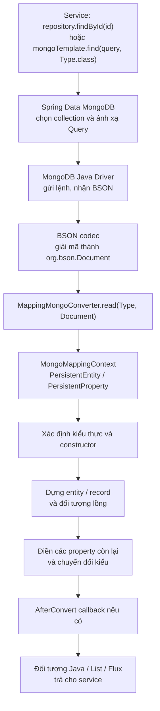
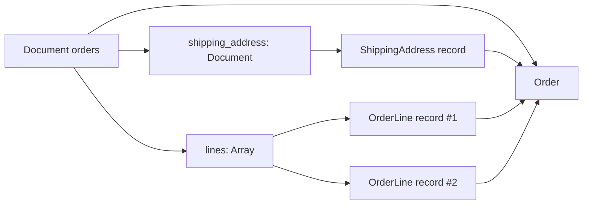

# Cách MappingMongoConverter dựng đối tượng từ document

Khi ứng dụng Java gọi `MongoRepository.findById(...)` hoặc `MongoTemplate.find(...)`, MongoDB trả dữ liệu theo dạng BSON, còn service muốn nhận một đối tượng Java có kiểu rõ ràng. **`MappingMongoConverter`** là thành phần cốt lõi của Spring Data MongoDB thực hiện bước chuyển từ document sang đối tượng: xác định lớp đích, đọc metadata của entity, chuyển từng giá trị, dựng đối tượng lồng nhau và điền các thuộc tính còn lại.

Trong chương **Đối tượng và nhúng**, việc hiểu quá trình này giúp thiết kế document đúng với cách MongoDB lưu dữ liệu, kiểm tra vì sao trường bị `null`, vì sao `@Field` không khớp, tại sao constructor không được gọi như mong đợi và lúc nào một quan hệ tham chiếu tạo thêm truy vấn.

## 1. Đường đi từ MongoDB tới Java object



Đây là **sơ đồ trách nhiệm logic**. Trong quá trình đọc một collection bằng Spring Data, driver thường giải mã BSON thành `org.bson.Document` để bộ converter xử lý; với các API, codec hay loại kết quả khác, chi tiết nội bộ có thể thay đổi. `MongoMappingContext` chứa metadata ánh xạ đã được xây dựng và tái sử dụng, không nhất thiết phải quét lại annotation trên từng document.

Phân biệt ba tầng:

| Tầng | Thứ nó xử lý | Ví dụ |
| --- | --- | --- |
| MongoDB Server + Java Driver | Lệnh MongoDB và giá trị BSON | `_id` là BSON ObjectId, trường `address` là document lồng |
| `MappingMongoConverter` | Quy tắc chuyển document ↔ object; tên property, constructor, type hints, custom conversions | `customer_id` → `customerId`, nested document → `Address` |
| Repository/`MongoTemplate` | API truy vấn và lựa chọn kiểu kết quả cho ứng dụng | `Optional<Order>`, `List<Order>`, `Page<Order>` |

Converter **không tự thực hiện JOIN, tạo index hoặc kiểm soát transaction**. Những hoạt động này thuộc truy vấn, server, session/transaction manager và các thành phần Spring Data khác.

## 2. Ví dụ document và mô hình Java

Giả sử collection `orders` lưu một đơn hàng, địa chỉ giao nhận và các dòng sản phẩm ngay trong document:

```javascript
// Biểu diễn theo cú pháp mongosh, ID chỉ dùng để minh họa.
{
  _id: ObjectId("674000000000000000000501"),
  customer_id: "KH-101",
  shipping_address: {
    city: "Đà Nẵng",
    street: "12 Trần Phú"
  },
  lines: [
    { sku: "S-01", quantity: 2, unit_price_vnd: NumberLong("125000") },
    { sku: "S-02", quantity: 1, unit_price_vnd: NumberLong("45000") }
  ],
  status: "NEW"
}
```

Java model tương ứng:

```java
import java.util.List;
import org.bson.types.ObjectId;
import org.springframework.data.annotation.Id;
import org.springframework.data.mongodb.core.mapping.Document;
import org.springframework.data.mongodb.core.mapping.Field;

record ShippingAddress(String city, String street) {}

record OrderLine(
    String sku,
    int quantity,
    @Field("unit_price_vnd") long unitPriceVnd
) {}

@Document(collection = "orders")
class Order {
    @Id
    private ObjectId id;

    @Field("customer_id")
    private String customerId;

    @Field("shipping_address")
    private ShippingAddress shippingAddress;

    private List<OrderLine> lines;
    private String status;

    public Order() {}

    public ObjectId getId() { return id; }
    public String getCustomerId() { return customerId; }
    public ShippingAddress getShippingAddress() { return shippingAddress; }
    public List<OrderLine> getLines() { return lines; }
    public String getStatus() { return status; }
}
```

`Order` là aggregate root được ánh xạ vào collection. `ShippingAddress` và `OrderLine` là **đối tượng giá trị nhúng**: trong ví dụ này chúng không có collection hoặc repository riêng. Spring Data có thể ánh xạ các property qua field access, ngay cả khi không có setter công khai. Các record Java có canonical constructor nên phù hợp với giá trị nhúng bất biến.

Khi sử dụng Java record trong phiên bản Spring Data hỗ trợ record, annotation `@Field` trên component `unitPriceVnd` cung cấp tên trường BSON. Nếu muốn tránh phụ thuộc vào cách gắn annotation trên record trong phiên bản đang dùng, có thể chuyển `OrderLine` thành class Java thông thường và đặt `@Field` lên field.

## 3. Từng bước MappingMongoConverter dựng một `Order`

Với `MongoTemplate`:

```java
import org.bson.types.ObjectId;
import org.springframework.data.mongodb.core.MongoTemplate;

ObjectId id = new ObjectId("674000000000000000000501");
Order order = mongoTemplate.findById(id, Order.class);
```

Một chuỗi công việc về mặt ý nghĩa:

1. **Xác định kiểu đích.** Lệnh đọc yêu cầu `Order.class`. Nếu có type hints cho kiểu thực, converter có thể dùng chúng theo quy tắc cấu hình; nếu không, kiểu được yêu cầu là điểm xuất phát.
2. **Lấy metadata.** `MongoMappingContext` nhận ra entity `Order`, property `id`, `customerId`, `shippingAddress`, `lines`, `status`, cùng `@Id` và `@Field`.
3. **Chọn cách tạo instance.** Ở ví dụ này, `Order()` không tham số cho phép tạo instance rỗng. Với immutable class, constructor được chọn có thể nhận các thuộc tính từ document.
4. **Đọc và chuyển từng property.** Converter đọc `_id` thành `ObjectId`, `customer_id` thành `String`, `shipping_address` thành `ShippingAddress`, từng phần tử `lines[]` thành `OrderLine`.
5. **Gán property còn lại.** Các field của `Order` được điền qua cơ chế property access của Spring Data, có thể dùng field/setter/wither theo metadata và thiết kế class.
6. **Hoàn tất vòng đời đọc.** Sau khi entity đã được ánh xạ, callback/event có đăng ký có thể xử lý tiếp; `MongoTemplate` trả `Order` hoặc `null` khi không có document phù hợp.

Với repository:

```java
import java.util.List;
import java.util.Optional;
import org.bson.types.ObjectId;
import org.springframework.data.mongodb.repository.MongoRepository;

interface OrderRepository extends MongoRepository<Order, ObjectId> {
    List<Order> findByCustomerId(String customerId);
}
```

```java
Optional<Order> loaded = repository.findById(id);
List<OrderLine> lines = loaded.map(Order::getLines).orElse(List.of());
```

`MongoRepository` dùng cùng hệ thống ánh xạ entity của Spring Data MongoDB; kết quả `Optional.empty()` chỉ có nghĩa không tìm thấy document phù hợp, không phải converter tạo ra một `Order` rỗng.

## 4. Cơ chế đổi tên field và quy tắc ID

### 4.1. Java property và tên trường BSON là hai thứ khác nhau

| Trong Java | Annotation | Trong MongoDB |
| --- | --- | --- |
| `Order.id` | `@Id` | `_id` |
| `Order.customerId` | `@Field("customer_id")` | `customer_id` |
| `Order.shippingAddress` | `@Field("shipping_address")` | `shipping_address` |
| `Order.lines` | Không đổi tên | `lines` |
| `OrderLine.unitPriceVnd` | `@Field("unit_price_vnd")` | `unit_price_vnd` |

Khi dùng `Query` gắn với class entity, ta thường viết theo property Java:

```java
import org.springframework.data.mongodb.core.query.Criteria;
import org.springframework.data.mongodb.core.query.Query;

Query query = Query.query(
    Criteria.where("shippingAddress.city").is("Đà Nẵng")
);
List<Order> orders = mongoTemplate.find(query, Order.class);
```

Spring Data ánh xạ đường dẫn `shippingAddress.city` thành `shipping_address.city`. Với MongoDB Shell hoặc native driver dùng trực tiếp document thô, phải truy vấn **tên field thật**:

```javascript
db.orders.find({ "shipping_address.city": "Đà Nẵng" });
```

### 4.2. Dựng `_id` và vấn đề `String` / `ObjectId`

Trong ví dụ `@Id ObjectId id`, `_id` BSON ObjectId trở thành `org.bson.types.ObjectId` của Java. Nếu entity khai báo `@Id String id`, Spring Data MongoDB thường có thể chuyển ObjectId về chuỗi hex, đồng thời khi **ghi/truy vấn** có quy tắc chuyển chuỗi ID hợp lệ thành BSON ObjectId. Với `@MongoId(FieldType.STRING)`, ứng dụng có thể yêu cầu lưu ID theo BSON String.

Vì vậy, nếu một document được đọc bằng truy vấn native nhưng repository `findById` trả rỗng, cần kiểm tra kiểu BSON của `_id`, tên collection và chiến lược `@Id`/`@MongoId`. Hai giá trị có cùng chuỗi hex nhưng một bên là ObjectId, bên kia là String **không phải một giá trị BSON tương đương**.

## 5. Dựng đối tượng nhúng và danh sách

Converter xử lý document lồng một cách đệ quy theo kiểu property:



Với `ShippingAddress`, converter tìm canonical constructor của record và cung cấp giá trị `city`, `street`. Với `List<OrderLine>`, converter nhận biết kiểu phần tử và xử lý từng document trong array; `quantity` được chuyển theo kiểu số đích và `unit_price_vnd` được gán vào `unitPriceVnd`.

Cần phân biệt nhúng với tham chiếu:

- **Nhúng:** `shipping_address` và `lines[]` chứa dữ liệu thật trong **cùng document**. Việc dựng chúng không cần truy vấn thêm collection khác.
- **Tham chiếu theo ID thường:** property Java kiểu `ObjectId customerId` chỉ giữ một giá trị định danh. Converter không tự tìm document khách hàng.
- **`@DBRef` hoặc `@DocumentReference`:** Spring Data có thể phân giải document ở collection khác (eager/lazy tùy cấu hình và cơ chế). Đây có thể là các lượt truy vấn riêng, không nên đánh đồng với embedding.

Nếu danh sách có hàng chục nghìn phần tử, ánh xạ thành `List<T>` cũng tiêu tốn bộ nhớ và CPU để dựng từng object. Điều đó có thể là dấu hiệu cần tách collection hoặc giới hạn/projection kết quả đọc, dù MongoDB cho phép array trong document.

## 6. Constructor binding: từ document sang object bất biến

Khi entity không có constructor không tham số hoặc dùng immutable design, Spring Data ưu tiên cơ chế **object creation** rồi **property population**. Một constructor có thể được dùng để cung cấp những property cần thiết ngay lúc tạo object.

```java
import org.bson.types.ObjectId;
import org.springframework.data.annotation.Id;
import org.springframework.data.annotation.PersistenceCreator;
import org.springframework.data.mongodb.core.mapping.Document;
import org.springframework.data.mongodb.core.mapping.Field;

@Document("customer_profiles")
class CustomerProfile {
    @Id
    private final ObjectId id;

    @Field("display_name")
    private final String displayName;

    private final ShippingAddress address;

    @PersistenceCreator
    public CustomerProfile(
            ObjectId id,
            String displayName,
            ShippingAddress address) {
        this.id = id;
        this.displayName = displayName;
        this.address = address;
    }

    public ObjectId getId() { return id; }
    public String getDisplayName() { return displayName; }
    public ShippingAddress getAddress() { return address; }
}
```

`@PersistenceCreator` giúp chỉ định constructor dùng cho việc materialize entity khi có nhiều lựa chọn. Các tham số được ghép với **tên property Java**; Spring Data đọc giá trị BSON theo annotation và quy tắc mapping của property tương ứng. Ví dụ `display_name` vẫn được đưa vào tham số `displayName`.

Đối với class Java thông thường, việc nhận diện tên tham số constructor cần metadata phù hợp (ví dụ biên dịch với `-parameters` hoặc phương án được phiên bản Spring Data hỗ trợ). Thiếu tên tham số có thể dẫn tới lỗi instantiation. Với Java record, canonical constructor và tên component làm cho thiết kế bất biến thuận tiện hơn. Không nên kỳ vọng framework đoán chính xác thứ tự tham số chỉ dựa vào tên field BSON.

**Không được gọi constructor tùy ý như một mapper thủ công:** framework chọn đường tạo object theo quy tắc của Spring Data. Có thể dùng cơ chế tạo instance tối ưu thay vì Java reflection thuần ở mọi trường hợp; điều quan trọng với người viết entity là constructor phù hợp, property name rõ ràng và kiểu dữ liệu khớp.

### Property được gán bằng constructor hoặc sau khi tạo

Với `CustomerProfile`, cả ba property `final` được cung cấp qua constructor. Với `Order` ở trên, constructor không tham số tạo object rồi converter gán các field còn lại. Nếu một property bất biến không nằm trong constructor mà cũng không có wither/cơ chế gán được hỗ trợ, việc materialize có thể thất bại.

Vì thế:

1. Đối tượng mutable: có thể dùng no-arg constructor và field/setter mapping.
2. Đối tượng immutable: cung cấp constructor hợp lệ cho tất cả property cần khởi tạo.
3. Với Java record: ưu tiên canonical constructor; bảo đảm tên component và kiểu dữ liệu phù hợp document.
4. Khi có nhiều constructor: đánh dấu factory/constructor dành cho persistence nếu cần, và thử readback với MongoDB thật.

## 7. Converter biết kiểu thực của đối tượng bằng cách nào?

Khi field Java khai báo đúng class cụ thể, như `ShippingAddress`, metadata của property thường đủ để converter dựng đối tượng. Nhưng khi property có kiểu **interface**, **abstract class** hoặc polymorphism, framework có thể cần thông tin về kiểu thực được lưu trong document.

Spring Data MongoDB mặc định có cơ chế **type hint** với trường `_class` trong nhiều tình huống. Chẳng hạn property Java kiểu `PaymentMethod` có thể chứa một thể hiện `CardPayment`:

```java
interface PaymentMethod {}

record CardPayment(String last4) implements PaymentMethod {}

@Document("payments")
class Payment {
    @Id
    private ObjectId id;
    private PaymentMethod method;
}
```

Document minh họa:

```javascript
{
  _id: ObjectId("674000000000000000000601"),
  method: {
    last4: "1234",
    _class: "com.example.payments.CardPayment"
  },
  _class: "com.example.payments.Payment"
}
```

Tên package chỉ là ví dụ. Trường `_class` có thể xuất hiện ở document gốc hoặc document lồng khi cần giữ kiểu thực; việc ghi type hint phụ thuộc `MongoTypeMapper` và cấu hình. Converter có thể dùng metadata này để xác định lớp cụ thể thay vì cố khởi tạo interface.

**Đừng coi `_class` là dữ liệu nghiệp vụ.** Việc đổi package/class name có thể ảnh hưởng tới khả năng đọc document cũ khi dựa vào tên class đã lưu. Ứng dụng có thể sử dụng `@TypeAlias` và cấu hình type mapper có chủ đích, nhưng cần kế hoạch tương thích dữ liệu khi thay đổi hoặc bỏ `_class`. Nếu collection chứa nhiều subtype mà tắt type hint, phải có cách xác định subtype tương đương, chẳng hạn custom converter hoặc một discriminator được quản lý rõ ràng.

## 8. Chuyển đổi kiểu: built-in conversions và custom converters

Document không chứa một object Java đã sẵn sàng; mỗi giá trị BSON phải được diễn giải theo kiểu đích:

| Giá trị BSON / Java driver | Kiểu Java có thể nhận | Lưu ý |
| --- | --- | --- |
| BSON ObjectId | `ObjectId` hoặc `String` ID trong một số mapping | Quy tắc ID khác property String thông thường |
| BSON String | `String`, enum theo tên khi cấu hình mặc định phù hợp | Chuỗi không khớp enum có thể gây lỗi |
| BSON Int32 / Int64 | `int` / `long` / wrapper theo chuyển đổi được hỗ trợ | Cẩn thận tràn số và thay schema kiểu |
| BSON Date | `Date`, `Instant` và các kiểu thời gian được hỗ trợ/cấu hình | Múi giờ hiển thị và độ chính xác phải được xử lý riêng |
| Document lồng | Entity/value object/record | Dựng object theo metadata hoặc custom converter |
| BSON Array | `List<T>`, collection/array được hỗ trợ | Kiểu phần tử có ý nghĩa khi chuyển đổi |

Khi kiểu lưu trữ không ánh xạ tự nhiên với domain, có thể đăng ký custom converter. Ví dụ domain muốn biểu diễn số tiền cùng đơn vị:

```java
record Money(long amountMinor, String currency) {}

// BSON document:
// { amount_minor: NumberLong("129900"), currency: "VND" }
```

Một converter cho chiều đọc:

```java
import org.bson.Document;
import org.springframework.core.convert.converter.Converter;
import org.springframework.data.convert.ReadingConverter;

@ReadingConverter
class DocumentToMoneyConverter implements Converter<Document, Money> {
    @Override
    public Money convert(Document source) {
        Number amount = source.get("amount_minor", Number.class);
        if (amount == null) {
            throw new IllegalArgumentException("Thiếu amount_minor");
        }
        return new Money(amount.longValue(), source.getString("currency"));
    }
}
```

`DocumentToMoneyConverter` cần được **đăng ký vào `MongoCustomConversions`** của cấu hình Spring Data MongoDB; chỉ định nghĩa class không khiến Spring Data tự dùng nó. Converter chiều đọc này áp dụng khi Spring Data cần chuyển dữ liệu kiểu `Document` sang `Money`; nếu cần ghi `Money` trở lại BSON ổn định, hãy tạo thêm converter chiều ghi (`@WritingConverter`) tương ứng. Không nên chồng nhiều converter mâu thuẫn cho cùng một cặp kiểu.

Nếu trường `amount_minor` có thể lớn hơn giới hạn Java `long` hoặc dùng tiền tệ với phần thập phân, cần thiết kế kiểu số khác (ví dụ BSON Decimal128 / Java `BigDecimal`) và kiểm chứng chuyển đổi chính xác thay vì cắt số âm thầm.

## 9. Field thiếu, `null` và projection ảnh hưởng thế nào?

Một document không nhất thiết có đủ các trường trong entity, nhất là khi đọc dữ liệu cũ hoặc dùng projection. Hãy phân biệt:

| Trường trong document | Kết quả cần lưu ý |
| --- | --- |
| Có giá trị hợp lệ | Property nhận giá trị đã chuyển đổi |
| Có `null` | Property tham chiếu có thể là `null`; với primitive/constructor bắt buộc cần xét đường tạo object |
| Không tồn tại | Property có thể giữ mặc định Java (`null`, `0`, `false`), hoặc constructor nhận giá trị thiếu theo quy tắc binding |
| Có nhưng khác kiểu mong đợi | Có thể chuyển được qua conversion; nếu không phù hợp sẽ phát sinh lỗi mapping/conversion |
| Chỉ được trả một phần qua projection | Những field không được chọn không được tự động truy vấn bổ sung để điền đủ entity |

Ví dụ:

```java
Query query = Query.query(Criteria.where("status").is("NEW"));
query.fields().include("customerId").include("status");
List<Order> partial = mongoTemplate.find(query, Order.class);
```

Các `Order` trong `partial` không có dữ liệu `shippingAddress` hoặc `lines` từ document gốc. Với object mutable có no-arg constructor, các field đó có thể là `null`. **Không nên dùng `save(partialOrder)` như cách cập nhật status**, vì lưu toàn bộ entity không đầy đủ có thể ghi đè hoặc làm mất những trường không được nạp. Hãy dùng `updateFirst`/`findAndModify` để cập nhật một số field, hoặc DTO/projection riêng cho API.

Nếu sử dụng constructor bất biến yêu cầu giá trị không được thiếu, dữ liệu cũ hoặc projection có thể gây lỗi instantiation. Kiểm thử các document thực tế, quy tắc defaulting và validation thay vì coi mọi trường thiếu là lỗi MongoDB Server.

## 10. Callback và event quanh quá trình đọc

Spring Data MongoDB có các sự kiện mapping và entity callback. Trong luồng đọc, hai mốc thường cần phân biệt:

1. **Sau khi lấy document và trước khi chuyển sang entity**, các sự kiện như `AfterLoadEvent` có thể quan sát document ở dạng thô.
2. **Sau khi entity đã được dựng**, `AfterConvertCallback<T>` có thể xử lý đối tượng trước khi trả về cho service.

Ví dụ callback:

```java
import org.bson.Document;
import org.springframework.data.mongodb.core.mapping.event.AfterConvertCallback;
import org.springframework.stereotype.Component;

@Component
class OrderReadCallback implements AfterConvertCallback<Order> {
    @Override
    public Order onAfterConvert(
            Order entity,
            Document document,
            String collection) {
        // Có thể bổ sung xử lý đã được cho phép cho entity sau mapping.
        // Đoạn này giữ nguyên đối tượng để minh họa.
        return entity;
    }
}
```

Callback không nên chứa truy vấn N+1, gọi API mạng chậm hoặc thay đổi dữ liệu nghiệp vụ ngầm mà không có hợp đồng rõ ràng. Nếu cần kiểm tra dữ liệu hoặc dựng một view bổ sung, phân biệt trách nhiệm của converter, callback, service và DTO mapper. Không giả định callback sẽ chạy khi truy vấn qua native MongoDB Java Driver vì driver không đi qua vòng đời entity của Spring Data.

Với asynchronous/reactive MongoDB operations, loại callback và phương thức trả về có thể thuộc dạng reactive tương ứng, và thời điểm gọi gắn với vòng đời subscription.

## 11. Tham chiếu được phân giải khác với object nhúng

Giả sử `Order` có trường khách hàng. Hai cách mô hình hóa:

```java
// Lưu ID, không tự truy vấn sang users:
private ObjectId customerId;

// Một lựa chọn cho quan hệ tham chiếu:
@DocumentReference(lazy = true)
private Customer customer;
```

`@DocumentReference` cần import `org.springframework.data.mongodb.core.mapping.DocumentReference` và khai báo `Customer`/entity chứa field phù hợp. Phần code là minh họa **hai lựa chọn khác nhau**, không đặt đồng thời lên cùng một field.

Khi chỉ lưu `customerId`, converter đọc ObjectId và dừng lại. Khi dùng `@DocumentReference`, Spring Data có thể tạo một proxy lazy hoặc truy vấn để tải `Customer` theo cấu hình. Nếu đọc 100 đơn và sau đó truy cập `customer` của từng đơn, hệ thống có thể phát sinh nhiều truy vấn bổ sung; cần đo command count để tránh vấn đề N+1.

Điểm quan trọng: **embedded object** được lấy từ cùng BSON document, còn **document reference** có thể cần I/O khác. MongoDB không tự bảo đảm foreign key cho những tham chiếu này. Khi hiệu năng là ưu tiên, hãy cân nhắc query theo lô hoặc aggregation `$lookup`, dựa trên nhu cầu API cụ thể.

## 12. Phân tích lỗi dựng đối tượng theo từng lớp

| Hiện tượng | Nguyên nhân thường gặp | Cách kiểm tra |
| --- | --- | --- |
| `customerId == null` dù có dữ liệu | Tên lưu là `customer_id` nhưng mapping chưa có `@Field`; hoặc projection bỏ qua field | Xem document raw và metadata `@Field` |
| Constructor không được gọi đúng / lỗi instantiation | Constructor không khả dụng, thiếu tên tham số, class không thể tạo, dữ liệu thiếu | Kiểm tra `@PersistenceCreator`, `-parameters`, kiểu property và document |
| Trường nhúng thành `null` | Không có document lồng, sai đường dẫn field hoặc projection | Xem `shipping_address` trong BSON và đường dẫn mapping |
| Lỗi khi dựng enum/số/ngày | Giá trị lưu không phù hợp kiểu Java hoặc custom conversion thiếu | Kiểm tra `$type`, giá trị thực, custom converter |
| Interface/abstract property không dựng được | Thiếu type hint hoặc cơ chế quyết định subtype | Xem `_class`, `@TypeAlias`, type mapper |
| Repository trả rỗng nhưng native query có kết quả | Khác collection/database, sai kiểu `_id`, query được ánh xạ khác | So truy vấn sau mapping và kiểu BSON thực |
| Đọc một document kéo theo nhiều truy vấn | `@DBRef`/`@DocumentReference` eager hoặc lazy được truy cập | Log command, rà soát reference và batch |
| Giá trị bị mất sau round-trip | Custom converter thiếu chiều ghi, schema khác version, kiểu số không tương thích | So document trước và sau `save` + readback |

Để chẩn đoán, bắt đầu bằng **document thật** lưu trên MongoDB (tên field, kiểu BSON, giá trị), rồi so với Java entity và các annotation. Logging chọn lọc của `MongoTemplate` và MongoDB Java Driver command monitoring có thể giúp xác định query, nhưng không nên ghi mật khẩu, token hay dữ liệu nhạy cảm ra log.

## 13. Kiểm thử mapping từ document thô

Để biết converter thực sự đọc một document như thế nào, một integration test có MongoDB dành riêng cho test đáng tin cậy hơn mock repository.

Ví dụ dùng JUnit 5 và Spring Boot test slice (giả định `Order` và các record trên được scan, có bean `MongoTemplate` và MongoDB test):

```java
import static org.assertj.core.api.Assertions.assertThat;

import java.util.List;
import org.bson.Document;
import org.bson.types.ObjectId;
import org.junit.jupiter.api.Test;
import org.springframework.beans.factory.annotation.Autowired;
import org.springframework.boot.test.autoconfigure.data.mongo.DataMongoTest;
import org.springframework.data.mongodb.core.MongoTemplate;

@DataMongoTest
class OrderReadMappingTest {
    @Autowired MongoTemplate template;

    @Test
    void shouldMaterializeEmbeddedObjects() {
        ObjectId id = new ObjectId();
        Document address = new Document("city", "Đà Nẵng")
                .append("street", "12 Trần Phú");
        Document line = new Document("sku", "S-01")
                .append("quantity", 2)
                .append("unit_price_vnd", 125000L);

        Document raw = new Document("_id", id)
                .append("customer_id", "KH-101")
                .append("shipping_address", address)
                .append("lines", List.of(line))
                .append("status", "NEW");

        template.getCollection("orders").insertOne(raw);

        Order loaded = template.findById(id, Order.class);

        assertThat(loaded).isNotNull();
        assertThat(loaded.getCustomerId()).isEqualTo("KH-101");
        assertThat(loaded.getShippingAddress().city())
                .isEqualTo("Đà Nẵng");
        assertThat(loaded.getLines()).hasSize(1);
        assertThat(loaded.getLines().get(0).unitPriceVnd())
                .isEqualTo(125000L);
    }
}
```

Bài test chủ động ghi **document raw qua driver** rồi đọc bằng `MongoTemplate`: như vậy phép ánh xạ khi đọc được kiểm chứng độc lập với quá trình Spring Data ghi entity. Nếu test chỉ `template.save(order)` rồi đọc lại, hai chiều ghi/đọc có thể cùng che giấu lỗi schema hoặc quy ước tên field không đúng với dữ liệu legacy.

Khi chạy với Spring Boot/Spring Data phiên bản khác, cần cấu hình MongoDB test và dependencies tương ứng; không phụ thuộc vào việc thư viện test tự khởi động database. Có thể dùng Testcontainers để cung cấp MongoDB thực cho test. Test cần được đặt trong môi trường cô lập, tránh kết nối nhầm vào database production.

Ngoài trường hợp tốt, nên test thêm:

- Document thiếu `shipping_address` hoặc `lines`, để xác định mặc định mà domain cho phép.
- Một phần tử `lines` có `quantity` sai kiểu, kiểm tra lỗi conversion có được xử lý rõ không.
- Entity bất biến với `@PersistenceCreator`, xác minh constructor binding và property final.
- Document có subtype và `_class`, rồi kiểm tra hành vi khi thay đổi type alias/cấu hình.
- Đọc bằng projection, sau đó kiểm tra không thể vô tình `save` lại entity thiếu dữ liệu.

## 14. Sự khác nhau khi đọc reactive

`ReactiveMongoTemplate` và `ReactiveMongoRepository` có kiểu kết quả `Mono<T>`/`Flux<T>`, nhưng **quy tắc mapping object, `@Field`, `@Id`, nested document và custom conversions vẫn áp dụng**.

```java
import org.bson.types.ObjectId;
import reactor.core.publisher.Mono;
import org.springframework.data.mongodb.core.ReactiveMongoTemplate;

Mono<Order> findOrder(
        ReactiveMongoTemplate template, ObjectId id) {
    return template.findById(id, Order.class);
}
```

Đường reactive chỉ thực thi truy vấn khi publisher được subscribe theo cơ chế Reactive Streams; dữ liệu BSON nhận được vẫn cần được dựng thành `Order`. Việc mapping từng document dùng CPU và bộ nhớ, nên reactive không tự làm quá trình dựng một object phức tạp nhanh hơn. Với tập dữ liệu lớn, dùng lọc/index, phân trang, projection và kiểm soát tốc độ tiêu thụ thay vì gom toàn bộ `Flux` vào RAM.

## 15. Câu hỏi tự kiểm tra

**1.** Document lưu `customer_id`, nhưng entity dùng `customerId` không có `@Field`. Vì sao property có thể rỗng? **Đáp án:** vì mapping theo tên property mặc định không biết `customer_id` và `customerId` là một. Dùng `@Field("customer_id")` hoặc chiến lược field naming phù hợp.

**2.** Vì sao `Order.lines` có thể trở thành `List<OrderLine>` mà không cần `OrderLineRepository`? **Đáp án:** mỗi phần tử là document nhúng nằm ngay trong BSON `orders`; converter đọc nó theo kiểu phần tử khai báo.

**3.** `@DocumentReference(lazy = true)` trên `Order.customer` có tương đương nhúng `Customer` vào đơn hàng không? **Đáp án:** không; tài liệu được tham chiếu có thể cần truy vấn bổ sung khi truy cập.

**4.** Entity bất biến có constructor `(ObjectId id, String displayName)`, nhưng document lưu `display_name`. Constructor cần đổi tham số thành `display_name` không? **Đáp án:** không; tham số liên kết với property Java `displayName`, còn `@Field` xử lý tên BSON.

**5.** Tại sao một record đọc được từ document thô nhưng `save` lại tạo dữ liệu không mong muốn? **Đáp án:** cần kiểm tra schema, custom converters chiều ghi, annotation, type hints và những trường không có trong document khi đọc projection; test hai chiều riêng.

**6.** Có thể lấy raw `Document` để xem lỗi ánh xạ rồi mặc định gọi `save` với entity đã đọc thiếu field không? **Đáp án:** không nên; nếu chỉ cần đổi một trường, hãy dùng `Update` trên điều kiện phù hợp, tránh mất dữ liệu ngoài phạm vi cập nhật.

Quá trình `MappingMongoConverter` dựng object có thể tóm lược bằng chuỗi: **BSON → `Document` → metadata `MongoPersistentEntity` → chọn kiểu và constructor → chuyển/điền property → đối tượng Java**. Hiểu từng bước giúp phân biệt lỗi truy vấn, lỗi BSON, lỗi constructor, lỗi mapping và lỗi tham chiếu; từ đó thiết kế đối tượng nhúng và kiểm thử Spring Data MongoDB chắc chắn hơn.
