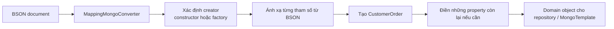
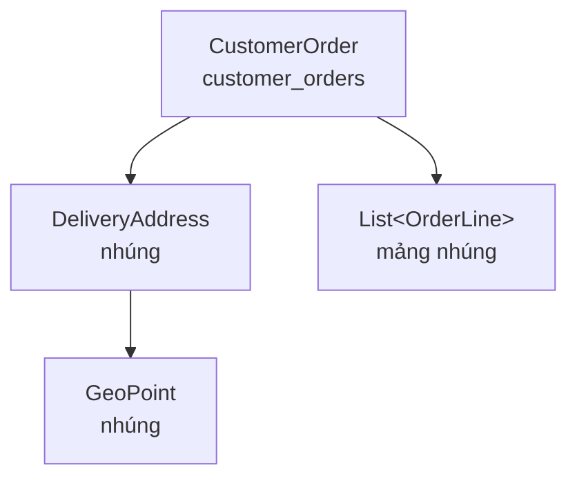

# Constructor, factory và @PersistenceCreator

> **Chương:** Đối tượng và nhúng  
> **Module:** `SPRING_DATA_MONGODB` — sử dụng Spring Data MongoDB để kết nối, ánh xạ document và thao tác MongoDB bằng `MongoTemplate` hoặc repository. Cơ chế dựng đối tượng từ BSON là nền tảng để thiết kế truy vấn, aggregation, index, transaction, reactive access, kiểm thử và chẩn đoán lỗi dữ liệu. Bài học tập trung vào constructor, factory method và `@PersistenceCreator` khi ánh xạ đối tượng Java, đặc biệt là đối tượng bất biến và object nhúng.

## 1. Bài toán: đọc một document để tạo object Java

MongoDB lưu document theo định dạng **BSON**, trong khi ứng dụng Java làm việc với class, record và các kiểu domain có constructor riêng. Khi đọc một đơn hàng, Spring Data MongoDB phải biết **tạo đối tượng như thế nào** trước khi điền các thuộc tính.

Ví dụ document:

```json
{
  "_id": "ORDER-101",
  "buyer_id": "CUS-42",
  "deliveryAddress": {
    "city": "Da Nang",
    "street": "Hai Chau"
  },
  "lines": [
    { "sku": "BOOK-01", "quantity": 2 },
    { "sku": "PEN-02", "quantity": 1 }
  ],
  "createdAt": { "$date": "2026-11-20T02:00:00Z" }
}
```

Nếu class `CustomerOrder` có các field `final` và không có setter, Spring Data **không thể chỉ dùng constructor rỗng rồi gán lần lượt mọi field**. Framework phải chọn constructor hoặc factory method có tham số phù hợp để truyền dữ liệu vào ngay khi khởi tạo.



**Constructor/factory phục vụ materialization** (tạo object từ dữ liệu đã lưu) khác với phương thức tạo object mới cho nghiệp vụ, ví dụ `placeOrder(…)`. Hai thao tác có thể dùng chung implementation nhưng mục đích và điều kiện dữ liệu thường không giống nhau.

## 2. Spring Data chọn constructor hoặc factory theo quy tắc nào?

Trong cơ chế **object creation** của Spring Data Commons dùng bởi Spring Data MongoDB, những quy tắc quan trọng khi materialize entity là:

1. Nếu có **một static factory method** được đánh dấu `@PersistenceCreator`, Spring Data ưu tiên factory đó.
2. Nếu không có factory như trên nhưng có **một constructor** được đánh dấu `@PersistenceCreator`, Spring Data dùng constructor được chỉ định.
3. Với **Java record**, Spring Data mặc định dùng **canonical constructor** (constructor chứa đầy đủ record component).
4. Nếu không có chỉ định tường minh và class có **no-argument constructor**, Spring Data có thể dùng constructor rỗng rồi thực hiện property population.
5. Nếu class chỉ có **một constructor**, constructor đó có thể được chọn dù không có `@PersistenceCreator`.
6. Nếu có nhiều constructor mà không có cách xác định duy nhất một persistence creator, việc materialize có thể thất bại; một no-argument constructor có sẵn thường là đường dự phòng theo quy tắc trên.

Thứ tự này dùng để hiểu **chiến lược chọn creator**; các phiên bản Spring Data cụ thể có thêm quy tắc về khả năng truy cập, kiểu dữ liệu và cách tạo object. Khi thiết kế class quan trọng, **khai báo creator rõ ràng** để tránh phụ thuộc vào việc sau này thêm một constructor phụ.

| Cấu trúc Java | Creator thường được chọn | Hệ quả |
| --- | --- | --- |
| `record Address(String city, String street)` | Canonical constructor của record | Các component được truyền vào constructor. |
| Class có đúng một constructor với tham số | Constructor duy nhất | Phù hợp với entity immutable. |
| Class có no-arg constructor và constructor tiện ích | No-arg nếu không chỉ định khác | Các property được điền sau khi tạo instance. |
| Class có nhiều constructor, một cái gắn `@PersistenceCreator` | Constructor có annotation | Loại bỏ sự mơ hồ khi đọc từ MongoDB. |
| Class có static factory gắn `@PersistenceCreator` | Static factory đó | Có thể tập trung chuẩn hóa việc khởi tạo vào factory. |
| Class có nhiều constructor cạnh tranh, không no-arg, không annotation | Không có creator rõ ràng | Có nguy cơ lỗi mapping lúc đọc dữ liệu. |

**`@PersistenceCreator`** nằm trong package `org.springframework.data.annotation`. Một số mã nguồn cũ dùng `@PersistenceConstructor`; cần đối chiếu API/version khi bảo trì. Với code mới trên phiên bản có hỗ trợ, `@PersistenceCreator` diễn đạt được cả constructor và factory method, rõ mục đích hơn.

## 3. Constructor mặc định và property population

Mô hình JavaBean thường có constructor rỗng và field có thể thay đổi:

```java
import org.springframework.data.annotation.Id;
import org.springframework.data.mongodb.core.mapping.Document;

@Document(collection = "customers")
public class Customer {
    @Id
    private String id;
    private String name;

    protected Customer() { }

    public Customer(String name) {
        this.name = name;
    }

    public String getId() { return id; }
    public String getName() { return name; }
    public void rename(String name) { this.name = name; }
}
```

Khi đọc document `{ "_id": "...", "name": "An" }`, Spring Data có thể gọi no-arg constructor và gán `id`, `name` sau đó bằng cơ chế property access thích hợp. `protected` không bắt buộc đổi thành `public` chỉ để framework hoạt động, tuy nhiên khả năng truy cập và hiệu năng instantiation còn tùy cách triển khai và phiên bản.

Đây là kiểu dễ hiểu với entity mutable, nhưng có một số nhược điểm:

- Trong một khoảng ngắn sau khi constructor chạy, object chưa mang đủ trạng thái từ MongoDB.
- Các field bắt buộc có thể tạm thời là `null`.
- Quy tắc bất biến như “đơn hàng luôn có người mua và thời điểm tạo” khó bảo vệ bằng no-arg constructor.
- Nếu chuyển các field thành `final` và loại bỏ setter, chiến lược điền property sau khởi tạo có thể không còn phù hợp.

**Khi nên dùng:** entity đơn giản, mutable, các quy tắc hợp lệ được kiểm tra ở tầng khác hoặc framework cần cách tạo đối tượng kiểu JavaBean. Với domain yêu cầu bất biến, ưu tiên constructor chứa đầy đủ trạng thái bắt buộc.

## 4. Chỉ định constructor bằng @PersistenceCreator

### 4.1. Mẫu entity immutable có object nhúng

Ta khai báo đơn hàng với `id`, `buyerId`, `createdAt`, địa chỉ nhận hàng và danh sách sản phẩm. Mọi field đều `final`, nên object phải được tạo với đủ dữ liệu.

```java
import java.time.Instant;
import java.util.List;
import java.util.Objects;
import org.springframework.data.annotation.Id;
import org.springframework.data.annotation.PersistenceCreator;
import org.springframework.data.mongodb.core.mapping.Document;
import org.springframework.data.mongodb.core.mapping.Field;

@Document(collection = "customer_orders")
public class CustomerOrder {

    @Id
    private final String id;

    @Field("buyer_id")
    private final String buyerId;

    private final DeliveryAddress deliveryAddress;
    private final List<OrderLine> lines;
    private final Instant createdAt;

    @PersistenceCreator
    public CustomerOrder(
            String id,
            String buyerId,
            DeliveryAddress deliveryAddress,
            List<OrderLine> lines,
            Instant createdAt) {
        this.id = id;
        this.buyerId = Objects.requireNonNull(buyerId);
        this.deliveryAddress = Objects.requireNonNull(deliveryAddress);
        this.lines = List.copyOf(Objects.requireNonNull(lines));
        this.createdAt = Objects.requireNonNull(createdAt);
    }

    // Factory nghiệp vụ, KHÔNG phải persistence creator.
    public static CustomerOrder place(
            String buyerId,
            DeliveryAddress address,
            List<OrderLine> lines) {
        return new CustomerOrder(null, buyerId, address, lines, Instant.now());
    }

    public String getId() { return id; }
    public String getBuyerId() { return buyerId; }
    public DeliveryAddress getDeliveryAddress() { return deliveryAddress; }
    public List<OrderLine> getLines() { return lines; }
    public Instant getCreatedAt() { return createdAt; }

    public record DeliveryAddress(String city, String street) {}
    public record OrderLine(String sku, int quantity) {}
}
```

Ở đây `@PersistenceCreator` nằm trên **constructor đầy đủ năm tham số**. Khi đọc BSON, Spring Data gọi constructor đó để tạo `CustomerOrder`. Khi tạo đơn mới trong nghiệp vụ, code gọi `CustomerOrder.place(…)`, chủ động đặt ID `null` và thời điểm hiện tại.

Các record lồng `DeliveryAddress` và `OrderLine` là **giá trị nhúng**, được materialize qua canonical constructor tương ứng. Chúng không tự có collection riêng. Spring Data ánh xạ `buyerId` từ BSON `buyer_id` nhờ `@Field("buyer_id")` trên thuộc tính domain.

> Ví dụ dùng Java 17+ và giả định phiên bản Spring Data MongoDB có hỗ trợ record. `Objects.requireNonNull` thể hiện quy tắc domain; nếu dữ liệu cũ thiếu trường bắt buộc, việc đọc document **có thể thất bại**. Trong hệ thống đang vận hành, nên thiết kế migration hoặc tương thích với schema cũ trước khi thêm ràng buộc constructor.

### 4.2. Từ MongoDB trở lại constructor

Một document tương ứng có dạng:

```json
{
  "_id": "ORDER-101",
  "buyer_id": "CUS-42",
  "deliveryAddress": {
    "city": "Da Nang",
    "street": "Hai Chau"
  },
  "lines": [
    { "sku": "BOOK-01", "quantity": 2 },
    { "sku": "PEN-02", "quantity": 1 }
  ],
  "createdAt": { "$date": "2026-11-20T02:00:00Z" }
}
```

Khi đọc bằng `MongoTemplate.findById("ORDER-101", CustomerOrder.class)` hoặc repository, mapping diễn ra theo logic:

| Constructor parameter | Domain property | BSON source |
| --- | --- | --- |
| `id` | `@Id id` | `_id` |
| `buyerId` | `@Field("buyer_id") buyerId` | `buyer_id` |
| `deliveryAddress` | `deliveryAddress` | Object `deliveryAddress` |
| `lines` | `lines` | Mảng document `lines` |
| `createdAt` | `createdAt` | BSON datetime `createdAt` |

**Quan trọng:** tên tham số constructor trong Java là **`buyerId`**, trùng property Java, dù BSON lưu dưới `buyer_id`. `@Field` làm nhiệm vụ liên kết property với field lưu trữ. Đổi tên tham số thành `buyer_id` mà không có cơ chế mapping tương ứng có thể khiến Spring Data không tìm được property để bind.

Trong ví dụ, `List.copyOf` tạo danh sách không sửa đổi được qua API `List`. Đây là bất biến ở tầng Java, không có nghĩa server MongoDB không thể cập nhật mảng `lines` bằng các lệnh khác. Đồng thời, toàn bộ entity có các trường final nhưng MongoDB vẫn lưu trữ và chuyển đổi chúng bình thường.

### 4.3. Cập nhật entity immutable

Thay vì sửa field trực tiếp, có thể xây dựng một bản thể mới giữ định danh:

```java
public CustomerOrder withAddress(DeliveryAddress newAddress) {
    return new CustomerOrder(id, buyerId, newAddress, lines, createdAt);
}
```

Đoạn trên là **phương thức bổ sung vào class `CustomerOrder`**, không phải file Java độc lập. Với repository:

```java
CustomerOrder current =
    repository.findById("ORDER-101").orElseThrow();

CustomerOrder changed = current.withAddress(
    new CustomerOrder.DeliveryAddress("Hue", "Le Loi")
);

CustomerOrder saved = repository.save(changed);
```

Nếu domain dùng `@Version` để khóa lạc quan, bản copy phải **giữ đúng version hiện tại**, và nên thiết kế constructor/factory tương ứng. Nếu bỏ version khi tạo bản copy, Spring Data có thể coi nó là entity mới rồi cố insert, gây duplicate key. Tính bất biến của Java **không tự bảo vệ trước cập nhật đồng thời**; cần optimistic locking hoặc cập nhật có điều kiện khi nghiệp vụ yêu cầu.

## 5. Static factory method với @PersistenceCreator

Đôi khi nhóm muốn che giấu constructor, kiểm soát tên factory hoặc giữ nhiều cách tạo đối tượng. Khi đó có thể đánh dấu một **static factory method** bằng `@PersistenceCreator`:

```java
import org.springframework.data.annotation.Id;
import org.springframework.data.annotation.PersistenceCreator;
import org.springframework.data.mongodb.core.mapping.Document;

@Document(collection = "catalog_items")
public final class CatalogItem {

    @Id
    private final String id;
    private final String title;
    private final int stock;

    private CatalogItem(String id, String title, int stock) {
        this.id = id;
        this.title = title;
        this.stock = stock;
    }

    @PersistenceCreator
    public static CatalogItem restore(
            String id, String title, int stock) {
        return new CatalogItem(id, title, stock);
    }

    // Factory dành cho luồng tạo mới.
    public static CatalogItem create(String title, int stock) {
        return new CatalogItem(null, title, stock);
    }

    public String getId() { return id; }
    public String getTitle() { return title; }
    public int getStock() { return stock; }
}
```

Khi đọc từ MongoDB, Spring Data dùng **`restore(id, title, stock)`**. Khi tạo mới, application code dùng **`create(title, stock)`**. Phương thức `restore` phải là factory có thể được Spring Data nhận diện; các tham số phải tương ứng với thuộc tính được lưu. Không gắn `@PersistenceCreator` lên mọi factory có mục đích nghiệp vụ khác nhau.

Đừng hiểu factory annotated là callback “sau khi object được tạo”: **factory chính là cơ chế tạo object**. Các bước callback riêng như `AfterConvertCallback` (nếu có) diễn ra ở giai đoạn khác trong chu trình ánh xạ.

### 5.1. Constructor hay factory?

| Tiêu chí | Constructor với `@PersistenceCreator` | Static factory với `@PersistenceCreator` |
| --- | --- | --- |
| Cách biểu đạt | Tạo instance trực tiếp với tham số | Đặt tên hành động dựng lại entity |
| Kiểm soát API | Có thể dùng public, protected hoặc mức truy cập phù hợp | Có thể giữ constructor không public, cho phép factory chịu trách nhiệm |
| Nghiệp vụ khởi tạo | Có thể chung với constructor lưu trữ | Dễ tách `create` và `restore` |
| Mapping tham số | Tên tham số gắn với property | Tên tham số cũng phải gắn với property |
| Rủi ro | Thêm constructor khác làm tăng nguy cơ chọn nhầm nếu bỏ annotation | Factory trả sai kiểu/trạng thái, nhiều factory đánh dấu gây mơ hồ |

Với class nhỏ có một constructor duy nhất, **không nhất thiết phải thêm `@PersistenceCreator`**. Annotation có giá trị rõ nhất khi cần cố định lựa chọn giữa nhiều constructor/factory hoặc khi muốn thể hiện chủ đích của persistence.

## 6. Tên tham số constructor và ánh xạ giá trị

Spring Data cần biết **tham số nào tương ứng property nào**. Ví dụ constructor nhận `String buyerId` sẽ được bind từ property `buyerId`, rồi hệ thống mapping mới xác định field BSON là `buyer_id`.

### 6.1. Biên dịch với metadata tên tham số

Nên biên dịch Java với tùy chọn `-parameters` (hoặc cơ chế tương đương do build tool cung cấp) để metadata tên tham số được giữ trong bytecode. Với một số dự án cũ, debug metadata hoặc annotation `@ConstructorProperties` cũng có thể cung cấp thông tin cần thiết, tùy phiên bản Spring.

Ví dụ:

```java
import java.beans.ConstructorProperties;

public class ShippingLabel {
    private final String orderId;
    private final String recipient;

    @ConstructorProperties({"orderId", "recipient"})
    public ShippingLabel(String orderId, String recipient) {
        this.orderId = orderId;
        this.recipient = recipient;
    }
}
```

`@ConstructorProperties` minh họa cách khai báo **tên property** cho các tham số, không phải một tên BSON tùy ý. Để class trên thật sự là entity dùng trong bài thực hành, vẫn cần quyết định mapping collection, ID và các thuộc tính khác phù hợp.

Thiếu metadata tên tham số có thể gây lỗi mapping khi đọc object immutable, đặc biệt khi build/obfuscation thay đổi tên tham số thành `arg0`, `arg1`. Lỗi này thường **chỉ xuất hiện ở runtime khi materialize**, vì source code Java vẫn biên dịch bình thường.

### 6.2. Null, field vắng mặt và giá trị mặc định

Giả sử document cũ không có `deliveryAddress` nhưng constructor bắt buộc `Objects.requireNonNull(deliveryAddress)`. Spring Data không thể tự nghĩ ra một địa chỉ hợp lệ. Tùy kiểu tham số, nullability và converter, kết quả có thể là truyền `null`, dùng giá trị mặc định có chủ đích hoặc phát sinh lỗi ánh xạ/khởi tạo.

Một số cách ứng xử:

- Thêm migration/backfill cho document cũ trước khi yêu cầu field mới.
- Dùng tham số có thể `null` nếu domain cho phép, rồi chuẩn hóa có chủ đích trong constructor.
- Với Java record hoặc Kotlin data class, xem xét cơ chế default value/nullable mà phiên bản framework hỗ trợ.
- Dùng `@Value` trên tham số persistence creator để tính giá trị theo expression khi thực sự cần, nhưng phải kiểm thử kỹ tên field, null và kiểu dữ liệu vì expression có thể che khuất schema sai.

**Tránh dùng default để giấu lỗi dữ liệu quan trọng.** Ví dụ mặc định `quantity=1` khi BSON thực tế thiếu trường có thể làm đơn hàng sai số lượng. Với schema thay đổi, xác định quy tắc tương thích rõ ràng và có test dữ liệu lịch sử.

### 6.3. Tham số không tương ứng với property có thể gây lỗi

Ví dụ sai:

```java
@PersistenceCreator
public CatalogItem(String id, String displayText, int stock) {
    this.id = id;
    this.title = displayText; // Property tên "title", không phải "displayText".
    this.stock = stock;
}
```

Nếu class không có property persistent `displayText` và không có cách bind được cấu hình rõ, Spring Data không có cơ sở để ghép tham số này với field `title`. Cách sửa thông thường là đặt tên tham số thành `title` hoặc áp dụng cơ chế biểu thức/mapping riêng có chủ đích, không dựa vào tên biến thuận tiện nhưng khác metadata.

## 7. Record, class lồng nhau và constructor ở nhiều cấp

### 7.1. Record cho value object nhúng

Java record rất phù hợp để mô tả một value object bất biến. Hai record `public` dưới đây cần được đặt trong hai file Java riêng tương ứng với tên kiểu:

```java
public record GeoPoint(double latitude, double longitude) {}

public record DeliveryAddress(
    String city,
    String street,
    GeoPoint location
) {}
```

Trong record, canonical constructor có đủ `record component` và được Spring Data nhận diện theo quy tắc dành cho record. Một document nhúng như sau:

```json
{
  "deliveryAddress": {
    "city": "Da Nang",
    "street": "Hai Chau",
    "location": { "latitude": 16.05, "longitude": 108.20 }
  }
}
```

Khi đọc `CustomerOrder` có property `deliveryAddress` tương ứng, Spring Data sẽ materialize `GeoPoint`, `DeliveryAddress` rồi truyền object vào constructor của entity cha. Trong các ví dụ record ở đây, giá trị `GeoPoint` là một object BSON thông thường; nếu muốn lưu dưới định dạng GeoJSON để dùng geospatial index, cần dùng kiểu và mapping phù hợp, không mặc định record `GeoPoint` ở trên đã là GeoJSON.

### 7.2. Object nhúng không tự tạo collection



Constructor của object con được chọn **độc lập** theo quy tắc creator cho kiểu con. `DeliveryAddress` và `OrderLine` không cần có `@Document(collection = "...")` chỉ để được lưu nhúng. Chúng cùng nằm trong document đơn hàng, nên cần suy nghĩ về vòng đời, kích thước document, truy vấn nested field và atomicity ở cấp document.

Đối tượng con **có tham chiếu đến document khác** (ví dụ qua `@DocumentReference`) là câu chuyện khác với embedded object. `@PersistenceCreator` chỉ quy định cách tạo instance; nó **không biến embedded object thành reference** và không định nghĩa giao dịch giữa collections.

### 7.3. Có nên làm toàn bộ entity bằng record?

Có thể, nếu domain phù hợp và phiên bản Spring Data hỗ trợ:

```java
import org.springframework.data.annotation.Id;
import org.springframework.data.mongodb.core.mapping.Document;

@Document(collection = "order_summaries")
public record OrderSummary(
    @Id String id,
    String buyerId,
    int lineCount
) {}
```

Record thuận tiện cho read model hoặc value object bất biến. Tuy nhiên, khi MongoDB tạo ID, cập nhật version, thay đổi trạng thái hoặc ánh xạ document thiếu field, **hãy kiểm tra đối tượng được trả về từ `save`** và cơ chế property population/copying mà framework sử dụng. Không giả định instance record ban đầu được sửa tại chỗ vì record bất biến.

## 8. Quan hệ với @Id, @Version, @Field và type hint

Constructor/factory giải quyết **cách tạo object**, còn annotation mapping giải quyết **lấy dữ liệu từ đâu**:

| Annotation/cơ chế | Vai trò | Liên hệ với persistence creator |
| --- | --- | --- |
| `@Document(collection = "...")` | Chọn collection cho entity | Không quyết định constructor nào được gọi. |
| `@Id` / `@MongoId` | Ánh xạ định danh với BSON `_id` | Tham số `id` nhận giá trị ID sau khi chuyển đổi kiểu phù hợp. |
| `@Field("buyer_id")` | Đổi tên field BSON | Tham số constructor vẫn mang tên property Java `buyerId`. |
| `@Version` | Optimistic locking và phát hiện trạng thái mới ở repository | Creator nên nhận/giữ đúng version khi dùng immutable entity. |
| `@Transient` | Bỏ qua property trong mapping | Không nên kỳ vọng tham số tương ứng được tự bind từ BSON. |
| `@TypeAlias` / type hint `_class` | Xác định loại Java cần materialize trong một số cấu trúc | Sau khi biết type, Spring Data mới chọn creator phù hợp cho type đó. |

Ví dụ khi một collection chứa các subtype được hỗ trợ qua thông tin kiểu, hệ thống có thể cần type hint để nhận đúng concrete class và constructor. Nếu loại bỏ `_class`/type mapping mà dữ liệu vẫn chứa nhiều subtype hoặc interface, việc materialize có thể không còn đủ thông tin. Đó là vấn đề **type resolution**, khác với việc chọn constructor bên trong một type đã xác định.

Với `@Version` trên entity immutable, nếu constructor copy không giữ version từ document, lần lưu tiếp theo có thể bị coi là tạo mới hoặc optimistic locking không hoạt động như mong đợi. Đảm bảo trạng thái `id` và `version` không bị bỏ quên khi thiết kế factory nghiệp vụ hoặc `with...` method.

## 9. Dùng repository và MongoTemplate để kiểm chứng

Giả định dự án đã cấu hình MongoDB Java Driver và Spring Data MongoDB phù hợp với Spring Boot đang chạy; các kiểu `CustomerOrder` và nested record ở mục 4 đã được khai báo.

Repository:

```java
import java.util.List;
import org.springframework.data.mongodb.repository.MongoRepository;

public interface CustomerOrderRepository
        extends MongoRepository<CustomerOrder, String> {
    List<CustomerOrder> findByBuyerId(String buyerId);
}
```

Lưu và đọc:

```java
CustomerOrder order = CustomerOrder.place(
    "CUS-42",
    new CustomerOrder.DeliveryAddress("Da Nang", "Hai Chau"),
    List.of(new CustomerOrder.OrderLine("BOOK-01", 2))
);

CustomerOrder persisted = repository.save(order);
CustomerOrder loaded =
    repository.findById(persisted.getId()).orElseThrow();

// loaded được tạo qua constructor @PersistenceCreator.
// Địa chỉ và từng dòng sản phẩm được materialize từ BSON.
```

Một cách đọc tương tự qua template:

```java
CustomerOrder fromTemplate =
    mongoTemplate.findById(persisted.getId(), CustomerOrder.class);
```

Với `@Field("buyer_id")`, repository `findByBuyerId` dùng **property Java**. Trong `mongosh`, kiểm tra đúng field BSON:

```javascript
db.customer_orders.findOne({ buyer_id: "CUS-42" })
```

Nếu `@PersistenceCreator` không chọn đúng creator hoặc constructor tham số không bind được, lỗi thường phát sinh khi gọi `findById`/`find`, mặc dù thao tác ghi ban đầu có thể thành công. Vì vậy test “ghi thành công” chưa đủ; phải kiểm tra **vòng đi và về**.

## 10. Lỗi thường gặp và cách chẩn đoán

| Biểu hiện | Nguyên nhân có thể xảy ra | Cách xử lý |
| --- | --- | --- |
| Đọc document báo không tìm được creator/constructor | Class có nhiều constructor mà không có lựa chọn rõ ràng. | Chỉ định một constructor hoặc static factory bằng `@PersistenceCreator`. |
| Tham số constructor không được bind | Mất metadata tên tham số, tên tham số khác property hoặc thiếu property trong mapping. | Kiểm tra `-parameters`, `@ConstructorProperties` và tên property Java. |
| Lỗi vì `buyer_id` “không tìm thấy” | Constructor lại khai báo tham số `buyer_id` trong khi property Java là `buyerId`. | Để tham số tên `buyerId`; `@Field` xử lý tên BSON. |
| Đọc dữ liệu lịch sử phát sinh `NullPointerException` | Document cũ thiếu field bị `requireNonNull` trong constructor. | Migration dữ liệu, thay đổi domain invariant hoặc handling null có chủ đích. |
| Factory nghiệp vụ luôn đặt `createdAt=now` khi load | Dùng nhầm factory tạo mới để phục hồi entity. | Tách `create` và `restore`; chỉ đánh dấu factory phục hồi. |
| Entity immutable đọc được nhưng `save` không giữ ID/version | Factory/copy constructor bỏ sót metadata persistence. | Mang đủ ID/version trong creator và khi copy; kiểm thử round trip. |
| Query shell không tìm thấy field `buyerId` | BSON thật lưu `buyer_id`. | Query shell bằng tên field BSON, repository bằng tên property Java. |
| Object con không được materialize | Nested type thiếu creator phù hợp, thiếu type info hoặc schema dữ liệu không khớp. | Kiểm tra record/constructor của từng type con và raw document. |
| Gắn `@PersistenceCreator` vào nhiều factory | Framework không có lựa chọn đơn nhất. | Giữ đúng một persistence creator có chủ đích. |
| Tên class/package đổi làm dữ liệu cũ khó đọc | Type hint `_class` hoặc alias lưu theo kiểu cũ. | Lập kế hoạch migration/type mapping; không chỉ đổi tên constructor. |

### Quy trình chẩn đoán cụ thể

1. **Lấy document BSON** từ database test bằng `mongosh`, xác nhận tên field và kiểu BSON, nhất là `_id`, field nhúng, list và date.
2. **Xem signature constructor/factory** và số lượng constructor hiện có; xác nhận chỉ một `@PersistenceCreator` được chủ động sử dụng.
3. **Kiểm tra tên tham số** trong bytecode/cấu hình compiler và tên property Java, bao gồm alias `@Field`.
4. **Thử đọc từng lớp:** value object con trước, sau đó entity cha. Với nested type dùng record, xác nhận dữ liệu BSON tương ứng các record component.
5. **Kiểm tra bất biến với dữ liệu cũ**, đặc biệt null, field mới và conversion kiểu.
6. **Đọc lại sau khi ghi**, so sánh thông tin nghiệp vụ, ID, version, địa chỉ và list; làm tương tự với repository và `MongoTemplate`.

Khi thực hiện aggregation hoặc projection chỉ lấy một số field, cần nhớ **constructor bắt buộc đủ dữ liệu có thể không còn phù hợp với kết quả projection**. Với truy vấn chỉ cần vài trường, hãy cân nhắc DTO/projection riêng, chọn kiểu trả về phù hợp và kiểm tra cách Spring Data materialize projection; không mặc định một entity immutable đầy đủ vẫn dựng được từ document thiếu trường.

## 11. Bài thực hành và câu hỏi tự đánh giá

### Bài thực hành: đơn hàng có đối tượng nhúng

Xây dựng `Shipment` chứa `id`, `trackingCode`, `destination` và `events`. `destination` là record `Destination(city, postalCode)`; `events` là danh sách record `TrackingEvent(status, timestamp)`.

Yêu cầu:

1. Sử dụng `@Document(collection = "shipments")`, field `trackingCode` ánh xạ thành BSON `tracking_code`.
2. Thiết kế entity immutable có ít nhất hai cách tạo object cho nghiệp vụ và **một persistence constructor** được đánh dấu `@PersistenceCreator`.
3. Viết factory `Shipment.start(…)` cấp dữ liệu tạo mới, còn persistence creator nhận cả ID, tracking code, destination và history.
4. Dùng repository hoặc `MongoTemplate` lưu rồi đọc lại. Kiểm tra tên field BSON bằng `mongosh` và xác nhận nested record được khôi phục đúng.
5. Thêm một document test không có `destination`. Giải thích domain sẽ cho phép null, đặt mặc định có chủ đích hay từ chối đọc; chọn phương án dựa trên yêu cầu nghiệp vụ.
6. Viết một test thay đổi cách chọn constructor: thêm constructor phụ nhưng giữ `@PersistenceCreator`. Xác minh readback vẫn dựng đúng entity.

### Câu hỏi kiểm tra hiểu biết

- Tại sao class có một constructor duy nhất thường không cần `@PersistenceCreator`?
- Khi có no-arg constructor và constructor đầy đủ, Spring Data chọn cái nào nếu không có annotation chỉ định?
- Vì sao static factory tạo đơn mới không nên được gắn `@PersistenceCreator` nếu nó tự sinh `createdAt` và bỏ qua ID?
- Vì sao tham số `buyerId` vẫn mang tên Java dù document có BSON key `buyer_id`?
- Dấu hiệu nào cho thấy lỗi nằm ở constructor materialization thay vì lỗi kết nối MongoDB?
- Nếu constructor gọi `Objects.requireNonNull` và document cũ thiếu field, nên xử lý thay đổi schema thế nào?
- Record nhúng khác với collection riêng hoặc reference đến document khác ở điểm nào?
- Khi copy entity immutable có `@Version`, vì sao phải giữ version trước khi lưu lại?

**Tiêu chí đạt:** người học giải thích được cơ chế Spring Data chọn creator, xây dựng được entity immutable có nested record, phân biệt factory nghiệp vụ và persistence factory, đồng thời có integration test bảo đảm BSON ↔ Java hoạt động đúng.

## 12. Ghi nhớ và tài liệu tham khảo

- **Persistence creator** quyết định cách Spring Data dựng object khi đọc BSON; nó không thay thế các quy tắc nghiệp vụ tạo object mới.
- **`@PersistenceCreator`** dùng để cố định constructor hoặc static factory được chọn, đặc biệt khi class có nhiều cách khởi tạo.
- **Tên tham số constructor** phải ánh xạ được đến **property Java**; `@Field` quyết định tên BSON, không nhất thiết đổi tên tham số Java.
- **Record** thuận tiện cho value object nhúng vì có canonical constructor và bất biến mặc định.
- **No-arg + property population** phù hợp với một số entity mutable; **constructor binding** phù hợp khi cần xây object đủ trạng thái ngay khi khởi tạo.
- **Field vắng mặt, dữ liệu cũ, ID/version và các factory tự tính giá trị** là nguồn lỗi cần kiểm thử bằng vòng lưu rồi đọc lại.
- **`MongoRepository` và `MongoTemplate`** cùng sử dụng Spring Data mapping để dựng entity; truy vấn thô của driver/mongosh làm việc với tên BSON thật.

Tài liệu đối chiếu theo phiên bản đang dùng: [Spring Data MongoDB Reference — Mapping Fundamentals](https://docs.spring.io/spring-data/mongodb/reference/mongodb/mapping/mapping.html) và [Spring Data Commons — Object Mapping Fundamentals](https://docs.spring.io/spring-data/commons/reference/object-mapping.html).
