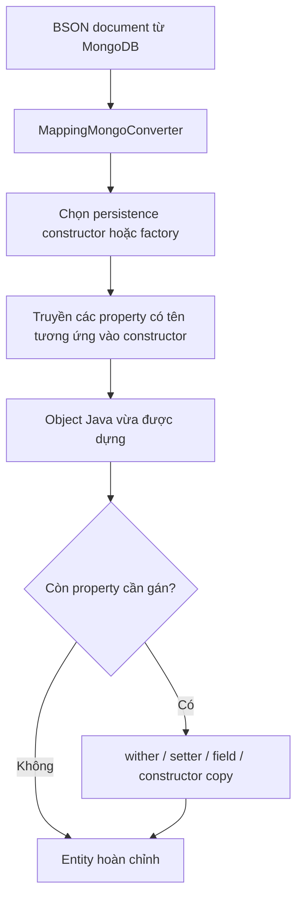

# Entity bất biến, Java record và phương thức wither

Trong MongoDB, một document có thể chứa nhiều object lồng nhau và mảng. Khi dùng **Spring Data MongoDB**, các phần này được ánh xạ thành Java object. Bạn có thể thiết kế các object đó theo kiểu **bất biến (immutable)**: sau khi được tạo, trạng thái bên trong không bị thay đổi qua setter hoặc thao tác sửa trực tiếp. Muốn đổi một giá trị, ứng dụng tạo **object mới** đại diện cho trạng thái mới.

Điều này rất phù hợp với mô hình dữ liệu trong chương **Đối tượng và nhúng** của module `SPRING_DATA_MONGODB`. Bài này kết hợp mapping document, nested object, `MongoTemplate` và repository để giải thích cách Spring Data khôi phục entity bất biến từ BSON, cách **Java record** rút gọn mã, vai trò của phương thức **wither**, và những điểm cần chú ý khi MongoDB sinh `_id` hoặc quản lý `@Version`.

> **Ý chính:** Bất biến của Java object và tính nguyên tử của thao tác MongoDB là hai chuyện khác nhau. Object không có setter giúp quản lý trạng thái trong ứng dụng, nhưng cập nhật database vẫn cần chọn đúng `insert`, `save`, cập nhật có điều kiện và cơ chế xử lý xung đột.

## 1. Mục tiêu học tập

Sau bài này, bạn có thể:

1. Phân biệt object bất biến, object chỉ “không có setter” và object **bất biến sâu**.
2. Hiểu luồng **constructor binding → property population** trong Spring Data MongoDB.
3. Tạo entity `@Document` bằng Java `record`, gồm các object nhúng và danh sách bất biến.
4. Dùng `@PersistenceCreator` và constructor đầy đủ cho một `final class` bất biến.
5. Viết `withId`, `withAddress`, `withStatus` mà không sửa instance gốc.
6. Xử lý việc MongoDB sinh ID và cập nhật version đối với object có trường `final`.
7. Hiểu khác biệt giữa tạo bản sao object, `repository.save` và cập nhật một phần bằng `MongoTemplate.updateFirst`.
8. Kiểm thử round-trip mapping, id generation, optimistic locking và những lỗi do schema cũ.

## 2. Bất biến trong Java không đồng nghĩa dữ liệu đứng yên

Một entity mutable thường cho phép thay đổi trực tiếp:

```java
shipment.setStatus("SHIPPED");
shipment.getItems().add(extraItem);
```

Với entity bất biến, bạn biểu diễn sự thay đổi bằng một **giá trị mới**:

```java
Shipment updated = shipment.withStatus("SHIPPED");

// shipment vẫn giữ trạng thái cũ.
// updated mang trạng thái mới.
```

Lợi ích:

- **Dễ suy luận:** một tham chiếu đang được sử dụng không bị code khác âm thầm sửa các field.
- **Rõ điểm chuyển trạng thái:** có thể kiểm tra invariant ngay tại constructor hoặc phương thức nghiệp vụ.
- **Hạn chế side effect:** service không vô tình sửa entity mà tầng khác còn đang giữ.
- **Hợp với mapping theo constructor:** Spring Data có thể đọc dữ liệu BSON và tạo một object đã được khởi tạo đầy đủ.
- **Tốt cho object nhúng:** địa chỉ, dòng hàng hoặc thông tin đơn giá thường có ý nghĩa như value object.

Tuy nhiên, tính bất biến của Java object **không tự bảo vệ** hai request cùng thay đổi một document. Hai bản sao có thể cùng được tạo từ phiên bản cũ; nếu cả hai được `save`, request sau vẫn có thể ghi đè request trước nếu thiếu optimistic locking hoặc cập nhật có điều kiện.

### 2.1. Bất biến nông và bất biến sâu

```java
public record Cart(String id, java.util.List<String> items) {
}
```

Bản thân record không có setter và các component là `final`, nhưng:

```java
var items = new java.util.ArrayList<String>();
items.add("SKU-1");

var cart = new Cart("CART-1", items);

items.add("SKU-2");       // Sửa danh sách bên ngoài.
cart.items().add("SKU-3"); // Cũng có thể sửa nếu list còn mutable.
```

Vì vậy, record ở trên chỉ **bất biến nông**. Cần defensive copy:

```java
public record Cart(String id, java.util.List<String> items) {
    public Cart {
        items = java.util.List.copyOf(items);
    }
}
```

`List.copyOf` tạo bản sao không thể sửa qua API thông thường của `List` và chặn việc danh sách bên ngoài thay đổi ảnh hưởng đến object. Nhưng đây vẫn là bản sao **nông**: nếu phần tử trong danh sách là object mutable, trạng thái phần tử đó vẫn có thể đổi. Nên kết hợp collection bất biến với phần tử là record hoặc class bất biến.

Với `byte[]`, `Date` và một số kiểu mutable khác, cần **sao chép ở cả đầu vào lẫn đầu ra**; chỉ gán `final` cho field không đủ.

## 3. Spring Data MongoDB dựng object từ document như thế nào?

MongoDB lưu BSON. Khi gọi `MongoTemplate.findById`, `MongoRepository.findById` hay nhận kết quả aggregation, Spring Data phải tạo object Java từ dữ liệu được truy xuất.

Có hai bước logic:



**Bước 1 — Object creation:** Spring Data xác định constructor hoặc factory phù hợp, sau đó giải quyết giá trị tham số từ các field được ánh xạ. **Bước 2 — Property population:** những persistent property chưa được constructor nhận sẽ được đưa vào entity.

### 3.1. Cách chọn constructor

Trong Spring Data Commons, các quy tắc được áp dụng theo thứ tự như sau (không xét các trường hợp đã chọn bằng factory đặc biệt):

| Tình huống | Cách chọn |
| --- | --- |
| Có static factory duy nhất đánh dấu `@PersistenceCreator` | Dùng factory đó. |
| Class có một constructor | Dùng constructor đó. |
| Có nhiều constructor, một constructor có `@PersistenceCreator` | Dùng constructor được chỉ định. |
| Loại dữ liệu là Java `record` | Dùng **canonical constructor** của record. |
| Có no-argument constructor, không có lựa chọn ưu tiên khác | Dùng constructor không tham số và điền property sau. |

Với class bất biến, **constructor nhận mọi persistent property** thường là lựa chọn rõ ràng và hiệu quả: object được tạo ở trạng thái hoàn chỉnh mà không cần điền từng field sau khi khởi tạo.

Tên tham số constructor cần ánh xạ tới tên property của entity. Với class Java thông thường, nên biên dịch có metadata tên tham số (ví dụ compiler option `-parameters`, thường được cấu hình trong các dự án Spring Boot), hoặc dùng `@ConstructorProperties` phù hợp. Java record có metadata component và canonical constructor thuận tiện hơn cho mục đích này.

### 3.2. Property population và wither

Nếu một persistent property không được constructor tiêu thụ, Spring Data có thể:

1. Gọi phương thức `with…` khi property bất biến có wither phù hợp.
2. Gọi setter khi được cấu hình property access.
3. Gán field mutable trực tiếp theo chính sách mapping.
4. Tạo một bản sao bằng persistence constructor khi property bất biến và đường copy được hỗ trợ.

Ví dụ `id` có thể là `null` lúc tạo entity mới. Sau thao tác insert, MongoDB/Spring Data tạo ID. Object Java bất biến không thể sửa `final id` bằng setter; mapping có thể dùng `withId` hoặc tạo bản sao bằng constructor để trả về entity có ID.

Một wither **không bắt buộc** trong mọi trường hợp, đặc biệt khi persistence constructor đã nhận tất cả property và có thể làm công việc tạo bản sao. Dù vậy, wither rất có ích để người đọc mã hiểu rõ thao tác nào tạo trạng thái mới.

## 4. Ví dụ chính: Java record cho document và object nhúng

Giả sử ứng dụng quản lý lô giao hàng. Một document có địa chỉ và danh sách mặt hàng:

```json
{
  "_id": "SHIP-1001",
  "customerId": "CUS-19",
  "address": {
    "street": "12 Nguyen Trai",
    "city": "Ha Noi",
    "postal_code": "100000"
  },
  "items": [
    { "sku": "SKU-1", "quantity": 2 },
    { "sku": "SKU-2", "quantity": 1 }
  ],
  "status": "CREATED"
}
```

Đây là hình dạng minh họa để hiểu mapping; MongoDB có thể lưu metadata như `_class` tùy cấu hình mapping và kiểu dữ liệu cụ thể.

### 4.1. Address là value object

```java
package dev.learning.shipping;

import java.util.Objects;
import org.springframework.data.mongodb.core.mapping.Field;

public record Address(
        String street,
        String city,
        @Field("postal_code") String postalCode) {

    public Address {
        Objects.requireNonNull(street, "street");
        Objects.requireNonNull(city, "city");
        Objects.requireNonNull(postalCode, "postalCode");

        if (street.isBlank() || city.isBlank()) {
            throw new IllegalArgumentException(
                    "Địa chỉ phải có đường và thành phố");
        }
    }
}
```

Java record tự cung cấp constructor, accessor `street()`, `city()`, `postalCode()`, `equals`, `hashCode` và `toString`. `@Field("postal_code")` minh họa khả năng đặt tên field khác trong BSON; trong truy vấn qua mapping context, mã Java vẫn dùng property `postalCode`.

### 4.2. Mỗi dòng hàng cũng là record

```java
package dev.learning.shipping;

import java.util.Objects;

public record ShipmentItem(String sku, int quantity) {

    public ShipmentItem {
        Objects.requireNonNull(sku, "sku");
        if (sku.isBlank() || quantity <= 0) {
            throw new IllegalArgumentException(
                    "SKU không được rỗng; quantity phải > 0");
        }
    }
}
```

`ShipmentItem` không có setter, và mọi field đều là kiểu không chứa tham chiếu mutable ở ví dụ này. Nhờ vậy, khi sao chép một list bằng `List.copyOf`, ta có một cấu trúc phù hợp với yêu cầu bất biến ở cả collection và phần tử.

### 4.3. Shipment là aggregate root

```java
package dev.learning.shipping;

import java.util.List;
import java.util.Objects;

import org.springframework.data.annotation.Id;
import org.springframework.data.mongodb.core.mapping.Document;

@Document("shipments")
public record Shipment(
        @Id String id,
        String customerId,
        Address address,
        List<ShipmentItem> items,
        String status) {

    public Shipment {
        Objects.requireNonNull(customerId, "customerId");
        Objects.requireNonNull(address, "address");
        items = List.copyOf(Objects.requireNonNull(items, "items"));
        Objects.requireNonNull(status, "status");

        if (customerId.isBlank() || items.isEmpty()) {
            throw new IllegalArgumentException(
                    "customerId và danh sách hàng phải hợp lệ");
        }
    }

    public static Shipment draft(
            String customerId,
            Address address,
            List<ShipmentItem> items) {
        return new Shipment(
                null, customerId, address, items, "CREATED");
    }

    public Shipment withId(String newId) {
        return new Shipment(
                newId, customerId, address, items, status);
    }

    public Shipment withAddress(Address newAddress) {
        return new Shipment(
                id, customerId, newAddress, items, status);
    }

    public Shipment withStatus(String newStatus) {
        return new Shipment(
                id, customerId, address, items, newStatus);
    }
}
```

Lưu ý:

- `@Document("shipments")` chỉ định collection.
- `@Id` ánh xạ component Java `id` thành BSON `_id`.
- Spring Data sử dụng **canonical constructor** để đọc lại record.
- `Address` được lưu **nhúng trong document**, `List<ShipmentItem>` được lưu thành một mảng object nhúng theo mapping thông thường. Đây không phải `DBRef`.
- Compact canonical constructor chặn dữ liệu đầu vào không hợp lệ và thực hiện defensive copy.
- Các phương thức `with…` trả về **Shipment mới** mà không thay đổi shipment gốc.
- Khi tạo một record khác bằng `with…`, mọi component không thay đổi phải được giữ lại; bỏ sót component có thể làm mất dữ liệu.

**Khi nào không nên validate quá chặt trong constructor?** Nếu collection chứa dữ liệu cũ có field `null`/thiếu field, constructor có thể ném lỗi ngay lúc đọc BSON. Cần có kế hoạch migration dữ liệu, quy tắc tương thích và test với dữ liệu thật trước khi siết invariant.

## 5. Lưu, đọc và hiểu vòng đời ID với record

Spring Data hỗ trợ Java record; `MongoTemplate` và repository có thể mapping nhờ canonical constructor. Ví dụ repository:

```java
package dev.learning.shipping;

import org.springframework.data.mongodb.repository.MongoRepository;

public interface ShipmentRepository
        extends MongoRepository<Shipment, String> {
}
```

Một service tạo document:

```java
package dev.learning.shipping;

import java.util.List;
import org.springframework.stereotype.Service;

@Service
public class ShipmentService {
    private final ShipmentRepository repository;

    public ShipmentService(ShipmentRepository repository) {
        this.repository = repository;
    }

    public Shipment create() {
        var address = new Address(
                "12 Nguyen Trai", "Ha Noi", "100000");

        var draft = Shipment.draft(
                "CUS-19",
                address,
                List.of(new ShipmentItem("SKU-1", 2)));

        return repository.insert(draft);
    }
}
```

`repository.insert` biểu diễn ý định **create-only**. Nếu `id == null` và kiểu ID được Spring Data hỗ trợ tự sinh, thao tác ghi có thể gán ObjectId và trả về entity tương ứng với ID. Đối với record có field `final`, hãy dùng **giá trị trả về từ insert/save**:

```java
Shipment draft = Shipment.draft(
        "CUS-19",
        address,
        List.of(new ShipmentItem("SKU-1", 2)));

Shipment persisted = repository.insert(draft);

System.out.println(draft.id());     // vẫn null
System.out.println(persisted.id()); // có ID sau insert thành công
```

Đừng viết `repository.insert(draft); draft.id()` rồi kỳ vọng biến `draft` được thay đổi tại chỗ. Dữ liệu được ánh xạ lại thành một instance mới khi cần gán giá trị của trường bất biến.

**Khi chủ động gán ID** (ví dụ `"SHIP-1001"`), ứng dụng tạo record với ID đó rồi `insert`. Nếu document có cùng `_id` đã tồn tại, MongoDB báo duplicate key; việc một record có ID **không chứng minh document đã được ghi**.

### @Id String và kiểu BSON

Spring Data MongoDB thường chuyển một chuỗi `@Id String` trông như ObjectId hợp lệ (24 ký tự hex) sang BSON ObjectId. Với chuỗi không hợp lệ như `"SHIP-1001"`, MongoDB có thể lưu ID dạng string. Nếu muốn giữ **mọi** ID ở dạng BSON string kể cả chuỗi hex 24 ký tự, hãy xem `@MongoId` và quy tắc chuyển kiểu tương ứng.

Cần nhất quán kiểu `_id` ở cả query, schema và dữ liệu lịch sử. Đổi annotation mà không kiểm tra kiểu BSON có thể làm `findById` không tìm thấy document cũ.

## 6. Immutable class truyền thống và @PersistenceCreator

Record phù hợp với nhiều value object và entity dạng dữ liệu. Tuy nhiên, khi cần kiểm soát API, ẩn một phần constructor hoặc diễn đạt quy tắc nghiệp vụ phức tạp, một `final class` với field `final` có thể rõ nghĩa hơn.

```java
package dev.learning.shipping;

import java.util.Objects;

import org.springframework.data.annotation.Id;
import org.springframework.data.annotation.PersistenceCreator;
import org.springframework.data.mongodb.core.mapping.Document;

@Document("customers")
public final class CustomerProfile {

    @Id
    private final String id;

    private final String email;
    private final Address address;

    @PersistenceCreator
    public CustomerProfile(
            String id, String email, Address address) {
        this.id = id;
        this.email = Objects.requireNonNull(email, "email");
        this.address = Objects.requireNonNull(address, "address");
    }

    public static CustomerProfile create(
            String email, Address address) {
        return new CustomerProfile(null, email, address);
    }

    public String getId() {
        return id;
    }

    public String getEmail() {
        return email;
    }

    public Address getAddress() {
        return address;
    }

    public CustomerProfile withId(String newId) {
        return new CustomerProfile(newId, email, address);
    }

    public CustomerProfile withAddress(Address newAddress) {
        return new CustomerProfile(id, email, newAddress);
    }
}
```

Trong ví dụ này:

- `id`, `email` và `address` là `final`, chỉ gán trong constructor.
- `@PersistenceCreator` cho Spring Data biết constructor dùng khi materialize entity. Khi chỉ có **một constructor**, annotation không bắt buộc; thêm vào đây để nói rõ ý định và phòng trường hợp class thêm constructor về sau.
- `create` là static factory dành cho mã ứng dụng: không cần yêu cầu caller tự truyền `id = null`.
- `withId` hỗ trợ tạo bản sao có ID mới; `withAddress` biểu diễn cập nhật giá trị lồng nhau.
- `getId` và các getter chỉ đọc, không có setter.

Với class Java không phải record, hãy bảo đảm tên tham số constructor tồn tại trong bytecode hoặc có metadata tương đương. Nếu Spring Data không tìm được tên `email`/`address` thì mapping có thể thất bại. Dùng cấu hình compiler `-parameters` hoặc `@ConstructorProperties` khi cần.

### Không có setter không có nghĩa là Spring Data không ánh xạ được

Spring Data không bắt buộc entity có no-arg constructor và setter cho từng field. Với constructor đầy đủ, mapping có thể dựng instance một lần với tất cả property; cách này thường giảm việc phản chiếu và các bước property population bổ sung.

Ngược lại, nếu class có nhiều constructor mà Spring Data không xác định được constructor dùng cho persistence, quá trình đọc có thể thất bại hoặc chọn đường không mong muốn. Dùng `@PersistenceCreator` một cách nhất quán khi cần chỉ rõ.

## 7. Phương thức wither: quy ước và lợi ích

**Wither** thường có tên `with<Property>`, nhận giá trị mới và trả một object **cùng kiểu** đã được sao chép:

```java
public CustomerProfile withAddress(Address newAddress) {
    return new CustomerProfile(id, email, newAddress);
}
```

Phép biến đổi:

```text
Đầu vào:
  CustomerProfile(id="CUS-1", email="lan@example.test", address=OLD)

Gọi:
  CustomerProfile next = current.withAddress(NEW)

Kết quả:
  current.address == OLD
  next.address    == NEW
  current != next
```

### 7.1. Wither khác setter

| Setter mutable | Wither immutable |
| --- | --- |
| `void setAddress(Address a)` | `CustomerProfile withAddress(Address a)` |
| Sửa object hiện tại. | Tạo object mới. |
| Mọi tham chiếu cùng object có thể thấy thay đổi. | Tham chiếu cũ giữ trạng thái cũ. |
| Có thể tạo trạng thái trung gian nếu sửa nhiều field. | Có thể kiểm tra invariant khi dựng toàn bộ bản sao. |
| Dễ sử dụng cho JavaBean mutable. | Phù hợp record, value object và domain model bất biến. |

### 7.2. Quy tắc đặt tên và chữ ký

Spring Data object mapping nhận diện wither theo quy ước, ví dụ `withId(String id)` trả đúng kiểu entity. Để mapping thuận lợi, nên viết phương thức có thể truy cập được từ cơ chế ánh xạ và không thực hiện side effect. Nếu entity không có wither nhưng có persistence constructor nhận được mọi field, Spring Data có thể dùng constructor để tạo bản sao khi cần population giá trị của field bất biến.

Đừng nhầm wither với API của MongoDB. **Gọi `withAddress` chỉ tạo object Java mới**, chưa hề gửi lệnh ghi đến database.

```java
CustomerProfile current = repository.findById(id).orElseThrow();
CustomerProfile changed =
        current.withAddress(new Address(
                "99 Le Loi", "Da Nang", "550000"));

// Đến đây MongoDB chưa thay đổi.
CustomerProfile saved = repository.save(changed);
```

Trong đoạn trên, `repository` cần là repository của `CustomerProfile`. Khi dùng `save`, phải hiểu hành vi thay thế document và yêu cầu kiểm soát đồng thời. Ở nghiệp vụ chỉ sửa một field, `updateFirst` có điều kiện đôi khi phù hợp hơn.

### 7.3. Wither cần giữ mọi property

Một lỗi sao chép phổ biến:

```java
// SAI: Làm mất giá trị address và các trường khác.
public CustomerProfile withEmailBroken(String newEmail) {
    return new CustomerProfile(id, newEmail, null);
}
```

Constructor của ví dụ sẽ ném lỗi vì `address` là null. Ngay cả khi constructor cho phép null, đây vẫn là lỗi mất dữ liệu. Khi thêm một field mới (ví dụ `customerTier`), hãy cập nhật **tất cả** các phương thức wither liên quan hoặc dựa vào cơ chế copy được sinh tự động có kiểm thử.

### 7.4. Record có nhất thiết cần wither không?

Không. Record luôn có canonical constructor, và Spring Data có thể dùng constructor copy khi giá trị immutable cần được gán. Wither trên record chủ yếu làm rõ **chuyển trạng thái trong nghiệp vụ**, đồng thời là một điểm mở rộng hữu ích cho các trường như ID được sinh. Việc mapping cụ thể sử dụng wither hay tạo bản sao tùy tình huống property và phiên bản Spring Data.

## 8. Ghi document với MongoTemplate: hai kiểu cập nhật

Có hai chiến lược khác nhau cần tách rõ.

### 8.1. Tạo bản sao rồi save

```java
Shipment before = repository.findById(id).orElseThrow();

Shipment changed = before.withAddress(
        new Address("99 Le Loi", "Da Nang", "550000"));

Shipment saved = repository.save(changed);
```

Đây là cách dễ đọc với domain model bất biến. Tuy nhiên, `save` có thể lưu/thay thế nhiều trường của document, tùy trạng thái entity và phiên bản. Nếu hai request cùng đọc một object cũ rồi lưu bản sao, có nguy cơ **lost update** khi không có optimistic locking.

**Khi phù hợp:** domain aggregate nhỏ, có thay đổi nhiều thuộc tính cần validate cùng nhau, và đã thiết kế xử lý xung đột bằng `@Version` hoặc điều kiện tương đương.

### 8.2. Cập nhật riêng một số field bằng MongoTemplate

Nếu nghiệp vụ chỉ sửa thành phố giao hàng:

```java
import com.mongodb.client.result.UpdateResult;
import org.springframework.data.mongodb.core.MongoTemplate;
import org.springframework.data.mongodb.core.query.Criteria;
import org.springframework.data.mongodb.core.query.Query;
import org.springframework.data.mongodb.core.query.Update;

public boolean changeCity(
        MongoTemplate template, String shipmentId, String newCity) {

    if (newCity == null || newCity.isBlank()) {
        throw new IllegalArgumentException("city không hợp lệ");
    }

    Query query = Query.query(
            Criteria.where("_id").is(shipmentId)
                    .and("status").is("CREATED"));

    Update update = new Update().set("address.city", newCity);

    UpdateResult result =
            template.updateFirst(query, update, Shipment.class);

    return result.getMatchedCount() == 1;
}
```

Đây là **một lệnh cập nhật nguyên tử trên một document** ở MongoDB. Java record đã được đọc trước đó (nếu có) **không tự thay đổi**, vì server chỉnh BSON trực tiếp.

```text
before.address().city()      -> "Ha Noi"  (object Java cũ)
MongoDB sau updateFirst      -> "Da Nang" (document mới)
template.findById(...).city  -> "Da Nang" (object Java đọc lại)
```

Với domain có invariant phức tạp, cần nhớ cập nhật BSON trực tiếp **không đi qua constructor Java của record đang nằm trong bộ nhớ**. Service phải validate dữ liệu, hoặc dùng MongoDB schema validation và quy tắc nghiệp vụ ở các đường ghi. Đừng cho phép một đường `updateFirst` tùy ý bypass những invariant quan trọng đã đặt trong constructor.

### 8.3. Save và update khác nhau về phạm vi thay đổi

| Tiêu chí | Tạo bản sao rồi `save` | `updateFirst` với `$set` |
| --- | --- | --- |
| Object Java cũ | Không bị mutate. | Không bị mutate. |
| Nơi xây trạng thái mới | Constructor/wither ở Java. | Câu lệnh update phía MongoDB. |
| Phạm vi dữ liệu ghi | Thường lưu/replacement toàn entity. | Chỉ những field được khai báo trong `Update`. |
| Constructor validation | Chạy khi tạo bản sao. | Không tự chạy với dữ liệu đang cập nhật trên server. |
| Đọc lại để có bản mới | Giá trị trả về từ `save` là entity đã lưu. | Cần truy vấn lại nếu muốn object mới. |
| Nguy cơ lost update | Cần kiểm soát version/xung đột. | Có thể dùng điều kiện trên field/version để bảo vệ. |

## 9. @Version với entity bất biến

Bất biến ở Java **không bảo vệ** một document khỏi hai lệnh ghi cạnh tranh. Optimistic locking sử dụng `@Version` để chỉ cập nhật khi version trong database còn khớp version mà ứng dụng đã đọc.

Ví dụ dùng record:

```java
package dev.learning.shipping;

import org.springframework.data.annotation.Id;
import org.springframework.data.annotation.Version;
import org.springframework.data.mongodb.core.mapping.Document;

@Document("profiles")
public record VersionedProfile(
        @Id String id,
        String nickname,
        @Version Long version) {

    public VersionedProfile withNickname(String nextNickname) {
        return new VersionedProfile(id, nextNickname, version);
    }

    public VersionedProfile withId(String nextId) {
        return new VersionedProfile(nextId, nickname, version);
    }

    public VersionedProfile withVersion(Long nextVersion) {
        return new VersionedProfile(id, nickname, nextVersion);
    }
}
```

Với `@Version Long` dạng wrapper, giá trị `null` biểu thị entity mới theo cơ chế entity state detection. Khi lưu, Spring Data có thể gán version ban đầu; khi sửa một entity đã tồn tại, những operation có hỗ trợ optimistic locking kiểm tra và tăng version phù hợp.

Kịch bản hai request:

```text
T0  DB: { _id: "P-1", nickname: "Lan", version: 0 }

T1  A đọc VersionedProfile(version=0)
T2  B đọc VersionedProfile(version=0)

T3  A tạo A1 = A.withNickname("Lan A")
T4  B tạo B1 = B.withNickname("Lan B")

T5  repository.save(A1) -> thành công, version mới
T6  repository.save(B1) -> OptimisticLockingFailureException
```

Khi phát hiện xung đột, ứng dụng có thể trả HTTP 409 hoặc đọc lại và retry theo quy tắc nghiệp vụ. **Không tự động ghi đè** trạng thái mới bằng object cũ.

**Hai điểm cần nhớ:**

- Optimistic locking yêu cầu write concern có xác nhận kết quả ghi; `WriteConcern.UNACKNOWLEDGED` có thể khiến lỗi xung đột không được phát hiện đúng.
- Không phải mọi phương thức update tùy biến tự động áp dụng điều kiện version mà bạn mong đợi. Nếu cập nhật qua `MongoTemplate.updateFirst`, cần xem semantics của API và bổ sung `Criteria.where("version").is(expectedVersion)` khi cần compare-and-set. Tránh tăng version hai lần nếu Spring Data đã hỗ trợ tăng tự động.

### 9.1. Ví dụ update có điều kiện version

```java
Query query = Query.query(
        Criteria.where("_id").is(profileId)
                .and("version").is(expectedVersion));

Update update = new Update().set("nickname", nextNickname);

UpdateResult result =
        mongoTemplate.updateFirst(
                query, update, VersionedProfile.class);

if (result.getMatchedCount() != 1) {
    // Document không tồn tại hoặc version đã thay đổi.
    throw new IllegalStateException(
            "Không thể cập nhật: dữ liệu đã thay đổi");
}
```

Lệnh trên bảo vệ ràng buộc phiên bản trong **cùng thao tác** ghi. Khi đọc object mới, cần thực hiện truy vấn lại; object record ban đầu không tự đồng bộ.

## 10. Record nhúng trong collection và schema evolution

Một mô hình nhúng có thể dùng record ở nhiều cấp:

```java
public record GeoPoint(double latitude, double longitude) {}

public record Warehouse(
        String code,
        Address address,
        GeoPoint position) {}
```

Nếu một field là object nhúng, Spring Data thông thường chuyển nó thành BSON object con. Nếu là collection các record, nó chuyển thành BSON array. Khi đổi tên component, thêm thuộc tính hoặc đổi kiểu, hãy chú ý những document cũ.

### 10.1. Field mới và giá trị mặc định

Giả sử record ban đầu:

```java
public record AddressV1(String street, String city) {}
```

Sau khi nâng cấp:

```java
public record AddressV2(
        String street,
        String city,
        String country) {

    public AddressV2 {
        country = (country == null || country.isBlank())
                ? "VN"
                : country;
    }
}
```

Khi document cũ không có `country`, constructor có thể nhận `null` và áp dụng default. Nhưng default trong constructor cũng được áp dụng cho **dữ liệu mới thiếu field**, nên có thể che giấu lỗi từ API. Nếu tính đúng đắn quan trọng, cân nhắc migrate BSON trước, định nghĩa cấu hình compatible riêng hoặc tách logic nhập liệu khỏi logic khôi phục dữ liệu.

Đừng thêm field primitive như `int` rồi tự động giả định giá trị 0 nghĩa là “chưa có dữ liệu”; 0 có thể là một giá trị nghiệp vụ hợp lệ. Dùng wrapper, validation hoặc migration khi cần phân biệt “không có” và “bằng 0”.

### 10.2. Đổi tên component và @Field

Nếu MongoDB lưu `postal_code` nhưng Java code muốn dùng `postalCode`, khai báo `@Field("postal_code")` như `Address`. Khi dùng `Query` với domain type tương ứng, Spring Data mapping context có thể ánh xạ đường dẫn property Java sang field BSON. Tránh trộn tên Java và tên BSON tùy tiện trong câu lệnh query.

### 10.3. Derived property cần thiết kế rõ

Một class bất biến có thể tính `totalCents` từ các dòng hàng:

```java
public record PriceLine(long unitPriceCents, int quantity) {

    public PriceLine {
        if (unitPriceCents < 0 || quantity <= 0) {
            throw new IllegalArgumentException("Giá hoặc số lượng sai");
        }
    }

    public long lineTotalCents() {
        return Math.multiplyExact(unitPriceCents, quantity);
    }
}
```

Phương thức `lineTotalCents()` không phải một record component; mặc định nó chỉ là hành vi, không phải persistent property. Trong một class thường có field `final totalCents` được tính từ field khác, Spring Data có thể gặp khó khăn nếu property được lưu trong BSON nhưng constructor không nhận nó và không có wither/copy hợp lệ. Có thể tránh lỗi bằng cách **không lưu field derived**, hoặc đưa nó vào constructor dành cho persistence với quy tắc tính toán nhất quán.

Tương tự, với `@Transient`, field không được mapping; hãy đánh giá liệu giá trị đó có cần khôi phục từ DB hay chỉ tính lại ở tầng Java.

## 11. Projection, aggregation và mô hình đọc riêng

Không phải mọi truy vấn đều cần materialize toàn bộ aggregate. Nếu một màn hình chỉ hiển thị ID và trạng thái giao hàng, có thể định nghĩa record chỉ đọc:

```java
package dev.learning.shipping;

import org.springframework.data.annotation.Id;

public record ShipmentSummary(
        @Id String id,
        String status) {
}
```

Ví dụ `MongoTemplate` projection trên collection:

```java
import java.util.List;

import org.springframework.data.mongodb.core.query.Criteria;
import org.springframework.data.mongodb.core.query.Query;

Query query = Query.query(
        Criteria.where("status").is("CREATED"));

query.fields()
        .include("_id")
        .include("status");

List<ShipmentSummary> summaries =
        mongoTemplate.find(
                query, ShipmentSummary.class, "shipments");
```

Record `ShipmentSummary` dùng canonical constructor gồm những field thực sự cần. Tránh project một vài field vào **record aggregate đầy đủ** có constructor yêu cầu tất cả field bắt buộc; các giá trị thiếu có thể khiến constructor validation thất bại.

Với aggregation, bạn cũng có thể ánh xạ kết quả `$project` sang record chuyên biệt, miễn là tên và kiểu của field kết quả phù hợp constructor. Luôn kiểm tra kết quả round-trip và conversion kiểu BSON.

**Mục tiêu của read model:** giảm payload mạng, giảm chi phí mapping và không buộc nghiệp vụ đọc dữ liệu không cần. Cần thiết kế query và index phù hợp để có lợi ích hiệu năng thực tế; chỉ đổi mutable class sang record không giải quyết vấn đề index kém.

## 12. Những sai lầm thường gặp

| Sai lầm | Vì sao gây vấn đề | Cách khắc phục |
| --- | --- | --- |
| “Record tự động immutable sâu.” | Component là tham chiếu đến list/map/object mutable. | Defensive copy và immutable nested types. |
| “Có `withStatus` thì DB đã đổi.” | Wither chỉ tạo object Java mới. | Gọi đúng API persistence hoặc lệnh update. |
| “Record không cần constructor vì có mapper.” | Mapper phải gọi được canonical constructor với dữ liệu tương thích. | Khai báo component phù hợp schema, test BSON → record. |
| “Thêm `final` cho ID khiến Spring Data không sinh được ID.” | Spring Data hỗ trợ bất biến qua constructor copy/wither. | Dùng all-args constructor hoặc `withId`; kiểm tra giá trị trả về từ insert. |
| “Gọi `insert(draft)` rồi đọc `draft.id()`.” | Object bất biến ban đầu không bị mutate. | Giữ `Shipment persisted = repository.insert(draft)`. |
| “Save record an toàn với mọi thay đổi đồng thời.” | Hai snapshot có thể cùng sửa document cũ. | `@Version`, compare-and-set hoặc transaction theo nhu cầu. |
| “Update BSON đã chạy validation trong record.” | Câu lệnh `$set` chạy trên server, không đi qua constructor Java. | Validate ở service và/hoặc JSON schema validation. |
| “`List.copyOf` sao chép sâu từng phần tử.” | Đây là bản sao nông của phần tử. | Dùng immutable element type; copy riêng mutable element. |
| “Đổi tên field record không ảnh hưởng dữ liệu cũ.” | Mapping theo tên field/component; schema cũ có thể không khớp. | `@Field`, migration hoặc mapping tương thích. |
| “Bất biến nghĩa là thread-safe ở mọi tình huống.” | Phụ thuộc cả trạng thái tham chiếu bên trong và tài nguyên ngoài. | Xem lại deep immutability và đồng thời trên MongoDB. |

### 12.1. Tránh nhận xét sai về performance

Constructor-only materialization thường có lợi vì giảm property population. Nhưng tác động thực tế còn phụ thuộc reflection/generated accessor, độ sâu object, conversion BSON, network, query, index và tải MongoDB. Đo bằng workload đại diện trước khi kết luận record nhanh hơn class mutable trong một ứng dụng cụ thể.

### 12.2. Tránh sử dụng một model cho mọi tình huống

Entity domain bất biến phù hợp lưu trữ và bảo toàn invariant, nhưng một API PATCH chỉ cần sửa một field có thể dùng `MongoTemplate.updateFirst`. Kết quả aggregation chỉ cần vài trường có thể dùng read-model record. Tách **aggregate model**, **command DTO** và **read projection** khi chúng có yêu cầu khác nhau.

## 13. Kiểm thử: từ object bất biến đến round-trip MongoDB

Một bộ kiểm thử hợp lý có ba lớp:

1. **Unit test constructor/wither:** không cần kết nối database.
2. **Mapping/integration test:** ghi rồi đọc lại record và nested object từ MongoDB thật.
3. **Concurrency test:** nhiều snapshot thay đổi đồng thời, xác nhận optimistic locking hoặc điều kiện update.

### 13.1. Unit test record không có side effect

```java
import static org.junit.jupiter.api.Assertions.*;

import java.util.ArrayList;
import java.util.List;
import org.junit.jupiter.api.Test;

class ShipmentImmutabilityTest {

    @Test
    void witherCreatesNewObject() {
        Address first =
                new Address("12 Nguyen Trai", "Ha Noi", "100000");
        Address second =
                new Address("99 Le Loi", "Da Nang", "550000");

        Shipment original = Shipment.draft(
                "CUS-19",
                first,
                List.of(new ShipmentItem("SKU-1", 2)));

        Shipment changed = original.withAddress(second);

        assertNotSame(original, changed);
        assertEquals(first, original.address());
        assertEquals(second, changed.address());
        assertEquals(original.items(), changed.items());
    }

    @Test
    void copiesListDefensively() {
        var source = new ArrayList<ShipmentItem>();
        source.add(new ShipmentItem("SKU-1", 2));

        Shipment shipment = Shipment.draft(
                "CUS-19",
                new Address("12 Nguyen Trai", "Ha Noi", "100000"),
                source);

        source.add(new ShipmentItem("SKU-2", 1));

        assertEquals(1, shipment.items().size());
        assertThrows(
                UnsupportedOperationException.class,
                () -> shipment.items().add(
                        new ShipmentItem("SKU-3", 1)));
    }
}
```

Hai test này xác minh giá trị trong Java và phòng trường hợp danh sách mutable ở đầu vào. Chúng **không** xác minh MongoDB mapping.

### 13.2. Integration test insert → read lại object nhúng

Ví dụ dưới đây yêu cầu một MongoDB test riêng đã được cấu hình URI; dùng `@SpringBootTest` với Spring Boot và `MongoTemplate`:

```java
import static org.junit.jupiter.api.Assertions.*;

import java.util.List;

import org.junit.jupiter.api.Test;
import org.springframework.beans.factory.annotation.Autowired;
import org.springframework.boot.test.context.SpringBootTest;
import org.springframework.data.mongodb.core.MongoTemplate;

@SpringBootTest
class ShipmentMappingIntegrationTest {

    @Autowired
    MongoTemplate mongoTemplate;

    @Test
    void insertsAndReadsImmutableNestedRecord() {
        Shipment draft = Shipment.draft(
                "CUS-19",
                new Address("12 Nguyen Trai", "Ha Noi", "100000"),
                List.of(new ShipmentItem("SKU-1", 2)));

        Shipment saved = mongoTemplate.insert(draft);
        assertNull(draft.id());
        assertNotNull(saved.id());

        Shipment readBack =
                mongoTemplate.findById(saved.id(), Shipment.class);

        assertNotNull(readBack);
        assertEquals(saved.customerId(), readBack.customerId());
        assertEquals(saved.address(), readBack.address());
        assertEquals(saved.items(), readBack.items());
        assertEquals("CREATED", readBack.status());
    }
}
```

Nếu test đọc thất bại, cần xem:

- Collection `shipments` có đúng không.
- Kiểu BSON của `_id` và conversion sang `String` có khớp không.
- Tên field `postal_code` được mapping đúng chưa.
- Constructor có chặn những document cũ/thiếu field không.
- Dữ liệu list có phần tử `null` hoặc sai kiểu `quantity` không.
- Có custom converter hoặc mapping customization làm thay đổi cách serialize không.

Test cần dùng dữ liệu riêng; không chạy `dropCollection` vào database sản xuất.

### 13.3. Optimistic locking với record có version

Thử đọc hai bản `VersionedProfile` từ MongoDB, tạo hai bản sao qua `withNickname`, lưu bản thứ nhất, sau đó lưu bản thứ hai. Khi repository hoặc `MongoTemplate` sử dụng optimistic locking đúng, lần save còn giữ version cũ sẽ phát sinh `OptimisticLockingFailureException`. Kiểm tra đồng thời dữ liệu trong collection vẫn là trạng thái của lần ghi đã thành công.

Không thử nghiệm này với `WriteConcern.UNACKNOWLEDGED` vì ứng dụng cần được server xác nhận kết quả ghi.

### 13.4. Test cập nhật trực tiếp không sửa object Java

Tạo Shipment, đọc thành `before`, chạy `updateFirst` đổi `address.city` với filter phù hợp. Assert `before.address().city()` vẫn là giá trị cũ, rồi đọc lại entity mới để xác minh database đã thay đổi.

Đây là bài test rất hữu ích để tách hai khái niệm: **object bất biến** và **document có thể được cập nhật trên server**.

## 14. Lưu ý khi dùng reactive access và transaction

Trong dự án reactive, `ReactiveMongoTemplate` và `ReactiveMongoRepository` vẫn dùng quy tắc ánh xạ entity tương ứng nhưng trả về `Mono`/`Flux`. Ví dụ:

```java
reactiveShipmentRepository.insert(draft)
    .flatMap(saved -> reactiveShipmentRepository.findById(saved.id()))
    .map(Shipment::address);
```

Giá trị trả về sau insert có thể là bản sao mới chứa ID. Tránh dùng `block()` trong đường reactive chỉ để lấy ID rồi tiếp tục sửa object mutable.

Với transaction, bản chất không đổi: Spring Data/MongoDB có thể bảo vệ nhiều thao tác trong một transaction phù hợp topology, nhưng một record immutable **không tự tạo transaction**. Khi nhiều document cần thay đổi cùng nhau, cần xác định ranh giới transaction và retry/idempotency. Khi một document có nested address/items, một lệnh cập nhật của MongoDB trên document ấy có tính nguyên tử theo quy tắc MongoDB.

## 15. Bài tập thực hành

### Bài 1 — Thiết kế value object bất biến

Tạo `Money(long amountCents, String currency)` bằng record, chặn số âm và currency rỗng. Giải thích vì sao lưu integer cents có thể dễ kiểm soát hơn phép tính bằng `double` khi xử lý tiền.

### Bài 2 — Bảo vệ collection khỏi sửa ngoài ý muốn

Tạo `Order` có `List<OrderLine>`. Dùng `List.copyOf` ở compact constructor, đưa vào một `ArrayList` có thể sửa và kiểm tra thay đổi danh sách bên ngoài không làm Order đổi. Giải thích vì sao từng OrderLine cũng cần bất biến.

### Bài 3 — Wither và generated ID

Tạo `CustomerProfile` có `id` là `final`, thêm `withId`. Gọi `MongoTemplate.insert` hoặc repository insert, so sánh `draft.getId()` và `saved.getId()`; giải thích vì sao phải giữ giá trị trả về.

### Bài 4 — Constructor binding và schema cũ

Document cũ thiếu field `country`. Tạo record Address mới có thêm country. Đề xuất chiến lược migration hoặc default rõ ràng và test đọc lại cả document cũ/mới.

### Bài 5 — So sánh hai chiến lược cập nhật

Viết code đổi thành phố giao hàng bằng `withAddress + save` và bằng `MongoTemplate.updateFirst`. Phân tích khác nhau về validation, phạm vi ghi và lost update.

### Bài 6 — Xung đột version

Hai request cùng đọc `VersionedProfile(version=0)`. Dùng `withNickname` tạo hai bản sao rồi lưu tuần tự. Mô tả exception của lần lưu thứ hai và cách API nên phản hồi.

### Gợi ý đánh giá

- Record chỉ bất biến sâu khi các component lồng nhau cũng bất biến hoặc được sao chép phòng vệ.
- Canonical constructor của Java record là đầu vào thuận tiện cho mapping.
- Với class thường, constructor cần nhận mọi persistent property hoặc phải có cơ chế điền field còn lại.
- Wither tạo **object mới**, không gửi lệnh tới MongoDB.
- ID/version do persistence quản lý có thể yêu cầu object mới: luôn sử dụng giá trị trả về từ thao tác lưu.
- `save` và `updateFirst` có semantics khác nhau; muốn tránh lost update cần version hoặc điều kiện phù hợp.
- Kiểm thử round-trip nên dùng document nhúng, field alias, danh sách và ID sinh tự động.

## 16. Checklist trước khi áp dụng vào ứng dụng

- [ ] Xác định aggregate root, value objects nhúng và phạm vi dữ liệu bất biến.
- [ ] Với list/map/array, kiểm tra defensive copy và các kiểu mutable bên trong.
- [ ] Dùng canonical constructor của record hoặc persistence constructor đầy đủ cho class thường.
- [ ] Đảm bảo constructor parameter metadata/naming phù hợp mapping.
- [ ] Thiết kế factory tạo mới và wither không gây side effect.
- [ ] Lưu giữ object được trả về từ `insert`/`save` khi có generated ID/version.
- [ ] Kiểm tra `@Id`/`@MongoId` và kiểu BSON của khóa.
- [ ] Với `save` entity toàn phần, cân nhắc `@Version` để phát hiện ghi đè.
- [ ] Với `MongoTemplate.updateFirst`, validate các trường thay đổi và áp dụng điều kiện cần thiết.
- [ ] Kiểm thử dữ liệu cũ, alias field, nested list, null/missing fields và schema evolution.
- [ ] Tách DTO đọc/ghi, projection record và aggregate model khi yêu cầu khác nhau.
- [ ] Đo mapping và query trên workload thật trước khi kết luận hiệu năng.

## 17. Tài liệu chính thức

1. [Spring Data MongoDB — Object Mapping (5.0)](https://docs.spring.io/spring-data/mongodb/reference/5.0/mongodb/mapping/mapping.html): cơ chế constructor binding, property population, record và wither.
2. [Spring Data MongoDB — Object Mapping (4.5)](https://docs.spring.io/spring-data/data-mongo/reference/4.5/mongodb/mapping/mapping.html): tham khảo khi dùng Spring Boot 3.5.
3. [Spring Data Commons — Object Mapping Fundamentals](https://docs.spring.io/spring-data/commons/reference/object-mapping.html): thứ tự chọn constructor, bất biến và property accessor.
4. [Spring Data MongoDB — Mapping Documents](https://docs.spring.io/spring-data/mongodb/reference/mongodb/mapping/mapping.html): ánh xạ field, embedded object và metadata.
5. [Spring Data MongoDB — Saving, Updating, and Removing Documents](https://docs.spring.io/spring-data/mongodb/reference/mongodb/template-crud-operations.html): `insert`, `save`, `updateFirst`, optimistic locking.
6. [Spring Data MongoDB — Querying Documents](https://docs.spring.io/spring-data/mongodb/reference/mongodb/template-query-operations.html): dùng `Query` và mapping các field lồng nhau.
7. [MongoDB Manual — Embedded Data](https://www.mongodb.com/docs/manual/data-modeling/concepts/embedding-vs-references/): cân nhắc nhúng dữ liệu hoặc liên kết giữa document.

**Ghi nhớ:** Thiết kế entity bất biến giúp trạng thái Java rõ ràng và khó bị sửa ngoài ý muốn. Java record giúp khai báo ngắn gọn; constructor binding cho Spring Data tạo object từ BSON; phương thức wither mô tả việc tạo bản sao khi thay đổi ID hoặc field. Để giữ dữ liệu MongoDB đúng khi nhiều request cùng cập nhật, vẫn phải dùng đúng API ghi, điều kiện truy vấn, optimistic locking và kiểm thử tích hợp.
