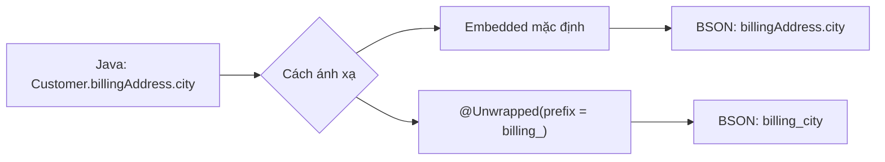

# @Unwrapped, prefix và trải trường vào document cha trong Spring Data MongoDB

## 1. Đặt vấn đề: đối tượng lồng trong Java, dữ liệu trải phẳng trong MongoDB

Trong một mô hình Java, các giá trị liên quan thường được gom thành một **value object**: địa chỉ có thành phố và mã bưu chính, tên người có họ và tên, hoặc một khoảng tiền có giá trị và đơn vị. Khi lưu bằng **Spring Data MongoDB**, cách mặc định là ánh xạ value object thành **embedded document** nằm trong document cha.

Giả sử một khách hàng có địa chỉ thanh toán và giao hàng:

```json
{
  "_id": "C001",
  "billingAddress": {
    "city": "Hà Nội",
    "post_code": "100000"
  },
  "shippingAddress": {
    "city": "Đà Nẵng",
    "post_code": "550000"
  }
}
```

Nếu ứng dụng muốn giữ cách tổ chức object trong Java nhưng schema MongoDB đã quy định các trường ở **ngay cấp document cha**, Spring Data MongoDB hỗ trợ annotation `@Unwrapped`. Với tiền tố (`prefix`), dạng dữ liệu tương ứng có thể là:

```json
{
  "_id": "C001",
  "billing_city": "Hà Nội",
  "billing_post_code": "100000",
  "shipping_city": "Đà Nẵng",
  "shipping_post_code": "550000"
}
```

Document **không có** khóa `billingAddress` hay `shippingAddress`. Chúng chỉ là **tên thuộc tính Java** mà mapper dùng để gom các trường BSON lại khi đọc dữ liệu. Đây là thay đổi ở lớp **mapping Java ↔ BSON**, không phải lệnh aggregation `$unwind` để tách phần tử array và cũng không phải việc tự động biến đổi mọi document cũ đã tồn tại trong collection.

Bài học trong chương **Đối tượng và nhúng** tập trung vào:

- Cách `@Unwrapped` chuyển các thuộc tính của value object lên document cha.
- Cách dùng `prefix` để tránh trùng trường, kết hợp với `@Field`.
- Ý nghĩa của `@Unwrapped.Nullable`, `@Unwrapped.Empty` và `onEmpty` khi đọc dữ liệu thiếu/null.
- Truy vấn, sắp xếp, projection, update, repository, aggregation và index trên các trường đã trải phẳng.
- Những giới hạn về lồng nhiều tầng, xung đột tên, thay đổi schema và kiểm thử dữ liệu thực.

## 2. Embedded object thông thường và @Unwrapped khác nhau thế nào?



| Vấn đề | Embedded mặc định | `@Unwrapped` với prefix |
|---|---|---|
| Đường dẫn vật lý MongoDB | `billingAddress.city` | `billing_city` |
| Document con | Có, nằm dưới `billingAddress` | Không, trường con nằm ở document cha |
| Cấu trúc domain Java | Có `Address billingAddress` | Vẫn có `Address billingAddress` |
| Query Java theo domain path | `billingAddress.city` | Vẫn viết `billingAddress.city` nếu query được Spring Data ánh xạ theo domain type |
| Query raw trong `mongosh` | `{ "billingAddress.city": "Hà Nội" }` | `{ billing_city: "Hà Nội" }` |
| Nguy cơ trùng tên trường cấp cha | Thường thấp hơn | Cao hơn nếu không đặt prefix |
| Đổi từ schema cũ sang schema mới | Không tự diễn ra | Cần migration hoặc chiến lược tương thích |

Không nên chọn `@Unwrapped` chỉ vì cho rằng “trải phẳng luôn nhanh hơn”. Hiệu năng phụ thuộc nhiều hơn vào index, truy vấn, kích thước document, cardinality và workload. Điểm mạnh chính của `@Unwrapped` là **giữ ranh giới value object trong Java** nhưng khớp với **hình dạng BSON phẳng** mà hệ thống yêu cầu.

## 3. Khai báo @Unwrapped trên thuộc tính Java

Annotation nằm trong package:

```java
import org.springframework.data.mongodb.core.mapping.Unwrapped;
```

Trong Spring Data MongoDB, `@Unwrapped` có thuộc tính bắt buộc `onEmpty`. Hai biến thể dễ dùng hơn là:

| Cách khai báo | Khi tất cả field đã trải phẳng đều null hoặc thiếu lúc đọc |
|---|---|
| `@Unwrapped.Nullable` | Gán thuộc tính value object bằng `null` |
| `@Unwrapped.Empty` | Tạo một instance value object rỗng, các thuộc tính bên trong có thể là `null` |
| `@Unwrapped(onEmpty = Unwrapped.OnEmpty.USE_NULL)` | Tương đương hành vi nullable |
| `@Unwrapped(onEmpty = Unwrapped.OnEmpty.USE_EMPTY)` | Tương đương hành vi empty |

`@Unwrapped.Nullable` và `@Unwrapped.Empty` cũng hỗ trợ `prefix`. Hai biến thể thể hiện **chiến lược đọc** khi thiếu toàn bộ giá trị, không phải ràng buộc “bắt buộc phải có dữ liệu” tại MongoDB.

### 3.1. Định nghĩa value object

Ví dụ dùng Java class thông thường để có thể ánh xạ với các phiên bản Spring Data MongoDB phù hợp. Mỗi class dưới đây nằm trong file Java riêng:

```java
import org.springframework.data.mongodb.core.mapping.Field;

public class Address {
    private String city;

    @Field("post_code")
    private String postCode;

    protected Address() {
        // Cho Spring Data khởi tạo qua cơ chế mapping thông thường.
    }

    public Address(String city, String postCode) {
        this.city = city;
        this.postCode = postCode;
    }

    public String getCity() {
        return city;
    }

    public String getPostCode() {
        return postCode;
    }
}
```

`@Field("post_code")` quy định tên BSON cho thuộc tính Java `postCode`. Khi value object được unwrapped với prefix, tên cuối cùng được ghép theo quy tắc:

```text
Tên field BSON = prefix của @Unwrapped + tên trường BSON của Address

billing_ + city       = billing_city
billing_ + post_code  = billing_post_code
shipping_ + city      = shipping_city
shipping_ + post_code = shipping_post_code
```

### 3.2. Khai báo document cha

```java
import org.springframework.data.annotation.Id;
import org.springframework.data.mongodb.core.mapping.Document;
import org.springframework.data.mongodb.core.mapping.Unwrapped;

@Document("customers")
public class Customer {
    @Id
    private String id;

    @Unwrapped.Nullable(prefix = "billing_")
    private Address billingAddress;

    @Unwrapped.Empty(prefix = "shipping_")
    private Address shippingAddress;

    protected Customer() {
    }

    public Customer(String id, Address billingAddress, Address shippingAddress) {
        this.id = id;
        this.billingAddress = billingAddress;
        this.shippingAddress = shippingAddress;
    }

    public String getId() {
        return id;
    }

    public Address getBillingAddress() {
        return billingAddress;
    }

    public Address getShippingAddress() {
        return shippingAddress;
    }
}
```

Trong service có `MongoTemplate`:

```java
Customer customer = new Customer(
    "C001",
    new Address("Hà Nội", "100000"),
    new Address("Đà Nẵng", "550000")
);

mongoTemplate.insert(customer);
```

Document lưu trong MongoDB có các field `billing_city`, `billing_post_code`, `shipping_city`, `shipping_post_code` như mục 1; nó không có embedded document `billingAddress` hoặc `shippingAddress`. Giá trị `_id` vẫn là ID của `Customer`, không bị trải hay thay đổi chỉ vì hai value object được unwrapped.

**Phạm vi hỗ trợ:** `@Unwrapped` áp dụng cho các value object có các thuộc tính cần ánh xạ. Một value object có thể chứa kiểu phức hợp, nhưng kiểu phức hợp đó **không được tự là unwrapped hoặc chứa tiếp trường unwrapped** theo giới hạn của cơ chế. Tránh xây mô hình unwrapped lồng nhau nhiều tầng rồi kỳ vọng mapper trải phẳng đệ quy.

## 4. Prefix và quy tắc tên field: tránh collision

Nếu dùng hai value object có cùng trường `city` nhưng đều không đặt prefix:

```java
@Unwrapped.Nullable
private Address billingAddress;

@Unwrapped.Nullable
private Address shippingAddress;
```

thì cả hai đều ánh xạ ra `city` và `post_code` ở document cha. Đây là **xung đột tên**: các giá trị có thể ghi đè lên nhau hoặc khiến dữ liệu được đọc không như mong muốn. Cần thiết kế namespace rõ ràng trước khi lưu.

### 4.1. Quy tắc đặt prefix thực tế

| Vị trí Java | Prefix | Field Java | Field BSON bên trong value object | Field lưu trong document cha |
|---|---|---|---|---|
| `billingAddress` | `billing_` | `city` | `city` | `billing_city` |
| `billingAddress` | `billing_` | `postCode` | `post_code` | `billing_post_code` |
| `shippingAddress` | `shipping_` | `city` | `city` | `shipping_city` |
| `shippingAddress` | `shipping_` | `postCode` | `post_code` | `shipping_post_code` |

Prefix được **nối trực tiếp** vào tên BSON của trường con. Framework không tự chèn dấu gạch dưới, dấu chấm hay ký tự phân cách; nếu cần `billing_city` thì phải khai báo prefix `"billing_"`. Nên dùng prefix đủ rõ để khi đọc raw BSON vẫn nhận diện được chủ sở hữu của field.

### 4.2. Kết hợp @Field như thế nào?

Hợp lệ: `@Field` đặt trên **thuộc tính bên trong** value object, ví dụ:

```java
public class Name {
    @Field("first_name")
    private String firstName;
}

// Trong document cha:
@Unwrapped.Nullable(prefix = "contact_")
private Name contact;
// BSON: contact_first_name
```

**Không hợp lệ:** gắn `@Field` và `@Unwrapped` lên **cùng một thuộc tính của document cha**:

```java
// Cấu hình mapping sai, không nên sử dụng:
@Field("billing")
@Unwrapped.Nullable(prefix = "billing_")
private Address billingAddress;
```

Lý do: thuộc tính cha `billingAddress` không có field BSON riêng để `@Field` đặt tên khi đã được trải phẳng. Thay vào đó, đổi tên từng field trong `Address` hoặc đặt `prefix` ở `@Unwrapped`.

### 4.3. Collision còn có thể đến từ field gốc

Ngay cả khi chỉ có một value object, cần tránh trùng với field được khai báo trực tiếp trong document cha:

```java
// Không nên có cả hai cùng ghi ra "billing_city":
@Field("billing_city")
private String legacyBillingCity;

@Unwrapped.Nullable(prefix = "billing_")
private Address billingAddress;
```

Khi đổi schema hoặc bổ sung property mới, hãy rà soát toàn bộ tập **tên BSON cuối cùng** của entity, bao gồm `@Field`, `prefix`, kế thừa class và custom converter. Một mô hình Java không trùng tên property vẫn có thể trùng tên field vật lý trong MongoDB.

## 5. onEmpty, null và sự hiện diện của field khi đọc

Khi truy xuất document, mapper phải quyết định cách khôi phục object Java từ các field đã trải. Xét ba document:

```javascript
// A: Không có trường thuộc billingAddress
{ _id: "A" }

// B: Có trường, nhưng mọi giá trị đều null
{ _id: "B", billing_city: null, billing_post_code: null }

// C: Có ít nhất một giá trị khác null
{ _id: "C", billing_city: "Huế" }
```

Giả sử dùng `@Unwrapped.Nullable(prefix = "billing_")` ở ví dụ trên:

| Document | Kết quả khi đọc thuộc tính Java `billingAddress` |
|---|---|
| A: cả hai field không tồn tại | `null` |
| B: cả hai field `null` | `null` |
| C: `billing_city = "Huế"` | Có `Address`, `city = "Huế"`, `postCode` có thể là `null` |

Nếu đổi sang `@Unwrapped.Empty(prefix = "billing_")`, A và B sẽ tạo một `Address` rỗng khi Spring Data ánh xạ kết quả. **Điều đó không tạo dữ liệu vào MongoDB**: đây là quyết định tại thời điểm dựng object Java.

### 5.1. Những trường hợp dễ nhầm

- `@Unwrapped.Empty` **không** có nghĩa field BSON bắt buộc tồn tại hoặc tự sinh giá trị mặc định hợp lệ.
- Khi tất cả field thiếu/null, `@Unwrapped.Nullable` không thể phân biệt “đã từng có Address và bị xóa” với “chưa từng được cung cấp” chỉ qua thuộc tính Java sau khi đọc.
- Chuỗi rỗng `""` khác với `null` và missing: nếu `billing_city = ""`, thuộc tính value object không rỗng theo điều kiện “tất cả giá trị null/thiếu”.
- Khi ghi entity, Spring Data MongoDB thường bỏ qua những thuộc tính null theo cấu hình mặc định. Việc có xuất hiện field BSON null tường minh hay không còn phụ thuộc annotation, converter và phiên bản mapping. Kiểm tra raw document thay vì suy diễn từ null của Java.
- `@Unwrapped.Empty` có thể dẫn đến một object Java tồn tại nhưng **không có thông tin nào**. Trong API, đừng nhầm điều này với một địa chỉ hợp lệ đã được người dùng xác nhận.

### 5.2. Phân biệt với validation

Nếu nghiệp vụ yêu cầu địa chỉ giao hàng phải có thành phố, dùng validation ở DTO/domain và/hoặc MongoDB schema validation. `@Unwrapped.Empty` chỉ quy định cách dựng object khi đọc thiếu dữ liệu; nó **không thay thế** `@NotNull`, `@NotBlank` hoặc quy tắc validator của MongoDB. Một field bị thiếu trong document legacy vẫn có thể được dựng thành object rỗng nếu chọn chiến lược này.

## 6. Truy vấn bằng MongoTemplate: đường dẫn Java và đường dẫn BSON

Một ưu điểm của `@Unwrapped` là mã truy vấn **theo domain type** có thể tiếp tục dùng các đường dẫn property Java, mặc dù dữ liệu vật lý đã trải phẳng. Spring Data sử dụng thông tin mapping để biến đường dẫn thành field thực tế.

### 6.1. Truy vấn một thuộc tính của object được trải

```java
import java.util.List;
import org.springframework.data.mongodb.core.MongoTemplate;
import org.springframework.data.mongodb.core.query.Criteria;
import org.springframework.data.mongodb.core.query.Query;

Query q = Query.query(
    Criteria.where("billingAddress.city").is("Hà Nội")
);

List<Customer> customers = mongoTemplate.find(q, Customer.class);
```

Với kiểu entity `Customer` ở mục 3, mapper sẽ tạo điều kiện MongoDB tương ứng:

```javascript
db.customers.find({ billing_city: "Hà Nội" });
```

Điều kiện `"billingAddress.city"` là **property path Java**, còn `"billing_city"` là **field BSON**. Hai đường dẫn không được dùng thay thế bừa bãi:

- Khi dùng `MongoTemplate` với entity type đúng và cơ chế mapping của Spring, có thể tham chiếu bằng property path.
- Khi dùng `mongosh`, raw driver `MongoCollection<Document>` hoặc thao tác trực tiếp trên BSON, phải dùng field vật lý như `billing_city`.
- Nếu dùng `MongoTemplate` với collection name và raw `Document` mà không có domain mapping type, không được giả định framework sẽ biến `"billingAddress.city"` thành `"billing_city"`.

Lỗi phổ biến là viết trực tiếp trong `mongosh`:

```javascript
// Sai nếu document thực tế đã được trải phẳng:
db.customers.find({ "billingAddress.city": "Hà Nội" });
```

MongoDB sẽ tìm một document con tên `billingAddress`, vốn không tồn tại ở schema `@Unwrapped` đang dùng.

### 6.2. Truy vấn toàn bộ value object

Spring Data hỗ trợ truyền một đối tượng vào criteria của property `@Unwrapped`:

```java
Address address = new Address("Hà Nội", "100000");

Query q = Query.query(
    Criteria.where("billingAddress").is(address)
);

Customer result = mongoTemplate.findOne(q, Customer.class);
```

Với entity mapping ở ví dụ, điều kiện tương ứng sẽ tham chiếu tới các field đã trải:

```javascript
db.customers.find({
  billing_city: "Hà Nội",
  billing_post_code: "100000"
});
```

Ở đây framework chuyển giá trị object thành các điều kiện trên thuộc tính, không tìm field `billingAddress` chứa một embedded document. Nếu chỉ muốn lọc theo `city`, hãy viết criteria trên `billingAddress.city`; dùng equality toàn value object có thể vô tình ràng buộc cả `postCode`. Cần kiểm thử cụ thể khi value object có field null, converter tùy biến hoặc quy tắc đặt tên đặc biệt.

### 6.3. Sắp xếp và projection

Sắp xếp theo thuộc tính con:

```java
import org.springframework.data.domain.Sort;

Query q = Query.query(
    Criteria.where("billingAddress.city").is("Hà Nội")
).with(Sort.by(Sort.Direction.ASC, "billingAddress.postCode"));

List<Customer> customers = mongoTemplate.find(q, Customer.class);
```

Mapping sử dụng `billing_post_code` làm sort key. **Tránh sort theo toàn bộ object** như `Sort.by("billingAddress")`: lúc trải phẳng, thứ tự giữa các thành phần có thể không phù hợp hoặc không ổn định cho nhu cầu sắp xếp nghiệp vụ.

Chọn một thuộc tính (projection):

```java
Query onlyCity = new Query();
onlyCity.fields().include("billingAddress.city");
List<Customer> partial = mongoTemplate.find(onlyCity, Customer.class);
```

Với `Customer`, phép chiếu vật lý chọn `billing_city`. Nếu muốn lấy tất cả các trường của value object, Spring Data hỗ trợ `fields().include("billingAddress")` và diễn giải thành các field đã trải tương ứng:

```java
Query allBillingParts = new Query();
allBillingParts.fields().include("billingAddress");
List<Customer> partial = mongoTemplate.find(allBillingParts, Customer.class);
```

**Lưu ý:** đây là entity được đọc bằng projection một phần. Các field không được lấy có thể mang giá trị null hoặc bị thiếu khi dựng domain object. Không dùng entity đọc thiếu field để `save(...)` thay thế toàn document mà chưa hiểu hậu quả đối với dữ liệu chưa tải.

## 7. Repository và Query By Example

Spring Data Repository cũng có thể dẫn xuất truy vấn từ các property nằm trong value object đã trải:

```java
import java.util.List;
import org.springframework.data.mongodb.repository.MongoRepository;

public interface CustomerRepository
        extends MongoRepository<Customer, String> {

    List<Customer> findByBillingAddress_City(String city);

    List<Customer> findByShippingAddress_PostCode(String postCode);
}
```

Trong tên phương thức, dấu gạch dưới được Spring Data dùng để phân định đường dẫn property lồng nhau: `billingAddress.city` và `shippingAddress.postCode`. Truy vấn được ánh xạ tới `billing_city` và `shipping_post_code`.

Có thể định nghĩa query theo cả value object, ví dụ `findByBillingAddress(Address address)`, nếu cần so khớp đủ các thành phần. Với **Query By Example**, Spring Data MongoDB cũng hỗ trợ dùng object mẫu có property `@Unwrapped`. Cần thống nhất cách xử lý giá trị null, matcher, các field được bỏ qua và độ chính xác của điều kiện; không coi QBE là bản sao của phép equality toàn document BSON.

Trong thực tế, nên bật logging phù hợp ở môi trường test và kiểm tra query BSON được sinh ra, đặc biệt khi thêm `@Field`, custom converter, đổi tên property hoặc nâng phiên bản Spring Data MongoDB.

## 8. Update: đặt một trường hay cả value object

### 8.1. Sửa một thuộc tính

```java
import org.springframework.data.mongodb.core.query.Update;

Query byId = Query.query(Criteria.where("id").is("C001"));

mongoTemplate.updateFirst(
    byId,
    new Update().set("billingAddress.city", "Huế"),
    Customer.class
);
```

Với query/update được ánh xạ theo `Customer.class`, lệnh tương ứng ở MongoDB là:

```javascript
db.customers.updateOne(
  { _id: "C001" },
  { $set: { billing_city: "Huế" } }
);
```

Không có thao tác cập nhật trên trường `billingAddress.city` ở BSON, vì document không chứa subdocument `billingAddress`.

### 8.2. Đặt cả value object

Spring Data có thể ánh xạ update cho toàn value object sang cập nhật các field đã trải:

```java
mongoTemplate.updateFirst(
    byId,
    new Update().set(
        "billingAddress",
        new Address("Nha Trang", "650000")
    ),
    Customer.class
);
```

Cách này hướng đến các field `billing_city` và `billing_post_code`. Không mặc định rằng một update đối tượng có field null sẽ tự **xóa hết các field vật lý cũ**: phải kiểm tra câu lệnh do mapper sinh ra và hành vi null theo phiên bản đang chạy.

### 8.3. Xóa dữ liệu đã trải và phân biệt với set null

Nếu nghiệp vụ yêu cầu loại bỏ hoàn toàn thông tin địa chỉ thanh toán, hãy xác định rõ những field lưu trữ phải bị xóa. Ở `mongosh`:

```javascript
db.customers.updateOne(
  { _id: "C001" },
  {
    $unset: {
      billing_city: "",
      billing_post_code: ""
    }
  }
);
```

Với typed update của Spring Data, có thể chỉ định các property con:

```java
mongoTemplate.updateFirst(
    byId,
    new Update()
        .unset("billingAddress.city")
        .unset("billingAddress.postCode"),
    Customer.class
);
```

Sau thao tác, nếu dùng `@Unwrapped.Nullable` thì `billingAddress` thường được đọc thành `null`, còn `@Unwrapped.Empty` sẽ dựng một `Address` rỗng. **`$unset` khác `$set: null`**: lệnh đầu xóa field BSON; lệnh sau lưu field với giá trị null tường minh. Khi thiết kế API `PATCH`, phải quyết định “không gửi property”, “gửi null” và “gửi object rỗng” có ý nghĩa gì, rồi ánh xạ thành các thao tác ghi đúng.

Với thao tác cập nhật song song, dùng atomic update trên field cần thay đổi hoặc optimistic locking qua `@Version` khi phù hợp; tránh đọc entity cũ, sửa một trường rồi `save` thay thế cả document nếu không kiểm soát được lost update.

## 9. Aggregation và tên field sau khi trải phẳng

Aggregation là thao tác tại phía MongoDB, nên các biểu thức raw luôn phải tham chiếu **field BSON thực tế**. Khi sử dụng **typed aggregation** của Spring Data, mapper có thể xử lý property path qua wrapper, tương tự `Query`:

```java
import org.bson.Document;
import org.springframework.data.mongodb.core.aggregation.Aggregation;
import org.springframework.data.mongodb.core.aggregation.AggregationResults;

Aggregation pipeline = Aggregation.newAggregation(
    Aggregation.match(
        Criteria.where("billingAddress.city").is("Hà Nội")
    ),
    Aggregation.group("billingAddress.city")
        .count().as("customerCount")
);

AggregationResults<Document> results = mongoTemplate.aggregate(
    pipeline, Customer.class, Document.class
);
```

Pipeline BSON tương đương về ý nghĩa:

```javascript
db.customers.aggregate([
  { $match: { billing_city: "Hà Nội" } },
  {
    $group: {
      _id: "$billing_city",
      customerCount: { $sum: 1 }
    }
  }
]);
```

Ở pipeline raw, viết `"$billingAddress.city"` sẽ tham chiếu tới embedded document không tồn tại. Trong pipeline typed, hãy dùng property path **bao gồm tên wrapper**, chẳng hạn `billingAddress.city`, để Spring Data có thông tin mapping. Với expression tùy biến hay stage dạng `Document` thô, cần kiểm tra chúng có được ánh xạ hay không; nếu không, hãy sử dụng tên field vật lý `billing_city`.

Lưu ý `_id` trong kết quả `$group` là khóa nhóm mới, không phải `_id` của collection gốc. Khi ánh xạ kết quả vào DTO/record, cần kiểm tra tên cột đầu ra và hình dạng aggregation result.

## 10. Index trên field được @Unwrapped

### 10.1. Index dùng tên field vật lý

Nếu truy vấn thường xuyên lọc khách hàng theo thành phố thanh toán, index MongoDB sẽ được tạo trên `billing_city`:

```javascript
db.customers.createIndex(
  { billing_city: 1 },
  { name: "ix_customers_billing_city" }
);
```

Có thể tạo bằng `MongoTemplate` với **collection name** và tên BSON vật lý:

```java
import org.springframework.data.domain.Sort;
import org.springframework.data.mongodb.core.index.Index;

mongoTemplate.indexOps("customers")
    .ensureIndex(
        new Index().on("billing_city", Sort.Direction.ASC)
    );
```

Đừng tạo index `{"billingAddress.city": 1}` khi document lưu `billing_city`; hai key pattern khác nhau. Nếu cần compound index, thiết kế theo filter, sort và quy tắc prefix của MongoDB:

```javascript
db.customers.createIndex(
  { billing_city: 1, shipping_city: 1 },
  { name: "ix_city_pair" }
);
```

### 10.2. Vị trí @Indexed hợp lệ

Spring Data cho phép gắn `@Indexed` trên **thuộc tính bên trong value object**, ví dụ `Address.city`, và giải quyết tên field sau khi trải vào cha theo mapping. Tuy nhiên, **không đặt `@Indexed` cùng `@Unwrapped` trên chính thuộc tính cha**:

```java
// Trong Address:
@Indexed
private String city; // Có thể ánh xạ đến các tên có prefix của owner.

// Trong Customer - sai:
@Indexed
@Unwrapped.Nullable(prefix = "billing_")
private Address billingAddress;
```

Hãy kiểm tra việc tạo index tự động của ứng dụng: các phiên bản Spring Data MongoDB có cơ chế bật/tắt auto index creation; **không** nên mặc định rằng derived repository queries tự tạo index cho các property unwrapped. Nếu index là điều kiện vận hành bắt buộc, tạo index tường minh qua migration hoặc `IndexOperations` và xác minh bằng `getIndexes()`.

```javascript
db.customers.getIndexes();

db.customers.find({ billing_city: "Hà Nội" })
  .explain("executionStats");
```

Quan sát index được dùng, `totalKeysExamined` và `totalDocsExamined` để đánh giá truy vấn. `@Unwrapped` không tự tạo index hay tăng tốc câu lệnh chỉ nhờ thay đổi cấu trúc document.

## 11. Quyết định schema và chuyển đổi dữ liệu đang tồn tại

Đổi một thuộc tính Java từ embedded thông thường sang `@Unwrapped` **không** làm các document cũ tự thay đổi. Giả sử bản cũ của `Customer` lưu:

```javascript
{
  _id: "C-LEGACY",
  billingAddress: {
    city: "Hà Nội",
    post_code: "100000"
  }
}
```

Sau khi gắn `@Unwrapped.Nullable(prefix = "billing_")`, mapper tìm `billing_city` và `billing_post_code`. Nếu các field đó không tồn tại, `billingAddress` có thể được đọc thành `null` dù thông tin cũ vẫn còn trong embedded document. Do đó việc đổi annotation là **thay đổi hợp đồng dữ liệu**, không chỉ là refactor lớp Java.

### 11.1. Các bước migration đề xuất

1. **Khảo sát dữ liệu hiện có:** bao nhiêu document dùng cấu trúc cũ, có trường thiếu/null không, có document đã có tên `billing_city` không.
2. **Chốt schema đích:** danh sách field vật lý, prefix, cách ánh xạ `@Field`, hành vi `onEmpty` và các index cần có.
3. **Kiểm tra collision:** không ghi đè dữ liệu `billing_city` hiện hữu từ nguồn khác; xử lý khác biệt tên và kiểu trước khi chuyển đổi.
4. **Chuẩn bị phiên bản ứng dụng tương thích:** cân nhắc giai đoạn đọc cả hai schema, dual write có kiểm soát hoặc tạm dừng ghi khi migration, tùy tính sẵn sàng của hệ thống.
5. **Backfill dữ liệu:** di chuyển trường embedded lên document cha theo một kế hoạch có thể kiểm chứng, chia batch nếu collection lớn.
6. **Đối chiếu kết quả:** kiểm tra số bản ghi, giá trị gốc/đích, kết quả query, index, rollback và tương tác với các service khác.
7. **Cắt bỏ schema cũ:** chỉ xóa trường legacy khi mọi ứng dụng đọc/ghi đã chuyển và có phương án khôi phục.

Ví dụ một lệnh pipeline update minh họa **chuyển các field từ embedded cũ sang dạng trải phẳng** trên một document thử nghiệm; hãy chạy trên dữ liệu sao lưu hoặc môi trường test trước:

```javascript
db.customers.updateOne(
  {
    _id: "C-LEGACY",
    billingAddress: { $type: "object" }
  },
  [
    {
      $set: {
        billing_city: "$billingAddress.city",
        billing_post_code: "$billingAddress.post_code"
      }
    },
    { $unset: "billingAddress" }
  ]
);
```

Không áp dụng nguyên xi lệnh trên cho collection production khi chưa xử lý khả năng field cũ thiếu giá trị, document đã có field đích, concurrent writes, custom converter và chính sách rollback. Lệnh `$unset` chỉ nên xuất hiện sau khi đã kiểm tra chuyển đổi thành công. Với dữ liệu lớn, cần đo thời gian chạy, tải ghi và tác động lên replication.

### 11.2. Validation schema phải dùng tên BSON thực tế

Khi dùng MongoDB `$jsonSchema`, validator cho `Customer` đã unwrapped phải mô tả các trường **ngang cấp document cha**, không phải một object con tên `billingAddress`:

```javascript
{
  $jsonSchema: {
    bsonType: "object",
    properties: {
      billing_city: { bsonType: ["string", "null"] },
      billing_post_code: { bsonType: ["string", "null"] },
      shipping_city: { bsonType: ["string", "null"] },
      shipping_post_code: { bsonType: ["string", "null"] }
    }
  }
}
```

Đoạn trên là **một phần schema minh họa** để đưa vào cấu hình validator của collection, không phải lệnh tự cập nhật validator. Vì chưa khai báo `required`, các field có thể thiếu; nếu nghiệp vụ bắt buộc `billing_city` phải hiện diện và là string không rỗng, cần điều chỉnh `required`, `bsonType` và `minLength` tương ứng.

## 12. Kiểm thử mapping để tránh sai khác dữ liệu

### 12.1. Kiểm tra đồng thời object Java và raw BSON

Với Spring Boot test hoặc integration test có MongoDB thật/Testcontainers, nên xác minh **hai phía**: object Java sau đọc và document vật lý sau ghi.

Ví dụ JUnit 5 với AssertJ (giả sử `mongoTemplate` đã được inject trong test):

```java
import org.bson.Document;
import org.junit.jupiter.api.Test;
import static org.assertj.core.api.Assertions.assertThat;

@Test
void storesUnwrappedAddressWithExpectedPrefix() {
    Customer value = new Customer(
        "C-TEST-1",
        new Address("Huế", "530000"),
        new Address("Đà Nẵng", "550000")
    );

    mongoTemplate.save(value);

    Document stored = mongoTemplate.getCollection("customers")
        .find(new Document("_id", "C-TEST-1"))
        .first();

    assertThat(stored).isNotNull();
    assertThat(stored.containsKey("billingAddress")).isFalse();
    assertThat(stored.containsKey("shippingAddress")).isFalse();
    assertThat(stored.getString("billing_city")).isEqualTo("Huế");
    assertThat(stored.getString("billing_post_code")).isEqualTo("530000");
    assertThat(stored.getString("shipping_city")).isEqualTo("Đà Nẵng");
    assertThat(stored.getString("shipping_post_code")).isEqualTo("550000");

    Customer loaded = mongoTemplate.findById("C-TEST-1", Customer.class);
    assertThat(loaded).isNotNull();
    assertThat(loaded.getBillingAddress().getCity()).isEqualTo("Huế");
    assertThat(loaded.getShippingAddress().getPostCode())
        .isEqualTo("550000");
}
```

Test trên xác nhận prefix, `@Field("post_code")`, cấu trúc document cha và việc dựng lại value object. Nếu chỉ assert `Customer.billingAddress.city` sau khi save mà không xem raw BSON, test có thể bỏ sót việc field vật lý bị đặt tên sai.

### 12.2. Kiểm tra onEmpty

Thêm hai document không có field địa chỉ để kiểm tra việc đọc của `@Unwrapped.Nullable` và `@Unwrapped.Empty`:

```java
mongoTemplate.getCollection("customers")
    .insertOne(new Document("_id", "C-EMPTY-1"));

Customer loaded = mongoTemplate.findById("C-EMPTY-1", Customer.class);

assertThat(loaded).isNotNull();
assertThat(loaded.getBillingAddress()).isNull();
assertThat(loaded.getShippingAddress()).isNotNull();
assertThat(loaded.getShippingAddress().getCity()).isNull();
```

Cần test thêm document có field `billing_city: ""`, field có `null` tường minh và field chỉ có một phần dữ liệu. Kết quả mong đợi phải phù hợp với quy tắc của `onEmpty` và hợp đồng API, không suy đoán dựa vào một trường hợp duy nhất.

### 12.3. Bộ test thực tế nên có

| Trường hợp | Điều cần xác minh |
|---|---|
| Ghi cả hai Address | Có đủ bốn field phẳng với hai prefix riêng |
| `@Field("post_code")` trên value object | Field vật lý là `billing_post_code`, không phải `billing_postCode` |
| Address nullable thiếu toàn bộ field | Đọc ra `null` |
| Address empty thiếu toàn bộ field | Đọc ra object rỗng theo `USE_EMPTY` |
| Field chuỗi rỗng và BSON null | Đúng quy tắc onEmpty, không nhầm hai trạng thái |
| Truy vấn `billingAddress.city` qua template typed | Khớp `billing_city` |
| Repository query theo property lồng nhau | Trả đúng document |
| Sort/projection trên property con | Chỉ chiếu/sắp xếp theo field vật lý đúng |
| Update một field | Chỉ sửa field BSON tương ứng |
| Unset toàn bộ Address | Những field vật lý cần xóa biến mất, kết quả đọc theo onEmpty |
| Hai @Unwrapped không có prefix | Bị phát hiện collision qua kiểm tra thiết kế/test |
| Dữ liệu embedded cũ | Được migration hoặc xử lý tương thích trước khi bật mapping mới |
| Index | `getIndexes()` cho thấy key pattern vật lý đúng |

Từ phía API, nên kiểm tra trường hợp request `PATCH` không gửi `billingAddress` khác với gửi object có các thuộc tính null và gửi lệnh xóa địa chỉ. Chỉ dựa vào một DTO Java nullable có thể làm mất thông tin về việc khóa JSON có tồn tại hay không.

## 13. Lỗi phổ biến và cách chẩn đoán

| Hiện tượng | Nguyên nhân hay gặp | Hướng xử lý |
|---|---|---|
| `find` trả rỗng dù thấy địa chỉ trong DB | Dùng `"billingAddress.city"` trực tiếp với BSON đã trải | Kiểm tra raw field `billing_city`; dùng typed mapping khi truy vấn từ Spring |
| Hai value object đọc ra cùng dữ liệu | Không dùng prefix hoặc prefix dẫn tới trùng tên | Đặt prefix khác nhau, xác minh danh sách field vật lý |
| `billingAddress == null` dù có địa chỉ trong document | DB vẫn lưu embedded `billingAddress` theo schema cũ | Migration hoặc thiết lập đường đọc tương thích |
| Không khởi động được mapping | Kết hợp `@Field` và `@Unwrapped` trên cùng owner property | Chuyển `@Field` xuống field của value object |
| Object rỗng được xem là “đã có địa chỉ” | `@Unwrapped.Empty` tạo instance khi tất cả field thiếu | Validation theo giá trị bên trong; không dựa vào `object != null` |
| Update sinh thêm subdocument ngoài ý muốn | Ghi thẳng vào field `billingAddress.city` bằng raw driver | Với raw BSON cập nhật `billing_city`; dùng typed `MongoTemplate` |
| Index tồn tại nhưng query vẫn chậm | Index tạo cho đường dẫn embedded thay vì field phẳng | Kiểm tra `getIndexes()`, `explain("executionStats")` và workload |
| Thêm property mới gây ghi đè | Tên vật lý trùng với property cha hoặc unwrapped khác | Kiểm tra field collision trước khi triển khai |
| Khi đọc bằng projection, dữ liệu bị thiếu | Không chiếu toàn bộ field của value object | Chỉ dùng entity đọc một phần cho tác vụ đọc, tránh save thay thế |
| Reactive query khác kết quả sync query | Hai service có mapper/converter/phiên bản khác nhau | Dùng cùng hợp đồng schema BSON và integration tests liên dịch vụ |

Khi cần debug, đọc document dưới dạng `org.bson.Document` bằng driver/MongoTemplate, ghi lại **tên field vật lý** (không log dữ liệu nhạy cảm), sau đó so sánh với Java mapping. Nếu nghi ngờ tên field do converter sinh ra, thử vòng ghi–đọc trên một database test với đúng phiên bản Spring Data hiện tại.

## 14. Thực hành tổng hợp

**Bối cảnh:** hệ thống quản lý khách hàng lưu hai địa chỉ thanh toán và giao hàng. Domain Java muốn dùng class `Address` có `city` và `postCode` nhưng schema MongoDB yêu cầu bốn field phẳng tương ứng.

1. Tạo `Address` với `@Field("post_code")` cho thuộc tính `postCode`. Tạo `Customer` với hai annotation `@Unwrapped.Nullable(prefix = "billing_")` và `@Unwrapped.Empty(prefix = "shipping_")`.
2. Dùng `MongoTemplate.insert(...)` để lưu một `Customer`. Đọc raw BSON bằng `getCollection("customers")`, xác nhận bốn field có tên `billing_city`, `billing_post_code`, `shipping_city` và `shipping_post_code`.
3. Truy vấn theo `Criteria.where("billingAddress.city").is(...)`; đối chiếu kết quả với `mongosh` dùng field `billing_city`.
4. Tạo `CustomerRepository` tìm theo thành phố giao hàng. Thực hành sort và projection theo property path Java.
5. Cập nhật `billingAddress.city` bằng `Update` và kiểm tra chỉ field `billing_city` thay đổi. Thử `$unset` cả hai field của địa chỉ thanh toán và quan sát hành vi `Nullable`.
6. Thêm một document chỉ có `_id`, đọc qua mapper và so sánh `billingAddress` với `shippingAddress` để hiểu `USE_NULL`/`USE_EMPTY`.
7. Tạo index theo `billing_city` và kiểm tra bằng `getIndexes()`/`explain("executionStats")`.
8. Tạo một document legacy dùng embedded `billingAddress`, giải thích vì sao mapper mới không đọc được như mong muốn và xây kế hoạch migration an toàn.

**Tiêu chí hoàn thành:** có thể giải thích chính xác đường dẫn Java và BSON, đặt prefix không đụng độ, hiểu quy tắc onEmpty, thực thi được find/update/repository/aggregation/index theo schema phẳng và kiểm thử được raw document sau ghi.

## 15. Ghi nhớ khi thiết kế

| Câu hỏi | Quy tắc |
|---|---|
| `@Unwrapped` có thay đổi cấu trúc object Java không? | Không. Nó thay đổi cách map các thuộc tính sang BSON document cha. |
| `prefix` áp dụng lên tên nào? | Tên field BSON của từng thuộc tính con, sau khi xét `@Field`. |
| Có thể gắn `@Field` lên property đồng thời `@Unwrapped` không? | Không; đặt `@Field` ở thuộc tính bên trong value object. |
| Dùng `@Unwrapped.Empty` có buộc DB lưu object không? | Không; nó chi phối cách đọc khi mọi field thiếu/null. |
| Đổi embedded sang unwrapped có tự migration không? | Không. Phải chuyển dữ liệu hoặc xây cơ chế tương thích. |
| Query typed và query raw có giống đường dẫn không? | Không nhất thiết; typed có thể dùng property Java, raw dùng field BSON thực tế. |
| Có thể dùng `@Indexed` trên field con không? | Có, nhưng không đặt cùng `@Unwrapped` trên owner property; kiểm tra cơ chế tạo index thực tế. |
| Unwrapped có hỗ trợ unwrapped lồng nhiều tầng không? | Không theo giới hạn của Spring Data MongoDB; tránh nested unwrapped trong object đã được unwrapped. |

`@Unwrapped` giúp mô hình Java giữ được **ranh giới value object**, trong khi cấu trúc MongoDB vẫn là **document phẳng**. Độ đúng của ứng dụng phụ thuộc vào một hợp đồng nhất quán về **tên field, prefix, hành vi null, query/update và migration** giữa tất cả các đường đọc/ghi.

**Tài liệu tham khảo:** [Spring Data MongoDB — Unwrapping Types](https://docs.spring.io/spring-data/mongodb/reference/mongodb/mapping/unwrapping-entities.html). Khi áp dụng vào dự án cụ thể, đối chiếu phiên bản Spring Data MongoDB đang sử dụng và kiểm chứng kết quả BSON bằng integration test.
