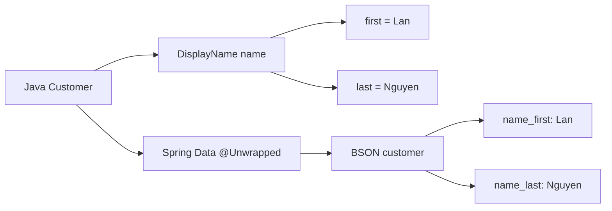

# USE_NULL, USE_EMPTY và dữ liệu nhúng thiếu một phần

## 1. Vấn đề: object Java đầy đủ nhưng document MongoDB thiếu field

Trong Spring Data MongoDB, một đối tượng Java có thể chứa một **value object** như tên, địa chỉ hoặc thông tin liên hệ. Nếu nhúng theo cách thông thường, MongoDB lưu object con trong một document lồng nhau. Nếu sử dụng `@Unwrapped`, Spring Data **trải phẳng** các trường của object con thành các trường ở document cha.

Ví dụ, ứng dụng quản lý khách hàng có kiểu `DisplayName` gồm `first` và `last`. Với `@Unwrapped(prefix = "name_", ...)`, document MongoDB có thể là:

```javascript
{
  _id: "customer-001",
  email: "lan@example.com",
  name_first: "Lan",
  name_last: "Nguyen"
}
```

Không có trường `name` chứa document lồng nhau; `name_first` và `name_last` nằm ở cấp cao nhất. Nhưng dữ liệu thực tế đôi khi không đầy đủ:

```javascript
// Khách hàng chưa cung cấp tên:
{ _id: "customer-002", email: "unknown@example.com" }

// Chỉ có tên gọi, chưa có họ:
{ _id: "customer-003", email: "minh@example.com", name_first: "Minh" }

// Cả hai trường được ghi tường minh là null:
{
  _id: "customer-004",
  name_first: null,
  name_last: null
}
```

Khi khôi phục entity, Spring Data cần quyết định: thuộc tính Java `name` nên là `null`, hay một đối tượng `DisplayName` đã được tạo nhưng có các trường thành viên `null`? Đây chính là vai trò của **`USE_NULL`** và **`USE_EMPTY`** trong `@Unwrapped`.

Bài này thuộc chương **Đối tượng và nhúng** của **SPRING_DATA_MONGODB**. Mục tiêu là hiểu chính sách khôi phục dữ liệu thiếu một phần, chọn mô hình dữ liệu thích hợp, thao tác bằng `MongoTemplate` hoặc repository, kiểm thử các trạng thái thiếu và tránh lỗi khi truy vấn, cập nhật hoặc tạo index. Quy tắc tương tự áp dụng trong nhánh reactive.

## 2. @Unwrapped khác với nhúng document thông thường

Trong mô hình nhúng thông thường, một thuộc tính Java `name` có thể ánh xạ thành:

```javascript
{
  _id: "customer-001",
  name: {
    first: "Lan",
    last: "Nguyen"
  }
}
```

Trong mô hình `@Unwrapped(prefix = "name_")`, cùng dữ liệu sẽ được trải phẳng:

```javascript
{
  _id: "customer-001",
  name_first: "Lan",
  name_last: "Nguyen"
}
```



| Đặc điểm | Nhúng thông thường | `@Unwrapped` |
| --- | --- | --- |
| Cấu trúc BSON | `name: { first, last }` | `name_first`, `name_last` ở document cha |
| Đường dẫn truy vấn MongoDB thô | `name.first` | `name_first` |
| Đường dẫn thuộc tính Java | `name.first` | `name.first` |
| Chính sách `USE_NULL` / `USE_EMPTY` | Không phải chính sách của object nhúng thông thường | Áp dụng khi **toàn bộ** trường được trải phẳng có giá trị null hoặc không có |
| Nguy cơ trùng tên trường BSON | Theo cấu trúc các document con | Cần kiểm tra prefix và các tên trường ở cấp cha |
| Index | Trường lồng nhau, ví dụ `name.first` | Trường BSON trải phẳng, ví dụ `name_first` |

**Phạm vi chính xác:** `USE_NULL` và `USE_EMPTY` là các giá trị của `Unwrapped.OnEmpty`. Chúng không phải các chế độ chung cho mọi object có `@Document`, không phải tùy chọn của `@Field` và không phải giá trị của MongoDB server.

## 3. Hai chính sách đọc: USE_NULL và USE_EMPTY

### 3.1. USE_NULL: toàn bộ dữ liệu vắng mặt thì object bằng null

```java
import static org.springframework.data.mongodb.core.mapping.Unwrapped.OnEmpty.USE_NULL;

import org.springframework.data.mongodb.core.mapping.Unwrapped;

@Unwrapped(onEmpty = USE_NULL, prefix = "name_")
private DisplayName name;
```

Nếu `name_first` và `name_last` đều **không tồn tại** hoặc đều có giá trị BSON `null`, Spring Data gán `name = null` khi đọc entity. Nếu ít nhất một trường có giá trị khác null, Spring Data tạo một `DisplayName` và nạp các giá trị tìm thấy.

Chính sách này phù hợp nếu nghiệp vụ cần phân biệt rõ **chưa có thông tin** với **có một đối tượng thông tin**.

### 3.2. USE_EMPTY: toàn bộ dữ liệu vắng mặt thì tạo object rỗng

```java
import static org.springframework.data.mongodb.core.mapping.Unwrapped.OnEmpty.USE_EMPTY;

import org.springframework.data.mongodb.core.mapping.Unwrapped;

@Unwrapped(onEmpty = USE_EMPTY, prefix = "name_")
private DisplayName name;
```

Khi toàn bộ trường trải phẳng đều null hoặc vắng mặt, Spring Data tạo một instance `DisplayName` mà các thuộc tính tương ứng có thể là `null`. Ví dụ sau khi đọc:

```java
customer.name != null;       // true
customer.name.first;         // null
customer.name.last;          // null
```

Chính sách này tiện khi object con được xem như một cấu trúc luôn tồn tại trong domain model. Tuy nhiên, **object khác null không đồng nghĩa đã có dữ liệu hợp lệ**. Code kiểm tra nghiệp vụ vẫn phải xác minh các trường bên trong.

### 3.3. Dùng annotation rút gọn

Spring Data MongoDB cung cấp hai cách viết tương đương về chính sách khôi phục:

```java
@Unwrapped.Nullable(prefix = "name_")
private DisplayName nullableName;

@Unwrapped.Empty(prefix = "name_")
private DisplayName emptyName;
```

`@Unwrapped.Nullable` tương ứng `onEmpty = USE_NULL`; `@Unwrapped.Empty` tương ứng `onEmpty = USE_EMPTY`. Đoạn mã trên chỉ minh họa cú pháp; trong một entity thực tế, **không được để hai thuộc tính khác nhau cùng ánh xạ vào các trường `name_first`/`name_last`**. Nếu cần hai value object, phải chọn prefix riêng cho từng thuộc tính.

### 3.4. Không giả định USE_NULL là mặc định của annotation

`@Unwrapped` yêu cầu chỉ rõ chiến lược `onEmpty`, hoặc dùng annotation rút gọn `@Unwrapped.Nullable` / `@Unwrapped.Empty`. Khi đọc hoặc review mã, hãy kiểm tra **annotation nào đang được sử dụng** thay vì suy đoán từ tên thuộc tính Java.

## 4. Ma trận đọc dữ liệu: vắng mặt, null và thiếu một phần

Giả sử `DisplayName` có đúng hai trường tham chiếu `String first` và `String last`, không có giá trị khởi tạo mặc định.

| BSON `name_first` | BSON `name_last` | `USE_NULL`: thuộc tính `name` | `USE_EMPTY`: thuộc tính `name` |
| --- | --- | --- | --- |
| Không có field | Không có field | `null` | `DisplayName(null, null)` |
| `null` | `null` | `null` | `DisplayName(null, null)` |
| Không có field | `null` | `null` | `DisplayName(null, null)` |
| `"Lan"` | Không có field | `DisplayName("Lan", null)` | `DisplayName("Lan", null)` |
| `null` | `"Nguyen"` | `DisplayName(null, "Nguyen")` | `DisplayName(null, "Nguyen")` |
| `"Lan"` | `"Nguyen"` | `DisplayName("Lan", "Nguyen")` | `DisplayName("Lan", "Nguyen")` |
| `""` (chuỗi rỗng) | Không có field | `DisplayName("", null)` | `DisplayName("", null)` |

**Quy tắc quan trọng:** Hai chính sách chỉ khác nhau khi **tất cả** giá trị của object trải phẳng đều null hoặc không tồn tại. Nếu chỉ thiếu **một phần** mà ít nhất một trường có giá trị khác null, cả hai đều cố gắng khôi phục object và để trường còn thiếu ở giá trị Java thích hợp (thường `null` đối với kiểu tham chiếu).

Chuỗi rỗng `""`, số `0` hoặc `false` **không phải** giá trị BSON null. Nếu đây là dữ liệu thực sự được đọc vào một trường của object, đối tượng được xem là có giá trị thành viên; phải dùng validation nếu nghiệp vụ coi chuỗi trắng là “chưa nhập”.

Đừng đánh đồng ba khái niệm:

- **BSON field không tồn tại:** chưa có khóa đó trong document.
- **BSON field tồn tại với `null`:** có khóa và giá trị null.
- **Object Java rỗng:** instance đã được tạo; các thuộc tính bên trong có thể là null hoặc giá trị mặc định.

Ở mức đọc entity qua `@Unwrapped`, hai trạng thái BSON đầu tiên có thể cùng dẫn đến một kết quả object. Nếu nghiệp vụ phải biết **khóa có tồn tại thật hay không**, cần kiểm tra raw BSON hoặc xây mô hình lưu sự hiện diện riêng.

## 5. Ví dụ entity: cùng document, hai cách khôi phục

### 5.1. Định nghĩa value object và hai entity

Để quan sát trực tiếp sự khác biệt, ta cố ý dùng hai lớp entity trỏ tới **cùng một collection** `customers`. Trong ứng dụng thật, thông thường chỉ chọn một chính sách cho một thuộc tính; hai lớp dưới đây phục vụ so sánh.

```java
package example.customers;

import org.springframework.data.annotation.Id;
import org.springframework.data.mongodb.core.mapping.Document;
import org.springframework.data.mongodb.core.mapping.Unwrapped;

import static org.springframework.data.mongodb.core.mapping.Unwrapped.OnEmpty.USE_NULL;
import static org.springframework.data.mongodb.core.mapping.Unwrapped.OnEmpty.USE_EMPTY;

class DisplayName {
    String first;
    String last;

    public DisplayName() {
    }

    public DisplayName(String first, String last) {
        this.first = first;
        this.last = last;
    }
}

@Document(collection = "customers")
class CustomerNullable {
    @Id String id;
    String email;

    @Unwrapped(onEmpty = USE_NULL, prefix = "name_")
    DisplayName name;

    public CustomerNullable() {
    }
}

@Document(collection = "customers")
class CustomerEmpty {
    @Id String id;
    String email;

    @Unwrapped(onEmpty = USE_EMPTY, prefix = "name_")
    DisplayName name;

    public CustomerEmpty() {
    }
}
```

Đối với code Java thật, đặt các lớp vào file/source package phù hợp với quy tắc hiển thị của Java. Các trường trong ví dụ dùng package-private để đơn giản hóa kiểm thử ở cùng package; trong ứng dụng sản xuất có thể dùng getter/setter hoặc thiết kế bất biến với constructor tương thích mapping.

### 5.2. Các document đầu vào

```javascript
db.customers.insertMany([
  {
    _id: "demo-missing",
    email: "missing@example.com"
  },
  {
    _id: "demo-partial",
    email: "partial@example.com",
    name_first: "Lan"
  },
  {
    _id: "demo-all-null",
    email: "null@example.com",
    name_first: null,
    name_last: null
  },
  {
    _id: "demo-full",
    email: "full@example.com",
    name_first: "Lan",
    name_last: "Nguyen"
  }
]);
```

Với dữ liệu này:

- `demo-missing` và `demo-all-null` cho `CustomerNullable.name == null`, nhưng `CustomerEmpty.name != null` và các trường bên trong null.
- `demo-partial` cho object `DisplayName` ở **cả hai** lớp, với `first == "Lan"` và `last == null`.
- `demo-full` cho object `DisplayName` ở **cả hai** lớp, với hai thuộc tính đầy đủ.

Phương thức đọc:

```java
CustomerNullable a =
    mongoTemplate.findById("demo-missing", CustomerNullable.class);

CustomerEmpty b =
    mongoTemplate.findById("demo-missing", CustomerEmpty.class);

CustomerNullable c =
    mongoTemplate.findById("demo-partial", CustomerNullable.class);

// Với MongoDB có đúng các document mẫu:
// a.name == null
// b.name != null && b.name.first == null && b.name.last == null
// c.name != null && c.name.first.equals("Lan") && c.name.last == null
```

Ví dụ này dùng `MongoTemplate`; với `MongoRepository`, metadata mapping tương ứng của từng entity cho ra cùng kết quả. Chú ý rằng logic `onEmpty` được áp dụng lúc **chuyển BSON thành đối tượng Java**.

## 6. USE_EMPTY không tự lấp dữ liệu còn thiếu

Tên `USE_EMPTY` dễ khiến người học nghĩ Spring sẽ:

1. Ghi thêm field còn thiếu vào MongoDB;
2. Thay mọi null bằng chuỗi rỗng;
3. Tạo một object có dữ liệu mặc định hợp lệ;
4. Tự động cập nhật document cũ về schema mới.

**Cả bốn giả định đều sai.** `USE_EMPTY` chỉ quy định tạo instance khi **toàn bộ** giá trị của object unwrapped đều null/vắng mặt lúc đọc. Nó không tự sửa document, không thay `null` bằng `""`, không xác nhận yêu cầu nghiệp vụ và không thực hiện migration.

Ví dụ:

```javascript
{ _id: "demo-partial", name_first: "Lan" }
```

Với cả hai chế độ, object Java có thể là:

```java
name.first == "Lan";
name.last == null;
```

Muốn `last` bắt buộc có giá trị, ứng dụng cần validation ở biên nhận dữ liệu hoặc quy tắc lưu:

```java
static void requireCompleteName(DisplayName name) {
    if (name == null
            || name.first == null || name.first.isBlank()
            || name.last == null || name.last.isBlank()) {
        throw new IllegalArgumentException(
            "Tên phải có đầy đủ first và last"
        );
    }
}
```

Đoạn kiểm tra trên dành cho trường hợp **hai thành phần đều bắt buộc**. Nếu người dùng được phép chỉ nhập `first`, hãy dùng quy tắc khác phù hợp nghiệp vụ, không ép mọi object thiếu một phần thành lỗi.

Khi object chứa các field kiểu nguyên thủy như `int`, `boolean`, giá trị chưa được gán có thể rơi vào mặc định Java (`0`/`false`) trong những cách dựng object. Vì không thể phân biệt “chưa cung cấp” và “người dùng chọn 0/false” bằng primitive đơn thuần, hãy cân nhắc dùng `Integer`/`Boolean` cùng quy tắc validation khi cần phân biệt trạng thái thiếu.

## 7. Cách ghi dữ liệu và tác động của onEmpty

Lệnh lưu thông qua Spring Data mapper sẽ trải phẳng thuộc tính `name`:

```java
CustomerNullable customer = new CustomerNullable();
customer.id = "customer-new";
customer.email = "new@example.com";
customer.name = new DisplayName("Hoa", "Tran");

mongoTemplate.save(customer);
```

Document có thể được ghi với các field:

```javascript
{
  _id: "customer-new",
  email: "new@example.com",
  name_first: "Hoa",
  name_last: "Tran"
}
```

**`onEmpty` là cấu hình cho cách đọc** khi mọi field unwrapped đều null/missing. Không nên suy ra rằng `USE_EMPTY` luôn làm Spring Data ghi ra các field `name_first: null` và `name_last: null` khi giá trị object rỗng. Việc field null có được ghi hay bỏ qua còn liên quan tới quy tắc ghi null của mapper và cấu hình tương ứng.

Nếu ứng dụng tự gọi driver với một `org.bson.Document` hoặc thực hiện cập nhật BSON thô, code đó không tự đọc annotation `@Unwrapped` trên entity. Thay vì:

```javascript
// Không khớp với schema đã trải phẳng:
db.customers.updateOne(
  { _id: "customer-new" },
  { $set: { name: { first: "Hoa", last: "Tran" } } }
);
```

hãy cập nhật các tên BSON thực sự của schema:

```javascript
db.customers.updateOne(
  { _id: "customer-new" },
  { $set: { name_first: "Hoa", name_last: "Tran" } }
);
```

Giả sử hệ thống cần xóa tên, `$unset` hai field trải phẳng khiến lần đọc tiếp theo trở thành trường hợp toàn bộ field missing. `USE_NULL` cho `name = null`, còn `USE_EMPTY` cho instance trống. Đây là **cùng dữ liệu MongoDB nhưng hai cách diễn giải ở Java**.

## 8. Query, update, sort và index với trường unwrapped

### 8.1. Đường dẫn domain khác tên field BSON

Khi dùng typed query cùng `MongoTemplate`, Spring Data hiểu đường dẫn thuộc tính Java `name.first` và ánh xạ qua `@Unwrapped(prefix = "name_")` thành field BSON `name_first`.

```java
import org.springframework.data.mongodb.core.query.Criteria;
import org.springframework.data.mongodb.core.query.Query;

Query query = Query.query(
    Criteria.where("name.first").is("Lan")
);

var customers = mongoTemplate.find(query, CustomerNullable.class);
```

Truy vấn raw tương ứng trong mongosh:

```javascript
db.customers.find({ name_first: "Lan" });
```

Trong Spring Data, đường dẫn `name.first` là thuộc tính Java **đi qua mapper có metadata entity**; trong MongoDB shell, đường dẫn `name.first` lại chỉ document lồng nhau tên `name` và không tìm đúng field đã trải phẳng.

### 8.2. Update một field của value object

```java
import org.springframework.data.mongodb.core.query.Update;

Query byId = Query.query(Criteria.where("id").is("customer-new"));
Update update = new Update().set("name.last", "Le");

mongoTemplate.updateFirst(byId, update, CustomerNullable.class);
```

Khi update typed qua Spring Data, `name.last` được ánh xạ thành `name_last`. Một lệnh `$set` đơn field khác với `save` thay thế toàn bộ entity, và có thể phù hợp nếu cần cập nhật một thuộc tính mà không nạp cả object vào bộ nhớ.

Nếu dữ liệu thiếu một phần và service làm:

```java
CustomerNullable loaded =
    mongoTemplate.findById("demo-partial", CustomerNullable.class);

loaded.name.last = "Nguyen";
mongoTemplate.save(loaded);
```

điều này giả định `loaded` khác null và có object `name`. Trường hợp `demo-missing` với `USE_NULL`, `loaded.name` sẽ bằng null nên gọi `loaded.name.last = ...` gây `NullPointerException`. Cần tạo object khi thích hợp hoặc cập nhật field trực tiếp qua `Update`.

### 8.3. Sort và projection

```java
import org.springframework.data.domain.Sort;

Query q = new Query()
    .with(Sort.by(Sort.Direction.ASC, "name.last"));

q.fields().include("email").include("name.first").include("name.last");

var page = mongoTemplate.find(q, CustomerNullable.class);
```

Typed projection/sort nên dùng đường dẫn domain `name.first` / `name.last` để mapper áp dụng tên field và prefix. Nếu projection chỉ lấy `email`, tất cả trường tên đều vắng mặt trong kết quả đọc. Khi đó:

- `USE_NULL` cho `name = null`;
- `USE_EMPTY` cho object `name` rỗng;
- **không thể kết luận document gốc chưa lưu tên** chỉ từ object được tạo qua projection.

Đây là một khác biệt rất quan trọng giữa **dữ liệu nguồn bị thiếu** và **dữ liệu không được chọn trong query**. Không nên `save` lại một entity được đọc chỉ qua projection thiếu trường nếu có nguy cơ ghi đè hoặc loại bỏ dữ liệu gốc.

### 8.4. Index với @Unwrapped

Nếu ứng dụng thường lọc theo họ, có thể tạo index trên field BSON `name_last`:

```javascript
db.customers.createIndex({ name_last: 1 });
```

Ở tầng mapping, `@Indexed` có thể đặt trên thuộc tính **bên trong** `DisplayName`:

```java
import org.springframework.data.mongodb.core.index.Indexed;

class DisplayName {
    String first;

    @Indexed
    String last;
}
```

Không đặt `@Indexed` đồng thời lên chính thuộc tính cha có `@Unwrapped`; đây không phải cách hợp lệ để đánh index cho toàn value object. Index cần dựa trên field con sau khi được flatten, và quá trình tự động tạo index còn phụ thuộc cấu hình ứng dụng Spring Data MongoDB. Hãy xác minh index thực tế trên MongoDB và kiểm tra `explain` cho query quan trọng.

## 9. Prefix và nguy cơ trùng tên trường

Nếu hai value object có cùng tên trường `first` và `last` nhưng được trải phẳng không có prefix, chúng có thể đè lên cùng một khóa BSON. Ví dụ domain có cả `legalName` và `preferredName`:

```java
@Unwrapped(onEmpty = USE_NULL, prefix = "legal_")
private DisplayName legalName;

@Unwrapped(onEmpty = USE_NULL, prefix = "preferred_")
private DisplayName preferredName;
```

Document tương ứng:

```javascript
{
  _id: "customer-007",
  legal_first: "An",
  legal_last: "Nguyen",
  preferred_first: "Anna",
  preferred_last: "Nguyen"
}
```

Prefix phải ổn định qua các phiên bản schema. Nếu một bản phát hành đổi `legal_` thành `official_`, các field cũ sẽ trở thành “missing” đối với mapper mới nếu chưa migration. Khi đó `USE_NULL` có thể trả về null và `USE_EMPTY` có thể tạo object rỗng dù document vẫn chứa dữ liệu với tên cũ.

Có thể dùng `@Field` **trên thuộc tính của value object** để đặt tên trường BSON:

```java
class DisplayName {
    @org.springframework.data.mongodb.core.mapping.Field("given")
    String first;

    @org.springframework.data.mongodb.core.mapping.Field("family")
    String last;
}
```

Với prefix `"name_"`, các tên BSON thành `name_given` và `name_family`. Không kết hợp `@Field` lên **cùng thuộc tính cha** đã gắn `@Unwrapped`: Spring Data MongoDB không hỗ trợ sự kết hợp đó theo cách đổi tên một object lồng nhau.

Khi thiết kế schema, hãy kiểm tra cả tên có prefix, `@Field` của field con và tên trường thực tế của document cha để tránh trùng khóa.

## 10. Dữ liệu thiếu một phần: nguyên nhân và cách xử lý

Dữ liệu thiếu field có thể đến từ nhiều nguồn, không phải lúc nào cũng là lỗi:

| Nguyên nhân | Tình huống minh họa | Hướng xử lý |
| --- | --- | --- |
| Người dùng chỉ nhập một phần | Có `name_first`, chưa có `name_last` | Chấp nhận partial nếu nghiệp vụ cho phép, hoặc validate khi hoàn tất |
| Schema đã thay đổi | Bản cũ không có field mới | Đặt quy tắc tương thích và migration |
| Dữ liệu từ nhiều service | Một service chỉ gửi `name_first` | Thống nhất hợp đồng ghi, giám sát field thiếu |
| Projection chỉ chọn một field | Query không lấy `name_last` | Phân biệt partial projection với nguồn dữ liệu thiếu |
| Raw BSON update | Lệnh `$unset` hoặc `$set` từng field | Dùng cập nhật có điều kiện và kiểm thử |
| Trường lưu BSON null | Source cố ý xóa giá trị | Xác định ý nghĩa giữa “không biết”, “không áp dụng”, “đã xóa” |
| Prefix sai hoặc trùng | Mapper tìm `name_first` nhưng DB còn `given_name` | Kiểm tra schema thực, mapping và migration |

### 10.1. Phân biệt “không có field” và “có field null” khi cần

`@Unwrapped` có thể ánh xạ cả hai tình huống thành cùng object Java. Để khảo sát dữ liệu gốc, dùng MongoDB:

```javascript
// Chỉ tìm document không có trường:
db.customers.find({ name_first: { $exists: false } });

// Tìm document có trường và giá trị chính xác là null:
db.customers.find({
  name_first: { $exists: true, $eq: null }
});

// Xem kiểu BSON, bao gồm "missing" / "null":
db.customers.aggregate([
  {
    $project: {
      firstType: { $type: "$name_first" },
      lastType: { $type: "$name_last" }
    }
  },
  { $limit: 50 }
]);
```

Trong MongoDB, một truy vấn đơn giản `{ name_first: null }` cũng có thể khớp document **không có field**. Vì vậy dùng `$exists` khi ý định là phân biệt rõ vắng mặt và BSON null.

### 10.2. Nhận diện document thực sự thiếu một phần

Truy vấn sau tìm các document có đúng một trong hai khóa tồn tại:

```javascript
db.customers.find({
  $or: [
    {
      name_first: { $exists: true },
      name_last: { $exists: false }
    },
    {
      name_first: { $exists: false },
      name_last: { $exists: true }
    }
  ]
});
```

Đây là kiểm tra **sự hiện diện của khóa**, không phải kiểm tra đầy đủ về nghiệp vụ. Một field tồn tại nhưng bằng null hoặc chuỗi trắng vẫn có thể là “thiếu” theo yêu cầu người dùng. Với lượng dữ liệu lớn, cân nhắc sample hoặc lọc theo nhóm phù hợp để tránh thống kê tốn tài nguyên trong giờ cao điểm.

### 10.3. Khi cần phân biệt mọi trạng thái, cân nhắc mô hình khác

Nếu ứng dụng cần phân biệt chính xác các tình huống “chưa nhập”, “đã chủ động xóa”, “không áp dụng” và “đã nhập đầy đủ”, chỉ dùng `@Unwrapped` cùng `USE_NULL`/`USE_EMPTY` có thể chưa biểu đạt đủ. Có thể lưu thêm trường trạng thái riêng, ví dụ `nameStatus: "NOT_PROVIDED" | "PARTIAL" | "COMPLETE"`, hoặc chuyển sang cấu trúc khác phù hợp.

Đây là quy ước domain cần được cập nhật nhất quán qua service và database. Không suy ra trạng thái nghiệp vụ quan trọng chỉ từ việc `name != null` khi sử dụng `USE_EMPTY`.

## 11. Kiểm thử đọc và ghi với MongoTemplate

### 11.1. Kiểm thử tích hợp ba trường hợp then chốt

Ví dụ sau dùng các lớp `DisplayName`, `CustomerNullable` và `CustomerEmpty` ở phần 5, đặt cùng package `example.customers`. Test dùng MongoDB thật hoặc instance kiểm thử do môi trường cung cấp:

```java
package example.customers;

import static org.junit.jupiter.api.Assertions.*;

import java.util.UUID;
import org.bson.Document;
import org.junit.jupiter.api.Test;
import org.springframework.beans.factory.annotation.Autowired;
import org.springframework.boot.test.autoconfigure.data.mongo.DataMongoTest;
import org.springframework.data.mongodb.core.MongoTemplate;

@DataMongoTest
class UnwrappedOnEmptyTest {

    @Autowired
    MongoTemplate template;

    @Test
    void emptyAndPartialDocumentsAreMappedCorrectly() {
        String suffix = UUID.randomUUID().toString();
        String missingId = "missing-" + suffix;
        String nullId = "null-" + suffix;
        String partialId = "partial-" + suffix;

        template.getCollection("customers").insertOne(
            new Document("_id", missingId)
        );
        template.getCollection("customers").insertOne(
            new Document("_id", nullId)
                .append("name_first", null)
                .append("name_last", null)
        );
        template.getCollection("customers").insertOne(
            new Document("_id", partialId)
                .append("name_first", "Lan")
        );

        CustomerNullable missingNullable =
            template.findById(missingId, CustomerNullable.class);
        CustomerEmpty missingEmpty =
            template.findById(missingId, CustomerEmpty.class);

        assertNotNull(missingNullable);
        assertNull(missingNullable.name);
        assertNotNull(missingEmpty);
        assertNotNull(missingEmpty.name);
        assertNull(missingEmpty.name.first);
        assertNull(missingEmpty.name.last);

        CustomerNullable explicitNullNullable =
            template.findById(nullId, CustomerNullable.class);
        CustomerEmpty explicitNullEmpty =
            template.findById(nullId, CustomerEmpty.class);

        assertNotNull(explicitNullNullable);
        assertNull(explicitNullNullable.name);
        assertNotNull(explicitNullEmpty);
        assertNotNull(explicitNullEmpty.name);

        CustomerNullable partialNullable =
            template.findById(partialId, CustomerNullable.class);
        CustomerEmpty partialEmpty =
            template.findById(partialId, CustomerEmpty.class);

        assertNotNull(partialNullable);
        assertNotNull(partialNullable.name);
        assertEquals("Lan", partialNullable.name.first);
        assertNull(partialNullable.name.last);

        assertNotNull(partialEmpty);
        assertNotNull(partialEmpty.name);
        assertEquals("Lan", partialEmpty.name.first);
        assertNull(partialEmpty.name.last);
    }
}
```

`@DataMongoTest` cấu hình context cho kiểm thử MongoDB, nhưng không tự bảo đảm MongoDB server sẽ chạy trong mọi môi trường. Có thể dùng Testcontainers MongoDB hoặc cấu hình một instance kiểm thử riêng, phù hợp phiên bản Spring Boot/Spring Data của dự án.

### 11.2. Kiểm tra BSON khi ghi từ object Java

Nếu muốn xác minh mapping từ Java sang database, kiểm tra trực tiếp document raw:

```java
CustomerNullable customer = new CustomerNullable();
customer.id = "write-" + java.util.UUID.randomUUID();
customer.name = new DisplayName("Ha", "Pham");
template.save(customer);

Document raw = template.getCollection("customers")
    .find(new Document("_id", customer.id))
    .first();

assertNotNull(raw);
assertEquals("Ha", raw.getString("name_first"));
assertEquals("Pham", raw.getString("name_last"));
assertFalse(raw.containsKey("name"));
```

Không chỉ dựa vào giá trị Java trước và sau `save`, vì entity trong bộ nhớ có thể còn giữ những giá trị chưa được biểu diễn theo cùng cấu trúc BSON.

## 12. Reactive access và constructor mapping

`ReactiveMongoRepository` hoặc `ReactiveMongoTemplate` dùng cùng metadata ánh xạ của Spring Data MongoDB. Vì vậy ngữ nghĩa của `@Unwrapped(onEmpty = USE_NULL/USE_EMPTY)` về **document có toàn bộ giá trị con null/vắng mặt** vẫn như nhánh đồng bộ. Khác biệt chính là kết quả được phát qua `Mono`/`Flux`.

```java
import org.springframework.data.mongodb.repository.ReactiveMongoRepository;
import reactor.core.publisher.Mono;

interface CustomerReactiveRepository
        extends ReactiveMongoRepository<CustomerEmpty, String> {
}

class ReactiveCustomerService {
    private final CustomerReactiveRepository repository;

    ReactiveCustomerService(CustomerReactiveRepository repository) {
        this.repository = repository;
    }

    Mono<String> displayName(String id) {
        return repository.findById(id)
            .map(customer -> {
                DisplayName name = customer.name;
                if (name == null || name.first == null) {
                    return "Khách hàng";
                }
                return name.first;
            });
    }
}
```

Dù dùng `USE_EMPTY`, ví dụ vẫn kiểm tra `name.first == null` để tránh hiểu sai “đã có tên”. Chuyển sang reactive không làm Spring Data tự bổ sung dữ liệu BSON thiếu trường.

**Lưu ý với immutable value object và constructor:** Spring Data phải biết cách tạo `DisplayName` khi policy là `USE_EMPTY`. Một value object chỉ có constructor bắt buộc các tham số không-null, hoặc Kotlin class có kiểm tra non-null nghiêm ngặt, có thể không khôi phục được khi mọi trường đều vắng mặt. Thiết kế constructor, default values và khả năng null của các field phải tương thích với trường hợp dữ liệu thiếu. Nếu không thể tạo object rỗng hợp lệ, cân nhắc `USE_NULL` và xử lý riêng ở tầng service/DTO.

Ngoài ra, Spring Data MongoDB hỗ trợ unwrapped value object có thuộc tính phức tạp trong những trường hợp nhất định, nhưng có giới hạn đối với việc lồng tiếp một value object đã `@Unwrapped` vào bên trong. Hãy giữ schema dễ dự đoán và kiểm thử bằng dữ liệu BSON cụ thể thay vì giả định có thể unwrapped vô hạn nhiều tầng.

## 13. Chọn USE_NULL hay USE_EMPTY trong thực tế

| Tình huống nghiệp vụ | Lựa chọn thường hợp lý | Vì sao |
| --- | --- | --- |
| Thông tin địa chỉ giao hàng chưa được cung cấp | `USE_NULL` | `address == null` biểu diễn rõ trạng thái chưa có đối tượng địa chỉ |
| Object con là cấu trúc luôn cần tồn tại trong logic hiển thị, chấp nhận các field null | `USE_EMPTY` | Giảm thao tác tạo instance cho trường hợp trống, nhưng vẫn phải validate nội dung |
| Dữ liệu legacy thường thiếu một số field | Cả hai, tùy ý nghĩa domain | Dữ liệu thiếu **một phần** được khôi phục ở cả hai khi có field non-null |
| Cần phân biệt field BSON missing với explicit null | Cần mô hình/đường đọc bổ sung | Chỉ `onEmpty` không bảo toàn mọi trạng thái hiện diện của khóa |
| Có invariant “tên phải đủ hai trường” | Validation bắt buộc | `USE_EMPTY` không tạo ra dữ liệu đúng; `USE_NULL` cũng không kiểm tra partial |
| Value object không thể tạo khi các tham số constructor đều null | Thường nên xem lại `USE_EMPTY` | Chính sách tạo instance rỗng có thể mâu thuẫn với invariant của class |

Quy trình ra quyết định:

1. Xác định ý nghĩa **không có object** và **object có trường null** trong nghiệp vụ.
2. Chọn `USE_NULL` nếu không có dữ liệu con nên được biểu diễn bằng `null`; chọn `USE_EMPTY` nếu cần instance rỗng có thể khởi tạo hợp lệ.
3. Quy định rõ xử lý **partial data** và kiểm tra nội dung bắt buộc ở nơi phù hợp.
4. Kiểm tra schema MongoDB thực tế, tên field sau khi flatten và prefix.
5. Viết test cho missing, explicit null, partial và full data; lặp lại test khi đổi constructor, projection hoặc schema.

## 14. Bài tập thực hành

### Bài tập 1: hai cách khôi phục địa chỉ

Tạo `ShippingAddress` gồm `city` và `postalCode`, sau đó tạo hai entity dùng `@Unwrapped(onEmpty = USE_NULL, prefix = "ship_")` và `@Unwrapped(onEmpty = USE_EMPTY, prefix = "ship_")`. Đọc bốn document lần lượt không có hai field, có hai field null, chỉ có `ship_city`, và có cả hai giá trị. Ghi lại object Java trong từng trường hợp.

### Bài tập 2: truy vấn dữ liệu partial

Viết query raw MongoDB tìm:

- Document không có `ship_city`;
- Document có `ship_city` bằng BSON null;
- Document có `ship_city` nhưng không có `ship_postalCode`.

Giải thích vì sao các query trên không thể được thay hoàn toàn bằng một lần kiểm tra `address == null`.

### Bài tập 3: update và prefix

Tạo một entity có `billingAddress` và `shippingAddress`, cùng kiểu `Address` nhưng prefix `bill_` và `ship_`. Viết lệnh `MongoTemplate` cập nhật `shippingAddress.city` và xác minh raw BSON có trường `ship_city` tương ứng. Thử query/sort theo thuộc tính Java so với tên field thực trong mongosh.

### Bài tập 4: kiểm thử projection

Tạo document có cả `name_first` và `name_last`, nhưng đọc bằng query projection chỉ lấy `email`. So sánh object khi dùng `USE_NULL` và `USE_EMPTY`. Giải thích vì sao object nhận từ projection không chứng minh document gốc có hay không có name.

### Bài tập 5: thiết kế quy tắc domain

Một ứng dụng không cho phép địa chỉ giao hàng thiếu `city` nhưng có thể thiếu `postalCode`. Hãy định nghĩa validation và quyết định `USE_NULL`/`USE_EMPTY` phù hợp khi đọc đơn hàng cũ. Nếu một document legacy thiếu cả `ship_city` và `ship_postalCode`, ứng dụng nên trả lỗi, yêu cầu bổ sung thông tin hay hiển thị trạng thái “chưa cung cấp”? Giải thích theo ngữ cảnh nghiệp vụ.

## Ghi nhớ

`@Unwrapped` của Spring Data MongoDB **trải phẳng** các thuộc tính của value object vào document cha. `USE_NULL` đặt object Java bằng `null` khi tất cả các field con đều null hoặc không có; `USE_EMPTY` tạo **instance rỗng** trong cùng tình huống. Khi chỉ **thiếu một phần** mà ít nhất một field có giá trị khác null, cả hai chính sách đều khôi phục object với những thành phần còn thiếu ở giá trị thích hợp, thường là null. Đây là **quy tắc ánh xạ lúc đọc**, không phải migration, schema validation hay cơ chế tự lấp dữ liệu. Hãy kiểm tra kiểu BSON thực tế, prefix, projection, constructor và các bất biến nghiệp vụ trước khi lựa chọn.

### Tham khảo

- [Spring Data MongoDB Reference — Unwrapping Types](https://docs.spring.io/spring-data/mongodb/reference/mongodb/mapping/unwrapping-entities.html)
- [Spring Data MongoDB API — `Unwrapped`](https://docs.spring.io/spring-data/mongodb/docs/current/api/org/springframework/data/mongodb/core/mapping/Unwrapped.html)
