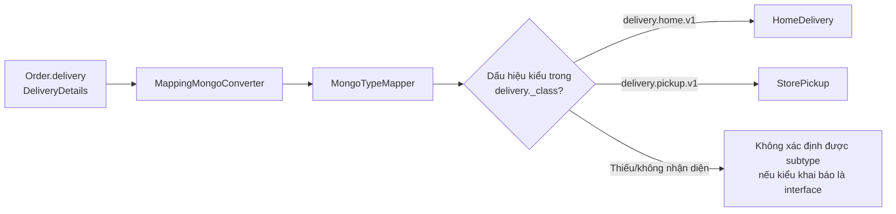

# Tùy chỉnh MongoTypeMapper và duy trì khả năng đọc dữ liệu đa hình

## 1. Mục tiêu và bối cảnh

**Spring Data MongoDB** giúp ứng dụng Java/Spring kết nối MongoDB, ánh xạ document BSON thành object và truy cập dữ liệu qua `MongoTemplate` hoặc repository. Trong phần **Đối tượng và nhúng**, một tình huống đặc biệt quan trọng là **đa hình (polymorphism)**: một thuộc tính khai báo bằng interface/lớp cha nhưng ở runtime có thể chứa nhiều kiểu con khác nhau.

Ví dụ xuyên suốt là hệ thống bán hàng **Mini Commerce** với `Product`, `Customer` và `Order`. Một đơn hàng có thông tin giao nhận được nhúng: đơn giao tận nhà dùng `HomeDelivery`, còn đơn nhận tại cửa hàng dùng `StorePickup`. Cả hai cùng triển khai interface `DeliveryDetails`. Khi đọc `Order` từ MongoDB, Spring Data phải biết object cụ thể cần dựng thuộc loại nào.

`MongoTypeMapper` là thành phần phối hợp với `MappingMongoConverter` để **ghi và đọc dấu hiệu nhận diện kiểu** (type hint/discriminator) trong document. Mặc định, dấu hiệu này nằm ở field `_class`. Việc tùy chỉnh type mapper giúp đổi tên field, dùng alias thay tên lớp hoặc bỏ type hint; tuy nhiên bất kỳ thay đổi nào cũng phải xem xét khả năng đọc dữ liệu **đã lưu trước đó**.

Sau bài này, người học có thể:

- Giải thích vì sao dữ liệu nhúng đa hình cần thông tin nhận diện kiểu.
- Đọc cấu trúc `_class` của document gốc và object nhúng, sử dụng `@TypeAlias` để tách dữ liệu lưu khỏi tên package Java.
- Cấu hình `DefaultMongoTypeMapper` cho `MappingMongoConverter` và hiểu hệ quả của việc đổi `_class` thành khóa khác hoặc vô hiệu hóa type hint.
- Đăng ký kiểu con vào mapping context để đọc được alias **ngay sau khi khởi động ứng dụng mới**.
- Thiết kế migration dữ liệu cũ, thử nghiệm đọc dữ liệu đa hình trước/sau nâng cấp và phân tích hiệu năng truy vấn.
- Phân biệt type hint của mapper với trường nghiệp vụ, bảo mật và cơ chế transaction.

**Kiến thức cần có:** Java interface/kế thừa, Spring Boot với `spring-boot-starter-data-mongodb`, `@Document`, `@Id`, repository, `MongoTemplate` và document nhúng. Ví dụ sử dụng Java 17 trở lên, API MongoDB synchronous và cú pháp Spring Data MongoDB hiện đại. Các thay đổi cần được xác minh với phiên bản thư viện thực tế của dự án.

## 2. Vấn đề: vì sao object nhúng đa hình khó đọc?

MongoDB lưu **document và các field**, không lưu trực tiếp object Java hay cơ chế đa hình của JVM. Giả sử hai đơn có cấu trúc:

```json
{
  "_id": "order-home-001",
  "customerId": "customer-001",
  "delivery": {
    "recipient": "Nguyen Thi Lan",
    "street": "12 Duong Mau",
    "city": "TP Ho Chi Minh"
  }
}
```

```json
{
  "_id": "order-pickup-001",
  "customerId": "customer-002",
  "delivery": {
    "pickupPointId": "STORE-HCM-01",
    "pickupCode": "PICKUP-7294"
  }
}
```

Nếu lớp Java có `private DeliveryDetails delivery;` nhưng `DeliveryDetails` là **interface**, chỉ dựa vào kiểu khai báo thì framework không biết phải khởi tạo `HomeDelivery` hay `StorePickup`. Tên field khác nhau có thể gợi ý cho con người, nhưng mapper mặc định không được phép suy đoán kiểu nghiệp vụ từ sự có mặt của các khóa.

Một cách giải quyết là lưu thông tin kiểu cùng dữ liệu, chẳng hạn:

```json
{
  "_id": "order-home-001",
  "delivery": {
    "recipient": "Nguyen Thi Lan",
    "street": "12 Duong Mau",
    "city": "TP Ho Chi Minh",
    "_class": "delivery.home.v1"
  },
  "_class": "order.v1"
}
```

Khi đó Spring Data đọc `delivery._class`, xác định kiểu con đã đăng ký, rồi mới tạo object Java tương ứng.



**Hai hướng cần phân biệt:**

- Khi **ghi**, mapper biết runtime class của object và có thể tạo type hint trong BSON.
- Khi **đọc**, mapper phải chuyển type hint BSON thành một class phù hợp; việc resolve này phụ thuộc classpath, mapping context và cấu hình hiện hành.

## 3. MongoTypeMapper và hành vi mặc định

Các thành phần chính:

| Thành phần | Package | Vai trò |
| --- | --- | --- |
| `MongoTypeMapper` | `org.springframework.data.mongodb.core.convert` | Giao diện cho việc ghi/đọc metadata kiểu từ BSON |
| `DefaultMongoTypeMapper` | `org.springframework.data.mongodb.core.convert` | Cách triển khai mặc định, dùng khóa `_class` |
| `MappingMongoConverter` | `org.springframework.data.mongodb.core.convert` | Chuyển giữa entity Java và MongoDB document, dùng type mapper khi cần |
| `@TypeAlias` | `org.springframework.data.annotation` | Khai báo tên kiểu ngắn/ổn định thay cho tên class đầy đủ |
| `MongoMappingContext` | `org.springframework.data.mongodb.core.mapping` | Quản lý metadata entity và các alias đã được nhận diện |

Theo mặc định, `DefaultMongoTypeMapper` có thể ghi:

- Ở **document gốc**, dấu hiệu về kiểu entity.
- Ở **object nhúng**, type hint khi giá trị thực tế là một kiểu con phức hợp so với kiểu thuộc tính đã khai báo, ví dụ property kiểu interface/lớp cha chứa một instance của subclass.
- Ở các phần tử của **collection/map** khi có nhu cầu phân giải kiểu con theo cấu trúc được ánh xạ.

Không phải mọi object nhúng đều phải xuất hiện `_class`. Một trường khai báo chính xác bằng một lớp cụ thể có thể được ánh xạ đủ mà không cần type hint ở mức object con.

Ví dụ mặc định nếu không đặt `@TypeAlias`:

```json
{
  "_id": "order-home-001",
  "delivery": {
    "recipient": "Nguyen Thi Lan",
    "street": "12 Duong Mau",
    "city": "TP Ho Chi Minh",
    "_class": "com.example.minicommerce.domain.HomeDelivery"
  },
  "_class": "com.example.minicommerce.domain.Order"
}
```

**Rủi ro của tên class đầy đủ:** nếu sau này đổi package từ `com.example.minicommerce.domain` sang `com.example.shop.domain` hoặc đổi tên class, các document cũ có thể chứa tên lớp không còn tồn tại. Vì vậy, type hint cũng là một phần của **hợp đồng dữ liệu tồn tại lâu dài**, dù ứng dụng không đưa nó vào REST response.

## 4. Mô hình Mini Commerce với @TypeAlias

Ta sử dụng một interface và hai cách giao nhận. Những ví dụ dưới đây là các file Java độc lập nằm trong package `com.example.minicommerce.domain`.

### 4.1. Interface khai báo thuộc tính đa hình

```java
package com.example.minicommerce.domain;

public interface DeliveryDetails {
}
```

Interface này biểu diễn khái niệm chung, còn hình dạng dữ liệu được quyết định bởi từng subtype. Vì nó không thể được khởi tạo trực tiếp, cần type hint hoặc một chiến lược chuyển đổi tường minh khi đọc từ database.

### 4.2. Hai loại giao nhận

`HomeDelivery.java`:

```java
package com.example.minicommerce.domain;

import org.springframework.data.annotation.TypeAlias;
import org.springframework.data.mongodb.core.mapping.Document;

@Document
@TypeAlias("delivery.home.v1")
public record HomeDelivery(
        String recipient,
        String street,
        String city) implements DeliveryDetails {
}
```

`StorePickup.java`:

```java
package com.example.minicommerce.domain;

import org.springframework.data.annotation.TypeAlias;
import org.springframework.data.mongodb.core.mapping.Document;

@Document
@TypeAlias("delivery.pickup.v1")
public record StorePickup(
        String pickupPointId,
        String pickupCode) implements DeliveryDetails {
}
```

Chúng ta đặt `@Document` lên hai subtype trong ví dụ để chúng được hệ thống quét entity phát hiện từ đầu. Hai kiểu vẫn **được nhúng** bên trong `orders.delivery` khi được sử dụng qua property của `Order`; không bắt buộc tạo collection riêng cho chúng. Trong thiết kế khác, có thể đăng ký subtype qua `getInitialEntitySet()` mà không cần dùng `@Document` cho lớp nhúng.

`@TypeAlias` tạo tên ngắn thay vì dùng Java fully qualified class name. Các alias nên **duy nhất trong phạm vi mapping context**, có ý nghĩa ổn định và được quản lý khi thay đổi schema. Hậu tố `v1` ở đây là một quy ước do dự án lựa chọn; annotation không tự cung cấp cơ chế phiên bản dữ liệu.

### 4.3. Entity Order chứa kiểu con

`Order.java`:

```java
package com.example.minicommerce.domain;

import org.springframework.data.annotation.Id;
import org.springframework.data.annotation.TypeAlias;
import org.springframework.data.mongodb.core.mapping.Document;

@Document(collection = "orders")
@TypeAlias("order.v1")
public class Order {
    @Id
    private String id;

    private String customerId;
    private String status;
    private DeliveryDetails delivery;

    public Order() {
    }

    public Order(String id, String customerId,
                 String status, DeliveryDetails delivery) {
        this.id = id;
        this.customerId = customerId;
        this.status = status;
        this.delivery = delivery;
    }

    public String getId() { return id; }
    public void setId(String id) { this.id = id; }

    public String getCustomerId() { return customerId; }
    public void setCustomerId(String customerId) {
        this.customerId = customerId;
    }

    public String getStatus() { return status; }
    public void setStatus(String status) { this.status = status; }

    public DeliveryDetails getDelivery() { return delivery; }
    public void setDelivery(DeliveryDetails delivery) {
        this.delivery = delivery;
    }
}
```

Để tập trung vào đa hình, ví dụ lược bớt danh sách `OrderLine`, `totalAmount` và thời gian đặt. Trong ứng dụng Mini Commerce đầy đủ, đơn hàng có các dòng chứa snapshot sản phẩm/giá, khách hàng được tham chiếu qua `customerId`, còn `delivery` là thông tin giao nhận nhúng.

### 4.4. Lưu dữ liệu bằng MongoTemplate

```java
import com.example.minicommerce.domain.HomeDelivery;
import com.example.minicommerce.domain.Order;
import com.example.minicommerce.domain.StorePickup;

Order shipHome = new Order(
    "order-home-001",
    "customer-001",
    "PLACED",
    new HomeDelivery("Nguyen Thi Lan", "12 Duong Mau", "TP Ho Chi Minh")
);

Order pickup = new Order(
    "order-pickup-001",
    "customer-002",
    "PLACED",
    new StorePickup("STORE-HCM-01", "PICKUP-7294")
);

mongoTemplate.save(shipHome);
mongoTemplate.save(pickup);
```

Trong môi trường mặc định và khi alias đã được mapping context nhận diện, BSON lưu có dạng:

```json
{
  "_id": "order-home-001",
  "customerId": "customer-001",
  "status": "PLACED",
  "delivery": {
    "recipient": "Nguyen Thi Lan",
    "street": "12 Duong Mau",
    "city": "TP Ho Chi Minh",
    "_class": "delivery.home.v1"
  },
  "_class": "order.v1"
}
```

Và:

```json
{
  "_id": "order-pickup-001",
  "customerId": "customer-002",
  "status": "PLACED",
  "delivery": {
    "pickupPointId": "STORE-HCM-01",
    "pickupCode": "PICKUP-7294",
    "_class": "delivery.pickup.v1"
  },
  "_class": "order.v1"
}
```

Thứ tự field và metadata bổ sung có thể thay đổi theo converter/cấu hình. Điều đáng kiểm chứng là **giá trị và vị trí của type hint**, không phải chuỗi JSON giống từng byte.

### 4.5. Đọc lại đúng subtype

```java
Order loadedHome =
    mongoTemplate.findById("order-home-001", Order.class);
Order loadedPickup =
    mongoTemplate.findById("order-pickup-001", Order.class);

if (loadedHome != null
        && loadedHome.getDelivery() instanceof HomeDelivery home) {
    System.out.println(home.street());
}

if (loadedPickup != null
        && loadedPickup.getDelivery() instanceof StorePickup store) {
    System.out.println(store.pickupPointId());
}
```

Với `MongoRepository<Order, String>`, quá trình mapping cũng do Spring Data thực hiện; cách truy vấn khác nhau nhưng mục tiêu đọc đúng kiểu con là như nhau.

## 5. Vì sao @TypeAlias cần được đăng ký khi khởi động?

Lưu `_class: "delivery.home.v1"` không đủ nếu ứng dụng sau khi restart **chưa biết alias đó tương ứng với Java class nào**. Spring Data MongoDB chỉ giải quyết alias ổn định khi `MongoMappingContext` đã nhận diện entity thực tế, thông qua bước quét ban đầu hoặc lần đầu mapping một class.

Tình huống dễ gây lỗi:

1. Phiên bản A đã lưu một triệu document với alias `delivery.home.v1`.
2. Phiên bản B vừa deploy, đọc ngay đơn cũ trước khi từng ghi một `HomeDelivery` nào.
3. Nếu phiên bản B không đăng ký subtype trong initial mapping context, alias có thể không được giải quyết; việc đọc field interface `DeliveryDetails` có thể thất bại.

Có hai cách thường dùng:

- Đặt subtype trong **package được entity scan nhận diện** với metadata phù hợp (ví dụ `@Document` như ở mục 4).
- Đăng ký **tập entity ban đầu** trong cấu hình Spring Data MongoDB.

Ví dụ phần override khi đã có một lớp `extends AbstractMongoClientConfiguration`:

```java
import java.util.Set;
import com.example.minicommerce.domain.HomeDelivery;
import com.example.minicommerce.domain.Order;
import com.example.minicommerce.domain.StorePickup;

@Override
protected Set<Class<?>> getInitialEntitySet() {
    return Set.of(Order.class, HomeDelivery.class, StorePickup.class);
}
```

Đây là **đoạn phương thức đặt trong lớp cấu hình**, không phải một file Java độc lập. Nếu ứng dụng đã có entity khác, hãy thêm vào tập đăng ký hoặc giữ cơ chế scan thích hợp, tránh vô tình giới hạn metadata của các entity còn lại.

Quan trọng nhất là kiểm tra bằng **cold-start test**: nạp document mẫu vào database, tạo application context mới hoàn toàn, rồi **đọc dữ liệu trước khi thực hiện bất kỳ lệnh save nào**. Test “save rồi đọc ngay trong một context” đôi khi che giấu việc mapping context chưa đăng ký đầy đủ sau khởi động.

## 6. Tùy chỉnh MongoTypeMapper: ba chiến lược

Tùy chỉnh được đặt trên `MappingMongoConverter` qua:

```java
converter.setTypeMapper(mongoTypeMapper);
```

Hàm này quyết định cách converter ghi/đọc type metadata. **Không truyền `null` trực tiếp cho `setTypeMapper` để tắt hint**: truyền `null` vào chính setter này sẽ đưa converter trở về mapper mặc định ở các phiên bản hiện hành. Muốn tắt type hint, sử dụng `new DefaultMongoTypeMapper(null)` và cung cấp **instance mapper đó**.

| Chiến lược | Cấu hình | Có đọc được `DeliveryDetails` đa hình theo mặc định? | Lưu ý |
| --- | --- | --- | --- |
| Giữ `_class` + alias | `new DefaultMongoTypeMapper()` hoặc giữ mặc định | Có, nếu alias/class được resolve | Dễ tương thích dữ liệu cũ |
| Đổi tên khóa | `new DefaultMongoTypeMapper("_kind", mappingContext)` | Có với document ghi theo khóa mới | Tự động **không** đọc khóa `_class` cũ |
| Tắt type hint | `new DefaultMongoTypeMapper(null)` | **Không bảo đảm**, đặc biệt với field interface/abstract | Cần chiến lược chuyển đổi khác hoặc mô hình không đa hình |

Đối với Mini Commerce đang lưu `Order.delivery` theo interface, **giữ `_class` và dùng `@TypeAlias` thường là lựa chọn hợp lý nhất**. Chỉ thay khóa hoặc tắt type hint khi có lý do cụ thể, dữ liệu đã được khảo sát và có kế hoạch migration.

### 6.1. Ví dụ: chuyển khóa từ _class sang _kind

Khi cần tên discriminator riêng, có thể tự định nghĩa `MappingMongoConverter`. Ví dụ dưới đây dùng Spring Boot với một MongoDB connection **đồng bộ** và cơ chế dependency injection thông thường:

```java
package com.example.minicommerce.config;

import org.springframework.context.annotation.Bean;
import org.springframework.context.annotation.Configuration;
import org.springframework.data.mongodb.MongoDatabaseFactory;
import org.springframework.data.mongodb.core.convert.DefaultDbRefResolver;
import org.springframework.data.mongodb.core.convert.DefaultMongoTypeMapper;
import org.springframework.data.mongodb.core.convert.MappingMongoConverter;
import org.springframework.data.mongodb.core.convert.MongoCustomConversions;
import org.springframework.data.mongodb.core.mapping.MongoMappingContext;

@Configuration
public class MongoTypeMappingConfiguration {

    @Bean
    public MappingMongoConverter mappingMongoConverter(
            MongoDatabaseFactory databaseFactory,
            MongoMappingContext mappingContext,
            MongoCustomConversions customConversions) {

        MappingMongoConverter converter = new MappingMongoConverter(
            new DefaultDbRefResolver(databaseFactory),
            mappingContext
        );

        converter.setCustomConversions(customConversions);
        converter.setTypeMapper(
            new DefaultMongoTypeMapper("_kind", mappingContext));

        return converter;
    }
}
```

Lớp trên **thay thế bean converter** mà Spring Boot thông thường tạo. Vì là cấu hình hạ tầng, cần xác minh nó không làm mất các tùy chỉnh mapping khác của dự án (ví dụ converter số tiền Decimal128, encryption/converters, query mapping, metadata và bean template). Ví dụ đã chuyển `MongoCustomConversions` đang được container quản lý vào converter thay thế.

Nếu dự án đã kế thừa `AbstractMongoClientConfiguration` hoặc đã khai báo `MappingMongoConverter` riêng, hãy chỉnh **chính bean hiện có** thay vì tạo một bean thứ hai trùng chức năng. Tránh gọi thủ công `new MongoTemplate(...)` thứ hai mà không biết repository đang sử dụng converter nào.

Với cấu hình trên, document mới được ghi theo dạng:

```json
{
  "_id": "order-home-002",
  "customerId": "customer-001",
  "status": "PLACED",
  "delivery": {
    "recipient": "Nguyen Thi Lan",
    "street": "12 Duong Mau",
    "city": "TP Ho Chi Minh",
    "_kind": "delivery.home.v1"
  },
  "_kind": "order.v1"
}
```

**Không thay tên khóa discriminator giữa chừng mà bỏ qua dữ liệu cũ.** `DefaultMongoTypeMapper("_kind", ...)` không tự đi tìm `_class` khi đọc. Document cũ chứa `delivery._class` nhưng không có `delivery._kind` sẽ thiếu type hint đối với cấu hình mới; property `DeliveryDetails` không có class cụ thể để khởi tạo.

### 6.2. Ví dụ: tắt hoàn toàn type hint

Nếu một collection luôn lưu một loại entity gốc đã biết và các object nhúng **không dùng interface, abstract class, Object hoặc subtype đa hình**, có thể cân nhắc:

```java
converter.setTypeMapper(new DefaultMongoTypeMapper(null));
```

Đây chỉ là một **phương án cấu hình**, không phải lời khuyên mặc định. Với `Order.delivery` khai báo interface trong bài này, chỉ dùng đoạn trên mà không bổ sung converter/discriminator nghiệp vụ sẽ khiến việc đọc subtype trở nên không xác định.

Khi tắt type hint:

- Truy vấn `findById(id, Order.class)` vẫn chỉ định được **kiểu gốc** là `Order`.
- Mapper vẫn cần biết kiểu **con** của `delivery`; không thể giả định interface tự trở thành một class cụ thể.
- Nếu đọc generic như `findAll(Object.class, "orders")`, việc không có class hint cũng loại bỏ cơ sở để khôi phục kiểu gốc theo cách mặc định.
- Dữ liệu cũ có `_class` không tự được “xóa” khỏi MongoDB chỉ vì phiên bản mới ngừng ghi key đó.

Một phương án thay thế nếu cần bỏ type hint kỹ thuật là lưu **business discriminator** như `delivery.kind = "HOME"` hoặc `"PICKUP"`, sau đó cung cấp chiến lược chuyển đổi đọc rõ ràng (ví dụ custom converter đã đăng ký, mapping DTO theo kind, hoặc service chọn subtype). Chỉ thêm field `kind` vào document mà không triển khai logic đọc tương ứng **không tự bảo đảm Spring Data dựng đúng interface**.

### 6.3. Tùy chỉnh sâu hơn với TypeInformationMapper

Trong các dự án lớn, mapping alias có thể cần độc lập với annotation trên class. Spring Data hỗ trợ abstraction `TypeInformationMapper`, có thể được cung cấp cho `DefaultMongoTypeMapper` để ánh xạ type information sang alias và ngược lại.

Hướng này phù hợp khi cần mapping alias cấu hình tập trung, nhưng phải giải quyết đủ cả hai chiều:

- **Write**: runtime class -> alias được lưu.
- **Read**: alias cũ/mới -> class thực tế.

Một mapping chỉ thực hiện chiều ghi sẽ khiến document mới trông hợp lệ nhưng không thể đọc sau restart. Vì vậy phải có test ánh xạ hai chiều và test với dữ liệu legacy, đặc biệt khi alias đổi tên hoặc class được refactor.

## 7. Phân biệt type hint với business discriminator

Hai khái niệm thường cùng xuất hiện trong một document nhưng có mục đích khác nhau:

| Thuộc tính | Type hint `_class` / `_kind` | Business discriminator `delivery.kind` |
| --- | --- | --- |
| Ai sử dụng chính? | `MappingMongoConverter`/`MongoTypeMapper` | Domain, API, báo cáo, nghiệp vụ |
| Giá trị ví dụ | `delivery.home.v1` | `HOME` |
| Khi refactor Java package | Alias ổn định có thể giữ nguyên | Thường không phụ thuộc tên Java |
| Có tự giúp đọc interface đa hình? | Có nếu mapper và alias mapping phù hợp | Không, phải có logic converter/mapping |
| Có nên đưa trực tiếp vào REST API? | Thường không | Có thể, nếu thuộc hợp đồng API |
| Dùng làm index/truy vấn | Có thể, nhưng gắn với chiến lược persistence | Thường phù hợp hơn với nhu cầu truy vấn nghiệp vụ |

Ví dụ document có cả hai:

```json
{
  "_id": "order-home-003",
  "delivery": {
    "kind": "HOME",
    "recipient": "Nguyen Thi Lan",
    "street": "12 Duong Mau",
    "city": "TP Ho Chi Minh",
    "_class": "delivery.home.v1"
  },
  "_class": "order.v1"
}
```

Giữ `kind` ở mô hình nghiệp vụ có thể giúp thống kê “đơn giao tận nhà” mà không gắn dashboard vào chi tiết nội bộ của Spring Data. Nếu đã có `kind`, cần đảm bảo không có trường hợp `kind = PICKUP` nhưng `_class = delivery.home.v1`; hãy đặt validation và test thống nhất.

**Bảo mật:** type hint không phải cơ chế xác thực. Không cho client tùy ý quyết định class bằng cách truyền `_class` hoặc tên class Java qua HTTP rồi đưa thẳng vào cơ chế mapping. Hãy kiểm soát DTO đầu vào, validate các kind/alias cho phép và giới hạn quyền ghi MongoDB.

## 8. Duy trì khả năng đọc dữ liệu cũ khi nâng cấp

Có ba kiểu thay đổi thường gặp:

1. **Đổi package/class Java** trong khi MongoDB đang lưu fully qualified class name.
2. **Đổi giá trị @TypeAlias** trong khi document cũ đang lưu alias trước đó.
3. **Đổi khóa type hint**, ví dụ `_class` thành `_kind` hoặc bỏ hoàn toàn hint.

Cả ba đều có khả năng ảnh hưởng dữ liệu cũ; thay đổi ứng dụng chạy thành công với dữ liệu mới **không chứng minh** đọc được dữ liệu đã lưu.

### 8.1. Ma trận tương thích

| Dữ liệu đang có | Reader mới | Rủi ro |
| --- | --- | --- |
| `_class = com.example.old.HomeDelivery` | Class cũ vẫn tồn tại trong classpath | Có thể đọc, nhưng phụ thuộc tên class cũ |
| `_class = com.example.old.HomeDelivery` | Class cũ bị xóa/đổi package | Có thể không resolve được subtype |
| `_class = delivery.home.v1` | Reader đăng ký `@TypeAlias("delivery.home.v1")` | Đọc được nếu mapping context nhận diện type |
| `_class = delivery.home.v1` | Reader đổi alias thành `delivery.home.v2` duy nhất | Alias cũ có thể không được nhận diện |
| `_class = delivery.home.v1` | Mapper mới chỉ đọc `_kind` | Không tự đọc được key cũ |
| Không có type hint, property là interface | Mapping mặc định | Không biết class cụ thể |

### 8.2. Quy trình chuyển đổi an toàn

**Bước 1 — Kiểm kê trước thay đổi.** Xác định những field thực sự chứa type hint:

```javascript
db.orders.aggregate([
  {
    $group: {
      _id: "$delivery._class",
      count: { $sum: 1 }
    }
  },
  { $sort: { count: -1 } }
])
```

Đối chiếu cả root `_class` lẫn `delivery._class`, các phần tử mảng đa hình nếu có, document thiếu hint và alias không biết. Đừng chỉ kiểm tra một document mẫu.

**Bước 2 — Chọn hợp đồng mới.** Quyết định có tiếp tục dùng `_class` với alias ổn định, đổi sang `_kind`, hay chuyển sang business discriminator và custom conversion. Ghi rõ các alias legacy phải tiếp tục đọc được trong giai đoạn chuyển tiếp.

**Bước 3 — Chuẩn bị reader tương thích trước.** Nếu cần dual-read, có thể dùng một `MongoTypeMapper` hoặc converter **được triển khai và kiểm thử riêng** để hiểu cả dạng cũ và mới; Spring Data không tự suy luận hai tên khóa khác nhau. Trong kiến trúc đơn giản, một chiến lược dễ kiểm soát hơn là giữ khóa `_class` và chuyển giá trị fully qualified class name sang alias.

**Bước 4 — Sao lưu, thử trên staging, chạy migration có giới hạn.** Ví dụ sau chỉ đổi một **giá trị type hint của trường nhúng**, không thay cấu trúc đơn:

```javascript
db.orders.updateMany(
  {
    "delivery._class":
      "com.example.minicommerce.domain.HomeDelivery"
  },
  {
    $set: {
      "delivery._class": "delivery.home.v1"
    }
  }
)
```

Lệnh chỉ phù hợp với source alias/class name đúng trong dữ liệu thực tế. Phải xử lý từng subtype và các vị trí type hint tương ứng. Nếu root `_class` cũng lưu tên class cũ, nó cần kế hoạch cập nhật riêng. Luôn kiểm tra số bản ghi thay đổi, backup/rollback và tương thích của tất cả phiên bản ứng dụng đang truy cập collection.

**Bước 5 — Kiểm tra đọc trong application context mới.** Seed dữ liệu cũ vào database thử nghiệm, khởi động code mới, đọc cả `HomeDelivery` và `StorePickup` **trước khi save**. Kiểm tra lỗi resolve alias, thay đổi constructor, field name, enum và collection mapping.

**Bước 6 — Theo dõi sau triển khai.** Theo dõi lỗi mapping, chênh lệch số document được đọc, tỉ lệ subtype, query chậm và các worker đang chạy phiên bản cũ. Chỉ bỏ logic tương thích cũ khi toàn bộ document liên quan đã được chuyển và không còn code cũ phụ thuộc vào định dạng trước đó.

### 8.3. Đổi tên khóa _class có cần chuyển toàn bộ?

Nếu quyết định dùng `_kind`, ít nhất phải xác định:

- Cấu trúc root `_class` có cần đổi thành root `_kind`?
- Các đường dẫn lồng như `delivery._class`, mảng `events[*]._class` hoặc field kiểu `Object` có cần đổi tương ứng?
- Đã có một reader **dual-read** trong giai đoạn chuyển tiếp hay sẽ migration hết trước khi switch mapper?
- Những truy vấn/index/aggregation nào vẫn tham chiếu `_class`?

Không nên chỉ thay một constructor thành `new DefaultMongoTypeMapper("_kind")` rồi mặc định xem dữ liệu cũ vẫn hoạt động.

## 9. Danh sách, mảng và object nhúng có nhiều kiểu con

Không chỉ một field `Order.delivery` mới gặp đa hình. Các collection có thể chứa:

- `List<OrderEvent>`: `OrderPlacedEvent`, `OrderCancelledEvent` và `OrderShippedEvent`.
- `List<DiscountRule>`: giảm theo phần trăm hoặc số tiền cố định.
- Một field kiểu `Object` lưu các cấu trúc phức hợp khác nhau.
- Một map với value khai báo bằng interface nhưng giá trị là nhiều subtype.

Ví dụ BSON minh họa một mảng sự kiện:

```json
{
  "_id": "order-events-001",
  "events": [
    {
      "occurredAt": "2026-11-20T02:00:00Z",
      "source": "checkout",
      "_class": "order.event.placed.v1"
    },
    {
      "occurredAt": "2026-11-20T02:05:00Z",
      "reason": "Customer request",
      "_class": "order.event.cancelled.v1"
    }
  ],
  "_class": "order.v1"
}
```

Các `_class` ở ví dụ này là **type hint minh họa**. Việc ánh xạ sự kiện cụ thể đòi hỏi các Java subtype tương ứng và alias được đăng ký. Đối với timestamp thực, nên dùng BSON Date/`Instant` thay vì mặc định lưu chuỗi như JSON minh họa ở trên nếu cần range query.

Khi mảng lớn, embedding có thể dẫn đến document quá lớn và truy vấn nặng. Việc dùng type hint không giải quyết giới hạn kích thước document hoặc chiến lược lưu event; cần quyết định khi nào tách thành collection riêng, index theo nhu cầu và phân trang.

## 10. Truy vấn, aggregation và index theo subtype

Type hint có thể xuất hiện trong filter MongoDB:

```javascript
db.orders.find({
  "delivery._class": "delivery.home.v1"
})
```

Hoặc nhóm số đơn theo subtype và trạng thái:

```javascript
db.orders.aggregate([
  {
    $group: {
      _id: {
        type: "$delivery._class",
        status: "$status"
      },
      orders: { $sum: 1 }
    }
  },
  { $sort: { orders: -1 } }
])
```

Nếu query dạng này chạy thường xuyên, có thể cân nhắc index:

```javascript
db.orders.createIndex({
  "delivery._class": 1,
  status: 1
})

db.orders
  .find({
    "delivery._class": "delivery.home.v1",
    status: "PLACED"
  })
  .explain("executionStats")
```

**Các lưu ý:**

1. `_class` và `_kind` là chi tiết persistence có thể thay đổi khi nâng cấp. Truy vấn nghiệp vụ theo `delivery.kind` thường bền vững hơn nếu hệ thống duy trì kind ổn định.
2. Thay khóa mapper có thể khiến query và index cũ mất tác dụng; cần rà soát query shape và migration trước khi deploy.
3. Kiểm tra `winningPlan`, `totalKeysExamined`, `totalDocsExamined` và `nReturned` trước/sau khi thêm index. Không tạo index chỉ vì subtype tồn tại.
4. Mapping alias không tự làm aggregation hiểu semantics của class Java; pipeline vận hành trên giá trị BSON thực sự.

## 11. Kiểm thử tự động: xác minh kiểu BSON lẫn object được đọc

Một integration test nên đọc/ghi với MongoDB thật hoặc Testcontainers để kiểm tra toàn bộ mapping context và persistence. Ví dụ dưới đây áp dụng với mapper mặc định `_class`, alias đã được đăng ký và một database test riêng:

```java
package com.example.minicommerce;

import static org.junit.jupiter.api.Assertions.*;

import org.bson.Document;
import org.junit.jupiter.api.Test;
import org.springframework.beans.factory.annotation.Autowired;
import org.springframework.boot.test.context.SpringBootTest;
import org.springframework.data.mongodb.core.MongoTemplate;

import com.example.minicommerce.domain.HomeDelivery;
import com.example.minicommerce.domain.Order;
import com.example.minicommerce.domain.StorePickup;

@SpringBootTest
class PolymorphicOrderMappingTest {
    @Autowired
    MongoTemplate template;

    @Test
    void writesAliasesAndRestoresConcreteTypes() {
        String homeId = "poly-home-test";
        String pickupId = "poly-pickup-test";
        var raw = template.getCollection("orders");

        raw.deleteOne(new Document("_id", homeId));
        raw.deleteOne(new Document("_id", pickupId));
        try {
            template.save(new Order(
                homeId,
                "customer-001",
                "PLACED",
                new HomeDelivery(
                    "Nguyen Thi Lan", "12 Duong Mau", "TP Ho Chi Minh")
            ));

            template.save(new Order(
                pickupId,
                "customer-002",
                "PLACED",
                new StorePickup("STORE-HCM-01", "PICKUP-7294")
            ));

            Document storedHome =
                raw.find(new Document("_id", homeId)).first();
            assertNotNull(storedHome);
            assertEquals("order.v1", storedHome.getString("_class"));

            Document embedded =
                storedHome.get("delivery", Document.class);
            assertNotNull(embedded);
            assertEquals(
                "delivery.home.v1", embedded.getString("_class"));

            Order loadedHome = template.findById(homeId, Order.class);
            Order loadedPickup = template.findById(pickupId, Order.class);
            assertNotNull(loadedHome);
            assertNotNull(loadedPickup);

            assertInstanceOf(
                HomeDelivery.class, loadedHome.getDelivery());
            assertInstanceOf(
                StorePickup.class, loadedPickup.getDelivery());
        } finally {
            raw.deleteOne(new Document("_id", homeId));
            raw.deleteOne(new Document("_id", pickupId));
        }
    }
}
```

Test dùng `save` trên fixture ID cố định, rồi đọc **raw BSON** và entity. Thao tác xóa fixture chỉ nên chạy trên database test riêng. Nếu đã cấu hình mapper `_kind`, hãy thay assertion và test dữ liệu phù hợp; test ví dụ mặc định sẽ không còn áp dụng nguyên xi.

### 11.1. Tối thiểu cần kiểm tra thêm những gì?

| Kịch bản | Điều cần xác minh |
| --- | --- |
| Lưu `HomeDelivery` | BSON nhúng có alias đúng, không phụ thuộc tên package |
| Lưu `StorePickup` | BSON nhúng có alias khác và đọc lại đúng class |
| Đọc document alias có sẵn trên **context mới** | Type con được nhận diện dù chưa từng save |
| Document cũ chứa fully qualified class name | Vẫn đọc được hoặc được migration có kiểm soát |
| Alias cũ không tồn tại trong code mới | Test phát hiện lỗi và buộc có phương án tương thích |
| Document thiếu type hint ở field interface | Test thất bại có chủ đích hoặc được converter nghiệp vụ xử lý |
| Chuyển `_class` sang `_kind` | Cả root lẫn object nhúng dùng đúng khóa, dữ liệu cũ được xử lý |
| Tắt type hint | Chỉ áp dụng cho mô hình đọc được khi không có đa hình hoặc có custom conversion |
| Hai alias bị trùng | Phát hiện trước khi triển khai và sửa cấu hình |
| Query/aggregation theo subtype | Giá trị BSON, index và báo cáo cho kết quả nhất quán |

**Đặc biệt quan trọng:** cần một integration test được seed bằng BSON legacy, sau đó dựng **context hoàn toàn mới** và đọc dữ liệu trước khi gọi `save`. Đây là cách kiểm tra vấn đề alias registration và khả năng mở lại dữ liệu lâu dài.

## 12. Lỗi thường gặp và cách xử lý

| Triệu chứng | Nguyên nhân thường gặp | Cách xử lý |
| --- | --- | --- |
| Không tạo được object cho property interface | Thiếu type hint hoặc alias không resolve được | Kiểm tra `delivery._class`/`_kind` và initial entity set |
| Sau restart mới gặp lỗi đọc subtype | Alias chỉ được nhận biết sau lần mapping/write đầu | Đăng ký subtype bằng entity scan hoặc `getInitialEntitySet()`; cold-start test |
| Vừa đổi package thì đọc đơn cũ lỗi | BSON lưu fully qualified class name cũ | Duy trì compatibility hoặc migration sang alias ổn định |
| Sau khi đổi `_class` thành `_kind` không đọc dữ liệu cũ | Mapper mới chỉ tra một key | Triển khai dual-read được test hoặc migrate toàn bộ key |
| Tắt type hints rồi mất đa hình | `new DefaultMongoTypeMapper(null)` bỏ discriminator | Giữ hint hoặc xây converter đọc `kind` |
| Dùng `setTypeMapper(null)` nhưng vẫn có `_class` | Setter khôi phục mapper mặc định | Truyền instance `DefaultMongoTypeMapper(null)` khi thật sự muốn tắt |
| Type alias giống nhau cho nhiều class | Đụng độ alias hoặc metadata không nhất quán | Quy định alias duy nhất, kiểm tra khi startup/test |
| Converter custom làm thay đổi Decimal128 | Thay converter và bỏ mất custom conversions | Giữ `MongoCustomConversions`, test BSON số tiền |
| Raw BSON có hint nhưng REST vẫn sai kiểu | API serialization/DTO mapping không khớp | Tách layer HTTP; kiểm tra DTO/Jackson riêng |
| Query subtype chậm | Thiếu index/query không còn đúng field sau migration | Dùng `explain`, đo và quản lý index theo workload |
| Dữ liệu có `_class` lạ từ request | Client có thể ghi field kỹ thuật tùy ý | Validate dữ liệu đầu vào, phân quyền ghi, không trust class name |

## 13. Liên hệ với transaction, reactive và các phần học tiếp theo

Đa hình thuộc **mapping**, nên ảnh hưởng tới cả repository, `MongoTemplate`, aggregation và test. Nếu dùng `ReactiveMongoTemplate` hoặc `ReactiveMongoRepository`, cần cấu hình **converter của nhánh reactive** tương ứng và kiểm tra `Mono`/`Flux` có trả đúng subtype khi subscriber nhận dữ liệu. Không mặc định việc sửa converter đồng bộ đã cấu hình cho cả reactive.

Multi-document transaction có thể bảo đảm ghi `orders` và cập nhật `products.stock` nhất quán (với MongoDB topology hỗ trợ transaction), nhưng **không sửa được document đã lưu thiếu discriminator** hoặc alias không được resolve. Tương tự, index cải thiện truy vấn theo subtype chứ không giải quyết vấn đề không thể khởi tạo interface.

Một thiết kế có thể vận hành lâu dài cần thống nhất:

1. Hình dạng document nhúng và các subtype hợp lệ.
2. Tên và giá trị discriminator có hợp đồng rõ ràng.
3. Chiến lược đăng ký entity ngay khi khởi động.
4. Chính sách migration/dual-read trước khi thay đổi schema.
5. Kiểm thử ở cả mức object Java và raw BSON, kể cả dữ liệu từ phiên bản cũ.

## 14. Bài tập và tiêu chí hoàn thành

**Bài tập 1 — Đọc/ghi đa hình:** Tạo `DeliveryDetails`, `HomeDelivery`, `StorePickup` và `Order` như ví dụ. Lưu hai đơn khác kiểu giao nhận bằng `MongoTemplate`, đọc lại và kiểm tra kiểu con bằng `instanceof`/assertion.

**Bài tập 2 — Alias ổn định:** Gắn `@TypeAlias` cho từng entity, kiểm tra `_class` không còn chứa fully qualified class name. Khởi tạo một application context mới chỉ thực hiện lệnh đọc; bảo đảm mapping context đã nhận diện toàn bộ subtype.

**Bài tập 3 — Đổi khóa:** Trên database test riêng, cấu hình `DefaultMongoTypeMapper("_kind", mappingContext)`. Kiểm tra root và `delivery` dùng khóa mới. Thử đọc fixture BSON cũ chứa `_class` để quan sát vấn đề tương thích, rồi xây dựng kế hoạch migration hoặc dual-read.

**Bài tập 4 — Tắt hint có kiểm soát:** Trên một entity chỉ có các trường kiểu cụ thể, thử `new DefaultMongoTypeMapper(null)`. So sánh với trường `DeliveryDetails` và giải thích vì sao mô hình đa hình cần một cơ chế phân giải kiểu khác.

**Bài tập 5 — Truy vấn và hiệu năng:** Lọc các đơn giao tận nhà theo subtype; dùng `explain("executionStats")` trước và sau khi thử index phù hợp. Đề xuất một trường `delivery.kind` ổn định nếu báo cáo nghiệp vụ không nên phụ thuộc `_class`.

Tự kiểm tra:

1. Vì sao Spring Data cần type hint khi property khai báo interface nhưng thực tế chứa class con?
2. `MongoTypeMapper` và `MappingMongoConverter` phối hợp như thế nào khi ghi và đọc BSON?
3. `@TypeAlias` giải quyết vấn đề gì và vì sao alias phải được mapping context biết ngay khi khởi động?
4. Vì sao chuyển từ `_class` sang `_kind` có thể làm ứng dụng không đọc được đơn hàng cũ?
5. Vì sao `setTypeMapper(null)` khác với `setTypeMapper(new DefaultMongoTypeMapper(null))`?
6. Khi nào nên dùng business discriminator kèm custom conversion, thay cho metadata kiểu Java?
7. Những kiểm thử nào cần có để bảo vệ dữ liệu đa hình khi refactor package, đổi alias hoặc nâng cấp Spring Data MongoDB?

**Kết quả mong đợi:** người học có thể giữ được kiểu cụ thể của object nhúng sau vòng ghi/đọc MongoDB, cấu hình `MongoTypeMapper` theo nhu cầu và bảo vệ khả năng mở lại các document đa hình đã lưu lâu dài. Đây là tiền đề cho ứng dụng Spring Data MongoDB có truy vấn, aggregation, transaction, reactive access, kiểm thử và hiệu năng đáng tin cậy.

## Tài liệu tham khảo

- [Spring Data MongoDB — Type Mapping](https://docs.spring.io/spring-data/mongodb/reference/mongodb/converters-type-mapping.html) — hành vi mặc định của `_class`, `@TypeAlias` và cấu hình `MongoTypeMapper`.
- [Spring Data MongoDB API — DefaultMongoTypeMapper](https://docs.spring.io/spring-data/mongodb/docs/current/api/org/springframework/data/mongodb/core/convert/DefaultMongoTypeMapper.html) — constructor với type key và mapping context; trường hợp `null`.
- [Spring Data MongoDB API — MappingMongoConverter](https://docs.spring.io/spring-data/mongodb/docs/current/api/org/springframework/data/mongodb/core/convert/MappingMongoConverter.html) — `setTypeMapper` và quy trình mapping document.
- [Spring Data MongoDB — Object Mapping](https://docs.spring.io/spring-data/mongodb/reference/mongodb/mapping/mapping.html) — entity mapping, constructor và property materialization.
- [MongoDB — BSON Document](https://www.mongodb.com/docs/manual/core/document/) — cấu trúc document nhúng và BSON.
