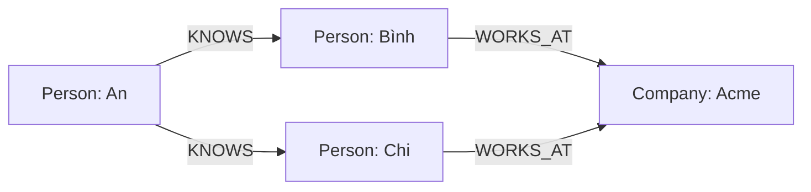
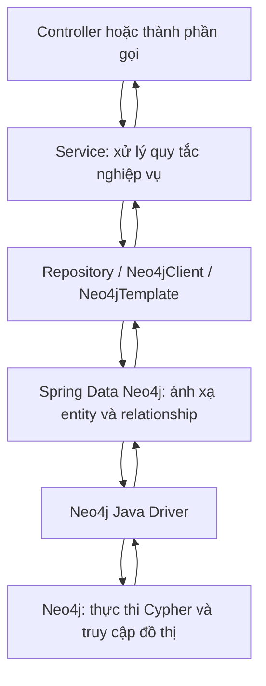

# Spring Data Neo4j là gì và giải quyết bài toán dữ liệu nào?

## Mục tiêu bài học

Sau bài này, bạn có thể:

- Giải thích vai trò của Neo4j, mô hình dữ liệu đồ thị và Spring Data Neo4j trong một ứng dụng Spring.
- Nhận diện khi nào dữ liệu có nhiều mối liên hệ và truy vấn theo đường đi phù hợp với Neo4j.
- Hiểu cách Spring Data Neo4j ánh xạ node, relationship và thuộc tính thành các đối tượng Java.
- Phân biệt repository có sẵn với truy vấn Cypher tùy chỉnh, đồng thời nắm được vai trò của transaction và tối ưu truy vấn.

## 1. Từ bài toán dữ liệu đến cơ sở dữ liệu đồ thị

Nhiều ứng dụng không chỉ lưu các bản ghi độc lập. Giá trị của dữ liệu nằm ở cách các đối tượng liên kết với nhau: một người quen những ai, tài khoản chuyển tiền qua những tài khoản nào, một sản phẩm thường được mua cùng sản phẩm nào, hay một dịch vụ phụ thuộc vào những dịch vụ nào.

Trong mô hình quan hệ, các liên kết thường được biểu diễn bằng khóa ngoại và được truy xuất qua phép JOIN. Cách này rất hiệu quả với dữ liệu có cấu trúc ổn định và các quan hệ đã biết trước. Tuy nhiên, khi câu hỏi yêu cầu lần theo nhiều tầng quan hệ hoặc số tầng thay đổi theo dữ liệu, câu truy vấn có thể trở nên dài và khó duy trì.

Neo4j là một hệ quản trị cơ sở dữ liệu đồ thị (graph database). Mô hình cơ bản của Neo4j gồm:

- **Node (nút):** biểu diễn một thực thể, chẳng hạn `Person`, `Product` hoặc `Account`.
- **Relationship (quan hệ):** biểu diễn liên kết có hướng giữa hai node, chẳng hạn `KNOWS`, `PURCHASED` hoặc `TRANSFERRED_TO`. Relationship có kiểu và có thể chứa thuộc tính.
- **Property (thuộc tính):** lưu dữ liệu trên node hoặc relationship, chẳng hạn tên, thời điểm giao dịch hoặc vai trò thành viên.
- **Label (nhãn):** phân loại node, ví dụ `Person` hay `Company`. Một node có thể mang nhiều label.

Ví dụ, một mạng lưới người dùng có thể được biểu diễn như sau:



Trong mô hình này, việc tìm đồng nghiệp của bạn bè là thao tác đi theo các relationship từ node hiện tại. Các liên kết là thành phần trực tiếp của dữ liệu, thay vì chỉ là những giá trị khóa ngoại cần ghép lại khi truy vấn.

Cypher là ngôn ngữ truy vấn đồ thị của Neo4j. Ví dụ, truy vấn tìm những người mà An biết:

```cypher
MATCH (an:Person {name: 'An'})-[:KNOWS]->(friend:Person)
RETURN friend.name
```

Biểu thức `(an:Person)` chọn node có label `Person`; `-[:KNOWS]->` mô tả relationship có hướng; và `RETURN` xác định dữ liệu trả về. Cypher thể hiện trực tiếp hình dạng quan hệ cần tìm, kể cả khi truy vấn cần đi qua nhiều bước.

## 2. Spring Data Neo4j là gì?

Spring Data Neo4j (SDN) là module thuộc hệ sinh thái Spring Data, cung cấp cách làm việc với Neo4j từ ứng dụng Java/Spring. SDN kết nối ứng dụng với Neo4j thông qua Neo4j Java Driver, ánh xạ dữ liệu đồ thị thành các đối tượng Java và cung cấp các API quen thuộc của Spring Data.

Có thể xem trách nhiệm của từng thành phần như sau:

| Thành phần | Trách nhiệm |
| --- | --- |
| Neo4j | Lưu trữ node, relationship và property; thực thi truy vấn Cypher |
| Neo4j Java Driver | Quản lý kết nối và trao đổi dữ liệu với máy chủ Neo4j |
| Spring Data Neo4j | Ánh xạ đối tượng với đồ thị, cung cấp repository, API truy vấn và tích hợp transaction |
| Ứng dụng Spring | Chứa quy tắc nghiệp vụ và gọi các API của tầng dữ liệu |

SDN giúp giảm phần mã kết nối và ánh xạ phải tự viết. Nhà phát triển có thể khai báo entity, định nghĩa repository và bổ sung Cypher khi cần kiểm soát truy vấn. Nhờ vậy, mã nghiệp vụ tập trung vào việc ứng dụng cần làm, còn các thao tác lưu và đọc đồ thị được tổ chức theo một cách nhất quán.

SDN không phải là một cơ sở dữ liệu mới và cũng không thay thế Neo4j. Nó là tầng tích hợp giữa ứng dụng Spring và máy chủ Neo4j. Dữ liệu vẫn được lưu và truy vấn theo mô hình đồ thị của Neo4j.

## 3. Những vấn đề Spring Data Neo4j giải quyết

### 3.1. Ánh xạ mô hình Java sang mô hình đồ thị

Nếu dùng trực tiếp driver, ứng dụng phải tự đọc các record trả về, lấy node và relationship, rồi chuyển chúng thành đối tượng Java. Khi mô hình có nhiều loại node và quan hệ, phần chuyển đổi này dễ lặp lại và khó đồng bộ.

SDN cung cấp annotation để mô tả cách một lớp Java tương ứng với node hoặc relationship:

- `@Node` đánh dấu một lớp được ánh xạ thành node và có thể chỉ định label.
- `@Id` xác định thuộc tính định danh của entity; `@GeneratedValue` có thể dùng khi muốn SDN tạo giá trị định danh theo cơ chế được cấu hình.
- `@Property` ánh xạ một thuộc tính Java sang tên property trong Neo4j.
- `@Relationship` mô tả kiểu và hướng của liên kết giữa các entity.
- `@RelationshipProperties` và `@TargetNode` dùng khi bản thân relationship có các thuộc tính cần ánh xạ thành một lớp Java.

Ví dụ sau mô tả một người và những người mà họ biết:

```java
import java.util.ArrayList;
import java.util.List;

import org.springframework.data.neo4j.core.schema.Id;
import org.springframework.data.neo4j.core.schema.Node;
import org.springframework.data.neo4j.core.schema.Property;
import org.springframework.data.neo4j.core.schema.Relationship;

@Node("Person")
public class Person {

    @Id
    @Property("personId")
    private String id;

    private String name;

    @Relationship(
        type = "KNOWS",
        direction = Relationship.Direction.OUTGOING
    )
    private List<Person> friends = new ArrayList<>();

    protected Person() {
    }

    public Person(String id, String name) {
        this.id = id;
        this.name = name;
    }

    public String getId() {
        return id;
    }

    public String getName() {
        return name;
    }

    public List<Person> getFriends() {
        return friends;
    }
}
```

Trong ví dụ, mỗi đối tượng `Person` được ánh xạ thành node có label `Person`. Thuộc tính Java `id` được lưu dưới tên property `personId`. Trường `friends` mô tả các relationship `KNOWS` đi ra từ node hiện tại.

Định danh trong ví dụ được ứng dụng cung cấp. Đây là lựa chọn hữu ích khi hệ thống đã có mã nghiệp vụ ổn định, chẳng hạn mã người dùng. Với định danh do cơ sở dữ liệu tạo, có thể sử dụng `@GeneratedValue` cùng `@Id`. Không nên xem internal ID của Neo4j là mã nghiệp vụ lâu dài để trao đổi với hệ thống bên ngoài; hãy chọn một khóa nghiệp vụ ổn định khi ứng dụng cần tham chiếu entity qua nhiều hệ thống.

### 3.2. Mô hình hóa relationship có thuộc tính

Không phải relationship nào cũng chỉ biểu diễn một liên kết đơn giản. Ví dụ, quan hệ giữa người dùng và nhóm có thể mang vai trò, ngày tham gia hoặc trạng thái. Những thông tin này thuộc về chính relationship.

SDN hỗ trợ ánh xạ trường hợp này bằng một lớp được đánh dấu `@RelationshipProperties`:

```java
import org.springframework.data.neo4j.core.schema.RelationshipId;
import org.springframework.data.neo4j.core.schema.RelationshipProperties;
import org.springframework.data.neo4j.core.schema.TargetNode;

@RelationshipProperties
public class Membership {

    @RelationshipId
    private Long relationshipId;

    private String role;

    @TargetNode
    private Person person;

    protected Membership() {
    }

    public Membership(String role, Person person) {
        this.role = role;
        this.person = person;
    }

    public String getRole() {
        return role;
    }

    public Person getPerson() {
        return person;
    }
}
```

Một entity `Group` có thể khai báo danh sách membership:

```java
@Node("Group")
public class Group {

    @Id
    @Property("groupId")
    private String id;

    private String name;

    @Relationship(
        type = "HAS_MEMBER",
        direction = Relationship.Direction.OUTGOING
    )
    private List<Membership> members = new ArrayList<>();
}
```

Ở đây, `Membership` đại diện cho relationship `HAS_MEMBER`, `role` là property của relationship và `person` là node đích. `@RelationshipId` là thông tin định danh nội bộ phục vụ việc ánh xạ relationship; không nên dùng nó làm mã nghiệp vụ.

Cách mô hình hóa này giúp giữ đúng ý nghĩa dữ liệu: vai trò là thuộc tính của việc một người tham gia một nhóm, không nhất thiết là thuộc tính cố định của người đó hoặc của nhóm.

### 3.3. Truy cập dữ liệu qua repository

Với Spring Data Neo4j, repository thường kế thừa `Neo4jRepository<T, ID>`. SDN cung cấp các thao tác cơ bản như lưu, tìm theo ID, kiểm tra tồn tại và xóa entity.

```java
import java.util.List;
import java.util.Optional;

import org.springframework.data.neo4j.repository.Neo4jRepository;
import org.springframework.data.neo4j.repository.query.Query;

public interface PersonRepository
        extends Neo4jRepository<Person, String> {

    Optional<Person> findByName(String name);

    @Query("""
        MATCH (p:Person {personId: $personId})-[:KNOWS]->(friend:Person)
        RETURN friend
        ORDER BY friend.name
        """)
    List<Person> findFriends(String personId);
}
```

Phương thức `findByName` minh họa truy vấn dẫn xuất từ tên phương thức. Với truy vấn cần diễn đạt rõ cấu trúc đồ thị, `@Query` cho phép viết Cypher và truyền tham số như `$personId`. Kết quả trả về là node `friend`, để SDN ánh xạ thành các đối tượng `Person`.

Repository phù hợp với các thao tác dữ liệu phổ biến và các truy vấn gắn với một entity. Khi cần truy vấn phức tạp hơn, xử lý kết quả tùy chỉnh hoặc điều khiển Cypher chi tiết, ứng dụng có thể dùng `Neo4jClient` hoặc `Neo4jTemplate`. Chọn API theo mức độ kiểm soát cần thiết, đồng thời giữ truy vấn gần với nơi thể hiện rõ mục đích dữ liệu.

### 3.4. Quản lý transaction trong luồng nghiệp vụ

Một thao tác nghiệp vụ có thể cần cập nhật nhiều node và relationship. Ví dụ, khi tạo một giao dịch chuyển tiền trong mô hình đồ thị, hệ thống có thể phải ghi nhận giao dịch, cập nhật các liên kết liên quan và lưu trạng thái xử lý. Các thay đổi thuộc cùng một nghiệp vụ cần tuân theo một ranh giới transaction rõ ràng.

Trong ứng dụng Spring, có thể dùng `@Transactional` ở service:

```java
import org.springframework.stereotype.Service;
import org.springframework.transaction.annotation.Transactional;

@Service
public class PersonService {

    private final PersonRepository personRepository;

    public PersonService(PersonRepository personRepository) {
        this.personRepository = personRepository;
    }

    @Transactional
    public Person createPerson(Person person) {
        return personRepository.save(person);
    }
}
```

Với cấu hình Spring Boot và Spring Data Neo4j phù hợp, transaction manager của Neo4j được cấu hình để tích hợp với cơ chế transaction của Spring. Ở cấu hình tùy chỉnh, cần bảo đảm ứng dụng sử dụng transaction manager dành cho Neo4j. Khi một phương thức service được quản lý bởi transaction, các thao tác dữ liệu tham gia cùng transaction đó có thể được commit hoặc rollback theo kết quả xử lý.

Transaction giúp bảo đảm tính nhất quán của một đơn vị công việc. Nó không tự sửa được quy tắc nghiệp vụ sai, cũng không thay thế việc thiết kế transaction ngắn gọn, xác định rõ dữ liệu cần cập nhật và xử lý lỗi đúng cách.

## 4. Những bài toán phù hợp với Neo4j và Spring Data Neo4j

Neo4j đặc biệt hữu ích khi câu hỏi nghiệp vụ tập trung vào mối liên hệ giữa các thực thể hoặc cần đi qua nhiều bước quan hệ. Một số ví dụ:

| Bài toán | Dữ liệu và truy vấn đồ thị |
| --- | --- |
| Mạng xã hội | Người dùng, nhóm và quan hệ bạn bè; tìm bạn chung hoặc các kết nối cách nhau vài bước |
| Gợi ý sản phẩm | Người dùng, sản phẩm và hành vi mua; tìm sản phẩm được mua cùng hoặc sản phẩm liên quan |
| Phát hiện gian lận | Tài khoản, thiết bị, giao dịch và địa chỉ; lần theo các cụm tài khoản có liên hệ bất thường |
| Quản lý quyền truy cập | Người dùng, nhóm, vai trò và tài nguyên; xác định quyền hiệu lực qua nhiều quan hệ |
| Bản đồ phụ thuộc | Dịch vụ, thư viện hoặc thành phần; tìm các thành phần phụ thuộc trực tiếp và gián tiếp |
| Tri thức doanh nghiệp | Khái niệm, tài liệu, tổ chức và người phụ trách; khám phá đường liên kết giữa các thông tin |

Trong các bài toán này, SDN giúp biểu diễn node và relationship thành mô hình Java, cung cấp cách truy cập dữ liệu qua repository và cho phép dùng Cypher khi cần truy vấn theo đường đi cụ thể.

Không phải mọi ứng dụng đều cần cơ sở dữ liệu đồ thị. Nếu dữ liệu chủ yếu là các bản ghi độc lập, truy vấn chủ yếu lọc và tổng hợp trên từng bảng, hoặc mô hình quan hệ đã đáp ứng tốt nhu cầu, cơ sở dữ liệu quan hệ có thể là lựa chọn đơn giản và phù hợp hơn. Cần chọn Neo4j dựa trên dạng truy vấn và cấu trúc quan hệ thực tế, không chỉ vì dữ liệu có thể được vẽ thành một đồ thị.

## 5. Những điểm cần cân nhắc khi thiết kế tầng dữ liệu

### Thiết kế node và relationship theo ngữ nghĩa nghiệp vụ

Một node nên đại diện cho một thực thể có ý nghĩa trong miền nghiệp vụ. Relationship nên thể hiện rõ loại liên kết và hướng của nó. Tránh tạo relationship chỉ để thay thế một thuộc tính đơn giản nếu thuộc tính đó không biểu diễn một thực thể hay sự kiện độc lập.

Khi relationship có dữ liệu riêng như vai trò, thời gian hoặc trạng thái, hãy cân nhắc dùng lớp `@RelationshipProperties`. Khi một sự kiện cần được truy vấn, quản lý vòng đời hoặc liên kết với nhiều thực thể, mô hình hóa sự kiện thành node cũng có thể hợp lý. Quyết định phụ thuộc vào cách ứng dụng sử dụng dữ liệu.

### Định danh và ràng buộc dữ liệu

Chọn chiến lược định danh rõ ràng cho từng loại node. Nếu dùng mã nghiệp vụ, bảo đảm mã đó được tạo và kiểm tra nhất quán. Các ràng buộc duy nhất và index trong Neo4j cần được thiết lập ở cơ sở dữ liệu, thường thông qua migration hoặc câu lệnh Cypher quản lý schema. Annotation ánh xạ entity không nên được hiểu là tự động thay thế việc quản lý schema.

### Kiểm soát lượng dữ liệu được ánh xạ

Một truy vấn trả về node cùng các relationship có thể khiến ứng dụng phải ánh xạ một phần lớn đồ thị liên quan. Hãy xác định rõ dữ liệu mà màn hình hoặc nghiệp vụ cần. Với kết quả lớn, cân nhắc projection, DTO hoặc chỉ trả về các property cần dùng. Tránh tải cả một mạng lưới liên kết rộng khi chỉ cần một vài trường.

### Tối ưu truy vấn Cypher

Một số nguyên tắc thực tế:

- Tạo index hoặc constraint phù hợp cho các property thường dùng để tìm node.
- Dùng `EXPLAIN` để xem kế hoạch thực thi và `PROFILE` để đo hoạt động thực tế của truy vấn.
- Giới hạn độ sâu khi duyệt relationship; tránh mở rộng đường đi không giới hạn nếu nghiệp vụ không cần.
- Lọc sớm theo label, property và kiểu relationship để thu hẹp tập node cần duyệt.
- Phân trang hoặc giới hạn số kết quả khi danh sách có thể lớn.
- Chỉ trả về node, relationship hoặc property mà phía ứng dụng thực sự sử dụng.

Tối ưu cần dựa trên dữ liệu và kế hoạch thực thi đo được. Một truy vấn ngắn chưa chắc nhanh; một truy vấn có nhiều bước cũng chưa chắc chậm nếu mô hình, index và đường đi được thiết kế phù hợp.

## 6. Luồng xử lý điển hình trong ứng dụng Spring

Một luồng đọc dữ liệu thường diễn ra như sau:



Trong luồng này, controller tiếp nhận yêu cầu, service điều phối nghiệp vụ, còn repository hoặc API truy vấn chịu trách nhiệm truy cập dữ liệu. SDN chuyển đổi giữa mô hình đối tượng và kết quả đồ thị; driver thực hiện giao tiếp với Neo4j.

Với thao tác ghi, service có thể mở transaction bằng `@Transactional`, gọi repository để lưu entity và các quan hệ đã được mô hình hóa. Ranh giới transaction nên đặt quanh một đơn vị nghiệp vụ hoàn chỉnh, thay vì mở transaction quá rộng qua các bước xử lý không liên quan đến cơ sở dữ liệu.

## 7. Kết luận

Spring Data Neo4j là tầng tích hợp giúp ứng dụng Spring làm việc với Neo4j theo mô hình đối tượng Java. Nó cung cấp ánh xạ node và relationship, repository cho thao tác dữ liệu phổ biến, Cypher tùy chỉnh cho truy vấn đồ thị, cùng khả năng tích hợp transaction của Spring.

Giá trị chính của Neo4j xuất hiện khi mối quan hệ giữa các thực thể là phần cốt lõi của bài toán: tìm đường đi, khám phá liên kết nhiều tầng, phát hiện cụm quan hệ hoặc phân tích mạng lưới. Khi thiết kế tầng dữ liệu, cần mô hình hóa đúng ngữ nghĩa node và relationship, chọn định danh ổn định, xác định ranh giới transaction và đo hiệu năng truy vấn bằng công cụ của Neo4j.

## Câu hỏi tự kiểm tra

1. Node, relationship, label và property khác nhau như thế nào trong Neo4j?
2. Spring Data Neo4j đảm nhiệm phần việc nào giữa ứng dụng Spring và Neo4j?
3. Khi nào nên dùng `@RelationshipProperties` thay vì liên kết trực tiếp hai entity?
4. Repository dẫn xuất và `@Query` Cypher giải quyết những nhu cầu truy vấn nào?
5. Vì sao cần thiết kế ranh giới `@Transactional` và đo truy vấn bằng `EXPLAIN` hoặc `PROFILE`?
