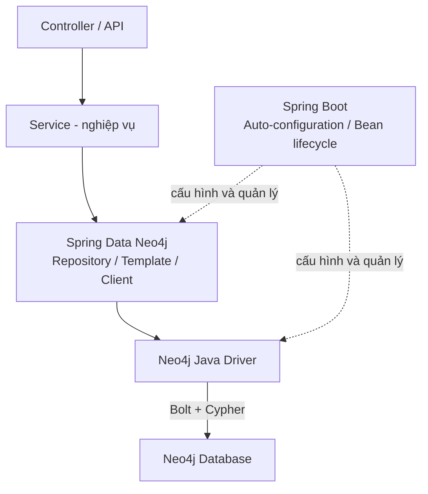

# Vai trò của Neo4j, Neo4j Java Driver, Spring Data và Spring Boot

Khi xây dựng ứng dụng Java lưu trữ dữ liệu dạng đồ thị, ta thường gặp bốn thành phần: **Neo4j**, **Neo4j Java Driver**, **Spring Data Neo4j** và **Spring Boot**. Chúng phối hợp với nhau nhưng đảm nhiệm những công việc khác nhau. Hiểu rõ ranh giới này giúp chọn đúng API, tổ chức mã nguồn dễ bảo trì và kiểm soát tốt truy vấn, ánh xạ dữ liệu cũng như transaction.

Bài học đặt bốn thành phần trong cùng một kiến trúc, giải thích dữ liệu đi qua các lớp như thế nào và minh họa cách một ứng dụng Spring Boot truy cập đồ thị Neo4j.

## 1. Neo4j: nơi lưu trữ và xử lý dữ liệu đồ thị

**Neo4j là hệ quản trị cơ sở dữ liệu đồ thị (graph database)**. Nó lưu dữ liệu theo mô hình property graph, gồm ba khái niệm chính:

- **Node (nút):** biểu diễn một thực thể, chẳng hạn `Person`, `Movie` hoặc `Company`.
- **Relationship (quan hệ):** nối các node, có kiểu và có hướng, chẳng hạn `ACTED_IN`, `WORKS_FOR` hoặc `KNOWS`.
- **Property (thuộc tính):** các cặp khóa và giá trị gắn với node hoặc relationship, chẳng hạn `name`, `released` hay `since`.

Ví dụ, một người tham gia diễn xuất trong một bộ phim có thể được biểu diễn như sau:

```text
(Person {name: "Lan"})-[:ACTED_IN {role: "Mai"}]->(Movie {title: "Mùa hè"})
```

Mô hình này thể hiện trực tiếp cả thực thể lẫn mối liên hệ giữa chúng. Khi truy vấn các kết nối nhiều bước, ứng dụng có thể đi theo relationship thay vì phải tự ghép nhiều bảng bằng khóa ngoại.

Neo4j cung cấp ngôn ngữ truy vấn **Cypher** để tạo, đọc, cập nhật và xóa dữ liệu. Ví dụ:

```cypher
MATCH (p:Person)-[:ACTED_IN]->(m:Movie)
WHERE p.name = $name
RETURN m.title AS title
```

Truy vấn trên tìm các node `Movie` được nối từ node `Person` qua relationship `ACTED_IN`. `$name` là tham số, được truyền riêng với câu truy vấn.

Neo4j chịu trách nhiệm lưu trữ đồ thị, thực thi Cypher, quản lý chỉ mục và constraint, đồng thời bảo đảm transaction ở phía cơ sở dữ liệu. Nó không tự biết các lớp Java trong ứng dụng có ý nghĩa gì. Việc chuyển đổi giữa mô hình đồ thị và đối tượng Java thuộc về các thư viện phía ứng dụng như Neo4j Java Driver và Spring Data Neo4j.

## 2. Neo4j Java Driver: kết nối từ Java đến Neo4j

**Neo4j Java Driver là thư viện Java chính thức để ứng dụng giao tiếp với máy chủ Neo4j.** Driver sử dụng giao thức Bolt, quản lý kết nối và cung cấp API để gửi Cypher, truyền tham số, nhận kết quả cũng như làm việc với transaction.

Driver cung cấp các đối tượng quan trọng:

- `Driver` đại diện cho cấu hình kết nối và connection pool. Trong ứng dụng thông thường, tạo một Driver dùng chung trong suốt vòng đời ứng dụng.
- `Session` là ngữ cảnh làm việc với cơ sở dữ liệu. Tạo session cho một đơn vị công việc rồi đóng session khi hoàn tất; không chia sẻ một session giữa nhiều luồng đồng thời.
- `Transaction` cho phép gom nhiều câu lệnh vào một đơn vị commit hoặc rollback. Driver cũng hỗ trợ các cách chạy transaction tiện lợi như transaction tự quản lý và transaction tự động commit.
- `Record`, `Value` và `Result` biểu diễn dữ liệu trả về. Khi dùng Driver trực tiếp, lập trình viên tự đọc các giá trị và chuyển chúng thành kiểu dữ liệu của ứng dụng.

Ví dụ truy vấn trực tiếp bằng Driver:

```java
try (Session session = driver.session()) {
    var result = session.run(
        "MATCH (p:Person {name: $name}) RETURN p.name AS name",
        Map.of("name", personName)
    );

    List<String> names = result.list(
        record -> record.get("name").asString()
    );
}
```

Trong ví dụ này, `driver` là một đối tượng `org.neo4j.driver.Driver` đã được cấu hình. Session được đóng tự động nhờ `try-with-resources`; tham số `personName` được truyền riêng để tránh ghép dữ liệu người dùng trực tiếp vào chuỗi Cypher.

Driver tập trung vào giao tiếp và kết quả ở mức thấp. Nó không tự cung cấp mô hình repository của Spring Data, không tự biến mọi node thành entity Java theo annotation `@Node`, và không tự áp dụng các quy ước nghiệp vụ của ứng dụng. Nếu dùng Driver trực tiếp, nhóm phát triển phải tự tổ chức việc ánh xạ kết quả, quản lý ranh giới transaction và xử lý vòng đời tài nguyên.

## 3. Spring Data Neo4j: ánh xạ đồ thị vào mô hình Java

**Spring Data Neo4j (SDN) là lớp tích hợp Spring Data dành cho Neo4j.** SDN xây dựng trên Neo4j Java Driver và bổ sung cơ chế ánh xạ đối tượng (Object Graph Mapping – OGM), repository, truy vấn theo phương thức và các API truy cập dữ liệu theo phong cách Spring.

SDN giúp ứng dụng làm việc với các lớp miền (domain classes) thay vì phải chuyển từng `Record` thành đối tượng bằng tay. Một số annotation thường dùng:

| Annotation | Vai trò |
|---|---|
| `@Node` | Đánh dấu lớp Java được ánh xạ thành node; có thể chỉ định label của node. |
| `@Id` | Khai báo thuộc tính định danh của entity. |
| `@GeneratedValue` | Yêu cầu cơ chế sinh giá trị định danh được cấu hình cho entity. |
| `@Relationship` | Khai báo quan hệ giữa các node, gồm kiểu quan hệ và hướng. |
| `@RelationshipProperties` | Đánh dấu lớp mô tả các thuộc tính nằm trên relationship. |
| `@TargetNode` | Chỉ định node đích trong lớp mô tả relationship. |

Ví dụ mô hình hóa người và phim:

```java
@Node("Person")
public class Person {
    @Id
    @GeneratedValue
    private Long id;

    private String name;

    @Relationship(type = "ACTED_IN", direction = Relationship.Direction.OUTGOING)
    private List<Movie> movies = new ArrayList<>();
}

@Node("Movie")
public class Movie {
    @Id
    @GeneratedValue
    private Long id;

    private String title;
}
```

Ở đây, `Person` và `Movie` tương ứng với hai loại node. Trường `movies` mô tả các relationship `ACTED_IN` đi ra từ node `Person`. Khi mô hình quan hệ có thuộc tính riêng, chẳng hạn vai diễn hoặc ngày bắt đầu, có thể dùng `@RelationshipProperties` kết hợp `@TargetNode` để biểu diễn dữ liệu trên chính relationship.

### Repository và truy vấn Cypher

SDN cung cấp repository để thực hiện các thao tác phổ biến. Ví dụ:

```java
public interface PersonRepository extends Neo4jRepository<Person, Long> {
    List<Person> findByName(String name);

    @Query("""
        MATCH (p:Person)-[:ACTED_IN]->(m:Movie)
        WHERE p.name = $name
        RETURN m
        """)
    List<Movie> findMoviesForPerson(@Param("name") String name);
}
```

`Neo4jRepository<Person, Long>` cung cấp các thao tác như lưu, tìm theo ID, lấy danh sách và xóa entity. Phương thức `findByName` minh họa query derivation: SDN suy ra truy vấn từ tên phương thức và thuộc tính của entity. Với truy vấn cần diễn đạt rõ cấu trúc đồ thị, `@Query` cho phép viết Cypher trực tiếp và ánh xạ kết quả về kiểu trả về phù hợp.

Ngoài repository, SDN còn cung cấp:

- **`Neo4jTemplate`:** API thao tác với entity theo cách có kiểm soát hơn, hữu ích khi cần các thao tác lưu, đọc hoặc xóa mà repository không diễn đạt thuận tiện.
- **`Neo4jClient`:** API làm việc trực tiếp với Cypher và kết quả dạng record, hữu ích cho truy vấn tùy chỉnh, projection hoặc kết quả không tương ứng với một entity đầy đủ.

Có thể chọn mức trừu tượng phù hợp cho từng trường hợp: repository cho thao tác miền phổ biến, `@Query` cho truy vấn Cypher gắn với repository, `Neo4jTemplate` hoặc `Neo4jClient` cho các luồng truy cập dữ liệu linh hoạt hơn.

## 4. Spring Boot: cấu hình và khởi chạy các thành phần

**Spring Boot giúp tạo và cấu hình ứng dụng Spring với ít cấu hình thủ công.** Khi thêm starter `spring-boot-starter-data-neo4j`, Boot có thể tự cấu hình các thành phần kết nối và tích hợp cần thiết dựa trên dependency, cấu hình ứng dụng và các bean hiện có.

Starter thường được khai báo trong Maven như sau:

```xml
<dependency>
    <groupId>org.springframework.boot</groupId>
    <artifactId>spring-boot-starter-data-neo4j</artifactId>
</dependency>
```

Khai báo này đưa Spring Data Neo4j và các dependency cần thiết, trong đó có Neo4j Java Driver tương thích với bộ phiên bản do Spring Boot quản lý, vào ứng dụng. Khi dùng Spring Boot dependency management, thông thường không cần tự chọn phiên bản riêng cho từng thư viện trong nhóm này.

Thông tin kết nối có thể đặt trong `application.properties`:

```properties
spring.neo4j.uri=bolt://localhost:7687
spring.neo4j.authentication.username=neo4j
spring.neo4j.authentication.password=${NEO4J_PASSWORD}
```

Trong ví dụ, URI trỏ đến máy chủ Neo4j có thể truy cập từ ứng dụng. Mật khẩu được lấy từ biến môi trường để tránh đưa thông tin bí mật vào mã nguồn. Môi trường triển khai thực tế cần cấu hình URI, cơ chế xác thực và bảo vệ kết nối phù hợp với hạ tầng.

Khi khởi động, Spring Boot có thể dựa trên cấu hình để tạo và quản lý vòng đời `Driver`, thiết lập tích hợp Spring Data Neo4j, phát hiện repository và cung cấp transaction manager tương ứng. Ứng dụng vì thế có thể inject `PersonRepository` hoặc các API như `Neo4jClient` vào service mà không phải tự tạo và đóng Driver trong từng request.

Spring Boot không thay Neo4j, không thực thi Cypher thay cho cơ sở dữ liệu và cũng không thay thế vai trò ánh xạ của SDN. Vai trò của Boot là kết nối các thành phần trong ứng dụng, quản lý cấu hình và vòng đời bean theo hệ sinh thái Spring.

## 5. Bốn thành phần phối hợp như thế nào?

Kiến trúc tổng quát có thể hình dung như sau:



Một luồng đọc dữ liệu thường diễn ra theo các bước:

1. Controller nhận yêu cầu từ phía gọi API và chuyển dữ liệu cần thiết cho service.
2. Service thực hiện quy tắc nghiệp vụ, sau đó gọi repository, template hoặc client.
3. Spring Data Neo4j tạo hoặc thực thi truy vấn phù hợp, dùng metadata entity để ánh xạ dữ liệu khi cần.
4. Neo4j Java Driver gửi Cypher và tham số đến Neo4j qua kết nối Bolt.
5. Neo4j thực thi truy vấn trên đồ thị và trả kết quả cho Driver.
6. Driver chuyển kết quả cho SDN; SDN ánh xạ kết quả thành entity hoặc projection theo API được sử dụng.
7. Service xử lý kết quả và trả dữ liệu về controller.

Spring Boot tham gia xuyên suốt ở khâu cấu hình và quản lý các bean. Nó cung cấp hạ tầng để service sử dụng các thành phần trên, thay vì trở thành một bước truy vấn riêng trong luồng dữ liệu.

## 6. Transaction trong ứng dụng Spring

Neo4j hỗ trợ transaction ở phía cơ sở dữ liệu; Driver cung cấp API để chạy transaction; Spring Data Neo4j tích hợp transaction đó với cơ chế quản lý transaction của Spring. Trong ứng dụng Spring Boot theo kiểu đồng bộ, service thường xác định ranh giới nghiệp vụ bằng `@Transactional`:

```java
@Service
public class PersonService {
    private final PersonRepository personRepository;

    public PersonService(PersonRepository personRepository) {
        this.personRepository = personRepository;
    }

    @Transactional
    public Person savePerson(Person person) {
        return personRepository.save(person);
    }
}
```

Khi phương thức được gọi qua Spring transaction proxy, transaction manager của Neo4j tham gia quản lý thao tác dữ liệu trong phạm vi phương thức. Nếu phương thức hoàn tất bình thường, transaction được commit; nếu có ngoại lệ khiến transaction bị đánh dấu rollback theo quy tắc Spring, các thay đổi trong transaction sẽ được rollback.

Nên đặt ranh giới transaction quanh một đơn vị công việc nghiệp vụ có ý nghĩa. Khi nhiều repository cùng tham gia một thao tác, việc gọi chúng trong cùng phạm vi `@Transactional` giúp các thay đổi thuộc cùng transaction. Với thao tác dùng Driver trực tiếp, cần hiểu cách tích hợp session và transaction với transaction manager; tự mở một transaction độc lập có thể khiến thao tác đó nằm ngoài transaction do Spring quản lý.

Ứng dụng dùng API reactive cần chọn các repository và transaction manager reactive tương ứng, đồng thời giữ luồng xử lý reactive xuyên suốt. Không nên trộn tùy tiện transaction đồng bộ với luồng reactive.

## 7. Chọn API nào cho từng nhu cầu?

| Nhu cầu | Thành phần hoặc API phù hợp | Lý do |
|---|---|---|
| Lưu và tìm entity theo quy ước phổ biến | `Neo4jRepository` | Có sẵn CRUD và query derivation. |
| Viết truy vấn đồ thị cụ thể | `@Query` với Cypher | Kiểm soát rõ pattern, relationship, tham số và kết quả. |
| Thao tác entity ngoài các phương thức repository | `Neo4jTemplate` | Cung cấp API hướng entity ở mức linh hoạt hơn. |
| Chạy Cypher tùy chỉnh và ánh xạ projection | `Neo4jClient` | Làm việc gần với kết quả truy vấn nhưng vẫn tích hợp Spring. |
| Dùng tính năng Driver trực tiếp hoặc kiểm soát chi tiết phiên làm việc | Neo4j Java Driver | Truy cập API kết nối, session và transaction ở mức thấp hơn. |
| Cấu hình ứng dụng, dependency injection và vòng đời bean | Spring Boot / Spring Framework | Tự động cấu hình và kết nối các thành phần trong ứng dụng. |

Nên bắt đầu bằng repository cho các thao tác thông thường. Khi truy vấn cần diễn đạt bằng Cypher, dùng `@Query`. Nếu cần kết quả tùy biến hoặc thao tác linh hoạt, cân nhắc `Neo4jClient` hay `Neo4jTemplate`. Chỉ dùng Driver trực tiếp khi thực sự cần quyền kiểm soát ở mức thấp; khi đó phải chủ động quản lý session, kết quả, lỗi và transaction.

## 8. Những điểm cần chú ý khi thiết kế

- **Thiết kế đồ thị theo quan hệ của miền nghiệp vụ.** Chọn label, relationship type, hướng quan hệ và property có ý nghĩa. Tránh biến mọi kết nối thành một thuộc tính chuỗi khó truy vấn.
- **Dùng tham số cho Cypher.** Truyền giá trị qua `$parameter`, không nối chuỗi đầu vào của người dùng vào câu truy vấn. Điều này giúp truy vấn an toàn hơn và hỗ trợ tái sử dụng kế hoạch truy vấn.
- **Tạo index và constraint phù hợp.** Các truy vấn lọc hoặc tìm node theo thuộc tính thường cần index; constraint giúp bảo vệ tính duy nhất hoặc tính hợp lệ của dữ liệu theo quy tắc đã thiết kế.
- **Kiểm tra kế hoạch thực thi.** Dùng `EXPLAIN` để xem kế hoạch mà không chạy truy vấn và `PROFILE` để đo hoạt động thực tế. Tránh duyệt đường đi không giới hạn hoặc tải một đồ thị quá lớn khi chỉ cần một phần dữ liệu.
- **Chú ý phạm vi entity được tải.** Một entity có thể liên kết với nhiều node khác. Hãy thiết kế truy vấn và kiểu trả về theo đúng dữ liệu service cần, tránh tải toàn bộ mạng lưới quan hệ một cách không cần thiết.
- **Phân biệt định danh nội bộ và định danh nghiệp vụ.** Giá trị ID do cơ sở dữ liệu sinh có thể hữu ích trong nội bộ, nhưng không nên mặc định xem internal ID là mã định danh ổn định để công khai. Nếu cần ID bền vững cho API hoặc tích hợp ngoài, hãy cân nhắc UUID hoặc mã nghiệp vụ do ứng dụng quản lý và đặt constraint phù hợp.
- **Quản lý cấu hình kết nối an toàn.** Không commit mật khẩu vào repository. Tách cấu hình theo môi trường và dùng cơ chế xác thực, quyền truy cập cùng bảo vệ kết nối phù hợp khi triển khai.

## 9. Phân biệt nhanh các vai trò

| Thành phần | Câu hỏi mà thành phần giải quyết | Trách nhiệm chính |
|---|---|---|
| Neo4j | Dữ liệu đồ thị được lưu và truy vấn ở đâu? | Lưu node, relationship, property; thực thi Cypher và transaction. |
| Neo4j Java Driver | Java giao tiếp với Neo4j bằng cách nào? | Kết nối Bolt, session, gửi truy vấn, nhận record và quản lý transaction ở mức Driver. |
| Spring Data Neo4j | Đối tượng Java được ánh xạ và truy cập dữ liệu ra sao? | OGM, repository, query derivation, Cypher tùy chỉnh và API truy cập dữ liệu của Spring. |
| Spring Boot | Các thành phần Spring được cấu hình và khởi chạy thế nào? | Auto-configuration, dependency management, dependency injection và vòng đời bean. |

Khi phối hợp đúng, Neo4j tập trung vào lưu trữ và truy vấn đồ thị; Driver đảm nhiệm giao tiếp; Spring Data Neo4j ánh xạ mô hình Java và cung cấp API truy cập dữ liệu; Spring Boot cấu hình, khởi tạo và quản lý các thành phần để ứng dụng vận hành thống nhất. Đây là nền tảng để tiếp tục học cách mô hình hóa node entity, relationship, repository, Cypher, transaction và tối ưu truy vấn trong Spring Data Neo4j.
