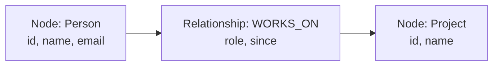

# Bản đồ khái niệm: node, label, relationship, property, entity và repository

Spring Data Neo4j (SDN) giúp ứng dụng Java làm việc với cơ sở dữ liệu đồ thị Neo4j thông qua các lớp miền, annotation và repository của Spring Data. Để sử dụng đúng, cần phân biệt hai lớp khái niệm: **mô hình đồ thị mà Neo4j lưu trữ** và **mô hình đối tượng mà ứng dụng Java sử dụng**.

Neo4j lưu dữ liệu dưới dạng node và relationship. Label phân loại node; property lưu các giá trị trên node hoặc relationship. Trong ứng dụng, SDN ánh xạ cấu trúc đó thành entity Java và cung cấp repository để đọc, ghi dữ liệu. Repository và entity là khái niệm của tầng ứng dụng; chúng không phải thành phần vật lý của đồ thị.

## 1. Nhìn tổng thể

Ví dụ một người tham gia một dự án. Người và dự án là hai node; `WORKS_ON` là relationship nối chúng. Vai trò và ngày bắt đầu có thể được lưu thành property của relationship.



| Khái niệm | Thuộc về | Ý nghĩa | Cách thể hiện thường gặp trong SDN |
|---|---|---|---|
| Node | Neo4j | Một thực thể hoặc đối tượng trong đồ thị | Một lớp Java có `@Node` |
| Label | Neo4j | Nhóm hoặc phân loại node | Label chính được khai báo qua `@Node` |
| Relationship | Neo4j | Liên kết có hướng giữa hai node | Một trường có `@Relationship` |
| Property | Neo4j | Cặp tên và giá trị gắn với node hoặc relationship | Trường Java; có thể đổi tên bằng `@Property` |
| Entity | Spring Data / Java | Đối tượng miền được SDN ánh xạ với dữ liệu đồ thị | Lớp Java, thường được đánh dấu `@Node` |
| Repository | Spring Data | Cổng thao tác dữ liệu theo kiểu miền | Interface kế thừa `Neo4jRepository` |

## 2. Node: đối tượng được lưu trong đồ thị

**Node** là đơn vị dữ liệu cơ bản của Neo4j. Một node có thể đại diện cho người dùng, sản phẩm, đơn hàng, địa điểm, tài khoản hoặc bất kỳ đối tượng nào cần được kết nối với đối tượng khác.

Node có thể chứa:

- Một hoặc nhiều label để phân loại node.
- Các property mô tả node, chẳng hạn `id`, `name`, `email`.
- Các relationship nối node đó với những node khác.

Trong SDN, một lớp Java được đánh dấu `@Node` để khai báo rằng các đối tượng của lớp đó được ánh xạ với node. Ví dụ:

```java
@Node("Person")
public class Person {

    @Id
    private String id;

    private String name;

    private String email;
}
```

Khi SDN ánh xạ một đối tượng `Person`, node tương ứng có label chính `Person`; các trường `id`, `name` và `email` được ánh xạ thành property theo quy tắc mapping. Ví dụ trên lược bỏ constructor, getter và setter để tập trung vào cấu trúc dữ liệu.

`@Id` xác định thuộc tính định danh mà SDN dùng để nhận diện entity. Nếu dùng mã nghiệp vụ như `person-1024`, ứng dụng phải bảo đảm mã đó duy nhất. Nên tạo unique constraint tương ứng trong Neo4j để bảo vệ tính duy nhất ở tầng dữ liệu:

```cypher
CREATE CONSTRAINT person_id IF NOT EXISTS
FOR (p:Person)
REQUIRE p.id IS UNIQUE;
```

SDN cũng hỗ trợ cơ chế sinh định danh. Dù dùng loại định danh nào, hãy phân biệt định danh nội bộ của Neo4j với mã nghiệp vụ mà hệ thống công khai cho API hoặc tích hợp bên ngoài. Mã nghiệp vụ ổn định thường phù hợp hơn khi cần tham chiếu lâu dài giữa các hệ thống.

## 3. Label: phân loại node

**Label** là nhãn gắn trên node để cho biết node thuộc nhóm nào. Ví dụ `Person`, `Project`, `Product` hoặc `Order`. Label giúp câu truy vấn Cypher xác định loại node cần tìm và giúp Neo4j áp dụng index hoặc constraint cho một nhóm node.

Trong SDN, `@Node("Person")` khai báo label chính cho lớp `Person`. Nếu không chỉ định label, SDN có thể dùng tên lớp làm label mặc định. Label là phần cấu trúc của node, không phải property; vì vậy `:Person` trong Cypher khác với `{type: "Person"}`.

Hai cách biểu diễn sau không tương đương:

```cypher
(:Person {name: "An"})
```

```cypher
(:Entity {type: "Person", name: "An"})
```

Ở ví dụ đầu, `Person` là label. Ở ví dụ sau, node mang label `Entity`, còn `Person` chỉ là giá trị của property `type`. Việc chọn label hay property phụ thuộc vào cách ứng dụng phân loại và truy vấn dữ liệu. Nếu các nhóm node có cấu trúc và quy tắc truy vấn khác nhau, label riêng thường diễn đạt mô hình rõ ràng hơn.

Một node Neo4j có thể mang nhiều label. Khi dùng nhiều label trong mô hình SDN, cần khai báo hoặc quản lý chúng theo cơ chế mapping phù hợp với phiên bản SDN đang dùng; không nên giả định một trường property thông thường tự động trở thành label.

## 4. Relationship: mô tả liên kết giữa các node

**Relationship** là liên kết giữa hai node. Mỗi relationship có một type và có hướng từ node bắt đầu đến node kết thúc. Ví dụ:

```cypher
(person:Person)-[:WORKS_ON]->(project:Project)
```

Đọc từ trái sang phải: một node `Person` có relationship `WORKS_ON` hướng tới một node `Project`. Các type thường được đặt theo tên hành động hoặc ý nghĩa nghiệp vụ, chẳng hạn `PLACED`, `CONTAINS`, `FOLLOWS` hoặc `MEMBER_OF`.

Trong entity SDN, trường có annotation `@Relationship` khai báo một quan hệ mà entity tham gia:

```java
@Node("Person")
public class Person {

    @Id
    private String id;

    @Relationship(type = "WORKS_ON", direction = Relationship.Direction.OUTGOING)
    private Set<Project> projects = new HashSet<>();
}
```

`direction` được hiểu tương đối với node đang được ánh xạ. `OUTGOING` nghĩa là relationship đi từ node `Person` tới node đích; `INCOMING` nghĩa là relationship đi vào node `Person`. Nếu bỏ qua `direction`, SDN mặc định dùng `OUTGOING`.

Trong mô hình đồ thị, relationship luôn có hướng. Khi muốn truy vấn theo cả hai chiều trong Cypher, có thể viết pattern không chỉ rõ chiều:

```cypher
MATCH (a:Person)-[:KNOWS]-(b:Person)
RETURN a, b
```

Pattern trên tìm liên kết `KNOWS` giữa hai node bất kể hướng lưu trữ. Điều này không biến relationship trong cơ sở dữ liệu thành liên kết vô hướng.

### Relationship có property

Không phải mọi thông tin liên quan đến một mối liên kết đều thuộc về node đầu hoặc node cuối. Ví dụ, `role` và `since` mô tả vai trò và thời điểm một người bắt đầu tham gia dự án. Đây là thông tin của chính relationship `WORKS_ON`.

Neo4j cho phép relationship có property. Trong SDN, có thể biểu diễn loại relationship này bằng lớp được đánh dấu `@RelationshipProperties`. Trường `@TargetNode` chỉ node đích của relationship:

```java
@RelationshipProperties
public class ProjectMembership {

    @RelationshipId
    private Long id;

    private String role;

    private LocalDate since;

    @TargetNode
    private Project project;
}
```

Entity nguồn khai báo tập các đối tượng relationship properties:

```java
@Node("Person")
public class Person {

    @Id
    private String id;

    @Relationship(type = "WORKS_ON", direction = Relationship.Direction.OUTGOING)
    private Set<ProjectMembership> memberships = new HashSet<>();
}
```

Ở đây, `ProjectMembership` đại diện cho relationship cùng các property của nó; `Project` là node đích. `@RelationshipId` là định danh relationship do SDN quản lý để nhận diện liên kết khi ánh xạ. Không nên dùng giá trị này như mã nghiệp vụ công khai.

## 5. Property: dữ liệu mô tả node hoặc relationship

**Property** là cặp tên và giá trị gắn với node hoặc relationship. Ví dụ, node `Person` có thể có `name`, `email`; relationship `WORKS_ON` có thể có `role`, `since`.

Property có kiểu dữ liệu và giá trị. Neo4j hỗ trợ các kiểu giá trị cơ bản và danh sách giá trị; SDN chuyển đổi giữa các kiểu Java được hỗ trợ và kiểu dữ liệu của Neo4j. Với kiểu tùy chỉnh hoặc cấu trúc phức tạp, ứng dụng cần chọn cách chuyển đổi phù hợp thay vì giả định mọi object Java đều được lưu trực tiếp thành một property.

Thông thường, tên trường Java và tên property trong Neo4j giống nhau. Dùng `@Property` khi cần ánh xạ sang tên khác:

```java
@Node("Person")
public class Person {

    @Id
    private String id;

    @Property("display_name")
    private String name;
}
```

Trường `name` trong Java khi đó được lưu dưới property `display_name`. Tên property cần nhất quán với dữ liệu hiện có và các câu truy vấn Cypher viết thủ công.

Hãy đặt property theo ý nghĩa nghiệp vụ, chọn kiểu dữ liệu phù hợp và tránh lưu cùng một thông tin ở nhiều nơi nếu không có quy tắc đồng bộ rõ ràng. Các property thường xuyên dùng để tìm kiếm hoặc ràng buộc duy nhất nên được xem xét tạo index hoặc constraint thích hợp.

## 6. Entity: mô hình Java ánh xạ với đồ thị

**Entity** là đối tượng miền trong ứng dụng. Với SDN, lớp entity mô tả node và những relationship mà ứng dụng muốn ánh xạ. Entity thường có định danh, các trường property và các trường tham chiếu tới entity khác hoặc tới lớp relationship properties.

Ví dụ, `Person` và `Project` là hai entity node. `ProjectMembership` là lớp mô tả relationship có property. Khi nhìn từ Java, chúng là các object và trường tham chiếu; khi nhìn từ Neo4j, chúng tương ứng với node, relationship và property.

| Mô hình Java | Mô hình Neo4j |
|---|---|
| Lớp `Person` có `@Node("Person")` | Node mang label `Person` |
| Trường `String name` | Property `name` trên node |
| Trường `Set<Project>` có `@Relationship` | Các relationship nối tới node `Project` |
| Lớp `ProjectMembership` có `@RelationshipProperties` | Relationship cùng các property của nó |
| Trường `Project project` có `@TargetNode` | Node đích của relationship |
| Trường định danh có `@Id` | Property được SDN dùng để nhận diện entity, hoặc định danh được cấu hình theo cơ chế sinh ID |

Entity là góc nhìn đối tượng của ứng dụng, không phải bản sao tự động của toàn bộ đồ thị. Một entity chỉ thể hiện những property và relationship được mô hình hóa, đồng thời dữ liệu thực tế được tải còn phụ thuộc vào truy vấn và cách SDN ánh xạ kết quả. Vì vậy, không nên giả định đọc một entity sẽ tự động tải mọi node có thể đi tới từ node đó.

Khi thiết kế entity, hãy xác định rõ node nào là đối tượng chính của thao tác, relationship nào cần dùng trong nghiệp vụ và độ sâu dữ liệu cần đọc. Với đồ thị có nhiều liên kết hoặc chu trình, việc mô hình hóa mọi chiều tham chiếu hai chiều có thể làm object graph lớn và khó kiểm soát.

## 7. Repository: cổng truy cập dữ liệu theo entity

**Repository** là abstraction của Spring Data để ứng dụng thực hiện thao tác dữ liệu mà không phải viết lại các thao tác CRUD phổ biến. Với SDN, repository thường kế thừa `Neo4jRepository<Entity, IdType>`.

```java
public interface PersonRepository extends Neo4jRepository<Person, String> {

    Optional<Person> findByEmail(String email);

    @Query("MATCH (p:Person {id: $id}) RETURN p")
    Optional<Person> findNodeById(@Param("id") String id);
}
```

`Neo4jRepository<Person, String>` khai báo repository quản lý entity `Person` có kiểu định danh `String`. Repository thừa hưởng các thao tác như lưu, tìm theo ID và xóa. Phương thức `findByEmail` minh họa derived query: Spring Data suy ra truy vấn từ tên phương thức và thuộc tính entity. `@Query` dùng khi cần viết Cypher trực tiếp.

Ví dụ Cypher trong `@Query` chỉ trả về node `p`. Nếu phương thức cần ánh xạ thêm relationship hoặc node liên quan, câu truy vấn phải trả về cấu trúc đồ thị cần thiết cho kết quả đó. Việc một node xuất hiện trong kết quả không đồng nghĩa tất cả relationship của node sẽ tự động có mặt.

Repository phù hợp với thao tác theo entity và các truy vấn miền thường dùng. Khi cần điều khiển Cypher chi tiết, trả về dữ liệu tổng hợp hoặc ánh xạ một projection riêng, có thể dùng `@Query` hoặc `Neo4jClient` tùy mức độ kiểm soát cần thiết.

## 8. Ghép các khái niệm thành một mô hình hoàn chỉnh

Đoạn mã dưới đây tổng hợp các khái niệm trong ví dụ người tham gia dự án. Các lớp đã lược bỏ constructor, getter, setter và import để làm rõ vai trò của annotation.

```java
@Node("Person")
public class Person {

    @Id
    private String id;

    private String name;

    @Property("email_address")
    private String email;

    @Relationship(type = "WORKS_ON", direction = Relationship.Direction.OUTGOING)
    private Set<ProjectMembership> memberships = new HashSet<>();
}

@Node("Project")
public class Project {

    @Id
    private String id;

    private String name;
}

@RelationshipProperties
public class ProjectMembership {

    @RelationshipId
    private Long id;

    private String role;

    private LocalDate since;

    @TargetNode
    private Project project;
}

public interface PersonRepository extends Neo4jRepository<Person, String> {
    Optional<Person> findByEmail(String email);
}
```

Có thể hình dung dữ liệu Neo4j tương ứng như sau:

```cypher
CREATE (p:Person {
    id: 'person-1024',
    name: 'An',
    email_address: 'an@example.com'
})
CREATE (pr:Project {
    id: 'project-42',
    name: 'Graph Platform'
})
CREATE (p)-[:WORKS_ON {
    role: 'Developer',
    since: date('2026-01-15')
}]->(pr)
```

Truy vấn relationship và property bằng Cypher:

```cypher
MATCH (p:Person {id: 'person-1024'})-[r:WORKS_ON]->(pr:Project)
RETURN p.name AS person,
       r.role AS role,
       r.since AS startDate,
       pr.name AS project
```

Đối chiếu hai cách nhìn:

- `Person` và `Project` là node trong Neo4j, được biểu diễn bằng hai lớp `@Node` trong Java.
- `Person` và `Project` là label; `id`, `name`, `email_address` là property của node.
- `WORKS_ON` là type của relationship; `role` và `since` là property của relationship.
- `ProjectMembership` là lớp Java giúp SDN ánh xạ relationship có property.
- `PersonRepository` cung cấp giao diện để ứng dụng thao tác với entity `Person`.

## 9. Luồng làm việc và các điểm cần kiểm soát

Một luồng dữ liệu điển hình trong ứng dụng Spring gồm các bước sau:

1. **Thiết kế đồ thị:** xác định các loại node, label, relationship, hướng liên kết và property theo nghiệp vụ.
2. **Khai báo entity:** tạo lớp `@Node`, định danh bằng `@Id`, ánh xạ property và khai báo relationship bằng `@Relationship`.
3. **Khai báo repository:** kế thừa `Neo4jRepository` cho các thao tác phổ biến; bổ sung derived query hoặc `@Query` cho truy vấn cụ thể.
4. **Thực hiện nghiệp vụ:** service gọi repository hoặc client phù hợp. Có thể đặt các thao tác cần tính nhất quán trong một phương thức `@Transactional` để chúng tham gia cùng transaction Neo4j.
5. **Kiểm tra truy vấn:** xác nhận dữ liệu trả về đúng hình dạng cần ánh xạ, sau đó xem kế hoạch thực thi bằng `EXPLAIN` hoặc `PROFILE` khi cần tối ưu.

Một số nguyên tắc giúp mô hình dễ bảo trì và truy vấn hiệu quả:

- Chọn label và relationship type theo ngôn ngữ nghiệp vụ; dùng tên nhất quán giữa entity và Cypher.
- Xác định hướng relationship từ entity sở hữu trường quan hệ. Chỉ khai báo tham chiếu ở nhiều phía khi đã hiểu cách SDN ánh xạ và cập nhật các liên kết đó.
- Đưa dữ liệu mô tả mối liên kết vào relationship properties khi dữ liệu đó phụ thuộc vào chính mối liên kết, chẳng hạn vai trò, thời điểm tham gia hoặc số lượng.
- Dùng `@Id` với định danh ổn định và bảo đảm tính duy nhất bằng constraint phù hợp trong Neo4j.
- Chỉ tải những node và relationship cần cho use case. Tránh truy vấn đường đi không giới hạn hoặc trả về một đồ thị lớn khi màn hình chỉ cần vài thuộc tính.
- Tạo index cho các property thường xuyên được dùng để tìm kiếm; dùng constraint khi cần bảo đảm tính duy nhất hoặc tính hợp lệ.
- Dùng transaction cho nhóm thao tác phải thành công hoặc thất bại cùng nhau. Không tách các bước phụ thuộc lẫn nhau thành nhiều transaction độc lập nếu điều đó làm sai quy tắc nghiệp vụ.

## 10. Tự kiểm tra mức độ hiểu

1. `Person` trong `@Node("Person")` là label hay property? Vì sao?
2. Trong `(p:Person)-[:WORKS_ON]->(pr:Project)`, node nào là node nguồn và `WORKS_ON` có hướng nào?
3. Nếu `role` mô tả vai trò của một người trong một dự án, nên đặt property này trên node `Person`, node `Project` hay relationship `WORKS_ON`?
4. `@RelationshipProperties` và `@TargetNode` phối hợp với nhau để biểu diễn phần nào của đồ thị?
5. `Neo4jRepository<Person, String>` cho biết những thông tin gì về entity và định danh?
6. Vì sao một câu truy vấn Cypher trả về node `Person` chưa chắc đã cung cấp đủ dữ liệu cho mọi relationship được khai báo trong entity?

Khi trả lời được các câu hỏi này, người học có thể đọc một mô hình SDN và lần theo mối liên hệ từ lớp Java tới node, label, property, relationship và repository tương ứng trong Neo4j.
