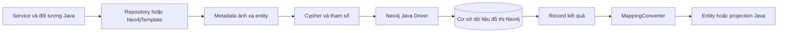

# Luồng xử lý từ đối tượng Java đến Cypher và kết quả đồ thị

Trong chương **Tổng quan**, bài học này theo dõi một thao tác dữ liệu từ lúc ứng dụng tạo đối tượng Java cho đến khi Neo4j lưu đồ thị, rồi trả kết quả về ứng dụng. Với `SPRING_DATA_NEO4J`, Spring Data Neo4j cung cấp tầng ánh xạ giữa mô hình Java và mô hình đồ thị: node được biểu diễn bằng entity, cạnh được biểu diễn bằng relationship, còn repository và Cypher là hai cách chính để truy vấn dữ liệu.

Luồng xử lý này gắn trực tiếp với các kỹ năng của module: mô hình hóa quan hệ, ánh xạ dữ liệu, quản lý transaction và tối ưu truy vấn. Hiểu được từng chặng giúp ta biết phần nào do Spring Data Neo4j đảm nhiệm, phần nào do ứng dụng quyết định và cần kiểm tra ở đâu khi kết quả không như mong đợi.

## 1. Nhìn toàn bộ luồng xử lý

Một thao tác ghi thường bắt đầu ở service với một hoặc nhiều đối tượng Java. Repository nhận đối tượng, Spring Data Neo4j đọc metadata ánh xạ, chuẩn bị câu lệnh Cypher có tham số và thực thi qua Neo4j Java Driver trong transaction. Khi đọc, kết quả truy vấn được chuyển ngược thành entity hoặc projection Java.



Sơ đồ mô tả các vai trò chính, không khẳng định mỗi lần lưu chỉ sinh một câu Cypher hay một lần trao đổi với database. Số câu lệnh và hình dạng Cypher phụ thuộc vào entity, quan hệ cần lưu, trạng thái dữ liệu và phiên bản Spring Data Neo4j.

Hai chiều có thể được hiểu như sau:

- **Ghi:** trạng thái đối tượng Java được ánh xạ thành node, thuộc tính và relationship trong Neo4j.
- **Đọc:** Cypher tìm các phần của đồ thị; bộ ánh xạ chuyển record trả về thành đối tượng Java phù hợp với kiểu kết quả đã khai báo.

## 2. Entity Java mô tả node và relationship như thế nào?

Neo4j lưu dữ liệu dưới dạng node, relationship và property. Spring Data Neo4j dùng annotation để mô tả cách các thành phần này tương ứng với lớp Java.

Ví dụ, một người có thể tham gia nhiều bộ phim. Mỗi `Person` và `Movie` là một node; quan hệ `ACTED_IN` đi từ người sang phim.

```java
import org.springframework.data.neo4j.core.schema.Id;
import org.springframework.data.neo4j.core.schema.Node;
import org.springframework.data.neo4j.core.schema.Relationship;
import org.springframework.data.annotation.Version;

import java.util.HashSet;
import java.util.Set;

@Node("Person")
public class Person {

    @Id
    private String id;

    @Version
    private Long version;

    private String name;

    @Relationship(type = "ACTED_IN", direction = Relationship.Direction.OUTGOING)
    private Set<Movie> movies = new HashSet<>();

    // Constructor, getter và setter được lược bỏ.
}
```

```java
@Node("Movie")
public class Movie {

    @Id
    private String id;

    private String title;

    // Constructor, getter và setter được lược bỏ.
}
```

Các annotation quan trọng trong ví dụ:

| Annotation | Vai trò |
|---|---|
| `@Node("Person")` | Khai báo lớp là node entity và chỉ định label trong Neo4j. Nếu không chỉ định label, Spring Data Neo4j có thể suy ra label chính từ tên lớp. |
| `@Id` | Đánh dấu thuộc tính định danh dùng để nhận diện node trong mô hình persistence. |
| `@Version` | Hỗ trợ kiểm soát phiên bản khi cập nhật, phát hiện một số xung đột ghi đồng thời và giúp Spring Data xác định trạng thái mới của entity khi dùng ID do ứng dụng cấp. |
| `@Relationship` | Khai báo loại cạnh và hướng cạnh tương ứng với thuộc tính Java. |

Trong ví dụ, `OUTGOING` có nghĩa là cạnh được mô hình hóa theo hướng `Person` → `Movie`. Khi thiết kế entity, hãy đối chiếu hướng này với cách dữ liệu được tạo và truy vấn trong Cypher. Hướng cạnh là một phần của cấu trúc đồ thị, không chỉ là tên thuộc tính Java.

Ứng dụng có thể cấp ID ổn định, chẳng hạn UUID, trước khi lưu. Khi dùng ID tự cấp, cần chọn chiến lược xác định entity mới/cũ nhất quán; `@Version` là một lựa chọn phổ biến. Với dữ liệu quan trọng, nên tạo unique constraint ở Neo4j cho label và thuộc tính định danh để database bảo vệ tính duy nhất, kể cả khi có nhiều tiến trình ghi đồng thời.

Nếu một relationship có thuộc tính riêng, chẳng hạn vai diễn, ngày tham gia hoặc thứ tự, có thể mô hình hóa nó bằng lớp `@RelationshipProperties`. Lớp này dùng `@TargetNode` để trỏ đến node đích và có thể chứa các property của cạnh. Cách làm đó giữ đúng ý nghĩa của đồ thị: thông tin mô tả mối quan hệ nằm trên relationship thay vì bị đặt nhầm vào một trong hai node.

## 3. Từ lời gọi repository đến câu lệnh Cypher

Repository là điểm vào quen thuộc của tầng dữ liệu. Một repository có thể kế thừa `Neo4jRepository` để nhận các thao tác CRUD cơ bản và khai báo thêm phương thức truy vấn.

```java
import org.springframework.data.neo4j.repository.Neo4jRepository;
import java.util.Optional;

public interface PersonRepository extends Neo4jRepository<Person, String> {

    Optional<Person> findByName(String name);
}
```

Với `findByName`, Spring Data Neo4j phân tích tên phương thức và metadata của entity để tạo truy vấn phù hợp. Cách khai báo này tiện cho các điều kiện đơn giản dựa trên thuộc tính. Khi cần mô tả rõ đường đi qua nhiều loại node, gom nhóm, tính toán hoặc dùng tính năng đặc thù của Cypher, ta có thể khai báo truy vấn bằng `@Query`.

Khi service gọi `save`, luồng xử lý khái quát diễn ra theo các bước:

1. **Nhận entity:** repository nhận `Person` cùng các đối tượng liên quan được biểu diễn trong thuộc tính `movies`.
2. **Đọc metadata:** Spring Data Neo4j xác định label, ID, property, kiểu relationship và hướng cạnh từ annotation cùng metadata ánh xạ.
3. **Chuẩn bị câu lệnh:** framework tạo Cypher và bộ tham số tương ứng với trạng thái entity. Giá trị dữ liệu được truyền dưới dạng tham số, thay vì ghép trực tiếp vào chuỗi truy vấn.
4. **Thực thi:** Neo4j Java Driver gửi câu lệnh đến database trong transaction hiện hành.
5. **Nhận kết quả:** kết quả thực thi được ánh xạ trở lại entity; những giá trị do database hoặc framework quản lý, chẳng hạn version, có thể được cập nhật trong đối tượng trả về.

Đoạn Cypher dưới đây minh họa ý nghĩa của một thao tác lưu người và bộ phim có quan hệ. Đây là cách diễn giải ở mức nghiệp vụ, **không phải cam kết về chuỗi Cypher chính xác mà framework sẽ sinh ra**:

```cypher
MERGE (p:Person {id: $personId})
SET p.name = $personName
MERGE (m:Movie {id: $movieId})
SET m.title = $movieTitle
MERGE (p)-[:ACTED_IN]->(m)
```

`$personId`, `$personName`, `$movieId` và `$movieTitle` là tham số. Dùng tham số giúp database tái sử dụng kế hoạch thực thi tốt hơn trong nhiều trường hợp và tránh lỗi bảo mật do nối chuỗi đầu vào thành Cypher. `MERGE` trong ví dụ diễn tả việc tìm hoặc tạo theo khóa được nêu; ứng dụng vẫn cần constraint phù hợp để bảo đảm tính duy nhất khi có ghi đồng thời.

Một điểm cần lưu ý là `save` làm việc với entity graph mà ứng dụng đưa vào. Khi entity có thuộc tính relationship, Spring Data Neo4j cần đồng bộ các quan hệ được ánh xạ theo trạng thái entity. Vì vậy, không nên lấy một đối tượng chỉ chứa một phần quan hệ rồi lưu như thể đó là toàn bộ trạng thái nếu mục tiêu là giữ nguyên mọi cạnh hiện có. Hãy tải đủ phần dữ liệu cần quản lý trước khi cập nhật, hoặc dùng Cypher chuyên biệt cho thao tác chỉ thay đổi một phần đồ thị.

## 4. Từ Cypher trở lại entity hoặc projection

Khi đọc dữ liệu, repository có thể dùng query derivation hoặc Cypher tự khai báo. Ví dụ sau dùng `@Query` để tìm một người theo ID:

```java
import org.springframework.data.neo4j.repository.query.Query;
import org.springframework.data.repository.query.Param;

public interface PersonRepository extends Neo4jRepository<Person, String> {

    @Query("""
        MATCH (p:Person {id: $personId})
        RETURN p
        """)
    Optional<Person> findPersonById(@Param("personId") String personId);
}
```

Neo4j trả về record chứa node `p`. Bộ ánh xạ của Spring Data Neo4j đọc label và property để tạo `Person`. Câu truy vấn trên chỉ trả về node `p`; việc node có các cạnh khác trong database không có nghĩa tất cả những cạnh đó tự động được nạp vào thuộc tính `movies`. Nếu kết quả cần chứa quan hệ, truy vấn phải trả về dữ liệu đồ thị cần thiết theo cấu trúc kết quả mà Spring Data Neo4j có thể ánh xạ.

Không phải lúc nào ứng dụng cũng cần một entity đầy đủ. Với màn hình chỉ hiển thị tên người và danh sách phim, có thể dùng projection để trả về đúng dữ liệu cần dùng:

```java
import java.util.List;

public interface FilmographyView {
    String getPersonName();
    List<String> getMovieTitles();
}
```

```java
public interface PersonRepository extends Neo4jRepository<Person, String> {

    @Query("""
        MATCH (p:Person)-[:ACTED_IN]->(m:Movie)
        WHERE p.id = $personId
        RETURN p.name AS personName, collect(m.title) AS movieTitles
        """)
    Optional<FilmographyView> findFilmography(@Param("personId") String personId);
}
```

Các alias `personName` và `movieTitles` khớp với tên property mà projection cung cấp. Record được chuyển thành projection thay vì dựng toàn bộ `Person` và `Movie`. Cách này giảm lượng dữ liệu phải truyền và ánh xạ khi use case chỉ cần một phần kết quả.

Khi viết `@Query`, cần kiểm tra ba điểm:

- **Kiểu kết quả:** trả về node, relationship, path, scalar hay các cột phục vụ projection?
- **Dữ liệu được trả về:** truy vấn có trả đủ node và relationship mà entity cần ánh xạ không?
- **Tên cột:** alias trong `RETURN` có khớp với property của DTO hoặc projection không?

Đây là khác biệt quan trọng giữa việc viết Cypher chạy đúng trong Neo4j Browser và việc ánh xạ được kết quả đó thành đúng kiểu Java trong repository.

## 5. Transaction bao quanh thao tác dữ liệu

Một use case thường gồm nhiều thao tác: lưu node mới, cập nhật node khác và tạo relationship nối chúng. Nếu các thao tác này phải thành công hoặc thất bại cùng nhau, hãy đặt transaction ở ranh giới nghiệp vụ bằng `@Transactional`.

```java
import org.springframework.stereotype.Service;
import org.springframework.transaction.annotation.Transactional;

@Service
public class FilmographyService {

    private final PersonRepository people;
    private final MovieRepository movies;

    public FilmographyService(PersonRepository people, MovieRepository movies) {
        this.people = people;
        this.movies = movies;
    }

    @Transactional
    public Person addMovie(Person person, Movie movie) {
        movies.save(movie);
        person.getMovies().add(movie);
        return people.save(person);
    }
}
```

Ví dụ giả định `Person` và `Movie` có các phương thức truy cập tương ứng. Transaction manager của Spring Data Neo4j phối hợp với Neo4j Driver để các thao tác repository trong cùng transaction dùng chung ranh giới commit/rollback. Nếu một thao tác phát sinh lỗi khiến transaction bị rollback, các thay đổi thuộc transaction đó không được commit riêng lẻ.

Nên đặt transaction quanh use case thay vì mở transaction thủ công cho từng câu lệnh. Cách này giúp quy tắc nhất quán của nghiệp vụ nằm ở service, đồng thời tránh trạng thái chỉ tạo được node mà chưa tạo được relationship cần thiết. Với ứng dụng reactive, cần dùng mô hình transaction reactive tương ứng và giữ luồng xử lý reactive nhất quán; không trộn tùy tiện API imperative với reactive trong cùng một transaction.

## 6. Chọn cách truy vấn và tối ưu hiệu năng

Spring Data Neo4j hỗ trợ cả truy vấn suy diễn từ tên phương thức và Cypher tự viết. Có thể chọn theo độ phức tạp của use case:

| Nhu cầu | Cách tiếp cận phù hợp |
|---|---|
| Tìm entity theo một vài property đơn giản | Repository method như `findByName` |
| Duyệt nhiều loại node hoặc relationship theo mẫu cụ thể | `@Query` với Cypher tường minh |
| Trả về một tập trường nhỏ cho API hoặc màn hình | Projection hoặc DTO |
| Thực hiện thao tác dữ liệu linh hoạt ngoài CRUD entity thông thường | `Neo4jClient` hoặc `Neo4jTemplate` |

Một số nguyên tắc giúp truy vấn và ánh xạ hiệu quả hơn:

1. **Bắt đầu từ điều kiện có tính chọn lọc.** Nếu tìm theo ID hoặc khóa nghiệp vụ, hãy bảo đảm label/property đó có index hoặc unique constraint thích hợp. Điều này giúp Neo4j thu hẹp tập node cần xét.
2. **Giữ truy vấn có tham số.** Truyền giá trị qua parameter binding; không ghép dữ liệu người dùng trực tiếp vào chuỗi Cypher.
3. **Chỉ trả dữ liệu cần thiết.** Dùng projection, `RETURN` có chọn lọc và giới hạn số kết quả khi phù hợp. Tránh nạp một vùng đồ thị lớn chỉ để hiển thị vài trường.
4. **Kiểm tra kế hoạch thực thi.** Dùng `EXPLAIN` để xem kế hoạch và `PROFILE` để đo thực thi trên dữ liệu đại diện. `PROFILE` thực sự chạy truy vấn, vì vậy cần cân nhắc tải và tác động nếu dùng trên môi trường production.
5. **Tránh truy vấn lặp theo từng node.** Nếu một màn hình cần danh sách node cùng quan hệ liên quan, cân nhắc một truy vấn có mẫu đồ thị phù hợp thay vì phát sinh thêm truy vấn cho từng phần tử.
6. **Giới hạn kích thước kết quả.** Với tập dữ liệu lớn, dùng phân trang hoặc chia truy vấn theo khóa và tránh thu thập toàn bộ kết quả vào bộ nhớ ứng dụng.
7. **Đo cả chi phí ánh xạ.** Một truy vấn có thể chạy nhanh ở database nhưng vẫn chậm ở ứng dụng nếu trả quá nhiều node, relationship hoặc property để dựng entity graph.

Tối ưu không chỉ là làm Cypher chạy nhanh. Số lượng dữ liệu được trả về, số lần gọi database, cấu trúc entity và chi phí chuyển record thành Java object đều ảnh hưởng đến thời gian phản hồi.

## 7. Các lỗi thường gặp khi đi qua luồng ánh xạ

| Biểu hiện | Nguyên nhân cần kiểm tra | Hướng xử lý |
|---|---|---|
| Entity đọc được nhưng collection relationship rỗng | Truy vấn tùy chỉnh chỉ trả node gốc hoặc không trả đủ dữ liệu quan hệ | Kiểm tra phần `MATCH` và `RETURN`; xác nhận query trả các phần đồ thị cần ánh xạ |
| Cạnh đi ngược hướng mong muốn | `direction` trong `@Relationship` không khớp hướng dữ liệu | Đối chiếu annotation với mẫu `(nguồn)-[:LOẠI_CẠNH]->(đích)` trong Cypher |
| Xuất hiện node trùng | ID không ổn định, quy tắc nhận diện entity mới/cũ chưa nhất quán hoặc thiếu constraint | Kiểm tra chiến lược ID, `@Version`/newness và unique constraint trong database |
| Cập nhật làm mất một số cạnh | Entity được lưu chỉ chứa một phần trạng thái relationship nhưng lại được dùng như trạng thái đầy đủ | Tải aggregate cần thiết trước khi lưu hoặc cập nhật cạnh bằng Cypher có phạm vi rõ ràng |
| Truy vấn chậm khi dữ liệu tăng | Thiếu index, pattern quá rộng, trả nhiều dữ liệu hoặc phát sinh truy vấn lặp | Dùng `EXPLAIN`/`PROFILE`, thu hẹp pattern, thêm index phù hợp và giảm dữ liệu trả về |
| Nhiều thao tác chỉ commit một phần | Các thao tác nằm ngoài cùng transaction hoặc transaction không được áp dụng như dự kiến | Kiểm tra ranh giới `@Transactional`, transaction manager và cách gọi qua Spring proxy |

Khi điều tra lỗi, hãy lần theo đúng chiều của luồng: kiểm tra object trước khi gọi repository, metadata annotation, Cypher và tham số thực thi, dữ liệu thực tế trong Neo4j, rồi mới kiểm tra record và đối tượng Java sau ánh xạ. Cách kiểm tra tuần tự này giúp khoanh vùng lỗi ở mô hình, truy vấn, transaction hay converter.

## 8. Tự kiểm tra mức độ hiểu bài

Sau khi đọc bài, hãy thử giải thích hoặc thực hành các câu hỏi sau:

1. Với `Person` có thuộc tính `Set<Movie>` được đánh dấu `@Relationship`, annotation nào quyết định loại cạnh và hướng cạnh?
2. Khi gọi `personRepository.save(person)`, những metadata nào được Spring Data Neo4j dùng để chuẩn bị Cypher?
3. Vì sao một phương thức `@Query` trả về `p` chưa chắc làm đầy thuộc tính relationship của `Person`?
4. Khi một use case cần lưu node phim và liên kết nó với người trong cùng một nghiệp vụ, nên đặt `@Transactional` ở đâu và vì sao?
5. Nếu truy vấn chậm, cần xem xét đồng thời kế hoạch thực thi, index, số lượng record trả về và chi phí ánh xạ như thế nào?

Nắm được đường đi từ entity đến Cypher và từ record trở lại Java là nền tảng để sử dụng Spring Data Neo4j có chủ đích. Khi đã hiểu đường đi này, việc thiết kế node và relationship, chọn repository hay Cypher, đặt transaction và tối ưu truy vấn sẽ dựa trên cấu trúc dữ liệu thực tế của ứng dụng.
