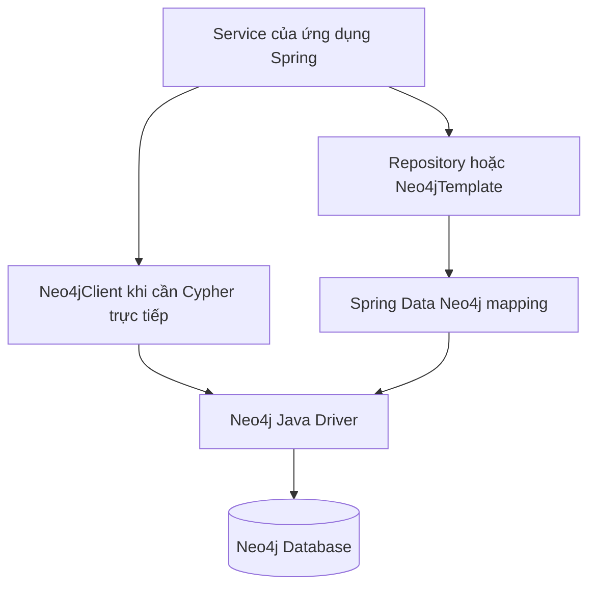

# Phân biệt Spring Data Neo4j hiện đại với các thế hệ dùng Neo4j-OGM

Spring Data Neo4j (SDN) và Neo4j-OGM đều giúp ánh xạ dữ liệu đồ thị thành đối tượng Java, nhưng chúng không phải cùng một thư viện. Ở các thế hệ Spring Data Neo4j cũ, Neo4j-OGM đảm nhiệm phần lớn công việc ánh xạ và quản lý phiên làm việc. Từ Spring Data Neo4j 6 trở đi, SDN có lớp ánh xạ riêng và truy cập cơ sở dữ liệu thông qua Neo4j Java Driver. Sự thay đổi này ảnh hưởng trực tiếp đến annotation, API truy cập dữ liệu, cách quản lý transaction và cách tổ chức mã nguồn.

Hiểu rõ ranh giới giữa hai thế hệ giúp bạn chọn đúng API khi xây dựng ứng dụng mới, đồng thời tránh trộn lẫn các thành phần OGM vào một ứng dụng đang dùng SDN hiện đại.

## 1. Phân biệt vai trò của hai công nghệ

**Spring Data Neo4j** là một phần của hệ sinh thái Spring Data. Thư viện cung cấp mô hình repository, cơ chế ánh xạ entity, tích hợp transaction của Spring và các API làm việc với Cypher. Mục tiêu là giúp ứng dụng Spring thao tác với node và relationship theo cách nhất quán với các module Spring Data khác.

**Neo4j-OGM (Object Graph Mapping)** là thư viện ánh xạ đồ thị đối tượng sang đồ thị Neo4j. OGM cung cấp annotation mô tả node và relationship, cùng các API như `SessionFactory` và `Session` để mở phiên, tải và lưu đồ thị. Trong các thế hệ Spring Data Neo4j cũ, SDN dựa vào OGM cho phần ánh xạ và tương tác với Neo4j.

Từ dòng **Spring Data Neo4j 6.x**, SDN chuyển sang sử dụng Neo4j Java Driver và triển khai lớp ánh xạ của chính mình. Vì vậy, một ứng dụng dùng SDN hiện đại không cần Neo4j-OGM để ánh xạ entity. OGM vẫn là một thư viện riêng; việc nó xuất hiện trong một dự án cũ không có nghĩa các API OGM tiếp tục là API của SDN hiện đại.

## 2. So sánh hai thế hệ

| Khía cạnh | Spring Data Neo4j thế hệ cũ dùng OGM | Spring Data Neo4j hiện đại (6.x trở đi) |
|---|---|---|
| Lớp ánh xạ | Dựa vào Neo4j-OGM | Lớp ánh xạ do SDN cung cấp |
| Kết nối cơ sở dữ liệu | OGM quản lý tương tác qua các driver tương ứng | Neo4j Java Driver |
| Annotation entity | Thường dùng `@NodeEntity` và annotation thuộc `org.neo4j.ogm.annotation` | Dùng `@Node`, `@Relationship`, `@Property` thuộc `org.springframework.data.neo4j.core.schema` |
| API làm việc với dữ liệu | `SessionFactory`, `Session` của OGM; SDN có thể cung cấp repository ở tầng Spring | `Neo4jRepository`, `Neo4jTemplate`, `Neo4jClient` |
| Truy vấn | OGM session và các cơ chế truy vấn được tích hợp trong thế hệ SDN tương ứng | Derived query, `@Query` với Cypher, hoặc `Neo4jClient` |
| Transaction | Gắn với vòng đời session và tích hợp OGM của thế hệ cũ | Tích hợp transaction Spring với Neo4j Java Driver qua transaction manager của SDN |
| Gói annotation | `org.neo4j.ogm.annotation` | `org.springframework.data.neo4j.core.schema` |

Tên annotation có thể giống nhau giữa hai hệ sinh thái, chẳng hạn `@Id` hoặc `@Relationship`, nhưng package và cơ chế thực thi có thể khác. Khi đọc hoặc di chuyển mã nguồn, hãy kiểm tra import thực tế thay vì chỉ nhìn tên annotation.

## 3. Mô hình truy cập dữ liệu trong SDN hiện đại

Trong ứng dụng dùng SDN hiện đại, các thành phần thường được tổ chức theo luồng sau:



Các thành phần có vai trò khác nhau:

- `Neo4jRepository` cung cấp thao tác CRUD và truy vấn theo quy ước tên phương thức hoặc theo `@Query`.
- `Neo4jTemplate` cung cấp API thao tác entity ở tầng template, hữu ích khi cần điều khiển quy trình đọc và ghi chi tiết hơn repository.
- `Neo4jClient` thực thi Cypher và ánh xạ các giá trị trả về. Đây là lựa chọn phù hợp khi kết quả truy vấn là dữ liệu tổng hợp, scalar hoặc projection tùy chỉnh.
- Neo4j Java Driver quản lý kết nối và thực thi giao dịch ở tầng giao tiếp với máy chủ Neo4j.

Bạn có thể dùng repository cho các thao tác miền nghiệp vụ thông thường, sau đó dùng `@Query` hoặc `Neo4jClient` cho truy vấn đồ thị đặc thù. Không cần tạo một OGM `Session` để sử dụng các API này.

## 4. Ví dụ entity và repository theo SDN hiện đại

Entity dưới đây mô tả một node `Person` có quan hệ có hướng `KNOWS` tới các node `Person` khác:

```java
import java.util.HashSet;
import java.util.Set;

import org.springframework.data.neo4j.core.schema.GeneratedValue;
import org.springframework.data.neo4j.core.schema.Id;
import org.springframework.data.neo4j.core.schema.Node;
import org.springframework.data.neo4j.core.schema.Property;
import org.springframework.data.neo4j.core.schema.Relationship;

@Node("Person")
public class Person {

    @Id
    @GeneratedValue
    private Long id;

    @Property("full_name")
    private String name;

    @Relationship(type = "KNOWS", direction = Relationship.Direction.OUTGOING)
    private Set<Person> friends = new HashSet<>();

    protected Person() {
    }

    public Person(String name) {
        this.name = name;
    }

    public Long getId() {
        return id;
    }

    public String getName() {
        return name;
    }

    public Set<Person> getFriends() {
        return friends;
    }
}
```

Các annotation trong ví dụ thuộc package schema của Spring Data Neo4j:

- `@Node("Person")` xác định label của node.
- `@Id` đánh dấu thuộc tính định danh của entity; `@GeneratedValue` yêu cầu SDN tạo giá trị định danh theo cơ chế được cấu hình.
- `@Property("full_name")` ánh xạ thuộc tính Java `name` sang property `full_name` trong Neo4j.
- `@Relationship` mô tả loại và hướng của relationship. `OUTGOING` nghĩa là relationship đi từ node `Person` hiện tại tới các node trong `friends`.

Repository có thể khai báo như sau:

```java
import java.util.List;

import org.springframework.data.neo4j.repository.Neo4jRepository;
import org.springframework.data.neo4j.repository.query.Query;

public interface PersonRepository extends Neo4jRepository<Person, Long> {

    List<Person> findByName(String name);

    @Query("""
        MATCH (p:Person)-[:KNOWS]->(friend:Person)
        WHERE p.full_name = $name
        RETURN friend
        """)
    List<Person> findFriendsByName(String name);
}
```

Phương thức `findByName` minh họa truy vấn theo thuộc tính Java của entity. Phương thức `findFriendsByName` dùng Cypher tường minh để biểu đạt quan hệ đồ thị. Kết quả `RETURN friend` trả về node cần ánh xạ thành `Person`. Khi viết truy vấn tùy chỉnh, hãy bảo đảm cấu trúc dữ liệu trả về phù hợp với kiểu kết quả khai báo; nếu chỉ trả về một vài cột thì nên dùng projection hoặc kiểu dữ liệu tương ứng thay vì yêu cầu SDN dựng một entity đầy đủ.

## 5. Truy vấn Cypher trực tiếp bằng Neo4jClient

Khi cần lấy một giá trị đơn giản hoặc kết quả tổng hợp, `Neo4jClient` giúp tránh phải ánh xạ toàn bộ kết quả thành entity. Ví dụ sau lấy tên những người mà một người biết:

```java
import java.util.List;

import org.springframework.data.neo4j.core.Neo4jClient;
import org.springframework.stereotype.Repository;

@Repository
public class PersonQueryRepository {

    private final Neo4jClient neo4jClient;

    public PersonQueryRepository(Neo4jClient neo4jClient) {
        this.neo4jClient = neo4jClient;
    }

    public List<String> findFriendNames(String name) {
        return neo4jClient.query("""
                MATCH (p:Person)-[:KNOWS]->(friend:Person)
                WHERE p.full_name = $name
                RETURN friend.full_name AS friendName
                """)
            .bind(name).to("name")
            .fetchAs(String.class)
            .mappedBy((typeSystem, record) -> record.get("friendName").asString())
            .all();
    }
}
```

Tham số `name` được bind vào `$name`, nhờ đó dữ liệu đầu vào không bị nối trực tiếp vào chuỗi Cypher. `fetchAs(String.class)` khai báo kiểu kết quả, còn `mappedBy` chuyển từng record thành chuỗi. Với truy vấn trả về nhiều cột, bạn có thể ánh xạ mỗi record thành một DTO hoặc kiểu projection phù hợp.

## 6. Mã kiểu OGM trong dự án thế hệ cũ

Một entity dùng Neo4j-OGM thường có dạng sau (đây là ví dụ nhận diện mã cũ, không phải cách khai báo entity cho SDN hiện đại):

```java
import java.util.Set;

import org.neo4j.ogm.annotation.GeneratedValue;
import org.neo4j.ogm.annotation.Id;
import org.neo4j.ogm.annotation.NodeEntity;
import org.neo4j.ogm.annotation.Relationship;

@NodeEntity
public class Person {

    @Id
    @GeneratedValue
    private Long id;

    @Relationship(type = "KNOWS", direction = Relationship.OUTGOING)
    private Set<Person> friends;
}
```

Đoạn mã này dùng annotation từ `org.neo4j.ogm.annotation`, đặc biệt là `@NodeEntity`. Ở tầng truy cập dữ liệu, ứng dụng OGM thường làm việc với `SessionFactory` và `Session`, chẳng hạn mở session rồi gọi `load` hoặc `save`. Đây là mô hình API của OGM. Trong SDN hiện đại, bạn dùng repository, template hoặc client của Spring Data Neo4j thay cho việc đưa OGM `Session` vào service.

Đừng chỉ đổi `@NodeEntity` thành `@Node` rồi xem việc nâng cấp đã hoàn tất. Cần chuyển cả cách tạo kết nối, truy vấn, lưu entity và quản lý transaction sang các API của SDN hiện đại.

## 7. Transaction trong SDN hiện đại

SDN hiện đại tích hợp với cơ chế transaction của Spring. Khi một nghiệp vụ cần nhiều thao tác Neo4j cùng thành công hoặc cùng rollback, hãy đặt ranh giới transaction ở tầng service bằng `@Transactional` và bảo đảm ứng dụng sử dụng transaction manager Neo4j phù hợp. SDN cung cấp transaction manager cho cả cách làm việc imperative và reactive; lựa chọn phải khớp với API mà ứng dụng đang sử dụng.

Ví dụ về ranh giới nghiệp vụ:

```java
import org.springframework.stereotype.Service;
import org.springframework.transaction.annotation.Transactional;

@Service
public class PersonService {

    private final PersonRepository personRepository;

    public PersonService(PersonRepository personRepository) {
        this.personRepository = personRepository;
    }

    @Transactional
    public Person createPerson(String name) {
        return personRepository.save(new Person(name));
    }
}
```

Ví dụ này minh họa vị trí đặt transaction cho một nghiệp vụ ghi dữ liệu. Trong ứng dụng thực tế, cần kiểm tra cấu hình driver, transaction manager và kiểu lập trình đồng bộ hoặc reactive để bảo đảm mọi thao tác trong nghiệp vụ tham gia cùng transaction mong muốn.

## 8. Những điểm cần rà soát khi chuyển từ OGM sang SDN

Khi nâng cấp một ứng dụng dùng thế hệ SDN dựa trên OGM, hãy rà soát lần lượt các phần sau:

1. **Dependency và import:** xác định dependency OGM còn được dùng trực tiếp ở đâu. Chuyển annotation entity sang `org.springframework.data.neo4j.core.schema` và loại bỏ import OGM khi không còn thành phần nào cần nó.
2. **Mô hình entity:** kiểm tra label node, tên property, hướng relationship, kiểu dữ liệu và các lớp mang thuộc tính relationship. Đảm bảo mô hình Java phản ánh đúng cấu trúc đồ thị cần lưu.
3. **Định danh:** xem lại cách sinh và lưu ID. Không nên xây dựng định danh nghiệp vụ lâu dài dựa vào internal ID của Neo4j; nếu cần định danh ổn định ngoài hệ thống, hãy cân nhắc ID do ứng dụng quản lý như UUID.
4. **API đọc và ghi:** thay các lời gọi `Session.load` hoặc `Session.save` bằng repository, `Neo4jTemplate`, `Neo4jClient` hoặc driver ở đúng tầng phù hợp. Chọn API theo mục tiêu: entity, thao tác template hay kết quả Cypher tùy chỉnh.
5. **Truy vấn:** kiểm tra lại Cypher và hình dạng record trả về. Một truy vấn trả về node, relationship, path hoặc các cột tổng hợp có yêu cầu ánh xạ khác nhau.
6. **Transaction:** chuyển cấu hình và ranh giới transaction sang cơ chế tích hợp của SDN với Spring. Kiểm tra rollback khi một bước trong nghiệp vụ thất bại.
7. **Kiểm thử đồ thị:** kiểm tra việc lưu rồi đọc lại node và relationship, hướng relationship, property được ánh xạ, kết quả truy vấn tùy chỉnh và hành vi transaction.
8. **Hiệu năng:** dùng `EXPLAIN` hoặc `PROFILE` trong Neo4j để xem kế hoạch thực thi, đồng thời kiểm tra index và constraint cho các thuộc tính thường được tìm kiếm.

Không nên thực hiện nâng cấp bằng cách thay dependency trước rồi xử lý lỗi biên dịch một cách máy móc. Những thay đổi về mapping và truy vấn có thể làm ứng dụng chạy được nhưng trả về đồ thị thiếu hoặc khác với dữ liệu mong đợi. Hãy kiểm tra hành vi đọc/ghi trên một tập dữ liệu đại diện.

## 9. Chọn cách tiếp cận nào?

- Với **ứng dụng mới dùng Spring**, hãy bắt đầu bằng Spring Data Neo4j hiện đại và Neo4j Java Driver. Dùng repository cho thao tác entity thông thường, `@Query` cho truy vấn miền nghiệp vụ cần Cypher và `Neo4jClient` cho kết quả tùy chỉnh.
- Với **ứng dụng cũ đang dùng SDN và OGM**, trước hết xác định phiên bản và các API OGM đang được gọi. Lập kế hoạch chuyển đổi mapping, truy vấn và transaction như một thay đổi kiến trúc có kiểm thử.
- Với **ứng dụng dùng OGM độc lập**, chỉ tiếp tục OGM khi đó là lựa chọn có chủ đích và tương thích với nền tảng của dự án. Không thêm OGM vào chỉ vì thấy ví dụ cũ sử dụng `SessionFactory` hoặc `@NodeEntity`.

## 10. Tự kiểm tra

1. Vì sao một entity có `@NodeEntity` và import từ `org.neo4j.ogm.annotation` thường cho thấy dự án đang dùng mô hình OGM?
2. Từ Spring Data Neo4j 6.x, thành phần nào đảm nhiệm kết nối và thực thi truy vấn tới Neo4j?
3. Khi cần trả về danh sách tên thay vì entity, vì sao `Neo4jClient` có thể phù hợp hơn repository?
4. Khi di chuyển từ OGM, vì sao cần kiểm tra lại cả mapping relationship và ranh giới transaction?

Nếu trả lời được các câu hỏi này, bạn đã nắm được khác biệt kiến trúc cốt lõi: OGM từng là nền tảng ánh xạ của các thế hệ SDN cũ, còn SDN hiện đại sở hữu lớp mapping riêng và làm việc trực tiếp qua Neo4j Java Driver.
