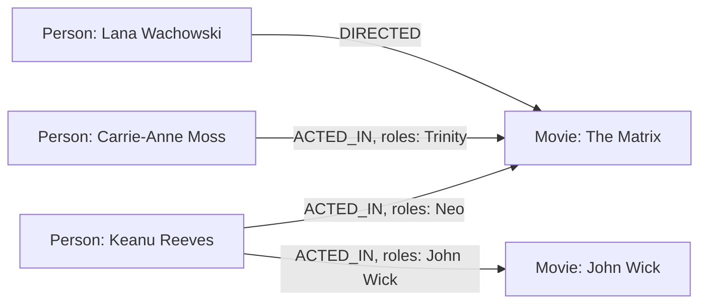

# Lộ trình học và bộ dữ liệu phim–diễn viên dùng xuyên suốt tài liệu

Spring Data Neo4j là một phần của hệ sinh thái Spring Data, giúp ứng dụng Java ánh xạ mô hình đối tượng sang đồ thị Neo4j. Thay vì chỉ thao tác với các hàng và khóa ngoại, ta mô hình hóa dữ liệu bằng **node**, **relationship** và thuộc tính của chúng; sau đó dùng repository, Cypher và transaction để đọc, ghi và duy trì dữ liệu.

Tài liệu trong module **SPRING_DATA_NEO4J** đi từ cách thiết kế đồ thị đến cách triển khai tầng dữ liệu trong ứng dụng Spring. Bộ dữ liệu phim–diễn viên được dùng xuyên suốt để các khái niệm luôn gắn với cùng một miền nghiệp vụ. Khi học đến repository, relationship properties hay truy vấn Cypher, ta có thể mở rộng chính đồ thị đó thay vì phải làm quen một ví dụ hoàn toàn mới.

## 1. Kết quả cần đạt

Sau khi hoàn thành lộ trình, bạn cần có khả năng:

- Nhận diện thực thể nào nên là node, quan hệ nào nên là relationship và thuộc tính nào nên đặt trên từng thành phần.
- Ánh xạ node và relationship sang lớp Java bằng các annotation của Spring Data Neo4j.
- Dùng repository để thực hiện các thao tác dữ liệu thông dụng, đồng thời viết truy vấn Cypher khi cần kiểm soát rõ cấu trúc truy vấn.
- Chọn ranh giới transaction phù hợp cho một nghiệp vụ gồm nhiều thao tác đọc và ghi.
- Đọc kế hoạch thực thi, sử dụng index và giới hạn lượng dữ liệu được tải để cải thiện hiệu năng.

Các kỹ năng này liên kết với nhau. Mô hình đồ thị quyết định cách ánh xạ; cách ánh xạ ảnh hưởng đến dữ liệu repository trả về; truy vấn và transaction quyết định hành vi khi chạy; còn việc đo và tối ưu giúp tầng dữ liệu hoạt động ổn định khi dữ liệu tăng lên.

## 2. Tư duy dữ liệu đồ thị

Neo4j lưu dữ liệu dưới dạng đồ thị. Hai thành phần cơ bản là:

- **Node** đại diện cho một đối tượng hoặc thực thể, chẳng hạn một người hoặc một bộ phim. Node có thể mang một hay nhiều label và các thuộc tính.
- **Relationship** biểu diễn liên kết có hướng giữa hai node. Relationship có type và cũng có thể mang thuộc tính riêng.

Với ví dụ phim–diễn viên, `Person` và `Movie` là hai loại node. Một người tham gia diễn xuất trong một bộ phim được biểu diễn bằng relationship `ACTED_IN`; một người đạo diễn bộ phim được biểu diễn bằng `DIRECTED`.



Hướng của relationship là một phần của mô hình. Trong đồ thị trên, `ACTED_IN` đi từ `Person` đến `Movie`. Khi truy vấn, Cypher có thể duyệt theo hướng này, hướng ngược lại hoặc bỏ qua hướng nếu nghiệp vụ cho phép. Việc chọn hướng nhất quán giúp sơ đồ dễ đọc và giúp nhóm phát triển thống nhất cách diễn giải dữ liệu.

Một relationship có thể chứa thông tin chỉ có ý nghĩa trong chính mối liên kết đó. Ví dụ, `roles` là danh sách vai diễn của một diễn viên trong một bộ phim. Thuộc tính này nên nằm trên `ACTED_IN`, vì cùng một người có thể đóng các vai khác nhau trong các phim khác nhau. Nếu đặt `roles` trực tiếp trên node `Person`, ta sẽ không biết vai nào thuộc về bộ phim nào.

## 3. Bộ dữ liệu phim–diễn viên

Bộ dữ liệu minh họa sử dụng hai label và một số relationship type sau:

| Thành phần | Thuộc tính tiêu biểu | Ý nghĩa |
|---|---|---|
| `Person` | `name`, `born` | Người tham gia sản xuất phim, chẳng hạn diễn viên hoặc đạo diễn |
| `Movie` | `title`, `released` | Bộ phim và năm phát hành |
| `ACTED_IN` | `roles` | Người tham gia diễn xuất trong phim và tên vai diễn |
| `DIRECTED` | — | Người đạo diễn phim |

Trong ví dụ học tập, `Person.name` được dùng làm khóa duy nhất cho người; cặp `Movie.title` và `Movie.released` xác định một phim. Đây là quy ước của bộ dữ liệu mẫu. Ứng dụng thực tế cần chọn khóa nghiệp vụ phù hợp với nguồn dữ liệu và quy tắc định danh của mình.

### 3.1. Tạo ràng buộc và dữ liệu mẫu

Các lệnh sau tạo ràng buộc duy nhất và thêm dữ liệu bằng `MERGE`. Có thể chạy lại các lệnh tạo dữ liệu mà không tạo thêm node hoặc relationship trùng theo các khóa đã chọn.

```cypher
CREATE CONSTRAINT person_name_unique IF NOT EXISTS
FOR (p:Person) REQUIRE p.name IS UNIQUE;

CREATE CONSTRAINT movie_identity_unique IF NOT EXISTS
FOR (m:Movie) REQUIRE (m.title, m.released) IS UNIQUE;

MERGE (keanu:Person {name: 'Keanu Reeves'})
SET keanu.born = 1964
MERGE (carrie:Person {name: 'Carrie-Anne Moss'})
SET carrie.born = 1967
MERGE (lana:Person {name: 'Lana Wachowski'})
MERGE (chad:Person {name: 'Chad Stahelski'})

MERGE (matrix:Movie {title: 'The Matrix', released: 1999})
MERGE (johnWick:Movie {title: 'John Wick', released: 2014})

MERGE (keanu)-[matrixCredit:ACTED_IN]->(matrix)
SET matrixCredit.roles = ['Neo']
MERGE (carrie)-[carrieCredit:ACTED_IN]->(matrix)
SET carrieCredit.roles = ['Trinity']
MERGE (lana)-[:DIRECTED]->(matrix)

MERGE (keanu)-[wickCredit:ACTED_IN]->(johnWick)
SET wickCredit.roles = ['John Wick']
MERGE (chad)-[:DIRECTED]->(johnWick);
```

Ràng buộc duy nhất giúp Neo4j bảo vệ các khóa đã chọn và hỗ trợ tra cứu theo thuộc tính. `MERGE` tìm hoặc tạo mẫu node/relationship; `SET` cập nhật thuộc tính trên kết quả đó. Trong hệ thống thật, cần xác định rõ khóa nào là duy nhất, xử lý trường hợp dữ liệu đầu vào thiếu hoặc sai và cân nhắc việc một người có thể có nhiều tên hiển thị.

### 3.2. Đọc dữ liệu bằng Cypher

Truy vấn sau tìm các bộ phim có diễn viên tên Keanu Reeves:

```cypher
MATCH (p:Person {name: $actorName})-[credit:ACTED_IN]->(m:Movie)
RETURN m.title AS title,
       m.released AS released,
       credit.roles AS roles
ORDER BY released;
```

`$actorName` là tham số truy vấn. Truyền giá trị qua tham số giúp tái sử dụng câu truy vấn và tránh ghép trực tiếp dữ liệu đầu vào vào chuỗi Cypher. Kết quả thể hiện cả thông tin phim và thuộc tính trên relationship, nhờ vậy ta thấy được vai diễn của người đó trong từng phim.

Một truy vấn khác có thể tìm các diễn viên của một phim:

```cypher
MATCH (p:Person)-[credit:ACTED_IN]->(m:Movie {title: $title})
RETURN p.name AS actor, credit.roles AS roles
ORDER BY actor;
```

Hai truy vấn dùng cùng một đồ thị nhưng bắt đầu từ các node khác nhau. Đây là điểm hữu ích của mô hình đồ thị: câu hỏi nghiệp vụ thường được diễn đạt bằng cách duyệt qua những mối liên kết có ý nghĩa, thay vì phải tự ghép nhiều bảng trung gian.

## 4. Ánh xạ đồ thị sang Java

Spring Data Neo4j cung cấp annotation để mô tả cách lớp Java tương ứng với node và relationship. Ví dụ rút gọn dưới đây minh họa `Person`, `Movie` và thông tin vai diễn. Các constructor, getter và setter được lược bỏ để tập trung vào phần ánh xạ.

```java
@Node("Person")
public class Person {

    @Id
    @GeneratedValue
    private Long id;

    private String name;
    private Integer born;

    @Relationship(type = "ACTED_IN", direction = Direction.OUTGOING)
    private List<ActingCredit> actingCredits = new ArrayList<>();
}

@Node("Movie")
public class Movie {

    @Id
    @GeneratedValue
    private Long id;

    private String title;
    private Integer released;
}

@RelationshipProperties
public class ActingCredit {

    @RelationshipId
    private Long id;

    private List<String> roles;

    @TargetNode
    private Movie movie;
}
```

Các annotation chính có vai trò như sau:

- `@Node` khai báo label của node mà lớp đại diện.
- `@Id` đánh dấu trường định danh của entity; `@GeneratedValue` yêu cầu Spring Data Neo4j tạo giá trị định danh theo cơ chế được cấu hình.
- `@Relationship` khai báo type và hướng của relationship được ánh xạ vào thuộc tính.
- `@RelationshipProperties` đánh dấu lớp mô tả relationship có thuộc tính riêng.
- `@TargetNode` chỉ node ở đầu còn lại của relationship.
- `@RelationshipId` đánh dấu định danh nội bộ của relationship trong mô hình ánh xạ.

Ví dụ dùng định danh nội bộ được sinh tự động để đơn giản hóa bài học. Không nên mặc định xem internal ID của Neo4j là mã định danh nghiệp vụ ổn định để công khai trong API hoặc lưu ở hệ thống bên ngoài. Với ứng dụng thực tế, hãy cân nhắc khóa nghiệp vụ hoặc UUID được quản lý rõ ràng.

Nếu chỉ cần danh sách phim của một người, mô hình có thể dùng trực tiếp một thuộc tính quan hệ tới `Movie`. Khi cần đọc hoặc ghi `roles`, relationship phải được biểu diễn bằng lớp thuộc tính như `ActingCredit`; nếu không, thông tin nằm trên relationship sẽ không được thể hiện đầy đủ trong mô hình Java.

## 5. Lộ trình học trong module

Nên học theo thứ tự dưới đây. Mỗi chặng bổ sung một năng lực và tiếp tục sử dụng bộ dữ liệu phim–diễn viên.

| Chặng | Nội dung | Thực hành với bộ dữ liệu |
|---|---|---|
| 1. Nền tảng đồ thị và Cypher | Node, label, relationship, property, hướng quan hệ, `MATCH`, `MERGE`, `CREATE`, `RETURN` | Tạo `Person`, `Movie`, `ACTED_IN`, `DIRECTED`; truy vấn phim theo diễn viên và diễn viên theo phim |
| 2. Mô hình hóa entity | `@Node`, `@Id`, `@GeneratedValue`, `@Relationship`, kiểu dữ liệu và định danh | Ánh xạ `Person` và `Movie`; chọn hướng quan hệ nhất quán |
| 3. Repository | `Neo4jRepository`, CRUD, truy vấn suy diễn từ tên phương thức, phân trang khi phù hợp | Tạo repository cho phim và người; tìm phim theo tiêu đề, năm phát hành hoặc người tham gia |
| 4. Cypher tùy chỉnh | `@Query`, tham số truy vấn, kết quả entity và projection | Viết truy vấn tìm phim theo diễn viên, tổng hợp số phim hoặc trả về dữ liệu phù hợp với màn hình |
| 5. Relationship properties | `@RelationshipProperties`, `@TargetNode`, ánh xạ thuộc tính của cạnh | Đọc và cập nhật `roles` trên `ACTED_IN`; phân biệt thuộc tính của người với thuộc tính của lần tham gia một phim |
| 6. Transaction và tầng dịch vụ | `@Transactional`, ranh giới transaction, phối hợp nhiều thao tác repository | Xây dựng nghiệp vụ thêm phim và các credit liên quan trong cùng một transaction |
| 7. Truy vấn và hiệu năng | Constraint, index, projection, giới hạn kết quả, `EXPLAIN`, `PROFILE` | Kiểm tra kế hoạch truy vấn phim theo diễn viên; tránh duyệt đồ thị không giới hạn và tải dữ liệu không cần thiết |
| 8. Kiểm thử và hoàn thiện | Kiểm thử tích hợp với Neo4j, dữ liệu kiểm thử, kiểm tra hành vi transaction | Kiểm tra repository, Cypher và quan hệ sau khi ghi; xác nhận dữ liệu đúng với kỳ vọng nghiệp vụ |

Thứ tự này giúp tránh học annotation một cách rời rạc. Trước khi ánh xạ một thuộc tính, hãy hiểu node hoặc relationship tương ứng trong đồ thị; trước khi tối ưu một truy vấn, hãy xác định câu hỏi nghiệp vụ và dữ liệu mà ứng dụng thực sự cần.

## 6. Repository, Cypher và transaction trong ứng dụng

Repository là điểm bắt đầu thuận tiện cho các thao tác dữ liệu phổ biến. Ví dụ, một repository cho `Movie` có thể khai báo như sau:

```java
public interface MovieRepository extends Neo4jRepository<Movie, Long> {

    Optional<Movie> findByTitleAndReleased(String title, Integer released);

    @Query("MATCH (p:Person {name: $actorName})-[:ACTED_IN]->(m:Movie) " +
           "RETURN m ORDER BY m.released")
    List<Movie> findMoviesByActor(@Param("actorName") String actorName);
}
```

`findByTitleAndReleased` minh họa truy vấn suy diễn từ tên phương thức. `findMoviesByActor` dùng `@Query` để diễn đạt rõ đường đi trong đồ thị. Khi dùng truy vấn tùy chỉnh, cần bảo đảm phần `RETURN` cung cấp dữ liệu phù hợp với kiểu kết quả mà phương thức khai báo; nếu cần ánh xạ relationship properties hoặc một cấu trúc kết quả khác, hãy thiết kế phần trả về tương ứng thay vì chỉ trả về một node không đủ thông tin.

Ở tầng dịch vụ, transaction nên bao quanh một đơn vị nghiệp vụ cần tính nhất quán. Chẳng hạn, thao tác đăng ký một phim cùng các liên kết diễn viên và đạo diễn có thể gồm nhiều lệnh ghi. Đặt `@Transactional` trên phương thức dịch vụ giúp các thao tác tham gia cùng một transaction do Spring quản lý:

```java
@Service
public class MovieCatalogService {

    private final MovieRepository movieRepository;
    private final PersonRepository personRepository;

    public MovieCatalogService(
            MovieRepository movieRepository,
            PersonRepository personRepository) {
        this.movieRepository = movieRepository;
        this.personRepository = personRepository;
    }

    @Transactional
    public void registerMovie(/* dữ liệu phim và credit */) {
        // Kiểm tra hoặc lưu các node cần thiết.
        // Tạo hoặc cập nhật các relationship liên quan.
        // Nếu thao tác thất bại, transaction được xử lý theo quy tắc rollback.
    }
}
```

Đây là khung minh họa ranh giới transaction, không phải một phương thức hoàn chỉnh có thể biên dịch nguyên trạng vì phần tham số và thân nghiệp vụ được lược bỏ. Với truy vấn chỉ đọc, có thể cân nhắc `@Transactional(readOnly = true)` ở nơi phù hợp. Cần kiểm tra cấu hình transaction manager và cách các thao tác truy cập Neo4j tham gia transaction trong ứng dụng cụ thể.

Khi repository không đủ linh hoạt, Spring Data Neo4j còn cung cấp `Neo4jClient` và `Neo4jTemplate` cho các thao tác cần kiểm soát thấp hơn. Hãy chọn API dựa trên mục đích: repository cho thao tác domain thông dụng, `@Query` cho truy vấn Cypher gắn với repository, và client/template cho các trường hợp cần chủ động hơn về câu lệnh hoặc cách ánh xạ kết quả.

## 7. Nguyên tắc tối ưu và kiểm chứng

Khi dữ liệu còn nhỏ, một truy vấn chưa tối ưu có thể vẫn chạy nhanh. Khi số node và relationship tăng, các lựa chọn về mô hình và cách truy vấn bắt đầu ảnh hưởng rõ rệt. Trong quá trình học, hãy tập thói quen:

1. **Tạo constraint và index theo cách truy cập thực tế.** Ví dụ, tra cứu `Person` theo `name` và xác định phim theo `title` cùng `released`. Constraint duy nhất vừa bảo vệ tính toàn vẹn vừa hỗ trợ tra cứu theo khóa.
2. **Giới hạn phạm vi duyệt.** Nêu rõ label, relationship type, điều kiện lọc và độ sâu cần thiết. Tránh truy vấn đi qua mọi loại relationship hoặc duyệt không giới hạn khi nghiệp vụ chỉ cần một vài bước.
3. **Chỉ trả về dữ liệu cần dùng.** Với màn hình danh sách, projection hoặc kết quả gọn thường phù hợp hơn việc tải toàn bộ đồ thị liên quan.
4. **Dùng tham số cho dữ liệu đầu vào.** Câu Cypher có thể được tái sử dụng, dễ đọc và an toàn hơn khi không ghép giá trị người dùng trực tiếp vào chuỗi truy vấn.
5. **Đọc kế hoạch thực thi.** Dùng `EXPLAIN` để xem kế hoạch mà Neo4j dự kiến chọn và `PROFILE` để quan sát thực thi thực tế trên dữ liệu thử nghiệm. Kiểm tra số hàng, số lần truy cập và các bước duyệt trước khi thay đổi truy vấn.
6. **Kiểm thử trên Neo4j thật trong phạm vi tích hợp.** Mock repository không chứng minh rằng Cypher hợp lệ hoặc quan hệ được lưu đúng. Kiểm thử tích hợp giúp xác nhận hành vi ánh xạ và truy vấn với phiên bản Neo4j mà ứng dụng sử dụng.

Tối ưu không chỉ là làm câu Cypher ngắn hơn. Mục tiêu là đọc và ghi đúng dữ liệu nghiệp vụ với lượng công việc hợp lý, đồng thời giữ cho mô hình dễ hiểu và dễ bảo trì.

## 8. Bài thực hành định hướng

Sau khi nắm được sơ đồ và dữ liệu mẫu, hãy thử hoàn thành các yêu cầu sau. Có thể dùng chúng làm mốc tự kiểm tra trước khi chuyển sang các bài chuyên sâu:

- Viết Cypher tìm tất cả phim có Keanu Reeves tham gia, kèm vai diễn và năm phát hành.
- Viết Cypher tìm tất cả diễn viên của `The Matrix` và kiểm tra thuộc tính `roles` trên relationship.
- Ánh xạ `Person`, `Movie` và `ACTED_IN` sang các lớp Java; xác định trường hợp nào cần `@RelationshipProperties`.
- Tạo repository có phương thức tìm phim theo tiêu đề và năm phát hành, sau đó bổ sung một truy vấn `@Query` tìm phim theo tên diễn viên.
- Đề xuất ranh giới transaction cho nghiệp vụ thêm phim, diễn viên và các credit liên quan.
- Dùng `EXPLAIN` hoặc `PROFILE` để kiểm tra truy vấn, rồi giải thích vì sao constraint, index hoặc giới hạn kết quả có ích.

Nếu có thể giải thích được vì sao `roles` thuộc về relationship, viết được truy vấn theo cả hai chiều nghiệp vụ và ánh xạ được kết quả vào mô hình Java, bạn đã có nền tảng cần thiết để học sâu hơn về Spring Data Neo4j. Các bài tiếp theo có thể mở rộng cùng bộ dữ liệu này để tập trung vào từng phần của tầng dữ liệu mà không làm thay đổi ngữ cảnh nghiệp vụ.
