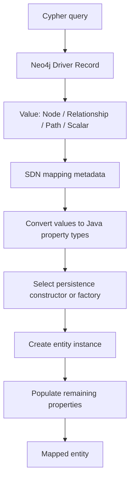

# Cách SDN dựng entity từ record và gán thuộc tính

Khi truy vấn Neo4j, ứng dụng nhận về các dòng kết quả (`Record`) chứa những giá trị như node, relationship, path hoặc scalar. Spring Data Neo4j (SDN) dùng metadata của entity để chuyển các giá trị phù hợp thành đối tượng Java. Quá trình này gồm hai việc chính: **khởi tạo đối tượng** bằng constructor hoặc factory method, sau đó **gán các property còn lại** từ dữ liệu đã đọc.

Hiểu quy trình này giúp chọn constructor đúng, thiết kế entity bất biến, xử lý field tùy chọn và tránh lỗi khi tham số constructor không khớp tên property. Cũng cần phân biệt `Record` của Neo4j Java Driver với `record` của Java: một cái là một hàng kết quả truy vấn, cái còn lại là một kiểu lớp dữ liệu có constructor canonical.

## 1. Từ kết quả Cypher đến entity Java

Neo4j Java Driver trả về kết quả truy vấn dưới dạng các `Record`. Mỗi record có các trường được đặt tên; mỗi trường chứa một `Value`. Value có thể đại diện cho node, relationship, path, số, chuỗi, boolean, thời gian hoặc cấu trúc dữ liệu khác.

Ví dụ truy vấn:

```cypher
MATCH (m:Film {movie_id: $movieId})
RETURN m
```

Một record có trường `m`, và giá trị của trường đó đại diện cho node `Film`. Khi repository hoặc API mapping của SDN nhận node này, mapping layer đọc label và property, đối chiếu với metadata của lớp `@Node`, chuyển đổi kiểu dữ liệu, rồi dựng entity.



Mapping metadata được tạo từ các annotation như `@Node`, `@Id`, `@Property`, `@Relationship` và `@RelationshipProperties`. Metadata cho SDN biết label nào đại diện cho entity, property nào tương ứng với field Java và relationship nào cần ánh xạ.

Không phải mọi `Record` đều tự động trở thành entity. Nếu truy vấn chỉ trả về các scalar như `title`, `count` hoặc `revenue`, kết quả thường phù hợp với projection hoặc DTO. Nếu muốn ánh xạ thành entity, truy vấn phải trả về cấu trúc node/relationship phù hợp với mapping mà API SDN đang sử dụng.

## 2. SDN chọn constructor để khởi tạo như thế nào?

Spring Data dùng một constructor hoặc factory method được xác định là persistence creator để tạo entity. Quy tắc thường gặp:

1. Nếu có một static factory method được đánh dấu `@PersistenceCreator`, Spring Data có thể dùng factory method đó.
2. Nếu lớp chỉ có một constructor, constructor đó được dùng.
3. Nếu có nhiều constructor, constructor được đánh dấu `@PersistenceCreator` là lựa chọn tường minh.
4. Với Java record, canonical constructor được dùng để tạo instance.
5. Nếu không có lựa chọn phù hợp ở trên và có constructor không tham số, Spring Data có thể dùng constructor đó rồi gán property sau.

Khi có nhiều constructor, nên đánh dấu rõ constructor dành cho persistence để không phụ thuộc vào việc thêm constructor mới về sau. Annotation `@PersistenceCreator` thuộc Spring Data Commons:

```java
import org.springframework.data.annotation.PersistenceCreator;
import org.springframework.data.neo4j.core.schema.Id;
import org.springframework.data.neo4j.core.schema.Node;
import org.springframework.data.neo4j.core.schema.Property;

@Node("Film")
public class Movie {

    @Id
    @Property("movie_id")
    private final String movieId;

    private final String title;

    @Property("released")
    private final Integer releaseYear;

    @PersistenceCreator
    public Movie(String movieId, String title, Integer releaseYear) {
        this.movieId = movieId;
        this.title = title;
        this.releaseYear = releaseYear;
    }

    public String getMovieId() { return movieId; }
    public String getTitle() { return title; }
    public Integer getReleaseYear() { return releaseYear; }
}
```

Trong ví dụ, SDN đọc property `movie_id`, `title` và `released`, chuyển đổi kiểu dữ liệu rồi truyền lần lượt vào constructor. Các field là `final`, vì vậy đối tượng được tạo với trạng thái đầy đủ ngay từ đầu và không cần setter để thay đổi chúng.

Nếu lớp chỉ có constructor này, `@PersistenceCreator` có thể không bắt buộc. Tuy nhiên, annotation giúp ý định rõ ràng, đặc biệt khi lớp có thêm constructor dành cho code nghiệp vụ hoặc các factory khác.

## 3. Ghép tham số constructor với property

Tên tham số constructor phải tương ứng với tên persistent property trong mô hình Java. Tên lưu trong Neo4j có thể khác nhờ `@Property`, nhưng alias database không thay thế tên property Java khi ghép tham số.

Ví dụ:

```java
@Node("Film")
public class Movie {

    @Id
    @Property("movie_id")
    private final String movieId;

    @Property("released")
    private final Integer releaseYear;

    @PersistenceCreator
    public Movie(String movieId, Integer releaseYear) {
        this.movieId = movieId;
        this.releaseYear = releaseYear;
    }
}
```

Tham số đúng là `movieId` và `releaseYear`, không phải `movie_id` và `released`. SDN dùng metadata `@Property` để đọc đúng tên property trong Neo4j, sau đó ghép giá trị với persistent property tương ứng trong Java.

Để Spring Data đọc được tên tham số qua reflection, hãy biên dịch Java với tùy chọn `-parameters` hoặc cung cấp metadata tên tham số tương đương theo cấu hình build. Nếu tên tham số không được giữ lại và không có metadata thay thế, việc ghép constructor có thể thất bại hoặc không xác định được property cần truyền.

Constructor nên nhận các property cần thiết và gán trực tiếp vào field. Tránh đặt truy vấn database, gọi HTTP hoặc thực hiện side effect trong constructor; SDN gọi constructor trong lúc mapping dữ liệu, nên constructor có side effect sẽ làm việc đọc entity khó dự đoán và khó kiểm thử.

## 4. Dùng `@PersistenceCreator` khi có nhiều constructor

Một entity có thể có constructor đầy đủ cho persistence và constructor tiện dụng cho code nghiệp vụ. Đánh dấu constructor đầy đủ bằng `@PersistenceCreator` để Spring Data không chọn nhầm:

```java
import org.springframework.data.annotation.PersistenceCreator;
import org.springframework.data.neo4j.core.schema.Id;
import org.springframework.data.neo4j.core.schema.Node;

@Node("Person")
public class Person {

    @Id
    private final String personId;

    private final String name;

    private final Integer age;

    @PersistenceCreator
    public Person(String personId, String name, Integer age) {
        this.personId = personId;
        this.name = name;
        this.age = age;
    }

    public Person(String personId, String name) {
        this(personId, name, null);
    }

    public String getPersonId() { return personId; }
    public String getName() { return name; }
    public Integer getAge() { return age; }
}
```

Constructor ba tham số là persistence creator. Constructor hai tham số chỉ là API tiện dụng cho ứng dụng. Khi SDN đọc entity có đủ ba property, nó vẫn dùng constructor đã đánh dấu và truyền `age` nếu có dữ liệu.

Nếu dùng static factory method, có thể đánh dấu factory bằng `@PersistenceCreator`. Factory phải trả về đúng kiểu entity và nhận các tham số tương ứng với persistent properties. Chọn một cơ chế tạo đối tượng rõ ràng; đừng để nhiều constructor hoặc factory cùng có vẻ phù hợp mà không có chỉ dẫn.

## 5. Khi dùng constructor không tham số và gán property sau đó

Entity mutable thường có constructor không tham số, sau đó SDN gán các property chưa được khởi tạo. Việc gán có thể thông qua setter hoặc truy cập field tùy cách property được mô hình hóa.

```java
import org.springframework.data.neo4j.core.schema.Id;
import org.springframework.data.neo4j.core.schema.Node;

@Node("Person")
public class MutablePerson {

    @Id
    private String personId;

    private String name;

    private Integer age;

    protected MutablePerson() {
        // Constructor dành cho persistence.
    }

    public String getPersonId() { return personId; }
    public void setPersonId(String personId) { this.personId = personId; }

    public String getName() { return name; }
    public void setName(String name) { this.name = name; }

    public Integer getAge() { return age; }
    public void setAge(Integer age) { this.age = age; }
}
```

Ở đây, SDN tạo `MutablePerson` bằng constructor không tham số rồi điền `personId`, `name` và `age` từ node. Constructor không tham số có thể để `protected`; không nhất thiết phải mở public chỉ để phục vụ mapping.

Trong cơ chế property population của Spring Data, thứ tự lựa chọn thông thường là:

1. Nếu có wither method cho property, Spring Data dùng wither để nhận một instance mới có giá trị cập nhật.
2. Nếu có setter phù hợp, setter được gọi.
3. Nếu không có setter hoặc wither phù hợp, Spring Data có thể gán trực tiếp vào field.

Các property đã được truyền qua persistence constructor không cần được gán lại sau đó. Điều này giúp entity bất biến có thể được tạo một lần với các giá trị cần thiết, trong khi entity mutable có thể nhận thêm các giá trị còn lại.

Không nên trộn field `final` với kỳ vọng rằng SDN sẽ cập nhật chúng bằng setter sau khi khởi tạo. Với field bất biến, hãy đưa giá trị vào persistence constructor hoặc dùng một thiết kế wither phù hợp nếu property cần được thay đổi bằng cách tạo instance mới.

## 6. Entity bất biến, wither và giá trị được sinh sau khi lưu

Entity bất biến dùng `final` field và không cung cấp setter. Thiết kế này giảm khả năng đối tượng bị thay đổi ngoài ý muốn, nhưng mọi giá trị cần thiết khi mapping phải được truyền qua constructor hoặc được xử lý bằng cách tạo instance mới.

Một trường hợp đặc biệt là giá trị được sinh trong quá trình lưu, chẳng hạn ID do database tạo. Nếu entity cần nhận giá trị mới sau khi insert nhưng không có setter, một wither method có thể tạo bản sao với ID đã sinh:

```java
import org.springframework.data.annotation.PersistenceCreator;
import org.springframework.data.neo4j.core.schema.GeneratedValue;
import org.springframework.data.neo4j.core.schema.Id;
import org.springframework.data.neo4j.core.schema.Node;

@Node("Note")
public class Note {

    @Id
    @GeneratedValue
    private final Long id;

    private final String text;

    @PersistenceCreator
    public Note(Long id, String text) {
        this.id = id;
        this.text = text;
    }

    public Note withId(Long generatedId) {
        return new Note(generatedId, text);
    }

    public Long getId() { return id; }
    public String getText() { return text; }
}
```

`withId` trả về một instance mới, giữ nguyên `text` và thay ID. Đây là mẫu thiết kế cho entity bất biến khi mapping cần cập nhật một giá trị sau thao tác lưu. Cần chọn đúng chiến lược `@GeneratedValue` và kiểu ID theo cấu hình Neo4j/SDN của dự án; không dùng ví dụ này thay cho business key đã có trong graph.

Nếu không cần bất biến tuyệt đối, setter hoặc field mutable có thể đơn giản hơn. Hãy chọn theo yêu cầu miền nghiệp vụ và khả năng kiểm soát trạng thái, không nên thêm wither chỉ vì framework hỗ trợ.

## 7. Java record và constructor canonical

Java `record` là kiểu dữ liệu bất biến có các component được khai báo ngay trên header. Compiler tạo canonical constructor nhận toàn bộ component theo đúng thứ tự. Spring Data hỗ trợ dùng canonical constructor để khởi tạo record.

```java
import org.springframework.data.neo4j.core.schema.Id;
import org.springframework.data.neo4j.core.schema.Node;
import org.springframework.data.neo4j.core.schema.Property;

@Node("Film")
public record MovieView(
    @Id @Property("movie_id") String movieId,
    String title,
    @Property("released") Integer releaseYear
) {}
```

Các component `movieId`, `title` và `releaseYear` được truyền vào canonical constructor. Annotation ánh xạ component sang label và property Neo4j tương ứng. Record phù hợp với entity nhỏ, bất biến hoặc projection có cấu trúc rõ ràng. Nếu cần các thao tác cập nhật từng field theo kiểu mutable, hãy cân nhắc lớp thông thường.

Record Java và `Record` của Neo4j Driver là hai khái niệm khác nhau:

| Tên | Ý nghĩa | Vai trò |
| --- | --- | --- |
| Neo4j Driver `Record` | Một hàng trong kết quả Cypher, gồm các trường tên và `Value` | Nguồn dữ liệu để SDN hoặc mapper đọc |
| Java `record` | Một kiểu lớp dữ liệu có component và canonical constructor | Có thể là kiểu entity/DTO được tạo từ dữ liệu |

## 8. Kiểu dữ liệu và chuyển đổi property

Trước khi gọi constructor hoặc gán field, SDN cần chuyển đổi giá trị từ Neo4j sang kiểu Java tương ứng. Các kiểu cơ bản và nhiều kiểu dữ liệu phổ biến được hỗ trợ sẵn, nhưng kiểu Java và kiểu lưu trong Neo4j phải tương thích.

Ví dụ:

| Giá trị Neo4j | Kiểu Java thường dùng |
| --- | --- |
| String | `String` |
| Integer | `Integer`, `Long` tùy miền giá trị |
| Float | `Double` |
| Boolean | `Boolean` |
| Date | `java.time.LocalDate` |
| LocalDateTime | `java.time.LocalDateTime` |
| DateTime | `java.time.ZonedDateTime` hoặc kiểu thời gian phù hợp |
| Mảng/list cùng kiểu | Collection hoặc array tương ứng |

Không nên dựa vào việc ép kiểu ngầm nếu dữ liệu có thể vượt miền giá trị hoặc có quy tắc thời gian đặc biệt. Ví dụ, `Integer` không phù hợp với bộ đếm có thể vượt giới hạn 32-bit; `LocalDateTime` không chứa múi giờ nên không thể thay thế `ZonedDateTime` khi nghiệp vụ cần giữ offset/zone.

Với kiểu miền nghiệp vụ riêng, có thể đăng ký custom converter theo cơ chế conversion của Spring Data Neo4j. Converter nên mô tả rõ cách chuyển giữa kiểu Java và kiểu Neo4j; không giấu các truy vấn bổ sung hoặc side effect trong quá trình convert.

## 9. Khởi tạo relationship và đối tượng lồng nhau

Khi entity có relationship, SDN cũng cần ánh xạ node đích và relationship properties. Các entity ở đầu kia được dựng theo metadata và quy tắc constructor tương tự entity gốc.

Ví dụ relationship có property:

```java
import org.springframework.data.annotation.PersistenceCreator;
import org.springframework.data.neo4j.core.schema.RelationshipId;
import org.springframework.data.neo4j.core.schema.RelationshipProperties;
import org.springframework.data.neo4j.core.schema.TargetNode;

@RelationshipProperties
public class ActingCredit {

    @RelationshipId
    private Long id;

    private String role;

    @TargetNode
    private Person actor;

    @PersistenceCreator
    public ActingCredit(Long id, String role, Person actor) {
        this.id = id;
        this.role = role;
        this.actor = actor;
    }
}
```

Entity `Movie` có thể khai báo collection `Set<ActingCredit> cast`. Khi mapping graph phù hợp, SDN tạo các `Person` và `ActingCredit` tương ứng rồi gắn vào entity phim. `@TargetNode` xác định đối tượng node ở đầu kia của relationship; các field còn lại trong lớp relationship properties mô tả dữ liệu gắn trên relationship.

Đồ thị có thể có chu trình, chẳng hạn `Person` liên kết đến `Movie` và `Movie` lại liên kết đến `Person`. Vì vậy, hãy thiết kế các truy vấn và graph được tải theo đúng phạm vi nghiệp vụ. Tránh giả định rằng một entity luôn cần tải toàn bộ neighborhood của nó. Dùng query/projection phù hợp để giới hạn dữ liệu, đặc biệt với collection có thể rất lớn.

## 10. Constructor và property mapping trong truy vấn tùy chỉnh

Với repository trả về entity, SDN quản lý mapping theo metadata entity. Với truy vấn tùy chỉnh, hình dạng kết quả phải phù hợp với kiểu trả về khai báo. Ví dụ, trả về node `m` phù hợp khi phương thức cần entity `Movie`; trả về các biểu thức như `m.title`, `count(*)` phù hợp hơn với projection hoặc DTO.

```java
import java.util.List;

import org.springframework.data.neo4j.repository.Neo4jRepository;
import org.springframework.data.neo4j.repository.query.Query;
import org.springframework.data.repository.query.Param;

public interface MovieRepository extends Neo4jRepository<Movie, String> {

@Query("""
    MATCH (m:Film)
    WHERE m.released >= $year
    RETURN m
    """)
List<Movie> findReleasedSince(@Param("year") int year);
}
```

Trong ví dụ, truy vấn trả về node `m`, cho phép SDN ánh xạ thành `Movie`. Nếu thay bằng:

```cypher
MATCH (m:Film)
WHERE m.released >= $year
RETURN m.title AS title, m.released AS year
```

thì kết quả chỉ gồm hai scalar. Không nên mong SDN dựng đầy đủ entity `Movie` từ một record thiếu node và thiếu các property bắt buộc. Hãy định nghĩa DTO/projection với component hoặc constructor khớp dữ liệu trả về, hoặc dùng mapper tường minh qua `Neo4jClient`.

## 11. Lỗi thường gặp khi khởi tạo entity

| Biểu hiện | Nguyên nhân có thể | Cách xử lý |
| --- | --- | --- |
| Không tìm được constructor phù hợp | Có nhiều constructor nhưng không đánh dấu persistence creator | Đánh dấu constructor bằng `@PersistenceCreator` |
| Tham số constructor nhận null hoặc ghép sai | Tên tham số không khớp persistent property hoặc thiếu parameter metadata | Kiểm tra tên Java property và bật `-parameters` |
| Alias database không được nhận | Dùng tên `@Property` làm tên tham số constructor | Dùng tên property Java, giữ alias ở annotation |
| Field `final` không được cập nhật | Property không có trong constructor và không có wither | Đưa property vào constructor hoặc thiết kế wither |
| Field mutable không được gán như mong đợi | Thiếu setter/constructor phù hợp hoặc kiểu dữ liệu không chuyển đổi được | Kiểm tra metadata, setter, field và converter |
| Entity trả về thiếu relationship | Truy vấn không trả về graph shape cần thiết hoặc mapping relationship không khớp | Kiểm tra Cypher, relationship type/direction và kiểu trả về |
| DTO không dựng được | Scalar aliases không khớp component/constructor của DTO | Đồng bộ tên, kiểu và thứ tự constructor/projection |
| Constructor gây tác dụng phụ khi đọc | Đưa logic nghiệp vụ hoặc I/O vào persistence constructor | Giữ constructor tập trung vào gán và bảo đảm trạng thái object |

## 12. Checklist thiết kế entity dễ mapping

Trước khi dùng entity trong repository hoặc custom query, hãy kiểm tra:

1. Lớp có `@Node` với label đúng với graph thực tế.
2. Field `@Id` ánh xạ đúng định danh và có constraint bảo vệ tính duy nhất nếu cần.
3. Mọi tên property khác tên field đều được khai báo bằng `@Property`.
4. Constructor persistence được chọn rõ ràng và tên tham số khớp persistent property Java.
5. Build giữ lại tên tham số bằng `-parameters` khi cần reflection.
6. Field bất biến được cung cấp qua constructor hoặc wither phù hợp.
7. Field mutable có setter hoặc được SDN truy cập qua field theo mapping metadata.
8. Kiểu Java tương thích với kiểu Neo4j hoặc có converter rõ ràng.
9. Relationship type, direction và relationship properties khớp graph.
10. Query trả về đúng hình dạng dữ liệu với kiểu entity/DTO được khai báo.

## Kết luận

SDN chuyển dữ liệu Neo4j thành entity bằng cách đọc `Record` và `Value`, tra cứu mapping metadata, chuyển đổi kiểu, chọn persistence constructor hoặc factory rồi gán các property còn lại qua wither, setter hoặc field. Constructor parameters cần khớp tên persistent property Java; `@Property` chỉ định tên lưu trong Neo4j. Dùng constructor rõ ràng cho entity bất biến, constructor không tham số cùng property population cho entity mutable, và canonical constructor cho Java record. Khi truy vấn trả về entity hoặc DTO, hãy bảo đảm result shape phù hợp với kiểu đích để mapping chính xác và dễ bảo trì.
