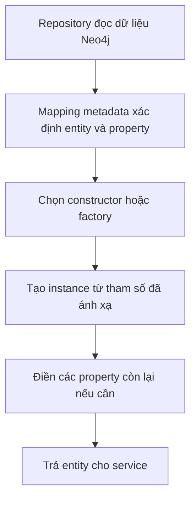

# Constructor, factory và @PersistenceCreator

Khi Spring Data Neo4j đọc một node và chuyển dữ liệu thành đối tượng Java, framework phải biết cách tạo instance của lớp entity. Với lớp đơn giản, một constructor duy nhất thường đã đủ. Khi lớp có nhiều constructor, dùng constructor bất biến hoặc cung cấp static factory method, ta cần chỉ rõ cách tạo đối tượng dành cho persistence. Annotation `@PersistenceCreator` của Spring Data Commons giúp Spring Data chọn đúng constructor hoặc factory method khi materialize entity.

Bài học thuộc module **SPRING_DATA_NEO4J**, nơi ta xây dựng tầng dữ liệu đồ thị qua node entity, relationship, repository và Cypher. Các ví dụ dùng `Person` và `Movie` để giải thích cách SDN khởi tạo entity từ dữ liệu Neo4j, cách phối hợp constructor với property mapping và cách tránh lỗi do tham số constructor không khớp metadata.

## 1. Vì sao object instantiation quan trọng?

Khi gọi `repository.findById(...)`, SDN thực hiện truy vấn, nhận dữ liệu node cùng các quan hệ cần ánh xạ, sau đó tạo đối tượng Java tương ứng. Quá trình này thường được gọi là *object mapping* hoặc *materialization*.



Constructor được chọn ảnh hưởng đến:

- Những property nào phải có dữ liệu ngay tại thời điểm tạo đối tượng.
- Cách thiết kế entity bất biến với các trường `final`.
- Việc ánh xạ tên và kiểu tham số từ property của node hoặc relationship.
- Cách duy trì invariant của domain model, chẳng hạn một `Person` luôn có mã định danh hợp lệ.

Nếu constructor được chọn có tham số mà Spring Data không thể ánh xạ, việc đọc entity có thể thất bại. Nếu framework chọn nhầm constructor ít tham số hơn, một số property có thể bị bỏ qua hoặc phải được gán sau đó bằng setter/field access.

## 2. Quy tắc chọn constructor của Spring Data

Spring Data Commons cung cấp cơ chế object mapping dùng chung cho các module Spring Data, trong đó có SDN. Quy tắc tổng quát khi chọn persistence creator là:

1. Nếu lớp có một constructor duy nhất, Spring Data có thể dùng constructor đó mà không cần `@PersistenceCreator`.
2. Nếu lớp có nhiều constructor, hãy đánh dấu constructor dành cho persistence bằng `@PersistenceCreator` để lựa chọn rõ ràng.
3. Nếu lớp dùng static factory method để tạo đối tượng khi đọc dữ liệu, có thể đánh dấu factory method đó bằng `@PersistenceCreator`.
4. Nếu không có persistence creator được chỉ định và lớp có constructor không tham số phù hợp, Spring Data có thể dùng constructor không tham số rồi điền các property có thể ghi sau đó.

Khi có nhiều lựa chọn, khai báo rõ persistence creator giúp tránh phụ thuộc vào cấu trúc constructor tình cờ của lớp. Mỗi entity nên có một cách tạo đối tượng dành cho persistence dễ nhận biết.

`@PersistenceCreator` nằm trong package:

```java
import org.springframework.data.annotation.PersistenceCreator;
```

Đây là annotation của Spring Data Commons, không phải annotation JPA và cũng không thuộc package schema của SDN.

## 3. Một constructor duy nhất

Với entity chỉ có một constructor, Spring Data có thể dùng constructor đó để tạo instance. Ví dụ `Person` có mã định danh nghiệp vụ, tên và năm sinh:

```java
import org.springframework.data.annotation.Id;
import org.springframework.data.neo4j.core.schema.Node;

@Node("Person")
public class Person {

    @Id
    private final String personId;

    private final String name;
    private final Integer born;

    public Person(String personId, String name, Integer born) {
        this.personId = personId;
        this.name = name;
        this.born = born;
    }

    public String getPersonId() {
        return personId;
    }

    public String getName() {
        return name;
    }

    public Integer getBorn() {
        return born;
    }
}
```

Ở đây constructor là điểm khởi tạo duy nhất. Các trường `final` được gán ngay khi tạo instance nên entity có thể giữ trạng thái bất biến sau khi khởi tạo. `@Id` đến từ Spring Data Commons, còn `@Node` đến từ SDN.

Tên tham số constructor cần tương ứng với tên property mà Spring Data ánh xạ. Với Java, hãy bật tùy chọn biên dịch giữ tên tham số (`-parameters`) để framework có thể đọc tên tham số qua reflection. Nếu dự án không giữ tên tham số, có thể cung cấp metadata tên tham số bằng `@ConstructorProperties` của Java Beans.

Ví dụ trên dùng `personId` làm property ID. Khi tạo đối tượng trong ứng dụng, giá trị đó phải được cấp trước. Nếu dùng ID do SDN sinh, cần thiết kế kiểu ID và chiến lược khởi tạo phù hợp với việc ID có thể chỉ có sau lần lưu đầu tiên.

## 4. Nhiều constructor và @PersistenceCreator

Một entity thường có constructor tiện dụng cho nghiệp vụ và constructor đầy đủ để khôi phục từ persistence. Khi đó, đánh dấu constructor đầy đủ bằng `@PersistenceCreator`:

```java
import org.springframework.data.annotation.Id;
import org.springframework.data.annotation.PersistenceCreator;
import org.springframework.data.neo4j.core.schema.Node;

@Node("Person")
public class Person {

    @Id
    private final String personId;

    private final String name;
    private final Integer born;

    @PersistenceCreator
    public Person(String personId, String name, Integer born) {
        this.personId = personId;
        this.name = name;
        this.born = born;
    }

    public Person(String personId, String name) {
        this(personId, name, null);
    }
}
```

Hai constructor có mục đích khác nhau:

- Constructor ba tham số được Spring Data dùng để tái tạo entity từ property đã đọc trong Neo4j.
- Constructor hai tham số là API tiện dụng cho code nghiệp vụ khi chưa có năm sinh.

Nếu bỏ `@PersistenceCreator`, lớp có nhiều constructor sẽ khiến việc chọn constructor phụ thuộc vào quy tắc fallback của Spring Data. Đánh dấu tường minh giúp người đọc code biết constructor nào là hợp đồng tạo đối tượng cho persistence.

Không nên đánh dấu constructor ít tham số hơn chỉ vì nó thuận tiện cho ứng dụng. Hãy bảo đảm persistence creator nhận đủ property cần thiết để entity ở trạng thái hợp lệ sau khi đọc.

## 5. Static factory method với @PersistenceCreator

Thay vì gọi constructor trực tiếp, một lớp có thể cung cấp static factory method để tạo entity. Cách này hữu ích khi muốn tên phương thức diễn đạt rõ ý nghĩa khởi tạo, hoặc khi constructor được để private/protected để kiểm soát việc tạo đối tượng.

```java
import org.springframework.data.annotation.Id;
import org.springframework.data.annotation.PersistenceCreator;
import org.springframework.data.neo4j.core.schema.Node;

@Node("Movie")
public class Movie {

    @Id
    private final String movieId;

    private final String title;
    private final Integer released;

    private Movie(String movieId, String title, Integer released) {
        this.movieId = movieId;
        this.title = title;
        this.released = released;
    }

    @PersistenceCreator
    public static Movie rehydrate(
            String movieId, String title, Integer released) {
        return new Movie(movieId, title, released);
    }

    public static Movie create(
            String movieId, String title, Integer released) {
        if (movieId == null || movieId.isBlank()) {
            throw new IllegalArgumentException("movieId is required");
        }
        return new Movie(movieId, title, released);
    }
}
```

`rehydrate` được đánh dấu là factory dành cho persistence. `create` là factory nghiệp vụ có thể thực hiện kiểm tra hoặc áp dụng quy tắc tạo mới. Cả hai đều trả về `Movie`, nhưng chỉ `rehydrate` là lựa chọn mà Spring Data dùng để materialize dữ liệu.

Factory method phải là static và trả về kiểu entity tương ứng. Các tham số cần ánh xạ được với property của entity. Nên đặt tên phương thức thể hiện mục đích như `rehydrate`, `fromPersistence` hoặc `ofStoredState`, tránh tên chung chung khó hiểu.

## 6. Ánh xạ tham số constructor với property

Spring Data cần biết mỗi tham số constructor tương ứng với property nào. Thông thường, tên và kiểu tham số nên khớp với property của entity.

| Property trong entity | Tham số constructor | Vai trò |
|---|---|---|
| `personId` | `String personId` | Định danh node |
| `name` | `String name` | Tên người |
| `born` | `Integer born` | Năm sinh, có thể null |
| `actingCredits` | `List<ActingCredit> actingCredits` | Các relationship được ánh xạ nếu entity cần nạp quan hệ này |

Ví dụ nếu property Java đổi tên nhưng property lưu trong Neo4j giữ tên cũ, hãy dùng mapping metadata như `@Property` để xác định tên lưu trữ. Tên tham số persistence creator vẫn cần khớp với property Java mà mapping context nhận diện, không phải tùy tiện dùng tên cột hoặc tên property Neo4j.

### 6.1. Tên tham số không được phát hiện

Một lỗi thường gặp là constructor dùng tham số `arg0`, `arg1` thay vì tên có ý nghĩa vì compiler không giữ tên tham số. Spring Data có thể không ánh xạ đúng các tham số đó.

Với Maven, có thể cấu hình compiler plugin bật `parameters`:

```xml
<plugin>
    <groupId>org.apache.maven.plugins</groupId>
    <artifactId>maven-compiler-plugin</artifactId>
    <configuration>
        <parameters>true</parameters>
    </configuration>
</plugin>
```

Với Gradle, cấu hình tương ứng cho JavaCompile:

```groovy
tasks.withType(JavaCompile).configureEach {
    options.compilerArgs += ['-parameters']
}
```

Nếu không thể bật `-parameters`, có thể dùng `@ConstructorProperties` để cung cấp tên property theo đúng thứ tự tham số:

```java
import java.beans.ConstructorProperties;

@ConstructorProperties({"personId", "name", "born"})
public Person(String personId, String name, Integer born) {
    this.personId = personId;
    this.name = name;
    this.born = born;
}
```

`@ConstructorProperties` không thay thế `@PersistenceCreator` khi lớp có nhiều constructor. Một annotation cung cấp tên property cho tham số; annotation còn lại chọn creator mà Spring Data sử dụng.

## 7. Constructor và entity bất biến

Entity bất biến có các trường không thay đổi sau khi khởi tạo, thường được khai báo `final` và không cung cấp setter. Thiết kế này giúp trạng thái đối tượng dễ suy luận và giảm nguy cơ thay đổi ngoài ý muốn.

Để ánh xạ entity bất biến:

- Đưa các property cần khôi phục vào persistence constructor hoặc factory method.
- Bảo đảm tên và kiểu tham số khớp metadata của entity.
- Để Spring Data tạo một instance mới khi cần cập nhật property bất biến.
- Không giả định field `final` có thể được gán tùy ý sau khi constructor chạy.

Với entity có một số property mutable, Spring Data có thể điền chúng sau khi gọi constructor thông qua property accessor. Nếu property không có setter, framework có thể cần field access hoặc một cơ chế tạo bản sao như wither tùy cấu trúc lớp. Vì vậy, cách dễ kiểm soát nhất là đưa những property bất biến quan trọng vào constructor.

Ví dụ một wither trả về instance mới:

```java
public Person withName(String newName) {
    return new Person(personId, newName, born);
}
```

Wither không phải persistence creator; nó là quy ước giúp framework hoặc code ứng dụng tạo bản sao mới khi cần thay đổi một property bất biến. Chỉ dùng khi mapping và phiên bản Spring Data hỗ trợ kiểu cập nhật đó.

## 8. Quan hệ và object instantiation

Node entity có thể chứa thuộc tính relationship. Nếu constructor nhận relationship property, Spring Data cần có dữ liệu của quan hệ đó trong kết quả mapping và kiểu tham số phải phù hợp với mô hình SDN.

Ví dụ, `Person` có thể chứa danh sách `ActingCredit`:

```java
@Node("Person")
public class Person {

    @Id
    private final String personId;

    private final String name;

    private final List<ActingCredit> actingCredits;

    @PersistenceCreator
    public Person(
            String personId,
            String name,
            List<ActingCredit> actingCredits) {
        this.personId = personId;
        this.name = name;
        this.actingCredits = actingCredits;
    }
}
```

Lớp relationship properties có thể biểu diễn vai diễn:

```java
@RelationshipProperties
public class ActingCredit {

    @RelationshipId
    private Long id;

    private List<String> roles;

    @TargetNode
    private Movie movie;
}
```

Khi truy vấn một entity, dữ liệu relationship chỉ được materialize theo phạm vi truy vấn và cách SDN tải quan hệ. Không nên mặc định mọi relationship trong toàn bộ đồ thị đều tự động được nạp. Cần thiết kế truy vấn hoặc fetch depth phù hợp với dữ liệu mà constructor cần.

Nếu constructor bắt buộc một danh sách relationship nhưng truy vấn không trả về dữ liệu quan hệ tương ứng, cần xác định giá trị mặc định và cách mapping xử lý trường hợp thiếu dữ liệu. Với collection, có thể thiết kế entity nhận danh sách rỗng thay vì `null` nếu domain model yêu cầu.

## 9. Lỗi thường gặp và cách khắc phục

| Dấu hiệu | Nguyên nhân thường gặp | Cách xử lý |
|---|---|---|
| Không tạo được entity khi đọc repository | Không có creator phù hợp hoặc tham số không ánh xạ được | Kiểm tra constructor, factory và `@PersistenceCreator` |
| Nhiều constructor nhưng dùng nhầm constructor | Không chỉ định persistence creator rõ ràng | Đánh dấu đúng constructor hoặc static factory method |
| Tham số hiện thành `arg0`, `arg1` | Compiler không lưu tên tham số | Bật `-parameters` hoặc dùng `@ConstructorProperties` |
| Property sau khi đọc bị null | Property không nằm trong creator và không có cách ghi phù hợp | Đưa property vào creator hoặc cung cấp setter/property access phù hợp |
| Entity bất biến không được cập nhật như mong đợi | Field `final` không thể được điền sau constructor theo cách thông thường | Đưa field vào constructor hoặc thiết kế wither/copy constructor được hỗ trợ |
| Factory nghiệp vụ bị gọi khi đọc dữ liệu | Factory được chọn không đúng hoặc metadata creator chưa rõ | Đánh dấu duy nhất factory dành cho persistence bằng `@PersistenceCreator` |
| Relationship collection không có dữ liệu | Truy vấn không tải quan hệ hoặc mapping không khớp | Kiểm tra Cypher, fetch depth và kiểu relationship properties |

Khi gặp lỗi, hãy xem thông báo mapping và xác định lỗi xảy ra ở bước chọn creator, ánh xạ tham số hay điền property sau khi tạo đối tượng. Ba giai đoạn này có nguyên nhân và cách sửa khác nhau.

## 10. Checklist thiết kế persistence creator

- Lớp có một constructor duy nhất hoặc đã đánh dấu rõ constructor/factory bằng `@PersistenceCreator`.
- `@PersistenceCreator` được import từ `org.springframework.data.annotation`.
- Factory method là static và trả về đúng kiểu entity.
- Tên tham số constructor/factory khớp tên property Java.
- Compiler giữ tên tham số bằng `-parameters`, hoặc đã khai báo `@ConstructorProperties` khi cần.
- Các property bất biến cần thiết được truyền qua constructor.
- Property còn lại có cơ chế population phù hợp như setter hoặc field access.
- Các relationship cần thiết có trong phạm vi truy vấn và được ánh xạ bằng kiểu SDN tương ứng.
- Constructor/factory giữ invariant của domain model và không thực hiện side effect như gọi service hoặc ghi dữ liệu.

## 11. Bài tập thực hành

1. Viết entity `Person` chỉ có một constructor và giải thích vì sao không cần `@PersistenceCreator`.
2. Thêm constructor tiện dụng thứ hai, đánh dấu constructor đầy đủ bằng `@PersistenceCreator` và kiểm tra repository đọc entity đúng.
3. Chuyển constructor persistence thành static factory `rehydrate`, giữ factory `create` cho nghiệp vụ và phân biệt vai trò của hai phương thức.
4. Tắt `-parameters`, quan sát lỗi ánh xạ tham số rồi khắc phục bằng compiler option hoặc `@ConstructorProperties`.
5. Thiết kế entity bất biến có relationship properties và xác định dữ liệu nào cần được tải trước khi constructor chạy.
6. Tạo một property không nằm trong persistence constructor, sau đó thử setter/field access và giải thích cách Spring Data điền property sau khi tạo instance.

Khi hoàn thành, bạn cần giải thích được Spring Data chọn constructor hoặc factory method như thế nào, vì sao `@PersistenceCreator` quan trọng với lớp có nhiều creator và cách bảo đảm tham số ánh xạ chính xác. Đây là nền tảng để entity Spring Data Neo4j được khôi phục nhất quán từ node và relationship, đồng thời giữ được quy tắc khởi tạo của domain model.
