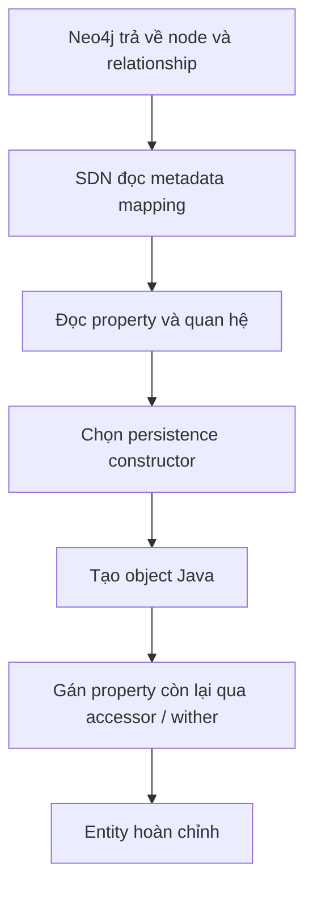

# Ánh xạ Java record và đối tượng có thuộc tính sinh tự động

Spring Data Neo4j (SDN) có thể ánh xạ node thành Java class thông thường hoặc Java record. Record phù hợp với mô hình dữ liệu bất biến vì các component được khai báo cùng constructor canonical và không có setter. Khi một entity có ID được sinh trong lúc lưu, SDN cần một cách đưa ID đó vào đối tượng bất biến. Với record, cách phổ biến là cung cấp phương thức *wither* như `withId`, trả về một record mới chứa ID vừa được cấp.

Điểm cần nhớ khi làm việc với `save` là giữ lại đối tượng được trả về. Đối tượng đầu vào có thể vẫn giữ `id == null`, trong khi đối tượng trả về đã có ID. Quy tắc này áp dụng cho record và các entity bất biến nói chung.

## 1. SDN khởi tạo entity như thế nào?

Khi đọc dữ liệu, SDN dựa trên metadata của entity để chuyển node, property và relationship thành object Java. Quá trình thường gồm các bước:

1. Xác định label và metadata mapping từ lớp được đánh dấu `@Node`.
2. Đọc các property và relationship có trong kết quả truy vấn.
3. Chọn persistence constructor và truyền các giá trị tương ứng vào constructor.
4. Gán những property chưa được constructor xử lý thông qua cơ chế property access phù hợp, chẳng hạn setter, field access hoặc wither.
5. Trả về entity đã được khởi tạo.



Với Java record, constructor canonical là điểm khởi tạo tự nhiên: mỗi record component tương ứng với một tham số constructor. Tên component được Java lưu trong metadata của record, giúp Spring Data ánh xạ theo tên. Với class có nhiều constructor, nên đánh dấu constructor dùng để đọc dữ liệu bằng `@PersistenceCreator` để lựa chọn rõ ràng.

## 2. Ánh xạ một Java record thành node entity

Giả sử ứng dụng quản lý phim với tiêu đề và năm phát hành. Có thể khai báo một record như sau:

```java
@Node("Movie")
public record Movie(
        @Id @GeneratedValue Long id,
        String title,
        Integer releaseYear) {
}
```

Các annotation có ý nghĩa:

- `@Node("Movie")` khai báo label chính của node được ánh xạ.
- `@Id` đánh dấu component định danh của entity.
- `@GeneratedValue` yêu cầu SDN sinh ID theo generator được cấu hình.
- `title` và `releaseYear` là các property thông thường của node.

Record tự cung cấp constructor canonical, accessor `id()`, `title()`, `releaseYear()`, cùng các phương thức `equals`, `hashCode` và `toString`. Khác với class Java thông thường, accessor của record có tên component, không có tiền tố `get`.

Repository khai báo kiểu ID tương ứng:

```java
public interface MovieRepository extends Neo4jRepository<Movie, Long> {
}
```

Khi đọc node `Movie`, SDN tạo record thông qua constructor canonical. Ví dụ, nếu node có `id`, `title` và `releaseYear`, các giá trị tương ứng được truyền vào constructor để tạo `Movie`.

## 3. Record có ID được sinh: dùng wither để nhận ID

Một record là bất biến: sau khi tạo, component không thể được gán lại. Khi lưu một record mới có `id == null`, SDN ghi node và nhận ID được sinh. Để đưa ID đó vào record, khai báo một phương thức wither:

```java
@Node("Movie")
public record Movie(
        @Id @GeneratedValue Long id,
        String title,
        Integer releaseYear) {

    public Movie withId(Long id) {
        return new Movie(id, title, releaseYear);
    }
}
```

`withId` không thay đổi record hiện tại. Nó tạo record mới, giữ nguyên `title` và `releaseYear`, đồng thời đặt `id` được truyền vào. SDN có thể dùng wither này khi cần điền giá trị được sinh sau thao tác ghi.

Lưu entity và nhận ID:

```java
Movie input = new Movie(null, "The Graph Journey", 2026);

Movie saved = movieRepository.save(input);
Long generatedId = saved.id();

System.out.println("Generated ID: " + generatedId);
```

`generatedId` được đọc từ `saved`, là record mà repository trả về. `input` vẫn có thể giữ `id == null`, vì vậy không nên gọi `input.id()` với kỳ vọng nó tự thay đổi sau `save`.

Với record, phương thức wither phải trả về một instance cùng kiểu và giữ nguyên các component khác. Nếu record có thêm component mới, hãy cập nhật wither để truyền đầy đủ component đó khi tạo record mới. Bỏ sót một component có thể làm mất dữ liệu trong object trả về.

## 4. Ánh xạ relationship trong record

Record component có thể được đánh dấu bằng `@Relationship` để ánh xạ liên kết tới entity khác. Ví dụ, một diễn viên có danh sách phim đã tham gia:

```java
@Node("Actor")
public record Actor(
        @Id @GeneratedValue Long id,
        String name,
        @Relationship(type = "ACTED_IN", direction = Relationship.Direction.OUTGOING)
        List<Movie> movies) {

    public Actor withId(Long id) {
        return new Actor(id, name, movies);
    }
}
```

`movies` là relationship collection đi từ node `Actor` tới node `Movie` qua relationship type `ACTED_IN`. Vì relationship này không có property riêng trong ví dụ, mỗi phần tử có thể ánh xạ trực tiếp thành `Movie`. Nếu mối liên hệ cần dữ liệu như tên nhân vật hoặc thứ tự credit, dùng một lớp `@RelationshipProperties` và `@TargetNode` để biểu diễn property của relationship.

Khi record chứa collection, nên quyết định rõ cách xử lý collection `null` và bảo đảm code tạo object tuân theo quy ước nhất quán. Ví dụ có thể dùng compact constructor để chuẩn hóa collection:

```java
@Node("Actor")
public record Actor(
        @Id @GeneratedValue Long id,
        String name,
        @Relationship(type = "ACTED_IN") List<Movie> movies) {

    public Actor {
        movies = movies == null ? List.of() : List.copyOf(movies);
    }

    public Actor withId(Long id) {
        return new Actor(id, name, movies);
    }
}
```

Compact constructor giúp chuẩn hóa dữ liệu ngay khi record được tạo, kể cả khi object được SDN khởi tạo từ dữ liệu đọc trong database. `List.copyOf` tạo collection không thể sửa đổi; chỉ dùng nếu ứng dụng muốn giữ đúng tính bất biến này.

## 5. Lựa chọn ID được sinh

`@GeneratedValue` dùng cho component định danh. Với ID nội bộ Neo4j, có thể dùng `Long`:

```java
@Node("Movie")
public record Movie(
        @Id @GeneratedValue Long id,
        String title) {

    public Movie withId(Long id) {
        return new Movie(id, title);
    }
}
```

Nếu ID cần ổn định hơn khi được công khai qua API hoặc dùng giữa nhiều hệ thống, có thể chọn UUID string generator:

```java
import org.springframework.data.neo4j.core.schema.GeneratedValue.UUIDStringGenerator;

@Node("Movie")
public record Movie(
        @Id @GeneratedValue(UUIDStringGenerator.class) String id,
        String title) {

    public Movie withId(String id) {
        return new Movie(id, title);
    }
}
```

Với lựa chọn UUID, repository dùng `String` làm kiểu ID:

```java
public interface MovieRepository extends Neo4jRepository<Movie, String> {
}
```

Trong cả hai trường hợp, cách lấy ID sau khi lưu không thay đổi:

```java
Movie saved = movieRepository.save(new Movie(null, "The Graph Journey"));
String publicId = saved.id();
```

Đoạn cuối minh họa trường hợp UUID `String`; với ID `Long`, dùng `Long generatedId = saved.id()`. UUID được lưu như property định danh của node, nên nên có unique constraint tương ứng:

```cypher
CREATE CONSTRAINT movie_id IF NOT EXISTS
FOR (m:Movie)
REQUIRE m.id IS UNIQUE;
```

ID nội bộ Neo4j và element ID là định danh kỹ thuật của database, không phải mã nghiệp vụ ổn định để các hệ thống bên ngoài lưu giữ lâu dài. Nếu cần mã bền vững qua các lần di chuyển hoặc khôi phục dữ liệu, ưu tiên UUID hoặc business key do ứng dụng quản lý.

## 6. Record và thuộc tính sinh tự động khác ID

Trong SDN, `@GeneratedValue` được dùng cho thuộc tính định danh. Không gắn annotation này lên mọi component chỉ vì muốn giá trị được tạo tự động. Ví dụ `createdAt`, `slug` hoặc `displayCode` là các property nghiệp vụ khác; cần xác định rõ thành phần chịu trách nhiệm sinh chúng.

Với giá trị do ứng dụng tạo trước khi lưu, có thể dùng factory hoặc service:

```java
public record Movie(
        @Id @GeneratedValue Long id,
        String title,
        Instant createdAt) {

    public Movie withId(Long id) {
        return new Movie(id, title, createdAt);
    }

    public static Movie draft(String title, Clock clock) {
        return new Movie(null, title, Instant.now(clock));
    }
}
```

Factory nhận `Clock` để có thể kiểm thử thời gian một cách xác định. Giá trị `createdAt` đã có trước khi `save`; wither chỉ bổ sung ID được SDN sinh.

Nếu giá trị do database hoặc một câu Cypher sinh ra, truy vấn cần trả về giá trị đó và ánh xạ nó vào kết quả phù hợp. Không nên giả định SDN tự động đọc lại mọi default hoặc trigger của database sau khi `save`.

Với logic cần áp dụng nhất quán trước khi ghi nhiều entity, có thể cân nhắc callback của Spring Data Neo4j như `BeforeBindCallback`. Callback phù hợp để bổ sung hoặc chuẩn hóa dữ liệu trước khi entity được bind thành câu lệnh ghi. Với record bất biến, callback cần trả về instance mới có giá trị đã cập nhật; không sửa component trực tiếp.

## 7. Class bất biến có constructor mapping

Java record không phải lựa chọn duy nhất. Một class thông thường cũng có thể bất biến nếu field là `final`, constructor nhận toàn bộ dữ liệu và có wither cho property được sinh:

```java
@Node("Movie")
public class Movie {

    @Id
    @GeneratedValue
    private final Long id;

    private final String title;

    @PersistenceCreator
    public Movie(Long id, String title) {
        this.id = id;
        this.title = title;
    }

    public Movie(String title) {
        this(null, title);
    }

    public Movie withId(Long id) {
        return new Movie(id, title);
    }

    public Long getId() {
        return id;
    }

    public String getTitle() {
        return title;
    }
}
```

`@PersistenceCreator` chỉ rõ constructor SDN dùng để tạo entity khi đọc dữ liệu. Khi class có nhiều constructor, annotation này giúp tránh lựa chọn constructor không như mong muốn. Constructor được chọn cần nhận đủ các giá trị mà ứng dụng muốn khởi tạo; tham số phải ánh xạ được với tên property tương ứng.

So với class thông thường, record giúp giảm mã lặp và thể hiện rõ mô hình dữ liệu bất biến. Class vẫn hữu ích khi cần kế thừa, kiểm soát API constructor phức tạp hoặc tích hợp với thư viện yêu cầu cấu trúc class cụ thể.

## 8. Quy tắc ánh xạ tên và kiểu dữ liệu

Mặc định, tên record component được ánh xạ với property cùng tên. Dùng `@Property` khi tên trong Java khác tên được lưu trong Neo4j:

```java
@Node("Movie")
public record Movie(
        @Id @GeneratedValue Long id,
        @Property("display_title") String title,
        Integer releaseYear) {

    public Movie withId(Long id) {
        return new Movie(id, title, releaseYear);
    }
}
```

Component `title` trong Java được ánh xạ với property `display_title` trong node. Tên component vẫn được dùng trong constructor và accessor của record.

Kiểu Java cần tương thích với kiểu property Neo4j hoặc có converter thích hợp. Các kiểu số, chuỗi, boolean, ngày giờ và collection của kiểu được hỗ trợ thường có thể ánh xạ trực tiếp. Với kiểu miền riêng, cần khai báo conversion phù hợp và kiểm tra cả chiều đọc lẫn chiều ghi. Không giả định một object Java tùy ý sẽ tự động được lưu thành property Neo4j.

## 9. Các lỗi thường gặp

| Lỗi | Nguyên nhân | Cách xử lý |
|---|---|---|
| Record được lưu nhưng component ID của object đầu vào vẫn `null` | Record bất biến và SDN trả về instance mới sau khi sinh ID | Dùng kết quả trả về từ `save` |
| Không có ID sau khi lưu record | Thiếu `@GeneratedValue` hoặc không có wither phù hợp cho ID sinh | Khai báo generator và `withId` trả về record mới |
| Wither làm mất dữ liệu | Tạo record mới nhưng bỏ sót component khác | Sao chép tất cả component, chỉ thay giá trị cần cập nhật |
| SDN chọn constructor không mong muốn | Class có nhiều constructor mà không chỉ rõ persistence constructor | Dùng `@PersistenceCreator` trên constructor phù hợp |
| Tên property không khớp với dữ liệu hiện có | Tên component Java khác tên property Neo4j | Dùng `@Property` để ánh xạ rõ ràng |
| Dùng `@GeneratedValue` cho `createdAt` hoặc property nghiệp vụ khác | Nhầm generator định danh với cơ chế sinh dữ liệu nghiệp vụ | Sinh giá trị ở factory/service, callback hoặc truy vấn có trả kết quả |
| Gọi getter kiểu JavaBean trên record | Record dùng accessor theo tên component | Dùng `movie.id()` và `movie.title()` |

## 10. Kiểm tra mapping record

Nên có integration test với Neo4j thật hoặc Testcontainers để xác nhận cả việc ghi và đọc record. Ví dụ:

```java
@Test
void savesAndReadsMovieRecordWithGeneratedId() {
    Movie input = new Movie(null, "The Graph Journey", 2026);

    Movie saved = movieRepository.save(input);

    assertThat(saved.id()).isNotNull();
    assertThat(input.id()).isNull();

    Movie loaded = movieRepository.findById(saved.id()).orElseThrow();
    assertThat(loaded.title()).isEqualTo("The Graph Journey");
    assertThat(loaded.releaseYear()).isEqualTo(2026);
}
```

Test này xác nhận hai điểm: ID có trên record trả về, và record đầu vào vẫn giữ nguyên vì bất biến. Nó cũng kiểm tra chiều đọc bằng constructor mapping. Nếu dùng UUID, thay kiểu ID và kiểm tra chuỗi ID không rỗng. Nếu record có relationship, thêm kiểm tra node đích và relationship được đọc đúng theo mapping.

## 11. Tự kiểm tra

1. Vì sao Java record phù hợp với constructor-based mapping của Spring Data?
2. `@Id` và `@GeneratedValue` có vai trò gì trên record component?
3. Vì sao record cần wither như `withId` khi ID được sinh sau khi ghi?
4. Vì sao phải giữ kết quả trả về từ `repository.save()`?
5. Khi class có nhiều constructor, `@PersistenceCreator` giải quyết vấn đề gì?
6. `@GeneratedValue` có nên được dùng cho property `createdAt` không? Hãy nêu cách tạo giá trị đó phù hợp hơn.
7. Khi đổi tên component Java so với property Neo4j, annotation nào hỗ trợ mapping?
8. Integration test cần xác minh những điều gì để chứng minh record được ghi và đọc đúng?

Khi nắm được constructor mapping, record component, wither và chiến lược sinh ID, người học có thể xây dựng entity bất biến gọn gàng, đọc đúng dữ liệu từ Neo4j và nhận được định danh được sinh tự động qua đối tượng trả về của Spring Data Neo4j.
