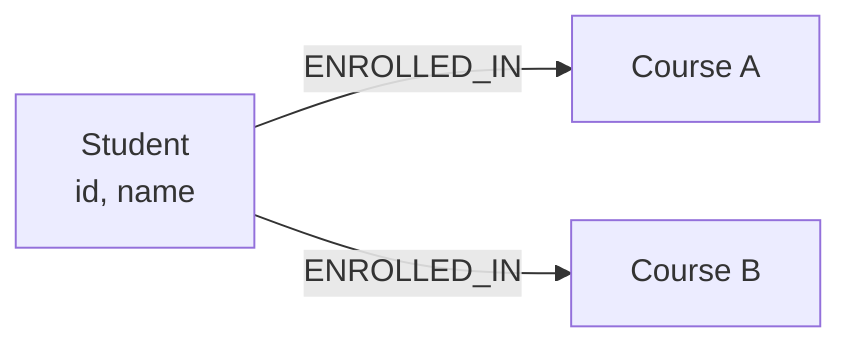

# Ảnh hưởng của Lombok và collection đến định danh đối tượng

Lombok giúp giảm mã getter, setter, constructor, builder và các phương thức `equals`/`hashCode`. Collection như `List` và `Set` giúp biểu diễn các giá trị hoặc relationship giữa các node. Nhưng khi kết hợp hai cơ chế này trong entity Spring Data Neo4j, cách sinh constructor và cách xác định equality có thể ảnh hưởng trực tiếp đến việc framework khởi tạo đối tượng, theo dõi entity và giữ phần tử trong collection.

Với `SPRING_DATA_NEO4J`, cần phân biệt định danh persistence do `@Id` quản lý với equality của object Java. Một entity có thể được Neo4j nhận diện bằng ID nhưng vẫn có `equals`/`hashCode` không phù hợp cho `HashSet`. Bài học dùng ví dụ `Student` có tập `Course` để giải thích các rủi ro và cách thiết kế an toàn.

## 1. Ba cơ chế cần phân biệt

Khi một entity được lưu hoặc đọc, có ba cơ chế cùng tham gia nhưng giải quyết những vấn đề khác nhau:

| Cơ chế | Vai trò | Ví dụ |
|---|---|---|
| Persistence identity | Nhận diện node hoặc relationship trong Neo4j và ánh xạ về entity | `@Id`, `@GeneratedValue` |
| Object equality | Quyết định hai object Java có được xem là bằng nhau hay không | `equals()` và `hashCode()` |
| Collection semantics | Quyết định cách collection lưu, tìm và loại phần tử trùng | `List`, `Set`, `HashSet` |

`@Id` không tự động quy định cách `equals()` hoạt động. Tương tự, khai báo một trường là `Set<Course>` không khiến Neo4j tạo ràng buộc duy nhất cho các node `Course`. Spring Data Neo4j dùng annotation và kiểu dữ liệu để ánh xạ graph; Java collection dùng quy tắc riêng của nó để quản lý object trong bộ nhớ.

Ví dụ, một `Student` có nhiều khóa học:



Collection `courses` trong entity có thể là `Set<Course>`. Khi thêm một khóa học, `HashSet` gọi `hashCode()` để xác định vị trí lưu và dùng `equals()` để kiểm tra phần tử trùng. Nếu các giá trị tham gia hai phương thức này thay đổi sau khi phần tử đã được thêm vào Set, collection có thể không còn tìm thấy phần tử ở vị trí cũ.

## 2. Lombok sinh equals và hashCode như thế nào?

Annotation `@Data` của Lombok gộp nhiều tính năng: getter cho các trường, setter cho trường không phải `final`, `toString()`, `equals()`, `hashCode()` và constructor cho các trường bắt buộc. Mặc định, `equals()` và `hashCode()` được sinh dựa trên các trường instance phù hợp của lớp, bao gồm cả những trường có thể thay đổi như tên hoặc collection relationship.

Ví dụ sau có vẻ ngắn gọn:

```java
import lombok.Data;
import org.springframework.data.neo4j.core.schema.Id;
import org.springframework.data.neo4j.core.schema.Node;
import org.springframework.data.neo4j.core.schema.Relationship;

import java.util.HashSet;
import java.util.Set;

@Data
@Node("Student")
public class Student {

    @Id
    private String id;

    private String name;

    @Relationship(type = "ENROLLED_IN")
    private Set<Course> courses = new HashSet<>();
}
```

Nhưng `@Data` có thể tạo ra các vấn đề:

1. **Hash code thay đổi:** `name`, `id` hoặc `courses` thay đổi thì hash code có thể đổi theo. Nếu object đã nằm trong `HashSet`, nó vẫn nằm ở bucket cũ.
2. **Quan hệ tham gia equality:** hai `Student` được so sánh bằng cả collection khóa học. Một thay đổi relationship có thể làm kết quả `equals()` thay đổi.
3. **Đệ quy giữa quan hệ hai chiều:** nếu `Student` chứa `Course`, còn `Course` lại chứa `students`, `equals()`, `hashCode()` hoặc `toString()` có thể đi qua lại giữa hai object và gây đệ quy sâu hoặc `StackOverflowError`.
4. **Setter quá rộng:** `@Data` sinh setter cho `id` và collection. Mã ứng dụng có thể vô tình đổi định danh hoặc thay collection ngoài các phương thức nghiệp vụ được kiểm soát.

Vì vậy, không nên dùng `@Data` như lựa chọn mặc định cho mọi node entity có relationship. Hãy chọn từng annotation theo nhu cầu của entity.

## 3. Vì sao định danh thay đổi làm hỏng Set?

`HashSet` dựa vào `hashCode()` để đặt phần tử vào một bucket. Khi kiểm tra `contains()` hoặc `remove()`, nó tính hash code hiện tại để tìm bucket tương ứng.

Xem ví dụ:

```java
Set<Student> students = new HashSet<>();

Student student = new Student();
student.setName("An");
students.add(student);

student.setName("An Nguyen");

boolean found = students.contains(student);
```

Nếu Lombok đã đưa `name` vào `hashCode()`, việc đổi tên sau khi thêm object có thể khiến `contains()` trả về `false`, dù chính object đó vẫn đang nằm trong Set. Việc `remove()` cũng có thể thất bại vì hash code hiện tại trỏ đến bucket khác.

Một trường hợp khác xuất hiện với ID do database sinh. Entity mới có thể có `id == null`; sau khi `save()`, Spring Data Neo4j gán ID nội bộ hoặc `elementId` theo cấu hình. Nếu `hashCode()` dựa trên trường ID này, hash code thay đổi sau khi lưu. Thêm entity vào `HashSet` trước khi lưu rồi cập nhật ID có thể làm hỏng tra cứu collection.

```java
Set<Student> students = new HashSet<>();

Student student = new Student(); // id còn null
students.add(student);

studentRepository.save(student); // ID được gán vào entity
students.contains(student); // Có thể không tìm thấy nếu hashCode dựa trên ID
```

Không phải mọi entity đều gặp lỗi này; lỗi xuất hiện khi trường tham gia `hashCode()` thay đổi trong lúc object đang nằm trong hash-based collection. Vì thế, equality phải được thiết kế cùng vòng đời cấp ID và cách collection được cập nhật.

## 4. Thiết kế equality ổn định cho entity

Một cách thực hành phù hợp khi ứng dụng có ID nghiệp vụ được cấp trước là chỉ đưa ID ổn định vào `equals()` và `hashCode()`. Không đưa các relationship hoặc trường có thể thay đổi vào equality.

```java
import lombok.EqualsAndHashCode;
import lombok.Getter;
import lombok.NoArgsConstructor;
import lombok.AccessLevel;
import org.springframework.data.annotation.PersistenceCreator;
import org.springframework.data.neo4j.core.schema.Id;
import org.springframework.data.neo4j.core.schema.Node;
import org.springframework.data.neo4j.core.schema.Relationship;

import java.util.HashSet;
import java.util.Set;

@Getter
@NoArgsConstructor(access = AccessLevel.PROTECTED)
@EqualsAndHashCode(onlyExplicitlyIncluded = true)
@Node("Student")
public class Student {

    @Id
    @EqualsAndHashCode.Include
    private String id;

    private String name;

    @Relationship(type = "ENROLLED_IN")
    @EqualsAndHashCode.Exclude
    private Set<Course> courses = new HashSet<>();

    @PersistenceCreator
    public Student(String id, String name) {
        this.id = id;
        this.name = name;
    }

    public void enroll(Course course) {
        courses.add(course);
    }
}
```

Ví dụ giả định `id` là ID do ứng dụng cấp và không đổi sau khi tạo entity. `onlyExplicitlyIncluded = true` khiến Lombok chỉ đưa các trường được đánh dấu `@EqualsAndHashCode.Include` vào equality; `courses` được loại khỏi equality. Constructor nghiệp vụ buộc caller cung cấp ID ngay từ đầu, trong khi constructor không tham số có phạm vi `protected` phục vụ cơ chế mapping khi cần.

Nếu dùng ID nội bộ do Neo4j cấp và chỉ có sau khi lưu, không nên áp dụng máy móc ví dụ trên. Khi ID còn `null`, nhiều entity mới có thể bị xem là bằng nhau nếu equality chỉ so sánh ID; khi ID được gán, hash code lại thay đổi. Có thể giữ equality theo identity mặc định của Java nếu không có yêu cầu domain equality, hoặc dùng một khóa bất biến do ứng dụng cấp trước khi object được đưa vào Set.

Nếu cần equality theo ID cho các entity được tải ở những thời điểm khác nhau, phải xác định rõ hành vi khi ID chưa có. Không coi hai entity mới với ID `null` là cùng một thực thể chỉ vì cùng chưa được lưu.

## 5. Collection relationship và lựa chọn List hay Set

Trong Spring Data Neo4j, collection relationship thường được khai báo bằng `@Relationship` trên một trường chứa entity hoặc relationship properties:

```java
@Relationship(type = "ENROLLED_IN")
private Set<Course> courses = new HashSet<>();
```

Việc chọn collection phụ thuộc ngữ nghĩa:

| Collection | Đặc điểm | Khi nên dùng |
|---|---|---|
| `Set<Course>` | Không giữ các phần tử được xem là bằng nhau theo `equals()`/`hashCode()` | Khi nghiệp vụ coi mỗi khóa học chỉ xuất hiện một lần trong tập quan hệ của sinh viên |
| `List<Course>` | Giữ thứ tự và cho phép phần tử trùng | Khi thứ tự có ý nghĩa hoặc cần biểu diễn nhiều lần tham gia |
| `Collection<Course>` | Trừu tượng hóa kiểu collection, nhưng cần xác định implementation khi khởi tạo | Khi API entity muốn ít phụ thuộc vào loại collection cụ thể |

`Set` không tạo unique constraint trong Neo4j. Nó chỉ loại trùng theo equality của object trong bộ nhớ Java. Nếu cần ràng buộc dữ liệu duy nhất ở database, phải thiết kế ID, constraint hoặc pattern truy vấn tương ứng.

Một điểm quan trọng: nếu cùng hai node có thể được nối bởi nhiều relationship cùng loại nhưng khác ngữ cảnh, `Set<Course>` có thể làm mất thông tin về các lần quan hệ ở tầng Java. Khi mỗi relationship có thuộc tính riêng, hãy cân nhắc `Set<EnrollmentDetails>` hoặc `List<EnrollmentDetails>` với `@RelationshipProperties`; nếu mỗi lần có ID và vòng đời nghiệp vụ độc lập, hãy dùng node trung gian `Enrollment`.

## 6. Khởi tạo collection với Lombok Builder

Một entity có collection nên có trạng thái ban đầu xác định. Nếu trường được khởi tạo bằng `new HashSet<>()` nhưng dùng `@Builder` ở cấp lớp, builder mặc định có thể gán `null` khi caller không truyền giá trị cho trường đó. Lombok cung cấp `@Builder.Default` để giữ giá trị khởi tạo khi builder không thiết lập field:

```java
@Builder
@Getter
@Node("Student")
public class Student {

    @Id
    private String id;

    private String name;

    @Builder.Default
    private Set<Course> courses = new HashSet<>();
}
```

Trong dự án thực tế, nếu cần chỉ định constructor cho Spring Data Neo4j, hãy kết hợp builder với constructor mapping rõ ràng thay vì dựa vào constructor do nhiều annotation sinh ra. Đoạn trên minh họa riêng ý nghĩa `@Builder.Default`; không nên thêm đồng thời nhiều annotation constructor mà chưa kiểm tra constructor thực tế được Lombok tạo ra.

Nếu đặt `@Builder` trên một constructor thay vì trên lớp, constructor đó chịu trách nhiệm chuẩn hóa collection:

```java
@Builder
public Student(String id, String name, Set<Course> courses) {
    this.id = id;
    this.name = name;
    this.courses = courses == null
        ? new HashSet<>()
        : new HashSet<>(courses);
}
```

Sao chép collection đầu vào giúp entity có một collection mutable do chính nó quản lý, tránh việc builder hoặc caller truyền vào một collection bất biến rồi entity không thể thêm relationship.

`@Singular` có thể tạo builder method tiện dụng như `course(course)` và `courses(...)`. Tuy nhiên, collection được tạo từ builder có thể là collection không sửa đổi được. Nếu entity cần thêm hoặc xóa relationship sau khi build, hãy tạo bản sao mutable trong constructor hoặc phương thức factory.

## 7. Constructor Lombok và quá trình khởi tạo entity

Spring Data Neo4j phải tạo instance Java khi đọc node và relationship từ database. Framework dùng constructor mapping và metadata để truyền giá trị property vào constructor hoặc khởi tạo instance rồi gán field/property tùy mô hình.

Các annotation Lombok có thể thay đổi constructor hiện diện trong bytecode:

| Annotation Lombok | Ảnh hưởng |
|---|---|
| `@NoArgsConstructor` | Sinh constructor không tham số; có thể dùng cho kiểu entity mutable cần framework tạo instance rồi gán property |
| `@RequiredArgsConstructor` | Sinh constructor cho trường `final` và trường `@NonNull` chưa được khởi tạo |
| `@AllArgsConstructor` | Sinh constructor nhận tất cả trường; có thể trở thành một ứng viên constructor mapping |
| `@Builder` trên lớp | Sinh builder dựa trên các trường và có thể sinh constructor all-args tương ứng |
| `@Builder` trên constructor | Sinh builder gọi đúng constructor được đánh dấu |

Nếu entity có nhiều constructor, hãy chỉ rõ constructor dành cho persistence bằng `@PersistenceCreator` của Spring Data. Các tham số constructor cần khớp với property được ánh xạ; tên tham số phải được giữ để framework xác định đúng property. Khi dùng Lombok, hãy kiểm tra constructor thực tế mà annotation sinh ra thay vì chỉ đọc phần source ngắn.

Ví dụ chỉ định constructor persistence:

```java
import lombok.Getter;
import lombok.NoArgsConstructor;
import lombok.AccessLevel;
import org.springframework.data.annotation.PersistenceCreator;
import org.springframework.data.neo4j.core.schema.Id;
import org.springframework.data.neo4j.core.schema.Node;

import java.util.HashSet;
import java.util.Set;

@Getter
@NoArgsConstructor(access = AccessLevel.PROTECTED)
@Node("Student")
public class Student {

    @Id
    private String id;

    private String name;

    private Set<Course> courses = new HashSet<>();

    @PersistenceCreator
    public Student(String id, String name, Set<Course> courses) {
        this.id = id;
        this.name = name;
        this.courses = courses == null
            ? new HashSet<>()
            : new HashSet<>(courses);
    }
}
```

Ví dụ này cho thấy constructor mapping có thể chuẩn hóa collection ngay khi framework dựng entity. Khi chọn mô hình immutable, constructor có thể nhận toàn bộ property và trả về object mới; khi chọn mô hình mutable, constructor không tham số cùng setter hoặc field access có thể phù hợp hơn. Hãy chọn một chiến lược nhất quán với cách entity được tạo trong ứng dụng.

## 8. toString và quan hệ hai chiều

Lombok `@Data` hoặc `@ToString` mặc định có thể đưa collection relationship vào chuỗi mô tả object. Nếu các entity tham chiếu lẫn nhau, ví dụ `Student.courses` và `Course.students`, việc tạo chuỗi có thể đi vòng lặp giữa hai object.

Có thể loại collection khỏi `toString()`:

```java
@Getter
@ToString(onlyExplicitlyIncluded = true)
public class Student {

    @ToString.Include
    private String id;

    @ToString.Include
    private String name;

    @ToString.Exclude
    private Set<Course> courses;
}
```

Chỉ đưa các trường ngắn, ổn định và an toàn vào log. Tránh ghi toàn bộ graph hoặc dữ liệu nhạy cảm chỉ để debug. Với entity có relationship hai chiều, việc loại collection khỏi `toString()` và khỏi `equals()`/`hashCode()` giúp giảm nguy cơ đệ quy và tránh tính equality phụ thuộc vào toàn bộ graph.

## 9. Quy tắc thực hành

1. **Không dùng `@Data` mặc định cho entity graph phức tạp.** Ưu tiên `@Getter`, setter có chọn lọc và `@EqualsAndHashCode` với field được chỉ định rõ.
2. **Không đưa collection relationship vào `equals()`/`hashCode()`.** Quan hệ có thể thay đổi sau khi object đã được thêm vào Set.
3. **Chọn ID ổn định nếu equality dựa trên ID.** ID phải có trước khi object được thêm vào hash-based collection và không thay đổi trong vòng đời object.
4. **Không so sánh mọi entity mới bằng ID `null`.** Nếu ID chỉ được cấp khi lưu, hãy xác định chiến lược equality riêng hoặc giữ identity mặc định của Java.
5. **Khởi tạo collection rõ ràng.** Dùng constructor, factory hoặc `@Builder.Default` đúng phạm vi để collection không bị `null` ngoài ý muốn.
6. **Sao chép collection đầu vào khi cần mutable state.** Điều này giúp entity kiểm soát các thao tác thêm/xóa relationship.
7. **Chọn `List` hay `Set` theo nghiệp vụ.** Set loại trùng theo equality Java; List giữ thứ tự và cho phép lặp.
8. **Kiểm soát constructor mapping.** Khi Lombok sinh nhiều constructor, đánh dấu constructor persistence bằng `@PersistenceCreator`.
9. **Loại relationship khỏi `toString()`.** Tránh đệ quy khi graph có tham chiếu hai chiều.
10. **Dùng constraint Neo4j cho tính duy nhất ở database.** `Set` chỉ là quy tắc collection trong JVM.

## 10. Tự kiểm tra

1. Vì sao `@Data` có thể làm `hashCode()` của entity thay đổi khi collection relationship được cập nhật?
2. Điều gì có thể xảy ra nếu entity có ID `null` được thêm vào `HashSet` rồi mới được Spring Data Neo4j cấp ID?
3. Khi nào nên dùng `@EqualsAndHashCode(onlyExplicitlyIncluded = true)`?
4. `Set<Course>` có tạo unique constraint cho relationship trong Neo4j không?
5. Khác biệt giữa `@Builder.Default` và việc khởi tạo collection trong constructor là gì?
6. Khi entity có nhiều constructor do Lombok sinh ra, `@PersistenceCreator` giúp giải quyết vấn đề nào?
7. Vì sao cần loại collection relationship khỏi `toString()` và equality khi mô hình có quan hệ hai chiều?

Lombok và collection giúp entity Spring Data Neo4j ngắn gọn, dễ thao tác, nhưng chúng không thay thế việc thiết kế định danh và vòng đời object. Hãy để persistence identity do `@Id` quản lý, chọn equality dựa trên khóa ổn định phù hợp, và chỉ dùng `Set` khi quy tắc loại trùng của Java đúng với nghiệp vụ. Constructor và builder cũng cần tạo collection ở trạng thái hợp lệ để quá trình mapping và cập nhật relationship hoạt động nhất quán.
