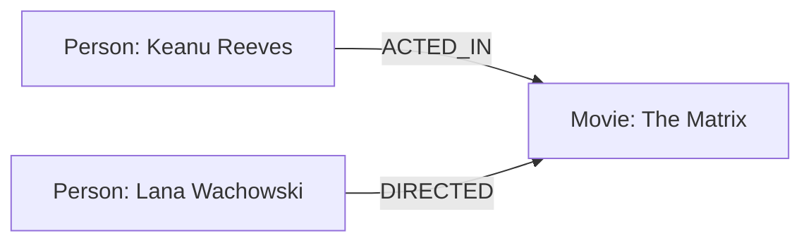
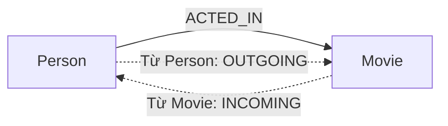

# Khai báo @Relationship với type và direction

Trong Neo4j, node biểu diễn thực thể còn relationship biểu diễn liên kết có hướng giữa các node. Khi ánh xạ đồ thị sang Java bằng Spring Data Neo4j (SDN), annotation `@Relationship` cho biết một thuộc tính của node entity tương ứng với loại relationship nào và relationship đi theo hướng nào. Khai báo đúng `type` và `direction` giúp SDN đọc và ghi đúng cấu trúc đồ thị, đồng thời giúp người đọc hiểu ý nghĩa của thuộc tính Java.

Bài học thuộc module **SPRING_DATA_NEO4J**, tập trung vào xây dựng tầng dữ liệu đồ thị qua node entity, relationship, repository và Cypher. Ví dụ dùng `Person`, `Movie` và các relationship `ACTED_IN`, `DIRECTED` để minh họa hướng đi từ người sang phim và cách nhìn cùng một liên kết từ phía node đích.

## 1. Relationship trong đồ thị Neo4j

Một relationship trong Neo4j luôn nối hai node và có hướng xác định. Relationship có một type, ví dụ `ACTED_IN` hoặc `DIRECTED`, và có thể có các property riêng.



Trong đồ thị trên:

- `Person` và `Movie` là label của node.
- `ACTED_IN` và `DIRECTED` là relationship type.
- Mũi tên thể hiện hướng của relationship: từ `Person` đến `Movie`.

Hướng là một phần của dữ liệu đồ thị, không chỉ là cách trình bày sơ đồ. Mẫu `(p:Person)-[:ACTED_IN]->(m:Movie)` khác với mẫu `(p:Person)<-[:ACTED_IN]-(m:Movie)`. Khi viết Cypher hoặc cấu hình mapping, cần dùng đúng hướng đã được mô hình hóa.

## 2. @Relationship dùng để làm gì?

`@Relationship` là annotation của Spring Data Neo4j, nằm trong package:

```java
import org.springframework.data.neo4j.core.schema.Relationship;
import org.springframework.data.neo4j.core.schema.Direction;
```

Annotation này được đặt trên thuộc tính của một lớp `@Node`. Hai thuộc tính quan trọng nhất là:

| Thuộc tính | Ý nghĩa |
|---|---|
| `type` | Tên relationship type được ánh xạ trong Neo4j, ví dụ `ACTED_IN` |
| `direction` | Hướng của relationship khi nhìn từ node đang chứa thuộc tính Java |

`direction` thường dùng `Direction.OUTGOING` hoặc `Direction.INCOMING`. Nếu không khai báo, hướng mặc định là `OUTGOING`. Dù vậy, nên khai báo tường minh trong mô hình quan trọng để tránh hiểu nhầm khi đọc code.

`type` phải khớp với relationship type được lưu trong Neo4j. Quy ước thường dùng là viết hoa và dùng dấu gạch dưới, chẳng hạn `ACTED_IN`, `DIRECTED`, `FOLLOWS`. Neo4j phân biệt tên type; `ACTED_IN` và `acted_in` không nên được xem là cùng một tên.

## 3. OUTGOING: relationship đi ra từ node hiện tại

Giả sử một người tham gia diễn xuất trong nhiều bộ phim. Mô hình đồ thị lưu relationship từ `Person` đến `Movie`:

```cypher
MATCH (p:Person {name: 'Keanu Reeves'})
MATCH (m:Movie {title: 'The Matrix'})
MERGE (p)-[:ACTED_IN]->(m);
```

Trong entity `Person`, dùng `Direction.OUTGOING` để ánh xạ các relationship đi từ người đó đến phim:

```java
import java.util.ArrayList;
import java.util.List;

import org.springframework.data.annotation.Id;
import org.springframework.data.neo4j.core.schema.Direction;
import org.springframework.data.neo4j.core.schema.GeneratedValue;
import org.springframework.data.neo4j.core.schema.Node;
import org.springframework.data.neo4j.core.schema.Relationship;

@Node("Person")
public class Person {

    @Id
    @GeneratedValue
    private Long id;

    private String name;
    private Integer born;

    @Relationship(type = "ACTED_IN", direction = Direction.OUTGOING)
    private List<Movie> actedIn = new ArrayList<>();
}
```

Thuộc tính `actedIn` biểu diễn danh sách node `Movie` ở đầu đích của các relationship `ACTED_IN` đi ra từ `Person`. Tên thuộc tính Java có thể được đặt theo ngôn ngữ domain; `type = "ACTED_IN"` mới là tên relationship type thực tế trong Neo4j.

Một người cũng có thể đạo diễn nhiều phim. Ta có thể ánh xạ relationship type khác trên một thuộc tính khác:

```java
@Relationship(type = "DIRECTED", direction = Direction.OUTGOING)
private List<Movie> directedMovies = new ArrayList<>();
```

Hai thuộc tính cùng trỏ tới `Movie` nhưng biểu diễn hai ý nghĩa nghiệp vụ khác nhau. Không nên dùng chung một danh sách nếu ứng dụng cần phân biệt phim người đó đóng và phim người đó đạo diễn.

## 4. INCOMING: relationship đi vào node hiện tại

Cùng relationship `ACTED_IN` có thể được nhìn từ phía `Movie`. Nếu node hiện tại là phim, các diễn viên nằm ở đầu bắt đầu của relationship, vì vậy hướng nhìn từ phim là `INCOMING`:

```java
import java.util.ArrayList;
import java.util.List;

import org.springframework.data.annotation.Id;
import org.springframework.data.neo4j.core.schema.Direction;
import org.springframework.data.neo4j.core.schema.GeneratedValue;
import org.springframework.data.neo4j.core.schema.Node;
import org.springframework.data.neo4j.core.schema.Relationship;

@Node("Movie")
public class Movie {

    @Id
    @GeneratedValue
    private Long id;

    private String title;
    private Integer released;

    @Relationship(type = "ACTED_IN", direction = Direction.INCOMING)
    private List<Person> actors = new ArrayList<>();
}
```

`actors` là danh sách `Person` có relationship `ACTED_IN` đi vào node `Movie`. Hướng này không có nghĩa Neo4j lưu một relationship mới theo chiều ngược lại. Nó chỉ mô tả cách SDN tìm và ánh xạ các relationship có sẵn khi đi từ node `Movie`.

Nếu cần ánh xạ đạo diễn từ phía phim, có thể khai báo:

```java
@Relationship(type = "DIRECTED", direction = Direction.INCOMING)
private List<Person> directors = new ArrayList<>();
```

## 5. Hiểu direction từ góc nhìn của node chứa thuộc tính

Quy tắc dễ nhớ là đọc hướng từ node entity có khai báo `@Relationship`:

| Node đang ánh xạ | Relationship type | Node ở đầu kia | Direction |
|---|---|---|---|
| `Person` | `ACTED_IN` | `Movie` | `OUTGOING` |
| `Movie` | `ACTED_IN` | `Person` | `INCOMING` |
| `Person` | `DIRECTED` | `Movie` | `OUTGOING` |
| `Movie` | `DIRECTED` | `Person` | `INCOMING` |

Có thể hình dung bằng hai cách đi qua cùng một cạnh:



`OUTGOING` và `INCOMING` được xác định theo node đang chứa field, không theo tên field hoặc góc nhìn của người dùng API. Nếu khai báo `actors` trong `Movie`, direction là `INCOMING` vì cạnh thực tế đi từ `Person` sang `Movie`.

## 6. Đối chiếu mapping với Cypher

Khi viết Cypher, mẫu relationship phải cùng type và hướng với mapping. Với dữ liệu `Person -[:ACTED_IN]-> Movie`, các truy vấn sau minh họa cách đi từ hai đầu:

```cypher
// Đi từ Person đến Movie: OUTGOING
MATCH (p:Person)-[:ACTED_IN]->(m:Movie)
RETURN p.name AS actor, m.title AS movie;

// Đi từ Movie về Person: duyệt ngược chiều relationship
MATCH (m:Movie)<-[:ACTED_IN]-(p:Person)
RETURN m.title AS movie, p.name AS actor;
```

Hai truy vấn trả lời hai góc nhìn khác nhau nhưng cùng mô tả một loại relationship trong đồ thị. Truy vấn thứ hai không đổi hướng lưu trữ; nó chỉ viết pattern từ node phim và đi theo mũi tên vào phim.

Cypher cũng cho phép bỏ qua hướng khi câu hỏi chỉ cần tìm node liên kết ở cả hai chiều:

```cypher
MATCH (a)-[:ACTED_IN]-(b)
RETURN a, b;
```

Pattern không chỉ định mũi tên phù hợp cho một số truy vấn khám phá. Tuy nhiên, relationship trong database vẫn có hướng. Không nên dùng một pattern không hướng để che đi quy tắc hướng của domain model hoặc để thay thế cấu hình `direction` trong entity SDN.

## 7. Relationship type không phải tên thuộc tính Java

Tên thuộc tính Java diễn tả mục đích sử dụng trong code, còn `type` xác định tên relationship trong Neo4j. Hai tên này không bắt buộc giống nhau:

```java
@Relationship(type = "ACTED_IN", direction = Direction.OUTGOING)
private List<Movie> filmography;
```

Ở đây `filmography` là tên thuộc tính Java; `ACTED_IN` là relationship type trong database. Điều này hữu ích khi domain model muốn dùng tên dễ đọc hơn hoặc khi database đã có quy ước type được dùng bởi nhiều ứng dụng.

Nếu bỏ `type`, SDN có thể suy ra type từ tên thuộc tính theo quy tắc mapping của framework. Đối với mô hình cần ổn định qua refactor, nên khai báo type tường minh để việc đổi tên field Java không vô tình làm thay đổi hợp đồng dữ liệu.

Relationship type nên là hằng số ổn định. Không thể truyền một giá trị tùy ý từ request vào annotation vì giá trị annotation phải được xác định tại thời điểm biên dịch. Nếu cần truy vấn nhiều relationship type theo điều kiện runtime, hãy dùng Cypher động được xây dựng an toàn hoặc các truy vấn riêng, thay vì cố thay đổi metadata annotation.

## 8. Quan hệ một-một và một-nhiều trong thuộc tính Java

Kiểu thuộc tính Java thể hiện số lượng node mà ứng dụng muốn ánh xạ từ relationship:

```java
// Một phim có một node đạo diễn chính theo mô hình domain này.
@Relationship(type = "DIRECTED", direction = Direction.INCOMING)
private Person director;

// Một phim có thể có nhiều diễn viên.
@Relationship(type = "ACTED_IN", direction = Direction.INCOMING)
private List<Person> actors = new ArrayList<>();
```

Kiểu `Person` biểu diễn một node liên kết; `List<Person>` biểu diễn nhiều node. Đây là hình dạng object model mà ứng dụng muốn sử dụng, không phải ràng buộc cardinality tự động của Neo4j. Neo4j cho phép nhiều relationship cùng type giữa các node nếu mô hình và dữ liệu tạo ra chúng; nếu nghiệp vụ yêu cầu một đạo diễn duy nhất, cần bảo đảm quy tắc đó trong logic ghi, constraint hoặc quy trình dữ liệu thích hợp.

Khi thứ tự không có ý nghĩa nghiệp vụ và cần tránh trùng node trong collection, có thể cân nhắc `Set<Person>`. Chọn `List` hay `Set` theo yêu cầu domain và cách ứng dụng xử lý dữ liệu, không dùng collection để suy luận rằng database tự bảo đảm tính duy nhất.

## 9. Relationship có thuộc tính riêng

Một relationship có thể mang property. Ví dụ `ACTED_IN` có thể lưu danh sách `roles` mà một diễn viên đảm nhận trong phim. Khi cần ánh xạ các property này, dùng lớp `@RelationshipProperties` và đặt field của lớp entity là collection kiểu relationship properties:

```java
import java.util.List;

import org.springframework.data.neo4j.core.schema.RelationshipId;
import org.springframework.data.neo4j.core.schema.RelationshipProperties;
import org.springframework.data.neo4j.core.schema.TargetNode;

@RelationshipProperties
public class ActingCredit {

    @RelationshipId
    private Long id;

    private List<String> roles;

    @TargetNode
    private Movie movie;
}
```

Trong `Person`, khai báo:

```java
@Relationship(type = "ACTED_IN", direction = Direction.OUTGOING)
private List<ActingCredit> actingCredits = new ArrayList<>();
```

`@Relationship` vẫn xác định type và direction. `ActingCredit` bổ sung nơi lưu property của cạnh; `@TargetNode` chỉ node `Movie` ở đầu kia. `@RelationshipId` là metadata nội bộ để SDN nhận diện relationship, không nên dùng làm mã nghiệp vụ công khai.

Ví dụ Cypher tạo relationship có property:

```cypher
MATCH (p:Person {name: 'Keanu Reeves'})
MATCH (m:Movie {title: 'The Matrix'})
MERGE (p)-[credit:ACTED_IN]->(m)
SET credit.roles = ['Neo'];
```

## 10. Những lỗi thường gặp khi khai báo type và direction

| Lỗi | Hệ quả | Cách kiểm tra |
|---|---|---|
| Dùng `INCOMING` trên `Person` trong khi cạnh đi từ `Person` đến `Movie` | SDN tìm relationship ở hướng ngược với dữ liệu đã lưu | Vẽ mũi tên và xác định node đang chứa field |
| Gõ sai `type`, ví dụ `ACT_IN` thay vì `ACTED_IN` | Mapping không khớp relationship type thực tế | Đối chiếu với Cypher và dữ liệu database |
| Nghĩ `INCOMING` tạo relationship mới theo chiều ngược | Hiểu sai dữ liệu đồ thị và kết quả truy vấn | Nhớ direction là hướng nhìn từ node đang ánh xạ |
| Đổi tên field và kỳ vọng type database tự giữ nguyên | Có thể thay đổi type suy diễn nếu không khai báo tường minh | Khai báo `type` rõ ràng |
| Dùng `List<Movie>` khi cần đọc `roles` trên cạnh | Không có lớp Java để chứa relationship properties | Dùng `@RelationshipProperties` và `@TargetNode` |
| Cho rằng `List<Person>` bảo đảm chỉ có một đạo diễn | Object model không tạo constraint cardinality trong Neo4j | Kiểm soát quy tắc nghiệp vụ khi ghi dữ liệu |

Khi mapping trả về collection rỗng, hãy kiểm tra theo thứ tự: node label, relationship type, direction, dữ liệu thực tế trong database và truy vấn tải quan hệ. Một lỗi type hoặc direction thường khiến SDN không tìm thấy cạnh mong đợi dù node đích vẫn tồn tại.

## 11. Quy trình thiết kế @Relationship

Trước khi viết annotation, hãy xác định:

1. Hai loại node ở hai đầu relationship là gì?
2. Relationship type chính xác trong Neo4j là gì?
3. Hướng lưu trữ của cạnh đi từ node nào đến node nào?
4. Thuộc tính Java đang nằm ở entity đầu hay entity cuối?
5. Ứng dụng cần một node liên kết hay một collection?
6. Relationship có property riêng như `roles`, `since` hoặc `rating` không?
7. Cypher dùng để tạo và đọc quan hệ có cùng type và hướng với mapping không?

Ví dụ với `ACTED_IN`:

```text
Person --ACTED_IN--> Movie
  |                    ^
  | OUTGOING           | INCOMING
  v                    |
Person.actingCredits   Movie.actors
```

Hãy dùng sơ đồ này như một bước kiểm tra trước khi thêm `@Relationship` vào entity.

## 12. Bài tập thực hành

1. Khai báo `Person.actedIn` với type `ACTED_IN` và direction `OUTGOING`.
2. Khai báo `Movie.actors` với cùng type nhưng direction `INCOMING`; giải thích vì sao hai hướng khác nhau.
3. Thêm relationship `DIRECTED` từ `Person` đến `Movie`, sau đó ánh xạ danh sách đạo diễn từ phía `Movie`.
4. Viết hai truy vấn Cypher tìm diễn viên từ phim và tìm phim từ diễn viên; giữ nguyên hướng dữ liệu.
5. Đổi tên thuộc tính Java từ `actedIn` thành `filmography` nhưng giữ nguyên `type = "ACTED_IN"`; giải thích lợi ích của khai báo type tường minh.
6. Mở rộng `ACTED_IN` để lưu `roles` bằng `@RelationshipProperties`, `@TargetNode` và kiểm tra kết quả đọc/ghi.
7. Tạo một relationship có hướng ngược với quy ước hiện tại trong dữ liệu thử nghiệm, quan sát mapping và sửa lại dữ liệu hoặc annotation cho nhất quán.

Khi hoàn thành, bạn cần xác định được relationship type và hướng từ góc nhìn của entity, đối chiếu được annotation với pattern Cypher và biết khi nào cần lớp relationship properties. Đây là nền tảng để ánh xạ các liên kết trong Spring Data Neo4j chính xác và giữ cho mô hình Java nhất quán với đồ thị Neo4j.
