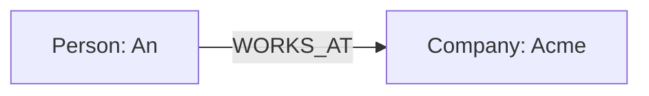

# Quan hệ OUTGOING, INCOMING và cách hiểu node đích

## Mục tiêu bài học

Sau bài này, bạn có thể:

- Xác định hướng của relationship trong đồ thị Neo4j.
- Giải thích ý nghĩa của `Relationship.Direction.OUTGOING` và `Relationship.Direction.INCOMING` trong Spring Data Neo4j (SDN).
- Phân biệt node đang được ánh xạ, node được tham chiếu bởi thuộc tính Java và node ở đầu mũi tên của relationship.
- Đọc cùng một relationship từ hai phía bằng Cypher và annotation.
- Chọn kiểu thuộc tính đơn hoặc collection phù hợp với số node liên quan.

## 1. Relationship trong Neo4j luôn có hướng

Một relationship trong Neo4j nối hai node, có kiểu và có hướng. Ví dụ:

```cypher
(:Person)-[:WORKS_AT]->(:Company)
```

Mẫu trên biểu diễn một node `Person` có relationship `WORKS_AT` đi đến node `Company`.

Có thể hình dung:



Trong relationship này:

- Node ở đầu bắt đầu (tail/source) là `Person`.
- Node ở đầu mũi tên (head/target) là `Company`.
- Kiểu relationship là `WORKS_AT`.
- Hướng được xác định từ `Person` sang `Company`.

Hướng là một phần của dữ liệu đồ thị. Nó có ý nghĩa nghiệp vụ: `Person -[:WORKS_AT]-> Company` có thể diễn đạt người làm việc tại công ty; nếu đảo mũi tên thành `Company -[:WORKS_AT]-> Person`, đó là một cấu trúc có hướng khác.

## 2. OUTGOING và INCOMING trong Spring Data Neo4j

Trong SDN, `@Relationship` khai báo mối liên kết giữa node hiện tại và entity được tham chiếu bởi thuộc tính Java. Thuộc tính `direction` cho biết relationship được định hướng như thế nào so với node đang được ánh xạ.

- **OUTGOING:** relationship đi ra từ node hiện tại. Node được tham chiếu bởi thuộc tính Java nằm ở đầu mũi tên.
- **INCOMING:** relationship đi vào node hiện tại. Node được tham chiếu bởi thuộc tính Java nằm ở đầu bắt đầu của relationship.

Mặc định, `@Relationship` dùng hướng `OUTGOING` nếu không chỉ định `direction`. Dù dùng hướng nào, kiểu Java của thuộc tính vẫn mô tả entity ở đầu còn lại của relationship.

Điểm cần ghi nhớ: INCOMING không đảo chiều relationship trong cơ sở dữ liệu. Nó nói rằng node hiện tại là đầu nhận của relationship, còn entity được tham chiếu bởi thuộc tính là node ở đầu bắt đầu.

## 3. OUTGOING: relationship đi ra từ node hiện tại

Giả sử một người làm việc tại một công ty. Entity `Person` có thể khai báo:

```java
import org.springframework.data.neo4j.core.schema.Id;
import org.springframework.data.neo4j.core.schema.Node;
import org.springframework.data.neo4j.core.schema.Relationship;

@Node("Person")
public class Person {

    @Id
    private String id;

    private String name;

    @Relationship(
        type = "WORKS_AT",
        direction = Relationship.Direction.OUTGOING
    )
    private Company employer;

    protected Person() {
    }

    public Person(String id, String name, Company employer) {
        this.id = id;
        this.name = name;
        this.employer = employer;
    }

    public Company getEmployer() {
        return employer;
    }
}
```

Trong ví dụ, SDN đang ánh xạ node `Person`. Thuộc tính `employer` tham chiếu đến một entity `Company`. Vì hướng là `OUTGOING`, relationship bắt đầu ở `Person` và đi đến `Company`:

```cypher
MATCH (person:Person)-[:WORKS_AT]->(company:Company)
RETURN person, company
```

Có thể đọc từ góc nhìn của object:

- Node hiện tại: `Person`.
- Thuộc tính quan hệ: `employer`.
- Kiểu entity được tham chiếu: `Company`.
- Hướng: đi ra khỏi `Person`.
- Node ở đầu mũi tên: `Company`.

Vì mỗi người trong ví dụ chỉ có một công ty hiện tại, thuộc tính dùng một đối tượng `Company`. Nếu nghiệp vụ cho phép một người làm việc tại nhiều công ty, mô hình Java cần dùng collection như `List<Company>` hoặc `Set<Company>`.

## 4. INCOMING: relationship đi vào node hiện tại

Có thể nhìn cùng quan hệ `WORKS_AT` từ phía công ty. Khi ánh xạ node `Company`, thuộc tính `employees` tham chiếu đến các node `Person` có relationship đi vào công ty:

```java
import java.util.ArrayList;
import java.util.List;

import org.springframework.data.neo4j.core.schema.Id;
import org.springframework.data.neo4j.core.schema.Node;
import org.springframework.data.neo4j.core.schema.Relationship;

@Node("Company")
public class Company {

    @Id
    private String id;

    private String name;

    @Relationship(
        type = "WORKS_AT",
        direction = Relationship.Direction.INCOMING
    )
    private List<Person> employees = new ArrayList<>();

    protected Company() {
    }

    public Company(String id, String name) {
        this.id = id;
        this.name = name;
    }

    public List<Person> getEmployees() {
        return employees;
    }
}
```

Ở đây, SDN đang ánh xạ node `Company`. Thuộc tính `employees` tham chiếu đến entity `Person`, nhưng relationship vẫn có hướng từ người đến công ty:

```cypher
MATCH (company:Company)<-[:WORKS_AT]-(person:Person)
RETURN company, person
```

Cách đọc từ góc nhìn của object:

- Node hiện tại: `Company`.
- Thuộc tính quan hệ: `employees`.
- Kiểu entity được tham chiếu: `Person`.
- Hướng: relationship đi vào `Company`.
- Node ở đầu bắt đầu: `Person`.

Đây là điểm dễ nhầm nhất: thuộc tính `employees` nằm trên entity `Company` và chứa các đối tượng `Person`, nhưng không có nghĩa relationship đi từ công ty đến nhân viên. Mũi tên trong đồ thị vẫn chỉ từ `Person` đến `Company`.

## 5. Hai cách nhìn, cùng một relationship

Hai cách khai báo ở trên mô tả cùng một relationship trong đồ thị:

- `Person.employer` dùng `OUTGOING`: từ Person đến Company.
- `Company.employees` dùng `INCOMING`: relationship từ Person đi vào Company.

Hai thuộc tính Java giúp điều hướng từ hai phía trong mô hình đối tượng. Chúng không có nghĩa cần tạo hai relationship khác nhau trong Neo4j. Nếu ứng dụng cần ánh xạ hai phía, hãy giữ cùng `type` và mô tả hướng tương ứng với node đang được ánh xạ.

Trong ví dụ thực tế, cần cân nhắc cách cập nhật object graph để tránh vô tình tạo hai liên kết nghiệp vụ riêng hoặc làm hai phía của object graph không nhất quán. Chọn phía quản lý cập nhật rõ ràng trong service và kiểm tra kết quả sau khi lưu.

## 6. Đọc cùng một relationship trong Cypher theo hai thứ tự

Cypher cho phép viết pattern từ node nguồn đến node đích hoặc bắt đầu từ node đích rồi viết mũi tên quay về node nguồn.

Hai truy vấn dưới đây mô tả cùng một relationship có hướng:

```cypher
// Bắt đầu từ Person
MATCH (person:Person)-[:WORKS_AT]->(company:Company)
RETURN person.name, company.name
```

```cypher
// Bắt đầu từ Company
MATCH (company:Company)<-[:WORKS_AT]-(person:Person)
RETURN person.name, company.name
```

Trong truy vấn thứ hai, phần pattern được viết từ `Company` sang `Person`, nhưng mũi tên vẫn hướng về `Company`. Vì vậy, quan hệ được lưu vẫn là:

```cypher
(person:Person)-[:WORKS_AT]->(company:Company)
```

Đừng suy ra hướng relationship chỉ từ thứ tự node xuất hiện trong câu truy vấn. Hãy nhìn vào mũi tên.

Một mẫu không có mũi tên như sau:

```cypher
MATCH (a:Person)-[:KNOWS]-(b:Person)
RETURN a, b
```

sẽ khớp relationship theo cả hai hướng. Đây là cách tìm kiếm linh hoạt trong truy vấn; nó không biến relationship trong Neo4j thành quan hệ vô hướng.

## 7. Ví dụ khác: Movie và người tham gia diễn xuất

Giả sử mô hình phim có relationship:

```cypher
(:Person)-[:ACTED_IN]->(:Movie)
```

Từ phía người, ta có thể ánh xạ các bộ phim mà người đó tham gia:

```java
@Node("Person")
public class Person {

    @Id
    private String id;

    @Relationship(
        type = "ACTED_IN",
        direction = Relationship.Direction.OUTGOING
    )
    private List<Movie> movies;
}
```

Từ phía phim, ta có thể ánh xạ những người tham gia:

```java
@Node("Movie")
public class Movie {

    @Id
    private String id;

    @Relationship(
        type = "ACTED_IN",
        direction = Relationship.Direction.INCOMING
    )
    private List<Person> actors;
}
```

Hai thuộc tính tham chiếu đến node ở đầu còn lại của relationship:

- `Person.movies`: từ Person đi ra đến Movie.
- `Movie.actors`: relationship đi vào Movie từ Person.

Cypher tương ứng:

```cypher
MATCH (person:Person)-[:ACTED_IN]->(movie:Movie)
RETURN person, movie
```

hoặc viết theo chiều bắt đầu từ phim:

```cypher
MATCH (movie:Movie)<-[:ACTED_IN]-(person:Person)
RETURN movie, person
```

Cách nhìn này hữu ích khi cùng một loại relationship cần được truy cập từ nhiều điểm bắt đầu trong ứng dụng, ví dụ xem danh sách phim của diễn viên hoặc danh sách diễn viên của một phim.

## 8. Chọn thuộc tính đơn hay collection

Hướng relationship và số lượng node liên quan là hai quyết định khác nhau.

- `direction` xác định chiều relationship so với node hiện tại.
- Kiểu thuộc tính Java xác định cách ứng dụng biểu diễn số lượng node ở đầu còn lại.

| Thuộc tính Java | Ý nghĩa mô hình |
| --- | --- |
| `Company employer` | Một node Company liên quan đến Person hiện tại |
| `List<Company> companies` | Nhiều node Company liên quan đến Person hiện tại |
| `List<Person> employees` | Nhiều node Person có relationship hướng vào Company |
| `Person manager` | Một node Person được tham chiếu ở đầu còn lại |

Ví dụ, nếu một công ty có nhiều nhân viên, `List<Person>` phù hợp hơn thuộc tính đơn `Person`. Nếu nghiệp vụ đảm bảo một nhân viên chỉ có một quản lý trực tiếp, thuộc tính đơn có thể phù hợp cho quan hệ đó.

Kiểu Java không tự tạo ra quy tắc duy nhất ở cấp cơ sở dữ liệu. Nếu nghiệp vụ yêu cầu một người chỉ có một công ty chính, cần bảo đảm quy tắc đó bằng quy trình ghi, constraint hoặc kiểm tra nghiệp vụ phù hợp.

## 9. Những lỗi thường gặp

| Cách hiểu sai | Cách hiểu đúng |
| --- | --- |
| `INCOMING` đảo hướng relationship đã lưu | `INCOMING` ánh xạ relationship đi vào node hiện tại; hướng lưu vẫn giữ nguyên |
| Field trên Company chứa Person nên relationship đi từ Company đến Person | Với `INCOMING`, Person là node nguồn và Company là node đích |
| Node được tham chiếu bởi field luôn là đầu mũi tên | Điều này đúng với OUTGOING; với INCOMING, field tham chiếu node ở đầu bắt đầu |
| Viết Cypher bắt đầu từ Company thì Company là nguồn | Mũi tên mới quyết định hướng; `(company)<-[:WORKS_AT]-(person)` vẫn là Person → Company |
| Dùng OUTGOING và INCOMING tạo hai relationship riêng | Hai hướng annotation có thể mô tả cùng một relationship từ hai phía |
| Dùng `List` có nghĩa Neo4j lưu một relationship dạng danh sách | `List` là cách biểu diễn nhiều node liên quan ở Java; mỗi liên kết vẫn là relationship trong đồ thị |

## 10. Câu hỏi tự kiểm tra

Cho mô hình đồ thị:

```cypher
(:Person {name: 'An'})
    -[:PURCHASED]->
(:Product {name: 'Laptop'})
```

Hãy trả lời:

1. Nếu entity `Person` có field `Product purchasedProduct`, hướng nào phù hợp với relationship này?
2. Nếu entity `Product` có field `List<Person> buyers`, hướng nào phù hợp?
3. Khi ánh xạ `Product.buyers` bằng `INCOMING`, node `Person` nằm ở đầu nào của relationship?
4. Hai pattern `(p:Person)-[:PURCHASED]->(x:Product)` và `(x:Product)<-[:PURCHASED]-(p:Person)` có mô tả hai relationship khác nhau không?
5. Nếu một sản phẩm có nhiều người mua, nên dùng thuộc tính đơn hay collection ở phía `Product`?

**Gợi ý:** Xác định node hiện tại của entity trước. Sau đó kiểm tra relationship đi ra khỏi hay đi vào node đó. Cuối cùng mới xác định kiểu Java của node được tham chiếu.

## Kết luận

`OUTGOING` biểu diễn relationship bắt đầu tại node đang được ánh xạ; `INCOMING` biểu diễn relationship kết thúc tại node đó. Thuộc tính Java luôn tham chiếu đến entity ở đầu còn lại, nhưng node được tham chiếu sẽ là đầu mũi tên với OUTGOING và đầu bắt đầu với INCOMING.

Khi đọc hoặc thiết kế ánh xạ quan hệ trong Spring Data Neo4j, hãy xác định node hiện tại, kiểu relationship, hướng mũi tên trong đồ thị và node được tham chiếu. Bốn yếu tố này giúp tránh đảo chiều quan hệ, chọn đúng entity đích và giữ cho mô hình Java phản ánh chính xác cấu trúc dữ liệu Neo4j.
