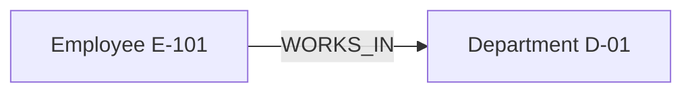

# Ánh xạ quan hệ đơn bằng một thuộc tính entity

Trong Neo4j, relationship nối hai node và thể hiện cách các thực thể liên quan với nhau. Với Spring Data Neo4j (SDN), khi một entity chỉ cần tham chiếu đến một node ở đầu kia của relationship, ta có thể khai báo một thuộc tính entity đơn và đánh dấu bằng `@Relationship`. SDN dùng metadata này để đọc và ghi liên kết trong graph.

Ví dụ, mỗi nhân viên trong mô hình ứng dụng thuộc về một phòng ban. Entity `Employee` có thuộc tính `Department department`; relationship `WORKS_IN` nối node nhân viên với node phòng ban. Cách ánh xạ này phù hợp khi mô hình nghiệp vụ kỳ vọng một nhân viên có tối đa một phòng ban tại một thời điểm.

## 1. Relationship trong graph và thuộc tính entity

Neo4j lưu relationship độc lập với property của node. Một relationship có type, hướng và có thể có các property riêng. Ví dụ:

```cypher
CREATE (e:Employee {employeeId: 'E-101', name: 'Lan'})
CREATE (d:Department {departmentId: 'D-01', name: 'Platform'})
CREATE (e)-[:WORKS_IN]->(d);
```

Graph có hai node và một relationship `WORKS_IN` hướng từ `Employee` đến `Department`:



Trong Java, ta có thể biểu diễn đầu còn lại của relationship bằng một thuộc tính entity:

```java
private Department department;
```

Thuộc tính `department` không phải property được lưu trực tiếp trên node `Employee`. Nó là tham chiếu đến node `Department` mà SDN tìm qua relationship đã khai báo. Relationship type `WORKS_IN` vẫn là một relationship riêng trong Neo4j.

## 2. Dùng `@Relationship` cho thuộc tính đơn

Annotation `@Relationship` thuộc package `org.springframework.data.neo4j.core.schema`. Thuộc tính `type` chỉ định relationship type trong graph; `direction` chỉ định hướng relationship so với node của entity đang khai báo thuộc tính.

```java
import org.springframework.data.annotation.Id;
import org.springframework.data.neo4j.core.schema.Direction;
import org.springframework.data.neo4j.core.schema.Node;
import org.springframework.data.neo4j.core.schema.Relationship;

@Node("Employee")
public class Employee {

    @Id
    private String employeeId;

    private String name;

    @Relationship(type = "WORKS_IN", direction = Direction.OUTGOING)
    private Department department;

    protected Employee() {
    }

    public Employee(String employeeId, String name) {
        this.employeeId = employeeId;
        this.name = name;
    }

    public void assignTo(Department department) {
        this.department = department;
    }

    public Department getDepartment() {
        return department;
    }
}
```

Node ở đầu kia cũng được ánh xạ thành entity:

```java
import org.springframework.data.annotation.Id;
import org.springframework.data.neo4j.core.schema.Node;

@Node("Department")
public class Department {

    @Id
    private String departmentId;

    private String name;

    protected Department() {
    }

    public Department(String departmentId, String name) {
        this.departmentId = departmentId;
        this.name = name;
    }
}
```

Trong ví dụ này:

- `@Node("Employee")` và `@Node("Department")` xác định label của hai loại node.
- `@Id` xác định thuộc tính định danh của từng entity. Các mã định danh trong ví dụ do ứng dụng cấp.
- `@Relationship(type = "WORKS_IN")` ánh xạ thuộc tính `department` qua relationship type `WORKS_IN`.
- `Direction.OUTGOING` nghĩa là relationship đi từ node `Employee` hiện tại đến node `Department`.
- Kiểu Java `Department` là một entity đơn, vì vậy thuộc tính thể hiện một đích liên kết duy nhất theo mô hình đối tượng.

Khi không khai báo `direction`, SDN mặc định dùng `Direction.OUTGOING`. Nên khai báo tường minh khi đọc code hoặc khi graph có nhiều loại relationship để tránh hiểu sai hướng.

## 3. Hướng relationship được tính từ entity sở hữu thuộc tính

`direction` được hiểu tương đối với node của entity chứa thuộc tính `@Relationship`. Với `Employee.department` và `Direction.OUTGOING`, pattern tương ứng là:

```cypher
(employee:Employee)-[:WORKS_IN]->(department:Department)
```

Nếu dữ liệu graph được lưu theo chiều ngược lại, thuộc tính trên `Employee` phải khai báo `Direction.INCOMING`:

```java
@Relationship(type = "WORKS_IN", direction = Direction.INCOMING)
private Department department;
```

Pattern khi đó là:

```cypher
(department:Department)-[:WORKS_IN]->(employee:Employee)
```

Đổi `direction` không đổi tên relationship type và cũng không tự đảo dữ liệu đã có trong Neo4j. Nó thay đổi hướng mà SDN dùng để tìm và quản lý relationship khi ánh xạ thuộc tính. Hãy đối chiếu annotation với hướng mũi tên thực tế trong graph.

## 4. Đọc và lưu entity có quan hệ đơn

Repository của entity vẫn kế thừa `Neo4jRepository` như bình thường:

```java
import org.springframework.data.neo4j.repository.Neo4jRepository;

public interface EmployeeRepository
        extends Neo4jRepository<Employee, String> {
}

public interface DepartmentRepository
        extends Neo4jRepository<Department, String> {
}
```

Khi cần gán nhân viên vào một phòng ban đã tồn tại, service có thể tải hai entity, gán tham chiếu và lưu aggregate root:

```java
import org.springframework.stereotype.Service;
import org.springframework.transaction.annotation.Transactional;

@Service
public class EmployeeService {

    private final EmployeeRepository employees;
    private final DepartmentRepository departments;

    public EmployeeService(
            EmployeeRepository employees,
            DepartmentRepository departments) {
        this.employees = employees;
        this.departments = departments;
    }

    @Transactional
    public void assignDepartment(String employeeId, String departmentId) {
        Employee employee = employees.findById(employeeId)
                .orElseThrow(() -> new IllegalArgumentException("Employee not found"));
        Department department = departments.findById(departmentId)
                .orElseThrow(() -> new IllegalArgumentException("Department not found"));

        employee.assignTo(department);
        employees.save(employee);
    }
}
```

Ví dụ minh họa cách điều phối ở tầng service: tải entity cần thiết, cập nhật thuộc tính quan hệ trên `Employee`, sau đó lưu `Employee` trong transaction. Cấu hình transaction manager Neo4j của ứng dụng để `@Transactional` quản lý các thao tác repository cùng transaction.

Khi đọc entity qua repository, SDN sử dụng mapping metadata để nạp các relationship được khai báo theo cơ chế truy vấn của repository và phiên bản SDN. Nếu use case cần bảo đảm một quan hệ đã được nạp, hãy kiểm tra truy vấn thực tế hoặc dùng truy vấn tùy chỉnh trả về đầy đủ dữ liệu cần thiết; không giả định một projection chỉ có vài trường tương đương với aggregate đầy đủ.

## 5. Cập nhật hoặc thay thế quan hệ đơn

Với mô hình một nhân viên chỉ thuộc một phòng ban, khi đổi phòng ban cần thay thế relationship cũ. Nếu thao tác trực tiếp bằng Cypher, hãy tìm được cả hai node trước, sau đó xóa relationship cũ cùng type và tạo relationship mới trong cùng câu lệnh:

```cypher
MATCH (e:Employee {employeeId: $employeeId}),
      (d:Department {departmentId: $departmentId})
OPTIONAL MATCH (e)-[old:WORKS_IN]->()
WITH e, d, collect(old) AS oldRelationships
FOREACH (r IN oldRelationships | DELETE r)
CREATE (e)-[:WORKS_IN]->(d)
RETURN e, d;
```

Vì hai node được khớp trước bước xóa, nếu nhân viên hoặc phòng ban không tồn tại thì truy vấn không đi đến phần thay đổi. `collect(old)` bỏ qua giá trị null khi chưa có relationship cũ; `FOREACH` khi đó không xóa gì. Câu lệnh xóa các relationship `WORKS_IN` đi ra từ nhân viên và tạo một liên kết mới đến phòng ban đã chọn.

Trong ứng dụng SDN, có thể thực hiện thay đổi qua thuộc tính `department` của entity rồi lưu root, miễn là entity được tải đủ dữ liệu và save semantics của phiên bản SDN đang dùng phù hợp. Khi dùng Cypher tùy chỉnh để thay đổi relationship, cần cân nhắc đồng bộ trạng thái entity trong persistence context và không tiếp tục lưu một object graph cũ sau khi graph đã được cập nhật trực tiếp.

## 6. Thuộc tính đơn không tự áp đặt cardinality trong Neo4j

Đây là điểm quan trọng khi mô hình hóa. Java field `Department department` biểu diễn một đích liên kết trong object model, nhưng Neo4j vẫn cho phép một node `Employee` có nhiều relationship `WORKS_IN` hướng ra nhiều node `Department`.

Ví dụ, dữ liệu sau vẫn hợp lệ ở cấp graph:

```cypher
MATCH (e:Employee {employeeId: 'E-101'})
MATCH (d1:Department {departmentId: 'D-01'})
MATCH (d2:Department {departmentId: 'D-02'})
CREATE (e)-[:WORKS_IN]->(d1)
CREATE (e)-[:WORKS_IN]->(d2);
```

Nhưng dữ liệu này mâu thuẫn với giả định một thuộc tính `department` đơn. SDN mapping không phải là constraint cardinality ở database. Ứng dụng cần bảo vệ quy tắc một phòng ban bằng service/domain logic hoặc các câu lệnh ghi có kiểm soát; đồng thời cần làm sạch dữ liệu cũ nếu đã tồn tại nhiều liên kết.

Nếu một nhân viên có thể làm việc ở nhiều phòng ban, hãy mô hình hóa đúng cardinality bằng collection:

```java
@Relationship(type = "WORKS_IN", direction = Direction.OUTGOING)
private List<Department> departments;
```

Hoặc dùng `Set<Department>` nếu cần biểu diễn tập đích không trùng theo equality của entity. Chọn collection dựa trên quy tắc nghiệp vụ và cách ứng dụng cần xử lý thứ tự hoặc trùng lặp.

## 7. Khi relationship có thuộc tính riêng

Một thuộc tính entity đơn phù hợp khi cần tham chiếu node đích và relationship không có dữ liệu nghiệp vụ cần ánh xạ. Nếu relationship có các property như `startDate`, `role`, `allocationPercent` hoặc `status`, hãy dùng `@RelationshipProperties` cùng `@TargetNode`.

Ví dụ, quan hệ nhân viên làm việc trong phòng ban có thể cần lưu ngày bắt đầu:

```java
import java.time.LocalDate;

import org.springframework.data.neo4j.core.schema.RelationshipId;
import org.springframework.data.neo4j.core.schema.RelationshipProperties;
import org.springframework.data.neo4j.core.schema.TargetNode;

@RelationshipProperties
public class DepartmentAssignment {

    @RelationshipId
    private Long id;

    private LocalDate startDate;

    @TargetNode
    private Department department;
}
```

Sau đó entity sở hữu relationship dùng thuộc tính kiểu wrapper:

```java
import org.springframework.data.neo4j.core.schema.Direction;
import org.springframework.data.neo4j.core.schema.Relationship;

@Relationship(type = "WORKS_IN", direction = Direction.OUTGOING)
private DepartmentAssignment assignment;
```

Trong trường hợp này, `assignment` đại diện cho relationship object có property và node đích. Đây là mô hình khác với `Department department` trực tiếp. Không cần tạo wrapper nếu relationship chỉ có nhiệm vụ nối hai node và không có thuộc tính riêng.

## 8. Kiểm tra mapping bằng Cypher

Khi entity không được nạp như mong đợi, hãy kiểm tra dữ liệu graph độc lập với Java mapping. Với ví dụ `Employee` và `Department`, có thể chạy:

```cypher
MATCH (e:Employee {employeeId: $employeeId})-[r:WORKS_IN]->(d:Department)
RETURN e.employeeId AS employeeId,
       type(r) AS relationshipType,
       d.departmentId AS departmentId,
       d.name AS departmentName;
```

Truy vấn xác nhận bốn điểm:

1. Node nguồn có label và định danh đúng.
2. Relationship có type đúng là `WORKS_IN`.
3. Hướng relationship đi từ `Employee` đến `Department`.
4. Node đích có label và định danh như mong đợi.

Nếu truy vấn không trả về kết quả, kiểm tra dữ liệu đã được tạo chưa, type có khớp chữ hoa/chữ thường không và annotation `direction` có trùng với hướng trong graph không. Nếu trả về nhiều dòng cho cùng nhân viên, kiểm tra quy tắc cardinality của mô hình đơn.

## 9. Những lỗi thường gặp

| Lỗi | Hệ quả | Cách xử lý |
|---|---|---|
| Nhầm thuộc tính entity với property của node | Tìm `department` như một property trên `Employee` trong Cypher nhưng dữ liệu thực nằm ở relationship | Truy vấn theo pattern relationship |
| Đặt sai `direction` | SDN không tìm thấy liên kết theo mapping đã khai báo | Đối chiếu `OUTGOING`/`INCOMING` với hướng mũi tên trong graph |
| Dùng field đơn trong khi graph có nhiều node đích | Object model không phản ánh cardinality thực tế | Dọn dữ liệu hoặc đổi sang collection |
| Cho rằng field đơn tạo constraint database | Dữ liệu khác vẫn có thể tạo nhiều relationship | Bảo vệ cardinality trong logic ghi và kiểm tra dữ liệu |
| Dùng `@RelationshipProperties` khi không có relationship property | Mapping phức tạp không cần thiết | Dùng trực tiếp thuộc tính entity đích |
| Dùng entity chỉ nạp một phần để lưu toàn bộ aggregate | Có nguy cơ làm sai trạng thái relationship khi đồng bộ | Nạp đủ dữ liệu cần ghi hoặc dùng command Cypher có phạm vi rõ ràng |
| Cập nhật Cypher trực tiếp rồi lưu object graph cũ | Trạng thái trong bộ nhớ có thể không còn đồng bộ với graph | Tải lại entity hoặc kết thúc transaction/context phù hợp trước lần ghi tiếp theo |

## 10. Bài tập thực hành

Tạo một nhân viên và một phòng ban, sau đó nối chúng bằng relationship `WORKS_IN`:

```cypher
CREATE (e:Employee {employeeId: 'E-201', name: 'Minh'})
CREATE (d:Department {departmentId: 'D-10', name: 'Engineering'})
CREATE (e)-[:WORKS_IN]->(d);
```

Thực hiện các yêu cầu:

1. Viết entity `Employee` với một thuộc tính `Department department` được đánh dấu `@Relationship(type = "WORKS_IN", direction = Direction.OUTGOING)`.
2. Viết entity `Department` và repository cho cả hai entity.
3. Dùng repository tải nhân viên và kiểm tra phòng ban được ánh xạ vào thuộc tính `department`.
4. Thay đổi phòng ban của nhân viên bằng service có `@Transactional`.
5. Chạy Cypher kiểm tra type và hướng relationship sau khi cập nhật.
6. Tạo thêm một relationship `WORKS_IN` thứ hai để quan sát vì sao graph cardinality có thể mâu thuẫn với thuộc tính Java đơn.
7. Nếu nghiệp vụ cho phép nhiều phòng ban, đổi field thành `List<Department>` và đánh giá lại mapping.

Sau bài tập, hãy giải thích được `@Relationship` xác định cách SDN duyệt graph từ entity, `direction` được tính tương đối với entity chứa field, và kiểu field đơn chỉ thể hiện giả định cardinality của object model.

## Kết luận

Một thuộc tính entity đơn được đánh dấu `@Relationship` giúp Spring Data Neo4j ánh xạ một node đích qua relationship type và hướng đã khai báo. `Direction.OUTGOING` và `Direction.INCOMING` luôn được hiểu tương đối với node của entity sở hữu thuộc tính. Field đơn thể hiện kỳ vọng một đích liên kết trong mô hình Java, nhưng không tự tạo ràng buộc cardinality trong Neo4j. Hãy chọn kiểu entity đơn hay collection theo nghiệp vụ, dùng `@RelationshipProperties` khi relationship có dữ liệu riêng và kiểm tra graph bằng Cypher khi cần xác minh mapping.
