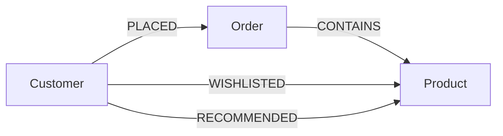

# Nhiều đường liên kết tới cùng node và vấn đề trùng đối tượng

## Mục tiêu bài học

Trong Neo4j, một node có thể được tiếp cận qua nhiều relationship hoặc nhiều đường đi khác nhau. Chẳng hạn, một khách hàng có thể nhìn thấy cùng một sản phẩm qua đơn hàng đã mua và danh sách yêu thích. Dù có nhiều đường đi, sản phẩm đó vẫn là một node duy nhất trong graph.

Khi truy vấn bằng Cypher và ánh xạ kết quả thành entity Java với Spring Data Neo4j (SDN), cần phân biệt node, relationship, path và record. Nếu một truy vấn trả về nhiều record cho cùng node gốc, danh sách entity có thể lặp đối tượng gốc hoặc mỗi bản ghi chỉ chứa một phần quan hệ. Nếu nhiều nhánh truy vấn được kết hợp không đúng cách, kết quả còn có thể bị nhân bản do tích Descartes.

Bài học này trình bày cách nhận diện các dạng trùng, dùng `DISTINCT` và `collect()` đúng chỗ, gom kết quả thành một record cho mỗi node gốc, ánh xạ các relationship riêng biệt và kiểm thử object graph sau khi đọc dữ liệu.

## 1. Phân biệt node, relationship, path và record

Xét graph thương mại điện tử sau:



Cùng một node `Product` có thể được tìm thấy qua ba đường đi:

- Khách hàng đặt một đơn hàng, đơn hàng chứa sản phẩm.
- Khách hàng thêm sản phẩm vào danh sách yêu thích.
- Hệ thống đề xuất sản phẩm cho khách hàng.

Ba đường đi không tạo ra ba node sản phẩm. Chúng là ba cách tiếp cận cùng một node, có thể đi qua những relationship khác nhau.

Cần phân biệt bốn khái niệm:

| Khái niệm | Ý nghĩa | Ví dụ |
|---|---|---|
| Node | Thực thể được lưu trong graph | Một `Product` có `id = "P-100"` |
| Relationship | Một cạnh có hướng, kiểu và có thể có thuộc tính | `WISHLISTED` từ khách hàng đến sản phẩm |
| Path | Một chuỗi node và relationship nối tiếp nhau | `Customer → Order → Product` |
| Record | Một dòng trong kết quả truy vấn Cypher | Một tổ hợp giá trị `customer`, `order`, `product` |

Một node có thể xuất hiện trong nhiều path. Một relationship cũng có thể xuất hiện trong nhiều path. Tuy nhiên, mỗi lần một path hoặc một tổ hợp khớp được trả về, Cypher có thể tạo một record riêng. Vì vậy, số record không đồng nghĩa với số node duy nhất.

Ở tầng Java, entity là object đại diện cho node. Relationship properties có thể được biểu diễn bằng một object riêng đại diện cho cạnh. Không nên đánh đồng số object trong một collection với số node hoặc số relationship trong graph nếu truy vấn chưa được gom và khử trùng phù hợp.

## 2. Vì sao kết quả Cypher có thể lặp node gốc?

Giả sử một bộ phim có nhiều diễn viên. Truy vấn sau tìm bộ phim và từng relationship `ACTED_IN`:

```cypher
MATCH (m:Movie {title: $title})<-[r:ACTED_IN]-(p:Person)
RETURN m, r, p
```

Nếu bộ phim có năm diễn viên, truy vấn trả về năm record. Trong mỗi record, `m` vẫn là cùng một node phim, nhưng `r` và `p` thay đổi:

| Record | `m` | `r` | `p` |
|---|---|---|---|
| 1 | The Graph | ACTED_IN của diễn viên A | A |
| 2 | The Graph | ACTED_IN của diễn viên B | B |
| 3 | The Graph | ACTED_IN của diễn viên C | C |
| 4 | The Graph | ACTED_IN của diễn viên D | D |
| 5 | The Graph | ACTED_IN của diễn viên E | E |

Nếu repository ánh xạ từng record thành một `Movie` trong `List<Movie>`, danh sách có thể chứa nhiều kết quả mang cùng node gốc. Mỗi kết quả còn chỉ có một phần dữ liệu quan hệ của bộ phim. Đây là vấn đề hình dạng kết quả truy vấn, không phải Neo4j đã tạo thêm các node phim.

SDN xử lý kết quả custom query theo record. Với một entity gốc cần được nạp cùng các nhánh quan hệ, nên trả về đầy đủ dữ liệu của entity đó trong một record. Tài liệu SDN minh họa cách gom relationship và node liên quan bằng `collect()` để tạo một record cho mỗi root node.

## 3. Gom relationship và node bằng collect()

Có thể sửa truy vấn ví dụ trên bằng cách gom các relationship và node diễn viên:

```cypher
MATCH (m:Movie {title: $title})<-[r:ACTED_IN]-(p:Person)
RETURN m, collect(r), collect(p)
```

Kết quả lúc này gồm một record cho bộ phim được tìm thấy:

- `m`: node phim gốc.
- `collect(r)`: danh sách các relationship `ACTED_IN`.
- `collect(p)`: danh sách node diễn viên.

SDN có thể dùng record chứa đầy đủ các node và relationship này để dựng object graph cho `Movie`. Khi truy vấn có thể khớp cùng một node hoặc relationship qua nhiều path, hãy cân nhắc dùng `DISTINCT` trong từng collection:

```cypher
MATCH (m:Movie {title: $title})<-[r:ACTED_IN]-(p:Person)
RETURN m, collect(DISTINCT r), collect(DISTINCT p)
```

Hai collection có vai trò khác nhau:

- `collect(DISTINCT p)` giữ một lần mỗi node diễn viên, dựa trên danh tính node trong graph.
- `collect(DISTINCT r)` giữ từng relationship riêng biệt. Hai relationship khác nhau vẫn được giữ dù chúng có cùng node nguồn và node đích.

Không nên thay `collect(DISTINCT r)` bằng cách chỉ gom node đích nếu nghiệp vụ cần thông tin của từng cạnh. Một diễn viên có thể đảm nhận nhiều vai trong cùng bộ phim; mỗi relationship có thể mang danh sách vai diễn khác nhau dù cùng trỏ đến một node `Person`.

Nếu muốn truy vấn nhiều kiểu relationship cùng trỏ đến cùng kiểu node, có thể khớp các kiểu đó trong một mẫu:

```cypher
MATCH (m:Movie {title: $title})<-[r:DIRECTED|REVIEWED|ACTED_IN]-(p:Person)
RETURN m, collect(DISTINCT r), collect(DISTINCT p)
```

Cách này gom các quan hệ có cùng node đích kiểu `Person` vào một kết quả gắn với bộ phim. Mô hình entity cần khai báo các relationship tương ứng rõ ràng để SDN ánh xạ đúng từng kiểu.

## 4. Dùng DISTINCT khi chỉ cần node duy nhất

Nếu màn hình chỉ cần danh sách sản phẩm duy nhất mà khách hàng đã gặp qua các đường đi khác nhau, không cần giữ chi tiết từng relationship, có thể dùng `UNION` hoặc `DISTINCT`.

Ví dụ dùng `UNION` để hợp nhất hai cách tìm sản phẩm:

```cypher
MATCH (c:Customer {id: $customerId})-[:WISHLISTED]->(p:Product)
RETURN p

UNION

MATCH (c:Customer {id: $customerId})-[:PLACED]->(:Order)-[:CONTAINS]->(p:Product)
RETURN p
```

`UNION` loại bỏ các dòng trùng trong kết quả hợp nhất. Nếu một sản phẩm vừa nằm trong danh sách yêu thích vừa xuất hiện trong đơn hàng, node đó chỉ được trả về một lần.

Nếu có thể diễn đạt các đường đi trong cùng một truy vấn, dùng `WITH` và `collect(DISTINCT ...)` để gom theo node gốc:

```cypher
MATCH (c:Customer {id: $customerId})-[:WISHLISTED|RECOMMENDED]->(p:Product)
WITH c, collect(DISTINCT p) AS products
RETURN c, products
```

Trong ví dụ này, mỗi khách hàng có một collection sản phẩm duy nhất từ hai kiểu relationship. Nếu truy vấn còn cần trả về metadata của từng cạnh, hãy gom relationship riêng:

```cypher
MATCH (c:Customer {id: $customerId})-[r:WISHLISTED|RECOMMENDED]->(p:Product)
RETURN c, collect(DISTINCT r), collect(DISTINCT p)
```

Hãy chọn cách khử trùng theo đúng ý nghĩa kết quả:

| Mục tiêu | Cách xử lý |
|---|---|
| Một dòng cho mỗi node sản phẩm | `RETURN DISTINCT p` |
| Một dòng cho mỗi node gốc và collection sản phẩm | `RETURN c, collect(DISTINCT p)` |
| Giữ đầy đủ các cạnh và node đích | Gom cả `collect(DISTINCT r)` và `collect(DISTINCT p)` |
| Giữ riêng từng đường đi | Trả về path hoặc dữ liệu mô tả path; không khử trùng chỉ theo node |

`DISTINCT` chỉ loại bỏ giá trị trùng theo những biểu thức được chọn trong record. Nếu record chứa thêm loại quan hệ hoặc thuộc tính khác nhau, cùng một node vẫn có thể xuất hiện ở nhiều record vì toàn bộ record không giống nhau.

## 5. Tránh tích Descartes khi truy vấn nhiều nhánh

Một lỗi phổ biến là MATCH nhiều nhánh độc lập trong cùng một truy vấn:

```cypher
MATCH (m:Movie {title: $title})<-[a:ACTED_IN]-(actor:Person)
MATCH (m)<-[d:DIRECTED]-(director:Person)
RETURN m, a, actor, d, director
```

Giả sử phim có năm relationship `ACTED_IN` và hai relationship `DIRECTED`. Hai nhánh được kết hợp có thể tạo ra mười record (5 × 2). Mỗi diễn viên bị lặp lại theo số đạo diễn, mỗi đạo diễn bị lặp theo số diễn viên. Nếu tiếp tục nối thêm nhánh `REVIEWED`, số tổ hợp trung gian còn tăng nữa.

Có thể tách từng nhánh thành subquery và gom kết quả độc lập:

```cypher
MATCH (m:Movie {title: $title})

CALL {
    WITH m
    OPTIONAL MATCH (m)<-[a:ACTED_IN]-(actor:Person)
    RETURN collect(DISTINCT a) AS actingRelationships,
           collect(DISTINCT actor) AS actors
}

CALL {
    WITH m
    OPTIONAL MATCH (m)<-[d:DIRECTED]-(director:Person)
    RETURN collect(DISTINCT d) AS directingRelationships,
           collect(DISTINCT director) AS directors
}

RETURN m,
       actingRelationships,
       actors,
       directingRelationships,
       directors
```

Mỗi subquery gom một nhánh trước khi kết quả được kết hợp với nhánh còn lại. `OPTIONAL MATCH` giữ node phim ngay cả khi không có diễn viên hoặc đạo diễn; `collect()` trên các giá trị không khớp trả về collection rỗng.

Mẫu này hữu ích cho custom projection hoặc DTO chứa nhiều collection độc lập. Khi dùng kết quả để hydrate trực tiếp một `@Node` entity, cần giữ cấu trúc record và tên/kiểu dữ liệu phù hợp với mapping mà SDN mong đợi. Hãy kiểm tra bằng integration test cho đúng phiên bản SDN đang dùng; không mặc định rằng mọi alias collection đều tự động khớp với mọi trường `@Relationship`.

## 6. Nhiều path sâu hơn: gom node và relationship từ path

Với truy vấn duyệt graph nhiều tầng, một node có thể xuất hiện trong nhiều path. Ví dụ, một người có thể kết nối đến cùng một người khác qua nhiều chuỗi quan hệ bạn bè. SDN không ánh xạ đối tượng path một cách tự động chỉ vì query trả về một biến path. Cần trích xuất node và relationship khỏi path.

Ví dụ trả về root cùng các danh sách node và relationship trên các path:

```cypher
MATCH p = (root:Person {id: $personId})-[:KNOWS*1..3]-(other:Person)
RETURN root, collect(nodes(p)), collect(relationships(p))
```

Các biểu thức `nodes(p)` và `relationships(p)` trả về danh sách theo từng path. Việc gom chúng tạo cấu trúc danh sách lồng nhau; SDN hỗ trợ xử lý các danh sách node/relationship lồng nhau trong custom query khi record chứa đủ dữ liệu cần để dựng entity.

Nếu cần loại bỏ node hoặc relationship trùng giữa các path ngay trong database, có thể thu thập các path rồi làm phẳng và khử trùng bằng `reduce()`. Cách này phức tạp hơn và cần cân nhắc bộ nhớ vì database phải giữ tập path để xử lý. Một phương án khác là trả danh sách lồng nhau để phần ánh xạ phía client xử lý. Hãy chọn theo kích thước dữ liệu và đo cả chi phí database lẫn chi phí ứng dụng.

Với truy vấn sâu, luôn giới hạn độ dài path nếu nghiệp vụ cho phép. Mẫu không giới hạn độ sâu trên graph lớn có thể tạo ra số lượng path tăng rất nhanh, kéo theo collection rất lớn và tốn bộ nhớ.

## 7. Ánh xạ cùng node qua nhiều relationship trong SDN

SDN ánh xạ node entity và relationship theo metadata khai báo trong domain model. Khi một node có thể được tiếp cận qua nhiều relationship, cần xác định liệu ứng dụng muốn lưu tham chiếu đến node, hay muốn giữ từng relationship như một đối tượng riêng.

### Chỉ cần node đích

Nếu chỉ cần danh sách người mà một bộ phim có liên quan, có thể khai báo trường quan hệ trực tiếp:

```java
@Node("Movie")
public class Movie {

    @Id
    private String title;

    @Relationship(type = "ACTED_IN", direction = Direction.INCOMING)
    private Set<Person> actors = new LinkedHashSet<>();

    // Constructor, getter và setter được lược bỏ.
}
```

Trường `actors` phù hợp khi điều ứng dụng cần là tập node `Person` duy nhất. Nếu cùng một người xuất hiện qua nhiều path và nghiệp vụ không quan tâm từng path hoặc từng cạnh riêng, tập node là biểu diễn đơn giản.

Tuy nhiên, nếu hai relationship đến cùng một người có thuộc tính khác nhau, chỉ lưu `Set<Person>` sẽ không mô tả được đầy đủ dữ liệu của từng cạnh. Khi đó, cần mô hình hóa relationship properties.

### Cần giữ từng relationship riêng biệt

Ví dụ một người có thể đảm nhận nhiều vai trong cùng một bộ phim. Mỗi relationship `ACTED_IN` có thể chứa danh sách vai diễn:

```java
@Node("Movie")
public class Movie {

    @Id
    private String title;

    @Relationship(type = "ACTED_IN", direction = Direction.INCOMING)
    private List<CastMember> cast = new ArrayList<>();

    // Constructor, getter và setter được lược bỏ.
}

@RelationshipProperties
public class CastMember {

    @RelationshipId
    private Long id;

    private List<String> roles;

    @TargetNode
    private Person person;

    // Constructor, getter và setter được lược bỏ.
}

@Node("Person")
public class Person {

    @Id
    private String id;

    private String name;

    // Constructor, getter và setter được lược bỏ.
}
```

Trong mô hình này:

- `Movie` là node gốc.
- `CastMember` đại diện cho từng relationship `ACTED_IN`.
- `@RelationshipId` nhận diện relationship riêng biệt.
- `roles` là thuộc tính của relationship.
- `@TargetNode` trỏ đến node `Person`.

Dùng `List<CastMember>` khi mỗi cạnh là một dữ kiện độc lập cần được giữ. Nếu dùng `Set`, quy tắc `equals()` và `hashCode()` của lớp relationship phải phản ánh đúng danh tính relationship; nếu chỉ dựa trên node đích, hai cạnh khác nhau đến cùng người có thể bị xem là bằng nhau và bị loại khỏi tập hợp Java.

Với relationship properties, không khử trùng chỉ dựa trên node đích khi mỗi cạnh mang ý nghĩa riêng. Hai relationship có thể cùng trỏ đến một node nhưng có `roles`, `since`, `source` hoặc trạng thái khác nhau.

## 8. Danh tính entity và equals/hashCode

Một node Neo4j có danh tính lưu trữ riêng. Trong entity SDN, trường `@Id` đại diện cho định danh mà ứng dụng dùng để nhận diện entity theo cấu hình mapping. Khi so sánh cùng một entity được lấy từ hai truy vấn hoặc hai transaction, không nên dựa vào phép so sánh tham chiếu Java `==` để xác định chúng có phải cùng node hay không.

Nếu domain model cần so sánh entity, hãy định nghĩa `equals()` và `hashCode()` theo định danh ổn định, phù hợp với vòng đời của entity. Tránh dùng thuộc tính có thể thay đổi như tên, trạng thái hoặc danh sách relationship làm khóa so sánh. Với entity mới chưa có ID, cần thiết kế quy tắc equality phù hợp để tránh hai object chưa được lưu bị xem là bằng nhau chỉ vì cùng có ID `null`.

Cũng cần phân biệt:

- Hai object Java có thể đại diện cùng một node nếu cùng định danh persistent.
- Hai relationship khác nhau có thể nối cùng một cặp node.
- Hai path khác nhau có thể đi qua cùng một node hoặc relationship.
- Hai record có thể chứa cùng node nhưng khác relationship hoặc thuộc tính.

Do đó, hãy khử trùng ở đúng tầng. Dùng `DISTINCT` trong Cypher để kiểm soát kết quả truy vấn, dùng `@RelationshipProperties` để giữ danh tính của cạnh, và dùng `equals/hashCode` theo ID ổn định khi domain logic cần so sánh entity.

## 9. Kiểm thử để phát hiện trùng đối tượng

Một integration test nên tạo dữ liệu có chủ đích để kiểm tra các tình huống dễ lỗi:

1. Một node gốc có nhiều relationship cùng kiểu đến nhiều node đích.
2. Cùng một node đích được tiếp cận qua hai relationship type khác nhau.
3. Hai relationship riêng biệt cùng nối một cặp node và có thuộc tính khác nhau.
4. Một truy vấn nhiều nhánh có số lượng kết quả tiềm năng là tích của các collection.
5. Một node không có relationship ở một nhánh được `OPTIONAL MATCH`.

Ví dụ kiểm thử với repository trả về bộ phim và danh sách diễn viên:

```java
@DataNeo4jTest
class MovieRepositoryTest {

    @Autowired
    private MovieRepository movieRepository;

    @Test
    void shouldMapOneMovieWithAllActors() {
        // Tạo một Movie và nhiều Person liên kết bằng ACTED_IN.
        // Gọi custom query đã gom relationship và node bằng collect().
        // Xác nhận chỉ có một Movie gốc trong kết quả.
        // Xác nhận đủ các diễn viên và relationship cần thiết.
    }
}
```

Khi có relationship properties, kiểm tra thêm số lượng relationship và ID của từng relationship. Nếu hai cạnh cùng trỏ đến một `Person`, hãy xác nhận cả hai cạnh vẫn có mặt với thuộc tính riêng. Với truy vấn nhiều path, kiểm tra danh sách node duy nhất và danh sách relationship duy nhất theo đúng yêu cầu nghiệp vụ.

Một số assertion hữu ích:

- Số entity gốc trả về đúng với số node gốc mong đợi.
- ID của entity gốc không bị lặp trong kết quả.
- Mỗi node đích cần thiết xuất hiện đúng số lần.
- Mỗi relationship độc lập vẫn được giữ, kể cả khi cùng node đích.
- Không có collection bị nhân số phần tử do tích Descartes.
- Nhánh không có dữ liệu trả về collection rỗng nếu dùng `OPTIONAL MATCH`.

## 10. Nguyên tắc hiệu năng và thiết kế truy vấn

**Gom dữ liệu ở database khi hợp lý.** `collect()` giúp trả một record cho mỗi root node, giảm việc lặp root ở phía ứng dụng. Nhưng collection lớn cũng tiêu tốn bộ nhớ database và client. Chỉ gom những nhánh cần thiết cho ca sử dụng.

**Tránh tích Descartes.** Tách các nhánh độc lập thành subquery và aggregate từng nhánh. Đừng dựa vào `DISTINCT` ở cuối để che một truy vấn đã tạo ra hàng triệu tổ hợp trung gian.

**Chọn đúng mức khử trùng.** Dùng `DISTINCT node` khi cần node duy nhất; dùng `DISTINCT relationship` khi cần giữ mỗi cạnh đúng một lần; không loại bỏ relationship chỉ vì chúng cùng node nguồn và node đích.

**Giới hạn path.** Với truy vấn duyệt nhiều tầng, dùng độ sâu hữu hạn khi nghiệp vụ cho phép. Đường đi không giới hạn có thể sinh nhiều path lặp hoặc tổ hợp rất lớn.

**Chỉ trả dữ liệu cần thiết.** Nếu màn hình chỉ cần tên sản phẩm và số lần xuất hiện, dùng projection/DTO thay vì hydrate toàn bộ object graph.

**Đo bằng kế hoạch thực thi.** Dùng `EXPLAIN` để xem kế hoạch và `PROFILE` để quan sát số dòng, operator và lượng dữ liệu thực tế. Kiểm tra số record trước và sau khi aggregate để nhận ra việc nhân dòng.

## 11. Lỗi thường gặp

| Lỗi | Hệ quả | Cách xử lý |
|---|---|---|
| Trả `root, relationship, target` thành nhiều record cho cùng root | Danh sách entity có root lặp hoặc quan hệ chỉ được nạp từng phần | Gom relationship và target bằng `collect()` để có một record mỗi root |
| Dùng `DISTINCT target` dù mỗi relationship có thuộc tính riêng | Mất thông tin của những cạnh khác nhau cùng trỏ đến target | Gom cả relationship và node đích riêng biệt |
| MATCH nhiều nhánh độc lập trong cùng record | Tạo tích Descartes và lặp phần tử trong collection | Aggregate từng nhánh trong subquery |
| Trả về path mà kỳ vọng SDN tự hiểu toàn bộ object graph | Path không tự động được hydrate thành entity graph | Trích xuất `nodes(path)` và `relationships(path)` rồi gom chúng |
| Dùng `Set<Target>` để lưu nhiều cạnh đến cùng target | Không giữ được từng relationship như dữ kiện riêng | Dùng `@RelationshipProperties` và collection các relationship object |
| equals/hashCode của relationship chỉ dựa trên target | Các relationship khác nhau có thể bị Set loại bỏ | Dùng danh tính relationship hoặc dùng List khi cần giữ từng cạnh |
| Chỉ kiểm thử một đường đi đơn giản | Không phát hiện trùng do nhiều path hoặc nhiều nhánh | Tạo fixture có node đích dùng chung và nhiều relationship |

## 12. Tự kiểm tra

1. Vì sao một node có thể xuất hiện trong nhiều record Cypher dù graph chỉ lưu một node?
2. SDN cần hình dạng kết quả như thế nào khi custom query hydrate một root cùng nhiều relationship?
3. `collect(DISTINCT p)` và `collect(DISTINCT r)` khác nhau ở điểm nào?
4. Khi nào `UNION` phù hợp để hợp nhất các node đích từ nhiều đường đi?
5. Vì sao hai nhánh MATCH độc lập có thể tạo tích Descartes?
6. Khi hai relationship cùng trỏ đến một node nhưng có thuộc tính khác nhau, nên ánh xạ bằng kiểu entity nào?
7. Vì sao không nên dùng `==` để kiểm tra hai object có đại diện cùng node Neo4j hay không?
8. Làm thế nào để kiểm thử rằng kết quả không lặp root nhưng vẫn giữ đủ relationship?

Hãy tạo một bộ phim có nhiều diễn viên, trong đó một người đảm nhận hai vai diễn. Chạy truy vấn trả về `m, r, p` để quan sát số record, sau đó chuyển sang `collect(DISTINCT r)` và `collect(DISTINCT p)`. So sánh số node, số relationship và kết quả ánh xạ qua repository. Tiếp tục tạo hai nhánh độc lập để quan sát tích Descartes rồi tách chúng thành các subquery aggregate riêng.

## Tài liệu tham khảo

- [Spring Data Neo4j — Custom queries: Queries with relationships](https://docs.spring.io/spring-data/neo4j/reference/appendix/custom-queries.html)
- [Spring Data Neo4j — Object Mapping](https://docs.spring.io/spring-data/neo4j/reference/object-mapping.html)
