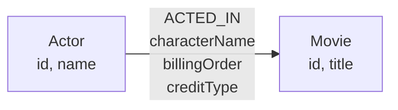

# Thiết kế lớp thuộc tính quan hệ và @TargetNode

Trong Neo4j, relationship không chỉ nối hai node mà còn có thể mang property riêng. Ví dụ, một diễn viên tham gia một bộ phim với tên nhân vật, loại vai và thứ tự credit. Những thông tin này mô tả chính lần tham gia giữa diễn viên và phim; chúng không thuộc riêng node `Actor` hay node `Movie`.

Spring Data Neo4j (SDN) ánh xạ loại dữ liệu này bằng lớp được đánh dấu `@RelationshipProperties`. Bên trong lớp, `@TargetNode` xác định node ở đầu kia của relationship so với entity sở hữu trường quan hệ. Cách thiết kế này giúp ứng dụng thao tác với cả property của relationship lẫn entity đích như một cấu trúc miền thống nhất.

## 1. Khi nào cần lớp thuộc tính quan hệ?

Hãy bắt đầu từ câu hỏi: một thuộc tính mô tả bản thân đối tượng hay mô tả mối liên hệ giữa hai đối tượng?

Giả sử hệ thống phim có hai node:

- `Actor` mô tả diễn viên, với các property như `id`, `name`, `birthDate`.
- `Movie` mô tả phim, với các property như `id`, `title`, `releaseYear`.

Một diễn viên có thể đóng nhiều phim, một phim có thể có nhiều diễn viên. Mỗi liên kết `ACTED_IN` có thể lưu:

- `characterName`: tên nhân vật mà diễn viên đảm nhận trong phim đó.
- `billingOrder`: thứ tự xuất hiện trong danh sách credit.
- `creditType`: loại vai, chẳng hạn `LEAD`, `SUPPORTING` hoặc `CAMEO`.
- `filmingStart`: ngày bắt đầu tham gia ghi hình nếu nghiệp vụ cần theo dõi.

Các thuộc tính trên thay đổi theo từng cặp diễn viên và phim. Nếu đặt `characterName` lên `Actor`, diễn viên chỉ có thể có một tên nhân vật dùng chung cho mọi phim. Nếu đặt lên `Movie`, bộ phim chỉ có một tên nhân vật. Cả hai đều làm sai ý nghĩa dữ liệu. Đặt chúng trên relationship `ACTED_IN` thể hiện đúng ngữ cảnh.



| Vị trí lưu | Ví dụ | Khi phù hợp |
|---|---|---|
| Property của node `Actor` | `name`, `birthDate` | Dữ liệu mô tả diễn viên bất kể phim nào |
| Property của node `Movie` | `title`, `releaseYear` | Dữ liệu mô tả phim bất kể diễn viên nào |
| Property của relationship `ACTED_IN` | `characterName`, `billingOrder` | Dữ liệu chỉ có nghĩa khi diễn viên tham gia một phim cụ thể |

Khi relationship chỉ cần type và hai đầu node, có thể ánh xạ trực tiếp bằng một trường entity như `Set<Movie>`. Khi relationship cần mang dữ liệu riêng, dùng `@RelationshipProperties` để mô hình hóa phần dữ liệu đó.

## 2. Cấu trúc của @RelationshipProperties và @TargetNode

Một lớp relationship properties thường có ba nhóm thành phần:

1. `@RelationshipId`: định danh kỹ thuật của relationship, nếu cần SDN nhận diện relationship cụ thể trong quá trình mapping và cập nhật.
2. Các field property thông thường: dữ liệu được lưu trên relationship trong Neo4j.
3. Một field `@TargetNode`: entity ở đầu kia của relationship so với entity nguồn.

Ví dụ:

```java
@RelationshipProperties
public class ActingCredit {

    @RelationshipId
    private Long id;

    private String characterName;

    private Integer billingOrder;

    private String creditType;

    @TargetNode
    private Movie movie;
}
```

`@RelationshipProperties` cho SDN biết lớp `ActingCredit` đại diện cho dữ liệu của relationship, không phải một node độc lập. Các field như `characterName` và `billingOrder` được ánh xạ thành property của relationship. `@TargetNode` đánh dấu entity `Movie` ở đầu đích.

`@TargetNode` cần xuất hiện trên field tham chiếu tới node đích. Nó không phải annotation đánh dấu entity nguồn; entity nguồn chính là object chứa trường quan hệ. Một lớp relationship properties có một node đích được ánh xạ. Nếu nghiệp vụ cần nối thêm một đối tượng độc lập thứ ba, hãy xem xét mô hình hóa relationship hoặc node riêng thay vì cố nhồi thêm nhiều endpoint vào một lớp relationship properties.

`@RelationshipId` là ID nội bộ do Neo4j/SDN quản lý để nhận diện relationship. Không dùng field này làm mã nghiệp vụ, mã credit công khai hoặc định danh ổn định qua các lần export/import. Nếu nghiệp vụ cần mã riêng, hãy khai báo property như `creditCode` và thiết kế constraint hoặc quy tắc duy nhất phù hợp. Việc có cần field `@RelationshipId` hay không phụ thuộc nhu cầu mapping; với relationship properties được cập nhật riêng lẻ, nên khai báo để SDN có thể nhận diện liên kết đã tồn tại.

## 3. Khai báo entity nguồn với @Relationship

Lớp relationship properties được sử dụng thông qua một trường trong entity nguồn. Trường này cần `@Relationship` để khai báo type và hướng của relationship.

```java
@Node("Actor")
public class Actor {

    @Id
    private String id;

    private String name;

    @Relationship(type = "ACTED_IN", direction = Relationship.Direction.OUTGOING)
    private List<ActingCredit> credits = new ArrayList<>();
}
```

Entity đích:

```java
@Node("Movie")
public class Movie {

    @Id
    private String id;

    private String title;

    private Integer releaseYear;
}
```

Trong mô hình này:

- `Actor` là node nguồn vì trường `credits` được khai báo trên entity `Actor`.
- `ACTED_IN` là relationship type trong Neo4j.
- `ActingCredit` mang property của relationship.
- `ActingCredit.movie` là node đích nhờ `@TargetNode`.
- `OUTGOING` có nghĩa relationship đi từ `Actor` tới `Movie`.

Các lớp trên lược bỏ constructor, getter và setter để tập trung vào annotation. Ứng dụng thực tế cần cung cấp cách khởi tạo và truy cập property phù hợp với chiến lược mapping của mình.

### Hiểu hướng relationship

`direction` được hiểu tương đối với entity chứa trường `@Relationship`. Với ví dụ trên, `OUTGOING` biểu diễn:

```cypher
(actor:Actor)-[:ACTED_IN]->(movie:Movie)
```

Nếu khai báo `INCOMING` trên một trường quan hệ của entity `Movie`, node `Actor` sẽ là node đích của trường đó và relationship được đọc theo hướng đi vào `Movie`. Hướng truy vấn Cypher có thể ngược với hướng lưu trữ; không cần tạo thêm relationship ngược chỉ để truy vấn từ phía còn lại.

Nếu không chỉ định `direction`, SDN mặc định sử dụng `OUTGOING`. Dù vậy, khai báo tường minh thường giúp mô hình dễ đọc và tránh hiểu nhầm khi entity có nhiều relationship.

## 4. Một cặp node có thể có nhiều relationship

Trong mô hình phim, một diễn viên có thể đóng nhiều nhân vật trong cùng một bộ phim. Khi đó, giữa cùng node `Actor` và node `Movie` có thể có nhiều relationship `ACTED_IN`, mỗi relationship mang `characterName` và `billingOrder` riêng.

Ví dụ:

```cypher
MATCH (a:Actor {id: 'actor-17'}), (m:Movie {id: 'movie-42'})
CREATE (a)-[:ACTED_IN {
    characterName: 'Mira',
    billingOrder: 1,
    creditType: 'LEAD'
}]->(m)
CREATE (a)-[:ACTED_IN {
    characterName: 'The Archivist',
    billingOrder: 8,
    creditType: 'SUPPORTING'
}]->(m);
```

Trong Java, `List<ActingCredit>` có thể biểu diễn nhiều credit, kể cả khi chúng cùng trỏ tới một `Movie`. Dùng `Set` khi mô hình đảm bảo các phần tử là duy nhất theo quy tắc `equals`/`hashCode` của ứng dụng. Nếu hai credit cùng node đích nhưng property khác nhau, cần tránh cách so sánh khiến chúng bị xem là trùng nhau.

Khi dữ liệu chỉ cho phép một relationship giữa mỗi cặp node, cần thể hiện quy tắc đó trong thao tác ghi. `CREATE` luôn tạo relationship mới; chạy lại có thể sinh bản ghi trùng. `MERGE` có thể dùng để nhận diện relationship theo pattern và property được chỉ định, nhưng phải chọn khóa nhận diện đúng với nghiệp vụ. Không nên `MERGE` chỉ theo hai node và type nếu giữa chúng hợp lệ có nhiều vai diễn.

## 5. Đọc và ghi relationship properties bằng Cypher

Neo4j lưu property trực tiếp trên relationship. Có thể tạo relationship cùng các property bằng Cypher:

```cypher
MATCH (a:Actor {id: $actorId}), (m:Movie {id: $movieId})
CREATE (a)-[r:ACTED_IN {
    characterName: $characterName,
    billingOrder: $billingOrder,
    creditType: $creditType
}]->(m)
RETURN a, r, m;
```

Đọc property của relationship:

```cypher
MATCH (a:Actor {id: $actorId})-[r:ACTED_IN]->(m:Movie)
RETURN a.name AS actorName,
       m.title AS movieTitle,
       r.characterName AS characterName,
       r.billingOrder AS billingOrder,
       r.creditType AS creditType
ORDER BY r.billingOrder;
```

Cập nhật một relationship cụ thể:

```cypher
MATCH (a:Actor {id: $actorId})-[r:ACTED_IN]->(m:Movie {id: $movieId})
WHERE r.characterName = $characterName
SET r.billingOrder = $newBillingOrder,
    r.creditType = $newCreditType
RETURN r;
```

Nếu cùng một diễn viên đóng nhiều nhân vật trong cùng phim, điều kiện `characterName` trong ví dụ chỉ là minh họa; ứng dụng cần có tiêu chí nhận diện đủ chính xác để cập nhật đúng relationship. Có thể dùng `@RelationshipId` khi entity đã được SDN đọc và mang theo ID kỹ thuật của relationship đó, hoặc dùng một business key được thiết kế riêng.

Các tham số `$actorId`, `$movieId` và những giá trị khác được truyền riêng thay vì nối chuỗi Cypher. Cách này an toàn hơn và giúp Neo4j tái sử dụng kế hoạch truy vấn.

## 6. Đọc relationship properties qua entity SDN

Khi repository đọc entity `Actor` với quan hệ được ánh xạ, SDN có thể khởi tạo `ActingCredit` từ relationship và `Movie` ở đầu kia. Tầng ứng dụng thao tác với cả hai phần:

```java
Actor actor = actorRepository.findById(actorId)
        .orElseThrow(() -> new IllegalArgumentException("Actor not found"));

for (ActingCredit credit : actor.getCredits()) {
    Movie movie = credit.getMovie();

    System.out.println("Movie: " + movie.getTitle());
    System.out.println("Character: " + credit.getCharacterName());
    System.out.println("Billing order: " + credit.getBillingOrder());
}
```

Ví dụ giả định entity có getter và repository được cấu hình để tải relationship cần thiết. Dữ liệu relationship thực tế có mặt trong object phụ thuộc vào câu truy vấn và cấu hình mapping/fetch của SDN. Không nên giả định mọi truy vấn trả về node nguồn đều luôn tải toàn bộ đồ thị có thể đi tới.

Nếu cần thêm một credit cho diễn viên, có thể xây dựng đối tượng relationship properties rồi thêm vào collection của entity nguồn:

```java
ActingCredit credit = new ActingCredit();
credit.setCharacterName("Mira");
credit.setBillingOrder(1);
credit.setCreditType("LEAD");
credit.setMovie(movie);

actor.getCredits().add(credit);
actorRepository.save(actor);
```

Đây là phác thảo cho entity mutable có setter. Với entity bất biến, hãy tạo instance mới của `Actor` cùng collection đã cập nhật và dùng entity trả về từ `save`. Với cả hai kiểu, cần kiểm tra cách SDN nhận diện relationship đã tồn tại, nhất là khi cập nhật một credit thay vì tạo credit mới.

## 7. Cập nhật relationship properties và vòng đời liên kết

Một relationship properties object đại diện cho một liên kết cụ thể. Khi tải dữ liệu và chỉnh sửa property, nên giữ lại identity của relationship để SDN phân biệt liên kết hiện hữu với liên kết mới.

Ví dụ cập nhật credit trong bộ nhớ:

```java
Actor actor = actorRepository.findById(actorId)
        .orElseThrow(() -> new IllegalArgumentException("Actor not found"));

ActingCredit credit = actor.getCredits().stream()
        .filter(item -> item.getId().equals(creditId))
        .findFirst()
        .orElseThrow(() -> new IllegalArgumentException("Credit not found"));

credit.setBillingOrder(2);
credit.setCreditType("SUPPORTING");

actorRepository.save(actor);
```

Ví dụ giả định `ActingCredit` có getter/setter và `@RelationshipId` được ánh xạ vào `id`. ID này giúp chọn đúng relationship đã tải. Không lấy `@RelationshipId` làm mã nghiệp vụ hiển thị cho người dùng.

Khi cập nhật collection relationship, hãy phân biệt ba thao tác:

- **Thêm:** thêm một đối tượng relationship properties mới với node đích và các property hợp lệ.
- **Sửa:** cập nhật property của relationship hiện có, giữ identity và target node đúng.
- **Gỡ:** loại relationship khỏi mô hình theo đúng quy tắc nghiệp vụ; xác định rõ có xóa liên kết hay cần lưu lịch sử trước khi gỡ.

SDN thường ghi quan hệ thuộc aggregate khi lưu entity gốc. Việc thay đổi collection có thể ảnh hưởng đến relationship trong database; do đó không dùng một collection chưa tải đầy đủ như thể đó là toàn bộ danh sách relationship cần giữ. Với câu truy vấn tùy chỉnh chỉ tải một phần quan hệ, cần thiết kế thao tác cập nhật riêng để không vô tình loại bỏ các liên kết khác.

Nếu thao tác gồm nhiều bước như kiểm tra phim, thêm credit và cập nhật thông tin diễn viên, đặt ranh giới transaction ở service bằng `@Transactional` để các thao tác cần nguyên tử cùng commit hoặc rollback.

## 8. Chọn property quan hệ hay node độc lập?

Không phải mọi dữ liệu nằm giữa hai đối tượng đều nên được biểu diễn thành relationship properties. Hãy xem xét liệu dữ liệu đó có cần định danh, vòng đời và các quan hệ riêng hay không.

| Tình huống | Mô hình phù hợp | Lý do |
|---|---|---|
| Tên nhân vật trong một lần diễn xuất | Property trên `ACTED_IN` | Chỉ có ý nghĩa với credit cụ thể |
| Thứ tự credit trong một phim | Property trên `ACTED_IN` | Phụ thuộc vào cặp diễn viên và phim |
| Ngày bắt đầu tham gia dự án | Property trên `WORKS_ON` | Mô tả mối quan hệ nhân viên - dự án |
| Nhân vật hư cấu có tiểu sử, phe phái và liên kết với nhân vật khác | Node `Character` | Có danh tính và quan hệ độc lập |
| Hợp đồng có số hợp đồng, trạng thái, tài liệu và lịch sử phê duyệt | Thường là node `Contract` | Có vòng đời nghiệp vụ riêng và nhiều liên kết |

Một relationship properties class phù hợp với dữ liệu gọn, có kiểu property Neo4j hỗ trợ và phụ thuộc vào hai endpoint. Nếu cần gắn nhiều relationship khác, có quy trình trạng thái, phân quyền hoặc truy vấn như một đối tượng riêng, một node trung gian thường diễn đạt mô hình rõ hơn.

Ví dụ, nếu mỗi lần tham gia phim cần lưu hợp đồng diễn viên, ngày ký, trạng thái thanh toán, tài liệu và lịch sử phê duyệt, có thể tạo node `ActingContract` nối tới `Actor` và `Movie`. Khi đó, hợp đồng có thể có quan hệ riêng tới `Document`, `Payment` hoặc `Approval`.

## 9. Ràng buộc kiểu dữ liệu và quy tắc nghiệp vụ

Các field property trong lớp `@RelationshipProperties` cần có kiểu được Neo4j hỗ trợ hoặc converter tương ứng. Ví dụ `String`, `Integer`, `Boolean`, `LocalDate`, `LocalDateTime` và các kiểu collection phù hợp thường dùng được. Một object Java tùy ý không tự động trở thành property lồng nhau của relationship.

Nếu cần lưu một cấu trúc phức tạp, có thể:

- Chuyển đổi cấu trúc thành một property đơn như JSON string nếu chỉ cần lưu và đọc nguyên khối, đồng thời chấp nhận hạn chế truy vấn từng field.
- Dùng converter để chuyển đổi kiểu miền sang kiểu property được Neo4j hỗ trợ.
- Mô hình hóa dữ liệu thành node riêng nếu cần truy vấn, liên kết hoặc quản lý độc lập.

Các quy tắc nghiệp vụ như `billingOrder` phải dương, `creditType` thuộc danh sách hợp lệ, hoặc `filmingStart` không được sau `filmingEnd` cần được xác thực ở tầng service/domain. Annotation mapping chỉ mô tả cách lưu dữ liệu; nó không thay thế validation.

## 10. Repository và transaction

Repository vẫn quản lý entity node gốc, ví dụ:

```java
public interface ActorRepository extends Neo4jRepository<Actor, String> {
}
```

`ActingCredit` không phải entity node độc lập nên không cần một `ActingCreditRepository`. Thao tác với credit thông qua entity nguồn `Actor`, hoặc dùng Cypher/`Neo4jClient` khi cần cập nhật relationship cụ thể.

Một service có thể quản lý việc thêm credit trong transaction:

```java
@Service
public class CastingService {

    private final ActorRepository actorRepository;
    private final MovieRepository movieRepository;

    public CastingService(
            ActorRepository actorRepository,
            MovieRepository movieRepository) {
        this.actorRepository = actorRepository;
        this.movieRepository = movieRepository;
    }

    @Transactional
    public void addCredit(
            String actorId,
            String movieId,
            String characterName,
            int billingOrder) {

        Actor actor = actorRepository.findById(actorId)
                .orElseThrow(() -> new IllegalArgumentException("Actor not found"));
        Movie movie = movieRepository.findById(movieId)
                .orElseThrow(() -> new IllegalArgumentException("Movie not found"));

        ActingCredit credit = new ActingCredit();
        credit.setCharacterName(characterName);
        credit.setBillingOrder(billingOrder);
        credit.setMovie(movie);

        actor.getCredits().add(credit);
        actorRepository.save(actor);
    }
}
```

Đây là ví dụ minh họa entity mutable; cần bổ sung constructor, getter, setter và validation. Nếu cho phép nhiều credit giữa cùng hai node, service cần kiểm tra quy tắc trùng lặp trước khi thêm. Nếu dùng entity immutable, tạo một bản `Actor` mới có collection mới thay vì sửa trực tiếp collection hiện tại.

Transaction giúp thao tác đọc hai node, thêm relationship và lưu entity nguồn nhất quán. Nó không tự giải quyết mọi quy tắc chống trùng; nếu nhiều request có thể đồng thời tạo cùng một credit, cần thiết kế khóa nghiệp vụ, constraint hoặc thao tác Cypher có điều kiện thích hợp.

## 11. Những lỗi thường gặp

| Lỗi | Hậu quả | Cách xử lý |
|---|---|---|
| Đặt `characterName` trên `Actor` | Một diễn viên không thể có tên nhân vật riêng cho từng phim | Đưa property lên relationship `ACTED_IN` |
| Quên `@RelationshipProperties` | SDN không nhận diện lớp là mô hình thuộc tính relationship | Đánh dấu lớp bằng annotation đúng |
| Quên `@TargetNode` | SDN không biết field nào là entity ở đầu kia của relationship | Đánh dấu field tham chiếu node đích |
| Hiểu `@TargetNode` là node nguồn | Đọc sai hướng mapping | Entity chứa trường `@Relationship` mới là nguồn |
| Dùng `@RelationshipId` làm ID nghiệp vụ | Phụ thuộc vào định danh kỹ thuật nội bộ | Tạo business key riêng nếu cần |
| Dùng `Set` trong khi có thể có nhiều relationship hợp lệ giữa cùng hai node | Phần tử có thể bị loại do equality/hashCode | Dùng `List` hoặc định nghĩa equality đúng với nghiệp vụ |
| Dùng `MERGE` theo cặp node và type trong mô hình có nhiều vai diễn | Các credit khác nhau có thể bị gộp thành một relationship | Chọn tiêu chí nhận diện relationship đủ cụ thể |
| Lưu entity với collection chỉ tải một phần | Có thể làm sai trạng thái các liên kết khác nếu xem collection đó là đầy đủ | Phân biệt dữ liệu tải một phần và aggregate đầy đủ; dùng truy vấn cập nhật chuyên biệt khi cần |
| Lưu object lồng tùy ý thành relationship property | Kiểu dữ liệu không được Neo4j hỗ trợ trực tiếp | Dùng converter, property đơn hoặc node riêng |

## 12. Tự kiểm tra

1. Khi nào nên đặt một thuộc tính lên node và khi nào nên đặt nó lên relationship?
2. `@RelationshipProperties` cho SDN biết điều gì về một lớp Java?
3. `@TargetNode` xác định endpoint nào và endpoint nguồn được xác định từ đâu?
4. Trong mô hình `Actor` - `ACTED_IN` - `Movie`, `OUTGOING` được hiểu theo chiều nào?
5. Vì sao `@RelationshipId` không nên được dùng làm mã nghiệp vụ?
6. Khi một diễn viên đóng hai vai trong cùng phim, nên chọn `List` hay `Set` cho collection credit? Vì sao?
7. Khi nào nên chuyển relationship properties thành một node độc lập?
8. Vì sao cần cẩn thận khi lưu entity gốc với một collection relationship chỉ được tải một phần?

Khi nắm được `@RelationshipProperties` và `@TargetNode`, người học có thể biểu diễn dữ liệu thuộc về mối liên hệ, truy cập node đích từ entity nguồn, đọc và cập nhật property bằng SDN/Cypher, đồng thời chọn đúng thời điểm nên dùng relationship properties hay node độc lập.
