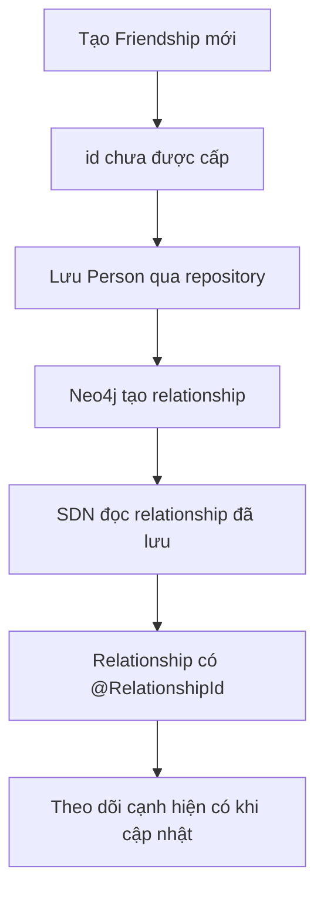

# `@RelationshipId` và nhận diện relationship đã tồn tại

Trong Neo4j, relationship là một thành phần đồ thị độc lập nối node nguồn với node đích. Relationship có type, hướng và có thể mang các property riêng. Khi ánh xạ relationship có thuộc tính thành Java object bằng Spring Data Neo4j (SDN), framework cần nhận diện được relationship cụ thể đã được đọc từ cơ sở dữ liệu để có thể cập nhật hoặc xóa đúng cạnh khi lưu entity.

`@RelationshipId` đánh dấu thuộc tính chứa định danh nội bộ của relationship trong mô hình `@RelationshipProperties`. SDN sử dụng định danh này để theo dõi relationship đã tồn tại trong quá trình mapping và persistence. Đây là metadata phục vụ tầng dữ liệu; ứng dụng không nên xem giá trị này là mã nghiệp vụ hoặc tự gán nó.

## 1. Vì sao relationship cần định danh?

Một relationship trong Neo4j có thể được mô tả bằng node nguồn, node đích, type và các property. Tuy nhiên, hai node có thể được nối bởi nhiều relationship cùng type, thậm chí cùng hướng. Ví dụ, hai người có thể có nhiều lần tương tác hoặc nhiều loại ngữ cảnh quan hệ `KNOWS`.

Nếu chỉ nhìn vào node nguồn và node đích, SDN không thể luôn phân biệt được hai relationship riêng biệt giữa cùng một cặp node. Mỗi relationship có định danh nội bộ riêng trong Neo4j. Khi SDN đọc relationship vào một object, `@RelationshipId` giúp lưu lại định danh đó để framework nhận ra cạnh nào đang được chỉnh sửa.

Điều này đặc biệt quan trọng với relationship có property. Khi một thuộc tính như `note` hoặc `since` thay đổi, SDN cần biết relationship hiện có nào cần được cập nhật. Khi một relationship bị loại khỏi collection, framework cần xác định cạnh cần xóa theo mô hình persistence.

## 2. Phân biệt `@Id`, `@RelationshipId` và `@TargetNode`

Ba annotation này có vai trò khác nhau:

| Annotation | Dùng ở đâu | Ý nghĩa |
|---|---|---|
| `@Id` | Entity node được đánh dấu bằng `@Node` | Định danh entity node trong mô hình SDN |
| `@RelationshipId` | Thuộc tính của lớp `@RelationshipProperties` | Định danh nội bộ của relationship đã được ánh xạ |
| `@TargetNode` | Thuộc tính trong lớp `@RelationshipProperties` | Node đích mà relationship đang trỏ tới |

`@RelationshipId` không thay thế `@TargetNode`: một thuộc tính cho biết relationship cụ thể nào đang được theo dõi, thuộc tính kia chứa entity ở đầu đích. Nó cũng không thay thế `@Relationship` trên node nguồn, vì `@Relationship` xác định type và direction của mối quan hệ trong mô hình.

## 3. Khai báo relationship có thuộc tính

Khi relationship mang dữ liệu riêng, hãy khai báo một lớp được đánh dấu `@RelationshipProperties`. Lớp này có một trường `@RelationshipId` và một trường `@TargetNode`.

Ví dụ mô hình hai người có quan hệ `KNOWS`, trong đó cạnh lưu thời điểm quen biết và ghi chú:

```java
import java.time.LocalDate;

import org.springframework.data.neo4j.core.schema.RelationshipId;
import org.springframework.data.neo4j.core.schema.RelationshipProperties;
import org.springframework.data.neo4j.core.schema.TargetNode;

@RelationshipProperties
public class Friendship {

    @RelationshipId
    private Long id;

    @TargetNode
    private Person person;

    private LocalDate since;
    private String note;

    protected Friendship() {
    }

    public Friendship(Person person, LocalDate since, String note) {
        this.person = person;
        this.since = since;
        this.note = note;
    }

    public Long getId() {
        return id;
    }

    public Person getPerson() {
        return person;
    }

    public LocalDate getSince() {
        return since;
    }

    public String getNote() {
        return note;
    }

    public void setNote(String note) {
        this.note = note;
    }
}
```

Node nguồn khai báo collection relationship bằng `@Relationship`:

```java
import java.time.LocalDate;
import java.util.ArrayList;
import java.util.List;

import org.springframework.data.neo4j.core.schema.GeneratedValue;
import org.springframework.data.neo4j.core.schema.Id;
import org.springframework.data.neo4j.core.schema.Node;
import org.springframework.data.neo4j.core.schema.Relationship;

@Node("Person")
public class Person {

    @Id
    @GeneratedValue
    private Long id;

    private String name;

    @Relationship(type = "KNOWS", direction = Relationship.Direction.OUTGOING)
    private List<Friendship> friendships = new ArrayList<>();

    protected Person() {
    }

    public Person(String name) {
        this.name = name;
    }

    public Long getId() {
        return id;
    }

    public List<Friendship> getFriendships() {
        return friendships;
    }

    public void addFriendship(Person person, LocalDate since, String note) {
        friendships.add(new Friendship(person, since, note));
    }
}
```

Trong ví dụ, mỗi phần tử `Friendship` biểu diễn một relationship `KNOWS` đi từ `Person` hiện tại tới một `Person` khác. `since` và `note` là property của relationship. `person` là node đích. `id` là định danh nội bộ do Neo4j/SDN quản lý khi relationship được lưu.

Khi dùng đoạn mã này, lớp `Person` cần import `java.time.LocalDate` như lớp `Friendship`. Trong dự án thực tế, có thể tách mỗi lớp public vào một file Java riêng.

## 4. Relationship mới và relationship đã tồn tại

Trước khi lưu, một object `Friendship` mới chưa có định danh relationship được cấp từ Neo4j. Sau khi lưu và đọc lại graph, SDN có thể gắn định danh nội bộ vào trường `id` được đánh dấu `@RelationshipId`.

Quá trình có thể hình dung như sau:



Khi SDN đọc một relationship đã tồn tại, trường `@RelationshipId` chứa định danh mà framework dùng để nhận diện chính relationship đó. Khi thay đổi property của object relationship rồi lưu lại entity nguồn, SDN có cơ sở để cập nhật relationship đã được đọc.

Không tự gán giá trị cho trường `@RelationshipId` khi tạo relationship mới. Hãy để SDN và Neo4j quản lý trường này. Nếu ứng dụng cần một mã quan hệ có ý nghĩa nghiệp vụ, hãy khai báo một property riêng, chẳng hạn `referenceCode` hoặc `externalKey`, với quy tắc tạo và kiểm tra duy nhất phù hợp.

## 5. Cập nhật property của relationship đã tồn tại

Giả sử một người đã có relationship `KNOWS` với người khác và ứng dụng cần cập nhật ghi chú trên relationship. Service có thể đọc entity nguồn, sửa object relationship tương ứng rồi lưu lại entity:

```java
import org.springframework.stereotype.Service;
import org.springframework.transaction.annotation.Transactional;

@Service
public class FriendshipService {

    private final PersonRepository people;

    public FriendshipService(PersonRepository people) {
        this.people = people;
    }

    @Transactional
    public void updateNote(Long personId, Long friendId, String note) {
        Person person = people.findById(personId)
            .orElseThrow(() -> new IllegalArgumentException("Person not found"));

        Friendship friendship = person.getFriendships().stream()
            .filter(link -> link.getPerson().getId().equals(friendId))
            .findFirst()
            .orElseThrow(() -> new IllegalArgumentException("Friendship not found"));

        friendship.setNote(note);
        people.save(person);
    }
}
```

Ở đây, service thao tác với relationship object được SDN ánh xạ từ dữ liệu hiện có. Trường `@RelationshipId` trên object đó được giữ lại trong quá trình cập nhật để SDN nhận diện cạnh cần ghi.

Ví dụ lọc theo `friendId` giả định chỉ có một relationship phù hợp giữa hai người. Nếu mô hình cho phép nhiều relationship `KNOWS` giữa cùng một cặp node, cần thêm điều kiện nghiệp vụ để chọn đúng object relationship, chẳng hạn loại tương tác hoặc mã tham chiếu. Không nên dùng `@RelationshipId` làm tiêu chí nghiệp vụ để chọn quan hệ.

## 6. Xóa một relationship và giữ các relationship còn lại

Khi relationship được quản lý trong collection của entity nguồn, việc loại object relationship khỏi collection rồi lưu entity nguồn là một cách biểu đạt thay đổi đồ thị qua SDN. Framework dựa vào metadata và định danh relationship đã đọc để xác định cạnh cần loại bỏ.

```java
@Transactional
public void removeFriendship(Long personId, Long friendId) {
    Person person = people.findById(personId)
        .orElseThrow(() -> new IllegalArgumentException("Person not found"));

    person.getFriendships().removeIf(
        link -> link.getPerson().getId().equals(friendId)
    );

    people.save(person);
}
```

Đoạn mã trên cũng giả định chỉ cần loại tất cả relationship trong collection có target ID bằng `friendId`. Nếu có nhiều cạnh giữa cùng hai node và chỉ muốn xóa một cạnh, hãy xác định object relationship cụ thể bằng thuộc tính nghiệp vụ phù hợp trước khi xóa.

Việc xóa relationship không đồng nghĩa với xóa node đích. Node `Person` được tham chiếu vẫn có thể tồn tại và được nối với các node khác. Đây là điểm quan trọng khi thao tác trên đồ thị: relationship và node có vòng đời độc lập.

## 7. Nhiều relationship giữa cùng một cặp node

Neo4j cho phép nhiều relationship nối cùng một cặp node. Ví dụ, hai người có thể có nhiều cạnh `KNOWS` được tạo trong các ngữ cảnh khác nhau. Nếu ứng dụng lưu nhiều object `Friendship`, mỗi object được SDN theo dõi như một relationship riêng.

```cypher
MATCH (a:Person {name: 'An'}), (b:Person {name: 'Binh'})
CREATE (a)-[:KNOWS {context: 'work'}]->(b)
CREATE (a)-[:KNOWS {context: 'community'}]->(b)
RETURN a, b;
```

Hai cạnh trên có cùng source, target và type nhưng có property `context` khác nhau. Khi mô hình hóa bằng relationship properties, mỗi cạnh cần có object tương ứng và định danh riêng. `@RelationshipId` giúp SDN phân biệt các relationship đã tồn tại khi ánh xạ và ghi lại graph.

Nếu nghiệp vụ cần tìm một cạnh cụ thể, hãy sử dụng property có ý nghĩa nghiệp vụ như `context`, `since` hoặc `referenceCode` để chọn. Internal relationship ID chỉ là chi tiết persistence.

## 8. Giới hạn và lưu ý khi sử dụng `@RelationshipId`

- Chỉ khai báo `@RelationshipId` trong lớp relationship properties được SDN quản lý; không dùng nó thay cho `@Id` của node entity.
- Không tự tạo hoặc chỉnh sửa giá trị ID nội bộ. Để framework quản lý giá trị này trong quá trình đọc và ghi.
- Không đưa internal relationship ID vào URL công khai, hợp đồng API hoặc dữ liệu đồng bộ giữa các hệ thống.
- Không giả định ID nội bộ là định danh nghiệp vụ bền vững qua export/import, xóa rồi tạo lại relationship hoặc di chuyển dữ liệu giữa môi trường.
- Nếu cần một mã quan hệ ổn định, khai báo property riêng trên lớp `@RelationshipProperties` và xác định rõ quy tắc tạo, tra cứu và uniqueness.
- `@RelationshipId` không tạo type hoặc direction. Hai thông tin đó thuộc về khai báo `@Relationship` trên node nguồn.
- Với quan hệ không có property riêng, có thể mô hình hóa trực tiếp collection các node đích bằng `@Relationship`; không cần tạo lớp relationship properties chỉ để chứa một ID nội bộ.

## 9. Những lỗi thường gặp

| Lỗi | Hệ quả | Cách xử lý |
|---|---|---|
| Dùng `@Id` trong lớp relationship properties thay cho `@RelationshipId` | Metadata định danh không đúng vai trò của relationship | Dùng `@RelationshipId` cho định danh relationship |
| Tự gán ID khi tạo relationship mới | Can thiệp vào metadata persistence do SDN quản lý | Để trường ID ở trạng thái chưa được cấp khi tạo mới |
| Dùng relationship ID làm mã nghiệp vụ | Phụ thuộc vào chi tiết nội bộ của Neo4j | Tạo property nghiệp vụ riêng |
| Chỉ dựa vào source và target để xác định cạnh | Có thể chọn nhầm khi tồn tại nhiều cạnh giữa cùng hai node | Lọc theo thuộc tính nghiệp vụ hoặc ngữ cảnh của relationship |
| Xóa node đích khi chỉ muốn bỏ một relationship | Làm mất node và có thể ảnh hưởng các quan hệ khác | Chỉ loại relationship khỏi collection hoặc xóa cạnh bằng thao tác phù hợp |
| Quên `@TargetNode` trong lớp relationship properties | SDN không biết entity ở đầu đích của relationship | Khai báo thuộc tính target với `@TargetNode` |

## 10. Tự kiểm tra

1. Vì sao SDN cần định danh cho relationship đã được đọc từ Neo4j?
2. `@RelationshipId` khác `@Id` và `@TargetNode` như thế nào?
3. Khi tạo relationship mới, ứng dụng có nên tự gán giá trị cho trường `@RelationshipId` không?
4. Nếu hai node có nhiều relationship cùng type và cùng hướng, cần dùng thông tin nào để chọn đúng cạnh theo nghiệp vụ?
5. Khi xóa một object relationship khỏi collection và lưu entity nguồn, node đích có bị xóa theo không?
6. Nếu cần mã quan hệ ổn định để trao đổi với hệ thống ngoài, nên thiết kế property nào?

`@RelationshipId` giúp SDN nhận diện relationship đã tồn tại trong đồ thị để quản lý cập nhật và xóa đúng cạnh. Hãy giữ nó ở tầng persistence, dùng `@TargetNode` để biểu diễn node đích và dùng property riêng cho mọi định danh có ý nghĩa nghiệp vụ.
