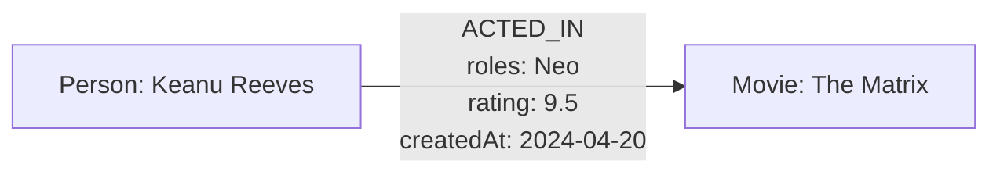

# Ánh xạ vai diễn, điểm đánh giá hoặc thời điểm tạo liên kết

Trong Neo4j, relationship không chỉ nối hai node mà còn có thể mang các property mô tả chính mối liên kết đó. Ví dụ, một người tham gia diễn xuất trong một bộ phim có thể đảm nhận một hoặc nhiều vai, được chấm điểm cho lần tham gia đó và có thời điểm ghi nhận credit. Các thông tin này thuộc về relationship `ACTED_IN`, vì chúng phụ thuộc vào cả người lẫn bộ phim.

Spring Data Neo4j (SDN) ánh xạ loại dữ liệu này bằng lớp được đánh dấu `@RelationshipProperties`. Lớp đó chứa các property của relationship và một trường `@TargetNode` trỏ đến node ở đầu còn lại. Bài học thuộc module **SPRING_DATA_NEO4J**, tập trung vào xây dựng tầng dữ liệu đồ thị qua node entity, relationship, repository và Cypher; ví dụ xuyên suốt dùng `Person`, `Movie` và relationship `ACTED_IN`.

## 1. Khi nào cần relationship properties?

Hãy xem đồ thị:



`Person` mô tả người, `Movie` mô tả phim. `roles`, `rating` và `createdAt` mô tả lần người đó tham gia bộ phim cụ thể:

- `roles`: các vai diễn mà người đó đảm nhận trong phim.
- `rating`: điểm đánh giá cho lần tham gia hoặc credit này.
- `createdAt`: thời điểm credit được ghi nhận trong hệ thống.

Nếu đặt `roles` trên node `Person`, ta không phân biệt được người đó đóng vai nào trong từng phim. Nếu đặt `rating` trên node `Movie`, ta không biết điểm đó thuộc về diễn viên nào. Relationship là nơi phù hợp vì các giá trị thay đổi theo từng cặp `Person`–`Movie`.

| Dữ liệu | Nơi nên lưu | Lý do |
|---|---|---|
| Tên người, năm sinh | Node `Person` | Mô tả người độc lập với một bộ phim cụ thể |
| Tiêu đề, năm phát hành | Node `Movie` | Mô tả bộ phim |
| Vai diễn trong phim | Relationship `ACTED_IN` | Phụ thuộc vào cả người và phim |
| Điểm đánh giá credit | Relationship `ACTED_IN` | Điểm áp dụng cho lần tham gia cụ thể |
| Thời điểm tạo credit | Relationship `ACTED_IN` | Ghi nhận thời điểm liên kết được tạo |

Nếu thông tin có vòng đời, danh tính và nhiều thuộc tính độc lập như một thực thể riêng, hãy cân nhắc mô hình nó thành node thay vì tiếp tục mở rộng relationship properties. Relationship properties phù hợp với dữ liệu mô tả liên kết giữa hai node.

## 2. Mô hình Java với @RelationshipProperties

Trong SDN, lớp relationship properties được đánh dấu bằng `@RelationshipProperties`. Lớp này thường có:

- Một trường `@RelationshipId` để SDN nhận diện relationship đã được ánh xạ.
- Các trường Java tương ứng với property của relationship.
- Một trường `@TargetNode` trỏ tới node ở đầu còn lại của relationship.

Ví dụ lớp `ActingCredit`:

```java
import java.time.ZonedDateTime;
import java.util.List;

import org.springframework.data.neo4j.core.schema.Property;
import org.springframework.data.neo4j.core.schema.RelationshipId;
import org.springframework.data.neo4j.core.schema.RelationshipProperties;
import org.springframework.data.neo4j.core.schema.TargetNode;

@RelationshipProperties
public class ActingCredit {

    @RelationshipId
    private Long id;

    private List<String> roles;

    private Double rating;

    @Property("created_at")
    private ZonedDateTime createdAt;

    @TargetNode
    private Movie movie;

    // Constructor, getter và setter được lược bỏ để tập trung vào mapping.
}
```

`@RelationshipProperties` và các annotation schema trong ví dụ thuộc package `org.springframework.data.neo4j.core.schema`. `@RelationshipId` là metadata để SDN theo dõi relationship trong quá trình đọc/ghi; nó không phải mã credit do nghiệp vụ cấp. Không tự gán giá trị cho trường này và không công khai nó như ID nghiệp vụ.

`@TargetNode` xác định node `Movie` ở đầu kia của relationship. Những trường còn lại như `roles`, `rating` và `createdAt` là property trên cạnh. `@Property("created_at")` ánh xạ tên trường Java `createdAt` sang property Neo4j `created_at`; nếu dùng tên mặc định, có thể bỏ annotation này.

### 2.1. Khai báo relationship ở node nguồn

Lớp `Person` chứa collection các credit:

```java
import java.util.ArrayList;
import java.util.List;

import org.springframework.data.annotation.Id;
import org.springframework.data.neo4j.core.schema.Direction;
import org.springframework.data.neo4j.core.schema.GeneratedValue;
import org.springframework.data.neo4j.core.schema.Node;
import org.springframework.data.neo4j.core.schema.Relationship;

@Node("Person")
public class Person {

    @Id
    @GeneratedValue
    private Long id;

    private String personId;
    private String name;

    @Relationship(type = "ACTED_IN", direction = Direction.OUTGOING)
    private List<ActingCredit> actingCredits = new ArrayList<>();
}
```

`@Relationship` vẫn là nơi khai báo relationship type `ACTED_IN` và hướng đi từ `Person` sang `Movie`. Kiểu của thuộc tính là `List<ActingCredit>` thay vì `List<Movie>` vì ứng dụng cần truy cập cả property của cạnh lẫn node đích.

Node đích `Movie` có thể được khai báo như sau:

```java
import org.springframework.data.annotation.Id;
import org.springframework.data.neo4j.core.schema.GeneratedValue;
import org.springframework.data.neo4j.core.schema.Node;

@Node("Movie")
public class Movie {

    @Id
    @GeneratedValue
    private Long id;

    private String movieId;
    private String title;
    private Integer released;
}
```

Các ID sinh tự động ở đây chỉ để minh họa mapping node. Trong ứng dụng thực tế, hãy chọn ID phù hợp với quy tắc định danh của miền nghiệp vụ.

## 3. Chọn kiểu Java cho từng relationship property

Kiểu Java cần tương thích với kiểu property mà Neo4j hỗ trợ và cách ứng dụng sử dụng dữ liệu.

| Ý nghĩa | Kiểu Java minh họa | Ví dụ giá trị |
|---|---|---|
| Danh sách vai diễn | `List<String>` | `List.of("Neo", "Mr. Anderson")` |
| Điểm đánh giá | `Double` | `9.5` |
| Thời điểm tạo có múi giờ | `ZonedDateTime` | `2024-04-20T09:30:00Z` |
| Ngày ghi nhận, không cần giờ | `LocalDate` | `2024-04-20` |
| Cờ trạng thái | `Boolean` | `true` |

Neo4j hỗ trợ các kiểu property đơn giản như chuỗi, số, boolean, mảng giá trị cùng kiểu và các kiểu temporal được hỗ trợ. Với danh sách `roles`, các phần tử cần cùng kiểu dữ liệu và không chứa `null`. Không nên dùng một collection Java tùy ý như một cấu trúc object lồng nhau làm property relationship; nếu phần tử có nhiều trường và vòng đời riêng, hãy mô hình hóa rõ ràng hơn.

### 3.1. Vai diễn với List<String>

Một diễn viên có thể đảm nhận nhiều vai trong cùng một phim, do đó `List<String>` là lựa chọn phù hợp:

```java
credit.setRoles(List.of("Neo", "Thomas Anderson"));
```

Neo4j lưu danh sách này thành property dạng mảng chuỗi. Nếu nghiệp vụ chỉ cho phép một vai, có thể dùng `String role`; không cần tạo collection khi miền dữ liệu không yêu cầu nhiều giá trị.

### 3.2. Điểm đánh giá với Double

`Double` phù hợp khi điểm có phần thập phân:

```java
credit.setRating(9.5);
```

Kiểu `Double` có thể nhận `null`, hữu ích nếu credit chưa được đánh giá. Hãy xác thực miền giá trị ở tầng nghiệp vụ, ví dụ điểm từ `0.0` đến `10.0`. Nếu cần tính toán tài chính hoặc độ chính xác thập phân tuyệt đối, hãy xem xét cách lưu và quy đổi số phù hợp thay vì mặc định dùng số dấu phẩy động.

### 3.3. Thời điểm với ZonedDateTime

Nếu cần ghi lại thời điểm kèm múi giờ, `ZonedDateTime` phù hợp với property `datetime` của Neo4j:

```java
ZonedDateTime createdAt = ZonedDateTime.now(ZoneOffset.UTC);
credit.setCreatedAt(createdAt);
```

Để lưu thời điểm theo UTC nhất quán, ứng dụng có thể chuẩn hóa trước khi ghi. Nếu chỉ cần ngày lịch như ngày ký hợp đồng, dùng `LocalDate`; nếu cần ngày và giờ nhưng không lưu thông tin múi giờ, dùng `LocalDateTime` sau khi đã thống nhất quy ước diễn giải. Chọn kiểu temporal dựa trên ý nghĩa nghiệp vụ, không chỉ dựa trên định dạng hiển thị.

## 4. Tạo relationship và property bằng Cypher

Ví dụ sau tạo hoặc tìm node `Person`, `Movie`, sau đó tạo relationship `ACTED_IN` và gán các property cho cạnh:

```cypher
MERGE (p:Person {personId: 'P-1042'})
SET p.name = 'Keanu Reeves'

MERGE (m:Movie {movieId: 'MOV-001'})
SET m.title = 'The Matrix',
    m.released = 1999

MERGE (p)-[credit:ACTED_IN]->(m)
ON CREATE SET
    credit.roles = ['Neo'],
    credit.rating = 9.5,
    credit.created_at = datetime('2024-04-20T09:30:00Z');
```

`roles`, `rating` và `created_at` nằm trên biến relationship `credit`, không nằm trên `p` hoặc `m`. `ON CREATE SET` chỉ gán thời điểm tạo khi relationship mới được tạo; nếu chạy lại truy vấn, thời điểm ban đầu không bị thay đổi.

Nếu muốn cập nhật điểm đánh giá sau này, có thể cập nhật riêng property đó:

```cypher
MATCH (p:Person {personId: $personId})
      -[credit:ACTED_IN]->
      (m:Movie {movieId: $movieId})
SET credit.rating = $rating
RETURN credit.rating AS rating;
```

Tham số giúp tái sử dụng truy vấn và tránh ghép dữ liệu đầu vào trực tiếp vào chuỗi Cypher. Nên xác thực `$rating` ở tầng dịch vụ trước khi thực thi.

## 5. Đọc relationship properties qua entity

Khi SDN đọc `Person` cùng relationship `ACTED_IN`, mỗi phần tử `ActingCredit` có thể cung cấp cả property của cạnh và node đích:

```java
Person person = personRepository.findById(personId)
    .orElseThrow();

for (ActingCredit credit : person.getActingCredits()) {
    Movie movie = credit.getMovie();

    System.out.println("Movie: " + movie.getTitle());
    System.out.println("Roles: " + credit.getRoles());
    System.out.println("Rating: " + credit.getRating());
    System.out.println("Created: " + credit.getCreatedAt());
}
```

Đoạn code giả định getter và repository đã được khai báo. Relationship được ánh xạ theo phạm vi truy vấn và cấu hình tải quan hệ của SDN. Không nên giả định mọi quan hệ ở mọi độ sâu đều tự động được tải khi đọc một node; hãy kiểm tra query, mapping và fetch depth mà ứng dụng sử dụng.

Nếu cần hiển thị một màn hình chỉ gồm tiêu đề phim, vai diễn và điểm đánh giá, có thể tạo DTO/projection phù hợp để chỉ lấy dữ liệu cần thiết. Không nhất thiết tải toàn bộ graph lớn chỉ để đọc một vài thuộc tính relationship.

## 6. Cập nhật relationship properties

Sau khi đọc entity, ứng dụng có thể thay đổi property của relationship và lưu lại graph theo quy tắc mapping của SDN:

```java
Person person = personRepository.findById(personId)
    .orElseThrow();

ActingCredit credit = person.getActingCredits().stream()
    .filter(item -> item.getMovie().getMovieId().equals(movieId))
    .findFirst()
    .orElseThrow();

credit.setRoles(List.of("Neo"));
credit.setRating(9.8);

personRepository.save(person);
```

Đây là ví dụ rút gọn, giả định `Movie` có getter `getMovieId()` và `ActingCredit` có các getter/setter tương ứng. Trước khi lưu, cần xác định entity và các relationship liên quan đã được tải đủ để biểu diễn trạng thái muốn ghi. Khi chỉ có một phần graph trong bộ nhớ, không nên giả định phần quan hệ bị thiếu luôn có nghĩa là muốn xóa khỏi database; hãy chọn truy vấn cập nhật riêng hoặc tải aggregate phù hợp.

Nếu cập nhật bằng Cypher trực tiếp thông qua `@Query` hoặc `Neo4jClient`, dữ liệu entity đang nằm trong bộ nhớ có thể không phản ánh thay đổi mới. Hãy tải lại khi cần sử dụng trạng thái đã cập nhật.

### 6.1. createdAt và updatedAt

Hai mốc thời gian có ý nghĩa khác nhau:

- `createdAt`: thời điểm relationship được tạo lần đầu; thường chỉ đặt trong `ON CREATE SET`.
- `updatedAt`: thời điểm property hoặc thông tin relationship được cập nhật gần nhất; có thể đặt trong mỗi lần cập nhật.

Ví dụ:

```cypher
MATCH (p:Person {personId: $personId})
      -[credit:ACTED_IN]->
      (m:Movie {movieId: $movieId})
SET credit.rating = $rating,
    credit.updated_at = datetime()
RETURN credit;
```

Trong entity Java, có thể ánh xạ thêm `updatedAt` bằng `ZonedDateTime` và `@Property("updated_at")`. Nếu nhiều service cùng ghi dữ liệu, hãy quy định rõ service nào chịu trách nhiệm cập nhật timestamp để giá trị có ý nghĩa nhất quán.

## 7. Nhiều relationship cùng type giữa một cặp node

Neo4j có thể lưu nhiều relationship cùng type giữa cùng hai node. Ví dụ, một người có thể có nhiều credit hoặc nhiều lần tham gia được ghi nhận riêng cho cùng một phim. Mỗi relationship có property riêng và được nhận diện riêng trong database.

Khi domain cho phép nhiều relationship như vậy, collection `List<ActingCredit>` có thể chứa nhiều phần tử cùng trỏ đến một `Movie`. `@RelationshipId` giúp SDN phân biệt các relationship đã được ánh xạ. Không nên dùng cặp `Person`–`Movie` như khóa duy nhất nếu nghiệp vụ thực sự cho phép nhiều credit giữa cùng cặp node.

Nếu nghiệp vụ chỉ cho phép một `ACTED_IN` giữa một người và một phim, hãy kiểm soát quy tắc này khi ghi dữ liệu. Đừng giả định `Set<ActingCredit>` hoặc kiểu collection Java tự tạo ra uniqueness constraint trong Neo4j. Việc hỗ trợ constraint cho relationship và các điều kiện áp dụng phụ thuộc phiên bản/edition; nếu quy tắc phức tạp, cân nhắc mô hình credit thành node riêng.

## 8. Khi nào nên chuyển relationship thành node?

Relationship properties rất phù hợp khi dữ liệu chỉ mô tả liên kết. Tuy nhiên, một `ActingCredit` có thể trở thành thực thể riêng nếu cần:

- Có ID nghiệp vụ độc lập được tham chiếu từ nhiều nơi.
- Có nhiều relationship khác nối đến chính credit.
- Có vòng đời riêng như trạng thái duyệt, hủy, chỉnh sửa và lịch sử thay đổi.
- Có nhiều nhóm thuộc tính hoặc quy tắc bảo mật riêng.

Trong trường hợp đó, có thể mô hình hóa `ActingCredit` thành node:


Khi vẫn chỉ cần vai diễn, điểm và thời điểm gắn với một cặp người–phim, lớp `@RelationshipProperties` thường đơn giản và sát mô hình đồ thị hơn.

## 9. Lỗi thường gặp và cách khắc phục

| Lỗi | Hệ quả | Cách xử lý |
|---|---|---|
| Đặt `roles` trên `Person` | Không xác định được vai diễn thuộc phim nào | Chuyển property sang lớp `@RelationshipProperties` |
| Quên `@TargetNode` | SDN không có trường rõ ràng cho node ở đầu còn lại | Khai báo trường đích với `@TargetNode` |
| Dùng `List<Movie>` khi cần đọc property của cạnh | Không có chỗ ánh xạ `rating`, `roles`, `createdAt` | Dùng `List<ActingCredit>` |
| Tự gán `@RelationshipId` | Nhầm metadata nội bộ với ID nghiệp vụ | Để SDN quản lý trường relationship ID |
| Dùng kiểu temporal không phù hợp | Mất hoặc hiểu sai thông tin múi giờ | Chọn `ZonedDateTime`, `LocalDate` hoặc kiểu khác theo semantics |
| Ghi đè `createdAt` mỗi lần cập nhật | Mất thời điểm tạo ban đầu | Chỉ đặt `createdAt` khi tạo relationship; dùng `updatedAt` riêng |
| Lưu entity chỉ tải một phần graph | Có thể làm trạng thái relationship không như mong muốn | Tải aggregate phù hợp hoặc cập nhật cạnh bằng truy vấn chuyên biệt |
| Không xác thực rating hoặc roles | Dữ liệu không đáp ứng quy tắc nghiệp vụ | Kiểm tra miền giá trị và danh sách đầu vào ở service |

## 10. Checklist thiết kế relationship properties

- Xác định property thực sự mô tả mối liên kết giữa hai node.
- Khai báo lớp `@RelationshipProperties` cho các property đó.
- Có trường `@TargetNode` trỏ đúng node ở đầu còn lại.
- Dùng `@RelationshipId` như metadata persistence, không dùng làm ID nghiệp vụ.
- Khai báo `@Relationship(type = ..., direction = ...)` trên thuộc tính của node nguồn.
- Chọn kiểu Java phù hợp với property Neo4j: `List<String>`, `Double`, `ZonedDateTime`, `LocalDate`...
- Dùng `@Property` nếu tên property trong Neo4j khác tên trường Java.
- Xác định rõ thời điểm tạo và cập nhật; không ghi đè `createdAt` khi sửa dữ liệu.
- Kiểm tra dữ liệu đã tải trước khi lưu lại graph.
- Cân nhắc chuyển relationship thành node nếu nó có identity hoặc vòng đời riêng.

## 11. Bài tập thực hành

1. Tạo lớp `ActingCredit` có `roles`, `rating`, `createdAt` và `@TargetNode Movie`.
2. Ánh xạ `Person.actingCredits` bằng `@Relationship(type = "ACTED_IN", direction = Direction.OUTGOING)`.
3. Viết Cypher tạo relationship với `roles = ['Neo']`, `rating = 9.5` và `created_at = datetime(...)`.
4. Đọc danh sách credit của một người và in tiêu đề phim cùng vai diễn, điểm đánh giá và thời điểm tạo.
5. Viết truy vấn cập nhật `rating` và `updated_at` mà vẫn giữ nguyên `created_at`.
6. Thiết kế trường hợp một người có hai credit khác nhau với cùng một phim; giải thích cách `@RelationshipId` phân biệt các relationship.
7. Đề xuất khi nào `ActingCredit` nên chuyển thành node riêng và vẽ lại graph tương ứng.

Khi hoàn thành, bạn cần biết đặt dữ liệu ở node hay relationship, ánh xạ các property của cạnh vào Java và đọc/ghi chúng qua SDN hoặc Cypher. Kỹ năng này giúp mô hình phim–diễn viên giữ đúng ngữ nghĩa: vai diễn, điểm đánh giá và thời điểm tạo thuộc về lần tham gia một bộ phim, không bị gắn nhầm vào người hoặc phim nói chung.
