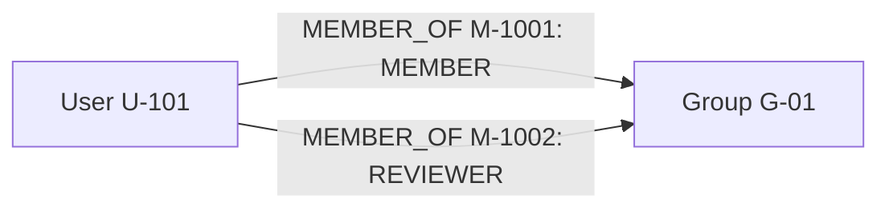

# Cập nhật thuộc tính relationship mà giữ đúng định danh

Trong Neo4j, relationship là một phần tử riêng của đồ thị. Nó có điểm đầu, điểm cuối, type và có thể có nhiều property mô tả chính mối liên kết đó. Khi cập nhật một property như `role`, `status` hoặc `joinedAt`, ứng dụng thường muốn thay đổi đúng relationship hiện có, giữ nguyên hai node đầu cuối và các property còn lại.

Spring Data Neo4j (SDN) hỗ trợ ánh xạ relationship có property bằng `@RelationshipProperties`, `@TargetNode` và `@RelationshipId`. Hiểu vai trò của định danh relationship giúp tránh vô tình xóa rồi tạo lại liên kết, cập nhật nhầm một trong nhiều relationship song song hoặc làm mất dữ liệu đi kèm relationship.

## 1. Relationship có định danh riêng với hai node đầu cuối

Một relationship được xác định trong graph bởi node nguồn, node đích và relationship type, nhưng Neo4j vẫn cho phép nhiều relationship cùng type nối cùng một cặp node. Mỗi relationship có thể mang bộ property riêng.

Ví dụ, một người dùng có thể tham gia cùng một nhóm với các vai trò khác nhau theo từng chương trình thành viên:

```cypher
CREATE (u:User {userId: 'U-101', name: 'Lan'})
CREATE (g:Group {groupId: 'G-01', name: 'Platform'})
CREATE (u)-[:MEMBER_OF {
    membershipKey: 'M-1001',
    role: 'MEMBER',
    joinedAt: date('2025-01-15')
}]->(g)
CREATE (u)-[:MEMBER_OF {
    membershipKey: 'M-1002',
    role: 'REVIEWER',
    joinedAt: date('2025-03-01')
}]->(g);
```

Hai relationship `MEMBER_OF` có cùng node nguồn, node đích và type, nhưng là hai liên kết khác nhau. Property `membershipKey` là khóa nghiệp vụ do ứng dụng định nghĩa để phân biệt từng lần tham gia. Nếu chỉ tìm theo `User`, `Group` và type, truy vấn sẽ khớp cả hai relationship.



Khi cần cập nhật một relationship cụ thể, phải xác định đúng relationship đó. Việc chỉ xác định được hai node đầu cuối chưa chắc đã đủ.

## 2. Ánh xạ relationship properties trong SDN

SDN dùng `@RelationshipProperties` để ánh xạ các property của relationship thành một lớp Java. `@TargetNode` chỉ node ở đầu kia của liên kết; `@RelationshipId` giữ định danh kỹ thuật mà SDN dùng để nhận diện relationship đã được nạp.

```java
import java.time.LocalDate;

import org.springframework.data.neo4j.core.schema.RelationshipId;
import org.springframework.data.neo4j.core.schema.RelationshipProperties;
import org.springframework.data.neo4j.core.schema.TargetNode;

@RelationshipProperties
public class Membership {

    @RelationshipId
    private Long id;

    private String membershipKey;
    private String role;
    private LocalDate joinedAt;

    @TargetNode
    private Group group;

    protected Membership() {
    }

    public Membership(String membershipKey, String role,
                      LocalDate joinedAt, Group group) {
        this.membershipKey = membershipKey;
        this.role = role;
        this.joinedAt = joinedAt;
        this.group = group;
    }

    public String getMembershipKey() {
        return membershipKey;
    }

    public String getRole() {
        return role;
    }

    public void changeRole(String role) {
        this.role = role;
    }
}
```

Entity `User` khai báo collection các relationship properties:

```java
import java.util.ArrayList;
import java.util.List;

import org.springframework.data.annotation.Id;
import org.springframework.data.neo4j.core.schema.Node;
import org.springframework.data.neo4j.core.schema.Relationship;
import org.springframework.data.neo4j.core.schema.Direction;

@Node("User")
public class User {

    @Id
    private String userId;

    private String name;

    @Relationship(type = "MEMBER_OF", direction = Direction.OUTGOING)
    private List<Membership> memberships = new ArrayList<>();

    protected User() {
    }

    public Membership findMembership(String membershipKey) {
        return memberships.stream()
                .filter(m -> m.getMembershipKey().equals(membershipKey))
                .findFirst()
                .orElseThrow(() -> new IllegalArgumentException("Membership not found"));
    }

    public void changeMembershipRole(String membershipKey, String newRole) {
        findMembership(membershipKey).changeRole(newRole);
    }
}
```

Các annotation có vai trò riêng:

- `@RelationshipProperties` đánh dấu lớp mô tả relationship có property.
- `@RelationshipId` giữ định danh kỹ thuật của relationship để SDN nhận biết liên kết đã được nạp.
- `@TargetNode` tham chiếu entity ở đầu kia của relationship.
- `@Relationship` trên entity root khai báo relationship type và hướng duyệt.
- `membershipKey` là khóa nghiệp vụ do ứng dụng quản lý; nó khác với `id` kỹ thuật của SDN.

Không tự gán `id` được đánh dấu `@RelationshipId` như thể đó là mã nghiệp vụ. SDN quản lý giá trị này khi đọc và ghi relationship. Với các phiên bản SDN/Neo4j hiện đại, internal relationship id là chi tiết kỹ thuật; không dùng nó làm định danh bền vững cho API hoặc dữ liệu nghiệp vụ. Nếu cần tham chiếu lâu dài, hãy dùng property khóa nghiệp vụ như `membershipKey`.

## 3. Vì sao phải giữ đúng định danh relationship?

Giả sử một `User` đã có relationship `MEMBER_OF` với `Group`, kèm `membershipKey`, `joinedAt`, `role` và một số property khác. Khi chỉ đổi `role`, mục tiêu là cập nhật đúng relationship hiện tại.

Nếu entity được nạp từ graph, wrapper `Membership` mang theo `@RelationshipId`. Khi thay đổi property trên chính wrapper đó rồi lưu entity root, SDN có thể nhận diện relationship đã tồn tại và đồng bộ thay đổi lên đúng relationship.

```java
user.changeMembershipRole("M-1001", "ADMIN");
userRepository.save(user);
```

Trong thao tác này, cần giữ lại instance relationship đã được nạp và các dữ liệu cần thiết của aggregate. Tránh thay toàn bộ collection bằng các wrapper mới không có định danh kỹ thuật nếu ý định chỉ là sửa property. Một wrapper mới có thể được xem như một relationship mới; tùy trạng thái collection và mapping, các relationship cũ không còn trong graph object có thể bị loại bỏ khi đồng bộ.

Điều này đặc biệt quan trọng khi có nhiều relationship cùng type nối cùng hai node. Node đích `Group G-01` không đủ để phân biệt `M-1001` với `M-1002`; khóa nghiệp vụ hoặc định danh relationship đã được SDN nạp giúp xác định đúng liên kết.

## 4. Cập nhật property bằng Cypher mà giữ nguyên relationship

Cypher dùng `SET` để thay đổi property trên relationship đang được khớp. Nếu chỉ cần sửa `role`, không cần xóa và tạo relationship mới:

```cypher
MATCH (u:User {userId: $userId})
      -[r:MEMBER_OF {membershipKey: $membershipKey}]->
      (g:Group)
SET r.role = $newRole,
    r.updatedAt = datetime()
RETURN r.membershipKey AS membershipKey,
       r.role AS role,
       r.joinedAt AS joinedAt,
       r.updatedAt AS updatedAt;
```

`MATCH` xác định relationship bằng node nguồn, type, khóa nghiệp vụ và node đích. `SET` thay đổi hai property được chỉ định; các property khác như `joinedAt` và `membershipKey` vẫn được giữ nguyên. Vì câu lệnh không dùng `DELETE` hoặc tạo relationship mới, nó cập nhật đúng relationship đã khớp.

Nếu khóa nghiệp vụ chỉ duy nhất trong phạm vi một user, điều kiện kết hợp `userId` và `membershipKey` là đủ theo quy ước đó. Nếu khóa chỉ duy nhất trong phạm vi một cặp user/group, hãy bổ sung điều kiện node đích. Thiết kế phạm vi khóa nhất quán và kiểm tra số lượng relationship khớp trước khi cập nhật trong các thao tác quản trị quan trọng.

### Tránh cập nhật nhiều relationship ngoài ý muốn

Truy vấn sau quá rộng nếu có nhiều relationship `MEMBER_OF` giữa cùng hai node:

```cypher
MATCH (u:User {userId: $userId})-[r:MEMBER_OF]->(g:Group {groupId: $groupId})
SET r.role = $newRole;
```

Truy vấn này cập nhật mọi relationship cùng type nối cặp node đã chọn. Nếu chỉ muốn cập nhật một lần tham gia, hãy thêm `membershipKey` hoặc tiêu chí nhận diện nghiệp vụ tương đương:

```cypher
MATCH (u:User {userId: $userId})
      -[r:MEMBER_OF {membershipKey: $membershipKey}]->
      (g:Group {groupId: $groupId})
SET r.role = $newRole;
```

Không nên dùng `LIMIT 1` để che đi việc điều kiện `MATCH` chưa đủ cụ thể. Nếu có nhiều kết quả, chọn một kết quả tùy ý có thể cập nhật nhầm relationship.

## 5. Cập nhật qua entity đã nạp trong Spring Data Neo4j

Khi thao tác thuộc mô hình domain, có thể nạp entity root cùng các relationship cần thiết, thay đổi property trên relationship object và lưu root trong transaction.

```java
import org.springframework.data.neo4j.repository.Neo4jRepository;

public interface UserRepository extends Neo4jRepository<User, String> {
}
```

Service tìm đúng wrapper bằng khóa nghiệp vụ và thay đổi thuộc tính:

```java
import org.springframework.stereotype.Service;
import org.springframework.transaction.annotation.Transactional;

@Service
public class MembershipService {

    private final UserRepository users;

    public MembershipService(UserRepository users) {
        this.users = users;
    }

    @Transactional
    public void changeRole(String userId, String membershipKey, String newRole) {
        User user = users.findById(userId)
                .orElseThrow(() -> new IllegalArgumentException("User not found"));

        user.changeMembershipRole(membershipKey, newRole);
        users.save(user);
    }
}
```

Ví dụ giả định repository load được collection `memberships` cần thay đổi. Hãy kiểm tra độ sâu và graph mapping thực tế của truy vấn nạp entity trong phiên bản SDN đang dùng. Nếu relationship không được nạp, không thể tìm wrapper hiện có để cập nhật. Khi aggregate lớn, có thể dùng custom query hoặc phương thức đọc riêng để nạp đúng các relationship cần thiết.

`@Transactional` giúp các thao tác đọc và ghi trong use case được thực hiện trong cùng transaction Neo4j khi transaction manager đã được cấu hình. Không trộn một entity cũ trong bộ nhớ với thay đổi relationship được cập nhật trực tiếp bằng Cypher rồi tiếp tục lưu entity đó mà chưa đồng bộ lại trạng thái.

## 6. Cập nhật bằng Neo4jClient

Với thao tác cập nhật tập trung vào một relationship cụ thể, `Neo4jClient` cho phép thực hiện Cypher có tham số mà không cần nạp toàn bộ object graph:

```java
import org.springframework.data.neo4j.core.Neo4jClient;
import org.springframework.stereotype.Repository;
import org.springframework.transaction.annotation.Transactional;

@Repository
public class MembershipWriter {

    private final Neo4jClient neo4jClient;

    public MembershipWriter(Neo4jClient neo4jClient) {
        this.neo4jClient = neo4jClient;
    }

    @Transactional
    public long changeRole(String userId, String membershipKey, String newRole) {
        return neo4jClient.query("""
                MATCH (u:User {userId: $userId})
                      -[r:MEMBER_OF {membershipKey: $membershipKey}]->
                      (:Group)
                SET r.role = $newRole,
                    r.updatedAt = datetime()
                RETURN count(r) AS updatedCount
                """)
                .bind(userId).to("userId")
                .bind(membershipKey).to("membershipKey")
                .bind(newRole).to("newRole")
                .fetchAs(Long.class)
                .mappedBy((typeSystem, record) -> record.get("updatedCount").asLong())
                .one()
                .orElse(0L);
    }
}
```

Giá trị trả về cho biết số relationship được khớp. Với quy tắc một `membershipKey` chỉ xuất hiện một lần trong phạm vi user, kết quả mong đợi là `1`; `0` nghĩa là không tìm thấy liên kết phù hợp. Nếu kết quả lớn hơn `1`, cần xem lại phạm vi khóa và dữ liệu. Nếu cần phân biệt không tìm thấy với dữ liệu bị trùng, có thể kiểm tra count và phát sinh lỗi nghiệp vụ thay vì chỉ trả về số lượng.

`SET` cập nhật property trên relationship hiện có. Cách này phù hợp cho thao tác cập nhật hẹp, nhưng nếu domain có invariant phức tạp liên quan đến nhiều field hoặc nhiều relationship, hãy đặt kiểm tra nghiệp vụ ở service/domain layer trước khi chạy câu lệnh.

## 7. Phân biệt định danh kỹ thuật và khóa nghiệp vụ

Trong ví dụ `Membership`, có hai loại định danh:

| Định danh | Ví dụ | Mục đích |
|---|---|---|
| `@RelationshipId` | `Long id` | Định danh kỹ thuật SDN dùng để nhận diện relationship đã được nạp |
| `membershipKey` | `M-1001` | Khóa nghiệp vụ dùng để tìm, tham chiếu và trao đổi dữ liệu relationship |

Không dùng internal ID như mã nghiệp vụ vì nó phụ thuộc vào cơ chế lưu trữ và không phải hợp đồng định danh lâu dài của domain. Không tự tạo giá trị cho `@RelationshipId`. Nếu API cần một mã quan hệ ổn định, hãy lưu property riêng như `membershipKey` và xác định quy tắc duy nhất của nó.

Neo4j có hàm `elementId()` để lấy định danh phần tử trong database. Giá trị này hữu ích trong một số thao tác kỹ thuật hoặc chẩn đoán, nhưng không nên lưu làm khóa nghiệp vụ lâu dài hoặc dùng làm định danh công khai. Hãy ưu tiên khóa domain được ứng dụng kiểm soát.

## 8. Transaction và cập nhật đồng thời

Khi nhiều request có thể cập nhật cùng relationship, transaction giúp mỗi câu lệnh ghi có tính nguyên tử. Tuy nhiên, transaction không tự giải quyết xung đột nghiệp vụ giữa hai request cùng đọc một giá trị cũ rồi ghi đè lẫn nhau.

Một số cách kiểm soát:

1. Giới hạn cập nhật bằng khóa relationship cụ thể, không match rộng theo hai node.
2. Đọc trạng thái hiện tại trong transaction nếu quy tắc mới phụ thuộc vào trạng thái cũ.
3. Dùng điều kiện cập nhật có kiểm tra phiên bản hoặc giá trị hiện tại nếu cần optimistic concurrency.
4. Kiểm tra số relationship được cập nhật và xử lý trường hợp không tìm thấy hoặc nhiều hơn một kết quả.
5. Tránh thay toàn bộ collection relationship nếu use case chỉ sửa một property trên một liên kết.

Ví dụ cập nhật có điều kiện theo trạng thái hiện tại:

```cypher
MATCH (u:User {userId: $userId})
      -[r:MEMBER_OF {membershipKey: $membershipKey, role: 'MEMBER'}]->
      (:Group)
SET r.role = 'ADMIN'
RETURN count(r) AS updatedCount;
```

Điều kiện `role: 'MEMBER'` khiến truy vấn chỉ chuyển role nếu giá trị hiện tại còn là `MEMBER`. Nếu một request khác đã thay đổi role trước đó, truy vấn không cập nhật relationship. Ứng dụng cần diễn giải kết quả `0` như một xung đột hoặc trạng thái không còn phù hợp, tùy quy tắc use case.

## 9. Những lỗi thường gặp

| Lỗi | Hệ quả | Cách xử lý |
|---|---|---|
| Chỉ match theo hai node và relationship type | Cập nhật nhiều relationship song song | Thêm khóa nghiệp vụ hoặc điều kiện phân biệt rõ ràng |
| Tạo wrapper mới khi chỉ muốn sửa property | SDN có thể xem đó là relationship mới hoặc đồng bộ collection khác với mong muốn | Cập nhật wrapper đã nạp, giữ `@RelationshipId` do SDN quản lý |
| Tự gán `@RelationshipId` | Can thiệp vào định danh kỹ thuật của persistence mapping | Để SDN quản lý internal relationship id |
| Dùng internal ID làm mã nghiệp vụ | Liên kết API/domain với chi tiết lưu trữ | Tạo property khóa nghiệp vụ ổn định |
| Xóa rồi tạo relationship mới để đổi một property | Có thể mất property khác, thay đổi identity và phát sinh tác dụng phụ | Dùng `SET r.property = ...` |
| Dùng `LIMIT 1` cho pattern mơ hồ | Có thể cập nhật một liên kết bất kỳ | Làm điều kiện `MATCH` đủ cụ thể và kiểm tra số kết quả |
| Cập nhật Cypher rồi lưu object graph cũ | Trạng thái entity trong bộ nhớ có thể ghi đè thay đổi vừa thực hiện | Tải lại entity hoặc tách rõ đường ghi trong transaction |
| Bỏ qua cập nhật đồng thời | Request sau có thể ghi đè quyết định mới hơn | Dùng điều kiện trạng thái/phiên bản và xử lý kết quả cập nhật |

## 10. Bài tập thực hành

Tạo user, group và hai relationship song song:

```cypher
CREATE (u:User {userId: 'U-201', name: 'Minh'})
CREATE (g:Group {groupId: 'G-10', name: 'Engineering'})
CREATE (u)-[:MEMBER_OF {
    membershipKey: 'M-201', role: 'MEMBER', joinedAt: date('2025-02-01')
}]->(g)
CREATE (u)-[:MEMBER_OF {
    membershipKey: 'M-202', role: 'REVIEWER', joinedAt: date('2025-04-01')
}]->(g);
```

Thực hiện các yêu cầu:

1. Viết lớp `Membership` với `@RelationshipProperties`, `@RelationshipId`, `@TargetNode`, `membershipKey`, `role` và `joinedAt`.
2. Viết entity `User` với collection `List<Membership>` được đánh dấu `@Relationship`.
3. Nạp user, thay đổi role của `M-201` thành `ADMIN` trên wrapper hiện có và lưu user.
4. Truy vấn lại graph để xác nhận `M-201` đổi role còn `M-202` vẫn giữ nguyên.
5. Dùng `Neo4jClient` cập nhật `M-202` và kiểm tra số relationship được cập nhật.
6. Thử bỏ `membershipKey` khỏi điều kiện `MATCH` để quan sát vì sao hai relationship có thể cùng bị cập nhật.
7. Thử điều kiện cập nhật theo role hiện tại và giải thích trường hợp trả về `updatedCount = 0`.

Sau bài tập, cần giải thích được vì sao hai relationship có cùng endpoints vẫn là hai liên kết riêng, vai trò của `@RelationshipId` trong SDN và vì sao khóa nghiệp vụ giúp chọn đúng relationship trong Cypher.

## Kết luận

Muốn cập nhật property mà giữ đúng relationship, hãy xác định chính xác liên kết cần sửa và dùng `SET` trên relationship hiện có hoặc thay đổi wrapper đã được SDN nạp. `@RelationshipId` giúp SDN nhận diện relationship về mặt kỹ thuật; khóa nghiệp vụ như `membershipKey` giúp ứng dụng định vị liên kết ổn định. Tránh tạo wrapper mới hoặc xóa rồi tạo lại relationship khi chỉ cần thay đổi một property. Kết hợp transaction, điều kiện match đủ cụ thể và kiểm tra số kết quả để bảo vệ dữ liệu khi có nhiều relationship song song hoặc cập nhật đồng thời.
