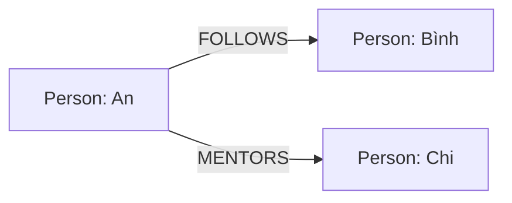

# Quan hệ động bằng Map với khóa String hoặc enum

Trong Neo4j, loại relationship là một phần của cấu trúc đồ thị. Một node `Person` có thể liên kết với các node khác qua nhiều loại cạnh như `FOLLOWS`, `MENTORS` hoặc `BLOCKS`. Khi tập loại quan hệ cần ánh xạ được xác định trong lúc chạy, Spring Data Neo4j hỗ trợ mô hình hóa chúng bằng `Map` có khóa `String` hoặc `enum`.

Với `SPRING_DATA_NEO4J`, dynamic relationship map cho phép một thuộc tính Java đại diện nhiều loại relationship cùng nối đến một kiểu node đích đã biết. Khóa của map chính là loại relationship trong Neo4j; giá trị là entity ở đầu còn lại. Cách này hữu ích khi một loại node có nhiều vai trò liên kết khác nhau, nhưng cần hiểu rõ giới hạn của map, hướng cạnh và cách chọn kiểu khóa để tránh biến dữ liệu đầu vào thành cấu trúc schema không kiểm soát.

## 1. Dynamic relationship là gì?

Với relationship tĩnh, loại cạnh được khai báo cố định trong `@Relationship`:

```java
@Relationship(type = "FOLLOWS")
private Set<Person> following;
```

Mọi phần tử trong collection trên đều được nối bằng relationship type `FOLLOWS`.

Với dynamic relationship, loại cạnh được quyết định bởi từng khóa của `Map`:

```java
@Relationship
private Map<String, Person> relations;
```

Ví dụ map có các entry:

| Key của Map | Value | Relationship được biểu diễn |
|---|---|---|
| `FOLLOWS` | `Person` có tên Bình | `(source)-[:FOLLOWS]->(Bình)` |
| `MENTORS` | `Person` có tên Chi | `(source)-[:MENTORS]->(Chi)` |
| `BLOCKS` | `Person` có tên Dũng | `(source)-[:BLOCKS]->(Dũng)` |

Spring Data Neo4j hỗ trợ hai dạng dynamic relationship map:

- `Map<String, AnnotatedDomainClass>`: khóa chuỗi xác định relationship type.
- `Map<Enum, AnnotatedDomainClass>`: khóa enum xác định relationship type.

Trong cả hai trường hợp, kiểu value là một domain class được ánh xạ thành node. Map không lưu các cặp key-value như property của node; nó mô tả những relationship nối node.

## 2. Ánh xạ bằng khóa String

Khai báo một entity `Person` có thể liên kết với một `Person` khác bằng nhiều loại relationship:

```java
import org.springframework.data.neo4j.core.schema.GeneratedValue;
import org.springframework.data.neo4j.core.schema.Id;
import org.springframework.data.neo4j.core.schema.Node;
import org.springframework.data.neo4j.core.schema.Relationship;

import java.util.HashMap;
import java.util.Map;
import java.util.Set;

@Node("Person")
public class Person {

    private static final Set<String> ALLOWED_RELATION_TYPES =
        Set.of("FOLLOWS", "MENTORS", "BLOCKS");

    @Id
    @GeneratedValue
    private Long id;

    private String name;

    @Relationship(direction = Relationship.Direction.OUTGOING)
    private Map<String, Person> relations = new HashMap<>();

    public Person(String name) {
        this.name = name;
    }

    public void addRelation(String type, Person target) {
        if (type == null || !ALLOWED_RELATION_TYPES.contains(type)) {
            throw new IllegalArgumentException("Unsupported relationship type: " + type);
        }
        if (target == null) {
            throw new IllegalArgumentException("Target person is required");
        }
        relations.put(type, target);
    }

    public Long getId() {
        return id;
    }

    public String getName() {
        return name;
    }

    public Map<String, Person> getRelations() {
        return relations;
    }
}
```

Repository dùng trong ví dụ:

```java
import org.springframework.data.neo4j.repository.Neo4jRepository;

public interface PersonRepository extends Neo4jRepository<Person, Long> {
}
```

Điểm cần chú ý:

- `Person` là node entity vì được đánh dấu `@Node`.
- `relations` là relationship map vì trường được đánh dấu `@Relationship` và value là `Person`.
- `@Relationship` không khai báo `type`. Relationship type được lấy từ key của từng entry trong map.
- `direction = OUTGOING` mô tả cạnh đi từ `Person` hiện tại đến `Person` được lưu làm value. Đây cũng là hướng mặc định của Spring Data Neo4j nếu không ghi rõ.
- `@Id @GeneratedValue` cung cấp định danh persistence cho node; nó không liên quan đến key của map hay tên relationship.

Không khai báo `@Relationship(type = "RELATED")` cho dynamic map. Nếu gán một type cố định vào annotation, cấu hình đó mâu thuẫn với mục đích lấy type từ key. Có thể cấu hình `direction`, còn relationship type phải do map quyết định.

### Tạo dữ liệu bằng map

```java
Person an = new Person("An");
Person binh = new Person("Bình");
Person chi = new Person("Chi");

an.addRelation("FOLLOWS", binh);
an.addRelation("MENTORS", chi);

Person saved = personRepository.save(an);
```

Khi lưu entity gốc qua repository, Spring Data Neo4j sử dụng map để tạo các relationship có type tương ứng. Nếu các node đích chưa được lưu và có định danh phù hợp cho trạng thái mới, chúng cũng nằm trong graph được lưu theo quy tắc mapping của framework.

Đồ thị tương ứng về mặt ý nghĩa:



Ví dụ Cypher tương đương để hình dung cấu trúc đồ thị:

```cypher
CREATE (an:Person {name: 'An'})
CREATE (binh:Person {name: 'Bình'})
CREATE (chi:Person {name: 'Chi'})
CREATE (an)-[:FOLLOWS]->(binh)
CREATE (an)-[:MENTORS]->(chi);
```

Đây là hình dạng dữ liệu mà map mô tả; câu Cypher cụ thể do Spring Data Neo4j phát ra có thể khác tùy trạng thái entity và phiên bản framework.

## 3. Ánh xạ bằng khóa enum

Nếu ứng dụng chỉ cho phép một tập relationship type đã biết, enum giúp giới hạn giá trị khóa ngay trong mã nguồn. Điều này giảm lỗi chính tả và làm rõ các loại liên kết hợp lệ.

```java
public enum PersonRelationType {
    FOLLOWS,
    MENTORS,
    BLOCKS
}
```

Entity sử dụng enum làm khóa:

```java
import org.springframework.data.neo4j.core.schema.Relationship;

import java.util.EnumMap;
import java.util.Map;

// Đặt các trường này bên trong node entity Person.
@Relationship(direction = Relationship.Direction.OUTGOING)
private Map<PersonRelationType, Person> relations =
    new EnumMap<>(PersonRelationType.class);
```

Thêm liên kết:

```java
person.getRelations().put(PersonRelationType.FOLLOWS, followedPerson);
person.getRelations().put(PersonRelationType.MENTORS, menteeOrMentor);
```

`EnumMap` là lựa chọn phù hợp khi toàn bộ khóa thuộc một enum: map chỉ nhận các hằng số của enum đó và không chấp nhận khóa `null`. Spring Data Neo4j hỗ trợ enum làm khóa dynamic relationship map. Hãy xem tên hằng enum là một phần của quy ước schema; đổi tên hằng có thể làm thay đổi loại relationship được ánh xạ, vì vậy cần phối hợp thay đổi mã với migration dữ liệu nếu graph đã tồn tại.

### Chọn String hay enum?

| Tiêu chí | `Map<String, Person>` | `Map<PersonRelationType, Person>` |
|---|---|---|
| Tập relationship type | Có thể thay đổi theo cấu hình hoặc dữ liệu đầu vào | Được giới hạn bởi các enum constant |
| Kiểm tra hợp lệ | Ứng dụng phải xác thực chuỗi | Compiler giúp giới hạn giá trị khóa |
| Tính linh hoạt | Cao hơn | Phù hợp với schema có danh sách type đã biết |
| Rủi ro đổi tên | Thay chuỗi key có thể làm thay đổi type được ghi | Đổi tên enum constant cũng có thể làm thay đổi type |
| Cách khởi tạo | `HashMap` hoặc implementation phù hợp | Thường dùng `EnumMap` |

Chọn `String` khi các relationship type được quản lý bằng cấu hình hoặc danh sách mở có kiểm soát. Chọn enum khi danh sách type thuộc domain cố định và cần compiler hỗ trợ kiểm tra.

## 4. Đọc và kiểm tra dynamic relationships bằng Cypher

Khi cần kiểm tra các loại relationship thực tế của một node, có thể dùng `type(r)`:

```cypher
MATCH (p:Person {name: $name})-[r]->(target:Person)
RETURN type(r) AS relationshipType,
       target.name AS targetName
ORDER BY relationshipType;
```

Kết quả cho biết mỗi relationship type và node đích. Đây cũng là cách kiểm tra các key mà dynamic map cần biểu diễn sau khi đọc graph.

Muốn xem riêng một loại quan hệ đã biết:

```cypher
MATCH (p:Person {name: $name})-[:FOLLOWS]->(target:Person)
RETURN target;
```

Hoặc kiểm tra toàn bộ relationship outgoing của node:

```cypher
MATCH (p:Person {name: $name})-[r]->(target)
RETURN p, r, target;
```

Nếu truy vấn tùy chỉnh được khai báo qua `@Query`, cần trả về đủ node và relationship mà kiểu entity cần ánh xạ. Nếu chỉ trả về một scalar như `type(r)` hoặc `target.name`, hãy khai báo kiểu trả về là projection/DTO phù hợp thay vì kỳ vọng framework dựng đầy đủ dynamic map từ một cột scalar.

## 5. Hướng relationship và ý nghĩa của map

Mặc định, relationship trong Spring Data Neo4j là `OUTGOING`. Khi khai báo:

```java
@Relationship(direction = Relationship.Direction.OUTGOING)
private Map<String, Person> relations;
```

map thuộc về node nguồn. Mỗi entry mô tả một cạnh đi từ node đang chứa map đến node value.

Nếu dùng `INCOMING`:

```java
@Relationship(direction = Relationship.Direction.INCOMING)
private Map<String, Person> incomingRelations;
```

map mô tả các cạnh đi từ node value vào node hiện tại. Ví dụ, nếu `An` có cạnh `(An)-[:FOLLOWS]->(Bình)`, thì ở góc nhìn của `Bình`, đó là một relationship incoming từ `An`.

Không nên khai báo cùng một quan hệ động ở cả hai đầu node chỉ vì muốn truy cập thuận tiện. Spring Data Neo4j phân tích graph được mô hình hóa để tạo truy vấn; các mapping hai chiều hoặc tự tham chiếu có thể mở rộng phạm vi graph cần tải. Hãy xác định aggregate root và hướng sở hữu quan hệ theo use case, sau đó dùng projection hoặc truy vấn chuyên biệt nếu chỉ cần một phần dữ liệu.

## 6. Giới hạn của Map dynamic relationships

Dynamic relationship map có hình dạng được tài liệu Spring Data Neo4j mô tả là `Map<String, AnnotatedDomainClass>` hoặc `Map<Enum, AnnotatedDomainClass>`. Điều đó dẫn đến một số giới hạn thiết kế:

1. **Value là một domain class đích đã biết.** Map key thay đổi relationship type; nó không làm kiểu node đích trở thành động.
2. **Một key chỉ xuất hiện một lần trong Map.** Vì vậy, map không thể biểu diễn nhiều target node riêng biệt dưới cùng một relationship type bằng nhiều entry trùng key.
3. **Không dùng map này để lưu property tùy ý.** `Map<String, Object>` không phải dynamic relationship map vì value không phải node entity.
4. **Không cấu hình type cố định trên `@Relationship`.** Key đã là nguồn cung cấp relationship type.
5. **Cần kiểm soát số lượng loại quan hệ.** Một map chứa nhiều type không có giới hạn nghiệp vụ có thể khiến mô hình khó đọc, truy vấn khó dự đoán và dữ liệu khó quản trị.

Nếu cần nhiều node đích cùng một relationship type, dùng collection với type cố định:

```java
@Relationship(type = "FOLLOWS", direction = Relationship.Direction.OUTGOING)
private Set<Person> following = new HashSet<>();
```

Nếu cần nhiều loại relationship và mỗi loại có nhiều node đích, hãy cân nhắc nhiều trường relationship tĩnh, một mô hình node trung gian hoặc một thiết kế domain khác có thể truy vấn và quản lý rõ ràng. Không tự giả định `Map<String, Set<Person>>` hoặc `Map<String, List<Person>>` được hỗ trợ như dynamic relationship map; dạng được tài liệu mô tả là map từ key String/enum đến một domain class.

### Dynamic relationship map khác Map property

Không nhầm hai kiểu Map sau:

| Mục đích | Khai báo minh họa | Ý nghĩa |
|---|---|---|
| Dynamic relationships | `@Relationship Map<String, Person> relations` | Key là relationship type, value là node đích |
| Composite properties | `@CompositeProperty Map<String, Object> attributes` | Key/value được ánh xạ thành các property của node theo quy tắc composite mapping |

Một map có value là `Person` entity không được lưu như property map; một map chứa các giá trị đơn không tự tạo relationship. Annotation và kiểu value quyết định cách Spring Data Neo4j ánh xạ.

## 7. Relationship có thuộc tính riêng thì sao?

Dynamic relationship map ở trên biểu diễn loại cạnh và node đích. Nếu mỗi cạnh còn có property như `since`, `score`, `role` hoặc `createdAt`, cần mô hình hóa relationship properties bằng `@RelationshipProperties` và `@TargetNode`:

```java
import org.springframework.data.neo4j.core.schema.RelationshipId;
import org.springframework.data.neo4j.core.schema.RelationshipProperties;
import org.springframework.data.neo4j.core.schema.TargetNode;

import java.time.LocalDate;

@RelationshipProperties
public class FollowDetails {

    @RelationshipId
    private Long id;

    private LocalDate since;

    @TargetNode
    private Person target;
}
```

Và trên node sở hữu quan hệ:

```java
@Relationship(type = "FOLLOWS", direction = Relationship.Direction.OUTGOING)
private Set<FollowDetails> follows = new HashSet<>();
```

Đây là mapping cho relationship type được khai báo cụ thể. Khi cần property riêng cho từng cạnh, không nên cố nhét đối tượng `FollowDetails` vào `Map<String, Person>` vì value của dynamic map là domain class đích, còn relationship properties có cấu trúc và annotation riêng. Nếu type vừa động vừa có nhiều property, hãy cân nhắc dùng Cypher/Neo4jClient cho thao tác chuyên biệt hoặc mô hình hóa loại liên kết thành node nghiệp vụ.

## 8. Quy tắc an toàn và bảo trì schema

- **Dùng danh sách cho phép với String key.** Không lấy trực tiếp chuỗi tùy ý từ request, message hoặc người dùng rồi dùng làm relationship type.
- **Chuẩn hóa tên type.** Dùng tên ổn định, dễ đọc như `FOLLOWS`, `MENTORS`, `BLOCKS`; tránh khoảng trắng và ký tự không cần thiết.
- **Giữ enum ổn định.** Nếu đổi tên enum constant, kiểm tra các relationship type hiện có và chuẩn bị migration tương ứng.
- **Xác định hướng cạnh.** Ghi rõ `OUTGOING` hoặc `INCOMING` nếu hướng đó quan trọng với domain.
- **Kiểm soát graph được tải.** Tránh mô hình hóa mọi relationship ở cả hai phía nếu use case chỉ cần một hướng; cân nhắc projection cho truy vấn đọc.
- **Kiểm tra schema sau khi ghi.** Dùng `type(r)` để xác nhận key map trở thành đúng relationship type.
- **Dùng đúng collection cho cardinality.** Map dynamic phù hợp với một target cho mỗi type key; collection relationship tĩnh phù hợp với nhiều target cùng một type.
- **Quản lý thay đổi type như thay đổi schema.** Đổi key String hoặc enum có thể tạo một loại relationship khác; nếu muốn đổi tên type trong graph, cần cập nhật dữ liệu hiện có.

## 9. Các lỗi thường gặp

| Biểu hiện | Nguyên nhân | Cách xử lý |
|---|---|---|
| Map không được ánh xạ thành relationship | Value không phải domain class được quản lý hoặc thiếu `@Relationship` | Dùng `Map<String, NodeEntity>`/`Map<Enum, NodeEntity>` và khai báo `@Relationship` |
| Mọi cạnh đều có cùng type cố định | Khai báo `type` trong `@Relationship` trên dynamic map | Bỏ `type`; để key của map quyết định relationship type |
| Không thấy relationship khi đọc | Hướng `INCOMING`/`OUTGOING` không khớp với graph | Kiểm tra chiều cạnh bằng Cypher và sửa `direction` |
| Mất một target khi thêm cùng type lần nữa | Map chỉ có một entry cho mỗi key | Dùng collection với type cố định hoặc mô hình hóa node trung gian |
| Có relationship type sai hoặc phát sinh ngoài ý muốn | String key lấy từ dữ liệu không được xác thực | Dùng allow-list hoặc enum cho tập type hợp lệ |
| Đổi enum khiến mapping không khớp dữ liệu cũ | Tên constant thay đổi nhưng relationship type trong graph chưa được migration | Giữ tên constant ổn định hoặc thực hiện migration có kiểm soát |
| Truy vấn đọc kéo quá nhiều node | Dynamic relationship được ánh xạ qua graph tự tham chiếu hoặc mapping hai chiều | Thu hẹp mapping, dùng projection và truy vấn chỉ lấy phần graph cần thiết |
| Dùng `Map<String, Object>` nhưng mong có relationship | Nhầm dynamic relationship map với map property | Dùng value là node entity cho relationship; dùng `@CompositeProperty` cho composite property |

## 10. Tự kiểm tra

1. Trong `Map<String, Person> relations`, phần nào quyết định relationship type được ghi vào Neo4j?
2. Vì sao không khai báo `@Relationship(type = "RELATED")` cho một dynamic relationship map?
3. Khác biệt giữa `Map<String, Person>` và `Map<PersonRelationType, Person>` là gì?
4. Nếu cần nối một người với nhiều người khác bằng cùng type `FOLLOWS`, nên dùng dynamic map hay collection relationship tĩnh?
5. `direction = INCOMING` thay đổi cách diễn giải map như thế nào?
6. Vì sao `Map<String, Object>` không tương đương với dynamic relationship map?
7. Nếu mỗi relationship cần property `since`, nên cân nhắc mapping nào?

Dynamic relationship map hữu ích khi một node cần nhiều loại relationship đến cùng một kiểu entity đích và tập type được quyết định trong lúc chạy. Khóa `String` đem lại sự linh hoạt; khóa enum giúp giới hạn schema bằng mã nguồn. Trong Spring Data Neo4j, hãy để map key xác định relationship type, value giữ node đích, và chọn hướng cùng cardinality theo đúng mô hình nghiệp vụ.

## Tài liệu tham khảo

- [Spring Data Neo4j — Metadata-based Mapping: Connecting nodes with `@Relationship`](https://docs.spring.io/spring-data/neo4j/reference/object-mapping/metadata-based-mapping.html)
- [Spring Data Neo4j — `@Relationship` API](https://docs.spring.io/spring-data/neo4j/docs/current/api/org/springframework/data/neo4j/core/schema/Relationship.html)
